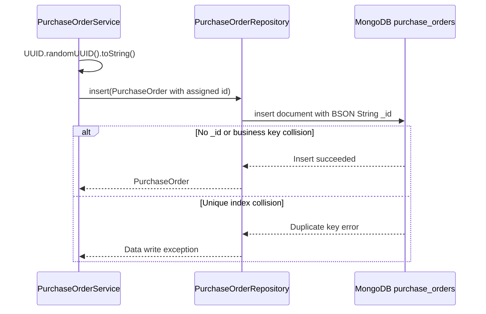

# UUIDs, Business Codes, and Application-Assigned IDs

## 1. The Identification Problem in Spring Data MongoDB

When working with **Spring Data MongoDB**, every document in a MongoDB collection has a special identifier field `_id`. In Java applications, you typically map this field to a property such as `id` and use `MongoRepository<Entity, IdType>` or `MongoTemplate` to save and query documents.

However, `_id` does not have to be an `ObjectId` generated by MongoDB or the driver. An application can **assign its own IDs**, such as UUIDs, string codes, or numbers issued by an ID-allocation service. At the same time, a business entity may have its own **separate code** like `SO-2026-00421` for customer lookups. Three questions must be answered independently:

1. **Which value technically identifies this document?** For example, `_id` is a string UUID.
2. **Which code do users or external systems recognize it by?** For example, order number `SO-2026-00421`.
3. **Who assigns the ID, when, and how are collisions prevented?** MongoDB/the driver can assign an ObjectId; alternatively, the application can generate a UUID before saving.

The goal of this lesson is to design clear entity identification, choose an appropriate UUID representation, write safe repositories when IDs are pre-assigned, enforce uniqueness constraints on business codes, and test with real BSON data.

## 2. `_id`, `@Id`, and Business Keys Are Not Synonymous

In MongoDB:

- Each document has an `_id` field; the `_id` value is unique **within the collection**.
- A collection typically has a default **unique index** on `_id`.
- `_id` can be an `ObjectId`, string, number, UUID encoded as BSON Binary, or another valid type permitted by MongoDB constraints. The actual BSON type is part of the identity.
- If an application inserts a document without providing `_id`, the MongoDB driver typically generates an `ObjectId`. If `_id` is provided, MongoDB uses the supplied value and checks uniqueness within the collection.

In Spring Data MongoDB, the annotation:

```java
import org.springframework.data.annotation.Id;

@Id
private String id;
```

marks a Java property as the identifier and maps it to `_id`. **The Java `String` type does not guarantee `_id` will be stored as BSON String**: under `@Id` conversion rules, a string that looks like a valid ObjectId can be converted into a BSON ObjectId. This distinction is especially important when the application accepts IDs from external sources.

Inside the same order document, you can store both kinds of identifiers:

```javascript
{
  _id: "c971248e-8a88-43f0-94ae-6b8f9e4d1bf7",
  tenant_id: "SHOP-A",
  order_no: "SO-2026-00421",
  status: "CREATED",
  total_minor: NumberLong("350000")
}
```

Here `_id` is an independent technical identifier; the pair `(tenant_id, order_no)` is the **business key** for lookups within a store context. The order number can be displayed to users, while the technical ID can live in internal URLs or system events.

| Aspect | Technical `_id` | Business code, e.g. `order_no` |
| --- | --- | --- |
| Purpose | Uniquely identify the document in the collection | Communicate with users or business systems |
| Uniqueness | Guaranteed by MongoDB within the collection | Scope must be defined: system-wide or per tenant |
| Mutability | Should be immutable; `_id` cannot be updated in place | May need to change if business rules change |
| Format | ObjectId, UUID, string, or valid BSON type | Order number, invoice code, SKU, customer code |
| Lookup | `findById(...)` | Derived query or `MongoTemplate` on the business field |
| Index | Built-in unique index on `_id` | Requires a separate index for fast lookup/uniqueness enforcement |

**Foundational rule:** never use a business code as `_id` just because both happen to be "unique" today. Check whether that code can change, be reused, vary across tenants, or depend on a numbering workflow.

## 3. ID Options and Trade-Offs

| Option | BSON Example | Who Assigns It? | Best When | Key Considerations |
| --- | --- | --- | --- | --- |
| ObjectId | `ObjectId("507f1f77bcf86cd799439011")` | Usually the driver | You need a simple technical ID without managing allocation | Encodes approximate creation time; not a secret or authorization mechanism |
| UUID v4 as String | `"c971248e-8a88-43f0-94ae-6b8f9e4d1bf7"` | Application | You want an ID before saving; easy in JSON/logs | Larger storage footprint than binary; UUID v4 has no time ordering |
| UUID as BSON Binary | BSON Binary subtype 4 | Application | You need compact standard binary UUIDs across systems | Must align `UuidRepresentation` across drivers, tools, and services |
| Business code as `_id` | `"SO-2026-00421"` | Business workflow | Code is immutable and globally unique in the collection | Conflicts easily in multi-tenant setups; changing code means changing identity |
| External system string ID | `"crm-customer-789"` | Source service | Syncing entities with an authoritative external owner | Normalization, namespace collisions, and re-ingestion rules |

In many systems, the most maintainable choice is a **stable technical `_id` + business code in a separate field**. That is a design choice, not a mandatory MongoDB restriction.

### What Are the Characteristics of ObjectId?

`ObjectId` has a 12-byte BSON size and includes a timestamp component; therefore, IDs generated over time tend to increase. However, ObjectId ordering **does not guarantee strict event ordering** across all machines or processes. Do not substitute the timestamp embedded in ObjectId for a business timestamp like `created_at`; nor should ID unpredictability serve as an authorization mechanism.

### What Are the Characteristics of UUID?

`UUID.randomUUID()` in Java generates a random version 4 UUID:

```java
import java.util.UUID;

String generatedId = UUID.randomUUID().toString();
System.out.println(generatedId);
```

The value typically has 36 characters including hyphens. UUID v4 has a negligible collision probability when the random generator works properly, but **that does not mean the database can skip uniqueness constraints**: MongoDB still enforces `_id`. UUID v4 also lacks chronological ordering; write-heavy workloads should measure its impact on index behavior and storage size.

Time-ordered UUID variants, such as UUID v7, can be useful in some systems, though choosing a variant requires standardizing generation, libraries, and comparison rules. The hands-on examples use JDK UUID v4 because it is straightforward and built in.

## 4. UUID as String vs. UUID as BSON Binary

The two documents below **do not share the same BSON identifier type**, even though a human reads them as the same UUID:

```javascript
// Option A: BSON string
{
  _id: "c971248e-8a88-43f0-94ae-6b8f9e4d1bf7",
  status: "CREATED"
}

// Option B: Standard BSON Binary subtype 4 UUID
{
  _id: UUID("c971248e-8a88-43f0-94ae-6b8f9e4d1bf7"),
  status: "CREATED"
}
```

In `mongosh`, `UUID("...")` is a constructor representing a BSON Binary UUID, not a String value. When querying `_id`, both value and **BSON type** must match stored data. A query using a string will not match a document whose `_id` is Binary.

| Criterion | UUID as BSON String | UUID as BSON Binary subtype 4 |
| --- | --- | --- |
| Readability in logs and JSON | Very convenient | Often requires conversion to string for display |
| Storage overhead | Longer string | More compact binary representation |
| Direct interaction in `mongosh` | Use plain string | Use `UUID("...")` or matching binary representation |
| Driver configuration | No binary UUID representation needed if property is always String | Must standardize `UuidRepresentation.STANDARD` |
| Schema-change risk | Easy to spot typos/string normalization issues | Easy to confuse legacy driver subtype 3 with standard subtype 4 |

When using Java `UUID` as a property written as BSON Binary, configure the MongoDB Java Driver's **UUID representation** consistently, typically `UuidRepresentation.STANDARD` (BSON subtype 4). Some legacy systems may have stored UUIDs with legacy byte ordering. Before choosing Binary on a live system, inspect existing data and run round-trip tests with your exact driver/framework version.

The examples in this document choose **UUID v4 as a String** to avoid binary configuration dependencies while keeping ID assignment independent and easy to inspect in `mongosh`.

## 5. Entities With Application-Assigned IDs

To store UUID strings explicitly as BSON String, declare the identifier using `@MongoId(FieldType.STRING)` instead of relying on `@Id`'s `String` conversion rules.

Create the `PurchaseOrder` entity in a Spring Boot application with `spring-boot-starter-data-mongodb` connected to the `orders_demo` database:

```java
package com.example.orders;

import org.springframework.data.mongodb.core.mapping.Document;
import org.springframework.data.mongodb.core.mapping.Field;
import org.springframework.data.mongodb.core.mapping.FieldType;
import org.springframework.data.mongodb.core.mapping.MongoId;

@Document(collection = "purchase_orders")
public class PurchaseOrder {

    @MongoId(FieldType.STRING)
    private String id;

    @Field("tenant_id")
    private String tenantId;

    @Field("order_no")
    private String orderNo;

    private String status;

    protected PurchaseOrder() {
        // For Spring Data document mapping instantiation.
    }

    public PurchaseOrder(String id, String tenantId,
                         String orderNo, String status) {
        this.id = id;
        this.tenantId = tenantId;
        this.orderNo = orderNo;
        this.status = status;
    }

    public String getId() {
        return id;
    }

    public String getTenantId() {
        return tenantId;
    }

    public String getOrderNo() {
        return orderNo;
    }

    public String getStatus() {
        return status;
    }
}
```

Key annotations:

- `@Document(collection = "purchase_orders")` selects the collection storing orders.
- `@MongoId(FieldType.STRING)` marks `id` as the identifier and requests **BSON String** representation in MongoDB, even if the text happens to be 24 hex characters resembling an ObjectId.
- `@Field("tenant_id")` and `@Field("order_no")` rename Java properties when stored. Repositories use Java property names `tenantId` and `orderNo` in query method names.
- `status` is stored under its Java property name unless another mapping rule applies.

`@MongoId` here is imported from `org.springframework.data.mongodb.core.mapping.MongoId`; `FieldType` comes from the same package. It is MongoDB's own identifier annotation, not JPA's `@Id`.

**Why does the constructor accept `id` upfront?** We want to allocate the ID in the application **before saving**, so it can be included in logs, events, or related workflows without waiting for the insert result. Even so, the application must only announce "order created" after the database write succeeds.

## 6. Repository: Creating With `insert` and Looking Up by Business Key

Create `PurchaseOrderRepository`:

```java
package com.example.orders;

import java.util.Optional;
import org.springframework.data.mongodb.repository.MongoRepository;

public interface PurchaseOrderRepository
        extends MongoRepository<PurchaseOrder, String> {

    Optional<PurchaseOrder> findByTenantIdAndOrderNo(
        String tenantId, String orderNo);
}
```

In `MongoRepository<PurchaseOrder, String>`, the `String` parameter matches the type of `PurchaseOrder.id`. `findByTenantIdAndOrderNo` is a derived query using **Java property names**; Spring Data translates `tenantId` to `tenant_id` and `orderNo` to `order_no` according to the entity mapping.

### Assigning an ID and Saving With `insert`

Create a service:

```java
package com.example.orders;

import java.util.Optional;
import java.util.UUID;
import org.springframework.stereotype.Service;

@Service
public class PurchaseOrderService {

    private final PurchaseOrderRepository repository;

    public PurchaseOrderService(PurchaseOrderRepository repository) {
        this.repository = repository;
    }

    public PurchaseOrder create(String tenantId, String orderNo) {
        if (tenantId == null || tenantId.isBlank()
                || orderNo == null || orderNo.isBlank()) {
            throw new IllegalArgumentException(
                "tenantId and orderNo must not be blank");
        }

        String id = UUID.randomUUID().toString();
        PurchaseOrder order =
            new PurchaseOrder(id, tenantId, orderNo, "CREATED");

        return repository.insert(order);
    }

    public Optional<PurchaseOrder> findByBusinessCode(
            String tenantId, String orderNo) {
        return repository.findByTenantIdAndOrderNo(tenantId, orderNo);
    }
}
```

Execution flow:



The example uses `insert` because the intent is **create-only**. If `_id` already exists, insert fails with a duplicate key error instead of accidentally overwriting previous content. In Spring Data, duplicate key errors are typically translated into the data access exception hierarchy, such as `DuplicateKeyException`; business handling for this should be explicitly defined.

### Why Avoid Using `save` by Default for "Create New" Requests?

`save` carries entity-persistence semantics; depending on entity state, mapping, version, and the API invoked, it can perform **replace/update or upsert** by identifier. When the application pre-assigns a non-null ID, never treat `save` as guaranteed to behave like a create-only insert.

| Business Intent | Typically Suitable Choice |
| --- | --- |
| Create a new document, fail if ID already exists | `repository.insert(entity)` |
| Persist entity per repository lifecycle, possibly updating an existing document | `repository.save(entity)` with proper state/version handling |
| Update only when document is in an expected state | `MongoTemplate.updateFirst` or conditional update |
| Prevent overwriting concurrent changes | Pair with `@Version`/optimistic locking or appropriate update predicates |

Never rely on a "check existence then insert" step to enforce uniqueness under concurrent load. Two requests can both observe no existing record before writing simultaneously. **A unique index in MongoDB is the ultimate guard for uniqueness invariants.**

## 7. Business Codes: Designing Uniqueness Scope and Indexes

Suppose Store A and Store B are both allowed to have order `SO-2026-00421`. Then the business rule is:

> Each `(tenant_id, order_no)` pair appears at most once in the `purchase_orders` collection.

Create the compound unique index via `mongosh`:

```javascript
use orders_demo

db.purchase_orders.createIndex(
  { tenant_id: 1, order_no: 1 },
  {
    unique: true,
    name: "purchase_orders_tenant_order_no_unique"
  }
)
```

**Prerequisite before creating the index:** if the collection already contains duplicate pairs, creating the unique index will fail. Inspect and clean legacy data first, including documents with missing fields or null values, according to your system's data rules. Nor does a unique index automatically normalize letter casing or whitespace; if `so-001` and `SO-001` must be treated as the same code, define normalization rules and/or appropriate collation consistently across writes and queries.

Afterward, you can run:

```javascript
db.purchase_orders.findOne({
  tenant_id: "SHOP-A",
  order_no: "SO-2026-00421"
})
```

With the repository, call:

```java
repository.findByTenantIdAndOrderNo(
    "SHOP-A", "SO-2026-00421");
```

The method name uses Java's `tenantId` and `orderNo`; the field names `tenant_id` and `order_no` appear in the index and `mongosh`.

### When Can a Business Code Be Chosen as `_id`?

You might consider it when the business code is **immutable**, **unique across the entire collection**, never requires format changes, and all participating systems share a single issuance scheme. For instance, a reference catalog with standardized, unchanging codes might use that code directly as `_id`. In multi-tenant systems, however, `SO-2026-00421` can repeat across tenants and therefore cannot serve as a collection-wide key; concatenating `tenantId + ":" + orderNo` also requires escaping/normalization rules and complicates code changes.

Therefore, in this example, the business code stays in `order_no`, while a stable UUID serves as `_id`.

## 8. Inspecting Data and Verifying the Actual `_id` Type

Suppose the application configures the URI:

```properties
spring.data.mongodb.uri=mongodb://localhost:27017/orders_demo
```

After the service creates an order, running in `mongosh`:

```javascript
use orders_demo

db.purchase_orders.findOne({
  tenant_id: "SHOP-A",
  order_no: "SO-2026-00421"
})
```

may return a document like:

```javascript
{
  _id: "c971248e-8a88-43f0-94ae-6b8f9e4d1bf7",
  tenant_id: "SHOP-A",
  order_no: "SO-2026-00421",
  status: "CREATED"
}
```

The UUID value here is illustrative; each run generates a different one. Verify the **BSON type** via aggregation:

```javascript
db.purchase_orders.aggregate([
  { $match: { tenant_id: "SHOP-A" } },
  {
    $project: {
      _id: 0,
      order_no: 1,
      idType: { $type: "$_id" }
    }
  },
  { $limit: 5 }
])
```

With `@MongoId(FieldType.STRING)` and a service-generated String UUID, `idType` must be `"string"`. If you observe `"objectId"` or `"binData"`, review the entity, legacy data, and how IDs were generated/saved. For standard Binary UUIDs, `$type` only reports `binData`; distinguishing subtype 4 from legacy subtypes requires checking BSON details or using supporting tools/drivers.

You can list existing indexes:

```javascript
db.purchase_orders.getIndexes()
```

Expected output includes the `_id_` index and `purchase_orders_tenant_order_no_unique` (if the `createIndex` command succeeded).

## 9. Generating Business Codes Is Not Like Generating UUIDs

`UUID.randomUUID()` solves the need for **technical IDs with minimal collision probability that can be allocated distributively**. By contrast, an order number like `SO-2026-00421` may include a year and sequence counter meant for humans. Generating sequential codes introduces different requirements:

- Counter scope: global, per tenant, per year, or per store?
- Are "gaps" in the sequence allowed when transactions fail?
- How do two processes allocating numbers concurrently coordinate?
- Do you need to protect against inferring total order volume from displayed codes?

Never use `count() + 1` to allocate numbers under concurrency; two requests can receive the same number. If a counter is needed, you can use a **counter document** updated atomically with `findOneAndUpdate` and `$inc`, then handle idempotency and failures between allocating the number and saving the order.

*Conceptual* example of a counter by tenant/year:

```javascript
db.counters.findOneAndUpdate(
  { _id: "SHOP-A:2026" },
  { $inc: { next_value: 1 } },
  {
    upsert: true,
    returnDocument: "after"
  }
)
```

This is **not yet a complete code-allocation workflow**: you must define initial values, number formatting, retry logic, failure handling if saving the order fails, and throughput bottlenecks if many requests increment a single counter. When multiple services issue orders, they must also agree on who owns code allocation. The `(tenant_id, order_no)` unique index remains necessary even when codes come from a counter.

## 10. Pre-Assigned IDs, "New" State, and `@Version`

In Spring Data, having `id != null` on an entity does not prove a document exists in the database. With application-assigned IDs, "has an ID" and "has been persisted" are two separate states.

When using standard repositories, **determining whether an entity is new or existing** can rely on the ID, a `@Version` property, or a mechanism like `Persistable.isNew()`, depending on entity type and configuration. This is why calling `save` on entities with pre-assigned IDs must be understood and tested carefully.

### Preventing Lost Updates With Optimistic Locking

If two users edit the same order concurrently, a unique ID **does not prevent lost updates**. For entities needing version control, Spring Data MongoDB supports:

```java
import org.springframework.data.annotation.Version;

@Version
private Long version;
```

This is an additional property you can place on the entity when optimistic locking is required. When configured and used properly, Spring Data checks the version on update; a stale copy can raise an exception such as `OptimisticLockingFailureException` instead of silently overwriting. Detecting conflicts requires an **acknowledged write concern**; the application must decide whether to reload/retry or return a conflict error.

If you only need to transition order status from `CREATED` to `PAID` once, you can use a conditional update on the same document:

```java
import com.mongodb.client.result.UpdateResult;
import org.springframework.data.mongodb.core.MongoTemplate;
import org.springframework.data.mongodb.core.query.Criteria;
import org.springframework.data.mongodb.core.query.Query;
import org.springframework.data.mongodb.core.query.Update;

Query query = Query.query(
    Criteria.where("id").is(orderId)
        .and("status").is("CREATED")
);

UpdateResult result = mongoTemplate.updateFirst(
    query,
    new Update().set("status", "PAID"),
    PurchaseOrder.class
);

boolean transitioned = result.getModifiedCount() == 1;
```

This snippet belongs to a service with `mongoTemplate` and `orderId` (a String UUID). `id` in the criteria is mapped by Spring Data to `_id`. Updating a single document in MongoDB is atomic; if the status is no longer `CREATED`, the query does not modify the document.

**Separating responsibilities:**

- **Unique ID:** prevents two documents in a collection from having the same `_id`.
- **Unique business code:** enforced by a unique index matching the business scope.
- **Version or conditional update:** resolves state conflicts on the *same document*.
- **Transactions or compensation workflows:** may be needed when maintaining invariants across *multiple documents* (for example, creating an order and deducting inventory together).

Reactive access changes the API to `ReactiveMongoRepository`/`ReactiveMongoTemplate` with asynchronous return types, but does not alter identifier rules, unique indexes, or database-level concurrency control.

## 11. Testing, Performance, and Common Pitfalls

For application-assigned IDs, tests must cover **BSON types**, **key collisions**, and **write behavior**. Run integration tests against a real MongoDB instance (for example via Testcontainers) and inspect stored data independently of Java entities.

| Test | What to Verify |
| --- | --- |
| Create order with String UUID | ID exists before `insert`; after saving, `_id` is still BSON String |
| Read by ID | `repository.findById(uuidString)` returns the right document |
| 24-hex-character string ID | `@MongoId(FieldType.STRING)` keeps BSON String instead of coercing to ObjectId |
| Re-insert same `_id` with `insert` | MongoDB reports duplicate key; existing data is not overwritten |
| Same `order_no` within one tenant | Compound unique index blocks the second insert |
| Same `order_no` across two different tenants | Allowed if business rules confirm per-tenant scope |
| Concurrent `CREATED → PAID` transitions | Only one update succeeds thanks to the status predicate |
| Legacy data with ObjectId/Binary IDs | String queries are not assumed compatible; requires a migration strategy |

### Measuring Queries by Business Code

```javascript
db.purchase_orders.find({
  tenant_id: "SHOP-A",
  order_no: "SO-2026-00421"
}).explain("executionStats")
```

Inspect `winningPlan`, `totalKeysExamined`, `totalDocsExamined`, and `nReturned` to evaluate index usage. A unique index also enforces a **data constraint** beyond accelerating queries; do not omit the index merely because test datasets are tiny.

### Real-World Pitfalls

| Symptom | Possible Cause | How to Handle |
| --- | --- | --- |
| `findById` returns nothing despite matching characters | `_id` is ObjectId/Binary while query sends String, or vice versa | Inspect `$type`, `@Id`/`@MongoId` rules, and conversions |
| Pre-assigned ID + `save` creates or overwrites unexpectedly | Misunderstanding new-entity detection | Use `insert` for create-only; use versioning/proper update logic |
| Two orders share the same displayed order number | Only checked existence in Java without a unique index | Create an appropriately scoped index and handle duplicate key errors |
| Unique index creation fails | Existing duplicates or null/missing field violations | Audit and clean data systematically |
| Binary UUID reads differently across apps | Mismatch between standard and legacy representations | Align `UuidRepresentation`, check subtype and byte order |
| Relying on `_id` for authorization | ID is merely an identifier | Always authenticate and check tenant/access permissions |
| Sorting by UUID v4 to order by creation date | UUID v4 is random | Store `created_at` separately and index per query pattern |

**Especially in multi-tenant applications:** `findById(id)` only proves a document with that ID exists. It **does not prove the caller is authorized to view it**. Business queries must scope by tenant and enforce application authorization rules, even when UUIDs are hard to guess.

## 12. Process for Choosing IDs on a New Model

When designing a new MongoDB entity, follow this process:

1. **Define uniqueness boundaries.** `_id` is unique within the collection; business codes may be unique per tenant, store, or accounting period.
2. **Determine where IDs are generated.** If an ID is needed before calling MongoDB, consider application-generated UUIDs. Otherwise, default ObjectId is often sufficient.
3. **Choose the actual BSON type.** For UUIDs, decide between String and Binary subtype 4; apply uniformly across applications and query tools.
4. **Map accurately in Spring Data.** Use `@Id` or `@MongoId` with the matching type, and declare the corresponding repository `ID` generic parameter.
5. **Keep business codes separate if needed.** Design scoped unique indexes; avoid string concatenation without normalization rules.
6. **Choose write APIs matching intent.** `insert` for create-only; `save`/update per lifecycle and actual state; add optimistic locking if needed.
7. **Test BSON data and concurrency.** Verify `_id` types, key conflicts, tenant-scoped queries, and concurrent updates.
8. **Measure and monitor.** Track index usage, read/write latency, code generation throughput, and retry/idempotency behavior under realistic load.

### Knowledge Check

**Question 1.** If `@Id private String id` receives `"507f1f77bcf86cd799439011"`, is MongoDB guaranteed to store `_id` as a BSON String?

**Answer:** No. Spring Data's conversion rules can turn a valid hex string into a BSON ObjectId; when you need to preserve String, use explicit identifier mapping such as `@MongoId(FieldType.STRING)` and verify with `$type`.

**Question 2.** Can application-generated UUID v4 replace a unique index on `(tenant_id, order_no)`?

**Answer:** No. UUID ensures low collision probability for the technical ID; the compound index enforces unique business codes within the same tenant.

**Question 3.** When a user clicks "create order", should you call `save` or `insert` if the requirement is to fail when a document with the same ID already exists?

**Answer:** `insert` fits create-only intent, because a duplicate `_id` raises a duplicate key error instead of overwriting an existing document.

**Question 4.** Can `findById` serve as the entire access-control check in a multi-tenant system?

**Answer:** No. You must enforce authorization and tenant checks separately; identification is neither authentication nor authorization.

**Key takeaway:** `_id` is the document identifier, UUID is one ID-generation strategy, and a business code is a domain rule. When the application assigns IDs in Spring Data MongoDB, enforce the BSON type with the right annotation, choose the proper creation API, add unique indexes for business codes, and test both queries and concurrent updates.
