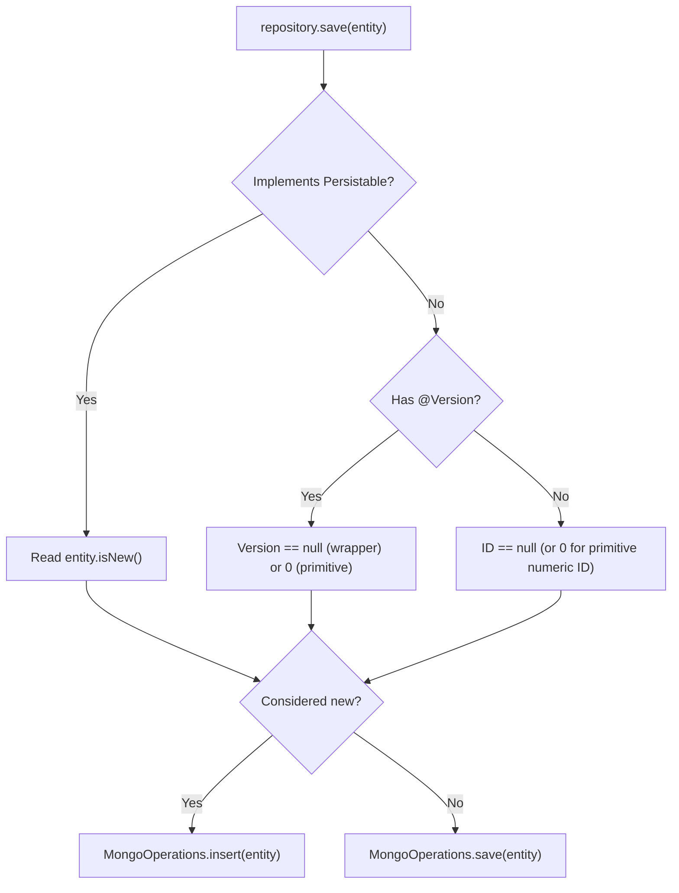
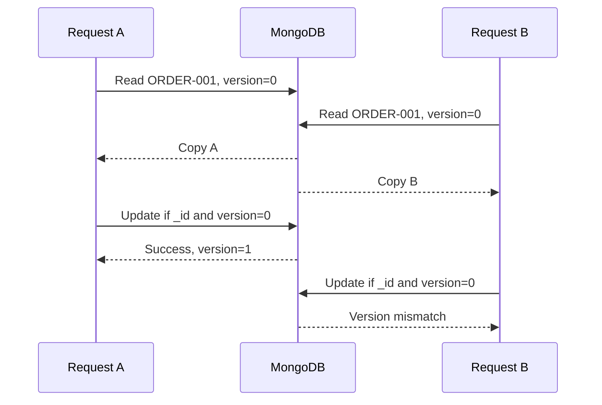

# Detecting New Entities via ID, @Version, or Persistable

> **Chapter:** Identity and State  
> **Scope:** `SPRING_DATA_MONGODB` — using Spring Data MongoDB to connect, map documents, and interact with MongoDB via `MongoTemplate` or repositories. This lesson explains how Spring Data determines whether an entity is **new or existing at the object-state level**, affecting persistence operations, optimistic locking, auditing, and testing. It also forms the foundation for designing safe updates across queries, aggregations, indexes, transactions, and reactive access.

## 1. The Problem: Having an ID Does Not Guarantee the Document Exists

Suppose an import pipeline receives an order with a pre-assigned business code:

```java
Order order = new Order("ORDER-2026-001", "PENDING");
orderRepository.save(order);
```

Here `id` is already non-null, yet MongoDB may **not yet contain** a document with that code. Conversely, an entity just loaded from MongoDB already has an `id` and usually needs to be treated as an existing object when saving edits.

Spring Data needs a mechanism to answer:

> *Should the current entity be considered new (`isNew == true`) when the repository executes a save operation?*

This question differs from running a query against MongoDB to check whether a document physically exists. **New-entity detection is a decision based on object state and metadata**, typically without running `existsById` prior to each `save`.

This matters because `SimpleMongoRepository.save(…)` essentially branches two ways:

```java
// Conceptual illustration, not verbatim library source code.
if (entityInformation.isNew(entity)) {
    return mongoOperations.insert(entity);
}
return mongoOperations.save(entity);
```

The `insert` branch creates a new document and fails if `_id` is already taken. The `MongoOperations` `save` branch can write/replace the document by identifier, with different rules when `@Version` is used. **Never equate "Spring Data considers the entity existing" with "the document definitely exists on the server".**

## 2. Precedence Order of New-Entity Detection Strategies

For an entity in Spring Data MongoDB, strategies are generally evaluated in the following order:

1. **Entity implements `Persistable<ID>`:** Spring Data uses the result of `entity.isNew()`. The application explicitly controls new/existing state.
2. **A property is annotated with `@Version` and the entity does not use `Persistable`:** the version property takes precedence over the ID.
   - Reference types such as `Long`: `null` is treated as new.
   - Primitive integer types such as `long`: `0` is treated as new.
3. **Neither applies:** the ID value is inspected. For common reference ID types (`String`, `ObjectId`, `UUID`), `null` is considered new; non-null is considered existing. For supported primitive numeric ID types, `0` can signal new.



| Current Entity | Inferred Spring Data State | What to Remember |
| --- | --- | --- |
| `@Id String id = null`, no version | **New** | Typically a document about to be created with an auto-generated ID. |
| `@Id String id = "A-1"`, no version | **Not new** | Even if document `A-1` is absent on the server, Spring Data does not infer from the DB. |
| `@Id String id = "A-1"` and `@Version Long version = null` | **New** | Wrapper version takes precedence over the pre-assigned ID. |
| `@Id String id = "A-1"` and `@Version Long version = 0L` | **Not new** | `0L` on a wrapper type is a valid version of a persisted entity. |
| `@Version long version = 0L` | **New** | For primitives, `0` is the sentinel for a new entity. |
| `Persistable.isNew() == true` despite non-null ID | **New** | Decision from `Persistable` governs repository behavior. |
| `Persistable.isNew() == false` despite non-null ID | **Not new** | State is managed by the entity; does not prove the document actually exists. |

**Note:** These rules describe **repository state detection**, not a guarantee of data existence. APIs like `MongoTemplate.insert`, `MongoTemplate.save`, `updateFirst`, or raw driver commands have their own semantics and do not necessarily branch on `EntityInformation.isNew`.

## 3. Default Strategy: Detection via ID

### 3.1. `null` ID Is Treated as New

Example of a simple entity:

```java
import org.springframework.data.annotation.Id;
import org.springframework.data.mongodb.core.mapping.Document;

@Document(collection = "notes")
public class Note {
    @Id
    private String id;
    private String title;

    protected Note() {}

    public Note(String id, String title) {
        this.id = id;
        this.title = title;
    }

    public String getId() {
        return id;
    }

    public String getTitle() {
        return title;
    }

    public void rename(String newTitle) {
        this.title = newTitle;
    }
}
```

And repository:

```java
import org.springframework.data.mongodb.repository.MongoRepository;

public interface NoteRepository extends MongoRepository<Note, String> {}
```

When creating `new Note(null, "Note A")`, Spring Data treats the entity as new and the repository follows the insert branch. With compatible ID types and mapping configuration, MongoDB/Spring Data can generate an `ObjectId` and map the ID back into Java. **Always use the returned value from `save`**, especially for immutable entities, because ID/version updates may live on a newly returned instance.

### 3.2. Pre-Assigned IDs Are Typically Treated as Existing

```java
Note note = new Note("NOTE-001", "Note imported from legacy system");
Note saved = noteRepository.save(note);
```

`NOTE-001` is non-null, so without `@Version` or `Persistable`, the repository treats the entity as not new and calls the `save` branch. Without versioning, MongoDB's save operation may have **upsert** semantics: a document that does not yet exist can still be created.

Points of confusion:

- `isNew == false` does not mean the repository ran `findById` to verify existence.
- `save` is not an "update only if the document already exists" command in all situations.
- Saving the whole entity can **overwrite existing fields**; for partial updates and concurrency predicates, use the proper update API.
- To enforce creation and detect duplicate IDs, use `insert` or an explicit creation-control strategy.

When naming business identifiers, also consider the BSON type stored in `_id`. For example, a `String` may be mapped to a BSON `ObjectId` if its value satisfies `@Id` conversion rules; if strict ID type control is needed, use `@MongoId` with the appropriate type for your version. **The BSON type of an ID is separate from new-entity detection.**

## 4. `@Version`: New-Entity Detection and Optimistic Locking

`@Version` serves two related but distinct roles:

1. **New-entity detection:** if version is unset under wrapper/primitive rules, the entity is considered new even when the ID is already assigned.
2. **Optimistic locking:** when updating an existing entity via version-aware operations, Spring Data includes the current version in the write filter and increments it to catch updates based on stale data.

### 4.1. Domain Example Using a Wrapper Version

```java
import org.springframework.data.annotation.Id;
import org.springframework.data.annotation.Version;
import org.springframework.data.mongodb.core.mapping.Document;

@Document(collection = "orders")
public class Order {
    @Id
    private String id;

    @Version
    private Long version;

    private String status;

    protected Order() {}

    public Order(String id, String status) {
        this.id = id;
        this.status = status;
    }

    public String getId() { return id; }
    public Long getVersion() { return version; }
    public String getStatus() { return status; }
    public void changeStatus(String value) { status = value; }
}
```

`Long` is chosen deliberately: `null` means *never versioned*, while `0L` is a real version number. For `new Order("ORDER-001", "PENDING")`, the ID is set yet `version == null`, so the repository **selects insert**. After a successful insert, the wrapper version initializes to `0` per Spring Data MongoDB rules.

```java
Order initial = new Order("ORDER-001", "PENDING");
// ID != null, but version == null: treated as a new entity.

Order inserted = orderRepository.save(initial);
// Initial version for Long is 0.

Order loaded = orderRepository.findById("ORDER-001").orElseThrow();
loaded.changeStatus("PAID");
Order updated = orderRepository.save(loaded);
// For an existing entity, version increments on successful update.
```

Here `orderRepository` is a bean of type:

```java
public interface OrderRepository extends MongoRepository<Order, String> {}
```

With **primitive `long`**, the default initial value is `0`, so Spring Data uses `0` to detect a new entity and typically initializes the stored version to `1`. With **wrapper `Long`**, only `null` signifies new; `0L` already signifies an existing entity. Using the wrapper usually expresses "not yet persisted" more clearly and avoids object lifecycle confusion.

### 4.2. Detecting Update Conflicts

Suppose two concurrent requests read the same document at version `0`:



With Spring Data MongoDB's versioned save operations, Request B typically receives `OptimisticLockingFailureException` instead of silently overwriting the newer state. In an API handler, the application can return an appropriate conflict status or reload and handle it according to business rules.

Illustrative code:

```java
Order a = orderRepository.findById("ORDER-001").orElseThrow();
Order b = orderRepository.findById("ORDER-001").orElseThrow();

a.changeStatus("PAID");
orderRepository.save(a); // Succeeds: version increments.

b.changeStatus("CANCELLED");
orderRepository.save(b); // Stale data: may throw OptimisticLockingFailureException.
```

This example assumes no other request interleaves and that writes use an **acknowledged write concern**. With an unacknowledged write concern, the application might fail to detect optimistic locking errors as expected. Some direct driver updates or custom pipelines do not apply the same version logic automatically; verify how an API manages versions before relying on its conflict detection.

**`@Version` is not a multi-document transaction.** It detects entity-level conflicts when operations use optimistic locking; if a business flow requires atomicity across multiple documents, design dedicated transactions under a supported MongoDB topology.

### 4.3. The Trap When ID Is Present but Version Is `null`

The following case often arises when accepting a request body from an API and instantiating a new entity manually:

```java
// In the database, _id = ORDER-001, version = 3 already exists.
Order fromRequest = new Order("ORDER-001", "CANCELLED");
orderRepository.save(fromRequest);
```

`fromRequest.version == null`, so the repository treats the entity as **new** and attempts an insert. Since `_id` already exists, MongoDB can return a duplicate key error instead of updating.

This is correct state-detection behavior; do not "fix" it by removing `@Version` or assigning an arbitrary version. A safer pattern for API updates is:

1. Accept the ID and fields to modify in a DTO.
2. Load the current entity from the repository to retrieve its stored version.
3. Apply changes to the loaded entity and validate business rules.
4. Call `save` and handle `OptimisticLockingFailureException` if a concurrent update occurred.

Read-then-write with optimistic locking still requires conflict handling; it does not guarantee success at all times. If the API accepts a version from the client (e.g., via ETag/`If-Match`), validate that version per the API contract and apply an appropriate conditional update.

## 5. `Persistable<ID>`: Controlling New/Existing State Yourself

Sometimes "new" cannot be inferred from ID or version alone:

- Imported records from external systems always carry a **pre-assigned ID**, yet must **insert on first arrival** and error if the ID already exists.
- Entities follow custom state lifecycles, such as records needing an explicit distinction between newly created instances and instances loaded from MongoDB.
- The application wants exact control over `insert`/`save` branching per business workflow.

Spring Data Commons provides the interface:

```java
package org.springframework.data.domain;

public interface Persistable<ID> {
    ID getId();
    boolean isNew();
}
```

This shows the core signature. When an entity implements `Persistable`, the repository uses `isNew()` to decide whether the entity is new, rather than inferring from `@Id` or `@Version`.

### 5.1. Practical Example: Partner-Assigned IDs

```java
import org.springframework.data.annotation.Id;
import org.springframework.data.annotation.Transient;
import org.springframework.data.domain.Persistable;
import org.springframework.data.mongodb.core.mapping.Document;

@Document(collection = "import_jobs")
public class ImportJob implements Persistable<String> {

    @Id
    private String id;

    private String source;

    @Transient
    private boolean newEntity = true;

    protected ImportJob() {}

    public ImportJob(String id, String source) {
        this.id = id;
        this.source = source;
    }

    @Override
    public String getId() { return id; }

    @Override
    public boolean isNew() { return newEntity; }

    public String getSource() { return source; }

    public void markPersisted() { newEntity = false; }
}
```

`new ImportJob("JOB-PARTNER-2026", "partner-A")` has an ID yet returns `isNew() == true`, so the repository picks `insert`. If the ID already exists, the server reports a duplicate key instead of silently turning it into an update.

**Crucial point:** `newEntity` is **Java object state**, not business data to persist. Therefore, annotate the field with `org.springframework.data.annotation.Transient` so it is omitted from BSON.

### 5.2. State Must Be Updated After Save and After Load

If you only initialize `newEntity = true`, a document loaded back from MongoDB can still carry the default `true` flag, causing a subsequent `save` to attempt an insert and fail on duplicate ID. A clear lifecycle strategy is required.

With the mutable entity above, you can use Spring Data MongoDB entity callbacks to mark it "persisted" after loading and saving:

```java
import org.bson.Document;
import org.springframework.data.mongodb.core.mapping.event.AfterConvertCallback;
import org.springframework.data.mongodb.core.mapping.event.AfterSaveCallback;
import org.springframework.stereotype.Component;

@Component
public class ImportJobStateCallbacks
        implements AfterConvertCallback<ImportJob>, AfterSaveCallback<ImportJob> {

    @Override
    public ImportJob onAfterConvert(
            ImportJob entity, Document document, String collection) {
        entity.markPersisted();
        return entity;
    }

    @Override
    public ImportJob onAfterSave(
            ImportJob entity, Document document, String collection) {
        entity.markPersisted();
        return entity;
    }
}
```

The two callbacks handle these moments:

- **Loading from MongoDB:** `AfterConvertCallback` marks the loaded entity as not new.
- **Saving successfully:** `AfterSaveCallback` marks the newly saved entity as not new, preventing the next save from mistakenly retrying an initial insert.

This is **one implementation pattern**, not the only strategy. With immutable entities, return a new instance reflecting the persisted state instead of mutating a field. Test callback lifecycles and all actual data-access paths; reads via the **raw MongoDB Driver** do not trigger Spring Data entity callbacks.

Never flip `isNew` prematurely before the write actually succeeds. Marking an entity "persisted" too early before a failed insert can send a retry down the wrong branch. With persistence frameworks using property access, also guard against accidentally mapping `isNew` as a stored field using proper annotations or configuration.

### 5.3. When an Entity Uses Both `Persistable` and `@Version`

`Persistable.isNew()` governs the repository's create branch; `@Version` can still participate in optimistic locking on version-aware write operations. The two mechanisms serve distinct purposes.

Avoid letting an entity report `isNew() == false` when its ID/version are not valid yet: the repository may choose the update branch only to find no document on the server or a version mismatch. If you already have `@Version` and do not genuinely need custom state, **prefer standard version detection** to minimize out-of-sync state bugs.

## 6. `insert`, `save`, and Conditional Updates: Picking the Right Intent

| API / Intent | Primary Behavior | Notes |
| --- | --- | --- |
| `MongoRepository.save(entity)` | Branches using `isNew`, then calls `insert` or `save`. | Can depend on `@Version`/`Persistable`; does not query existence before each call. |
| `MongoRepository.insert(entity)` | Requests new creation. | Duplicate `_id` is rejected; not an update. |
| `MongoTemplate.insert(entity)` | Requests document insertion. | Does not use `Persistable.isNew` to decide whether to upsert. |
| `MongoTemplate.save(entity)` | Saves per template semantics; unversioned writes typically behave as upsert. | Does not follow repository `isNew` branching; understand version handling when used. |
| `MongoTemplate.updateFirst(…)` | Updates matching document. | Uses filter, update operators, and modified/matched counts; ignores `Persistable.isNew`. |
| `MongoTemplate.upsert(…)` | Updates matching document, or creates one if absent per upsert rules. | Fits true business upsert requirements; design filters and unique indexes to avoid duplicates. |

**Example distinguishing creation vs. update intent:**

```java
// Create new: duplicate ID fails.
noteRepository.insert(new Note("NOTE-001", "New record"));

// Update based on loaded state.
Note existing = noteRepository.findById("NOTE-001").orElseThrow();
existing.rename("Updated record");
noteRepository.save(existing);
```

For concurrent updates, use conditional queries combining ID and status/version instead of read–modify–write of the full document. MongoDB guarantees atomicity for a single update on **one document**; filter predicates should explicitly express the business invariants you need to protect.

## 7. How Does Entity State Relate to Auditing, Transactions, and Reactive?

### 7.1. Auditing: Created and Modified Timestamps

Spring Data provides auditing features such as `@CreatedDate` and `@LastModifiedDate` when auditing is enabled. Distinguishing new entities from persisted ones affects how these timestamps are populated. If an existing entity is misreported as "new" due to a `null` version or a buggy `Persistable.isNew()`, the application can experience unexpected auditing behavior.

Test creation, reloading, and updating—especially when pairing pre-assigned IDs with state-management callbacks.

### 7.2. Transactions: Do Not Replace New-Entity Detection

Wrapping `repository.save(entity)` inside a MongoDB transaction **does not alter** `isNew` rules. Transactions coordinate consistency across a group of eligible operations; deciding between insert and update remains the job of the repository/template. Multi-document transactions require a supported MongoDB topology and a properly configured transaction manager/session.

### 7.3. Reactive Repositories: Same State Concepts, Different I/O Model

`ReactiveMongoRepository.save(entity)` still determines how to persist new vs. existing entities using the appropriate metadata; the main difference is that results emit inside publishers like `Mono<Order>` rather than direct objects. For example:

```java
Mono<Order> saved =
    reactiveOrderRepository.save(new Order("ORDER-RX-1", "PENDING"));
```

Actual execution happens only when the publisher is subscribed in the reactive flow. To access the entity with its updated ID/version after saving, **consume the value emitted by the `Mono`**. Reactive access does not prevent duplicate keys, repair stale versions, or change MongoDB atomicity guarantees.

## 8. Common Errors and How to Handle Them

| Symptom | Possible Cause | Diagnostic Direction |
| --- | --- | --- |
| Saved entity with new ID creates a document despite `isNew == false` | Unversioned `save` branch can perform upsert. | Check `@Version`, `Persistable`, and whether `save` or `insert` was called. |
| Calling `save` with a pre-assigned ID throws duplicate key | `@Version Long` is `null` or `Persistable.isNew() == true`, causing insert. | Clarify whether creation or update was intended. |
| Update throws `OptimisticLockingFailureException` | Stale version, deleted document, or update did not match version. | Reload and handle conflict instead of forcing a higher version manually. |
| After loading an entity, the next `save` attempts an insert | `Persistable.isNew` flag was not reset after `AfterConvert`. | Check `@Transient` and post-load callbacks. |
| After a successful insert, the next `save` inserts again | New flag was not flipped after save. | Use `AfterSaveCallback` or an explicit state transition. |
| Primitive version `0` is always treated as new | `0` is the sentinel for a new entity with primitives. | Consider wrapper `Long` to distinguish `null` from `0`. |
| Concurrent requests overwrite each other's changes | Saving unversioned entities or bypassing optimistic locking. | Use `@Version`, conditional updates, or appropriate transactions. |
| Update API constructs an entity from DTO with ID + `version = null` | Spring Data treats it as a new entity and inserts. | Load existing entity before applying DTO or write a conditional update. |

**Never use `existsById` before `insert` as the sole duplicate guard.** Two requests can simultaneously observe "not found" and both attempt to insert. To enforce uniqueness, rely on the unique index on `_id` (default) or a unique index on the business key, and handle duplicate key errors.

## 9. Testing Behavior Rather Than Just Field Values

A meaningful test suite should use a real MongoDB instance in an isolated test environment, such as Testcontainers; optimistic locking requires an acknowledged write concern. The assertions below illustrate the behaviors to verify:

### Scenario A — Pre-Assigned ID With `null` Version Is Still a New Entity

```java
Order first = new Order("ORDER-T1", "PENDING");
assert first.getVersion() == null;

Order saved = orderRepository.save(first);
assert saved.getVersion() != null;
assert saved.getVersion() == 0L;
```

In real tests, use an assertion framework such as JUnit/AssertJ and clean collections between tests. For immutable entities, assert state on **`saved`** rather than assuming `first` was mutated in place.

### Scenario B — Same ID and `null` Version Is Not an Update

```java
orderRepository.save(new Order("ORDER-T2", "PENDING"));

// New instance with the same ID, version still null.
Order duplicate = new Order("ORDER-T2", "CANCELLED");

// Expect a duplicate key error when the repository attempts insert.
orderRepository.save(duplicate);
```

### Scenario C — Concurrent Updates From Two Loaded Copies

```java
Order left = orderRepository.findById("ORDER-T1").orElseThrow();
Order right = orderRepository.findById("ORDER-T1").orElseThrow();

left.changeStatus("PAID");
orderRepository.save(left);

right.changeStatus("CANCELLED");
// Expect optimistic locking failure on the second save.
orderRepository.save(right);
```

### Scenario D — `Persistable` Tracks State Across Its Lifecycle

1. Create an `ImportJob` with an existing business ID and `isNew() == true`.
2. Call `save` successfully and verify the entity is marked not new.
3. Reload via `findById` from the database and verify `isNew() == false` via `AfterConvertCallback`.
4. Modify a field and `save` again; confirm no duplicate key error occurs.
5. Create a fresh instance with the same ID and `isNew() == true`; confirm it is rejected for duplicate `_id`.

Test D is critical because `Persistable` setups often pass the initial insert yet fail when reloaded and saved a second time.

## 10. Practice Exercise: Importing Data With Pre-Assigned IDs

An ingestion service receives events with a stable `externalId`. Requirements: create a document for new events; report a conflict if the ID already exists; safely update notes when an administrator edits a stored event.

**Proposed design:**

1. Create an `ExternalEvent` entity with `@Id String id`, `@Version Long version`, `payload`, and `note` fields.
2. For the **creation** flow, instantiate the entity with the partner-supplied ID and `null` version so the repository picks insert; duplicate IDs raise duplicate key errors.
3. For the **note-editing** flow, load the existing entity, update `note`, and call `save` to leverage optimistic locking.
4. If a separate "update if present, create if missing" endpoint is required, design a dedicated upsert operation and test concurrency and unique indexes; never mix upsert accidentally into creation flows.
5. If the team chooses `Persistable` for custom state control, add lifecycle callbacks, test reload/resave flows, and verify the state marker never leaks into BSON.

**Self-assessment questions:**

- Why does `id != null` not prove an entity already exists?
- Why does `@Version Long version = null` make an entity appear new despite an assigned ID?
- How does `@Version long version = 0` differ from `Long version = 0L`?
- Why does `Persistable.isNew()` require updating state after loading and saving?
- Which APIs actually check existence on the server, and which merely use metadata to choose a branch?
- When an optimistic locking failure occurs, how should the conflict be handled without overwriting another request's changes?

## 11. Key Takeaways and Reference Links

- **`Persistable.isNew()` takes top precedence** when an entity implements the interface.
- **`@Version` takes precedence over ID** for detecting new entities, using `null` for wrappers and `0` for primitives.
- **Without version/`Persistable`**, a `null` ID usually means new; a non-null ID usually means not new.
- **New/existing detection is not an existence query**; repositories inspect entity state to choose the `insert` or `save` branch.
- **`@Version` also powers optimistic locking**, detecting concurrent writes when used with version-aware APIs and appropriate write concerns.
- **`Persistable` requires accurate lifecycle management**, especially after loading an entity or completing an insert.
- **`insert`, `save`, `upsert`, and conditional updates** express different business intents. Pick the API matching your create/update rules and verify with integration tests.

Reference documentation to verify details for your specific version: [Spring Data MongoDB Reference — Optimistic Locking](https://docs.spring.io/spring-data/mongodb/reference/mongodb/template-crud-operations.html#mongo-template.optimistic-locking), [Spring Data Commons — Entity State Detection Strategies](https://docs.spring.io/spring-data/commons/reference/repositories/core-concepts.html#repositories.entity-state-detection-strategies), and [Spring Data MongoDB Reference](https://docs.spring.io/spring-data/mongodb/reference/).
