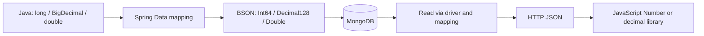

# Integers, Floating-Point Numbers, and the Risk of Precision Loss

## 1. Why Are Numeric Types a Data Design Decision?

In **Spring Data MongoDB**, Java applications commonly work with `int`, `long`, `double`, or `BigDecimal`, while MongoDB stores values as different BSON numeric types. Two numbers that look identical on screen do not necessarily share the same **type**, **range**, **precision**, or **comparison behavior** across all layers.

Consider an ordering system with three data items:

- `quantity = 3`: item quantity, a relatively small integer;
- `total = 199.99`: monetary amount that must match exact business rules;
- `eventSequence = 9007199254740993`: sequence number that may exceed JavaScript's safe integer range.

If the wrong type is chosen:

1. Monetary amounts may exhibit discrepancies because they were computed using binary floating-point.
2. Counters may overflow the storage range of `int` or `long`.
3. A `long` value stored accurately in BSON may be rounded when passing through a JSON client that uses JavaScript `Number`.
4. A collection mixing `string`, `double`, and `decimal` in the same numeric field can cause unpredictable filtering, sorting, and aggregation behavior.

The goal of this lesson in the **Data Types** chapter is to choose the right numeric representation for each need, map Java/BSON accurately with Spring Data MongoDB, preserve values across APIs, and detect issues through queries, tests, and data diagnostic tools.

## 2. BSON Numeric Types to Distinguish

MongoDB includes the following common BSON numeric types:

| BSON Type | Representation | Key Range or Characteristics | Example Purpose |
| --- | --- | --- | --- |
| `Int32` (`int`) | 32-bit signed integer | From −2,147,483,648 to 2,147,483,647 | Quantities, years, numeric status codes |
| `Int64` (`long`) | 64-bit signed integer | From −9,223,372,036,854,775,808 to 9,223,372,036,854,775,807 | Large counters, epoch timestamps, numeric identifiers |
| `Double` (`double`) | 64-bit IEEE 754 binary floating-point | ~15–17 significant digits; cannot represent every decimal fraction exactly | Measurements, statistics, coordinates when error tolerance is acceptable |
| `Decimal128` (`decimal`) | 128-bit IEEE 754 **decimal** floating-point | Up to 34 significant digits; supports exact decimal representation within type bounds | Currency, rates, decimal numbers requiring explicit rounding rules |

Key point: both `Double` and `Decimal128` are floating-point types, but their **representation bases** differ. `Double` stores values in base 2, so many decimal values such as 0.1 cannot be represented with absolute exactness. `Decimal128` stores values in base 10, so it can represent 0.1 or 19.99 exactly as long as the value fits within its representation limits.

`Decimal128` is **not** an arbitrary-precision decimal type. When a value exceeds 34 significant digits or falls outside the representable exponent range, an explicit handling policy is required; you cannot assume every conversion is lossless.

### Example of Typed Values in mongosh

```javascript
db.numeric_examples.insertOne({
  _id: "demo-1",
  quantity: NumberInt("3"),
  totalViews: NumberLong("9007199254740993"),
  ratio: 0.1, // JavaScript Number: stored as BSON Double
  price: NumberDecimal("19.99")
});
```

The constructors above make intent explicit when creating data from mongosh. Use strings with large `NumberLong` values to prevent JavaScript from rounding the numeric literal **before** the BSON construction call occurs.

To inspect the actual stored types:

```javascript
db.numeric_examples.aggregate([
  { $match: { _id: "demo-1" } },
  {
    $project: {
      quantityType: { $type: "$quantity" },
      viewsType: { $type: "$totalViews" },
      ratioType: { $type: "$ratio" },
      priceType: { $type: "$price" }
    }
  }
]);
```

The expected **type names** are `int`, `long`, `double`, and `decimal` respectively. Do not rely solely on how a number looks in a management UI: the same characters “19.99” could be `Double`, `Decimal128`, or `String`.

## 3. Integers: Exact Within Range, Still Subject to Overflow

### 3.1. `int` and `long` in Java

Java `int` is a 32-bit signed integer; `long` is a 64-bit signed integer. Both store exact integer values within their permitted ranges.

```java
int quantity = 12;
long sequence = 9_007_199_254_740_993L;
```

`quantity` suits `int` because its business range is small. `sequence` needs `long` because it exceeds `int`'s limit. However, if an application keeps incrementing a `long` counter, `long` itself also has a limit.

Java integer arithmetic can overflow silently without throwing an exception:

```java
long next = Long.MAX_VALUE + 1L;
System.out.println(next); // Long.MIN_VALUE: overflowed
```

Use checked arithmetic if you need to detect overflow errors:

```java
long current = Long.MAX_VALUE;
long increment = 1L;

try {
    long next = Math.addExact(current, increment);
} catch (ArithmeticException overflow) {
    // Reject the operation or switch to a different value storage strategy.
}
```

MongoDB also has representation and type-promotion rules when evaluating aggregation expressions. You should not assume that because a calculation result exceeds `Int64`, MongoDB will automatically turn everything into an arbitrary-precision integer; in some cases results are promoted to floating-point and lose precision.

### 3.2. The 2^53−1 Limit in JavaScript/JSON Clients

JavaScript `Number` can represent **every integer exactly** within the range:

\[
-(2^{53}-1) \le n \le 2^{53}-1
\]

That is from −9,007,199,254,740,991 to 9,007,199,254,740,991. This is JavaScript's safe integer range; Java/BSON `long` has a much larger range.

Example:

```javascript
const id = 9007199254740993;
console.log(id); // 9007199254740992: lost 1 unit
console.log(Number.isSafeInteger(id)); // false
```

If the Spring Data backend accurately reads an `Int64` but the controller emits a JSON number and the frontend uses default `JSON.parse`, the frontend can **receive the wrong ID**. Sending that ID back to look up the document may then fail even though the data in MongoDB is completely accurate.

API contract solution: for large integers used as identifiers or requiring unit-exact preservation, serialize them as **decimal strings** when exchanging with systems that do not guarantee 64-bit integers; or use a protocol/serializer and `BigInt`/`Int64` types controlled on both sides. Do not indiscriminately convert every `long` to `double` just to make JSON convenient.

```json
{
  "eventSequence": "9007199254740993"
}
```

This is an example of a JSON **string** convention for large integers; the receiving side must validate syntax and value bounds before parsing back to `long`.

## 4. Floating-Point: Why Can 0.1 + 0.2 Differ from 0.3?

In Java, `float` and `double` use binary floating-point representation. Most decimal fractions whose denominators contain a factor of 5 cannot be represented finitely in binary. As a result, calculations can introduce small errors:

```java
double a = 0.1;
double b = 0.2;

System.out.println(a + b);        // 0.30000000000000004
System.out.println(a + b == 0.3); // false
```

This does not mean `double` is “broken”. It is well suited for scientific computing, measurements with tolerance, statistics, geometry, or sensor data when business design specifies acceptable error bounds. Problems arise when the application **requires exact decimal results**, such as monetary amounts that must balance to the smallest unit.

### 4.1. Avoid Comparing `double` with `==`

For measurement data, you can define an absolute or relative tolerance appropriate to the value domain:

```java
double actual = 0.1 + 0.2;
double expected = 0.3;
double tolerance = 1e-9;

boolean closeEnough = Math.abs(actual - expected) <= tolerance;
```

`tolerance` must be chosen from business requirements; no single constant fits every case. For very large numbers or values very close to 0, a combined absolute and relative error criterion may be needed; never apply “close enough” comparison to monetary amounts that must reconcile exactly.

### 4.2. BigDecimal and Decimal128

`java.math.BigDecimal` represents decimal numbers with application-controlled precision and scale. It is the natural choice when financial logic requires base-10 arithmetic.

```java
import java.math.BigDecimal;

BigDecimal a = new BigDecimal("0.1");
BigDecimal b = new BigDecimal("0.2");
BigDecimal sum = a.add(b);

System.out.println(sum.toPlainString()); // 0.3
```

**Do not use `new BigDecimal(0.1)`** when your goal is to represent the exact decimal value “0.1”, because that constructor converts the exact binary value stored in `double` and can yield a very long decimal expansion. Construct `BigDecimal` from validated input strings or integers/scaled integers. `BigDecimal.valueOf(double)` behaves differently from the constructor above, yet it still cannot fix errors introduced by prior `double` arithmetic.

## 5. Java, Spring Data, and BSON Mapping Table

| Java Type | Common BSON Type | Design Notes |
| --- | --- | --- |
| `int` / `Integer` | `Int32` | Use for small integer values with clear bounds. |
| `long` / `Long` | `Int64` | Use for large integers; check traversal through JavaScript clients. |
| `float` / `Float` | Usually converted to a floating-point BSON type supported by the driver/converter, commonly `Double` | Precision can already be lost in Java `float`; restrict use when precision is required. |
| `double` / `Double` | `Double` | Suitable for approximate calculations, unsuitable for money requiring decimal exactness. |
| `BigDecimal` | **Often `String` by default in Spring Data MongoDB** | To store `Decimal128`, explicitly specify target type/mapping. |
| `BigDecimal` with `@Field(targetType = FieldType.DECIMAL128)` | `Decimal128` | Accepts Decimal128's 34-significant-digit limit; verify conversion behavior. |
| `org.bson.types.Decimal128` | `Decimal128` | Close to BSON/driver; can convert to `BigDecimal` when appropriate. |
| `BigInteger` | Usually stored as string via Spring Data | Not every `BigInteger` fits in `Int64`; requires explicit data and query conventions. |

Exact conversion rules depend on the Spring Data MongoDB version, converter configuration, and project custom conversions. Therefore, when precision is a critical requirement, **test the actual BSON type** rather than only checking the Java object saved and returned.

### 5.1. Why Doesn't BigDecimal Automatically Mean Decimal128?

Spring Data MongoDB can store `BigDecimal` as a string so it is not constrained by `Decimal128`'s precision limits. This preserves the Java value representation, but **a BSON String field is not a BSON numeric field**.

For example, if `amount` is stored as `"100.00"`, MongoDB cannot automatically treat it like `NumberDecimal("100.00")` in every arithmetic operation, filter, and index. Lexicographical string sorting also differs from numeric sorting.

When you need to compute, filter, and aggregate decimal numbers in MongoDB, consider `Decimal128` with explicit mapping and ensure values stay within its representable range.

## 6. Example of a Properly Typed Spring Data MongoDB Entity

Suppose a sales system needs to store unit price, quantity, and total amount using decimal values. A Java entity:

```java
package example.billing;

import java.math.BigDecimal;
import org.springframework.data.annotation.Id;
import org.springframework.data.mongodb.core.mapping.Document;
import org.springframework.data.mongodb.core.mapping.Field;
import org.springframework.data.mongodb.core.mapping.FieldType;

@Document(collection = "invoice_lines")
public class InvoiceLine {

    @Id
    private String id;

    private String sku;

    private int quantity;

    private long auditSequence;

    @Field(targetType = FieldType.DECIMAL128)
    private BigDecimal unitPrice;

    @Field(targetType = FieldType.DECIMAL128)
    private BigDecimal total;

    public InvoiceLine() {
    }

    public InvoiceLine(
            String id,
            String sku,
            int quantity,
            long auditSequence,
            BigDecimal unitPrice,
            BigDecimal total) {
        this.id = id;
        this.sku = sku;
        this.quantity = quantity;
        this.auditSequence = auditSequence;
        this.unitPrice = unitPrice;
        this.total = total;
    }

    public String getId() {
        return id;
    }

    public String getSku() {
        return sku;
    }

    public int getQuantity() {
        return quantity;
    }

    public long getAuditSequence() {
        return auditSequence;
    }

    public BigDecimal getUnitPrice() {
        return unitPrice;
    }

    public BigDecimal getTotal() {
        return total;
    }
}
```

Compute the total from `BigDecimal` and `int`, then save via `MongoTemplate`:

```java
import java.math.BigDecimal;
import org.springframework.data.mongodb.core.MongoTemplate;

public void saveExample(MongoTemplate template) {
    int quantity = 3;
    BigDecimal price = new BigDecimal("19.99");
    BigDecimal total = price.multiply(BigDecimal.valueOf(quantity));

    InvoiceLine line = new InvoiceLine(
        "invoice-line-001",
        "SKU-A12",
        quantity,
        9_007_199_254_740_993L,
        price,
        total
    );
    template.save(line);
}
```

With default mapping configuration and the annotations above, the equivalent document is:

```javascript
{
  _id: "invoice-line-001",
  sku: "SKU-A12",
  quantity: NumberInt("3"),
  auditSequence: NumberLong("9007199254740993"),
  unitPrice: NumberDecimal("19.99"),
  total: NumberDecimal("59.97")
}
```

A synchronous repository can use this entity directly:

```java
import org.springframework.data.mongodb.repository.MongoRepository;

public interface InvoiceLineRepository
        extends MongoRepository<InvoiceLine, String> {
}
```

Similarly, `ReactiveMongoRepository<InvoiceLine, String>` or `ReactiveMongoTemplate` uses the same mapping metadata and BSON types. Reactive access affects I/O scheduling and `Mono`/`Flux` return types, **not floating-point precision**.

## 7. Rounding Rules, Scale, and Comparison with BigDecimal

### 7.1. Rounding Is a Business Decision

`BigDecimal` preserves exact decimal results when an operation is finitely representable, whereas division can yield non-terminating decimals. Example:

```java
import java.math.BigDecimal;
import java.math.RoundingMode;

BigDecimal one = BigDecimal.ONE;
BigDecimal three = new BigDecimal("3");

// one.divide(three) without specifying rounding can throw ArithmeticException.
BigDecimal result = one.divide(three, 2, RoundingMode.HALF_EVEN);
System.out.println(result); // 0.33
```

When storing monetary amounts with two decimal places, the application can normalize upfront:

```java
BigDecimal normalized = new BigDecimal("19.995")
    .setScale(2, RoundingMode.HALF_EVEN);

System.out.println(normalized); // 20.00
```

**No single rounding rule applies to every currency and domain**: some systems require `HALF_UP`, others use `HALF_EVEN`, and some transactions retain extra internal digits and round only at settlement boundaries. Decide when rounding occurs, the scale, currency unit, and remainder handling.

### 7.2. `equals` and `compareTo` Are Not the Same

`BigDecimal` considers both value and scale in `equals`:

```java
BigDecimal a = new BigDecimal("1.0");
BigDecimal b = new BigDecimal("1.00");

System.out.println(a.equals(b));         // false
System.out.println(a.compareTo(b) == 0); // true
```

When comparing **numeric values**, `compareTo` is usually more appropriate. When preserving the number of decimal places as a formatting contract is required, manage scale deliberately. When using `BigDecimal` as a key in `HashMap`/`HashSet`, remember that `equals` and `hashCode` distinguish scale.

### 7.3. Minor-Unit Integer Model

Another option for money is storing **integers in minor units**, such as cents:

```java
long cents = 1_999L; // 19.99 in a currency with 100 minor units
long threeItems = Math.multiplyExact(cents, 3L); // 5997
```

Advantages: integer addition/subtraction/multiplication are exact within `long`'s range and do not depend on binary floating-point. However, you must define minor units per currency, handle constraints during FX conversions or tax calculations, and check for overflow. Do not assume all currencies have two decimal places.

**Choosing between Decimal128 and scaled integers** depends on value domain, required decimal places, server-side calculations, API interoperability, and business rules. Both options can be exact when applied consistently.

## 8. Queries, Aggregations, and Indexes: Numeric Types Affect Results

### 8.1. Avoid Mixing Numbers and Strings in the Same Field

Example collection with heterogeneous data:

```javascript
[
  { _id: "a", amount: NumberDecimal("9.50") },
  { _id: "b", amount: "10.00" },
  { _id: "c", amount: 10.0 },
  { _id: "d", amount: NumberLong("10") }
]
```

Each value may look like a number visually, but `"10.00"` is a **BSON String**. Numeric queries, `$sum` aggregations, and BSON type-based sort order can yield unexpected results when numbers and strings are mixed. String fields can be ignored in summation scenarios that only process numeric inputs.

MongoDB has numeric comparison rules **across BSON numeric types**; therefore, you should not claim that `Int32(10)` and `Int64(10)` are always treated as unequal in numeric filter predicates. However, **floating-point values that have already been rounded cannot be restored just because MongoDB compares numeric types**. Reading, sorting, indexing, aggregation, and arithmetic still require testing when actual types are mixed.

### 8.2. Checking Type Distribution with Aggregation

```javascript
db.invoice_lines.aggregate([
  {
    $group: {
      _id: { $type: "$total" },
      count: { $sum: 1 }
    }
  },
  { $sort: { count: -1 } }
]);
```

A well-managed collection should have a clear BSON type convention for every monetary field. If the results unexpectedly include `string`, `double`, and `decimal`, trace write sources, custom converters, deployed versions, and migration history.

To inspect documents whose total is stored with the wrong type relative to the Decimal128 convention:

```javascript
db.invoice_lines.find(
  { total: { $exists: true, $not: { $type: "decimal" } } },
  { _id: 1, total: 1 }
);
```

On large collections, type-inventory queries can incur scan costs. Scope them down or run during an appropriate operational window.

### 8.3. Aggregation Sums with Decimal128

When `total` is stored as Decimal128, a straightforward aggregation:

```javascript
db.invoice_lines.aggregate([
  {
    $group: {
      _id: "$sku",
      revenue: { $sum: "$total" },
      lines: { $sum: 1 }
    }
  },
  { $sort: { revenue: -1 } }
]);
```

Benefit: calculations use stored decimal numbers rather than converting money to `double` upfront. Still, the system must verify Decimal128 bounds, rounding rules, and operator type promotion. Some operations in MongoDB can return different types depending on input types; **do not let imprecise Double data mix into a pipeline and expect a `$toDecimal` step to recover lost digits**.

If all monetary fields are decimal strings written by a legacy system, perform a controlled conversion before running numeric aggregations. Do not expect MongoDB to automatically interpret strings as numbers across all operators.

### 8.4. Indexes Operate on Actual Stored Values

```javascript
db.invoice_lines.createIndex({ total: 1 });

db.invoice_lines.find({
  total: { $gte: NumberDecimal("100.00") }
});
```

Indexes store keys based on actual BSON values. If part of the `total` data consists of strings, an index and query on Decimal128 will not normalize them into numbers automatically. In a Spring Data application, if a project switches from storing `BigDecimal` as String to Decimal128, review **queries, indexes, aggregations, and code reading legacy data** together.

Evaluate indexes using `explain("executionStats")` and representative workloads, especially right after a data-type migration.

## 9. Where Can the Java → BSON → JSON Path Introduce Numeric Errors?



Check each boundary:

| Conversion Boundary | Example Risk | Mitigation |
| --- | --- | --- |
| User input → Java | Parsing `19.99` through `double` before creating `BigDecimal` | Parse decimal strings directly into `BigDecimal` and validate |
| Java → BSON | `BigDecimal` stored unexpectedly as String | `@Field(targetType = FieldType.DECIMAL128)` or deliberate converter configuration |
| MongoDB aggregation | Mixing Decimal128 with rounded Double | Standardize input types, test aggregation results |
| BSON → Java | Converter/custom mapping converts `Decimal128` to `double` | Use appropriate Java types, verify raw BSON and readback |
| Java → JSON | API emits large `long` as a JSON number | String convention for IDs/large integers or safe protocol support |
| JSON → JavaScript | `JSON.parse` uses Number, losing some `Int64` values | Use string + `BigInt`/decimal library per API contract |

Especially for money, the frontend should not perform authoritative calculations deciding payable amounts with `Number` and treat them as the source of truth. Finalized monetary figures should be computed by the business service under consistent rounding rules and returned accordingly.

### Example DTO Preserving Precision Across Transport

```java
public record InvoiceLineResponse(
    String id,
    String auditSequence,
    String total
) {
    public static InvoiceLineResponse from(InvoiceLine line) {
        return new InvoiceLineResponse(
            line.getId(),
            Long.toString(line.getAuditSequence()),
            line.getTotal().toPlainString()
        );
    }
}
```

The JSON can look like:

```json
{
  "id": "invoice-line-001",
  "auditSequence": "9007199254740993",
  "total": "59.97"
}
```

Strings here are a **transport format**, which does not mean money must be stored in MongoDB as BSON String. The backend can keep `Decimal128`, the API returns decimal strings so clients handle them accurately, and inbound boundaries parse strings into the appropriate numeric types.

## 10. Schema Validation to Reduce Mixed Data

Beyond Java annotations, you can place **JSON Schema validation** on a MongoDB collection to enforce BSON types written by different tools and applications.

Example applied when creating a new collection:

```javascript
db.createCollection("invoice_lines_validated", {
  validator: {
    $jsonSchema: {
      bsonType: "object",
      required: ["quantity", "auditSequence", "unitPrice", "total"],
      properties: {
        quantity: { bsonType: "int", minimum: 1 },
        auditSequence: { bsonType: "long" },
        unitPrice: { bsonType: "decimal" },
        total: { bsonType: "decimal" }
      }
    }
  }
});
```

Validation reduces the chance of a direct write job sending `unitPrice` as String or Double once the system has standardized on Decimal128. However:

- A validator on a new collection does not automatically migrate documents from older versions.
- Validation policies and modifying validators on existing collections must be rolled out, monitored, and tested against real data.
- Annotations and validation can conflict if Spring Data has not been configured to store `BigDecimal` as Decimal128.
- Business accuracy still requires validation at the service layer: a schema only confirms types and certain bounds, not whether an invoice calculated taxes or discounts accurately.

## 11. Testing Data Types and Precision

Tests that only compare `BigDecimal` before and after `repository.save` can be insufficient, because a converter could store a String and read it back into `BigDecimal`, causing the test to PASS. You must inspect the **actual BSON** as well.

Example integration test using JUnit 5, Spring Boot, and `MongoTemplate`:

```java
package example.billing;

import static com.mongodb.client.model.Filters.eq;
import static org.junit.jupiter.api.Assertions.*;

import java.math.BigDecimal;
import java.util.UUID;
import org.bson.Document;
import org.bson.types.Decimal128;
import org.junit.jupiter.api.Test;
import org.springframework.beans.factory.annotation.Autowired;
import org.springframework.boot.test.context.SpringBootTest;
import org.springframework.data.mongodb.core.MongoTemplate;

@SpringBootTest
class InvoiceLineMappingTest {

    @Autowired
    MongoTemplate template;

    @Test
    void storesExactDecimalAndLargeInteger() {
        String id = "invoice-test-" + UUID.randomUUID();
        BigDecimal price = new BigDecimal("19.99");
        BigDecimal total = price.multiply(BigDecimal.valueOf(3));
        long sequence = 9_007_199_254_740_993L;

        template.save(new InvoiceLine(
            id, "SKU-A12", 3, sequence, price, total
        ));

        Document stored = template.getCollection("invoice_lines")
            .find(eq("_id", id))
            .first();

        assertNotNull(stored);
        assertEquals(3, stored.getInteger("quantity"));
        assertEquals(sequence, stored.getLong("auditSequence"));

        Object rawTotal = stored.get("total");
        assertInstanceOf(Decimal128.class, rawTotal);
        BigDecimal decimalTotal =
            ((Decimal128) rawTotal).bigDecimalValue();
        assertEquals(0, decimalTotal.compareTo(
            new BigDecimal("59.97")
        ));

        InvoiceLine reloaded = template.findById(id, InvoiceLine.class);
        assertNotNull(reloaded);
        assertEquals(sequence, reloaded.getAuditSequence());
        assertEquals(0, reloaded.getTotal().compareTo(
            new BigDecimal("59.97")
        ));
    }
}
```

This example requires a reachable test MongoDB instance. It can run via Testcontainers or a dedicated test instance with Spring Boot configuration matching the project version. At the time of authoring this content, the snippet is a learning example; the repository's build/test suite has not been executed.

Beyond mapping tests, add tests for:

1. Boundary integers at `Integer.MAX_VALUE` and `Long.MAX_VALUE`; check for overflow errors.
2. Values `2^53−1` and `2^53+1` passing through the JSON frontend.
3. Decimals such as `0.1`, `0.2`, `19.995` and post-rounding outcomes.
4. A value with more than 34 significant digits to determine behavior when converting to Decimal128.
5. `$sum` aggregations over homogeneous Decimal128 data vs. mixed String/Double data.
6. Legacy data post-migration: document counts, totals, BSON types, and sort/query behavior.

## 12. Migrating Legacy Data to the Right Types Without Corrupting Values

Suppose `invoice_lines.total` contains String, Double, and Decimal128 data. Audit before fixing:

```javascript
db.invoice_lines.aggregate([
  {
    $group: {
      _id: { $type: "$total" },
      count: { $sum: 1 }
    }
  }
]);
```

A batch conversion strategy:

1. **Identify the meaning and original data source:** what are the units, where were values rounded, and what data can be recomputed from authoritative sources.
2. **Standardize new write code:** configure Spring Data `@Field(targetType = FieldType.DECIMAL128)`, validation, and API contracts so no more mistyped values are generated.
3. **Reconcile legacy data:** valid decimal strings can be parsed to Decimal128 if within bounds; for Double, identify existing precision drift and correct using original source records rather than assuming a cast is enough.
4. **Pilot conversion in controlled batches:** compute sums and counts before/after, log invalid records, and keep backups/recovery paths.
5. **Verify queries, indexes, and aggregations:** confirm the application reads both converted and unconverted data accurately during rollout.
6. **Lock down the convention post-migration:** add validation, integration tests, and type distribution monitoring to catch older applications still writing wrong types.

MongoDB provides `$convert` and `$toDecimal` operators for conversion. Example previewing **reading** numbers as Decimal128:

```javascript
db.invoice_lines.aggregate([
  {
    $project: {
      oldValue: "$total",
      oldType: { $type: "$total" },
      parsedValue: {
        $convert: {
          input: "$total",
          to: "decimal",
          onError: null,
          onNull: null
        }
      }
    }
  }
]);
```

This is a read-only diagnostic aggregation that **does not update the database**. `onError: null` helps identify unconvertible inputs; before running an actual migration, categorize those records and handle them per business rules. Converting `Double` to `Decimal128` cannot restore lost precision if the original value had already been rounded.

## 13. Diagnosing Common Errors

| Symptom | Likely Root Cause | How to Verify |
| --- | --- | --- |
| `0.1 + 0.2` becomes `0.30000000000000004` | Using `double`/binary floating-point | Check Java types, BSON Double, and input arithmetic |
| Total saved in MongoDB is String | `BigDecimal` not mapped to Decimal128 or custom converter | Use `$type` aggregation and inspect annotations/converters |
| Large ID changes on frontend | JavaScript Number exceeds safe integer | Test JSON round-trip with `9007199254740993` |
| MongoDB total differs from service sum | Mixed Double/Decimal data or differing rounding policies | Compare pipeline, individual operands, and BSON types |
| `BigDecimal.equals` returns false even though numbers look equal | Different scales | Use `compareTo` for numeric value comparison |
| Saving Decimal128 fails on huge numbers | Exceeds representation bounds or conversion limits | Inspect precision, scale, actual value, and driver error |
| Sorting monetary strings differs from numeric sort | Field stored as BSON String | Check `$type`, indexes, and migrated data |
| `long` turns negative after increment | Integer overflow | Use `Math.addExact`/`multiplyExact` and boundary checks |

A brief investigation path:

1. Check the **Java** type at data ingestion and right before saving.
2. Check whether the value was parsed from a String or from a Double.
3. Query raw BSON data, inspecting `$type` and actual stored values.
4. Check `@Field` mappings, custom converters, repositories, and direct driver write paths.
5. Inspect aggregations, indexes, and `explain` output if filtering/sorting diverges.
6. Check JSON responses and client-side parsing types; do not debug on the server alone.

## 14. Hands-On Exercises

**Exercise 1 — Identifying Types.** Create four fields in MongoDB using `NumberInt("12")`, `NumberLong("9007199254740993")`, `NumberDecimal("19.99")`, and a literal `0.1`. Use `$type` to inspect each BSON type and explain why on-screen numeric formatting alone is insufficient to determine precision.

**Exercise 2 — Comparing Calculation Methods.** Sum 3 items priced at 19.99 in three ways: Java `double`, Java `BigDecimal`, and integer cents. Compare results across repeated multiplication, addition, and rounding; document the required business conventions.

**Exercise 3 — Spring Data Mapping.** Create an `InvoiceLine` entity and persist it with `MongoRepository`/`MongoTemplate`. Observe the BSON type when `BigDecimal` has no annotation, then add `@Field(targetType = FieldType.DECIMAL128)` and re-verify using a new collection or fresh test data.

**Exercise 4 — API Testing.** Return `auditSequence = 9007199254740993` via HTTP JSON as a number and as a string. On the JavaScript side, parse each response, check `Number.isSafeInteger`, and identify the API contract capable of an exact round-trip.

**Exercise 5 — Mixed Data.** Prepare three documents with equivalent `total` values stored as String, Double, and Decimal128. Run `$type`, `$sum`, threshold filtering, and sorting. Write a migration plan ensuring old monetary values do not silently change meaning.

### Self-Check Questions

- Why can `double` fit sensor measurements yet should not be the default choice for payable monetary totals?
- What is the largest integer JavaScript `Number` can represent safely? How does that relate to Java/BSON `Int64`?
- Is Java `BigDecimal` automatically stored as `Decimal128` in MongoDB when using Spring Data?
- Does converting BSON `Double` to `Decimal128` restore digits lost due to binary representation?
- When should you choose `long` monetary amounts in minor units instead of Decimal128?
- Why must tests read **raw BSON** and verify JSON APIs rather than just comparing Java objects before and after saving?

## Key Takeaways

**Integers** preserve exact values within `Int32`/`Int64` ranges but can still overflow; `Int64` can also be rounded when passing through JavaScript `Number`. **Double** suits approximate calculations, whereas **BigDecimal/Decimal128** supports decimal numbers when precision and explicit rounding policies are required, within their representation limits. With **Spring Data MongoDB**, verify `BigDecimal` mapping (often String unless configured otherwise), choose consistent BSON types, verify with `$type`, and test the entire Java → BSON → aggregation → JSON path. Type selection, bounds, scale, and units must originate from business requirements and be enforced across every layer of the system.
