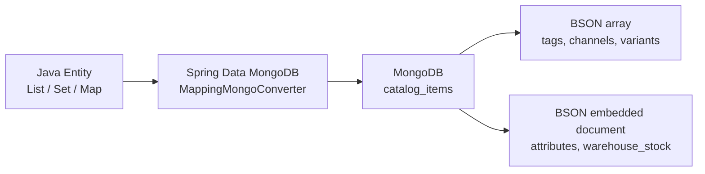

# List, Set, Map, and Element Types in Documents

## 1. From Java Collections to BSON Data

In **Spring Data MongoDB**, a Java entity can declare `List<T>`, `Set<T>`, and `Map<String, T>` properties. These collections typically map as follows:

| Java Property | Common BSON Form | Key Characteristics |
| --- | --- | --- |
| `List<String> tags` | Array of Strings | Ordered, allows duplicate values |
| `Set<String> channels` | Array of Strings | On the Java side, forbids duplicates by `equals/hashCode`; BSON has no dedicated Set type |
| `Map<String,String> attributes` | Embedded document | String keys become dynamic field names |
| `Map<String,Integer> stocks` | Embedded document | Values convert according to the element type |
| `List<Variant> variants` | Array of embedded documents | Each element is a nested object inside the document |

An important distinction: **Java collections define APIs and semantics in application memory**, while **BSON determines actual data types in MongoDB**. Java generics do not automatically enforce schema constraints for every client writing to the collection; another application can still write BSON data with different types or structures.



To write accurate queries, indexes, and aggregations, you need to know both the stored field names and the BSON types of elements. This is especially true when working with `MongoRepository`, `MongoTemplate`, or their reactive counterparts.

## 2. Example Entity Containing List, Set, and Map

Suppose a bookstore application stores a product with search tags, sales channels, dynamic attributes, inventory per warehouse, and variants.

```java
package com.example.catalog;

import java.util.ArrayList;
import java.util.LinkedHashMap;
import java.util.LinkedHashSet;
import java.util.List;
import java.util.Map;
import java.util.Set;
import org.springframework.data.annotation.Id;
import org.springframework.data.mongodb.core.mapping.Document;
import org.springframework.data.mongodb.core.mapping.Field;

@Document(collection = "catalog_items")
public class CatalogItem {
    @Id
    private String id;

    private String sku;

    @Field("tag_list")
    private List<String> tags = new ArrayList<>();

    private Set<String> channels = new LinkedHashSet<>();

    private Map<String, String> attributes = new LinkedHashMap<>();

    @Field("warehouse_stock")
    private Map<String, Integer> stockByWarehouse = new LinkedHashMap<>();

    private List<Variant> variants = new ArrayList<>();

    protected CatalogItem() {}

    public CatalogItem(
            String sku,
            List<String> tags,
            Set<String> channels,
            Map<String, String> attributes,
            Map<String, Integer> stockByWarehouse,
            List<Variant> variants) {
        this.sku = sku;
        this.tags = new ArrayList<>(tags);
        this.channels = new LinkedHashSet<>(channels);
        this.attributes = new LinkedHashMap<>(attributes);
        this.stockByWarehouse = new LinkedHashMap<>(stockByWarehouse);
        this.variants = new ArrayList<>(variants);
    }

    public String getId() { return id; }
    public String getSku() { return sku; }
    public List<String> getTags() { return tags; }
    public Set<String> getChannels() { return channels; }
    public Map<String, String> getAttributes() { return attributes; }
    public Map<String, Integer> getStockByWarehouse() {
        return stockByWarehouse;
    }
    public List<Variant> getVariants() { return variants; }

    public static class Variant {
        private String sku;
        private int stock;

        protected Variant() {}

        public Variant(String sku, int stock) {
            this.sku = sku;
            this.stock = stock;
        }

        public String getSku() { return sku; }
        public int getStock() { return stock; }
    }
}
```

Here, `@Field("tag_list")` renames the Java property `tags` to the BSON field `tag_list`; `@Field("warehouse_stock")` does the same for `stockByWarehouse`. Map keys such as `HCM` or `HN` are stored inside `warehouse_stock`. The `Variant` class defines the element type for `List<Variant>`.

The following snippet assumes a `CatalogItemRepository` has been injected into a service or runner:

```java
import java.util.LinkedHashSet;
import java.util.List;
import java.util.Map;

CatalogItem item = new CatalogItem(
    "BOOK-101",
    List.of("java", "spring", "java"),
    new LinkedHashSet<>(List.of("web", "store", "web")),
    Map.of("color", "red", "size", "M"),
    Map.of("HCM", 12, "HN", 4),
    List.of(
        new CatalogItem.Variant("BOOK-101-A", 8),
        new CatalogItem.Variant("BOOK-101-B", 2)
    )
);
catalogItemRepository.save(item);
```

In MongoDB, the document may look similar to:

```javascript
{
  _id: ObjectId("507f1f77bcf86cd799439011"),
  sku: "BOOK-101",
  tag_list: ["java", "spring", "java"],
  channels: ["web", "store"],
  attributes: { color: "red", size: "M" },
  warehouse_stock: { HCM: 12, HN: 4 },
  variants: [
    { sku: "BOOK-101-A", stock: 8 },
    { sku: "BOOK-101-B", stock: 2 }
  ]
}
```

This is illustrative data. The actual `_id` is generated according to mapping rules and ID allocation; converters may also write metadata such as `_class`. Notably, **do not treat the iteration order of a Set as a design guarantee**, even when the example initializes with `LinkedHashSet`.

## 3. List: Ordered, Allows Duplicates, and Holds Objects

`List<T>` fits when order carries business meaning: workflow steps, product image ordering, or displayed variant lists. When persisted, MongoDB uses a BSON array and preserves element order:

```javascript
tag_list: ["java", "spring", "java"]
```

This array has **three elements**, where `"java"` appears twice. MongoDB does not automatically deduplicate. If tags must be a duplicate-free set, normalize input data or pick appropriate update operators; declaring `List` alone does not enforce uniqueness.

With `List<Variant>`, each element is an embedded document:

```javascript
variants: [
  { sku: "BOOK-101-A", stock: 8 },
  { sku: "BOOK-101-B", stock: 2 }
]
```

This structure works well when variants are usually read alongside the product and their count is bounded. If variants have an independent lifecycle, need standalone pagination, or change very frequently, consider storing them in a separate collection with references. MongoDB enforces a **16 MiB size limit per BSON document**; never embed unboundedly growing history into an array inside a single document.

## 4. Set: Unique on the Java Side, Yet Still Stored as a BSON Array

In Java, `Set<T>` guarantees no two elements are equal according to `equals`/`hashCode`:

```java
Set<String> channels =
    new LinkedHashSet<>(List.of("web", "store", "web"));
System.out.println(channels.size()); // 2
```

Spring Data MongoDB usually persists `Set<String>` as a BSON array, for example:

```javascript
channels: ["web", "store"]
```

**BSON has no dedicated Set type**, so there is no element-level unique constraint simply because the entity declares `Set`. Another client can easily write `channels: ["web", "web"]`. When reading duplicate elements into a Java `Set`, duplicates collapse in memory without **modifying the underlying document**.

Points to keep in mind:

- `Set` has no general ordering contract. If you must display elements in persisted order, choose `List`.
- With `Set<Variant>`, two variants with the same `sku` are only treated as equal in Java if `Variant`'s equality rules are defined that way. Plain objects do not automatically compare by `sku`.
- Java-side deduplication rules do not replace data validation when multiple programs write to MongoDB.

MongoDB provides the `$addToSet` operator:

```javascript
db.catalog_items.updateOne(
  { sku: "BOOK-101" },
  { $addToSet: { channels: "mobile" } }
)
```

This operator appends `"mobile"` if it is not already in the array. However, `$addToSet` does not remove pre-existing duplicates, makes no ordering promise, and compares values using BSON equality rules rather than arbitrary Java `equals` overrides. Distinguish **in-memory `Set`** from **`$addToSet` during document updates**.

## 5. Map: Embedded Documents with Dynamic Keys

`Map<String, T>` typically maps to a BSON embedded document. Each String key becomes a field name, and each value converts according to type `T`:

```java
Map<String, String> attributes =
    Map.of("color", "red", "size", "M");

Map<String, Integer> stockByWarehouse =
    Map.of("HCM", 12, "HN", 4);
```

```javascript
{
  attributes: { color: "red", size: "M" },
  warehouse_stock: { HCM: 12, HN: 4 }
}
```

BSON documents use **string field names**, making `Map<String,T>` a clear match. For `Map<Integer,T>` or Maps with complex object keys, do not assume converters can map every key reliably; design custom key conversion or represent them as a list of `{ key, value }` objects.

### Keys Containing Dots or `$`

Queries using the path `"attributes.color"` rely on dot notation to reach nested fields. If a map key literally contains a dot, such as `"display.color"`, dot notation becomes ambiguous. Modern MongoDB supports certain field names with dots and `$`, yet many query operations, indexes, import/export tools, and mappers have varying restrictions. Do not claim all such names are forbidden by MongoDB, nor treat them as safe by default.

When keys originate from users, prefer **normalizing or restricting to an allowlist of keys** such as `color`, `size`, `HCM`. If special characters must be supported, test Spring Data's key-escaping rules (such as dot replacement in map keys for your version) and actual read/write behavior. When keys are highly dynamic or you need to query pairs individually, consider `List<AttributeEntry>` or a separate collection instead of a Map.

## 6. What Does the Element Type `T` Actually Do?

The generic parameter `T` guides Spring Data when converting each BSON element to the expected Java type. However, MongoDB **does not enforce Java class generics** across the collection.

| Type in Entity | Typical BSON Type | Risks to Verify |
| --- | --- | --- |
| `List<String>` | Array of String | Legacy data may contain numbers or booleans |
| `List<Integer>` | Array of Int32 | Watch for Strings or Int64 values |
| `List<Long>` | Array of Int64 | Watch numeric bounds and conversions |
| `List<Instant>` | Array of BSON Date per converter | Time zones on display and date-range filtering |
| `Set<String>` | Array of String | No uniqueness enforced at BSON array level |
| `List<Variant>` | Array of embedded documents | Each element needs required fields and valid types |
| `Map<String,Integer>` | Embedded document with numeric values | BSON numeric type and dynamic key names |
| `Map<String,Variant>` | Embedded document holding embedded documents | Dynamic keys and nested object types |
| `List<Object>` / `Map<String,Object>` | Can hold mixed BSON types | Hard to guarantee schema and type safety |

A BSON document might contain:

```javascript
{ tag_list: ["java", 42, true] }
```

while Java declares `List<String> tags`. When reading, the converter may coerce values or throw an error depending on data/config; even without an error, the program can receive semantically wrong values. Inspect raw data, validate inputs, and use MongoDB **JSON Schema validation** when business rules require type enforcement.

### BigDecimal and Target BSON Types

Java `BigDecimal` does not automatically guarantee BSON Decimal128 in all configurations. Especially with `List<BigDecimal>` or `Map<String,BigDecimal>`, verify converters, rounding, precision bounds, and the actual BSON type of **each element**. Do not assume an annotation on a collection property behaves identically at every nesting level and across every Spring Data version.

When storing monetary values, you can also use `Long` in minor units. Whether choosing Decimal128 or integers, standardize currency units, rounding rules, maximum values, and data types used in aggregations.

## 7. Querying Arrays: Elements, Value Sets, and `$elemMatch`

Assume the `CatalogItem` entity persisted the sample data from Section 2. In `mongosh`, use **BSON field names** such as `tag_list`; with `MongoTemplate` in an entity-aware context, use **Java property names** such as `tags`, which Spring Data maps to MongoDB fields.

### Finding Documents Containing an Element

When a BSON field is an array, an equality predicate against a scalar matches if the array contains that value:

```javascript
db.catalog_items.find({ tag_list: "spring" })
```

Equivalent with `MongoTemplate`:

```java
import java.util.List;
import org.springframework.data.mongodb.core.MongoTemplate;
import org.springframework.data.mongodb.core.query.Criteria;
import org.springframework.data.mongodb.core.query.Query;

Query query = Query.query(
    Criteria.where("tags").is("spring")
);
List<CatalogItem> results =
    mongoTemplate.find(query, CatalogItem.class);
```

In `find(query, CatalogItem.class)`, Spring Data uses `@Field("tag_list")` metadata to translate Java property `tags` to BSON field `tag_list`.

### `$in`, `$all`, and `$size` Operators

```javascript
// Contains at least one of the two tags.
db.catalog_items.find({
  tag_list: { $in: ["java", "mongodb"] }
})

// Contains both tags, no specific order required.
db.catalog_items.find({
  tag_list: { $all: ["java", "spring"] }
})

// Array has exactly 3 elements.
db.catalog_items.find({
  tag_list: { $size: 3 }
})
```

`$all` verifies that all listed values appear in the array, without turning the array into a Set. `$size` filters by array length; do not assume it is index-optimized in all cases—if filtering by element count is frequent, evaluate your schema and execution plans.

### Using `$elemMatch` to Constrain **the Same Element**

Requirement: find products that have **a single variant** with both `sku = "BOOK-101-A"` and `stock >= 5`.

```javascript
db.catalog_items.find({
  variants: {
    $elemMatch: {
      sku: "BOOK-101-A",
      stock: { $gte: 5 }
    }
  }
})
```

Equivalent with `MongoTemplate`:

```java
Query query = Query.query(
    Criteria.where("variants").elemMatch(
        Criteria.where("sku").is("BOOK-101-A")
            .and("stock").gte(5)
    )
);
List<CatalogItem> matches =
    mongoTemplate.find(query, CatalogItem.class);
```

Suppose a BSON array contains:

```javascript
variants: [
  { sku: "BOOK-101-A", stock: 1 },
  { sku: "BOOK-101-B", stock: 20 }
]
```

This document **does not satisfy `$elemMatch`** because no single element satisfies both conditions simultaneously. Writing two separate predicates on `variants.sku` and `variants.stock` without `$elemMatch` lets MongoDB match **two different array elements** against the two conditions, yielding unintended results.

## 8. Querying Maps by Key Path

The map in our example is stored as:

```javascript
warehouse_stock: { HCM: 12, HN: 4 }
```

In `mongosh`, query stock at warehouse `HCM`:

```javascript
db.catalog_items.find({
  "warehouse_stock.HCM": { $gte: 10 }
})
```

With `MongoTemplate` and the `CatalogItem` entity:

```java
Query query = Query.query(
    Criteria.where("stockByWarehouse.HCM").gte(10)
);
List<CatalogItem> matches =
    mongoTemplate.find(query, CatalogItem.class);
```

Spring Data maps `stockByWarehouse` to `warehouse_stock`; `HCM` is a **Map key**, not a property declared explicitly on the Java class.

If map keys arrive from HTTP requests or external inputs, validate them against allowed values. Never concatenate untrusted keys into update/query paths where dots or special characters might alter dot-notation semantics away from the intended field name.

Maps with many dynamic fields complicate indexing compared to fixed properties. If you only query `attributes.color` and `attributes.size`, create targeted indexes. When querying across many arbitrary keys is unavoidable, MongoDB offers **wildcard indexes** suited to certain query patterns:

```javascript
db.catalog_items.createIndex({
  "attributes.$**": 1
})
```

Write overhead, index size, and query support must be measured on your MongoDB version and workload. Do not create wildcard indexes solely because a schema uses a Map.

## 9. Updating Individual Elements with MongoTemplate

MongoDB update operators let you modify part of a document without reading the whole entity and calling `save`.

### Adding, Removing, or Avoiding Duplicates in Arrays

```java
import org.springframework.data.mongodb.core.query.Update;

Query bySku = Query.query(
    Criteria.where("sku").is("BOOK-101")
);

// $push: appends element even if already present.
mongoTemplate.updateFirst(
    bySku,
    new Update().push("tags", "mongodb"),
    CatalogItem.class
);

// $addToSet: adds only if value is not yet in array.
mongoTemplate.updateFirst(
    bySku,
    new Update().addToSet("channels", "mobile"),
    CatalogItem.class
);

// $pull: removes elements matching value.
mongoTemplate.updateFirst(
    bySku,
    new Update().pull("tags", "java"),
    CatalogItem.class
);
```

When passing `CatalogItem.class`, Spring Data maps field names using entity metadata: `tags` translates to `tag_list`. Each update on a **single document** is atomic in MongoDB, yet the three independent statements above do not form a multi-statement transaction.

Do not use `$push` to enforce “no duplicates”; `$addToSet` also does not clean up pre-existing duplicates. If you need to maintain ordering or insert at a specific position, design explicit update operations rather than relying incidentally on how Java collections iterate.

### Updating Part of a Map

```java
// Replace value of key color.
mongoTemplate.updateFirst(
    bySku,
    new Update().set("attributes.color", "blue"),
    CatalogItem.class
);

// Decrement stock in warehouse HCM by 2.
mongoTemplate.updateFirst(
    bySku,
    new Update().inc("stockByWarehouse.HCM", -2),
    CatalogItem.class
);
```

`$set` on `attributes.color` avoids replacing the entire `attributes` map. `$inc` updates the count at `warehouse_stock.HCM` yet **does not ensure stock stays non-negative**. For stock deduction, include a sufficient-quantity predicate in the query and inspect the matched/modified document count; also note that if the existing BSON value is not numeric, `$inc` will fail.

### Risks of Replacing the Entire Collection

Calling `set("tags", newTags)` or `save` on the full entity replaces the entire array with the in-memory copy. Two requests reading stale data and saving concurrently can overwrite each other's changes. For concurrent workflows, prefer operator-based updates, state conditions, and/or `@Version` (optimistic locking) suited to your business rules.

## 10. Indexing Arrays and Nested Documents

An index on an array field becomes a **multikey index**: MongoDB indexes each element according to index rules.

```javascript
// Find products by tag.
db.catalog_items.createIndex(
  { tag_list: 1 },
  { name: "catalog_item_tags" }
)

// Find products having a variant by sku.
db.catalog_items.createIndex(
  { "variants.sku": 1 },
  { name: "catalog_item_variant_sku" }
)

// Query inventory at warehouse HCM.
db.catalog_items.createIndex(
  { "warehouse_stock.HCM": 1 },
  { name: "catalog_item_stock_hcm" }
)
```

| Collection Field | Candidate Index | Notes |
| --- | --- | --- |
| `List<String> tags` | `{ tag_list: 1 }` | Each array can generate multiple index keys |
| `Set<String> channels` | `{ channels: 1 }` | An index does not enforce uniqueness **within** a single array |
| `List<Variant> variants` | `{ "variants.sku": 1 }` | Conditions on the same element should use `$elemMatch` |
| `Map<String,Integer> stockByWarehouse` | `{ "warehouse_stock.HCM": 1 }` | This index targets the specific `HCM` key |

**Compound multikey indexes have restrictions when more than one indexed field is an array in the same document**. Do not assume `{ tag_list: 1, channels: 1 }` is always valid and efficient when both fields are arrays. Choose indexes from real query shapes and test on representative data.

```javascript
db.catalog_items.find({
  tag_list: "spring"
}).explain("executionStats")
```

Inspect `winningPlan`, `totalKeysExamined`, `totalDocsExamined`, and `nReturned` to evaluate index behavior. Keys examined can exceed documents returned when a document contains many array elements. Indexes also consume storage and add write overhead.

## 11. Distinguishing Empty, Null, Missing, and Mistyped Data

In MongoDB, the following documents represent **four distinct BSON states**:

```javascript
{ sku: "A" }                        // Missing tag_list
{ sku: "B", tag_list: null }        // Field present with null
{ sku: "C", tag_list: [] }          // Empty array
{ sku: "D", tag_list: "java" }      // Field present with wrong type
```

In Java, initializing `tags = new ArrayList<>()` does not guarantee every legacy document missing the field will hydrate under one uniform rule. Behavior depends on constructors, setters, metadata, and converters; test against historical records. Similarly, `attributes: {}` differs from `attributes: null` or a missing `attributes` field.

If you want **MongoDB to enforce element types**, add JSON Schema validation. The example below only illustrates creating a **new collection** with a simple schema; do not run `createCollection` if the collection already exists:

```javascript
db.createCollection("catalog_items", {
  validator: {
    $jsonSchema: {
      bsonType: "object",
      properties: {
        tag_list: {
          bsonType: "array",
          items: { bsonType: "string" }
        },
        channels: {
          bsonType: "array",
          items: { bsonType: "string" }
        },
        warehouse_stock: {
          bsonType: "object",
          additionalProperties: { bsonType: "int" }
        }
      }
    }
  }
})
```

This illustrative validator only checks **types** on a few fields; it does not express every business invariant (such as no duplicate tags, non-negative stock, or unique variant SKUs). Adding validators to existing collections requires a dedicated administrative rollout and review of legacy documents.

## 12. Testing Mapping with Repositories and Real BSON

A simple repository for the entity:

```java
package com.example.catalog;

import java.util.List;
import org.springframework.data.mongodb.repository.MongoRepository;

public interface CatalogItemRepository
        extends MongoRepository<CatalogItem, String> {

    List<CatalogItem> findByTags(String tag);
}
```

The method name `findByTags` uses the Java property `tags`; Spring Data translates the query to `tag_list`. When `tag_list` is a String array, querying with a scalar value matches documents containing that element.

Write integration tests against a real MongoDB instance (for example via Testcontainers) to inspect raw BSON. The snippet below sits inside a test/service with `mongoTemplate` and a saved document:

```java
import java.util.List;
import org.bson.Document;
import static org.assertj.core.api.Assertions.assertThat;

Document stored = mongoTemplate.getCollection("catalog_items")
    .find(new Document("sku", "BOOK-101"))
    .first();

assertThat(stored).isNotNull();
assertThat(stored.get("tag_list")).isInstanceOf(List.class);
assertThat(stored.get("channels")).isInstanceOf(List.class);
assertThat(stored.get("attributes")).isInstanceOf(Document.class);
assertThat(stored.get("warehouse_stock")).isInstanceOf(Document.class);
assertThat(stored.get("variants")).isInstanceOf(List.class);
```

`mongoTemplate.getCollection(...)` returns the MongoDB Java Driver API, so field names accessed on `Document` here are **BSON names**. `assertThat` comes from AssertJ and requires the corresponding test dependency. This is a targeted assertion pattern, not a standalone Java program.

Cases to test:

1. `List<String>` with duplicate elements: verify order and element count are preserved on readback.
2. `Set<String>` with duplicate input elements: verify Java semantics and make no BSON ordering assumptions.
3. `List<Variant>`: verify each object's `sku` and `stock`, and confirm `$elemMatch` queries do not falsely match across two variants.
4. `Map<String,Integer>`: verify key names, numeric types, `$inc` updates, and handling of unusual keys.
5. Documents with missing fields, null fields, empty arrays, and mistyped arrays: verify a consistent conversion policy.
6. Indexes on `tag_list` and `variants.sku`: inspect `explain("executionStats")` with sufficiently large sample datasets.

### Common Pitfalls

| Symptom | Cause to Check | Resolution |
| --- | --- | --- |
| List contains duplicate values | BSON arrays allow duplicates | Normalize inputs or use `$addToSet` appropriately on updates |
| Set reads back in a different order | Set has no general ordering contract | Use List when order matters |
| `Set<Variant>` holds two identical SKUs | `equals/hashCode` does not compare by SKU | Define equality or explicit business constraints |
| Querying `tags` in `mongosh` returns nothing | Stored field is `tag_list` | Check `@Field` and BSON field names |
| Map key with dot is hard to query | Dot notation treats `.` as nested path | Normalize keys or adjust data model |
| Variant query matches wrong documents | Predicates matched two different elements | Use `$elemMatch` |
| Numeric aggregation produces wrong results | BSON elements hold unexpected types | Inspect `$type`, converters, and legacy data |
| Document keeps growing larger | Array/map grows without bound | Bound element count or move to a separate collection |

## 13. Hands-On Exercises and Summary

**Exercise 1.** An entity declares:

```java
private List<String> keywords;
private Set<String> supportedLanguages;
private Map<String, Integer> remainingByLocation;
```

**Question:** Which BSON types will these three properties map to? **Answer:** the first two typically map to BSON arrays; the third maps to an embedded document whose field names are location codes and values are numbers. `Set` does not become a distinct BSON Set type.

**Exercise 2.** A document contains:

```javascript
variants: [
  { sku: "A", stock: 0 },
  { sku: "B", stock: 10 }
]
```

**Question:** Is there a variant with both `sku = "A"` and `stock >= 5`? **Answer:** No. Both conditions must be evaluated on the same element using `$elemMatch`.

**Exercise 3.** Java declares `Set<String> tags`, while another client wrote `tags: ["java", "java"]`. **Question:** Does reading it into a `Set` fix the underlying BSON document? **Answer:** No. The converter may deduplicate elements in memory; fixing BSON requires an explicit write/migration operation.

**Exercise 4.** You want to query stock at warehouse `HN` using `MongoTemplate` on `CatalogItem` annotated with `@Field("warehouse_stock")`. **Suggested answer:** use `Criteria.where("stockByWarehouse.HN")` in entity-aware queries; use `"warehouse_stock.HN"` in `mongosh`.

**Key takeaway:** Both `List` and `Set` normally persist as **BSON arrays**, whereas `Map<String,T>` persists as an **embedded document**. Generic `T` guides Spring Data when hydrating elements into Java, yet does not replace schema validation or business invariants. Design ordering, uniqueness, key naming, updates, indexes, and tests around actual BSON data and application access patterns.
