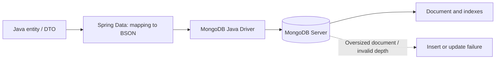
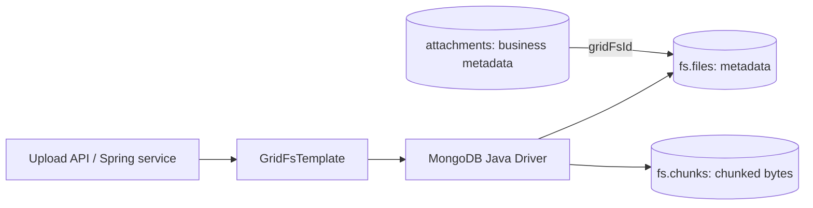

# Document Size Limits, Nesting Depth, and Off-Document Storage Options

MongoDB stores data as **BSON documents** rather than fixed rows and columns. A single document can hold strings, numbers, dates, arrays, nested objects, binary data, and many other BSON types. This flexible model lets **Spring Data MongoDB** applications map Java objects into natural data structures, yet **it does not mean a document can grow without bound**.

When designing documents, the two primary limits to remember are the **16 MiB maximum BSON document size** and the **100-level maximum nesting depth**. These limits shape how you embed data, design growing lists, store large files, and handle deeply nested JSON payloads. Good designs typically stay well below these technical limits based on query patterns, updates, pagination, and real performance measurements.

This lesson belongs to the **Data Types** chapter in the `SPRING_DATA_MONGODB` module. We will cover inspecting actual BSON on MongoDB Server, mapping with `MongoTemplate` or repositories, choosing between embedding and referencing, using GridFS or object storage for large content, and testing/diagnosing growth issues.

After this lesson, you will be able to:

- Explain why 16 MiB is a **BSON document** limit, distinct from JSON length and total collection size.
- Spot deeply nested structures, unbounded arrays, and binary fields that risk hitting limits.
- Measure BSON size and array length via `mongosh`/aggregation, and analyze impacts on queries and indexes.
- Choose among **embedded documents**, **separate referenced collections**, **GridFS**, or **object storage** based on requirements.
- Design metadata storage and large-file retrieval in Spring Data MongoDB while addressing consistency, security, and testing.

## 1. Two Limits to Understand Precisely

| MongoDB Limit | Value | Scope and Impact |
| --- | --- | --- |
| **Size of one BSON document** | **16 MiB = 16,777,216 bytes** | Covers all fields and values in the document. An oversized document cannot be saved with normal inserts/updates. |
| **BSON document nesting depth** | **Maximum 100 levels** | Nested object/array structures cannot exceed the nesting depth supported by MongoDB. |

### 1.1. 16 MiB Is Measured in BSON, Not Displayed JSON

Consider a document:

```javascript
{
  _id: "POST-001",
  title: "MongoDB Guide",
  author: {
    id: "U-12",
    displayName: "Lan"
  },
  tags: ["mongodb", "spring-data"],
  body: "Content..."
}
```

BSON includes **type tags, field names, string lengths, null terminators, and nested framing**. That byte count does not necessarily equal the JSON character count or the Java string length before saving:

- Unicode strings can require multiple UTF-8 bytes per character.
- Arrays carry element metadata and index keys; very long arrays add substantial BSON overhead.
- Binary data (`byte[]`/`BinData`), nested arrays, and child objects all count toward the **same parent document**.
- Storage-layer compression does not allow a document to exceed the **16 MiB logical BSON limit**.

Therefore, do not rely on `json.length()` or filesystem file size alone. An object might compress small on disk yet still exceed 16 MiB in BSON.

MongoDB can store collections with **many documents totaling far beyond 16 MiB**. The 16 MiB limit applies **per document**, not to a database, a collection, or a GridFS file split across multiple chunks.

### 1.2. The 100-Level Nesting Limit

Depth comes from nested BSON objects and arrays, for example:

```javascript
{
  account: {
    profile: {
      address: {
        city: "Ha Noi"
      }
    }
  }
}
```

This structure is only a few levels deep and poses no issue. By contrast, recursively generated JSON such as `child.child.child...` nested hundreds of times can exceed the nesting limit. **Do not confuse the element count of a flat array with nesting depth:** an array with one million elements is shallow in depth, yet can still exceed 16 MiB and become an operational liability.

The 100-level limit is a system ceiling, **not a recommendation to design 99-level schemas**. Excessively deep structures also hinder Java mapping, validation, field-path queries, partial updates, schema maintenance, and observability.

### 1.3. Where Do Errors Occur?



Spring Data and the driver prepare data for transmission, while MongoDB Server enforces storage limits. Depending on the case and version, failures may be caught during BSON encoding or when the server executes the command. Specific exception names vary; inspect the error message, payload size, and failing operation rather than matching a single exception string.

## 2. Design Around Queries, Not Maximum Limits

Suppose a course management system has `courses`, `lessons`, `comments`, and file attachments:

- A course has roughly 20–60 lessons; lesson titles are typically displayed alongside the course.
- A lesson's content can contain long paragraphs, code snippets, and media.
- Comments grow steadily with student count, potentially reaching hundreds of thousands.
- Video or PDF files can range from tens to hundreds of MiB.

A `course` document embedding **every lesson, every comment, and all media bytes** will rapidly outgrow limits. Conversely, splitting even small fields that are always read together adds unnecessary round-trip queries.

| Data Type | Typically Suitable Design | Rationale |
| --- | --- | --- |
| Small, stable metadata: title, status, author | **Embed in main document** | Usually read and updated together |
| **Bounded** list of lesson summaries | Can **embed subset** like `lessonSummaries` | Fast overview page; embed only needed fields |
| Large lesson bodies edited independently | **Separate `lessons` collection**, referencing `courseId` | Independent read/write, pagination, versioning; avoids bloating course documents |
| Unbounded comments, events, logs | **Separate collection** indexed by parent ID/timestamp | Avoids unbounded arrays; supports filtering and pagination |
| Large images, PDFs, videos | **GridFS** or **object storage**, document holds metadata and reference key | Avoids stuffing binary bytes into documents |
| Deeply nested external JSON | **Flatten/normalize**, split logically, or store raw payload outside MongoDB | Avoids excessive depth, hard queries, and mapping overhead |

**Decision rule:** a document should represent a cohesive group of data accessed and updated together, with **predictable size and growth**. If a subset needs its own lifecycle, access control, queries, or independent sizing, that signals it should be separated.

### 2.1. Embedding Bounded Arrays

Example list of lesson summaries:

```javascript
// Collection: courses
{
  _id: "COURSE-001",
  title: "Spring Data MongoDB",
  lessonCount: 36,
  lessonSummaries: [
    { lessonId: "LESSON-001", title: "Introduction", order: 1 },
    { lessonId: "LESSON-002", title: "BSON Mapping", order: 2 }
  ]
}
```

If `lessonSummaries` holds at most a known bounded count of small entries, embedding allows single-query reads. **Do not interpret this example as a recommendation to embed the entire course body**. When `lessonSummaries` changes alongside source lessons, the application must define how copies stay synchronized.

### 2.2. Avoid Unboundedly Growing Arrays

High-risk design:

```javascript
// Unsuitable if comments grow indefinitely:
{
  _id: "POST-001",
  title: "Article",
  comments: [
    /* ... hundreds of thousands of comments ... */
  ]
}
```

Alternative design:

```javascript
// posts: compact metadata
{ _id: "POST-001", title: "Article", commentCount: 250000 }

// comments: each comment is an independent document
{
  _id: "COMMENT-001",
  postId: "POST-001",
  authorId: "U-01",
  body: "Comment content",
  createdAt: ISODate("2026-11-20T02:00:00Z")
}
```

With logical references, add an index:

```javascript
db.comments.createIndex({ postId: 1, createdAt: -1, _id: -1 });
db.comments.find({ postId: "POST-001" })
  .sort({ createdAt: -1, _id: -1 })
  .limit(20);
```

This pattern enables comment pagination, shrinks individual document size, and allows concurrent comment writes without continuously expanding the same parent document. `commentCount` is derived data: update it carefully or accept eventual consistency per business rules.

## 3. Measuring BSON Size and Detecting Document Growth

### 3.1. Measuring One Document with `mongosh`

When working in a test database, use:

```javascript
const course = db.courses.findOne({ _id: "COURSE-001" });
if (course !== null) {
  print("BSON bytes:", Object.bsonsize(course));
}
```

`Object.bsonsize` measures the BSON byte size of the object (as represented in BSON), useful for comparison against 16,777,216 bytes. Measure the object **as actually stored**, including `_id` and persisted fields; when mapping via Spring Data, BSON documents can differ from initial Java objects.

### 3.2. Finding the Largest Documents in a Collection

MongoDB provides the `$bsonSize` aggregation operator to compute document sizes:

```javascript
db.courses.aggregate([
  {
    $project: {
      _id: 1,
      title: 1,
      sizeBytes: { $bsonSize: "$$ROOT" }
    }
  },
  { $sort: { sizeBytes: -1 } },
  { $limit: 10 }
]);
```

On large collections, this scan computes sizes across many documents; run it deliberately or on representative samples to avoid unnecessary load in production. `sizeBytes` reflects the logical BSON size per document, not compressed physical bytes on disk.

To detect unusually long arrays:

```javascript
db.courses.aggregate([
  {
    $project: {
      _id: 1,
      lessonSummaryCount: {
        $size: { $ifNull: ["$lessonSummaries", []] }
      },
      sizeBytes: { $bsonSize: "$$ROOT" }
    }
  },
  { $sort: { lessonSummaryCount: -1 } },
  { $limit: 10 }
]);
```

`$ifNull` prevents `$size` from erroring when the field is absent or `null`; if legacy data holds non-array values in that field, check types before running this measurement.

### 3.3. Setting Internal Operational Thresholds

MongoDB enforces a hard 16 MiB cap, yet applications should establish **much lower warning thresholds** based on average payloads, peak sizes, growth rates, network behavior, and update costs. No single “safe” threshold fits every system.

For example, a team might set an alert when documents in a collection begin reaching a few MiB and revisit the schema long before approaching 16 MiB. That is a **team-chosen operational policy**, not a different MongoDB limit.

Useful metrics include:

- Mean BSON size, high percentiles, and largest documents.
- Element counts in arrays prone to steady growth.
- `find`/`update` latency and bytes transferred for key APIs.
- Collection scan rates, index efficiency, serialization/deserialization time, and network latency.
- Update frequency on large documents, storage growth, and disk cost.

## 4. Strategies for Large or Frequently Changing Data

### 4.1. Splitting Documents by Lifecycle and Access Pattern

For user profiles, keep frequently read attributes in `profiles` and activity logs in `activityEvents`:

```javascript
// profiles
{ _id: "U-100", displayName: "An", avatarFileId: "FILE-123" }

// activityEvents
{
  _id: ObjectId("507f1f77bcf86cd799439011"),
  userId: "U-100",
  type: "LOGIN",
  occurredAt: ISODate("2026-11-19T12:00:00Z")
}
```

A profile page should never load an entire event history just to render a display name and avatar. If historical events are only needed for reporting, consider TTL indexes, time-based rollups, or archival storage per retention policies.

### 4.2. Subset Pattern and Bucket Pattern

- **Subset pattern:** embed a **small, bounded slice** of frequently accessed items (such as the 3 latest comments) while storing the full history in a separate collection.
- **Bucket pattern:** group a **bounded** number of items per document—for instance, sensor readings bucketed by time window or fixed record count. Each bucket must remain well below 16 MiB.
- **Extended reference:** keep `fileId`/`productId` along with summary fields needed for display, rather than duplicating entire related objects.

These patterns require policies for **source of truth, synchronization, edits/deletes, and pagination**. Embedding a summary does not make MongoDB synchronize it automatically with the source document in another collection.

### 4.3. Projections and Pagination Do Not Shrink Stored Documents

Selecting only required fields in a query:

```javascript
db.courses.find(
  { _id: "COURSE-001" },
  { title: 1, lessonCount: 1, lessonSummaries: { $slice: 5 } }
);
```

Projections or `$slice` limit the payload **returned to the client**, yet **do not shrink the persisted document size** or eliminate the 16 MiB ceiling. If an array keeps growing without bound, change the storage model.

Similarly, `skip`/`limit` pagination restricts result counts but does not replace proper indexes and key-based queries. For deep pagination, consider keyset/cursor pagination over stable sort keys.

## 5. When Should Data Move Outside the Document?

At least three categories of data warrant moving outside the primary application document:

1. **Large binary files:** PDFs, high-resolution images, audio, video, attachments.
2. **Unbounded child datasets:** comments, audit trails, logs, events, continuously generated versions.
3. **Deeply nested / unqueryable payloads:** multi-level third-party JSON, unstable schemas, or content stored verbatim for download.

“Moving outside the document” has two distinct meanings:

- **Moving to another collection** within MongoDB, suitable for structured data requiring queries and indexes.
- **Moving binary payloads to file/object storage**, such as MongoDB GridFS or external object storage, while MongoDB stores metadata and pointer keys.

| Option | When to Use | Trade-Offs |
| --- | --- | --- |
| In-document `String`/`Binary` field | Small, bounded content always fetched with the document | Increases BSON size; still subject to 16 MiB |
| Separate collection + ID reference | Many records needing independent queries, filters, indexes, edits | Extra queries or `$lookup`; requires reference management |
| **MongoDB GridFS** | Store/stream large files inside MongoDB; files can exceed 16 MiB | Bucket/chunk management, app-proxied downloads, storage/ops load on MongoDB |
| **Object storage** (S3, GCS, Azure Blob, etc.) | Large files, CDN delivery, lifecycles, direct downloads, independent scaling | Must coordinate MongoDB metadata with external objects; access control, orphan cleanup |
| Dedicated analytics store | Massive event streams, specialized analytical/historical queries | Adds sync pipelines and separate data models |

There is no single universal choice. For large-file storage, both **GridFS** and **object storage** are valid options; choose based on delivery requirements, access control, cost, operations, and consistency needs.

## 6. GridFS: Storing Large Files as MongoDB Chunks

**GridFS** is a convention that splits file content into multiple BSON chunks and stores metadata separately. In the default bucket, GridFS uses two collections:

- `fs.files`: file metadata (ID, filename, length, chunk size, upload date, optional metadata).
- `fs.chunks`: binary data chunks linked via `files_id` and sequence number `n`.

A 40 MiB file **cannot** be one 40 MiB BSON document, yet GridFS splits it into multiple chunk documents, each fitting comfortably within the BSON limit. GridFS's common default chunk size is **255 KiB** (configurable per driver/bucket); every chunk document must still be valid BSON. A large file never becomes one giant BSON document.



GridFS keeps files and chunk metadata inside the MongoDB ecosystem; applications can stream downloads without buffering entire files in RAM. However, GridFS still consumes MongoDB Server resources and requires access control, backup planning, storage monitoring, and handling abandoned uploads.

### 6.1. Upload Example with `GridFsTemplate`

Spring Data MongoDB example using the blocking API:

```java
import java.io.IOException;
import java.io.InputStream;

import org.bson.Document;
import org.bson.types.ObjectId;
import org.springframework.data.mongodb.gridfs.GridFsTemplate;
import org.springframework.stereotype.Service;

@Service
public class FileStorageService {
    private final GridFsTemplate gridFsTemplate;

    public FileStorageService(GridFsTemplate gridFsTemplate) {
        this.gridFsTemplate = gridFsTemplate;
    }

    public String storePdf(
            InputStream content,
            String filename,
            String ownerId
    ) throws IOException {
        Document metadata = new Document("ownerId", ownerId)
                .append("kind", "COURSE_ATTACHMENT");

        ObjectId fileId = gridFsTemplate.store(
                content,
                filename,
                "application/pdf",
                metadata
        );
        return fileId.toHexString();
    }
}
```

`GridFsTemplate` exposes a streaming upload API and returns the GridFS ID. In real applications, the service must **ensure proper stream ownership/closing**, validate file format/content, enforce upload size limits, and verify authentication and authorization before storing. Client-supplied filenames are untrusted metadata; never use them directly as filesystem paths, and do not log sensitive details in metadata.

This example assumes Spring Data MongoDB dependencies and a `GridFsTemplate` bean configured for your version. In reactive applications, use Spring Data's reactive GridFS API rather than blocking on `GridFsTemplate` inside an event-loop thread.

### 6.2. Linking Files with Business Metadata

You can maintain an `attachments` collection:

```javascript
{
  _id: "ATT-001",
  lessonId: "LESSON-123",
  ownerId: "U-100",
  originalFilename: "slide.pdf",
  contentType: "application/pdf",
  sizeBytes: NumberLong("41943040"),
  storageKind: "GRIDFS",
  gridFsId: ObjectId("507f1f77bcf86cd799439011"),
  createdAt: ISODate("2026-11-20T02:00:00Z")
}
```

The `attachments` document holds compact fields rather than 40 MiB of PDF bytes. On download requests, the application fetches business metadata, **checks authorization**, and then streams from GridFS using `gridFsId`. Having a reference does not enforce authorization automatically; enforce permissions in the application layer.

Writing `attachments` and writing the GridFS file may not finish together. If upload succeeds and metadata persistence fails, orphaned files occur; if metadata writes first, it can point to a missing file. Design explicit `UPLOADING/READY/FAILED` states, idempotent retries with stable IDs, and orphan-cleanup jobs as needed. **Never assume writes across separate collections are automatically atomic.**

## 7. Object Storage: Storing Bytes Outside MongoDB

For applications serving video, large images, PDFs, or heavy download traffic, **object storage** often outperforms GridFS on content delivery and storage lifecycles. MongoDB holds **metadata and object keys**, while files live in external storage.

Example metadata document:

```javascript
// Collection: attachments
{
  _id: "ATT-002",
  lessonId: "LESSON-123",
  ownerId: "U-100",
  storageKind: "OBJECT_STORAGE",
  bucket: "course-attachments",
  objectKey: "lessons/LESSON-123/ATT-002",
  contentType: "application/pdf",
  sizeBytes: NumberLong("41943040"),
  status: "READY"
}
```

`objectKey` is a **system-controlled logical key**, not necessarily a public URL. Never store object-storage API keys or access tokens inside this document. Pre-signed download URLs, if used, should be generated on demand after authorization checks with short expiration windows rather than stored permanently.

Common workflow:

1. Client requests upload; API authenticates the user and checks file size/type.
2. API allocates metadata ID and object key, issuing upload authorization or proxying the upload.
3. File streams to object storage; multipart upload can be used for large files.
4. Once upload success is confirmed, the app updates metadata to `READY` in MongoDB.
5. On download, the app checks permissions on `attachmentId` and returns a stream or short-lived signed URL.
6. Reconciliation jobs clean up missing files, metadata stuck in `UPLOADING`, and unreferenced objects.

Because MongoDB and object storage are **two independent systems**, MongoDB transactions cannot roll back an external object upload. Design **idempotency, state tracking, and compensating actions** for failures across steps. Never rely on `@Transactional` alone to promise atomic commits across file bytes and metadata.

## 8. Mapping Large-Asset Metadata in Spring Data MongoDB

### 8.1. Keeping the Primary Entity Compact with References

Example metadata document for externally stored files:

```java
import java.time.Instant;
import org.springframework.data.annotation.Id;
import org.springframework.data.mongodb.core.mapping.Document;

@Document(collection = "attachments")
public record Attachment(
        @Id String id,
        String lessonId,
        String ownerId,
        String storageKind,
        String storageKey,
        String contentType,
        long sizeBytes,
        String status,
        Instant createdAt
) {}
```

This entity carries only fields needed for queries and business logic, **with no tens-of-MiB `byte[] content`**. Any binary field stored in MongoDB counts toward the BSON document and remains bounded by 16 MiB, whether represented in Java as `byte[]` or `Binary`.

Repository:

```java
import java.util.List;
import org.springframework.data.mongodb.repository.MongoRepository;

public interface AttachmentRepository
        extends MongoRepository<Attachment, String> {

    List<Attachment> findByLessonIdAndStatus(
            String lessonId,
            String status
    );
}
```

When a lesson has many attachments, paginate instead of returning an unbounded `List`. Design indexes around real queries, for example:

```javascript
db.attachments.createIndex({ lessonId: 1, status: 1, createdAt: -1 });
```

Indexes do not bypass BSON size limits; they accelerate filtering and sorting across individual metadata documents.

### 8.2. Paginating Lists with `MongoTemplate`

```java
import java.util.List;
import org.springframework.data.domain.Sort;
import org.springframework.data.mongodb.core.MongoTemplate;
import org.springframework.data.mongodb.core.query.Criteria;
import org.springframework.data.mongodb.core.query.Query;

public class AttachmentLookup {
    private final MongoTemplate mongoTemplate;

    public AttachmentLookup(MongoTemplate mongoTemplate) {
        this.mongoTemplate = mongoTemplate;
    }

    public List<Attachment> latestReady(String lessonId) {
        Query query = Query.query(
                Criteria.where("lessonId").is(lessonId)
                        .and("status").is("READY")
        );
        query.with(Sort.by(Sort.Direction.DESC, "createdAt"));
        query.limit(20);
        return mongoTemplate.find(query, Attachment.class);
    }
}
```

`MongoTemplate` translates the query using entity metadata; the driver dispatches the command; the server filters, sorts, and returns results. The size of the **underlying files** never pushes metadata documents near 16 MiB as long as metadata fields stay small.

### 8.3. Enforcing Payload Limits at Application Boundaries

File upload endpoints must enforce **upload size limits** at the framework/gateway level and avoid buffering entire files into a single `byte[]` before persisting. CPU, RAM, network buffers, storage quotas, and connection pools can exhaust well before hitting MongoDB's document limit.

For deeply nested third-party JSON payloads, enforce **schema, depth, size, and element-count validation** at API/ingestion boundaries. JSON parsers and serialization frameworks also impose their own limits separate from MongoDB. Flattening and normalizing structures usually yields far more maintainable queries.

## 9. Testing Limits and Performance

Do not wait for production to fail with oversized-document errors before spotting unbounded growth. A solid test plan covers:

| Scenario | What to Verify |
| --- | --- |
| Typical compact document | Java/BSON mapping is accurate; queries and updates work |
| Document with thousands of array elements | BSON size, read/write latency, index footprint, pagination strategy |
| Document approaching internal threshold | Application warns or rejects additions per policy |
| Document exceeding 16 MiB | Write failure is handled cleanly with clear errors without corrupting existing data |
| Excessively nested JSON | Boundary validation rejects it per depth limits |
| Large file upload via GridFS/object storage | Streaming, retries, access control, range/partial downloads, orphan cleanup |
| Failure writing metadata after upload | Recovery state or compensating cleanup prevents stuck records |
| Listing 20 attachments | Only metadata is queried; file bytes are not loaded |

Use `@DataMongoTest` against a **real MongoDB test instance** (such as Testcontainers) to verify mapping, BSON sizes, indexes, and error behavior. Mocked repositories cannot validate the 16 MiB cap, persisted byte sizes, or server-side GridFS behavior.

### 9.1. Inspecting Query and Index Statistics

Example diagnostic for attachment listing:

```javascript
db.attachments.find({
  lessonId: "LESSON-123",
  status: "READY"
})
.sort({ createdAt: -1 })
.limit(20)
.explain("executionStats");
```

Inspect documents scanned, index plan, result count, and execution time. Even a collection of small metadata documents will query slowly if indexes are missing or filters are poorly shaped. Conversely, shrinking document size will not fix an incorrect filter or unbounded result sets.

### 9.2. Testing Meaningful Boundary Cases

- Persist Java objects with fixed-size arrays and measure actual BSON using `Object.bsonsize` and `$bsonSize`.
- Build fixtures **near your internal warning threshold** to test validation and API responses without necessarily allocating 16 MiB documents in every test.
- Test controlled deeply nested JSON payloads to confirm boundary validation rejects them before reaching MongoDB; avoid allocating unbounded structures in memory.
- Upload synthetic PDFs/videos large enough to exercise streaming; test downloads and per-user authorization.
- Simulate network interruptions or metadata write errors to verify retries and `FAILED`/`READY` state transitions.

## 10. Common Design Mistakes

| Mistake | Consequence | Remedy |
| --- | --- | --- |
| Assuming MongoDB stores a 100 MiB file directly in one `Binary` field | Document exceeds 16 MiB limit | Use GridFS or object storage |
| Treating 16 MiB as a “target” size per document | Wastes bandwidth, RAM, read/write cost; dangerously close to limit | Set much lower internal thresholds based on real workload |
| Embedding full activity history inside user documents | Arrays grow indefinitely, bloating docs and breaking pagination | Extract to `activityEvents` or bounded buckets |
| Using projection/`$slice` alone to “fix” unbounded arrays | Smaller responses, yet stored documents still keep growing | Redesign schema; extract to a separate collection |
| Persisting third-party JSON as hundreds of nested levels | Exceeds depth limit; hard to map and query | Normalize/flatten or store raw payload externally |
| Keeping files and metadata in two systems with no state machine | Orphaned files and broken links on partial failures | Track upload states, retries, reconciliation, and cleanup |
| Exposing public object URLs just because `objectKey` exists | Unauthorized file access | Enforce permission checks and return authorized streams or signed URLs |
| Calling blocking GridFS APIs inside a reactive event loop | Starves concurrent request throughput | Use reactive GridFS APIs and end-to-end streaming |

## 11. Applied Exercise

A learning platform has the following requirements:

- Each course has 40 lessons; the course page shows all 40 titles.
- Each lesson has text averaging 50 KiB, occasionally reaching several MiB.
- Each lesson can accumulate millions of comments over time.
- Students upload 25 MiB PDFs; instructional videos can reach 2 GiB.
- An external system sends deeply nested JSON where not every field needs querying.

Propose a storage design for each component. A sound design:

| Data | Proposed Design | Rationale |
| --- | --- | --- |
| Course metadata and 40 titles | Embed a **bounded** summary list | Fetched with the course page; small and predictable |
| Full content of each lesson | Separate `lessons` collection linked by `courseId` | Independent edit/query lifecycle; prevents bloating `course` |
| Comments | `comments` collection indexed by `lessonId`, `createdAt` | Unbounded volume; needs pagination and filtering |
| 25 MiB PDFs | GridFS or object storage + metadata | Exceeds 16 MiB; requires chunking or file storage |
| 2 GiB Videos | Typically object storage with streaming/CDN delivery | Very large files, heavy downloads; needs dedicated delivery |
| Deeply nested JSON | Extract queryable fields as metadata; store raw payload externally or normalize | Protects nesting limits and reduces mapping overhead |

When designing, write at least **three concrete queries** (such as lesson list, 20 latest comments, downloadable PDF list) and choose indexes matching your filters and sorts. Then measure BSON size and latency using synthetic data with realistic size distributions.

## 12. Pre-Deployment Checklist

1. **How many bytes is the largest BSON document today?** Was it measured with a tool inspecting real BSON?
2. **Which arrays can grow unboundedly?** Are element counts capped or moved to separate collections?
3. **How deep can nested structures get?** Is payload depth validated before mapping?
4. **Where are large files stored?** MongoDB GridFS or object storage, and what IDs/keys live in metadata?
5. **What data do primary queries need?** Are projections, pagination, and matching indexes in place?
6. **When upload or metadata persistence fails mid-way, how does the system recover?** Are retries, idempotency, and cleanup implemented?
7. **Where is file access authorization checked?** Are sensitive bucket names, keys, or tokens protected?
8. **Has the design been tested on real MongoDB and benchmarked under realistic data growth?**

**Key takeaway:** **16 MiB** is the size limit for **one BSON document**, and **100 levels** is BSON's nesting limit. Unbounded structures belong in separate documents/collections; large files belong in **GridFS or object storage**, with MongoDB holding compact metadata and queryable references. Spring Data MongoDB handles mapping and data access; design quality still hinges on real document sizes, access patterns, consistency, and operational performance.
