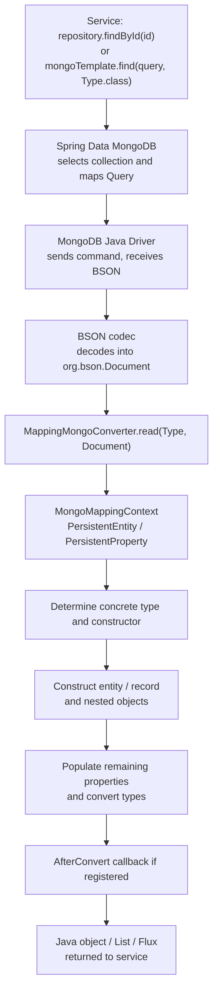
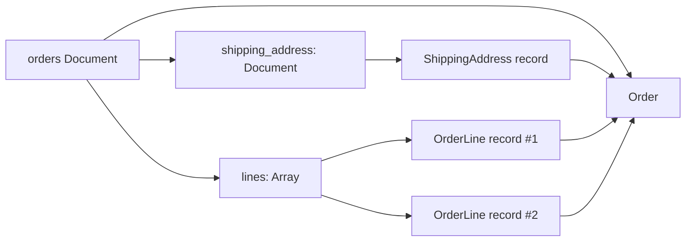

# How MappingMongoConverter Constructs Objects from Documents

When a Java application calls `MongoRepository.findById(...)` or `MongoTemplate.find(...)`, MongoDB returns data in BSON format, while the service expects a strongly typed Java object. **`MappingMongoConverter`** is the core component of Spring Data MongoDB that performs the conversion from document to object: determining the target class, reading entity metadata, converting each value, constructing nested objects, and populating the remaining properties.

In the **Objects and Embedding** chapter, understanding this process helps design documents aligned with how MongoDB stores data, troubleshoot why a field is `null`, why `@Field` does not match, why a constructor is not invoked as expected, and when a reference relationship triggers additional queries.

## 1. The Path from MongoDB to a Java Object



This is a **logical responsibility diagram**. When reading a collection with Spring Data, the driver typically decodes BSON into `org.bson.Document` for the converter to process; with other APIs, codecs, or result types, internal details may vary. `MongoMappingContext` holds prebuilt and reused mapping metadata, so annotations do not necessarily have to be rescanned for every document.

Distinguish the three layers:

| Layer | What It Handles | Examples |
| --- | --- | --- |
| MongoDB Server + Java Driver | MongoDB commands and BSON values | `_id` is a BSON ObjectId, `address` field is a nested document |
| `MappingMongoConverter` | Document ↔ object conversion rules; property names, constructors, type hints, custom conversions | `customer_id` → `customerId`, nested document → `Address` |
| Repository/`MongoTemplate` | Query APIs and result type selection for the application | `Optional<Order>`, `List<Order>`, `Page<Order>` |

The converter **does not execute JOINs, create indexes, or control transactions on its own**. Those responsibilities belong to queries, the server, the session/transaction manager, and other Spring Data components.

## 2. Example Document and Java Model

Suppose the `orders` collection stores an order, its shipping address, and its line items directly inside the document:

```javascript
// Represented in mongosh syntax; IDs are for illustration only.
{
  _id: ObjectId("674000000000000000000501"),
  customer_id: "KH-101",
  shipping_address: {
    city: "Da Nang",
    street: "12 Tran Phu"
  },
  lines: [
    { sku: "S-01", quantity: 2, unit_price_vnd: NumberLong("125000") },
    { sku: "S-02", quantity: 1, unit_price_vnd: NumberLong("45000") }
  ],
  status: "NEW"
}
```

The corresponding Java model:

```java
import java.util.List;
import org.bson.types.ObjectId;
import org.springframework.data.annotation.Id;
import org.springframework.data.mongodb.core.mapping.Document;
import org.springframework.data.mongodb.core.mapping.Field;

record ShippingAddress(String city, String street) {}

record OrderLine(
    String sku,
    int quantity,
    @Field("unit_price_vnd") long unitPriceVnd
) {}

@Document(collection = "orders")
class Order {
    @Id
    private ObjectId id;

    @Field("customer_id")
    private String customerId;

    @Field("shipping_address")
    private ShippingAddress shippingAddress;

    private List<OrderLine> lines;
    private String status;

    public Order() {}

    public ObjectId getId() { return id; }
    public String getCustomerId() { return customerId; }
    public ShippingAddress getShippingAddress() { return shippingAddress; }
    public List<OrderLine> getLines() { return lines; }
    public String getStatus() { return status; }
}
```

`Order` is the aggregate root mapped to the collection. `ShippingAddress` and `OrderLine` are **embedded value objects**: in this example, they do not have their own collection or repository. Spring Data can map properties via field access, even without public setters. Java records have a canonical constructor, making them suitable for immutable value objects.

When using a Java record in a Spring Data version that supports records, the `@Field` annotation on the `unitPriceVnd` component supplies the BSON field name. If you want to avoid relying on how annotations on records are handled in your version, you can turn `OrderLine` into a regular Java class and place `@Field` on the field.

## 3. Step-by-Step: How MappingMongoConverter Builds an `Order`

With `MongoTemplate`:

```java
import org.bson.types.ObjectId;
import org.springframework.data.mongodb.core.MongoTemplate;

ObjectId id = new ObjectId("674000000000000000000501");
Order order = mongoTemplate.findById(id, Order.class);
```

A conceptual sequence of steps:

1. **Determine the target type.** The read operation requests `Order.class`. If type hints for the concrete type are present, the converter can use them according to configuration rules; otherwise, the requested type is the starting point.
2. **Retrieve metadata.** `MongoMappingContext` identifies the `Order` entity, the properties `id`, `customerId`, `shippingAddress`, `lines`, and `status`, along with `@Id` and `@Field`.
3. **Choose how to instantiate.** In this example, the no-argument `Order()` constructor creates an empty instance. For an immutable class, the selected constructor can receive properties directly from the document.
4. **Read and convert each property.** The converter reads `_id` into `ObjectId`, `customer_id` into `String`, `shipping_address` into `ShippingAddress`, and each element of `lines[]` into `OrderLine`.
5. **Populate remaining properties.** The fields of `Order` are populated through Spring Data's property access mechanism, which may use fields, setters, or withers depending on metadata and class design.
6. **Complete the read lifecycle.** Once the entity is mapped, registered callbacks/events can process it further; `MongoTemplate` returns the `Order`, or `null` when no matching document is found.

With a repository:

```java
import java.util.List;
import java.util.Optional;
import org.bson.types.ObjectId;
import org.springframework.data.mongodb.repository.MongoRepository;

interface OrderRepository extends MongoRepository<Order, ObjectId> {
    List<Order> findByCustomerId(String customerId);
}
```

```java
Optional<Order> loaded = repository.findById(id);
List<OrderLine> lines = loaded.map(Order::getLines).orElse(List.of());
```

`MongoRepository` uses the same Spring Data MongoDB entity mapping system; an `Optional.empty()` result simply means no matching document was found, not that the converter created an empty `Order`.

## 4. Field Renaming Mechanism and ID Rules

### 4.1. Java Property Names and BSON Field Names Are Two Different Things

| In Java | Annotation | In MongoDB |
| --- | --- | --- |
| `Order.id` | `@Id` | `_id` |
| `Order.customerId` | `@Field("customer_id")` | `customer_id` |
| `Order.shippingAddress` | `@Field("shipping_address")` | `shipping_address` |
| `Order.lines` | Not renamed | `lines` |
| `OrderLine.unitPriceVnd` | `@Field("unit_price_vnd")` | `unit_price_vnd` |

When using a `Query` bound to an entity class, you normally write using Java properties:

```java
import org.springframework.data.mongodb.core.query.Criteria;
import org.springframework.data.mongodb.core.query.Query;

Query query = Query.query(
    Criteria.where("shippingAddress.city").is("Da Nang")
);
List<Order> orders = mongoTemplate.find(query, Order.class);
```

Spring Data maps the path `shippingAddress.city` to `shipping_address.city`. With MongoDB Shell or the native driver working directly on raw documents, you must query the **actual field name**:

```javascript
db.orders.find({ "shipping_address.city": "Da Nang" });
```

### 4.2. Materializing `_id` and the `String` / `ObjectId` Issue

In the `@Id ObjectId id` example, the BSON ObjectId `_id` becomes a Java `org.bson.types.ObjectId`. If an entity declares `@Id String id`, Spring Data MongoDB can generally convert an ObjectId to a hex string, while on **writes/queries** it applies rules to convert valid ID strings into BSON ObjectIds. With `@MongoId(FieldType.STRING)`, the application can explicitly request storing the ID as a BSON String.

Therefore, if a document is returned by a native query but repository `findById` returns empty, check the BSON type of `_id`, the collection name, and the `@Id`/`@MongoId` strategy. Two values with the same hex string—one stored as an ObjectId and the other as a String—**are not equivalent BSON values**.

## 5. Constructing Embedded Objects and Lists

The converter processes nested documents recursively based on property types:



For `ShippingAddress`, the converter finds the record's canonical constructor and passes the `city` and `street` values. For `List<OrderLine>`, the converter resolves the element type and processes each document in the array; `quantity` is converted to the target numeric type and `unit_price_vnd` is bound to `unitPriceVnd`.

Distinguish embedding from referencing:

- **Embedding:** `shipping_address` and `lines[]` hold the actual data inside the **same document**. Constructing them does not require querying another collection.
- **Plain ID reference:** a Java property of type `ObjectId customerId` only holds an identifier value. The converter does not automatically fetch the customer document.
- **`@DBRef` or `@DocumentReference`:** Spring Data can resolve a document in another collection (eagerly or lazily depending on configuration and mechanism). These may trigger separate queries and should not be equated with embedding.

If a list contains tens of thousands of elements, mapping it into `List<T>` also consumes memory and CPU to instantiate each object. Even though MongoDB allows arrays inside documents, this can be a sign that you should split into a separate collection or limit/project read results.

## 6. Constructor Binding: From Document to Immutable Object

When an entity has no no-argument constructor or uses an immutable design, Spring Data prioritizes **object creation** followed by **property population**. A constructor can be used to supply the required properties at the moment the object is created.

```java
import org.bson.types.ObjectId;
import org.springframework.data.annotation.Id;
import org.springframework.data.annotation.PersistenceCreator;
import org.springframework.data.mongodb.core.mapping.Document;
import org.springframework.data.mongodb.core.mapping.Field;

@Document("customer_profiles")
class CustomerProfile {
    @Id
    private final ObjectId id;

    @Field("display_name")
    private final String displayName;

    private final ShippingAddress address;

    @PersistenceCreator
    public CustomerProfile(
            ObjectId id,
            String displayName,
            ShippingAddress address) {
        this.id = id;
        this.displayName = displayName;
        this.address = address;
    }

    public ObjectId getId() { return id; }
    public String getDisplayName() { return displayName; }
    public ShippingAddress getAddress() { return address; }
}
```

`@PersistenceCreator` designates the constructor to use when materializing the entity if multiple options exist. Parameters are matched against **Java property names**; Spring Data reads the BSON value using the annotations and mapping rules of the corresponding property. For example, `display_name` is still passed into the `displayName` parameter.

For regular Java classes, resolving constructor parameter names requires appropriate metadata (such as compiling with `-parameters` or another approach supported by your Spring Data version). Missing parameter names can cause instantiation failures. With Java records, the canonical constructor and component names make immutable designs more convenient. Do not expect the framework to guess parameter order solely from BSON field names.

**Do not treat constructor invocation like a manual mapper:** the framework selects the instantiation path according to Spring Data's rules. It may use an optimized instantiation mechanism instead of plain Java reflection in all cases; what matters for entity authors is an appropriate constructor, clear property names, and matching data types.

### Properties Assigned by Constructor vs. After Creation

In `CustomerProfile`, all three `final` properties are supplied through the constructor. In `Order` above, the no-argument constructor creates the object and the converter assigns the remaining fields afterward. If an immutable property is neither in the constructor nor backed by a supported wither/assignment mechanism, materialization can fail.

Therefore:

1. Mutable objects: can use a no-arg constructor with field/setter mapping.
2. Immutable objects: provide a valid constructor for all properties that need initialization.
3. With Java records: prefer the canonical constructor; ensure component names and data types match the document.
4. When multiple constructors exist: mark the persistence factory/constructor if needed, and verify readback against a real MongoDB instance.

## 7. How Does the Converter Know the Concrete Type of an Object?

When a Java field is declared with a concrete class, such as `ShippingAddress`, the property metadata is usually enough for the converter to construct the object. However, when a property is typed as an **interface**, **abstract class**, or uses polymorphism, the framework may need information about the actual type stored in the document.

By default, Spring Data MongoDB uses a **type hint** mechanism with the `_class` field in many scenarios. For instance, a Java property of type `PaymentMethod` might hold a `CardPayment` instance:

```java
interface PaymentMethod {}

record CardPayment(String last4) implements PaymentMethod {}

@Document("payments")
class Payment {
    @Id
    private ObjectId id;
    private PaymentMethod method;
}
```

Illustrative document:

```javascript
{
  _id: ObjectId("674000000000000000000601"),
  method: {
    last4: "1234",
    _class: "com.example.payments.CardPayment"
  },
  _class: "com.example.payments.Payment"
}
```

Package names are for example only. The `_class` field can appear on the root document or nested documents when the concrete type needs to be preserved; writing type hints depends on `MongoTypeMapper` and configuration. The converter can use this metadata to determine the concrete class instead of attempting to instantiate the interface.

**Do not treat `_class` as business data.** Renaming packages or classes can break reading legacy documents that rely on stored class names. Applications can use `@TypeAlias` and deliberate type mapper configurations, but they need a data compatibility plan when changing or removing `_class`. If a collection holds multiple subtypes and type hints are disabled, there must be an equivalent way to determine the subtype, such as a custom converter or an explicitly managed discriminator.

## 8. Type Conversion: Built-in Conversions and Custom Converters

A document does not contain a ready-made Java object; each BSON value must be interpreted according to the target type:

| BSON / Java Driver Value | Acceptable Java Types | Notes |
| --- | --- | --- |
| BSON ObjectId | `ObjectId` or `String` ID in some mappings | ID rules differ from regular String properties |
| BSON String | `String`, enum by name under matching default config | Strings not matching an enum constant can cause errors |
| BSON Int32 / Int64 | `int` / `long` / wrappers via supported conversions | Watch out for overflow and numeric schema changes |
| BSON Date | `Date`, `Instant`, and supported/configured time types | Display time zones and precision must be handled separately |
| Nested Document | Entity / value object / record | Built from metadata or a custom converter |
| BSON Array | `List<T>`, supported collections/arrays | Element type matters during conversion |

When the stored type does not map naturally to the domain, you can register a custom converter. For example, if the domain wants to represent a monetary amount together with its currency:

```java
record Money(long amountMinor, String currency) {}

// BSON document:
// { amount_minor: NumberLong("129900"), currency: "VND" }
```

A reading converter:

```java
import org.bson.Document;
import org.springframework.core.convert.converter.Converter;
import org.springframework.data.convert.ReadingConverter;

@ReadingConverter
class DocumentToMoneyConverter implements Converter<Document, Money> {
    @Override
    public Money convert(Document source) {
        Number amount = source.get("amount_minor", Number.class);
        if (amount == null) {
            throw new IllegalArgumentException("Missing amount_minor");
        }
        return new Money(amount.longValue(), source.getString("currency"));
    }
}
```

`DocumentToMoneyConverter` must be **registered in `MongoCustomConversions`** in the Spring Data MongoDB configuration; simply defining the class does not make Spring Data use it automatically. This reading converter applies when Spring Data needs to convert `Document` data into `Money`; if you also need to write `Money` back to BSON reliably, create a corresponding writing converter (`@WritingConverter`). Avoid stacking conflicting converters for the same type pair.

If `amount_minor` can exceed Java `long` limits or involves currencies with fractional subunits, design a different numeric type (such as BSON Decimal128 / Java `BigDecimal`) and verify exact conversion instead of silently truncating numbers.

## 9. How Do Missing Fields, `null`, and Projections Affect Mapping?

A document does not necessarily contain every field declared on the entity, especially when reading legacy data or using projections. Distinguish these cases:

| Field in Document | Result to Watch For |
| --- | --- |
| Has a valid value | Property receives the converted value |
| Has `null` | Reference property may be `null`; for primitives/required constructors, consider the object creation path |
| Does not exist | Property may retain Java defaults (`null`, `0`, `false`), or the constructor receives missing values per binding rules |
| Exists with an unexpected type | May convert via conversions; if incompatible, throws a mapping/conversion error |
| Partially returned via projection | Unselected fields are not automatically queried separately to fill the entity |

Example:

```java
Query query = Query.query(Criteria.where("status").is("NEW"));
query.fields().include("customerId").include("status");
List<Order> partial = mongoTemplate.find(query, Order.class);
```

The `Order` instances in `partial` do not contain `shippingAddress` or `lines` data from the original document. For a mutable object with a no-arg constructor, those fields can be `null`. **Do not call `save(partialOrder)` just to update the status**, because saving an incomplete entity can overwrite or drop unloaded fields. Use `updateFirst`/`findAndModify` to update specific fields, or use a dedicated DTO/projection for the API.

If an immutable constructor requires values not to be missing, legacy data or projections can cause instantiation errors. Test against realistic documents, defaulting rules, and validation rather than treating every missing field as a MongoDB Server error.

## 10. Callbacks and Events Around Reading

Spring Data MongoDB provides mapping events and entity callbacks. In the read flow, two points are commonly distinguished:

1. **After retrieving the document and before converting it to an entity**, events such as `AfterLoadEvent` can inspect the raw document.
2. **After the entity has been constructed**, `AfterConvertCallback<T>` can process the object before returning it to the service.

Callback example:

```java
import org.bson.Document;
import org.springframework.data.mongodb.core.mapping.event.AfterConvertCallback;
import org.springframework.stereotype.Component;

@Component
class OrderReadCallback implements AfterConvertCallback<Order> {
    @Override
    public Order onAfterConvert(
            Order entity,
            Document document,
            String collection) {
        // Permitted post-mapping entity processing can be added here.
        // This snippet returns the object unchanged for illustration.
        return entity;
    }
}
```

Callbacks should not trigger N+1 queries, slow network API calls, or silent business data mutations without an explicit contract. If you need to validate data or build a derived view, separate the responsibilities of converters, callbacks, services, and DTO mappers. Do not assume callbacks will run when querying via the native MongoDB Java Driver, since the driver bypasses the Spring Data entity lifecycle.

With asynchronous/reactive MongoDB operations, the callback type and return types belong to the corresponding reactive variants, and invocation timing is tied to the subscription lifecycle.

## 11. Resolved References vs. Embedded Objects

Suppose `Order` has a customer field. Two modeling approaches:

```java
// Store the ID without automatically querying users:
private ObjectId customerId;

// An option for a reference relationship:
@DocumentReference(lazy = true)
private Customer customer;
```

`@DocumentReference` requires importing `org.springframework.data.mongodb.core.mapping.DocumentReference` and declaring `Customer`/entity with appropriate fields. The snippet illustrates **two different options**, not annotations to place on the same field at once.

When storing only `customerId`, the converter reads the ObjectId and stops. When using `@DocumentReference`, Spring Data can create a lazy proxy or issue queries to load `Customer` depending on configuration. If you read 100 orders and then access `customer` on each one, the system can emit many additional queries; measure command counts to avoid N+1 problems.

Key takeaway: an **embedded object** comes from the same BSON document, whereas a **document reference** may require separate I/O. MongoDB does not enforce foreign keys for these references on its own. When performance is a priority, consider batch queries or `$lookup` aggregations based on specific API needs.

## 12. Layer-by-Layer Troubleshooting of Object Construction Errors

| Symptom | Common Cause | How to Check |
| --- | --- | --- |
| `customerId == null` even though data exists | Stored field is `customer_id` but mapping lacks `@Field`; or projection excluded the field | Inspect raw document and `@Field` metadata |
| Constructor not invoked properly / instantiation failure | Constructor unavailable, missing parameter names, non-instantiable class, missing data | Check `@PersistenceCreator`, `-parameters`, property types, and document |
| Embedded field becomes `null` | Missing nested document, wrong field path, or projection | Inspect `shipping_address` in BSON and mapping paths |
| Failure building enum/number/date | Stored value incompatible with Java type or missing custom conversion | Check `$type`, actual values, and custom converters |
| Interface/abstract property fails to materialize | Missing type hint or subtype resolution mechanism | Inspect `_class`, `@TypeAlias`, and type mapper |
| Repository returns empty while native query finds results | Different collection/database, mismatched `_id` type, different mapped query | Compare mapped query and actual BSON types |
| Reading one document triggers many queries | Eager `@DBRef`/`@DocumentReference` or accessed lazy references | Log commands, review references and batching |
| Values lost after round-trip | Custom converter missing writing direction, schema version mismatch, incompatible numeric types | Compare document before and after `save` + readback |

To diagnose issues, start with the **actual document** stored in MongoDB (field names, BSON types, values), then compare it against the Java entity and its annotations. Selective logging in `MongoTemplate` and MongoDB Java Driver command monitoring can help identify executed queries, though passwords, tokens, and sensitive data must not be written to logs.

## 13. Testing Mapping from Raw Documents

To see how the converter actually reads a document, an integration test backed by a dedicated test MongoDB instance is more reliable than mocking the repository.

Example using JUnit 5 and a Spring Boot test slice (assuming `Order` and the records above are scanned, with a `MongoTemplate` bean and test MongoDB configured):

```java
import static org.assertj.core.api.Assertions.assertThat;

import java.util.List;
import org.bson.Document;
import org.bson.types.ObjectId;
import org.junit.jupiter.api.Test;
import org.springframework.beans.factory.annotation.Autowired;
import org.springframework.boot.test.autoconfigure.data.mongo.DataMongoTest;
import org.springframework.data.mongodb.core.MongoTemplate;

@DataMongoTest
class OrderReadMappingTest {
    @Autowired MongoTemplate template;

    @Test
    void shouldMaterializeEmbeddedObjects() {
        ObjectId id = new ObjectId();
        Document address = new Document("city", "Da Nang")
                .append("street", "12 Tran Phu");
        Document line = new Document("sku", "S-01")
                .append("quantity", 2)
                .append("unit_price_vnd", 125000L);

        Document raw = new Document("_id", id)
                .append("customer_id", "KH-101")
                .append("shipping_address", address)
                .append("lines", List.of(line))
                .append("status", "NEW");

        template.getCollection("orders").insertOne(raw);

        Order loaded = template.findById(id, Order.class);

        assertThat(loaded).isNotNull();
        assertThat(loaded.getCustomerId()).isEqualTo("KH-101");
        assertThat(loaded.getShippingAddress().city())
                .isEqualTo("Da Nang");
        assertThat(loaded.getLines()).hasSize(1);
        assertThat(loaded.getLines().get(0).unitPriceVnd())
                .isEqualTo(125000L);
    }
}
```

The test deliberately inserts a **raw document through the driver** and reads it back using `MongoTemplate`: this verifies read mapping independently from how Spring Data writes entities. If a test only runs `template.save(order)` and reads it back, the write and read sides can mask schema bugs or field-naming conventions that do not match legacy data.

When running with different Spring Boot/Spring Data versions, configure the test MongoDB and dependencies accordingly; do not rely on the test library automatically starting a database. You can use Testcontainers to provide a real MongoDB instance for tests. Tests must run in an isolated environment to avoid accidentally connecting to a production database.

Beyond the happy path, also test:

- Documents missing `shipping_address` or `lines`, to verify domain-permitted defaults.
- A `lines` element whose `quantity` has the wrong type, checking that conversion errors are handled clearly.
- An immutable entity with `@PersistenceCreator`, verifying constructor binding and final properties.
- Documents with subtypes and `_class`, plus checking behavior when type aliases/configurations change.
- Reading with a projection, then ensuring an incomplete entity cannot accidentally be saved back via `save`.

## 14. Differences When Reading Reactively

`ReactiveMongoTemplate` and `ReactiveMongoRepository` return `Mono<T>`/`Flux<T>`, yet **object mapping rules, `@Field`, `@Id`, nested documents, and custom conversions still apply**.

```java
import org.bson.types.ObjectId;
import reactor.core.publisher.Mono;
import org.springframework.data.mongodb.core.ReactiveMongoTemplate;

Mono<Order> findOrder(
        ReactiveMongoTemplate template, ObjectId id) {
    return template.findById(id, Order.class);
}
```

The reactive path only executes the query when the publisher is subscribed to per Reactive Streams semantics; received BSON data still has to be constructed into an `Order`. Mapping each document uses CPU and memory, so reactive execution does not automatically make building a complex object faster. For large datasets, use filtering/indexes, pagination, projections, and backpressure/consumption control instead of collecting an entire `Flux` into RAM.

## 15. Self-Check Questions

**1.** A document stores `customer_id`, but the entity uses `customerId` without `@Field`. Why might the property be empty? **Answer:** because default property-name mapping does not know that `customer_id` and `customerId` are the same. Use `@Field("customer_id")` or an appropriate field naming strategy.

**2.** Why can `Order.lines` become `List<OrderLine>` without needing an `OrderLineRepository`? **Answer:** each element is an embedded document stored directly inside the `orders` BSON document; the converter reads it using the declared element type.

**3.** Is `@DocumentReference(lazy = true)` on `Order.customer` equivalent to embedding `Customer` inside the order? **Answer:** no; the referenced document may require additional queries when accessed.

**4.** An immutable entity has constructor `(ObjectId id, String displayName)`, while the document stores `display_name`. Does the constructor parameter need to be renamed to `display_name`? **Answer:** no; the parameter binds to the Java property `displayName`, while `@Field` handles the BSON field name.

**5.** Why can a record be readable from a raw document yet `save` writes unexpected data? **Answer:** check the schema, writing custom converters, annotations, type hints, and fields omitted during a projection read; test both directions separately.

**6.** Can you inspect a raw `Document` to debug a mapping issue and then routinely call `save` on an entity read with missing fields? **Answer:** you should not; if only one field needs to change, use `Update` with appropriate criteria to avoid losing data outside the update scope.

The object construction process in `MappingMongoConverter` can be summarized as: **BSON → `Document` → `MongoPersistentEntity` metadata → type and constructor selection → property conversion/population → Java object**. Understanding each step helps distinguish query errors, BSON errors, constructor errors, mapping errors, and reference issues, leading to more reliable embedded object design and Spring Data MongoDB testing.
