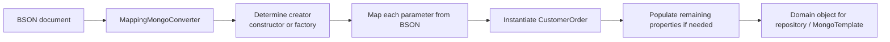
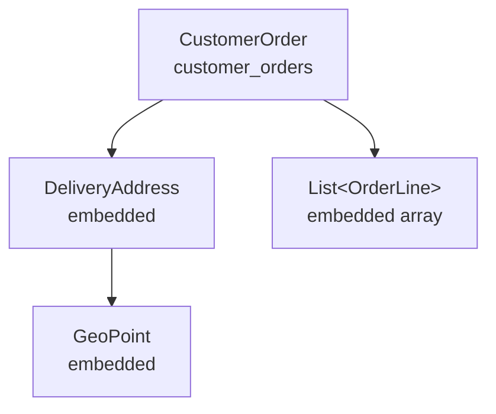

# Constructors, Factories, and @PersistenceCreator

> **Chapter:** Objects and Embedding  
> **Module:** `SPRING_DATA_MONGODB` — using Spring Data MongoDB to connect, map documents, and operate on MongoDB via `MongoTemplate` or repositories. Understanding how objects are constructed from BSON is the foundation for designing queries, aggregations, indexes, transactions, reactive access, testing, and diagnosing data issues. This lesson focuses on constructors, factory methods, and `@PersistenceCreator` when mapping Java objects, especially immutable objects and embedded objects.

## 1. The Problem: Reading a Document to Create a Java Object

MongoDB stores documents in **BSON** format, whereas a Java application works with classes, records, and domain types that have their own constructors. When reading an order, Spring Data MongoDB must know **how to instantiate the object** before populating its properties.

Example document:

```json
{
  "_id": "ORDER-101",
  "buyer_id": "CUS-42",
  "deliveryAddress": {
    "city": "Da Nang",
    "street": "Hai Chau"
  },
  "lines": [
    { "sku": "BOOK-01", "quantity": 2 },
    { "sku": "PEN-02", "quantity": 1 }
  ],
  "createdAt": { "$date": "2026-11-20T02:00:00Z" }
}
```

If the `CustomerOrder` class has `final` fields and no setters, Spring Data **cannot simply invoke an empty constructor and assign every field one by one afterward**. The framework must choose an appropriate parameterized constructor or factory method to pass data in at instantiation time.



**A constructor/factory for materialization** (creating an object from stored data) differs from a business creation method such as `placeOrder(…)`. Both operations may share an implementation, but their purpose and data constraints are often different.

## 2. How Does Spring Data Choose a Constructor or Factory?

In Spring Data Commons' **object creation** mechanism used by Spring Data MongoDB, the key rules when materializing an entity are:

1. If there is **one static factory method** annotated with `@PersistenceCreator`, Spring Data prefers that factory.
2. If there is no such factory, but there is **one constructor** annotated with `@PersistenceCreator`, Spring Data uses the specified constructor.
3. For a **Java record**, Spring Data uses the **canonical constructor** (the constructor containing all record components) by default.
4. If nothing is explicitly specified and the class has a **no-argument constructor**, Spring Data can use the empty constructor and then perform property population.
5. If a class has only **a single constructor**, that constructor can be selected even without `@PersistenceCreator`.
6. If there are multiple constructors without a unique way to identify a persistence creator, materialization may fail; an available no-argument constructor often serves as the fallback per the rules above.

This ordering explains the **creator selection strategy**; specific Spring Data versions add rules regarding visibility, data types, and instantiation mechanisms. When designing important classes, **declare the creator explicitly** to avoid depending on whether an auxiliary constructor is added later.

| Java Structure | Typically Selected Creator | Consequence |
| --- | --- | --- |
| `record Address(String city, String street)` | Record canonical constructor | Components are passed into the constructor. |
| Class with exactly one parameterized constructor | The single constructor | Fits immutable entities well. |
| Class with a no-arg constructor and convenience constructors | No-arg unless specified otherwise | Properties are populated after instantiation. |
| Class with multiple constructors, one annotated `@PersistenceCreator` | The annotated constructor | Eliminates ambiguity when reading from MongoDB. |
| Class with a static factory annotated `@PersistenceCreator` | That static factory | Centralizes and standardizes restoration logic in a factory. |
| Class with competing constructors, no no-arg, no annotation | No unambiguous creator | Risk of mapping errors when reading data. |

**`@PersistenceCreator`** resides in the `org.springframework.data.annotation` package. Some older codebases use `@PersistenceConstructor`; verify against your API/version during maintenance. For new code on supported versions, `@PersistenceCreator` covers both constructors and factory methods and expresses intent more clearly.

## 3. Default Constructor and Property Population

The JavaBean style typically uses an empty constructor and mutable fields:

```java
import org.springframework.data.annotation.Id;
import org.springframework.data.mongodb.core.mapping.Document;

@Document(collection = "customers")
public class Customer {
    @Id
    private String id;
    private String name;

    protected Customer() { }

    public Customer(String name) {
        this.name = name;
    }

    public String getId() { return id; }
    public String getName() { return name; }
    public void rename(String name) { this.name = name; }
}
```

When reading the document `{ "_id": "...", "name": "An" }`, Spring Data can call the no-arg constructor and set `id` and `name` afterward via the appropriate property access mechanism. A `protected` constructor does not have to be changed to `public` just for the framework to work, though visibility and instantiation performance depend on the implementation and version.

This style is straightforward for mutable entities, but it has drawbacks:

- Briefly after the constructor runs, the object does not yet hold the full state from MongoDB.
- Required fields may temporarily be `null`.
- Invariants such as "an order always has a buyer and creation timestamp" are hard to enforce with a no-arg constructor.
- If fields are changed to `final` and setters are removed, post-instantiation property population may no longer work.

**When to use:** simple, mutable entities where validation rules are checked at another layer or where JavaBean-style instantiation is expected. For domains requiring immutability, prefer a constructor containing all required state.

## 4. Specifying a Constructor with @PersistenceCreator

### 4.1. Immutable Entity Pattern with Embedded Objects

Let's declare an order with `id`, `buyerId`, `createdAt`, a delivery address, and a list of items. All fields are `final`, so the object must be created with complete data.

```java
import java.time.Instant;
import java.util.List;
import java.util.Objects;
import org.springframework.data.annotation.Id;
import org.springframework.data.annotation.PersistenceCreator;
import org.springframework.data.mongodb.core.mapping.Document;
import org.springframework.data.mongodb.core.mapping.Field;

@Document(collection = "customer_orders")
public class CustomerOrder {

    @Id
    private final String id;

    @Field("buyer_id")
    private final String buyerId;

    private final DeliveryAddress deliveryAddress;
    private final List<OrderLine> lines;
    private final Instant createdAt;

    @PersistenceCreator
    public CustomerOrder(
            String id,
            String buyerId,
            DeliveryAddress deliveryAddress,
            List<OrderLine> lines,
            Instant createdAt) {
        this.id = id;
        this.buyerId = Objects.requireNonNull(buyerId);
        this.deliveryAddress = Objects.requireNonNull(deliveryAddress);
        this.lines = List.copyOf(Objects.requireNonNull(lines));
        this.createdAt = Objects.requireNonNull(createdAt);
    }

    // Business factory, NOT a persistence creator.
    public static CustomerOrder place(
            String buyerId,
            DeliveryAddress address,
            List<OrderLine> lines) {
        return new CustomerOrder(null, buyerId, address, lines, Instant.now());
    }

    public String getId() { return id; }
    public String getBuyerId() { return buyerId; }
    public DeliveryAddress getDeliveryAddress() { return deliveryAddress; }
    public List<OrderLine> getLines() { return lines; }
    public Instant getCreatedAt() { return createdAt; }

    public record DeliveryAddress(String city, String street) {}
    public record OrderLine(String sku, int quantity) {}
}
```

Here `@PersistenceCreator` sits on the **full five-argument constructor**. When reading BSON, Spring Data invokes that constructor to build `CustomerOrder`. When creating a new order in business logic, code calls `CustomerOrder.place(…)`, intentionally setting the ID to `null` and using the current timestamp.

The nested records `DeliveryAddress` and `OrderLine` are **embedded values**, materialized through their respective canonical constructors. They do not have collections of their own. Spring Data maps `buyerId` from BSON `buyer_id` thanks to `@Field("buyer_id")` on the domain property.

> The example uses Java 17+ and assumes a Spring Data MongoDB version with record support. `Objects.requireNonNull` expresses domain rules; if legacy documents are missing required fields, reading them **can fail**. In a live system, plan data migrations or compatibility with older schemas before adding constructor constraints.

### 4.2. From MongoDB Back to the Constructor

A corresponding document looks like:

```json
{
  "_id": "ORDER-101",
  "buyer_id": "CUS-42",
  "deliveryAddress": {
    "city": "Da Nang",
    "street": "Hai Chau"
  },
  "lines": [
    { "sku": "BOOK-01", "quantity": 2 },
    { "sku": "PEN-02", "quantity": 1 }
  ],
  "createdAt": { "$date": "2026-11-20T02:00:00Z" }
}
```

When read with `MongoTemplate.findById("ORDER-101", CustomerOrder.class)` or a repository, mapping proceeds logically as follows:

| Constructor Parameter | Domain Property | BSON Source |
| --- | --- | --- |
| `id` | `@Id id` | `_id` |
| `buyerId` | `@Field("buyer_id") buyerId` | `buyer_id` |
| `deliveryAddress` | `deliveryAddress` | `deliveryAddress` object |
| `lines` | `lines` | `lines` document array |
| `createdAt` | `createdAt` | BSON datetime `createdAt` |

**Important:** the Java constructor parameter name is **`buyerId`**, matching the Java property, even though BSON stores it under `buyer_id`. `@Field` bridges the property and the stored field. Renaming the parameter to `buyer_id` without a corresponding mapping mechanism can prevent Spring Data from finding the property to bind.

In the example, `List.copyOf` creates a list that cannot be modified via the `List` API. This is Java-level immutability—it does not prevent the MongoDB server from updating the `lines` array through other commands. Likewise, having all final fields on the entity still allows MongoDB to persist and convert them normally.

### 4.3. Updating an Immutable Entity

Instead of mutating fields directly, you build a new instance that preserves the identifier:

```java
public CustomerOrder withAddress(DeliveryAddress newAddress) {
    return new CustomerOrder(id, buyerId, newAddress, lines, createdAt);
}
```

The snippet above is a **method added to the `CustomerOrder` class**, not a standalone Java file. With a repository:

```java
CustomerOrder current =
    repository.findById("ORDER-101").orElseThrow();

CustomerOrder changed = current.withAddress(
    new CustomerOrder.DeliveryAddress("Hue", "Le Loi")
);

CustomerOrder saved = repository.save(changed);
```

If the domain uses `@Version` for optimistic locking, the copy must **preserve the current version**, and constructors/factories should be designed accordingly. Dropping the version when creating a copy can cause Spring Data to treat it as a new entity and attempt an insert, resulting in a duplicate key error. Java immutability **does not protect against concurrent updates on its own**; use optimistic locking or conditional updates when required by business logic.

## 5. Static Factory Method with @PersistenceCreator

Sometimes a team wants to hide constructors, control factory naming, or maintain multiple creation paths. In such cases, you can annotate a **static factory method** with `@PersistenceCreator`:

```java
import org.springframework.data.annotation.Id;
import org.springframework.data.annotation.PersistenceCreator;
import org.springframework.data.mongodb.core.mapping.Document;

@Document(collection = "catalog_items")
public final class CatalogItem {

    @Id
    private final String id;
    private final String title;
    private final int stock;

    private CatalogItem(String id, String title, int stock) {
        this.id = id;
        this.title = title;
        this.stock = stock;
    }

    @PersistenceCreator
    public static CatalogItem restore(
            String id, String title, int stock) {
        return new CatalogItem(id, title, stock);
    }

    // Factory for new creation flows.
    public static CatalogItem create(String title, int stock) {
        return new CatalogItem(null, title, stock);
    }

    public String getId() { return id; }
    public String getTitle() { return title; }
    public int getStock() { return stock; }
}
```

When reading from MongoDB, Spring Data invokes **`restore(id, title, stock)`**. When creating a new item, application code calls **`create(title, stock)`**. The `restore` method must be recognizable by Spring Data as a factory, and its parameters must correspond to the persisted properties. Do not attach `@PersistenceCreator` to every factory that serves different business purposes.

Do not mistake an annotated factory for an "after object creation" callback: **the factory is the instantiation mechanism itself**. Separate callback steps such as `AfterConvertCallback` (if any) happen at a different stage of the mapping lifecycle.

### 5.1. Constructor or Factory?

| Criterion | Constructor with `@PersistenceCreator` | Static Factory with `@PersistenceCreator` |
| --- | --- | --- |
| Expressiveness | Instantiates directly with parameters | Names the entity restoration action explicitly |
| API control | Can use public, protected, or suitable visibility | Can keep constructors non-public, letting the factory take responsibility |
| Creation logic | May be shared with persistence constructor | Easily separates `create` and `restore` |
| Parameter mapping | Parameter names bind to properties | Parameter names must also bind to properties |
| Risks | Adding another constructor increases the chance of wrong selection if the annotation is omitted | Factory returning wrong type/state, or multiple annotated factories causing ambiguity |

For small classes with a single constructor, **it is not strictly necessary to add `@PersistenceCreator`**. The annotation is most valuable when pinning the choice among multiple constructors/factories or making persistence intent explicit.

## 6. Constructor Parameter Names and Value Mapping

Spring Data needs to know **which parameter corresponds to which property**. For example, a constructor taking `String buyerId` binds from the `buyerId` property, and then the mapping system resolves the BSON field as `buyer_id`.

### 6.1. Compiling with Parameter Name Metadata

Compile Java code with the `-parameters` option (or the equivalent mechanism provided by your build tool) so parameter name metadata is retained in bytecode. For some older projects, debug metadata or the `@ConstructorProperties` annotation can also supply the needed information, depending on the Spring version.

Example:

```java
import java.beans.ConstructorProperties;

public class ShippingLabel {
    private final String orderId;
    private final String recipient;

    @ConstructorProperties({"orderId", "recipient"})
    public ShippingLabel(String orderId, String recipient) {
        this.orderId = orderId;
        this.recipient = recipient;
    }
}
```

`@ConstructorProperties` illustrates how to declare **property names** for parameters, rather than arbitrary BSON names. For the class above to actually serve as an entity in exercises, you still need appropriate collection, ID, and property mappings.

Missing parameter name metadata can cause mapping errors when reading immutable objects, especially if builds or obfuscation turn parameter names into `arg0`, `arg1`. This error typically **surfaces only at runtime during materialization**, because Java source code compiles normally.

### 6.2. Nulls, Missing Fields, and Default Values

Suppose an old document lacks `deliveryAddress`, yet the constructor enforces `Objects.requireNonNull(deliveryAddress)`. Spring Data cannot invent a valid address on its own. Depending on parameter type, nullability, and converters, the outcome may be passing `null`, applying an intentional default, or throwing a mapping/instantiation exception.

Possible ways to handle this:

- Add a migration/backfill for old documents before requiring the new field.
- Accept nullable parameters if the domain allows it, then normalize deliberately in the constructor.
- For Java records or Kotlin data classes, check what default value / nullability support your framework version offers.
- Use `@Value` on a persistence creator parameter to evaluate an expression when genuinely needed, while thoroughly testing field names, nulls, and types because expressions can hide broken schemas.

**Avoid using defaults to mask critical data errors.** For example, defaulting `quantity=1` when the BSON field is actually missing can produce orders with wrong quantities. When schemas evolve, define clear compatibility rules and write tests with historical data.

### 6.3. Parameters Not Matching Properties Can Cause Errors

Incorrect example:

```java
@PersistenceCreator
public CatalogItem(String id, String displayText, int stock) {
    this.id = id;
    this.title = displayText; // Property is named "title", not "displayText".
    this.stock = stock;
}
```

If the class has no persistent property named `displayText` and no explicitly configured binding, Spring Data has no basis to match this parameter to the `title` field. The usual fix is to name the parameter `title` or use an explicit expression/custom mapping, rather than relying on a convenient variable name that differs from metadata.

## 7. Records, Nested Classes, and Multi-Level Constructors

### 7.1. Records for Embedded Value Objects

Java records are well suited to representing immutable value objects. The two `public` records below should live in separate Java files matching their type names:

```java
public record GeoPoint(double latitude, double longitude) {}

public record DeliveryAddress(
    String city,
    String street,
    GeoPoint location
) {}
```

In a record, the canonical constructor includes all `record components` and is recognized by Spring Data according to record rules. An embedded document looks like:

```json
{
  "deliveryAddress": {
    "city": "Da Nang",
    "street": "Hai Chau",
    "location": { "latitude": 16.05, "longitude": 108.20 }
  }
}
```

When reading a `CustomerOrder` with the corresponding `deliveryAddress` property, Spring Data materializes `GeoPoint` and `DeliveryAddress`, then passes the object into the parent entity's constructor. In these record examples, `GeoPoint` is a plain BSON object; if you want to store GeoJSON format for geospatial indexing, use the appropriate type and mapping rather than assuming the `GeoPoint` record above is already GeoJSON.

### 7.2. Embedded Objects Do Not Automatically Create Collections



The constructor of a child object is selected **independently** according to the creator rules for that child type. `DeliveryAddress` and `OrderLine` do not need `@Document(collection = "...")` just to be stored embedded. Because they live inside the order document, consider lifecycle, document size, nested-field queries, and document-level atomicity.

A child object **referencing another document** (for example via `@DocumentReference`) is a different topic from an embedded object. `@PersistenceCreator` only governs how an instance is constructed; it **does not turn an embedded object into a reference** and does not define cross-collection transactions.

### 7.3. Should Entire Entities Be Written as Records?

Yes, if it fits the domain and your Spring Data version supports it:

```java
import org.springframework.data.annotation.Id;
import org.springframework.data.mongodb.core.mapping.Document;

@Document(collection = "order_summaries")
public record OrderSummary(
    @Id String id,
    String buyerId,
    int lineCount
) {}
```

Records are convenient for read models or immutable value objects. However, when MongoDB generates IDs, updates versions, modifies state, or maps documents with missing fields, **inspect the object returned by `save`** and the property population/copying mechanism the framework uses. Do not assume the original record instance is mutated in place, because records are immutable.

## 8. Relationship with @Id, @Version, @Field, and Type Hints

Constructors/factories address **how to instantiate an object**, whereas mapping annotations address **where data comes from**:

| Annotation / Mechanism | Role | Relation to Persistence Creator |
| --- | --- | --- |
| `@Document(collection = "...")` | Selects the collection for the entity | Does not decide which constructor is called. |
| `@Id` / `@MongoId` | Maps the identifier to BSON `_id` | The `id` parameter receives the ID value after appropriate type conversion. |
| `@Field("buyer_id")` | Renames the BSON field | The constructor parameter still uses the Java property name `buyerId`. |
| `@Version` | Optimistic locking and new-entity state detection in repositories | The creator should receive/preserve the version for immutable entities. |
| `@Transient` | Excludes a property from mapping | Do not expect a matching parameter to be automatically bound from BSON. |
| `@TypeAlias` / `_class` type hint | Identifies the concrete Java type to materialize in some structures | Once the type is known, Spring Data selects the appropriate creator for that type. |

For example, when a collection holds subtypes supported via type information, the system may need a type hint to resolve the concrete class and its constructor. If `_class`/type mapping is stripped while data still holds multiple subtypes or an interface, materialization may lack sufficient information. That is a **type resolution** issue, separate from selecting a constructor within a known type.

With `@Version` on an immutable entity, if a copy constructor drops the version from the document, the next save may be treated as a new insert or optimistic locking may not behave as expected. Ensure `id` and `version` are not forgotten when designing business factories or `with...` methods.

## 9. Verifying with Repositories and MongoTemplate

Assume the project has configured the MongoDB Java Driver and Spring Data MongoDB compatible with the running Spring Boot version, and that `CustomerOrder` and the nested records from section 4 are defined.

Repository:

```java
import java.util.List;
import org.springframework.data.mongodb.repository.MongoRepository;

public interface CustomerOrderRepository
        extends MongoRepository<CustomerOrder, String> {
    List<CustomerOrder> findByBuyerId(String buyerId);
}
```

Saving and reading:

```java
CustomerOrder order = CustomerOrder.place(
    "CUS-42",
    new CustomerOrder.DeliveryAddress("Da Nang", "Hai Chau"),
    List.of(new CustomerOrder.OrderLine("BOOK-01", 2))
);

CustomerOrder persisted = repository.save(order);
CustomerOrder loaded =
    repository.findById(persisted.getId()).orElseThrow();

// loaded is constructed via the @PersistenceCreator constructor.
// Address and each order line are materialized from BSON.
```

A similar read via template:

```java
CustomerOrder fromTemplate =
    mongoTemplate.findById(persisted.getId(), CustomerOrder.class);
```

With `@Field("buyer_id")`, the repository method `findByBuyerId` uses the **Java property**. In `mongosh`, check the actual BSON field:

```javascript
db.customer_orders.findOne({ buyer_id: "CUS-42" })
```

If `@PersistenceCreator` does not pick the right creator or constructor parameters cannot bind, errors typically appear when calling `findById`/`find`, even if the initial write succeeded. Therefore, testing only "write succeeded" is not enough; you must test the **round trip**.

## 10. Common Errors and How to Diagnose Them

| Symptom | Possible Cause | How to Fix |
| --- | --- | --- |
| Reading a document reports no creator/constructor found | Class has multiple constructors with no clear choice. | Designate one constructor or static factory with `@PersistenceCreator`. |
| Constructor parameter fails to bind | Missing parameter name metadata, parameter name differs from property, or property missing in mapping. | Check `-parameters`, `@ConstructorProperties`, and Java property names. |
| Error claiming `buyer_id` was "not found" | Constructor declared parameter `buyer_id` while the Java property is `buyerId`. | Name the parameter `buyerId`; `@Field` handles the BSON name. |
| Reading historical data throws `NullPointerException` | Old document lacks a field checked with `requireNonNull` in the constructor. | Migrate data, adjust domain invariants, or handle nulls intentionally. |
| Business factory always sets `createdAt=now` on load | Creation factory mistakenly used to restore entities. | Separate `create` and `restore`; annotate only the restoration factory. |
| Immutable entity reads fine, but `save` loses ID/version | Factory/copy constructor drops persistence metadata. | Carry both ID and version in the creator and copies; write round-trip tests. |
| Shell query cannot find field `buyerId` | Actual BSON stores `buyer_id`. | Query the shell using BSON field names, and repositories using Java property names. |
| Child object fails to materialize | Nested type lacks a suitable creator, lacks type info, or schema mismatches. | Check each child type's record/constructor and inspect the raw document. |
| `@PersistenceCreator` placed on multiple factories | Framework has no unique choice. | Keep exactly one intentional persistence creator. |
| Renaming classes/packages breaks reading old data | Stored `_class` type hint or alias uses old names. | Plan migrations/type mapping; do not just rename constructors. |

### Concrete Diagnostic Workflow

1. **Fetch the BSON document** from the test database using `mongosh`, confirming field names and BSON types—especially `_id`, embedded fields, lists, and dates.
2. **Inspect constructor/factory signatures** and how many constructors exist; verify that only one `@PersistenceCreator` is actively used.
3. **Verify parameter names** in bytecode/compiler configuration and Java property names, including `@Field` aliases.
4. **Test reading layer by layer:** child value objects first, then the parent entity. For nested records, confirm BSON data matches record components.
5. **Check invariants against legacy data**, particularly nulls, newly added fields, and type conversions.
6. **Read back after writing**, comparing business fields, ID, version, addresses, and lists; do the same with both repository and `MongoTemplate`.

When running aggregations or projections that retrieve only a subset of fields, remember that **a constructor requiring complete data may no longer fit projected results**. For queries that only need a few fields, consider a dedicated DTO/projection, pick a suitable return type, and verify how Spring Data materializes projections; do not assume a full immutable entity can still be constructed from a partial document.

## 11. Hands-on Exercise and Self-Assessment Questions

### Exercise: Order with Embedded Objects

Build a `Shipment` containing `id`, `trackingCode`, `destination`, and `events`. `destination` is a `Destination(city, postalCode)` record; `events` is a list of `TrackingEvent(status, timestamp)` records.

Requirements:

1. Use `@Document(collection = "shipments")`, mapping `trackingCode` to BSON `tracking_code`.
2. Design an immutable entity with at least two business creation methods and **one persistence constructor** annotated with `@PersistenceCreator`.
3. Write a `Shipment.start(…)` factory for new shipments, while the persistence creator accepts ID, tracking code, destination, and history.
4. Save and read back using a repository or `MongoTemplate`. Check BSON field names in `mongosh` and confirm nested records are restored properly.
5. Insert a test document without `destination`. Explain whether the domain should allow null, apply an explicit default, or reject reads; choose an approach based on business requirements.
6. Write a test exercising constructor selection: add a secondary constructor while keeping `@PersistenceCreator`. Verify readback still constructs the entity correctly.

### Comprehension Check Questions

- Why does a class with a single constructor usually not need `@PersistenceCreator`?
- When both a no-arg constructor and a full constructor exist without annotations, which one does Spring Data choose?
- Why should a static factory for placing new orders not be annotated with `@PersistenceCreator` if it generates `createdAt` and omits the ID?
- Why does the `buyerId` parameter keep its Java name even though the document has the BSON key `buyer_id`?
- What signs indicate that a failure is in constructor materialization rather than a MongoDB connection error?
- If a constructor calls `Objects.requireNonNull` and old documents lack the field, how should schema evolution be handled?
- How does an embedded record differ from a separate collection or a reference to another document?
- When copying an immutable entity with `@Version`, why must the version be preserved before saving?

**Completion criteria:** the learner can explain how Spring Data selects a creator, build an immutable entity with nested records, distinguish business factories from persistence factories, and write integration tests verifying BSON ↔ Java round trips.

## 12. Key Takeaways and References

- **The persistence creator** determines how Spring Data constructs an object when reading BSON; it does not replace business rules for creating new objects.
- **`@PersistenceCreator`** pins the chosen constructor or static factory, especially when a class has multiple initialization paths.
- **Constructor parameter names** must map to **Java properties**; `@Field` governs the BSON name and does not necessarily change the Java parameter name.
- **Records** are convenient for embedded value objects because they provide a canonical constructor and immutability by default.
- **No-arg + property population** suits some mutable entities; **constructor binding** suits building objects with complete state upon instantiation.
- **Missing fields, legacy data, ID/version handling, and factories that compute values** are common bug sources that should be tested via save-and-readback round trips.
- **`MongoRepository` and `MongoTemplate`** share Spring Data's entity mapping; raw driver/mongosh queries operate on actual BSON field names.

Reference documentation for your version: [Spring Data MongoDB Reference — Mapping Fundamentals](https://docs.spring.io/spring-data/mongodb/reference/mongodb/mapping/mapping.html) and [Spring Data Commons — Object Mapping Fundamentals](https://docs.spring.io/spring-data/commons/reference/object-mapping.html).
