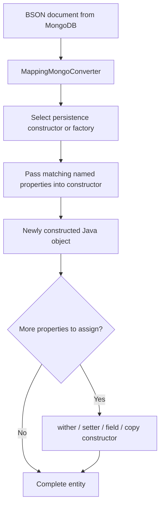

# Immutable Entities, Java Records, and Wither Methods

In MongoDB, a document can contain multiple nested objects and arrays. When using **Spring Data MongoDB**, these parts are mapped to Java objects. You can design those objects as **immutable**: once created, their internal state cannot be changed through setters or direct mutation. To change a value, the application creates a **new object** representing the new state.

This aligns well with the data modeling in the **Objects and Embedding** chapter of the `SPRING_DATA_MONGODB` module. This lesson combines document mapping, nested objects, `MongoTemplate`, and repositories to explain how Spring Data restores immutable entities from BSON, how **Java records** reduce boilerplate, the role of **wither** methods, and what to watch out for when MongoDB generates `_id` or manages `@Version`.

> **Key takeaway:** Immutability of a Java object and atomicity of a MongoDB operation are two separate concerns. Objects without setters make application state easier to manage, but database updates still require choosing the right `insert`, `save`, conditional updates, and conflict-handling mechanisms.

## 1. Learning Objectives

After this lesson, you can:

1. Distinguish immutable objects, objects that merely "lack setters," and **deeply immutable** objects.
2. Understand the **constructor binding → property population** flow in Spring Data MongoDB.
3. Build `@Document` entities using Java `record`, including embedded objects and immutable lists.
4. Use `@PersistenceCreator` and full constructors for an immutable `final class`.
5. Write `withId`, `withAddress`, and `withStatus` without mutating the original instance.
6. Handle MongoDB ID generation and version updates on objects with `final` fields.
7. Understand the differences between creating an object copy, `repository.save`, and partial updates with `MongoTemplate.updateFirst`.
8. Test round-trip mapping, ID generation, optimistic locking, and errors caused by legacy schemas.

## 2. Immutability in Java Does Not Mean Data Stands Still

A mutable entity typically allows direct modification:

```java
shipment.setStatus("SHIPPED");
shipment.getItems().add(extraItem);
```

With an immutable entity, you represent a change as a **new value**:

```java
Shipment updated = shipment.withStatus("SHIPPED");

// shipment still keeps the old state.
// updated carries the new state.
```

Benefits:

- **Easier reasoning:** a reference currently in use cannot have its fields silently altered by other code.
- **Clear state transitions:** invariants can be enforced directly in constructors or business methods.
- **Fewer side effects:** services do not accidentally mutate an entity still held by another layer.
- **Fits constructor-based mapping:** Spring Data can read BSON data and construct a fully initialized object.
- **Great for embedded objects:** addresses, line items, or unit price details naturally behave as value objects.

However, Java object immutability **does not by itself protect** two concurrent requests modifying the same document. Two copies can both be built from an old version; if both are passed to `save`, the later request can still overwrite the earlier one without optimistic locking or conditional updates.

### 2.1. Shallow vs. Deep Immutability

```java
public record Cart(String id, java.util.List<String> items) {
}
```

The record itself has no setters and its components are `final`, yet:

```java
var items = new java.util.ArrayList<String>();
items.add("SKU-1");

var cart = new Cart("CART-1", items);

items.add("SKU-2");       // Modifies the external list.
cart.items().add("SKU-3"); // Can also modify it if the list remains mutable.
```

Thus, the record above is only **shallowly immutable**. A defensive copy is needed:

```java
public record Cart(String id, java.util.List<String> items) {
    public Cart {
        items = java.util.List.copyOf(items);
    }
}
```

`List.copyOf` creates a copy that cannot be modified through standard `List` APIs and prevents external list changes from affecting the object. Still, this remains a **shallow** copy: if elements inside the list are mutable objects, their internal state can still change. Combine immutable collections with elements that are records or immutable classes.

For `byte[]`, `Date`, and other mutable types, **copy on both input and output**; marking a field `final` is not enough.

## 3. How Does Spring Data MongoDB Construct Objects from Documents?

MongoDB stores BSON. When you call `MongoTemplate.findById`, `MongoRepository.findById`, or receive aggregation results, Spring Data must build Java objects from the retrieved data.

There are two logical steps:



**Step 1 — Object creation:** Spring Data identifies the appropriate constructor or factory, then resolves parameter values from mapped fields. **Step 2 — Property population:** any persistent properties not consumed by the constructor are applied to the entity.

### 3.1. Constructor Selection Rules

In Spring Data Commons, rules are applied in the following order (excluding cases explicitly handled by special factories):

| Situation | Selection Rule |
| --- | --- |
| Single static factory annotated with `@PersistenceCreator` | Use that factory. |
| Class has a single constructor | Use that constructor. |
| Multiple constructors, one annotated with `@PersistenceCreator` | Use the annotated constructor. |
| Type is a Java `record` | Use the record's **canonical constructor**. |
| Has a no-argument constructor, no higher-priority choice | Use the no-argument constructor and populate properties afterward. |

For immutable classes, a **constructor accepting every persistent property** is usually the cleanest and most efficient option: the object is created in a complete state without needing per-field population after instantiation.

Constructor parameter names must map to entity property names. For regular Java classes, compile with parameter name metadata (such as the `-parameters` compiler option, typically configured in Spring Boot projects), or use `@ConstructorProperties` as appropriate. Java records provide component metadata and a canonical constructor, making this much easier.

### 3.2. Property Population and Withers

If a persistent property is not consumed by the constructor, Spring Data can:

1. Invoke a `with…` method when an immutable property has a matching wither.
2. Invoke a setter when property access is configured.
3. Assign a mutable field directly according to the mapping policy.
4. Create a copy via the persistence constructor when the property is immutable and copy creation is supported.

For instance, `id` may be `null` when creating a new entity. After an insert, MongoDB/Spring Data generates an ID. An immutable Java object cannot mutate `final id` via a setter; mapping can use `withId` or create a copy via the constructor to return an entity containing the ID.

A wither is **not mandatory** in every case, especially when the persistence constructor already takes all properties and can perform copy instantiation. Even so, withers are very useful for making state-copying operations clear to readers.

## 4. Main Example: Java Records for Documents and Embedded Objects

Suppose an application manages shipping consignments. A document contains an address and a list of items:

```json
{
  "_id": "SHIP-1001",
  "customerId": "CUS-19",
  "address": {
    "street": "12 Nguyen Trai",
    "city": "Ha Noi",
    "postal_code": "100000"
  },
  "items": [
    { "sku": "SKU-1", "quantity": 2 },
    { "sku": "SKU-2", "quantity": 1 }
  ],
  "status": "CREATED"
}
```

This shape is illustrative for understanding mapping; MongoDB may store metadata such as `_class` depending on mapping configuration and concrete types.

### 4.1. Address as a Value Object

```java
package dev.learning.shipping;

import java.util.Objects;
import org.springframework.data.mongodb.core.mapping.Field;

public record Address(
        String street,
        String city,
        @Field("postal_code") String postalCode) {

    public Address {
        Objects.requireNonNull(street, "street");
        Objects.requireNonNull(city, "city");
        Objects.requireNonNull(postalCode, "postalCode");

        if (street.isBlank() || city.isBlank()) {
            throw new IllegalArgumentException(
                    "Address must include street and city");
        }
    }
}
```

The Java record automatically provides a constructor, accessors `street()`, `city()`, `postalCode()`, `equals`, `hashCode`, and `toString`. `@Field("postal_code")` demonstrates specifying a different BSON field name; in queries executed through the mapping context, Java code still uses the `postalCode` property.

### 4.2. Each Line Item Is Also a Record

```java
package dev.learning.shipping;

import java.util.Objects;

public record ShipmentItem(String sku, int quantity) {

    public ShipmentItem {
        Objects.requireNonNull(sku, "sku");
        if (sku.isBlank() || quantity <= 0) {
            throw new IllegalArgumentException(
                    "SKU must not be blank; quantity must be > 0");
        }
    }
}
```

`ShipmentItem` has no setters, and all fields in this example hold no mutable references. Consequently, copying a list with `List.copyOf` yields a structure that satisfies immutability for both the collection and its elements.

### 4.3. Shipment as the Aggregate Root

```java
package dev.learning.shipping;

import java.util.List;
import java.util.Objects;

import org.springframework.data.annotation.Id;
import org.springframework.data.mongodb.core.mapping.Document;

@Document("shipments")
public record Shipment(
        @Id String id,
        String customerId,
        Address address,
        List<ShipmentItem> items,
        String status) {

    public Shipment {
        Objects.requireNonNull(customerId, "customerId");
        Objects.requireNonNull(address, "address");
        items = List.copyOf(Objects.requireNonNull(items, "items"));
        Objects.requireNonNull(status, "status");

        if (customerId.isBlank() || items.isEmpty()) {
            throw new IllegalArgumentException(
                    "customerId and item list must be valid");
        }
    }

    public static Shipment draft(
            String customerId,
            Address address,
            List<ShipmentItem> items) {
        return new Shipment(
                null, customerId, address, items, "CREATED");
    }

    public Shipment withId(String newId) {
        return new Shipment(
                newId, customerId, address, items, status);
    }

    public Shipment withAddress(Address newAddress) {
        return new Shipment(
                id, customerId, newAddress, items, status);
    }

    public Shipment withStatus(String newStatus) {
        return new Shipment(
                id, customerId, address, items, newStatus);
    }
}
```

Notes:

- `@Document("shipments")` specifies the collection.
- `@Id` maps the Java component `id` to BSON `_id`.
- Spring Data uses the **canonical constructor** when reading the record back.
- `Address` is stored **embedded in the document**, and `List<ShipmentItem>` is stored as an embedded object array under standard mapping. This is not a `DBRef`.
- The compact canonical constructor rejects invalid input and performs a defensive copy.
- The `with…` methods return a **new Shipment** without modifying the original shipment.
- When creating a new record via `with…`, every unchanged component must be forwarded; omitting a component can drop data.

**When should you avoid overly strict validation in constructors?** If the collection contains legacy documents with `null` or missing fields, the constructor may throw right while reading BSON. Plan data migrations, compatibility rules, and tests against real data before tightening invariants.

## 5. Saving, Reading, and Understanding ID Lifecycle with Records

Spring Data supports Java records; `MongoTemplate` and repositories can map them via their canonical constructor. Repository example:

```java
package dev.learning.shipping;

import org.springframework.data.mongodb.repository.MongoRepository;

public interface ShipmentRepository
        extends MongoRepository<Shipment, String> {
}
```

A service creating a document:

```java
package dev.learning.shipping;

import java.util.List;
import org.springframework.stereotype.Service;

@Service
public class ShipmentService {
    private final ShipmentRepository repository;

    public ShipmentService(ShipmentRepository repository) {
        this.repository = repository;
    }

    public Shipment create() {
        var address = new Address(
                "12 Nguyen Trai", "Ha Noi", "100000");

        var draft = Shipment.draft(
                "CUS-19",
                address,
                List.of(new ShipmentItem("SKU-1", 2)));

        return repository.insert(draft);
    }
}
```

`repository.insert` expresses **create-only** intent. If `id == null` and the ID type supports Spring Data auto-generation, the write operation assigns an ObjectId and returns the entity with its ID. For records with `final` fields, always use the **return value from insert/save**:

```java
Shipment draft = Shipment.draft(
        "CUS-19",
        address,
        List.of(new ShipmentItem("SKU-1", 2)));

Shipment persisted = repository.insert(draft);

System.out.println(draft.id());     // still null
System.out.println(persisted.id()); // populated ID after successful insert
```

Do not write `repository.insert(draft); draft.id()` expecting the `draft` variable to be mutated in place. Data is remapped into a new instance whenever immutable field values must be populated.

**When assigning an ID explicitly** (such as `"SHIP-1001"`), the application constructs the record with that ID and calls `insert`. If a document with the same `_id` already exists, MongoDB raises a duplicate key error; simply having an ID on a record **does not prove the document has been persisted**.

### @Id String and BSON Types

Spring Data MongoDB normally converts an `@Id String` value that looks like a valid ObjectId (24 hex characters) to a BSON ObjectId. For non-matching strings like `"SHIP-1001"`, MongoDB can store the ID as a string. If you want to store **every** ID as a BSON string—including 24-character hex strings—check `@MongoId` and the corresponding type conversion rules.

Keep `_id` types consistent across queries, schemas, and historical data. Changing annotations without verifying BSON types can cause `findById` to miss existing documents.

## 6. Traditional Immutable Classes and @PersistenceCreator

Records suit many value objects and data-centric entities. However, when you need tighter API control, hidden constructors, or more complex business rules, a `final class` with `final` fields can express intent more clearly.

```java
package dev.learning.shipping;

import java.util.Objects;

import org.springframework.data.annotation.Id;
import org.springframework.data.annotation.PersistenceCreator;
import org.springframework.data.mongodb.core.mapping.Document;

@Document("customers")
public final class CustomerProfile {

    @Id
    private final String id;

    private final String email;
    private final Address address;

    @PersistenceCreator
    public CustomerProfile(
            String id, String email, Address address) {
        this.id = id;
        this.email = Objects.requireNonNull(email, "email");
        this.address = Objects.requireNonNull(address, "address");
    }

    public static CustomerProfile create(
            String email, Address address) {
        return new CustomerProfile(null, email, address);
    }

    public String getId() {
        return id;
    }

    public String getEmail() {
        return email;
    }

    public Address getAddress() {
        return address;
    }

    public CustomerProfile withId(String newId) {
        return new CustomerProfile(newId, email, address);
    }

    public CustomerProfile withAddress(Address newAddress) {
        return new CustomerProfile(id, email, newAddress);
    }
}
```

In this example:

- `id`, `email`, and `address` are `final`, assigned only in the constructor.
- `@PersistenceCreator` tells Spring Data which constructor to use when materializing the entity. When there is only **a single constructor**, the annotation is optional; adding it here clarifies intent and guards against adding another constructor later.
- `create` is a static factory for application code so callers do not have to pass `id = null`.
- `withId` supports creating a copy with a generated ID; `withAddress` models updating a nested value.
- `getId` and the other getters are read-only, with no setters.

For non-record Java classes, ensure constructor parameter names exist in bytecode or equivalent metadata is present. If Spring Data cannot resolve `email`/`address`, mapping can fail. Use the `-parameters` compiler flag or `@ConstructorProperties` when needed.

### Having No Setters Does Not Prevent Spring Data from Mapping

Spring Data does not require entities to have a no-arg constructor and per-field setters. With a full constructor, mapping can build the instance in one pass with all properties; this often reduces reflection overhead and extra property population steps.

Conversely, if a class has multiple constructors and Spring Data cannot tell which one is for persistence, reading can fail or take an unintended path. Use `@PersistenceCreator` consistently whenever disambiguation is needed.

## 7. Wither Methods: Conventions and Benefits

A **wither** is typically named `with<Property>`, accepts a new value, and returns a copied object of the **same type**:

```java
public CustomerProfile withAddress(Address newAddress) {
    return new CustomerProfile(id, email, newAddress);
}
```

Transformation:

```text
Input:
  CustomerProfile(id="CUS-1", email="lan@example.test", address=OLD)

Call:
  CustomerProfile next = current.withAddress(NEW)

Result:
  current.address == OLD
  next.address    == NEW
  current != next
```

### 7.1. Withers vs. Setters

| Mutable Setter | Immutable Wither |
| --- | --- |
| `void setAddress(Address a)` | `CustomerProfile withAddress(Address a)` |
| Mutates the existing object. | Creates a new object. |
| All references to the same object observe the change. | Old references keep the old state. |
| Can expose intermediate states when updating multiple fields. | Can validate invariants while constructing the full copy. |
| Convenient for mutable JavaBeans. | Suits records, value objects, and immutable domain models. |

### 7.2. Naming and Signature Rules

Spring Data object mapping recognizes withers by convention, such as `withId(String id)` returning the exact entity type. For smooth mapping, keep the method accessible to the mapper and free of side effects. If an entity has no wither but has a persistence constructor accepting all fields, Spring Data can use the constructor to create a copy when populating immutable fields.

Do not confuse withers with MongoDB APIs. **Calling `withAddress` only creates a new Java object**—it sends no write command to the database.

```java
CustomerProfile current = repository.findById(id).orElseThrow();
CustomerProfile changed =
        current.withAddress(new Address(
                "99 Le Loi", "Da Nang", "550000"));

// MongoDB has not changed yet at this point.
CustomerProfile saved = repository.save(changed);
```

In this snippet, `repository` must be a `CustomerProfile` repository. When calling `save`, understand its document replacement behavior and concurrency requirements. When business logic only edits a single field, a conditional `updateFirst` is sometimes a better fit.

### 7.3. Withers Must Preserve Every Property

A common copying bug:

```java
// WRONG: Drops address and other fields.
public CustomerProfile withEmailBroken(String newEmail) {
    return new CustomerProfile(id, newEmail, null);
}
```

The example constructor throws because `address` is null. Even if the constructor allowed null, this would still cause data loss. Whenever you add a new field (for example, `customerTier`), update **all** relevant wither methods or rely on tested generated copy mechanisms.

### 7.4. Do Records Strictly Need Withers?

No. Records always have a canonical constructor, and Spring Data can use copy construction when immutable values need to be assigned. Withers on records mainly clarify **business state transitions**, while also serving as an explicit hook for generated fields like IDs. Whether mapping uses a wither or copy construction depends on the property and Spring Data version.

## 8. Writing Documents with MongoTemplate: Two Update Styles

Two distinct strategies should be kept separate.

### 8.1. Create a Copy and Call Save

```java
Shipment before = repository.findById(id).orElseThrow();

Shipment changed = before.withAddress(
        new Address("99 Le Loi", "Da Nang", "550000"));

Shipment saved = repository.save(changed);
```

This reads cleanly with an immutable domain model. However, `save` can write/replace many fields of the document depending on entity state and version. If two requests read the same old object and each saves a copy, there is a risk of a **lost update** without optimistic locking.

**When suitable:** small domain aggregates where multiple attributes change together and need joint validation, paired with `@Version` or equivalent conflict detection.

### 8.2. Update Specific Fields with MongoTemplate

If business logic only changes the delivery city:

```java
import com.mongodb.client.result.UpdateResult;
import org.springframework.data.mongodb.core.MongoTemplate;
import org.springframework.data.mongodb.core.query.Criteria;
import org.springframework.data.mongodb.core.query.Query;
import org.springframework.data.mongodb.core.query.Update;

public boolean changeCity(
        MongoTemplate template, String shipmentId, String newCity) {

    if (newCity == null || newCity.isBlank()) {
        throw new IllegalArgumentException("Invalid city");
    }

    Query query = Query.query(
            Criteria.where("_id").is(shipmentId)
                    .and("status").is("CREATED"));

    Update update = new Update().set("address.city", newCity);

    UpdateResult result =
            template.updateFirst(query, update, Shipment.class);

    return result.getMatchedCount() == 1;
}
```

This is a **single atomic update on one document** in MongoDB. Any Java record read earlier (if held in memory) **does not change automatically**, because the server updates BSON directly.

```text
before.address().city()      -> "Ha Noi"  (old Java object)
MongoDB after updateFirst    -> "Da Nang" (updated document)
template.findById(...).city  -> "Da Nang" (freshly read Java object)
```

For domains with complex invariants, remember that direct BSON updates **do not run the Java record constructor currently in memory**. Services must validate inputs, or enforce MongoDB schema validation and business rules across write paths. Do not allow arbitrary `updateFirst` calls to bypass critical invariants enforced in constructors.

### 8.3. How Save and Update Differ in Scope

| Criterion | Copy and `save` | `updateFirst` with `$set` |
| --- | --- | --- |
| Old Java object | Not mutated. | Not mutated. |
| Where new state is built | Constructor/wither in Java. | Update command on MongoDB. |
| Write scope | Typically saves/replaces the whole entity. | Only the fields declared in `Update`. |
| Constructor validation | Runs when creating the copy. | Does not automatically run against server-side update values. |
| Re-reading for fresh state | Return value from `save` is the persisted entity. | Requires re-querying if you want the updated object. |
| Lost update risk | Requires version/conflict control. | Can include field/version conditions for protection. |

## 9. @Version with Immutable Entities

Immutability in Java **does not protect** a document from two competing writes. Optimistic locking uses `@Version` so an update succeeds only when the database version still matches the version the application read.

Record example:

```java
package dev.learning.shipping;

import org.springframework.data.annotation.Id;
import org.springframework.data.annotation.Version;
import org.springframework.data.mongodb.core.mapping.Document;

@Document("profiles")
public record VersionedProfile(
        @Id String id,
        String nickname,
        @Version Long version) {

    public VersionedProfile withNickname(String nextNickname) {
        return new VersionedProfile(id, nextNickname, version);
    }

    public VersionedProfile withId(String nextId) {
        return new VersionedProfile(nextId, nickname, version);
    }

    public VersionedProfile withVersion(Long nextVersion) {
        return new VersionedProfile(id, nickname, nextVersion);
    }
}
```

With a boxed `@Version Long`, a `null` value denotes a new entity according to Spring Data's entity state detection. On save, Spring Data can assign the initial version; when modifying an existing entity, operations supporting optimistic locking check and increment the version accordingly.

Two-request scenario:

```text
T0  DB: { _id: "P-1", nickname: "Lan", version: 0 }

T1  A reads VersionedProfile(version=0)
T2  B reads VersionedProfile(version=0)

T3  A creates A1 = A.withNickname("Lan A")
T4  B creates B1 = B.withNickname("Lan B")

T5  repository.save(A1) -> succeeds, new version
T6  repository.save(B1) -> OptimisticLockingFailureException
```

When a conflict is detected, the application can return HTTP 409 or re-read and retry per business rules. **Do not silently overwrite** newer state with a stale object.

**Two points to remember:**

- Optimistic locking requires an acknowledged write concern; `WriteConcern.UNACKNOWLEDGED` can prevent conflicts from being detected properly.
- Not every custom update method automatically applies the version condition you expect. When updating via `MongoTemplate.updateFirst`, review API semantics and add `Criteria.where("version").is(expectedVersion)` when compare-and-set behavior is needed. Avoid incrementing version twice if Spring Data already increments it automatically.

### 9.1. Example of a Version-Conditional Update

```java
Query query = Query.query(
        Criteria.where("_id").is(profileId)
                .and("version").is(expectedVersion));

Update update = new Update().set("nickname", nextNickname);

UpdateResult result =
        mongoTemplate.updateFirst(
                query, update, VersionedProfile.class);

if (result.getMatchedCount() != 1) {
    // Document does not exist or version has changed.
    throw new IllegalStateException(
            "Unable to update: data has changed");
}
```

This command enforces the version check within the **same write operation**. To obtain the new object, perform a fresh query; the original record object does not synchronize itself.

## 10. Embedded Records in Collections and Schema Evolution

An embedded model can nest records at multiple levels:

```java
public record GeoPoint(double latitude, double longitude) {}

public record Warehouse(
        String code,
        Address address,
        GeoPoint position) {}
```

If a field is an embedded object, Spring Data normally converts it into a nested BSON object. If it is a collection of records, it converts into a BSON array. When renaming components, adding attributes, or changing types, pay close attention to legacy documents.

### 10.1. New Fields and Default Values

Suppose the initial record is:

```java
public record AddressV1(String street, String city) {}
```

After upgrading:

```java
public record AddressV2(
        String street,
        String city,
        String country) {

    public AddressV2 {
        country = (country == null || country.isBlank())
                ? "VN"
                : country;
    }
}
```

When an old document lacks `country`, the constructor may receive `null` and apply the default. However, a constructor default also applies to **new data missing the field**, which can hide bugs from APIs. When correctness matters, consider migrating BSON first, defining separate compatibility configurations, or separating input validation from persistence restoration logic.

Do not add a primitive field like `int` and implicitly treat `0` as "no data yet"; `0` may be a valid business value. Use wrappers, validation, or migrations when you need to distinguish "absent" from "equal to 0."

### 10.2. Renaming Components and @Field

If MongoDB stores `postal_code` while Java code wants `postalCode`, annotate with `@Field("postal_code")` as in `Address`. When using `Query` with the corresponding domain type, the Spring Data mapping context translates Java property paths to BSON fields. Avoid arbitrarily mixing Java and BSON names inside queries.

### 10.3. Derived Properties Must Be Designed Carefully

An immutable class might compute `totalCents` from line items:

```java
public record PriceLine(long unitPriceCents, int quantity) {

    public PriceLine {
        if (unitPriceCents < 0 || quantity <= 0) {
            throw new IllegalArgumentException("Invalid price or quantity");
        }
    }

    public long lineTotalCents() {
        return Math.multiplyExact(unitPriceCents, quantity);
    }
}
```

The `lineTotalCents()` method is not a record component; by default it is just behavior, not a persistent property. In a regular class with a `final totalCents` field computed from other fields, Spring Data can run into issues if the property is persisted in BSON yet the constructor does not accept it and there is no valid wither/copy path. You can prevent this by **not persisting derived fields**, or by including them in the persistence constructor with consistent calculation rules.

Similarly, with `@Transient`, a field is excluded from mapping; evaluate whether that value should be restored from the database or recomputed in Java.

## 11. Projections, Aggregations, and Dedicated Read Models

Not every query needs to materialize the full aggregate. If a screen only displays shipment ID and status, you can define a read-only record:

```java
package dev.learning.shipping;

import org.springframework.data.annotation.Id;

public record ShipmentSummary(
        @Id String id,
        String status) {
}
```

Example `MongoTemplate` projection on the collection:

```java
import java.util.List;

import org.springframework.data.mongodb.core.query.Criteria;
import org.springframework.data.mongodb.core.query.Query;

Query query = Query.query(
        Criteria.where("status").is("CREATED"));

query.fields()
        .include("_id")
        .include("status");

List<ShipmentSummary> summaries =
        mongoTemplate.find(
                query, ShipmentSummary.class, "shipments");
```

The `ShipmentSummary` record uses a canonical constructor containing only the actually needed fields. Avoid projecting just a couple of fields into the **full aggregate record** whose constructor enforces all required fields; missing values can cause constructor validation to fail.

With aggregation, you can also map `$project` results into a dedicated record, provided result field names and types match the constructor. Always test round-trip results and BSON type conversions.

**Purpose of a read model:** reduce network payload, cut mapping overhead, and avoid forcing business code to load unneeded data. Still, design proper queries and indexes for real performance gains; merely switching from a mutable class to a record does not fix poor indexing.

## 12. Common Mistakes

| Mistake | Why It Causes Problems | How to Fix |
| --- | --- | --- |
| "Records are automatically deeply immutable." | Components can reference mutable lists/maps/objects. | Use defensive copies and immutable nested types. |
| "Calling `withStatus` updated the database." | Withers only create new Java objects. | Call the proper persistence API or update command. |
| "Records don't need constructors because there's a mapper." | The mapper still invokes the canonical constructor with compatible data. | Align components with the schema and test BSON → record. |
| "Making ID `final` stops Spring Data from generating IDs." | Spring Data supports immutability via copy constructors/withers. | Use an all-args constructor or `withId`; capture the return value from insert. |
| "Calling `insert(draft)` and then reading `draft.id()`." | The original immutable object is not mutated. | Capture `Shipment persisted = repository.insert(draft)`. |
| "Saving a record is safe under any concurrent changes." | Two snapshots can still edit the same stale document. | Use `@Version`, compare-and-set, or transactions as needed. |
| "BSON updates run the record's validation." | `$set` executes on the server, bypassing Java constructors. | Validate in the service layer and/or via JSON Schema validation. |
| "`List.copyOf` deep-copies every element." | It only makes a shallow copy of element references. | Use immutable element types; copy mutable elements explicitly. |
| "Renaming a record field won't affect old data." | Mapping relies on field/component names; old schemas may no longer match. | Use `@Field`, migrations, or compatibility mapping. |
| "Immutability guarantees thread safety everywhere." | Depends on internal reference states and external shared resources. | Review deep immutability and MongoDB concurrency. |

### 12.1. Avoid Misleading Assumptions About Performance

Constructor-only materialization often helps by reducing property population. Still, real impact depends on reflection/generated accessors, object depth, BSON conversion, network latency, query patterns, indexes, and MongoDB load. Measure under a representative workload before concluding a record is faster than a mutable class in a specific application.

### 12.2. Avoid Using One Model for Every Scenario

An immutable domain entity fits persistence and invariant protection, whereas a PATCH API updating a single field can use `MongoTemplate.updateFirst`. Aggregation outputs needing only a few fields can use a read-model record. Separate the **aggregate model**, **command DTO**, and **read projection** when their requirements differ.

## 13. Testing: From Immutable Objects to MongoDB Round Trips

A sound test suite has three layers:

1. **Constructor/wither unit tests:** no database connection needed.
2. **Mapping/integration tests:** write and read back records and nested objects from a real MongoDB instance.
3. **Concurrency tests:** concurrent updates from multiple snapshots verifying optimistic locking or conditional updates.

### 13.1. Unit Testing Records Without Side Effects

```java
import static org.junit.jupiter.api.Assertions.*;

import java.util.ArrayList;
import java.util.List;
import org.junit.jupiter.api.Test;

class ShipmentImmutabilityTest {

    @Test
    void witherCreatesNewObject() {
        Address first =
                new Address("12 Nguyen Trai", "Ha Noi", "100000");
        Address second =
                new Address("99 Le Loi", "Da Nang", "550000");

        Shipment original = Shipment.draft(
                "CUS-19",
                first,
                List.of(new ShipmentItem("SKU-1", 2)));

        Shipment changed = original.withAddress(second);

        assertNotSame(original, changed);
        assertEquals(first, original.address());
        assertEquals(second, changed.address());
        assertEquals(original.items(), changed.items());
    }

    @Test
    void copiesListDefensively() {
        var source = new ArrayList<ShipmentItem>();
        source.add(new ShipmentItem("SKU-1", 2));

        Shipment shipment = Shipment.draft(
                "CUS-19",
                new Address("12 Nguyen Trai", "Ha Noi", "100000"),
                source);

        source.add(new ShipmentItem("SKU-2", 1));

        assertEquals(1, shipment.items().size());
        assertThrows(
                UnsupportedOperationException.class,
                () -> shipment.items().add(
                        new ShipmentItem("SKU-3", 1)));
    }
}
```

These two tests verify Java value semantics and protection against mutable input lists. They **do not** verify MongoDB mapping.

### 13.2. Integration Test: Insert → Read Back Embedded Objects

The example below requires an isolated test MongoDB with a configured URI; it uses `@SpringBootTest` with Spring Boot and `MongoTemplate`:

```java
import static org.junit.jupiter.api.Assertions.*;

import java.util.List;

import org.junit.jupiter.api.Test;
import org.springframework.beans.factory.annotation.Autowired;
import org.springframework.boot.test.context.SpringBootTest;
import org.springframework.data.mongodb.core.MongoTemplate;

@SpringBootTest
class ShipmentMappingIntegrationTest {

    @Autowired
    MongoTemplate mongoTemplate;

    @Test
    void insertsAndReadsImmutableNestedRecord() {
        Shipment draft = Shipment.draft(
                "CUS-19",
                new Address("12 Nguyen Trai", "Ha Noi", "100000"),
                List.of(new ShipmentItem("SKU-1", 2)));

        Shipment saved = mongoTemplate.insert(draft);
        assertNull(draft.id());
        assertNotNull(saved.id());

        Shipment readBack =
                mongoTemplate.findById(saved.id(), Shipment.class);

        assertNotNull(readBack);
        assertEquals(saved.customerId(), readBack.customerId());
        assertEquals(saved.address(), readBack.address());
        assertEquals(saved.items(), readBack.items());
        assertEquals("CREATED", readBack.status());
    }
}
```

If the readback test fails, check:

- Whether the `shipments` collection name is correct.
- Whether the BSON type of `_id` and conversion to `String` match.
- Whether the `postal_code` field name is mapped correctly.
- Whether the constructor rejects old/missing-field documents.
- Whether list data contains `null` elements or a mismatched `quantity` type.
- Whether custom converters or mapping customizations alter serialization.

Tests should use isolated data; never run `dropCollection` against a production database.

### 13.3. Optimistic Locking with Versioned Records

Read two copies of `VersionedProfile` from MongoDB, create two modified copies via `withNickname`, save the first, and then save the second. When the repository or `MongoTemplate` applies optimistic locking properly, saving the second copy with the stale version raises `OptimisticLockingFailureException`. Also verify the collection retains the state from the successful write.

Do not run this test with `WriteConcern.UNACKNOWLEDGED`, because the application needs write acknowledgments from the server.

### 13.4. Testing Direct Updates Without Mutating Java Objects

Create a `Shipment`, load it into `before`, and run `updateFirst` to change `address.city` with an appropriate filter. Assert that `before.address().city()` still holds the old value, then re-read the entity to confirm the database changed.

This is a very useful test to separate the two concepts: **immutable objects** and **documents that can be updated on the server**.

## 14. Notes on Reactive Access and Transactions

In reactive projects, `ReactiveMongoTemplate` and `ReactiveMongoRepository` apply the same entity mapping rules while returning `Mono`/`Flux`. Example:

```java
reactiveShipmentRepository.insert(draft)
    .flatMap(saved -> reactiveShipmentRepository.findById(saved.id()))
    .map(Shipment::address);
```

The value emitted after insert may be a new copy carrying the generated ID. Avoid calling `block()` in reactive pipelines just to grab an ID and then mutate an object.

For transactions, the fundamentals do not change: Spring Data/MongoDB can coordinate multiple operations inside a transaction on supported topologies, but an immutable record **does not create a transaction on its own**. When multiple documents must change together, define transaction boundaries and retry/idempotency strategies. When a single document holds embedded address/items, a MongoDB update on that document is atomic per MongoDB rules.

## 15. Hands-on Exercises

### Exercise 1 — Designing an Immutable Value Object

Create `Money(long amountCents, String currency)` as a record, rejecting negative amounts and blank currencies. Explain why storing integer cents can be easier to control than `double` arithmetic for money.

### Exercise 2 — Protecting Collections from Unintended Mutation

Create `Order` containing `List<OrderLine>`. Use `List.copyOf` in the compact constructor, pass in a mutable `ArrayList`, and verify that mutating the external list does not change `Order`. Explain why each `OrderLine` must also be immutable.

### Exercise 3 — Withers and Generated IDs

Create `CustomerProfile` with a `final id`, and add `withId`. Call `MongoTemplate.insert` or repository insert, compare `draft.getId()` and `saved.getId()`, and explain why the return value must be retained.

### Exercise 4 — Constructor Binding and Legacy Schemas

Legacy documents lack a `country` field. Create a new `Address` record adding `country`. Propose a migration strategy or explicit default, and test reading both old and new documents.

### Exercise 5 — Comparing Two Update Strategies

Write code to change the delivery city using `withAddress + save` and using `MongoTemplate.updateFirst`. Analyze differences in validation, write scope, and lost updates.

### Exercise 6 — Version Conflicts

Two requests concurrently read `VersionedProfile(version=0)`. Use `withNickname` to create two copies and save them sequentially. Describe the exception on the second save and how an API should respond.

### Evaluation Hints

- Records are deeply immutable only when nested components are also immutable or defensively copied.
- The canonical constructor of a Java record is a natural entry point for mapping.
- For regular classes, constructors must accept all persistent properties or provide a mechanism to populate remaining fields.
- Withers create **new objects**; they do not send commands to MongoDB.
- Persistence-managed IDs/versions may require creating a new object: always keep the return value of save operations.
- `save` and `updateFirst` have different semantics; preventing lost updates requires a version or appropriate criteria.
- Round-trip tests should cover embedded documents, field aliases, lists, and auto-generated IDs.

## 16. Checklist Before Applying in Production

- [ ] Identify aggregate roots, embedded value objects, and immutability boundaries.
- [ ] For lists/maps/arrays, check defensive copying and any mutable nested types.
- [ ] Use canonical constructors for records or full persistence constructors for regular classes.
- [ ] Ensure constructor parameter metadata/naming matches mapping requirements.
- [ ] Design creation factories and withers without side effects.
- [ ] Keep the object returned by `insert`/`save` when generated IDs/versions are involved.
- [ ] Check `@Id`/`@MongoId` and the BSON type of the key.
- [ ] For full-entity `save`, consider `@Version` to detect overwrites.
- [ ] For `MongoTemplate.updateFirst`, validate modified fields and apply necessary conditions.
- [ ] Test legacy data, field aliases, nested lists, null/missing fields, and schema evolution.
- [ ] Separate read/write DTOs, projection records, and aggregate models when requirements diverge.
- [ ] Benchmark mapping and queries on realistic workloads before drawing performance conclusions.

## 17. Official Documentation

1. [Spring Data MongoDB — Object Mapping (5.0)](https://docs.spring.io/spring-data/mongodb/reference/5.0/mongodb/mapping/mapping.html): constructor binding, property population, records, and withers.
2. [Spring Data MongoDB — Object Mapping (4.5)](https://docs.spring.io/spring-data/data-mongo/reference/4.5/mongodb/mapping/mapping.html): reference when using Spring Boot 3.5.
3. [Spring Data Commons — Object Mapping Fundamentals](https://docs.spring.io/spring-data/commons/reference/object-mapping.html): constructor selection order, immutability, and property accessors.
4. [Spring Data MongoDB — Mapping Documents](https://docs.spring.io/spring-data/mongodb/reference/mongodb/mapping/mapping.html): field mapping, embedded objects, and metadata.
5. [Spring Data MongoDB — Saving, Updating, and Removing Documents](https://docs.spring.io/spring-data/mongodb/reference/mongodb/template-crud-operations.html): `insert`, `save`, `updateFirst`, and optimistic locking.
6. [Spring Data MongoDB — Querying Documents](https://docs.spring.io/spring-data/mongodb/reference/mongodb/template-query-operations.html): using `Query` and mapping nested fields.
7. [MongoDB Manual — Embedded Data](https://www.mongodb.com/docs/manual/data-modeling/concepts/embedding-vs-references/): trade-offs between embedding data and linking between documents.

**Key takeaway:** Designing immutable entities keeps Java state explicit and hard to modify accidentally. Java records keep declarations concise; constructor binding lets Spring Data build objects from BSON; wither methods model copying when IDs or fields change. To keep MongoDB data accurate under concurrent requests, you still need the right write APIs, query conditions, optimistic locking, and integration tests.
