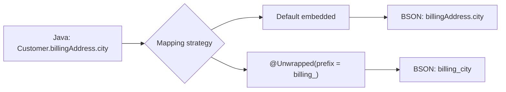

# @Unwrapped, Prefixes, and Flattening Fields into the Parent Document in Spring Data MongoDB

## 1. Problem Statement: Nested Objects in Java, Flat Data in MongoDB

In a Java model, related values are often grouped into a **value object**: an address with city and postal code, a person's name with first and last name, or a monetary amount with value and currency. When persisted by **Spring Data MongoDB**, the default behavior maps a value object to an **embedded document** inside the parent document.

Suppose a customer has both a billing address and a shipping address:

```json
{
  "_id": "C001",
  "billingAddress": {
    "city": "Ha Noi",
    "post_code": "100000"
  },
  "shippingAddress": {
    "city": "Da Nang",
    "post_code": "550000"
  }
}
```

If an application wants to preserve object organization in Java while the MongoDB schema places those fields **directly at the parent document level**, Spring Data MongoDB provides the `@Unwrapped` annotation. With a `prefix`, the stored shape can look like:

```json
{
  "_id": "C001",
  "billing_city": "Ha Noi",
  "billing_post_code": "100000",
  "shipping_city": "Da Nang",
  "shipping_post_code": "550000"
}
```

The document **contains no** `billingAddress` or `shippingAddress` keys. Those exist only as **Java property names** used by the mapper to assemble fields when reading data. This is a transformation at the **Java ↔ BSON mapping layer**, not an aggregation `$unwind` stage for array elements, nor an automatic transformation of existing documents already stored in the collection.

This lesson in the **Objects and Embedding** chapter focuses on:

- How `@Unwrapped` moves a value object's properties onto the parent document.
- How to use `prefix` to avoid field collisions, combined with `@Field`.
- The meaning of `@Unwrapped.Nullable`, `@Unwrapped.Empty`, and `onEmpty` when reading missing or null data.
- Querying, sorting, projections, updates, repositories, aggregations, and indexes over unwrapped fields.
- Limitations around multi-level nesting, name collisions, schema changes, and testing against real data.

## 2. How Do Standard Embedded Objects and @Unwrapped Differ?



| Aspect | Default Embedded | `@Unwrapped` with Prefix |
|---|---|---|
| Physical MongoDB path | `billingAddress.city` | `billing_city` |
| Subdocument | Yes, nested under `billingAddress` | No, child fields sit at parent level |
| Java domain structure | Has `Address billingAddress` | Still has `Address billingAddress` |
| Java query using domain path | `billingAddress.city` | Still written as `billingAddress.city` when mapped via domain type |
| Raw query in `mongosh` | `{ "billingAddress.city": "Ha Noi" }` | `{ billing_city: "Ha Noi" }` |
| Risk of colliding with parent fields | Usually lower | Higher without a prefix |
| Moving from old schema to new schema | Does not happen automatically | Requires migration or compatibility strategy |

Do not choose `@Unwrapped` merely assuming "flat is always faster." Performance depends far more on indexes, query patterns, document size, cardinality, and workload. The primary benefit of `@Unwrapped` is **keeping value object boundaries in Java** while matching a **flat BSON shape** required by the database schema.

## 3. Declaring @Unwrapped on Java Properties

The annotation lives in package:

```java
import org.springframework.data.mongodb.core.mapping.Unwrapped;
```

In Spring Data MongoDB, `@Unwrapped` has a required `onEmpty` attribute. Two shorthand meta-annotations are easier to use:

| Declaration | Behavior When All Unwrapped Fields Are Null or Missing on Read |
|---|---|
| `@Unwrapped.Nullable` | Assigns `null` to the value object property |
| `@Unwrapped.Empty` | Instantiates an empty value object whose inner properties may be `null` |
| `@Unwrapped(onEmpty = Unwrapped.OnEmpty.USE_NULL)` | Equivalent to nullable behavior |
| `@Unwrapped(onEmpty = Unwrapped.OnEmpty.USE_EMPTY)` | Equivalent to empty behavior |

`@Unwrapped.Nullable` and `@Unwrapped.Empty` also accept `prefix`. Both variants express a **read-time strategy** when all values are absent, not a MongoDB constraint requiring data to be present.

### 3.1. Defining the Value Object

The example uses regular Java classes compatible with Spring Data MongoDB versions supporting unwrapping. Each class below resides in its own Java file:

```java
import org.springframework.data.mongodb.core.mapping.Field;

public class Address {
    private String city;

    @Field("post_code")
    private String postCode;

    protected Address() {
        // Allows Spring Data instantiation via standard mapping.
    }

    public Address(String city, String postCode) {
        this.city = city;
        this.postCode = postCode;
    }

    public String getCity() {
        return city;
    }

    public String getPostCode() {
        return postCode;
    }
}
```

`@Field("post_code")` sets the BSON name for Java property `postCode`. When the value object is unwrapped with a prefix, the final name is formed as:

```text
BSON field name = @Unwrapped prefix + BSON field name inside Address

billing_ + city       = billing_city
billing_ + post_code  = billing_post_code
shipping_ + city      = shipping_city
shipping_ + post_code = shipping_post_code
```

### 3.2. Declaring the Parent Document

```java
import org.springframework.data.annotation.Id;
import org.springframework.data.mongodb.core.mapping.Document;
import org.springframework.data.mongodb.core.mapping.Unwrapped;

@Document("customers")
public class Customer {
    @Id
    private String id;

    @Unwrapped.Nullable(prefix = "billing_")
    private Address billingAddress;

    @Unwrapped.Empty(prefix = "shipping_")
    private Address shippingAddress;

    protected Customer() {
    }

    public Customer(String id, Address billingAddress, Address shippingAddress) {
        this.id = id;
        this.billingAddress = billingAddress;
        this.shippingAddress = shippingAddress;
    }

    public String getId() {
        return id;
    }

    public Address getBillingAddress() {
        return billingAddress;
    }

    public Address getShippingAddress() {
        return shippingAddress;
    }
}
```

In a service with `MongoTemplate`:

```java
Customer customer = new Customer(
    "C001",
    new Address("Ha Noi", "100000"),
    new Address("Da Nang", "550000")
);

mongoTemplate.insert(customer);
```

The document stored in MongoDB contains `billing_city`, `billing_post_code`, `shipping_city`, and `shipping_post_code` as shown in section 1; there is no `billingAddress` or `shippingAddress` subdocument. The `_id` remains the `Customer` ID and is unaffected by unwrapping the two value objects.

**Scope of support:** `@Unwrapped` applies to value objects with mappable properties. A value object may contain complex types, but those nested complex types **cannot themselves be unwrapped or contain further unwrapped fields** under current mechanism constraints. Avoid multi-level unwrapped hierarchies expecting recursive flattening.

## 4. Prefixes and Field Naming Rules: Avoiding Collisions

If two value objects share a `city` field and neither specifies a prefix:

```java
@Unwrapped.Nullable
private Address billingAddress;

@Unwrapped.Nullable
private Address shippingAddress;
```

then both map to `city` and `post_code` on the parent document. This causes a **name collision**: values can overwrite one another or read back inconsistently. Establish a clear namespace before persisting data.

### 4.1. Practical Prefix Rules

| Java Location | Prefix | Java Field | BSON Field Inside Value Object | Field Stored on Parent Document |
|---|---|---|---|---|
| `billingAddress` | `billing_` | `city` | `city` | `billing_city` |
| `billingAddress` | `billing_` | `postCode` | `post_code` | `billing_post_code` |
| `shippingAddress` | `shipping_` | `city` | `city` | `shipping_city` |
| `shippingAddress` | `shipping_` | `postCode` | `post_code` | `shipping_post_code` |

The prefix is **concatenated directly** onto the child field's BSON name. The framework does not automatically insert underscores, dots, or separators; if you want `billing_city`, specify `"billing_"` as the prefix. Choose prefixes clear enough that raw BSON remains self-explanatory.

### 4.2. How Does @Field Combine with @Unwrapped?

Valid: `@Field` placed on **properties inside** the value object, for example:

```java
public class Name {
    @Field("first_name")
    private String firstName;
}

// In parent document:
@Unwrapped.Nullable(prefix = "contact_")
private Name contact;
// BSON: contact_first_name
```

**Invalid:** placing `@Field` and `@Unwrapped` on **the same property of the parent document**:

```java
// Invalid mapping configuration; do not use:
@Field("billing")
@Unwrapped.Nullable(prefix = "billing_")
private Address billingAddress;
```

Reason: the parent property `billingAddress` has no BSON field of its own to rename once unwrapped. Instead, rename individual fields inside `Address` or set `prefix` on `@Unwrapped`.

### 4.3. Collisions Can Also Come from Root Fields

Even with a single unwrapped value object, avoid colliding with fields declared directly on the parent document:

```java
// Do not map both to "billing_city":
@Field("billing_city")
private String legacyBillingCity;

@Unwrapped.Nullable(prefix = "billing_")
private Address billingAddress;
```

When evolving schemas or adding new properties, audit the full set of **final BSON field names** on the entity, accounting for `@Field`, `prefix`, class inheritance, and custom converters. A Java model with distinct property names can still collide on physical MongoDB field names.

## 5. onEmpty, Nulls, and Field Presence When Reading

When reading a document, the mapper must decide how to reconstruct Java objects from unwrapped fields. Consider three documents:

```javascript
// A: No fields belonging to billingAddress
{ _id: "A" }

// B: Fields exist, but all values are null
{ _id: "B", billing_city: null, billing_post_code: null }

// C: At least one non-null value exists
{ _id: "C", billing_city: "Hue" }
```

Assuming `@Unwrapped.Nullable(prefix = "billing_")`:

| Document | Result for Java Property `billingAddress` |
|---|---|
| A: both fields absent | `null` |
| B: both fields `null` | `null` |
| C: `billing_city = "Hue"` | `Address` instance with `city = "Hue"`, `postCode` may be `null` |

Switching to `@Unwrapped.Empty(prefix = "billing_")` causes A and B to instantiate an empty `Address` when Spring Data maps the result. **This does not write data into MongoDB**: it is purely a Java object instantiation decision at read time.

### 5.1. Common Pitfalls

- `@Unwrapped.Empty` **does not** require BSON fields to exist or generate valid default values.
- When all fields are missing/null, `@Unwrapped.Nullable` cannot distinguish "previously had an Address and cleared it" from "never provided" from the Java property alone after reading.
- An empty string `""` differs from `null` and missing: if `billing_city = ""`, the value object property is not empty under the "all values null/missing" check.
- When writing entities, Spring Data MongoDB usually omits null properties by default. Whether an explicit null BSON field is written depends on annotations, converters, and mapping version. Inspect raw documents rather than inferring from Java nulls.
- `@Unwrapped.Empty` can produce a non-null Java object that **holds no actual data**. In APIs, never mistake this for a valid user-confirmed address.

### 5.2. Distinguishing from Validation

If business rules require a shipping address to have a city, enforce validation at the DTO/domain boundary and/or with MongoDB schema validation. `@Unwrapped.Empty` only defines how an object is built when data is absent on read; it **does not replace** `@NotNull`, `@NotBlank`, or MongoDB validator rules. A missing field in a legacy document can still materialize as an empty object under this strategy.

## 6. Querying with MongoTemplate: Java Paths vs. BSON Paths

A major advantage of `@Unwrapped` is that **domain-typed** queries can continue using Java property paths even though physical storage is flattened. Spring Data uses mapping metadata to translate paths into actual fields.

### 6.1. Querying a Property of an Unwrapped Object

```java
import java.util.List;
import org.springframework.data.mongodb.core.MongoTemplate;
import org.springframework.data.mongodb.core.query.Criteria;
import org.springframework.data.mongodb.core.query.Query;

Query q = Query.query(
    Criteria.where("billingAddress.city").is("Ha Noi")
);

List<Customer> customers = mongoTemplate.find(q, Customer.class);
```

With the `Customer` entity from section 3, the mapper translates this into the MongoDB filter:

```javascript
db.customers.find({ billing_city: "Ha Noi" });
```

`"billingAddress.city"` is a **Java property path**, whereas `"billing_city"` is the **BSON field**. The two paths are not interchangeable everywhere:

- When using `MongoTemplate` with a mapped entity type, you can reference Java property paths.
- When using `mongosh`, the raw `MongoCollection<Document>` driver, or direct BSON queries, you must use physical fields such as `billing_city`.
- If you call `MongoTemplate` using only a collection name and raw `Document` without a domain mapping type, do not assume the framework translates `"billingAddress.city"` to `"billing_city"`.

A frequent mistake in `mongosh` is writing:

```javascript
// Wrong if the stored document is unwrapped:
db.customers.find({ "billingAddress.city": "Ha Noi" });
```

MongoDB searches for a `billingAddress` subdocument, which does not exist in an `@Unwrapped` schema.

### 6.2. Querying by Whole Value Object

Spring Data supports passing a value object as criteria for an `@Unwrapped` property:

```java
Address address = new Address("Ha Noi", "100000");

Query q = Query.query(
    Criteria.where("billingAddress").is(address)
);

Customer result = mongoTemplate.findOne(q, Customer.class);
```

With our example mapping, the resulting criteria target the unwrapped fields:

```javascript
db.customers.find({
  billing_city: "Ha Noi",
  billing_post_code: "100000"
});
```

Here the framework expands the object into criteria on its fields rather than looking for a nested `billingAddress` document. If you only want to filter by `city`, target `billingAddress.city`; whole-object equality may unintentionally constrain `postCode` as well. Test carefully when the value object contains null fields, custom converters, or special naming rules.

### 6.3. Sorting and Projections

Sorting by a child property:

```java
import org.springframework.data.domain.Sort;

Query q = Query.query(
    Criteria.where("billingAddress.city").is("Ha Noi")
).with(Sort.by(Sort.Direction.ASC, "billingAddress.postCode"));

List<Customer> customers = mongoTemplate.find(q, Customer.class);
```

Mapping uses `billing_post_code` as the sort key. **Avoid sorting by the whole object** such as `Sort.by("billingAddress")`: once flattened, component ordering may not align with business sorting needs or stay stable.

Selecting a single property (projection):

```java
Query onlyCity = new Query();
onlyCity.fields().include("billingAddress.city");
List<Customer> partial = mongoTemplate.find(onlyCity, Customer.class);
```

For `Customer`, physical projection selects `billing_city`. If you want all fields of the value object, Spring Data supports `fields().include("billingAddress")` and expands it to the corresponding unwrapped fields:

```java
Query allBillingParts = new Query();
allBillingParts.fields().include("billingAddress");
List<Customer> partial = mongoTemplate.find(allBillingParts, Customer.class);
```

**Note:** this produces partially projected entities. Unselected fields may be null or missing when the domain object is constructed. Never pass a partially loaded entity to `save(...)` to replace the whole document without understanding the loss of unloaded data.

## 7. Repositories and Query By Example

Spring Data Repositories can also derive queries from properties inside unwrapped value objects:

```java
import java.util.List;
import org.springframework.data.mongodb.repository.MongoRepository;

public interface CustomerRepository
        extends MongoRepository<Customer, String> {

    List<Customer> findByBillingAddress_City(String city);

    List<Customer> findByShippingAddress_PostCode(String postCode);
}
```

In method names, underscores delimit nested property path segments: `billingAddress.city` and `shippingAddress.postCode`. Queries map to `billing_city` and `shipping_post_code`.

You can also define queries matching the whole value object, such as `findByBillingAddress(Address address)`, when all components should match. For **Query By Example**, Spring Data MongoDB also supports probe objects with `@Unwrapped` properties. Standardize null handling, matchers, ignored fields, and match precision; do not treat QBE as identical to raw BSON document equality.

In practice, enable appropriate query logging in test environments to inspect generated BSON queries, especially after adding `@Field`, custom converters, renaming properties, or upgrading Spring Data MongoDB.

## 8. Updates: Setting One Field vs. the Whole Value Object

### 8.1. Updating a Single Property

```java
import org.springframework.data.mongodb.core.query.Update;

Query byId = Query.query(Criteria.where("id").is("C001"));

mongoTemplate.updateFirst(
    byId,
    new Update().set("billingAddress.city", "Hue"),
    Customer.class
);
```

When query and update are mapped using `Customer.class`, the corresponding MongoDB operation is:

```javascript
db.customers.updateOne(
  { _id: "C001" },
  { $set: { billing_city: "Hue" } }
);
```

No update hits `billingAddress.city` in BSON, because no `billingAddress` subdocument exists.

### 8.2. Setting the Entire Value Object

Spring Data can translate an update of the entire value object into updates on its flattened fields:

```java
mongoTemplate.updateFirst(
    byId,
    new Update().set(
        "billingAddress",
        new Address("Nha Trang", "650000")
    ),
    Customer.class
);
```

This targets `billing_city` and `billing_post_code`. Do not assume updating an object that has null fields will automatically **remove all previous physical fields**: inspect the generated update statement and null-handling behavior for your version.

### 8.3. Deleting Unwrapped Data vs. Setting Null

If business logic requires completely removing the billing address, explicitly specify the stored fields to delete. In `mongosh`:

```javascript
db.customers.updateOne(
  { _id: "C001" },
  {
    $unset: {
      billing_city: "",
      billing_post_code: ""
    }
  }
);
```

With Spring Data typed updates, specify the child properties:

```java
mongoTemplate.updateFirst(
    byId,
    new Update()
        .unset("billingAddress.city")
        .unset("billingAddress.postCode"),
    Customer.class
);
```

Afterward, `@Unwrapped.Nullable` reads `billingAddress` as `null`, whereas `@Unwrapped.Empty` constructs an empty `Address`. **`$unset` differs from `$set: null`**: the former removes BSON fields; the latter stores explicit null values. When designing `PATCH` APIs, define distinct semantics for "property omitted," "null sent," and "empty object sent," and map each to the right write operation.

For concurrent updates, use atomic updates on targeted fields or optimistic locking via `@Version` where suitable; avoid reading a stale entity, mutating one field, and calling `save` to overwrite the whole document unless lost updates are handled.

## 9. Aggregations and Field Names After Unwrapping

Aggregations execute inside MongoDB, so raw expressions must always reference **actual BSON fields**. When using Spring Data's **typed aggregations**, the mapper can resolve property paths through the wrapper, much like `Query`:

```java
import org.bson.Document;
import org.springframework.data.mongodb.core.aggregation.Aggregation;
import org.springframework.data.mongodb.core.aggregation.AggregationResults;

Aggregation pipeline = Aggregation.newAggregation(
    Aggregation.match(
        Criteria.where("billingAddress.city").is("Ha Noi")
    ),
    Aggregation.group("billingAddress.city")
        .count().as("customerCount")
);

AggregationResults<Document> results = mongoTemplate.aggregate(
    pipeline, Customer.class, Document.class
);
```

Conceptually equivalent BSON pipeline:

```javascript
db.customers.aggregate([
  { $match: { billing_city: "Ha Noi" } },
  {
    $group: {
      _id: "$billing_city",
      customerCount: { $sum: 1 }
    }
  }
]);
```

In raw pipelines, writing `"$billingAddress.city"` points to a nonexistent embedded document. In typed pipelines, use the property path **including the wrapper name**, such as `billingAddress.city`, so Spring Data has mapping context. For custom expressions or raw `Document` stages, check whether they are mapped; if not, use the physical field name `billing_city`.

Note that `_id` in a `$group` stage output is the grouping key, not the original collection's `_id`. When mapping outputs into DTOs/records, verify output field names and aggregation result shapes.

## 10. Indexes on @Unwrapped Fields

### 10.1. Indexes Use Physical Field Names

If queries frequently filter customers by billing city, the MongoDB index belongs on `billing_city`:

```javascript
db.customers.createIndex(
  { billing_city: 1 },
  { name: "ix_customers_billing_city" }
);
```

You can create it with `MongoTemplate` using the **collection name** and physical BSON name:

```java
import org.springframework.data.domain.Sort;
import org.springframework.data.mongodb.core.index.Index;

mongoTemplate.indexOps("customers")
    .ensureIndex(
        new Index().on("billing_city", Sort.Direction.ASC)
    );
```

Do not create `{"billingAddress.city": 1}` when documents store `billing_city`; those are different index key patterns. For compound indexes, design according to filters, sorts, and MongoDB's index prefix rules:

```javascript
db.customers.createIndex(
  { billing_city: 1, shipping_city: 1 },
  { name: "ix_city_pair" }
);
```

### 10.2. Valid @Indexed Placement

Spring Data allows placing `@Indexed` on **properties inside** the value object, such as `Address.city`, resolving the flattened field name under the owner. However, **never put `@Indexed` together with `@Unwrapped` on the parent property itself**:

```java
// Inside Address:
@Indexed
private String city; // Can map to prefixed names of the owner.

// Inside Customer - invalid:
@Indexed
@Unwrapped.Nullable(prefix = "billing_")
private Address billingAddress;
```

Check your application's automatic index creation setting: Spring Data MongoDB versions have controls to enable/disable auto-index creation; **never** assume derived repository queries automatically create indexes for unwrapped properties. When indexes are operationally mandatory, create them explicitly via migrations or `IndexOperations` and verify with `getIndexes()`.

```javascript
db.customers.getIndexes();

db.customers.find({ billing_city: "Ha Noi" })
  .explain("executionStats");
```

Inspect the chosen index, `totalKeysExamined`, and `totalDocsExamined` to evaluate queries. `@Unwrapped` neither creates indexes nor speeds up queries on its own merely by changing document shape.

## 11. Schema Decisions and Migrating Existing Data

Changing a Java property from standard embedded mapping to `@Unwrapped` **does not** alter existing documents automatically. Suppose an earlier version of `Customer` persisted:

```javascript
{
  _id: "C-LEGACY",
  billingAddress: {
    city: "Ha Noi",
    post_code: "100000"
  }
}
```

Once `@Unwrapped.Nullable(prefix = "billing_")` is added, the mapper looks for `billing_city` and `billing_post_code`. If those fields do not exist, `billingAddress` may be read as `null` even though the legacy embedded document still holds the data. Changing the annotation is therefore a **data contract change**, not a pure Java class refactor.

### 11.1. Recommended Migration Steps

1. **Audit existing data:** determine how many documents use the old shape, whether any fields are missing/null, and whether any already have `billing_city`.
2. **Finalize target schema:** physical field names, prefixes, `@Field` mappings, `onEmpty` behavior, and required indexes.
3. **Check for collisions:** ensure existing `billing_city` data from other sources is not overwritten; resolve naming and type discrepancies first.
4. **Prepare compatible application versions:** consider dual-read phases, controlled dual-writes, or write freezes during migration depending on availability needs.
5. **Backfill data:** move embedded fields up to the parent document under a verifiable plan, batching for large collections.
6. **Reconcile results:** verify record counts, source vs. target values, query results, indexes, rollback procedures, and interactions with other services.
7. **Retire legacy schema:** remove legacy fields only after all readers and writers have transitioned and recovery plans are in place.

An illustrative update pipeline demonstrating **moving fields from an old embedded subdocument to flattened parent fields** on a test document; run against backups or test environments first:

```javascript
db.customers.updateOne(
  {
    _id: "C-LEGACY",
    billingAddress: { $type: "object" }
  },
  [
    {
      $set: {
        billing_city: "$billingAddress.city",
        billing_post_code: "$billingAddress.post_code"
      }
    },
    { $unset: "billingAddress" }
  ]
);
```

Do not apply this statement verbatim to a production collection without handling missing source fields, documents that already have target fields, concurrent writes, custom converters, and rollback plans. `$unset` should only run after confirming successful conversion. On large datasets, measure runtime, write load, and replication impact.

### 11.2. Validation Schemas Must Use Actual BSON Names

When using MongoDB `$jsonSchema`, a validator for an unwrapped `Customer` must describe fields **at the parent document level**, not a `billingAddress` subobject:

```javascript
{
  $jsonSchema: {
    bsonType: "object",
    properties: {
      billing_city: { bsonType: ["string", "null"] },
      billing_post_code: { bsonType: ["string", "null"] },
      shipping_city: { bsonType: ["string", "null"] },
      shipping_post_code: { bsonType: ["string", "null"] }
    }
  }
}
```

This snippet is a **partial illustrative schema** to embed in a collection validator configuration, not a command that updates validators by itself. Since `required` is not declared, fields may be absent; if business rules mandate a non-empty string for `billing_city`, adjust `required`, `bsonType`, and `minLength` accordingly.

## 12. Testing Mapping to Prevent Data Discrepancies

### 12.1. Verifying Both Java Objects and Raw BSON

In Spring Boot tests or integration tests backed by a real MongoDB/Testcontainers instance, verify **both sides**: the Java object after reading and the physical document after writing.

JUnit 5 + AssertJ example (assuming `mongoTemplate` is injected in the test):

```java
import org.bson.Document;
import org.junit.jupiter.api.Test;
import static org.assertj.core.api.Assertions.assertThat;

@Test
void storesUnwrappedAddressWithExpectedPrefix() {
    Customer value = new Customer(
        "C-TEST-1",
        new Address("Hue", "530000"),
        new Address("Da Nang", "550000")
    );

    mongoTemplate.save(value);

    Document stored = mongoTemplate.getCollection("customers")
        .find(new Document("_id", "C-TEST-1"))
        .first();

    assertThat(stored).isNotNull();
    assertThat(stored.containsKey("billingAddress")).isFalse();
    assertThat(stored.containsKey("shippingAddress")).isFalse();
    assertThat(stored.getString("billing_city")).isEqualTo("Hue");
    assertThat(stored.getString("billing_post_code")).isEqualTo("530000");
    assertThat(stored.getString("shipping_city")).isEqualTo("Da Nang");
    assertThat(stored.getString("shipping_post_code")).isEqualTo("550000");

    Customer loaded = mongoTemplate.findById("C-TEST-1", Customer.class);
    assertThat(loaded).isNotNull();
    assertThat(loaded.getBillingAddress().getCity()).isEqualTo("Hue");
    assertThat(loaded.getShippingAddress().getPostCode())
        .isEqualTo("550000");
}
```

This test confirms prefixes, `@Field("post_code")`, parent document structure, and value object reconstruction. Asserting only on `Customer.billingAddress.city` after saving can miss misnamed physical fields.

### 12.2. Testing onEmpty

Insert a document with no address fields to verify `@Unwrapped.Nullable` and `@Unwrapped.Empty` reads:

```java
mongoTemplate.getCollection("customers")
    .insertOne(new Document("_id", "C-EMPTY-1"));

Customer loaded = mongoTemplate.findById("C-EMPTY-1", Customer.class);

assertThat(loaded).isNotNull();
assertThat(loaded.getBillingAddress()).isNull();
assertThat(loaded.getShippingAddress()).isNotNull();
assertThat(loaded.getShippingAddress().getCity()).isNull();
```

Also test documents with `billing_city: ""`, explicit `null` fields, and partial fields. Expected behavior must align with `onEmpty` rules and API contracts rather than guessing from a single case.

### 12.3. Recommended Practical Test Suite

| Case | What to Verify |
|---|---|
| Write both Addresses | Four flat fields exist with their two distinct prefixes |
| `@Field("post_code")` on value object | Physical field is `billing_post_code`, not `billing_postCode` |
| Nullable address with all fields missing | Reads back as `null` |
| Empty address with all fields missing | Reads back as an empty object per `USE_EMPTY` |
| Empty string vs. BSON null | Follows `onEmpty` rules without conflating states |
| Query `billingAddress.city` via typed template | Matches `billing_city` |
| Repository query on nested property | Returns expected documents |
| Sort/projection on child property | Projects/sorts on the right physical fields |
| Single-field update | Modifies only the matching BSON field |
| Unset entire Address | Target physical fields disappear; readback follows `onEmpty` |
| Two `@Unwrapped` without prefixes | Collisions caught by design review/tests |
| Legacy embedded data | Migrated or handled compatibly before switching mapping |
| Index | `getIndexes()` shows correct physical key patterns |

From the API perspective, test how a `PATCH` request omitting `billingAddress` differs from sending an object with null fields or sending an address deletion command. Relying solely on one nullable Java DTO can lose whether a JSON key was present.

## 13. Common Errors and Diagnostics

| Symptom | Common Cause | Resolution |
|---|---|---|
| `find` returns empty even though address is in DB | Using `"billingAddress.city"` directly against flattened BSON | Check raw field `billing_city`; use typed mapping in Spring queries |
| Two value objects read back identical data | Missing prefixes or prefixes resolving to the same names | Use distinct prefixes and verify the physical field list |
| `billingAddress == null` despite address in document | DB still stores legacy embedded `billingAddress` | Migrate data or add compatibility reading |
| Mapping fails to initialize | Combining `@Field` and `@Unwrapped` on the same owner property | Move `@Field` inside the value object |
| Empty object treated as "address provided" | `@Unwrapped.Empty` constructs an instance when all fields are absent | Validate inner values; do not rely on `object != null` |
| Update unexpectedly creates a subdocument | Writing directly to `billingAddress.city` via raw driver | Update `billing_city` in raw BSON or use typed `MongoTemplate` |
| Index exists yet query stays slow | Index built on embedded path instead of flat field | Inspect `getIndexes()`, `explain("executionStats")`, and workload |
| Adding new property causes overwrite | Physical name collides with parent or another unwrapped field | Check for field collisions before deploying |
| Missing data when reading via projection | Not projecting all fields of the value object | Use partial entities only for reads; avoid saving them back |
| Reactive queries differ from sync queries | Different mappers, converters, or versions across services | Share one BSON schema contract and cross-service integration tests |

When debugging, read the document as an `org.bson.Document` using the driver or `MongoTemplate`, inspect **physical field names** (without logging sensitive values), and compare against Java mapping. If unsure what field names the converter emits, run a write–read round trip against a test database using your exact Spring Data version.

## 14. Comprehensive Hands-on Lab

**Scenario:** a customer management system stores billing and shipping addresses. The Java domain wants an `Address` class with `city` and `postCode`, while the MongoDB schema requires four corresponding flat fields.

1. Create `Address` with `@Field("post_code")` on `postCode`. Create `Customer` with `@Unwrapped.Nullable(prefix = "billing_")` and `@Unwrapped.Empty(prefix = "shipping_")`.
2. Use `MongoTemplate.insert(...)` to persist a `Customer`. Inspect raw BSON via `getCollection("customers")` and confirm the four fields `billing_city`, `billing_post_code`, `shipping_city`, and `shipping_post_code`.
3. Query using `Criteria.where("billingAddress.city").is(...)`; compare results with `mongosh` querying `billing_city`.
4. Create `CustomerRepository` to search by shipping city. Practice sorting and projections using Java property paths.
5. Update `billingAddress.city` via `Update` and verify only `billing_city` changes. Try `$unset` on both billing fields and observe `Nullable` behavior.
6. Insert a document containing only `_id`, read it through the mapper, and compare `billingAddress` against `shippingAddress` to observe `USE_NULL`/`USE_EMPTY`.
7. Create an index on `billing_city` and verify with `getIndexes()`/`explain("executionStats")`.
8. Insert a legacy document with an embedded `billingAddress`, explain why the new mapper does not read it as expected, and design a safe migration plan.

**Completion criteria:** you can accurately explain Java vs. BSON paths, assign non-colliding prefixes, apply `onEmpty` rules, perform find/update/repository/aggregation/index operations on flattened schemas, and verify raw documents after writes.

## 15. Design Takeaways

| Question | Rule |
|---|---|
| Does `@Unwrapped` change Java object structure? | No. It changes how properties map onto the parent BSON document. |
| What does `prefix` apply to? | Each child property's BSON field name, after resolving `@Field`. |
| Can `@Field` and `@Unwrapped` be placed on the same property? | No; place `@Field` on properties inside the value object. |
| Does `@Unwrapped.Empty` force the DB to store an object? | No; it governs read-time instantiation when all fields are missing/null. |
| Does switching embedded to unwrapped auto-migrate data? | No. Data must be migrated or read compatibly. |
| Do typed queries and raw queries use the same paths? | Not necessarily; typed queries can use Java properties, while raw queries use physical BSON fields. |
| Can `@Indexed` be placed on child fields? | Yes, though not alongside `@Unwrapped` on the owner property; verify actual index creation. |
| Does unwrapped support multi-level nested unwrapping? | Not under Spring Data MongoDB limitations; avoid nested unwrapping inside an unwrapped object. |

`@Unwrapped` lets your Java model retain **value object boundaries** while MongoDB keeps a **flat document structure**. Application correctness relies on a consistent contract for **field names, prefixes, null handling, queries/updates, and migrations** across every read and write path.

**References:** [Spring Data MongoDB — Unwrapping Types](https://docs.spring.io/spring-data/mongodb/reference/mongodb/mapping/unwrapping-entities.html). When applying this to a specific project, check your exact Spring Data MongoDB version and verify BSON output with integration tests.
