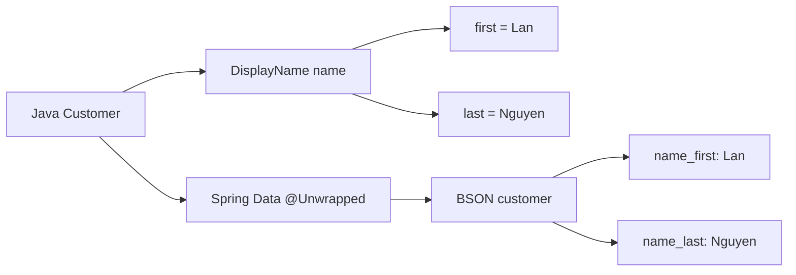

# USE_NULL, USE_EMPTY, and Partially Missing Embedded Data

## 1. The Problem: Complete Java Objects vs. Missing Fields in MongoDB Documents

In Spring Data MongoDB, a Java object can contain a **value object** such as a name, address, or contact details. With standard embedding, MongoDB stores the child object in a nested document. With `@Unwrapped`, Spring Data **flattens** the child object's fields into fields on the parent document.

For example, a customer management application has a `DisplayName` type with `first` and `last`. With `@Unwrapped(prefix = "name_", ...)`, the MongoDB document might look like:

```javascript
{
  _id: "customer-001",
  email: "lan@example.com",
  name_first: "Lan",
  name_last: "Nguyen"
}
```

There is no `name` field containing a nested document; `name_first` and `name_last` sit at the top level. However, real-world data is sometimes incomplete:

```javascript
// Customer has not provided a name yet:
{ _id: "customer-002", email: "unknown@example.com" }

// Only first name present, last name missing:
{ _id: "customer-003", email: "minh@example.com", name_first: "Minh" }

// Both fields explicitly stored as null:
{
  _id: "customer-004",
  name_first: null,
  name_last: null
}
```

When restoring the entity, Spring Data must decide: should the Java property `name` be `null`, or should it instantiate a `DisplayName` object whose member fields are `null`? That is precisely the role of **`USE_NULL`** and **`USE_EMPTY`** in `@Unwrapped`.

This lesson belongs to the **Objects and Embedding** chapter of **SPRING_DATA_MONGODB**. Its goal is to explain policies for restoring partially missing data, choose suitable data models, work with `MongoTemplate` or repositories, test missing states, and avoid bugs when querying, updating, or creating indexes. The same rules apply in the reactive stack.

## 2. How @Unwrapped Differs from Standard Document Embedding

Under standard embedding, a Java property `name` maps to:

```javascript
{
  _id: "customer-001",
  name: {
    first: "Lan",
    last: "Nguyen"
  }
}
```

With `@Unwrapped(prefix = "name_")`, the same data is flattened:

```javascript
{
  _id: "customer-001",
  name_first: "Lan",
  name_last: "Nguyen"
}
```



| Characteristic | Standard Embedding | `@Unwrapped` |
| --- | --- | --- |
| BSON structure | `name: { first, last }` | `name_first`, `name_last` on parent document |
| Raw MongoDB query path | `name.first` | `name_first` |
| Java property path | `name.first` | `name.first` |
| `USE_NULL` / `USE_EMPTY` policy | Not a policy for standard embedded objects | Applies when **all** unwrapped fields are null or absent |
| Risk of BSON field name collisions | Scoped within subdocuments | Must check prefixes and parent-level field names |
| Indexes | Nested field, e.g. `name.first` | Flattened BSON field, e.g. `name_first` |

**Exact scope:** `USE_NULL` and `USE_EMPTY` are enum constants of `Unwrapped.OnEmpty`. They are not global modes for every `@Document` object, not options on `@Field`, and not MongoDB server settings.

## 3. Two Read Policies: USE_NULL and USE_EMPTY

### 3.1. USE_NULL: When All Data Is Absent, the Object Is null

```java
import static org.springframework.data.mongodb.core.mapping.Unwrapped.OnEmpty.USE_NULL;

import org.springframework.data.mongodb.core.mapping.Unwrapped;

@Unwrapped(onEmpty = USE_NULL, prefix = "name_")
private DisplayName name;
```

If `name_first` and `name_last` are both **absent** or both have BSON value `null`, Spring Data sets `name = null` when reading the entity. If at least one field has a non-null value, Spring Data creates a `DisplayName` and populates the values found.

This policy fits when business logic must clearly distinguish **no information provided** from **an information object exists**.

### 3.2. USE_EMPTY: When All Data Is Absent, Create an Empty Object

```java
import static org.springframework.data.mongodb.core.mapping.Unwrapped.OnEmpty.USE_EMPTY;

import org.springframework.data.mongodb.core.mapping.Unwrapped;

@Unwrapped(onEmpty = USE_EMPTY, prefix = "name_")
private DisplayName name;
```

When all unwrapped fields are null or absent, Spring Data creates a `DisplayName` instance whose corresponding properties may be `null`. Example after reading:

```java
customer.name != null;       // true
customer.name.first;         // null
customer.name.last;          // null
```

This policy is convenient when the child object is treated as an always-present structure in the domain model. However, **a non-null object does not mean valid data is present**. Business checks must still validate the inner fields.

### 3.3. Using Shorthand Annotations

Spring Data MongoDB offers two equivalent shorthand annotations for the restoration policy:

```java
@Unwrapped.Nullable(prefix = "name_")
private DisplayName nullableName;

@Unwrapped.Empty(prefix = "name_")
private DisplayName emptyName;
```

`@Unwrapped.Nullable` corresponds to `onEmpty = USE_NULL`; `@Unwrapped.Empty` corresponds to `onEmpty = USE_EMPTY`. The snippet above only illustrates syntax; in a real entity, **never map two different properties onto the same `name_first`/`name_last` fields**. If two value objects are needed, choose a distinct prefix for each property.

### 3.4. Do Not Assume USE_NULL Is the Annotation Default

`@Unwrapped` requires explicitly specifying an `onEmpty` strategy, or using the shorthand `@Unwrapped.Nullable` / `@Unwrapped.Empty`. When reading or reviewing code, inspect **which annotation is actually used** instead of guessing from Java property names.

## 4. Data Read Matrix: Absent, Null, and Partially Missing

Suppose `DisplayName` has exactly two reference fields, `String first` and `String last`, with no default initial values.

| BSON `name_first` | BSON `name_last` | `USE_NULL`: `name` Property | `USE_EMPTY`: `name` Property |
| --- | --- | --- | --- |
| Field absent | Field absent | `null` | `DisplayName(null, null)` |
| `null` | `null` | `null` | `DisplayName(null, null)` |
| Field absent | `null` | `null` | `DisplayName(null, null)` |
| `"Lan"` | Field absent | `DisplayName("Lan", null)` | `DisplayName("Lan", null)` |
| `null` | `"Nguyen"` | `DisplayName(null, "Nguyen")` | `DisplayName(null, "Nguyen")` |
| `"Lan"` | `"Nguyen"` | `DisplayName("Lan", "Nguyen")` | `DisplayName("Lan", "Nguyen")` |
| `""` (empty string) | Field absent | `DisplayName("", null)` | `DisplayName("", null)` |

**Key rule:** The two policies differ only when **all** values of the unwrapped object are null or absent. If data is only **partially** missing—meaning at least one field has a non-null value—both attempt to restore the object and leave missing fields at suitable Java defaults (usually `null` for reference types).

An empty string `""`, number `0`, or `false` **is not** BSON null. When actually read into a field of the object, the object is treated as having a populated member; add validation if your business rules treat blank strings as "not entered."

Do not conflate three concepts:

- **BSON field absent:** the key does not exist in the document.
- **BSON field present with `null`:** the key exists with a null value.
- **Empty Java object:** an instance was constructed; its internal properties may be null or defaults.

When reading entities via `@Unwrapped`, the first two BSON states can produce the exact same Java object outcome. If business logic must know **whether a key actually existed**, inspect raw BSON or model presence explicitly.

## 5. Entity Example: Same Document, Two Restoration Modes

### 5.1. Defining the Value Object and Two Entities

To observe the difference directly, we intentionally point two entity classes to the **same collection** `customers`. In real applications, you normally choose one policy per property; the two classes below are for comparison.

```java
package example.customers;

import org.springframework.data.annotation.Id;
import org.springframework.data.mongodb.core.mapping.Document;
import org.springframework.data.mongodb.core.mapping.Unwrapped;

import static org.springframework.data.mongodb.core.mapping.Unwrapped.OnEmpty.USE_NULL;
import static org.springframework.data.mongodb.core.mapping.Unwrapped.OnEmpty.USE_EMPTY;

class DisplayName {
    String first;
    String last;

    public DisplayName() {
    }

    public DisplayName(String first, String last) {
        this.first = first;
        this.last = last;
    }
}

@Document(collection = "customers")
class CustomerNullable {
    @Id String id;
    String email;

    @Unwrapped(onEmpty = USE_NULL, prefix = "name_")
    DisplayName name;

    public CustomerNullable() {
    }
}

@Document(collection = "customers")
class CustomerEmpty {
    @Id String id;
    String email;

    @Unwrapped(onEmpty = USE_EMPTY, prefix = "name_")
    DisplayName name;

    public CustomerEmpty() {
    }
}
```

In real Java projects, place classes in files and packages matching Java visibility rules. Fields in the example are package-private to keep same-package tests concise; production code can use getters/setters or an immutable design with mapping-compatible constructors.

### 5.2. Sample Input Documents

```javascript
db.customers.insertMany([
  {
    _id: "demo-missing",
    email: "missing@example.com"
  },
  {
    _id: "demo-partial",
    email: "partial@example.com",
    name_first: "Lan"
  },
  {
    _id: "demo-all-null",
    email: "null@example.com",
    name_first: null,
    name_last: null
  },
  {
    _id: "demo-full",
    email: "full@example.com",
    name_first: "Lan",
    name_last: "Nguyen"
  }
]);
```

With this data:

- `demo-missing` and `demo-all-null` yield `CustomerNullable.name == null`, whereas `CustomerEmpty.name != null` with null inner fields.
- `demo-partial` yields a `DisplayName` object in **both** classes, with `first == "Lan"` and `last == null`.
- `demo-full` yields a `DisplayName` object in **both** classes, with both attributes populated.

Reading code:

```java
CustomerNullable a =
    mongoTemplate.findById("demo-missing", CustomerNullable.class);

CustomerEmpty b =
    mongoTemplate.findById("demo-missing", CustomerEmpty.class);

CustomerNullable c =
    mongoTemplate.findById("demo-partial", CustomerNullable.class);

// Against MongoDB containing the exact sample documents:
// a.name == null
// b.name != null && b.name.first == null && b.name.last == null
// c.name != null && c.name.first.equals("Lan") && c.name.last == null
```

This example uses `MongoTemplate`; with `MongoRepository`, the mapping metadata of each entity produces the same result. Note that `onEmpty` logic runs when **converting BSON into Java objects**.

## 6. USE_EMPTY Does Not Automatically Fill Missing Data

The name `USE_EMPTY` often misleads learners into thinking Spring will:

1. Write missing fields into MongoDB;
2. Replace every null with an empty string;
3. Construct an object populated with valid defaults;
4. Automatically migrate old documents to a new schema.

**All four assumptions are wrong.** `USE_EMPTY` only specifies instantiating the object when **all** unwrapped fields are null or absent on read. It does not mutate documents, turn `null` into `""`, validate business rules, or perform migrations.

Example:

```javascript
{ _id: "demo-partial", name_first: "Lan" }
```

In both modes, the Java object can be:

```java
name.first == "Lan";
name.last == null;
```

To enforce that `last` is required, add validation at the input boundary or save rules:

```java
static void requireCompleteName(DisplayName name) {
    if (name == null
            || name.first == null || name.first.isBlank()
            || name.last == null || name.last.isBlank()) {
        throw new IllegalArgumentException(
            "Name must include both first and last"
        );
    }
}
```

This check applies when **both components are mandatory**. If users are allowed to provide only `first`, use a business-appropriate rule instead of treating every partial object as an error.

When an object has primitive fields like `int` or `boolean`, unassigned values can fall back to Java defaults (`0`/`false`) depending on how the object is constructed. Since primitives alone cannot distinguish "not provided" from "user chose 0/false," consider `Integer`/`Boolean` paired with validation when missingness matters.

## 7. Writing Data and the Impact of onEmpty

Saving via the Spring Data mapper flattens the `name` property:

```java
CustomerNullable customer = new CustomerNullable();
customer.id = "customer-new";
customer.email = "new@example.com";
customer.name = new DisplayName("Hoa", "Tran");

mongoTemplate.save(customer);
```

The document may be written with these fields:

```javascript
{
  _id: "customer-new",
  email: "new@example.com",
  name_first: "Hoa",
  name_last: "Tran"
}
```

**`onEmpty` is a read-side configuration** for when all unwrapped fields are null/missing. Do not assume `USE_EMPTY` forces Spring Data to write `name_first: null` and `name_last: null` when the object is empty. Whether null fields are written or omitted depends on the mapper's null-handling rules and configuration.

If application code calls the driver with a raw `org.bson.Document` or runs raw BSON updates, that code does not automatically read `@Unwrapped` annotations on the entity. Instead of:

```javascript
// Does not match the flattened schema:
db.customers.updateOne(
  { _id: "customer-new" },
  { $set: { name: { first: "Hoa", last: "Tran" } } }
);
```

update the actual BSON names of the schema:

```javascript
db.customers.updateOne(
  { _id: "customer-new" },
  { $set: { name_first: "Hoa", name_last: "Tran" } }
);
```

If the system needs to remove a name, `$unset` on the two unwrapped fields puts the document into the all-fields-missing state on the next read. `USE_NULL` gives `name = null`, while `USE_EMPTY` gives an empty instance. This is **the same MongoDB data with two Java interpretations**.

## 8. Queries, Updates, Sorts, and Indexes on Unwrapped Fields

### 8.1. Domain Paths Differ from BSON Field Names

When running typed queries with `MongoTemplate`, Spring Data understands the Java property path `name.first` and maps it through `@Unwrapped(prefix = "name_")` to BSON field `name_first`.

```java
import org.springframework.data.mongodb.core.query.Criteria;
import org.springframework.data.mongodb.core.query.Query;

Query query = Query.query(
    Criteria.where("name.first").is("Lan")
);

var customers = mongoTemplate.find(query, CustomerNullable.class);
```

Equivalent raw query in mongosh:

```javascript
db.customers.find({ name_first: "Lan" });
```

In Spring Data, `name.first` is a Java property path **processed by a mapper with entity metadata**; in MongoDB shell, `name.first` refers to a nested document named `name` and will not match flattened fields.

### 8.2. Updating One Field of a Value Object

```java
import org.springframework.data.mongodb.core.query.Update;

Query byId = Query.query(Criteria.where("id").is("customer-new"));
Update update = new Update().set("name.last", "Le");

mongoTemplate.updateFirst(byId, update, CustomerNullable.class);
```

In typed Spring Data updates, `name.last` maps to `name_last`. A single-field `$set` differs from `save`, which replaces the entire entity, and is useful when updating one property without loading the entire object into memory.

If data is partially missing and a service executes:

```java
CustomerNullable loaded =
    mongoTemplate.findById("demo-partial", CustomerNullable.class);

loaded.name.last = "Nguyen";
mongoTemplate.save(loaded);
```

this assumes `loaded` is non-null and has a non-null `name` object. For `demo-missing` with `USE_NULL`, `loaded.name` will be null, so `loaded.name.last = ...` throws a `NullPointerException`. Instantiate the object when needed, or update the field directly via `Update`.

### 8.3. Sorts and Projections

```java
import org.springframework.data.domain.Sort;

Query q = new Query()
    .with(Sort.by(Sort.Direction.ASC, "name.last"));

q.fields().include("email").include("name.first").include("name.last");

var page = mongoTemplate.find(q, CustomerNullable.class);
```

Typed projections and sorts should use domain paths `name.first` / `name.last` so the mapper applies field names and prefixes. If a projection selects only `email`, all name fields are absent from the returned document. Then:

- `USE_NULL` sets `name = null`;
- `USE_EMPTY` constructs an empty `name` object;
- **you cannot conclude the stored document has no name** solely from an object built via projection.

This is a critical distinction between **missing source data** and **data omitted by query projection**. Never call `save` on an entity read through a partial projection if doing so could overwrite or drop stored data.

### 8.4. Indexes with @Unwrapped

If the application frequently filters by last name, create an index on BSON field `name_last`:

```javascript
db.customers.createIndex({ name_last: 1 });
```

At the mapping layer, `@Indexed` can be placed on a property **inside** `DisplayName`:

```java
import org.springframework.data.mongodb.core.index.Indexed;

class DisplayName {
    String first;

    @Indexed
    String last;
}
```

Never place `@Indexed` directly on the parent property carrying `@Unwrapped`; that is not a valid way to index the whole value object. Indexes operate on individual flattened child fields, and automatic index creation also depends on Spring Data MongoDB application configuration. Always verify actual indexes in MongoDB and run `explain` for important queries.

## 9. Prefixes and Field Name Collision Risks

If two value objects share fields named `first` and `last` and are unwrapped without prefixes, they collide on the same BSON keys. For example, if a domain has both `legalName` and `preferredName`:

```java
@Unwrapped(onEmpty = USE_NULL, prefix = "legal_")
private DisplayName legalName;

@Unwrapped(onEmpty = USE_NULL, prefix = "preferred_")
private DisplayName preferredName;
```

Corresponding document:

```javascript
{
  _id: "customer-007",
  legal_first: "An",
  legal_last: "Nguyen",
  preferred_first: "Anna",
  preferred_last: "Nguyen"
}
```

Prefixes must remain stable across schema versions. If a release renames `legal_` to `official_`, old fields become "missing" to the new mapper until migrated. Then `USE_NULL` returns null and `USE_EMPTY` builds an empty object even though the document still holds the data under the old keys.

You can use `@Field` **on properties inside the value object** to customize BSON field names:

```java
class DisplayName {
    @org.springframework.data.mongodb.core.mapping.Field("given")
    String first;

    @org.springframework.data.mongodb.core.mapping.Field("family")
    String last;
}
```

With prefix `"name_"`, the BSON names become `name_given` and `name_family`. Do not combine `@Field` on **the same parent property** that carries `@Unwrapped`: Spring Data MongoDB does not support using that combination to rename a nested object.

When designing schemas, check prefixed names, `@Field` on child fields, and top-level fields on the parent document to prevent key collisions.

## 10. Partially Missing Data: Causes and Handling

Missing fields can come from many sources and are not always bugs:

| Cause | Illustrative Scenario | Handling Approach |
| --- | --- | --- |
| User entered partial input | `name_first` exists, `name_last` not provided yet | Allow partial data if business permits, or validate on completion |
| Schema evolved | Older records lack newly added fields | Define compatibility rules and migrations |
| Data from multiple services | One service writes only `name_first` | Standardize write contracts and monitor missing fields |
| Projection selected only one field | Query omitted `name_last` | Distinguish partial projections from missing source data |
| Raw BSON update | `$unset` or per-field `$set` | Use conditional updates and test thoroughly |
| Field stores BSON null | Source deliberately cleared the value | Clarify semantics of "unknown," "not applicable," and "cleared" |
| Wrong or colliding prefix | Mapper expects `name_first` while DB has `given_name` | Verify actual schema, mapping, and migrations |

### 10.1. Distinguishing "Field Absent" from "Field Is Null" When Needed

`@Unwrapped` can map both scenarios to the same Java object state. To inspect the underlying data, query MongoDB directly:

```javascript
// Find only documents missing the field:
db.customers.find({ name_first: { $exists: false } });

// Find documents where the field exists and equals null:
db.customers.find({
  name_first: { $exists: true, $eq: null }
});

// Inspect BSON types, including "missing" / "null":
db.customers.aggregate([
  {
    $project: {
      firstType: { $type: "$name_first" },
      lastType: { $type: "$name_last" }
    }
  },
  { $limit: 50 }
]);
```

In MongoDB, a simple `{ name_first: null }` query matches **documents missing the field** as well. Always combine `$exists` when you explicitly want to separate absence from BSON null.

### 10.2. Identifying Truly Partial Documents

The following query finds documents where exactly one of the two keys is present:

```javascript
db.customers.find({
  $or: [
    {
      name_first: { $exists: true },
      name_last: { $exists: false }
    },
    {
      name_first: { $exists: false },
      name_last: { $exists: true }
    }
  ]
});
```

This checks **key presence**, not business completeness. A field that exists as null or a blank string may still count as "missing" for users. On large datasets, consider sampling or scoping filters to avoid heavy scans during peak traffic.

### 10.3. When Every State Must Be Distinguished, Consider Another Model

If the application must accurately separate "not entered," "intentionally cleared," "not applicable," and "completed," `@Unwrapped` with `USE_NULL`/`USE_EMPTY` alone may not carry enough information. You can store a separate status field, such as `nameStatus: "NOT_PROVIDED" | "PARTIAL" | "COMPLETE"`, or choose a different schema structure.

This is a domain convention that must be maintained consistently across services and the database. Do not infer critical business state solely from `name != null` when `USE_EMPTY` is active.

## 11. Testing Reads and Writes with MongoTemplate

### 11.1. Integration Testing Three Key Cases

The example below uses `DisplayName`, `CustomerNullable`, and `CustomerEmpty` from section 5, placed in the `example.customers` package. Tests run against a real MongoDB or test instance provided by your environment:

```java
package example.customers;

import static org.junit.jupiter.api.Assertions.*;

import java.util.UUID;
import org.bson.Document;
import org.junit.jupiter.api.Test;
import org.springframework.beans.factory.annotation.Autowired;
import org.springframework.boot.test.autoconfigure.data.mongo.DataMongoTest;
import org.springframework.data.mongodb.core.MongoTemplate;

@DataMongoTest
class UnwrappedOnEmptyTest {

    @Autowired
    MongoTemplate template;

    @Test
    void emptyAndPartialDocumentsAreMappedCorrectly() {
        String suffix = UUID.randomUUID().toString();
        String missingId = "missing-" + suffix;
        String nullId = "null-" + suffix;
        String partialId = "partial-" + suffix;

        template.getCollection("customers").insertOne(
            new Document("_id", missingId)
        );
        template.getCollection("customers").insertOne(
            new Document("_id", nullId)
                .append("name_first", null)
                .append("name_last", null)
        );
        template.getCollection("customers").insertOne(
            new Document("_id", partialId)
                .append("name_first", "Lan")
        );

        CustomerNullable missingNullable =
            template.findById(missingId, CustomerNullable.class);
        CustomerEmpty missingEmpty =
            template.findById(missingId, CustomerEmpty.class);

        assertNotNull(missingNullable);
        assertNull(missingNullable.name);
        assertNotNull(missingEmpty);
        assertNotNull(missingEmpty.name);
        assertNull(missingEmpty.name.first);
        assertNull(missingEmpty.name.last);

        CustomerNullable explicitNullNullable =
            template.findById(nullId, CustomerNullable.class);
        CustomerEmpty explicitNullEmpty =
            template.findById(nullId, CustomerEmpty.class);

        assertNotNull(explicitNullNullable);
        assertNull(explicitNullNullable.name);
        assertNotNull(explicitNullEmpty);
        assertNotNull(explicitNullEmpty.name);

        CustomerNullable partialNullable =
            template.findById(partialId, CustomerNullable.class);
        CustomerEmpty partialEmpty =
            template.findById(partialId, CustomerEmpty.class);

        assertNotNull(partialNullable);
        assertNotNull(partialNullable.name);
        assertEquals("Lan", partialNullable.name.first);
        assertNull(partialNullable.name.last);

        assertNotNull(partialEmpty);
        assertNotNull(partialEmpty.name);
        assertEquals("Lan", partialEmpty.name.first);
        assertNull(partialEmpty.name.last);
    }
}
```

`@DataMongoTest` configures the Spring context for MongoDB testing, though it does not guarantee a MongoDB server is running in every environment. You can use Testcontainers MongoDB or configure a dedicated test instance matching your Spring Boot/Spring Data version.

### 11.2. Checking BSON When Writing from Java Objects

To verify Java-to-database mapping, inspect the raw document directly:

```java
CustomerNullable customer = new CustomerNullable();
customer.id = "write-" + java.util.UUID.randomUUID();
customer.name = new DisplayName("Ha", "Pham");
template.save(customer);

Document raw = template.getCollection("customers")
    .find(new Document("_id", customer.id))
    .first();

assertNotNull(raw);
assertEquals("Ha", raw.getString("name_first"));
assertEquals("Pham", raw.getString("name_last"));
assertFalse(raw.containsKey("name"));
```

Do not assert only on Java values before and after `save`, because in-memory entities can hold values that were not persisted under the expected BSON shape.

## 12. Reactive Access and Constructor Mapping

`ReactiveMongoRepository` and `ReactiveMongoTemplate` share the same Spring Data MongoDB mapping metadata. Thus, the semantics of `@Unwrapped(onEmpty = USE_NULL/USE_EMPTY)` for **documents whose child values are all null/absent** remain identical to the synchronous stack. The primary difference is that results are emitted via `Mono`/`Flux`.

```java
import org.springframework.data.mongodb.repository.ReactiveMongoRepository;
import reactor.core.publisher.Mono;

interface CustomerReactiveRepository
        extends ReactiveMongoRepository<CustomerEmpty, String> {
}

class ReactiveCustomerService {
    private final CustomerReactiveRepository repository;

    ReactiveCustomerService(CustomerReactiveRepository repository) {
        this.repository = repository;
    }

    Mono<String> displayName(String id) {
        return repository.findById(id)
            .map(customer -> {
                DisplayName name = customer.name;
                if (name == null || name.first == null) {
                    return "Customer";
                }
                return name.first;
            });
    }
}
```

Even with `USE_EMPTY`, the example still checks `name.first == null` to avoid falsely assuming a name was provided. Switching to reactive does not cause Spring Data to fill in missing BSON fields.

**Note on immutable value objects and constructors:** Spring Data must be able to instantiate `DisplayName` when the policy is `USE_EMPTY`. A value object whose only constructor rejects null parameters, or a Kotlin class with strict non-null checks, may fail to restore when all fields are absent. Constructors, default values, and field nullability must accommodate missing data. If an empty object cannot be constructed validly, consider `USE_NULL` and handle absence in the service or DTO layer.

Additionally, Spring Data MongoDB supports unwrapped value objects with complex properties in certain cases, but imposes limitations on nesting another `@Unwrapped` value object inside an unwrapped object. Keep schemas predictable and verify with concrete BSON test cases instead of assuming unlimited multi-level unwrapping.

## 13. Choosing Between USE_NULL and USE_EMPTY in Practice

| Business Scenario | Usually Suitable Choice | Why |
| --- | --- | --- |
| Shipping address has not been provided yet | `USE_NULL` | `address == null` clearly represents the absence of an address object |
| Child object is an always-present view structure allowing null fields | `USE_EMPTY` | Avoids null checks for the container itself, though inner contents still need validation |
| Legacy data often lacks some fields | Either, depending on domain meaning | **Partially** missing data restores an object under both when any field is non-null |
| Need to distinguish BSON missing from explicit null | Requires additional model or read path | `onEmpty` alone does not preserve key presence states |
| Invariant requires "name must have both fields" | Explicit validation | `USE_EMPTY` does not supply real data; `USE_NULL` does not reject partial data |
| Value object cannot be constructed when all parameters are null | Usually reconsider `USE_EMPTY` | Empty instantiation policy conflicts with class invariants |

Decision workflow:

1. Define what **absent object** vs. **object with null fields** means to the business.
2. Pick `USE_NULL` if absent child data should be represented as `null`; pick `USE_EMPTY` if a valid empty instance should be created.
3. Explicitly specify how **partial data** is handled and validate required fields at the appropriate layer.
4. Check the actual MongoDB schema, flattened field names, and prefixes.
5. Write tests for missing, explicit null, partial, and full data; re-run them whenever constructors, projections, or schemas change.

## 14. Hands-on Exercises

### Exercise 1: Two Ways to Restore an Address

Create `ShippingAddress` with `city` and `postalCode`, then create two entities using `@Unwrapped(onEmpty = USE_NULL, prefix = "ship_")` and `@Unwrapped(onEmpty = USE_EMPTY, prefix = "ship_")`. Read four documents in turn: neither field present, both fields null, only `ship_city` present, and both values present. Record the Java object state in each case.

### Exercise 2: Querying Partial Data

Write raw MongoDB queries to find:

- Documents without `ship_city`;
- Documents where `ship_city` equals BSON null;
- Documents with `ship_city` present but `ship_postalCode` absent.

Explain why these queries cannot be fully replaced by a single check for `address == null`.

### Exercise 3: Updates and Prefixes

Create an entity with `billingAddress` and `shippingAddress`, both of type `Address` using prefixes `bill_` and `ship_`. Write a `MongoTemplate` command to update `shippingAddress.city` and verify raw BSON has the corresponding `ship_city` field. Compare querying/sorting via Java properties against physical field names in mongosh.

### Exercise 4: Testing Projections

Insert a document with both `name_first` and `name_last`, then read it using a projection query including only `email`. Compare the resulting objects under `USE_NULL` and `USE_EMPTY`. Explain why an object returned from a projection does not prove whether the original document has a name.

### Exercise 5: Designing Domain Rules

An application forbids shipping addresses missing `city`, while `postalCode` may be omitted. Define validation and choose `USE_NULL` or `USE_EMPTY` for reading legacy orders. If a legacy document lacks both `ship_city` and `ship_postalCode`, should the application throw an error, prompt for missing info, or display "not provided"? Explain according to business context.

## Key Takeaways

Spring Data MongoDB's `@Unwrapped` **flattens** a value object's properties into its parent document. `USE_NULL` sets the Java object to `null` when all child fields are null or absent; `USE_EMPTY` instantiates an **empty instance** in that same situation. When data is only **partially missing** and at least one field is non-null, both policies restore the object with missing members set to suitable defaults, typically null. This is a **read-time mapping rule**, not a migration, schema validator, or automatic data-filling mechanism. Always inspect actual BSON types, prefixes, projections, constructors, and business invariants before choosing.

### References

- [Spring Data MongoDB Reference — Unwrapping Types](https://docs.spring.io/spring-data/mongodb/reference/mongodb/mapping/unwrapping-entities.html)
- [Spring Data MongoDB API — `Unwrapped`](https://docs.spring.io/spring-data/mongodb/docs/current/api/org/springframework/data/mongodb/core/mapping/Unwrapped.html)
