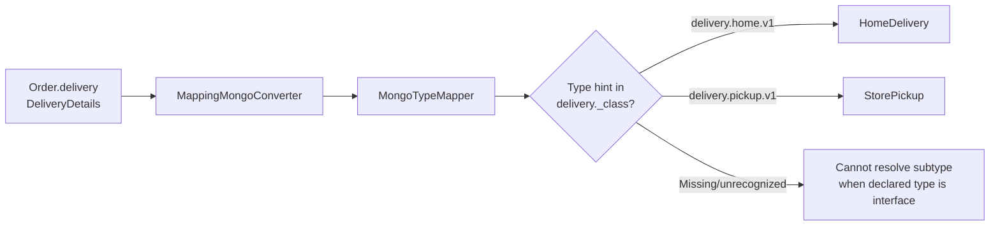

# Customizing MongoTypeMapper and Preserving Polymorphic Data Readability

## 1. Objectives and Context

**Spring Data MongoDB** enables Java/Spring applications to connect to MongoDB, map BSON documents to objects, and access data via `MongoTemplate` or repositories. Within **Objects and Embedding**, a particularly important scenario is **polymorphism**: a property declared with an interface or parent class that can hold different concrete subtypes at runtime.

Our running example is a **Mini Commerce** system with `Product`, `Customer`, and `Order`. An order embeds delivery information: home delivery uses `HomeDelivery`, while in-store pickup uses `StorePickup`. Both implement the `DeliveryDetails` interface. When reading an `Order` from MongoDB, Spring Data must know which concrete class to instantiate.

`MongoTypeMapper` works alongside `MappingMongoConverter` to **write and read type hints** (discriminators) in documents. By default, this hint lives in the `_class` field. Customizing the type mapper lets you change the field name, use aliases instead of class names, or omit type hints; however, any change must preserve readability of **previously stored documents**.

After this lesson, learners can:

- Explain why polymorphic embedded data requires type identification metadata.
- Read `_class` structures on root documents and embedded objects, and use `@TypeAlias` to decouple stored data from Java package names.
- Configure `DefaultMongoTypeMapper` on `MappingMongoConverter` and understand the consequences of renaming `_class` or disabling type hints.
- Register subtypes in the mapping context so aliases resolve **immediately after starting a new application instance**.
- Plan legacy data migrations, test reading polymorphic data before and after upgrades, and analyze query performance.
- Distinguish mapper type hints from business fields, security controls, and transactions.

**Prerequisites:** Java interfaces/inheritance, Spring Boot with `spring-boot-starter-data-mongodb`, `@Document`, `@Id`, repositories, `MongoTemplate`, and embedded documents. Examples use Java 17+, synchronous MongoDB APIs, and modern Spring Data MongoDB syntax. Verify changes against your project's exact library versions.

## 2. The Problem: Why Are Polymorphic Embedded Objects Hard to Read?

MongoDB stores **documents and fields**, not JVM objects or Java polymorphism metadata. Suppose two orders have these structures:

```json
{
  "_id": "order-home-001",
  "customerId": "customer-001",
  "delivery": {
    "recipient": "Nguyen Thi Lan",
    "street": "12 Sample St",
    "city": "TP Ho Chi Minh"
  }
}
```

```json
{
  "_id": "order-pickup-001",
  "customerId": "customer-002",
  "delivery": {
    "pickupPointId": "STORE-HCM-01",
    "pickupCode": "PICKUP-7294"
  }
}
```

If the Java class declares `private DeliveryDetails delivery;` where `DeliveryDetails` is an **interface**, the declared type alone gives the framework no way to tell whether to instantiate `HomeDelivery` or `StorePickup`. Differing field names may hint at the type to a human reader, but the default mapper does not guess business types from key presence.

One solution is storing type information alongside the data, for example:

```json
{
  "_id": "order-home-001",
  "delivery": {
    "recipient": "Nguyen Thi Lan",
    "street": "12 Sample St",
    "city": "TP Ho Chi Minh",
    "_class": "delivery.home.v1"
  },
  "_class": "order.v1"
}
```

Spring Data then reads `delivery._class`, resolves the registered subtype, and constructs the matching Java object.



**Two directions to distinguish:**

- On **write**, the mapper knows the runtime class of the object and can write a type hint into BSON.
- On **read**, the mapper must resolve the BSON type hint into a compatible class; resolution depends on classpath, mapping context, and active configuration.

## 3. MongoTypeMapper and Default Behavior

Key components:

| Component | Package | Role |
| --- | --- | --- |
| `MongoTypeMapper` | `org.springframework.data.mongodb.core.convert` | Interface for writing/reading type metadata from BSON |
| `DefaultMongoTypeMapper` | `org.springframework.data.mongodb.core.convert` | Default implementation using the `_class` key |
| `MappingMongoConverter` | `org.springframework.data.mongodb.core.convert` | Converts between Java entities and MongoDB documents, invoking type mapper as needed |
| `@TypeAlias` | `org.springframework.data.annotation` | Declares a short/stable type name instead of the fully qualified class name |
| `MongoMappingContext` | `org.springframework.data.mongodb.core.mapping` | Manages entity metadata and recognized aliases |

By default, `DefaultMongoTypeMapper` can write:

- On the **root document**, a hint for the entity type.
- On an **embedded object**, a type hint when the runtime value is a complex subtype differing from the declared property type—for instance, an interface or superclass property holding a subclass instance.
- On elements of **collections/maps** when subtype resolution is needed for the mapped structure.

Not every embedded object gets `_class`. A field declared with an exact concrete class can usually be mapped cleanly without a child-level type hint.

Default example without `@TypeAlias`:

```json
{
  "_id": "order-home-001",
  "delivery": {
    "recipient": "Nguyen Thi Lan",
    "street": "12 Sample St",
    "city": "TP Ho Chi Minh",
    "_class": "com.example.minicommerce.domain.HomeDelivery"
  },
  "_class": "com.example.minicommerce.domain.Order"
}
```

**Risk of fully qualified class names:** if you later refactor packages from `com.example.minicommerce.domain` to `com.example.shop.domain` or rename classes, older documents still hold class names that no longer exist. Type hints are therefore part of your **long-term data contract**, even though applications do not expose them in REST responses.

## 4. Mini Commerce Model with @TypeAlias

We use one interface and two delivery implementations. The snippets below are standalone Java files in package `com.example.minicommerce.domain`.

### 4.1. Interface for the Polymorphic Property

```java
package com.example.minicommerce.domain;

public interface DeliveryDetails {
}
```

This interface represents the shared concept, while data shapes are defined by each subtype. Since it cannot be instantiated directly, reading from the database requires a type hint or an explicit conversion strategy.

### 4.2. Two Delivery Subtypes

`HomeDelivery.java`:

```java
package com.example.minicommerce.domain;

import org.springframework.data.annotation.TypeAlias;
import org.springframework.data.mongodb.core.mapping.Document;

@Document
@TypeAlias("delivery.home.v1")
public record HomeDelivery(
        String recipient,
        String street,
        String city) implements DeliveryDetails {
}
```

`StorePickup.java`:

```java
package com.example.minicommerce.domain;

import org.springframework.data.annotation.TypeAlias;
import org.springframework.data.mongodb.core.mapping.Document;

@Document
@TypeAlias("delivery.pickup.v1")
public record StorePickup(
        String pickupPointId,
        String pickupCode) implements DeliveryDetails {
}
```

We place `@Document` on both subtypes in this example so entity scanning discovers them at startup. Both types are still **embedded** inside `orders.delivery` when referenced as properties on `Order`; they do not require their own collections. In another design, you can register subtypes via `getInitialEntitySet()` without placing `@Document` on embedded types.

`@TypeAlias` assigns short names instead of fully qualified Java class names. Aliases should be **unique within the mapping context**, carry stable meaning, and be managed across schema changes. The `v1` suffix here is purely a project naming convention; the annotation does not provide data versioning on its own.

### 4.3. Order Entity Holding the Subtype

`Order.java`:

```java
package com.example.minicommerce.domain;

import org.springframework.data.annotation.Id;
import org.springframework.data.annotation.TypeAlias;
import org.springframework.data.mongodb.core.mapping.Document;

@Document(collection = "orders")
@TypeAlias("order.v1")
public class Order {
    @Id
    private String id;

    private String customerId;
    private String status;
    private DeliveryDetails delivery;

    public Order() {
    }

    public Order(String id, String customerId,
                 String status, DeliveryDetails delivery) {
        this.id = id;
        this.customerId = customerId;
        this.status = status;
        this.delivery = delivery;
    }

    public String getId() { return id; }
    public void setId(String id) { this.id = id; }

    public String getCustomerId() { return customerId; }
    public void setCustomerId(String customerId) {
        this.customerId = customerId;
    }

    public String getStatus() { return status; }
    public void setStatus(String status) { this.status = status; }

    public DeliveryDetails getDelivery() { return delivery; }
    public void setDelivery(DeliveryDetails delivery) {
        this.delivery = delivery;
    }
}
```

To keep the focus on polymorphism, this example omits `OrderLine` lists, `totalAmount`, and placement timestamps. In the full Mini Commerce application, orders contain line snapshots of products/prices, reference customers by `customerId`, and embed `delivery` details.

### 4.4. Persisting Data with MongoTemplate

```java
import com.example.minicommerce.domain.HomeDelivery;
import com.example.minicommerce.domain.Order;
import com.example.minicommerce.domain.StorePickup;

Order shipHome = new Order(
    "order-home-001",
    "customer-001",
    "PLACED",
    new HomeDelivery("Nguyen Thi Lan", "12 Sample St", "TP Ho Chi Minh")
);

Order pickup = new Order(
    "order-pickup-001",
    "customer-002",
    "PLACED",
    new StorePickup("STORE-HCM-01", "PICKUP-7294")
);

mongoTemplate.save(shipHome);
mongoTemplate.save(pickup);
```

Under default settings once aliases are registered in the mapping context, the persisted BSON resembles:

```json
{
  "_id": "order-home-001",
  "customerId": "customer-001",
  "status": "PLACED",
  "delivery": {
    "recipient": "Nguyen Thi Lan",
    "street": "12 Sample St",
    "city": "TP Ho Chi Minh",
    "_class": "delivery.home.v1"
  },
  "_class": "order.v1"
}
```

And:

```json
{
  "_id": "order-pickup-001",
  "customerId": "customer-002",
  "status": "PLACED",
  "delivery": {
    "pickupPointId": "STORE-HCM-01",
    "pickupCode": "PICKUP-7294",
    "_class": "delivery.pickup.v1"
  },
  "_class": "order.v1"
}
```

Field order and extra metadata may vary by converter and configuration. What matters is verifying the **values and placement of type hints**, not byte-for-byte JSON equality.

### 4.5. Reading Back the Concrete Subtypes

```java
Order loadedHome =
    mongoTemplate.findById("order-home-001", Order.class);
Order loadedPickup =
    mongoTemplate.findById("order-pickup-001", Order.class);

if (loadedHome != null
        && loadedHome.getDelivery() instanceof HomeDelivery home) {
    System.out.println(home.street());
}

if (loadedPickup != null
        && loadedPickup.getDelivery() instanceof StorePickup store) {
    System.out.println(store.pickupPointId());
}
```

With `MongoRepository<Order, String>`, Spring Data performs the same mapping; the query API differs, but the goal of restoring concrete subtypes is identical.

## 5. Why Must @TypeAlias Be Registered at Startup?

Storing `_class: "delivery.home.v1"` is not enough if, after a restart, the application **does not yet know which Java class corresponds to that alias**. Spring Data MongoDB resolves aliases reliably only once `MongoMappingContext` has discovered the concrete entity, either via initial entity scanning or upon first mapping that class.

A common failure scenario:

1. Version A writes one million documents with alias `delivery.home.v1`.
2. Version B deploys and immediately reads an old order before ever writing a `HomeDelivery`.
3. If Version B did not register the subtype in the initial mapping context, the alias may fail to resolve, causing reads of the `DeliveryDetails` interface field to fail.

Two common solutions:

- Place subtypes in a **package scanned for entities** with suitable metadata (such as `@Document` in section 4).
- Register the **initial entity set** in Spring Data MongoDB configuration.

Example override inside a configuration class extending `AbstractMongoClientConfiguration`:

```java
import java.util.Set;
import com.example.minicommerce.domain.HomeDelivery;
import com.example.minicommerce.domain.Order;
import com.example.minicommerce.domain.StorePickup;

@Override
protected Set<Class<?>> getInitialEntitySet() {
    return Set.of(Order.class, HomeDelivery.class, StorePickup.class);
}
```

This is a **method placed inside a configuration class**, not a standalone Java file. If your application has other entities, include them in the returned set or keep entity scanning intact so you do not inadvertently drop metadata for other entities.

Most importantly, verify with a **cold-start test**: seed sample documents into the database, boot a brand-new application context, and **read data before performing any save**. Testing "save and then immediately read in the same context" can hide missing startup registration in the mapping context.

## 6. Customizing MongoTypeMapper: Three Strategies

Customization is applied on `MappingMongoConverter` via:

```java
converter.setTypeMapper(mongoTypeMapper);
```

This method controls how the converter writes and reads type metadata. **Do not pass `null` directly to `setTypeMapper` to disable hints**: passing `null` to this setter restores the default mapper in current versions. To disable type hints, construct `new DefaultMongoTypeMapper(null)` and pass **that mapper instance**.

| Strategy | Configuration | Can Read Polymorphic `DeliveryDetails` by Default? | Notes |
| --- | --- | --- | --- |
| Keep `_class` + aliases | `new DefaultMongoTypeMapper()` or default | Yes, if aliases/classes resolve | Easy compatibility with legacy data |
| Rename key | `new DefaultMongoTypeMapper("_kind", mappingContext)` | Yes, for documents written with the new key | Does **not** automatically read legacy `_class` keys |
| Disable type hints | `new DefaultMongoTypeMapper(null)` | **Not guaranteed**, especially for interface/abstract fields | Requires another conversion strategy or non-polymorphic model |

For Mini Commerce storing `Order.delivery` via an interface, **keeping `_class` with `@TypeAlias` is usually the best choice**. Only change the key or disable hints for a specific reason after auditing existing data and planning migrations.

### 6.1. Example: Switching the Key from _class to _kind

When a custom discriminator key is needed, you can define `MappingMongoConverter` explicitly. The example below targets Spring Boot with a **synchronous** MongoDB connection and standard dependency injection:

```java
package com.example.minicommerce.config;

import org.springframework.context.annotation.Bean;
import org.springframework.context.annotation.Configuration;
import org.springframework.data.mongodb.MongoDatabaseFactory;
import org.springframework.data.mongodb.core.convert.DefaultDbRefResolver;
import org.springframework.data.mongodb.core.convert.DefaultMongoTypeMapper;
import org.springframework.data.mongodb.core.convert.MappingMongoConverter;
import org.springframework.data.mongodb.core.convert.MongoCustomConversions;
import org.springframework.data.mongodb.core.mapping.MongoMappingContext;

@Configuration
public class MongoTypeMappingConfiguration {

    @Bean
    public MappingMongoConverter mappingMongoConverter(
            MongoDatabaseFactory databaseFactory,
            MongoMappingContext mappingContext,
            MongoCustomConversions customConversions) {

        MappingMongoConverter converter = new MappingMongoConverter(
            new DefaultDbRefResolver(databaseFactory),
            mappingContext
        );

        converter.setCustomConversions(customConversions);
        converter.setTypeMapper(
            new DefaultMongoTypeMapper("_kind", mappingContext));

        return converter;
    }
}
```

This class **replaces the converter bean** Spring Boot normally auto-configures. Because it is infrastructure configuration, verify it preserves all other mapping customizations in the project (such as Decimal128 currency converters, encryption/converters, query mapping, metadata, and template beans). Notice the example passes the container-managed `MongoCustomConversions` into the replacement converter.

If the project already extends `AbstractMongoClientConfiguration` or defines a custom `MappingMongoConverter`, modify **that existing bean** rather than creating a second competing bean. Avoid manually instantiating a second `new MongoTemplate(...)` without knowing which converter repositories use.

With this setup, new documents are written as:

```json
{
  "_id": "order-home-002",
  "customerId": "customer-001",
  "status": "PLACED",
  "delivery": {
    "recipient": "Nguyen Thi Lan",
    "street": "12 Sample St",
    "city": "TP Ho Chi Minh",
    "_kind": "delivery.home.v1"
  },
  "_kind": "order.v1"
}
```

**Never rename the discriminator key mid-flight while ignoring existing data.** `DefaultMongoTypeMapper("_kind", ...)` does not look up `_class` on read. Old documents with `delivery._class` and no `delivery._kind` lack a readable type hint under the new configuration, leaving `DeliveryDetails` without a concrete class to instantiate.

### 6.2. Example: Disabling Type Hints Completely

If a collection always stores a single known root entity type and embedded objects **never use interfaces, abstract classes, `Object`, or polymorphic subtypes**, you may consider:

```java
converter.setTypeMapper(new DefaultMongoTypeMapper(null));
```

This is a **configuration option**, not blanket advice. With `Order.delivery` declared as an interface in this lesson, applying this snippet without adding a custom converter or business discriminator renders subtype reading undefined.

When type hints are disabled:

- Calling `findById(id, Order.class)` still supplies the **root** target type `Order`.
- The mapper still needs the **child** concrete type for `delivery`; an interface cannot turn itself into a concrete class.
- Generic reads such as `findAll(Object.class, "orders")` also lose the hint needed to restore the root type by default.
- Existing documents containing `_class` do not automatically lose that key just because newer code stops writing it.

An alternative when technical type hints must be removed is storing a **business discriminator** such as `delivery.kind = "HOME"` or `"PICKUP"`, paired with an explicit read-conversion strategy (e.g., registered custom converters, kind-based DTO mapping, or service-level subtype selection). Merely adding a `kind` field without implementing corresponding read logic **does not make Spring Data instantiate the interface automatically**.

### 6.3. Deeper Customization with TypeInformationMapper

In large projects, alias mappings may need to be decoupled from annotations on classes. Spring Data provides the `TypeInformationMapper` abstraction, which can be supplied to `DefaultMongoTypeMapper` to map type information to aliases and back.

This approach works well for centralized alias mapping, provided both directions are covered:

- **Write**: runtime class -> stored alias.
- **Read**: old/new aliases -> concrete class.

Implementing only the write side produces documents that look valid yet fail to deserialize after restart. Always test bidirectional mapping and legacy data, especially when aliases are renamed or classes refactored.

## 7. Distinguishing Type Hints from Business Discriminators

Both concepts often appear in the same document, yet serve different purposes:

| Attribute | Type Hint `_class` / `_kind` | Business Discriminator `delivery.kind` |
| --- | --- | --- |
| Primary consumer | `MappingMongoConverter`/`MongoTypeMapper` | Domain logic, APIs, reporting, business rules |
| Example value | `delivery.home.v1` | `HOME` |
| During Java package refactoring | Stable aliases can remain unchanged | Normally independent of Java class names |
| Automatically resolves polymorphic interfaces? | Yes, with matching mapper and alias mapping | No, requires custom converter/mapping logic |
| Should be exposed directly in REST APIs? | Usually no | Yes, if part of the API contract |
| Use in indexes/queries | Possible, though coupled to persistence internals | Usually a better fit for business query needs |

Example document containing both:

```json
{
  "_id": "order-home-003",
  "delivery": {
    "kind": "HOME",
    "recipient": "Nguyen Thi Lan",
    "street": "12 Sample St",
    "city": "TP Ho Chi Minh",
    "_class": "delivery.home.v1"
  },
  "_class": "order.v1"
}
```

Keeping `kind` in the business model helps aggregate "home delivery orders" for analytics without coupling dashboards to Spring Data internals. When `kind` is present alongside `_class`, validate and test that mismatches like `kind = PICKUP` with `_class = delivery.home.v1` cannot occur.

**Security:** type hints are not an authentication or authorization mechanism. Never let clients dictate Java classes by accepting `_class` or Java class names over HTTP and passing them straight into mapping. Control input DTOs, validate allowed kinds/aliases, and restrict MongoDB write privileges.

## 8. Preserving Readability of Legacy Data During Upgrades

Three common changes occur:

1. **Renaming Java packages/classes** while MongoDB stores fully qualified class names.
2. **Changing `@TypeAlias` values** while older documents store previous aliases.
3. **Renaming or removing the type hint key**, e.g., switching `_class` to `_kind` or disabling hints altogether.

All three can break reading existing documents; an application passing tests on newly inserted records **does not prove** it can read previously persisted data.

### 8.1. Compatibility Matrix

| Stored Data | New Reader | Risk |
| --- | --- | --- |
| `_class = com.example.old.HomeDelivery` | Old class still on classpath | Readable, though coupled to old class name |
| `_class = com.example.old.HomeDelivery` | Old class deleted or moved to another package | Subtype may fail to resolve |
| `_class = delivery.home.v1` | Reader registers `@TypeAlias("delivery.home.v1")` | Readable if mapping context recognizes the type |
| `_class = delivery.home.v1` | Reader switches solely to `@TypeAlias("delivery.home.v2")` | Old alias may go unrecognized |
| `_class = delivery.home.v1` | New mapper reads only `_kind` | Old key is not read automatically |
| No type hint, property is an interface | Default mapping | Concrete class is unknown |

### 8.2. Safe Transition Workflow

**Step 1 — Audit before changing anything.** Identify which fields actually hold type hints:

```javascript
db.orders.aggregate([
  {
    $group: {
      _id: "$delivery._class",
      count: { $sum: 1 }
    }
  },
  { $sort: { count: -1 } }
])
```

Inspect root `_class`, `delivery._class`, any polymorphic array elements, documents lacking hints, and unrecognized aliases. Never inspect just one sample document.

**Step 2 — Pick the new contract.** Decide whether to keep `_class` with stable aliases, switch to `_kind`, or move to a business discriminator with custom conversions. Document which legacy aliases must remain readable during transition.

**Step 3 — Deploy a compatible reader first.** If dual-read is required, use a **custom, thoroughly tested** `MongoTypeMapper` or converter that handles both old and new shapes; Spring Data does not automatically look up two different key names. In simpler setups, a more controllable strategy is keeping `_class` and migrating fully qualified class names to aliases.

**Step 4 — Back up, verify in staging, run scoped migrations.** The following example updates only **an embedded field's type hint value**, without changing order structure:

```javascript
db.orders.updateMany(
  {
    "delivery._class":
      "com.example.minicommerce.domain.HomeDelivery"
  },
  {
    $set: {
      "delivery._class": "delivery.home.v1"
    }
  }
)
```

This command applies only to the exact source alias/class name observed in real data. Handle each subtype and type-hint path accordingly. If root `_class` also stores old class names, plan a separate update for it. Always check modified counts, backups/rollback plans, and compatibility across all application versions accessing the collection.

**Step 5 — Verify reading in a fresh application context.** Seed legacy data into a test database, start the new code, and read both `HomeDelivery` and `StorePickup` **before any save**. Check for alias resolution failures, constructor changes, field names, enums, and collection mappings.

**Step 6 — Monitor after rollout.** Watch for mapping exceptions, discrepancies in document read counts, subtype ratios, slow queries, and older workers still running. Remove legacy compatibility logic only once all affected documents are migrated and no older code depends on the previous format.

### 8.3. Does Renaming `_class` Require Migrating Everything?

If you adopt `_kind`, at minimum determine:

- Must root `_class` also change to root `_kind`?
- Must nested paths like `delivery._class`, array paths like `events[*]._class`, or `Object`-typed fields change too?
- Will you deploy a **dual-read** reader during rollout or migrate all documents before switching mappers?
- Which queries, indexes, and aggregations still reference `_class`?

Never swap a constructor to `new DefaultMongoTypeMapper("_kind")` and assume existing documents will keep working.

## 9. Lists, Arrays, and Embedded Objects with Multiple Subtypes

Polymorphism is not limited to `Order.delivery`. Collections often hold:

- `List<OrderEvent>`: `OrderPlacedEvent`, `OrderCancelledEvent`, and `OrderShippedEvent`.
- `List<DiscountRule>`: percentage discounts or fixed-amount discounts.
- An `Object` field storing varied complex structures.
- A map whose value type is an interface holding multiple concrete subtypes.

Illustrative BSON of an event array:

```json
{
  "_id": "order-events-001",
  "events": [
    {
      "occurredAt": "2026-11-20T02:00:00Z",
      "source": "checkout",
      "_class": "order.event.placed.v1"
    },
    {
      "occurredAt": "2026-11-20T02:05:00Z",
      "reason": "Customer request",
      "_class": "order.event.cancelled.v1"
    }
  ],
  "_class": "order.v1"
}
```

The `_class` values here are **illustrative type hints**. Mapping concrete events requires the corresponding Java subtypes and registered aliases. For real timestamps, store BSON Date/`Instant` rather than plain strings as in the JSON sketch above if range queries are needed.

When arrays grow large, embedding can bloat documents and slow queries. Type hints do not solve document size limits or event storage strategy; decide when to move events to a separate collection, add targeted indexes, and paginate.

## 10. Queries, Aggregations, and Indexes by Subtype

Type hints can appear in MongoDB filters:

```javascript
db.orders.find({
  "delivery._class": "delivery.home.v1"
})
```

Or to group orders by subtype and status:

```javascript
db.orders.aggregate([
  {
    $group: {
      _id: {
        type: "$delivery._class",
        status: "$status"
      },
      orders: { $sum: 1 }
    }
  },
  { $sort: { orders: -1 } }
])
```

If this query pattern runs frequently, consider indexing:

```javascript
db.orders.createIndex({
  "delivery._class": 1,
  status: 1
})

db.orders
  .find({
    "delivery._class": "delivery.home.v1",
    status: "PLACED"
  })
  .explain("executionStats")
```

**Notes:**

1. `_class` and `_kind` are persistence details that can change during upgrades. Querying business logic on `delivery.kind` is usually more durable if a stable `kind` field is maintained.
2. Changing the mapper key can invalidate old queries and indexes; audit query shapes and migrations before deploying.
3. Compare `winningPlan`, `totalKeysExamined`, `totalDocsExamined`, and `nReturned` before and after adding indexes. Never add indexes just because subtypes exist.
4. Alias mapping does not make aggregations understand Java class semantics; pipelines execute strictly over stored BSON values.

## 11. Automated Testing: Verifying Both BSON Shape and Read Objects

An integration test should write and read against a real MongoDB or Testcontainers instance to exercise the full mapping context and persistence layer. The example below assumes the default `_class` mapper, registered aliases, and a dedicated test database:

```java
package com.example.minicommerce;

import static org.junit.jupiter.api.Assertions.*;

import org.bson.Document;
import org.junit.jupiter.api.Test;
import org.springframework.beans.factory.annotation.Autowired;
import org.springframework.boot.test.context.SpringBootTest;
import org.springframework.data.mongodb.core.MongoTemplate;

import com.example.minicommerce.domain.HomeDelivery;
import com.example.minicommerce.domain.Order;
import com.example.minicommerce.domain.StorePickup;

@SpringBootTest
class PolymorphicOrderMappingTest {
    @Autowired
    MongoTemplate template;

    @Test
    void writesAliasesAndRestoresConcreteTypes() {
        String homeId = "poly-home-test";
        String pickupId = "poly-pickup-test";
        var raw = template.getCollection("orders");

        raw.deleteOne(new Document("_id", homeId));
        raw.deleteOne(new Document("_id", pickupId));
        try {
            template.save(new Order(
                homeId,
                "customer-001",
                "PLACED",
                new HomeDelivery(
                    "Nguyen Thi Lan", "12 Sample St", "TP Ho Chi Minh")
            ));

            template.save(new Order(
                pickupId,
                "customer-002",
                "PLACED",
                new StorePickup("STORE-HCM-01", "PICKUP-7294")
            ));

            Document storedHome =
                raw.find(new Document("_id", homeId)).first();
            assertNotNull(storedHome);
            assertEquals("order.v1", storedHome.getString("_class"));

            Document embedded =
                storedHome.get("delivery", Document.class);
            assertNotNull(embedded);
            assertEquals(
                "delivery.home.v1", embedded.getString("_class"));

            Order loadedHome = template.findById(homeId, Order.class);
            Order loadedPickup = template.findById(pickupId, Order.class);
            assertNotNull(loadedHome);
            assertNotNull(loadedPickup);

            assertInstanceOf(
                HomeDelivery.class, loadedHome.getDelivery());
            assertInstanceOf(
                StorePickup.class, loadedPickup.getDelivery());
        } finally {
            raw.deleteOne(new Document("_id", homeId));
            raw.deleteOne(new Document("_id", pickupId));
        }
    }
}
```

The test uses `save` with fixed fixture IDs, then inspects both **raw BSON** and restored entities. Deleting fixtures should only run against an isolated test database. If you configure a `_kind` mapper, update assertions and fixtures accordingly; the default example test will no longer apply verbatim.

### 11.1. Minimum Additional Cases to Test

| Scenario | What to Verify |
| --- | --- |
| Save `HomeDelivery` | Embedded BSON carries the right alias, independent of package name |
| Save `StorePickup` | Embedded BSON carries a distinct alias and reads back as the right class |
| Read existing alias document on a **fresh context** | Subtype resolves even without any prior save |
| Old document with fully qualified class name | Still readable or handled by controlled migration |
| Old alias missing from new code | Tests catch the error and enforce a compatibility plan |
| Document missing type hint on interface field | Test fails intentionally or is handled by a business converter |
| Switch `_class` to `_kind` | Both root and embedded objects use the new key; legacy data handled |
| Disable type hints | Used only where data is readable without polymorphism or via custom conversion |
| Duplicate aliases | Caught before deployment and configuration fixed |
| Subtype queries/aggregations | BSON values, indexes, and reports remain consistent |

**Especially critical:** write an integration test seeded with legacy BSON, boot a **completely fresh context**, and read the data before calling `save`. This catches alias registration gaps and long-term data readability regressions.

## 12. Common Errors and Resolutions

| Symptom | Common Cause | Resolution |
| --- | --- | --- |
| Cannot instantiate object for interface property | Missing type hint or unresolvable alias | Check `delivery._class`/`_kind` and initial entity set |
| Subtype read fails only right after restart | Alias was only registered after first mapping/write | Register subtypes via entity scan or `getInitialEntitySet()`; run cold-start test |
| Package rename broke reading old orders | BSON stored old fully qualified class names | Maintain compatibility or migrate to stable aliases |
| Changing `_class` to `_kind` broke reading old data | New mapper checks only one key | Implement tested dual-read or migrate all keys |
| Disabling type hints broke polymorphism | `new DefaultMongoTypeMapper(null)` omits discriminators | Keep hints or write a converter reading `kind` |
| Passed `setTypeMapper(null)` yet `_class` still appears | Passing `null` resets to default mapper | Pass a `DefaultMongoTypeMapper(null)` instance to actually disable hints |
| Same type alias used on multiple classes | Alias collision or inconsistent metadata | Enforce unique aliases and verify at startup/in tests |
| Custom converter broke Decimal128 handling | Replaced converter bean without keeping custom conversions | Pass `MongoCustomConversions` into custom converter; test monetary BSON |
| Raw BSON has hint yet REST response has wrong shape | API serialization/DTO mapping mismatch | Separate HTTP layer; inspect DTO/Jackson configuration |
| Subtype queries are slow | Missing index or query targets stale field after migration | Run `explain`, measure, and align indexes with workload |
| Unexpected `_class` values arrive from requests | Clients can submit arbitrary technical fields | Validate input DTOs, enforce write permissions, never trust client class names |

## 13. Connections to Transactions, Reactive Access, and Next Lessons

Polymorphism lives in **mapping**, so it affects repositories, `MongoTemplate`, aggregations, and tests alike. When using `ReactiveMongoTemplate` or `ReactiveMongoRepository`, configure the **reactive converter** accordingly and verify `Mono`/`Flux` emissions materialize the right subtypes on subscription. Never assume changing the synchronous converter automatically configures the reactive stack.

Multi-document transactions can keep `orders` writes and `products.stock` updates consistent (on MongoDB topologies supporting transactions), but **cannot fix documents missing discriminators** or unresolved aliases. Likewise, indexes speed up subtype queries without solving interface instantiation errors.

A sustainable long-term design aligns on:

1. Embedded document shapes and valid subtypes.
2. Clear contracts for discriminator field names and values.
3. Startup entity registration strategy.
4. Migration/dual-read policy prior to schema changes.
5. Testing at both the Java object and raw BSON levels, including records from previous versions.

## 14. Exercises and Completion Criteria

**Exercise 1 — Polymorphic read/write:** Create `DeliveryDetails`, `HomeDelivery`, `StorePickup`, and `Order` as shown. Save two orders with different delivery types using `MongoTemplate`, read them back, and assert concrete subtypes with `instanceof`/assertions.

**Exercise 2 — Stable aliases:** Add `@TypeAlias` to each entity and verify `_class` no longer holds fully qualified class names. Boot a fresh application context performing only reads; ensure the mapping context recognizes all subtypes.

**Exercise 3 — Renaming the key:** On a dedicated test database, configure `DefaultMongoTypeMapper("_kind", mappingContext)`. Confirm both root and `delivery` use the new key. Try reading a legacy BSON fixture containing `_class` to observe compatibility issues, then design a migration or dual-read plan.

**Exercise 4 — Controlled hint removal:** On an entity containing only concrete-typed fields, test `new DefaultMongoTypeMapper(null)`. Contrast with `DeliveryDetails` and explain why polymorphic models require another type resolution mechanism.

**Exercise 5 — Queries and performance:** Filter home-delivery orders by subtype; run `explain("executionStats")` before and after adding a suitable index. Propose a stable `delivery.kind` field when business reporting should not depend on `_class`.

Self-check:

1. Why does Spring Data need a type hint when a property is typed as an interface yet holds concrete subclasses?
2. How do `MongoTypeMapper` and `MappingMongoConverter` collaborate when writing and reading BSON?
3. What problem does `@TypeAlias` solve, and why must aliases be known to the mapping context at startup?
4. Why can switching from `_class` to `_kind` prevent the application from reading existing orders?
5. Why does `setTypeMapper(null)` differ from `setTypeMapper(new DefaultMongoTypeMapper(null))`?
6. When should you use a business discriminator with custom conversions instead of Java type metadata?
7. What tests protect polymorphic data across package refactors, alias renames, or Spring Data MongoDB upgrades?

**Expected outcome:** learners can preserve concrete subtypes of embedded objects across MongoDB write/read round trips, configure `MongoTypeMapper` intentionally, and protect long-term readability of stored polymorphic documents. This forms a foundation for Spring Data MongoDB applications with reliable queries, aggregations, transactions, reactive access, testing, and performance.

## References

- [Spring Data MongoDB — Type Mapping](https://docs.spring.io/spring-data/mongodb/reference/mongodb/converters-type-mapping.html) — default `_class` behavior, `@TypeAlias`, and configuring `MongoTypeMapper`.
- [Spring Data MongoDB API — DefaultMongoTypeMapper](https://docs.spring.io/spring-data/mongodb/docs/current/api/org/springframework/data/mongodb/core/convert/DefaultMongoTypeMapper.html) — constructors with type key and mapping context; `null` behavior.
- [Spring Data MongoDB API — MappingMongoConverter](https://docs.spring.io/spring-data/mongodb/docs/current/api/org/springframework/data/mongodb/core/convert/MappingMongoConverter.html) — `setTypeMapper` and document mapping workflow.
- [Spring Data MongoDB — Object Mapping](https://docs.spring.io/spring-data/mongodb/reference/mongodb/mapping/mapping.html) — entity mapping, constructors, and property materialization.
- [MongoDB — BSON Document](https://www.mongodb.com/docs/manual/core/document/) — embedded document structure and BSON.
