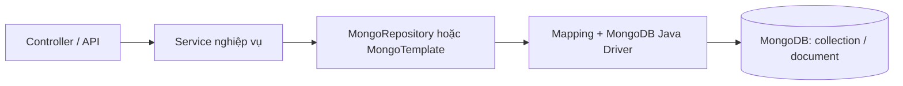

# Spring Data MongoDB là gì và giải quyết bài toán lưu trữ nào?

> **Phạm vi:** `SPRING_DATA_MONGODB` — sử dụng Spring Data MongoDB để kết nối, ánh xạ document và thao tác MongoDB qua `MongoTemplate` hoặc repository. Bài này xây dựng bức tranh tổng quan về thiết kế dữ liệu, truy vấn, aggregation, index, transaction, truy cập reactive, kiểm thử và chẩn đoán hiệu năng trước khi đi sâu vào từng kỹ thuật.

## 1. Bài toán: lưu dữ liệu ứng dụng dưới dạng document

Giả sử một dịch vụ bán hàng lưu đơn hàng gồm mã khách hàng, trạng thái, thời điểm tạo và danh sách sản phẩm. Trong cơ sở dữ liệu quan hệ, mô hình thường có bảng `orders` và `order_items` liên kết bằng khóa ngoại. Nếu một màn hình luôn cần hiển thị **toàn bộ đơn hàng cùng các dòng sản phẩm**, ứng dụng phải truy vấn nhiều bảng hoặc dùng phép `JOIN`.

MongoDB cung cấp một lựa chọn khác: lưu một đơn hàng thành **document BSON** trong collection `orders`, trong đó `lines` là mảng document con:

```json
{
  "_id": { "$oid": "64b7a327f9c0b1e2d3a4f501" },
  "customerId": "C-42",
  "status": "PENDING",
  "lines": [
    { "sku": "BOOK-01", "quantity": 2, "unitPriceVnd": 150000 },
    { "sku": "PEN-02", "quantity": 1, "unitPriceVnd": 25000 }
  ],
  "createdAt": { "$date": "2026-01-15T09:30:00Z" }
}
```

Các ký hiệu `$oid` và `$date` ở trên là cách biểu diễn **Extended JSON** cho các kiểu BSON `ObjectId` và ngày giờ; chúng không có nghĩa MongoDB chỉ lưu chuỗi JSON thông thường. `unitPriceVnd` dùng số nguyên theo VND để tránh sai số số thực trong ví dụ. Một document có thể chứa object lồng nhau và mảng, rất phù hợp khi dữ liệu được đọc, cập nhật và quản lý theo cùng một đơn vị nghiệp vụ.

Tuy nhiên, khi viết ứng dụng Java, ta vẫn phải trả lời nhiều câu hỏi: chuyển document thành đối tượng Java thế nào, lấy lịch sử đơn hàng ra sao, cập nhật có an toàn không, lập chỉ mục ở đâu, và xử lý sự thay đổi cấu trúc dữ liệu như thế nào? **Spring Data MongoDB giải quyết phần tích hợp dữ liệu đó trong hệ sinh thái Spring**.

## 2. Spring Data MongoDB là gì?

**Spring Data MongoDB** là mô-đun của dự án Spring Data giúp ứng dụng Java/Spring tương tác với MongoDB thông qua các abstraction nhất quán: ánh xạ đối tượng–document, truy cập dữ liệu theo repository, xây dựng truy vấn qua `MongoTemplate`, hỗ trợ aggregation, index, callback, auditing và một số cơ chế transaction. Nó sử dụng **MongoDB Java Driver** ở tầng kết nối; bản thân Spring Data MongoDB **không phải** cơ sở dữ liệu và cũng không thay thế khả năng truy vấn, lưu trữ hay vận hành của MongoDB.

Luồng làm việc điển hình:



| Thành phần | Vai trò thực tế |
| --- | --- |
| **MongoDB** | Lưu document BSON, cung cấp truy vấn, index, aggregation, replication và sharding. |
| **MongoDB Java Driver** | Giao tiếp với MongoDB, xử lý kết nối, lệnh, phiên làm việc và các thao tác mức driver. |
| **Spring Data MongoDB** | Ánh xạ dữ liệu Java, chuẩn hóa các thao tác truy cập và tích hợp với Spring. |
| **Spring Boot** (nếu sử dụng) | Tự động cấu hình nhiều bean và thuộc tính kết nối theo dependency, cấu hình và phiên bản Boot. |

Trong MongoDB, **database** chứa các **collection**; collection chứa **document**. So với tư duy quan hệ, database gần với database, collection gần với table và document gần với row, nhưng phép so sánh chỉ để định hướng: document hỗ trợ dữ liệu lồng nhau, các document trong collection không bắt buộc có cấu trúc hoàn toàn giống nhau, và quan hệ giữa document không tự mang ràng buộc khóa ngoại như RDBMS.

## 3. Những bài toán Spring Data MongoDB giúp đơn giản hóa

### 3.1. Giảm mã lặp khi ánh xạ đối tượng và thao tác CRUD

Thay vì tự chuyển từng trường BSON sang Java và viết các lệnh driver cho mọi thao tác, có thể mô hình hóa collection bằng class/record Java, gắn `@Document`, `@Id`, `@Field` khi cần, rồi sử dụng phương thức `save`, `findById`, `deleteById` có sẵn trên repository. `MappingMongoConverter` đảm nhiệm ánh xạ phổ biến; với kiểu đặc thù hoặc quy ước lưu trữ riêng, ứng dụng có thể cấu hình converter tùy chỉnh.

Điều này đặc biệt hữu ích ở các dịch vụ nhiều thực thể nghiệp vụ cần CRUD, phân trang, sắp xếp và truy vấn theo thuộc tính, vì code tập trung hơn vào quy tắc nghiệp vụ.

### 3.2. Truy vấn gắn với domain, không phải chuỗi lệnh rải khắp ứng dụng

Repository hỗ trợ **derived query**: Spring phân tích tên phương thức như `findByCustomerIdOrderByCreatedAtDesc` để tạo truy vấn phù hợp. Khi truy vấn phức tạp, có thể dùng `@Query`, `MongoTemplate`, `Criteria`, aggregation hoặc gọi trực tiếp driver trong những trường hợp đặc biệt. Lựa chọn này giúp nhóm phát triển giữ các thao tác dữ liệu ở một tầng rõ ràng và dễ kiểm thử.

### 3.3. Khai thác cấu trúc document cho dữ liệu nghiệp vụ

Với các đối tượng có thông tin lồng nhau hoặc một số thuộc tính thay đổi theo loại đối tượng (ví dụ: thông số sản phẩm, biểu mẫu, cấu hình), document thường biểu diễn tự nhiên hơn nhiều bảng phụ. Spring Data MongoDB giúp ánh xạ cấu trúc này vào kiểu Java. Nhưng **linh hoạt schema không có nghĩa bỏ qua quản trị schema**: vẫn phải xác định hợp đồng dữ liệu, validation, phiên bản cấu trúc và cách di trú document cũ.

### 3.4. Tích hợp các năng lực MongoDB theo cách quen thuộc trong Spring

Có thể xây dựng aggregation, tạo hoặc quản lý index, dùng session/transaction khi hạ tầng hỗ trợ, truy cập theo mô hình blocking hoặc reactive, đồng thời kiểm thử với Spring Test và cơ sở dữ liệu MongoDB dành cho môi trường test. **Tính năng khả dụng và cấu hình chính xác phụ thuộc phiên bản Spring Data, MongoDB Server và driver**, nên khi triển khai thực tế cần đối chiếu tài liệu của bộ phiên bản đang chạy.

## 4. Ví dụ: lưu đơn hàng bằng Spring Data MongoDB

Ví dụ dưới đây giả định ứng dụng Spring Boot đã thêm dependency Spring Data MongoDB phù hợp phiên bản Boot, có thể kết nối tới MongoDB và đã khai báo cấu hình kết nối qua biến môi trường. Đặt mỗi khai báo Java trong file thích hợp; các đoạn mã lược bỏ `package` và `import` để tập trung vào ý chính.

```yaml
# application.yml — minh họa cấu hình cho các phiên bản Boot dùng namespace này
spring:
  data:
    mongodb:
      uri: ${MONGODB_URI}
```

Không ghi username/password trực tiếp vào tài liệu hoặc source code. Một chuỗi kết nối trong môi trường phát triển có thể có dạng `mongodb://localhost:27017/shop`; các hệ thống có xác thực, replica set hoặc TLS cần URI và thiết lập tương ứng. Kiểm tra lại tên property khi chuyển giữa các phiên bản Spring Boot.

### 4.1. Ánh xạ document

```java
@Document(collection = "orders")
@CompoundIndex(
    name = "orders_customer_created_idx",
    def = "{'customerId': 1, 'createdAt': -1}"
)
public record Order(
    @Id String id,
    String customerId,
    OrderStatus status,
    List<OrderLine> lines,
    Instant createdAt
) {}
```

```java
public record OrderLine(String sku, int quantity, long unitPriceVnd) {}

public enum OrderStatus {
    PENDING, PAID, CANCELLED
}
```

- `@Document(collection = "orders")` ánh xạ `Order` tới collection `orders`.
- `@Id` ánh xạ `id` với `_id`. Trường `String` có thể được chuyển sang `ObjectId` khi giá trị thích hợp; nếu không có mã do ứng dụng cấp, MongoDB có thể tạo `_id` khi insert.
- `lines` là danh sách document con. Giá và số lượng tại thời điểm đặt hàng được giữ trong đơn hàng, tránh việc sửa giá sản phẩm ở nơi khác làm thay đổi lịch sử đơn.
- `@CompoundIndex` khai báo **ý định** có index phục vụ truy vấn theo `customerId` và sắp xếp theo `createdAt`. Annotation không bảo đảm index đã tồn tại trên server: việc tự tạo index phụ thuộc cấu hình, còn production thường quản lý index bằng migration/triển khai có kiểm soát.

### 4.2. Repository cho truy vấn thông dụng

```java
public interface OrderRepository extends MongoRepository<Order, String> {
    List<Order> findByCustomerIdOrderByCreatedAtDesc(String customerId);
}
```

```java
Order draft = new Order(
    null,
    "C-42",
    OrderStatus.PENDING,
    List.of(new OrderLine("BOOK-01", 2, 150_000L)),
    Instant.now()
);

Order saved = orderRepository.save(draft);
List<Order> history =
    orderRepository.findByCustomerIdOrderByCreatedAtDesc("C-42");
```

Ở đây `save` ghi document và `findByCustomerIdOrderByCreatedAtDesc` truy vấn lịch sử theo khách hàng, sắp xếp mới nhất trước. Nếu khách hàng có hàng triệu đơn, nên dùng `Pageable`, `Slice`, hoặc cơ chế phân trang dựa trên cursor/khóa sắp xếp thích hợp thay vì tải toàn bộ lịch sử vào `List`. Khi cần phân trang ổn định với giá trị thời gian trùng nhau, sử dụng thêm khóa phân biệt như `_id` trong thứ tự sắp xếp và index tương ứng.

### 4.3. `MongoTemplate` khi truy vấn cần thay đổi linh hoạt

```java
Query query = new Query(
    Criteria.where("customerId").is("C-42")
            .and("status").is(OrderStatus.PENDING)
);
query.with(Sort.by(Sort.Direction.DESC, "createdAt"));
query.limit(20);

List<Order> pending = mongoTemplate.find(query, Order.class);
```

`MongoTemplate` cho phép điều khiển `Query`, `Criteria`, projection, sort, update, bulk operation và aggregation một cách tường minh. Query ở trên lọc thêm `status`; index tối ưu cho truy vấn `customerId` + `createdAt` chưa chắc tối ưu nhất cho mọi bộ lọc, nên phải kiểm tra query plan với dữ liệu thực.

**Chọn công cụ nào?** Dùng repository cho CRUD và truy vấn có hợp đồng rõ ràng; dùng `MongoTemplate` cho truy vấn động, aggregation hoặc thao tác cập nhật phức tạp. Cả hai cùng hoạt động trên một MongoDB, có thể tồn tại trong cùng dịch vụ và không bắt buộc chọn một bên cho toàn bộ ứng dụng.

## 5. Thiết kế document: bài toán lưu trữ cốt lõi

**Mô hình dữ liệu nên xuất phát từ cách ứng dụng đọc và ghi dữ liệu**, thay vì chuyển máy móc từng bảng SQL thành một collection. Với hệ thống đơn hàng, cân nhắc:

| Câu hỏi thiết kế | Lựa chọn thường hợp lý | Đánh đổi cần biết |
| --- | --- | --- |
| Các dòng sản phẩm luôn hiển thị cùng đơn hàng? | **Embed** `lines` vào document `orders`. | Document có thể lớn khi mảng tăng liên tục; MongoDB giới hạn kích thước một document BSON. |
| Thông tin hồ sơ khách hàng được dùng ở nhiều nơi và cập nhật độc lập? | Lưu `customerId` để **tham chiếu** tới collection `customers`; chỉ chép các trường cần giữ snapshot. | Ứng dụng cần truy vấn thêm hoặc aggregation `$lookup` khi phải ghép dữ liệu. |
| Cần sửa một trường của đơn hàng? | Cập nhật có điều kiện bằng toán tử như `$set`, `$inc`. | Cần tránh đọc–sửa–ghi toàn bộ document gây ghi đè thay đổi đồng thời. |
| Danh sách sự kiện, log hoặc lượt xem tăng vô hạn? | Lưu trong collection riêng hoặc thiết kế phân vùng/bucket theo cách truy vấn. | Một mảng nhúng không giới hạn dễ làm document phình to và gây chi phí cập nhật. |
| Các loại sản phẩm có bộ thuộc tính khác nhau? | Document có các trường tùy loại, kết hợp validation rõ ràng. | Cần kiểm soát biến thể schema và cách đọc document cũ. |

MongoDB cho phép **atomicity ở mức một document**: một thao tác cập nhật trên một document được áp dụng nguyên tử, kể cả khi sửa nhiều trường trong document đó. Đây là một lợi thế của embedding. Với tính nhất quán giữa **nhiều document hoặc collection**, có thể dùng transaction khi cấu hình và topology MongoDB hỗ trợ, nhưng transaction làm tăng chi phí và độ phức tạp; đừng dùng nó như lý do để bỏ qua thiết kế ranh giới dữ liệu hợp lý.

Việc MongoDB không bắt buộc schema cố định ở mỗi collection không làm mất trách nhiệm bảo vệ dữ liệu. Nên kết hợp validation tại API/domain, schema validation tại cơ sở dữ liệu nếu phù hợp, quy ước kiểu dữ liệu nhất quán, và chiến lược bổ sung/chuyển đổi trường khi nâng cấp phiên bản.

## 6. Truy vấn, aggregation và index giải quyết vấn đề gì?

Một document model thuận tiện chưa đồng nghĩa truy vấn nhanh. Hiệu năng phụ thuộc **mẫu truy cập, độ chọn lọc bộ lọc, index, kích thước document, số lượng kết quả, phân trang, tải ghi và cấu hình cụm**.

### Index cho đường truy cập quan trọng

Với truy vấn “lịch sử đơn hàng của khách C-42, mới nhất trước”, index tổng hợp có dạng:

```javascript
db.orders.createIndex({ customerId: 1, createdAt: -1 })
```

MongoDB có thể dùng tiền tố của compound index cho những truy vấn phù hợp; thứ tự trường và chiều sort quan trọng. Index thường tăng tốc đọc có chọn lọc nhưng tiêu tốn dung lượng và làm thao tác ghi tốn thêm công cập nhật index. Index cần xuất phát từ truy vấn thật, không nên gắn cho mọi trường.

Một số bài toán cụ thể dùng **unique index** để ngăn mã trùng, **TTL index** để hỗ trợ hết hạn document theo thời gian, **text/geospatial index** cho dạng tìm kiếm phù hợp. TTL không phải đồng hồ xóa chính xác tức thời; hệ thống cần chấp nhận độ trễ xóa theo cơ chế nền của MongoDB.

### Aggregation cho phép tính trên dữ liệu

Ví dụ đếm số đơn theo trạng thái của một khách hàng:

```javascript
db.orders.aggregate([
  { $match: { customerId: "C-42" } },
  { $group: { _id: "$status", orderCount: { $sum: 1 } } },
  { $sort: { orderCount: -1 } }
])
```

Pipeline gồm nhiều stage; đưa `$match` vào sớm thường giúp giảm lượng dữ liệu phải xử lý, nếu điều kiện và index cho phép. Trong Java, Spring Data MongoDB cung cấp API `Aggregation` qua `MongoTemplate` để biểu diễn các stage tương ứng. Với báo cáo phức tạp, cần xét cả giới hạn bộ nhớ, việc ghi dữ liệu trung gian và chi phí xử lý trên MongoDB.

### Chẩn đoán trước khi tối ưu

Với các truy vấn chậm, kiểm tra `explain("executionStats")` và những chỉ số như lượng document/index key được duyệt, số kết quả trả về và thời gian thực thi. Ví dụ:

```javascript
db.orders.find({ customerId: "C-42" })
  .sort({ createdAt: -1 })
  .explain("executionStats")
```

Một truy vấn chạy tốt trên collection vài trăm document chưa chứng minh thiết kế hiệu quả khi có hàng triệu document. Khi đo, dùng dữ liệu, kiểu phân bố trường, tải và index gần với môi trường thực; xem xét cả `COLLSCAN`, `IXSCAN`, kích thước payload và các truy vấn phát sinh từ ứng dụng.

## 7. Transaction và reactive: khi nào mới cần?

**Transaction:** Nếu tác vụ phải thay đổi nhiều document mà không thể chấp nhận trạng thái dang dở (chẳng hạn chuyển tồn kho và tạo bản ghi đối soát), xem xét multi-document transaction qua `MongoTransactionManager` hoặc API quản lý transaction tương ứng. MongoDB yêu cầu topology phù hợp (chẳng hạn replica set; hỗ trợ sharded cluster tùy phiên bản), cấu hình session và quản lý lỗi/retry đúng cách. `@Transactional` một mình không bảo đảm mọi thao tác đã tham gia MongoDB transaction; phải có transaction manager và môi trường MongoDB hỗ trợ. Với một document, atomic update thường đơn giản và phù hợp hơn.

**Reactive access:** Spring Data MongoDB cũng có `ReactiveMongoRepository` và `ReactiveMongoTemplate` dùng driver reactive, thường trả về `Mono<T>` hoặc `Flux<T>` của Project Reactor. Lựa chọn này hữu ích khi luồng xử lý đã dùng reactive end-to-end và ứng dụng phải phục vụ nhiều thao tác I/O đồng thời. Reactive **không tự làm một truy vấn MongoDB nhanh hơn**; không nên trộn blocking driver vào event loop mà không có chiến lược cô lập phù hợp.

## 8. Khi nào nên và không nên chọn MongoDB cho dữ liệu ứng dụng?

| Tình huống | Đánh giá |
| --- | --- |
| API đọc/ghi các aggregate dạng document: đơn hàng, hồ sơ, cấu hình, nội dung. | **Phù hợp để cân nhắc** nếu ranh giới document rõ và cấu trúc thường được dùng cùng nhau. |
| Dữ liệu có các thuộc tính biến đổi theo loại hoặc phát triển nhanh. | **Có lợi thế** về cách biểu diễn, nhưng vẫn cần versioning và validation. |
| Truy vấn lọc, sắp xếp, aggregation theo các mẫu đã biết. | **Hỗ trợ tốt** khi có mô hình và index thích hợp; cần benchmark tải thực tế. |
| Báo cáo cần nhiều phép join đa chiều, quan hệ chéo và ràng buộc khóa ngoại phức tạp. | **Cần cân nhắc kỹ** vì mô hình quan hệ có thể diễn đạt và bảo toàn ràng buộc tự nhiên hơn. |
| Giao dịch chặt chẽ giữa nhiều thực thể độc lập ở hầu hết luồng nghiệp vụ. | **Đánh giá lại ranh giới document và RDBMS** trước khi chấp nhận chi phí transaction phân tán trên nhiều document. |
| Chỉ vì muốn “schema tự do” hoặc “NoSQL luôn nhanh hơn SQL”. | **Chưa đủ lý do**: hiệu năng, tính nhất quán và vận hành phụ thuộc workload cụ thể. |

Một hệ thống có thể dùng MongoDB cho dữ liệu document và RDBMS cho nghiệp vụ quan hệ chặt chẽ. Tuy nhiên, sử dụng nhiều hệ quản trị dữ liệu kéo theo chi phí đồng bộ, giao dịch xuyên hệ thống, backup và vận hành. Chọn công nghệ theo nhu cầu thực tế và năng lực đội ngũ, không theo tên gọi SQL/NoSQL.

## 9. Kiểm thử và kiểm soát vận hành từ sớm

Để xác minh cách Spring Data MongoDB hoạt động, nên có các loại kiểm tra sau:

1. **Mapping:** Lưu và đọc lại một `Order`, kiểm tra `_id`, `Instant`, enum, danh sách `lines`, giá trị null và converter nếu có.
2. **Repository/query:** Kiểm tra bộ lọc, thứ tự sắp xếp, phân trang và điều kiện cập nhật; cần dữ liệu kiểm thử thể hiện cả những trường hợp có cùng `createdAt`.
3. **Index/hiệu năng:** Xác minh index thực sự tồn tại và đo query plan trên khối lượng dữ liệu đại diện. Không đánh đồng annotation với index đã được tạo.
4. **Transaction/concurrency:** Khi sử dụng transaction, kiểm thử rollback và lỗi ghi đồng thời trên MongoDB topology hỗ trợ transaction. Kiểm thử atomic conditional update cho trường hợp số lượng tồn kho hoặc trạng thái đơn hàng.
5. **Tích hợp:** `@DataMongoTest` có thể hỗ trợ kiểm thử tầng dữ liệu; Testcontainers với MongoDB giúp chạy trên server thực tế gần sản phẩm hơn. Cấu hình test phải phù hợp tính năng cần kiểm chứng.

Trong vận hành, theo dõi độ trễ truy vấn, connection pool, timeout, lỗi ghi, kích thước collection và index, replica lag (nếu có), tốc độ tăng dữ liệu và kế hoạch backup/restore. Thiết lập timeout và `readConcern`/`writeConcern` theo yêu cầu nhất quán và độ bền dữ liệu của nghiệp vụ. Sao lưu và diễn tập khôi phục cũng là một phần của thiết kế lưu trữ, không chỉ là việc của tầng hạ tầng.

## 10. Những hiểu lầm dễ gặp

- **“Spring Data MongoDB tự tối ưu mọi truy vấn.”** Không đúng: framework hỗ trợ xây dựng truy vấn; index, document model và hiệu năng thực tế vẫn do ứng dụng và MongoDB quyết định.
- **“Document giống hệt bảng, chỉ khác định dạng JSON.”** Không đúng: khả năng embedding, cập nhật nguyên tử trên document và việc thiếu ràng buộc khóa ngoại mặc định làm thay đổi cách thiết kế quan hệ.
- **“Có `@Indexed` là chắc chắn index đã được tạo.”** Không đúng: cần xác minh chính sách tạo index và trạng thái index trên cơ sở dữ liệu.
- **“MongoDB hoàn toàn không có transaction.”** Không đúng: MongoDB hỗ trợ multi-document transaction trong các điều kiện tương ứng; đồng thời không phải mọi thao tác đều cần transaction.
- **“Reactive nghĩa là truy vấn nhanh hơn và dùng ít tài nguyên trong mọi trường hợp.”** Không đúng: lợi ích phụ thuộc toàn bộ luồng I/O, tải và cách triển khai.

## 11. Kết luận và hướng thực hành

Spring Data MongoDB giúp ứng dụng Spring làm việc với MongoDB bằng các kiểu Java và API quen thuộc, đồng thời giảm mã lặp cho mapping, CRUD và truy vấn. **Bài toán lưu trữ mà nó hỗ trợ tốt nhất** là quản lý dữ liệu dạng document được tổ chức theo cách ứng dụng thực sự đọc và cập nhật, đặc biệt khi một aggregate có thông tin lồng nhau và cấu trúc thay đổi có kiểm soát. Khả năng mở rộng, tốc độ truy vấn và tính nhất quán không đến tự động từ framework: chúng phải được thiết kế và kiểm chứng ở tầng dữ liệu.

Để tự kiểm tra hiểu biết, hãy thử xây dựng collection `orders`, ánh xạ `Order` và `OrderLine`, viết repository lấy lịch sử theo khách hàng, thử một truy vấn động bằng `MongoTemplate`, sau đó tạo compound index và so sánh kết quả `explain("executionStats")` trước/sau. Cuối cùng, giải thích vì sao `lines` được nhúng vào đơn hàng còn `customerId` được dùng làm tham chiếu. Nếu trả lời được cả **lợi ích lẫn đánh đổi** của hai lựa chọn, bạn đã nắm được tư duy cốt lõi khi sử dụng Spring Data MongoDB.
