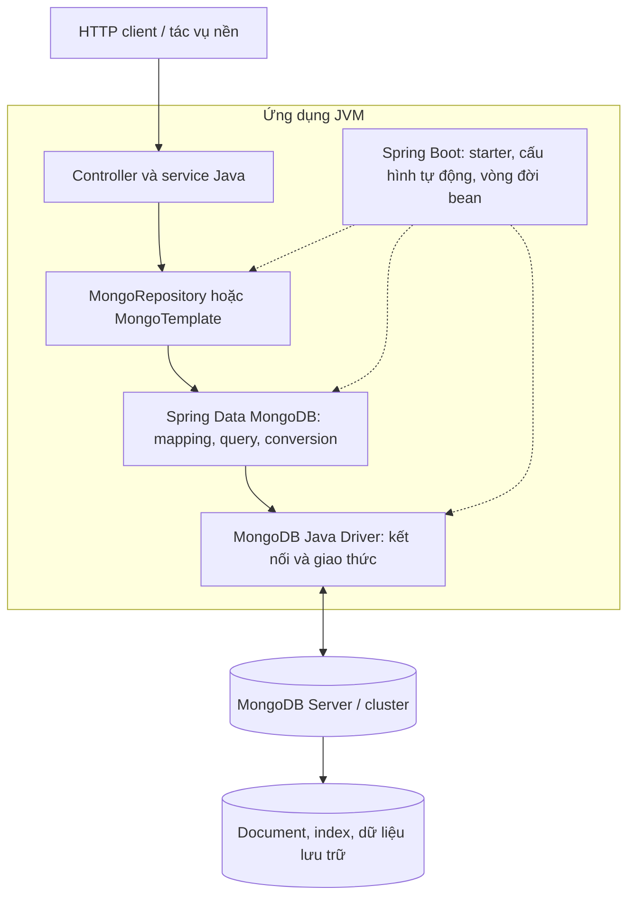

# Vai trò của MongoDB Server, Java Driver, Spring Data và Spring Boot

Trong ứng dụng Java dùng **Spring Data MongoDB**, bốn thành phần thường xuất hiện cùng nhau nhưng giải quyết những vấn đề khác nhau. **MongoDB Server** lưu và xử lý dữ liệu; **MongoDB Java Driver** giao tiếp với server; **Spring Data MongoDB** cung cấp mô hình lập trình truy cập dữ liệu ở mức domain; còn **Spring Boot** chuẩn bị cấu hình và các thành phần cần thiết để ứng dụng chạy thuận tiện. Phân biệt đúng trách nhiệm giúp chọn API phù hợp, tìm nguyên nhân lỗi và tối ưu hiệu năng ở đúng tầng.

Sau bài này, bạn có thể:

- Giải thích đường đi của một thao tác đọc/ghi từ mã Java tới MongoDB Server và ngược lại.
- Xác định việc nào thuộc server, driver, Spring Data hoặc Spring Boot.
- Chọn giữa `MongoRepository`, `MongoTemplate` và Java Driver trong tình huống cụ thể.
- Nhận diện ranh giới trách nhiệm khi cấu hình kết nối, tạo index, dùng transaction, reactive access và chẩn đoán truy vấn chậm.

## 1. Bức tranh tổng thể



Các mũi tên liền thể hiện **đường xử lý yêu cầu dữ liệu**. Mũi tên nét đứt thể hiện vai trò **khởi tạo và cấu hình** của Spring Boot: Boot không đóng vai trò một database server hay một tầng mạng trung gian mà mỗi truy vấn bắt buộc phải đi qua.

Một ứng dụng có thể sử dụng Java Driver mà không có Spring Data, hoặc dùng Spring Data MongoDB mà không cần Spring Boot. Trong ứng dụng Spring Boot thông thường, các tầng này được tích hợp để giảm công việc cấu hình thủ công.

| Thành phần | Trách nhiệm chính | Không nên nhầm với |
| --- | --- | --- |
| **MongoDB Server** | Lưu BSON document, chạy truy vấn và aggregation, quản lý index, phân quyền, replication, sharding và transaction theo khả năng triển khai | Thư viện Java ánh xạ class hay cấu hình bean Spring |
| **MongoDB Java Driver** | Mở/quản lý kết nối, xác thực, TLS, connection pool, gửi lệnh và nhận BSON qua giao thức MongoDB, hỗ trợ session và codec | Công cụ tự sinh repository Spring hay bộ máy xử lý query trong server |
| **Spring Data MongoDB** | Ánh xạ Java object ↔ document, dựng query, cung cấp `MongoTemplate`, repository, aggregation API, callback và tích hợp transaction | Cơ sở dữ liệu lưu trữ thực sự hoặc một driver mạng độc lập |
| **Spring Boot** | Cung cấp starter, tự cấu hình bean có điều kiện, đọc cấu hình môi trường và tích hợp vận hành/kiểm thử | Một API thay thế mọi chức năng của Spring Data hoặc cơ chế tạo index tự động trong mọi trường hợp |

## 2. MongoDB Server: nơi dữ liệu thực sự được xử lý

MongoDB Server quản lý database, collection và document. Một document được lưu ở dạng **BSON** (Binary JSON), có thể chứa object lồng nhau, mảng, ngày tháng và nhiều kiểu dữ liệu khác. Java object chỉ tồn tại trong ứng dụng; khi dữ liệu đến server, nó đã được biểu diễn dưới dạng document và các lệnh MongoDB.

Các công việc cốt lõi của server gồm:

- **Thực thi truy vấn:** lọc, sắp xếp, giới hạn kết quả, thực thi aggregation pipeline; chọn kế hoạch truy vấn và index phù hợp.
- **Lưu trữ và ràng buộc:** ghi document, bảo đảm các ràng buộc được cấu hình như unique index hoặc collection validation.
- **Khả dụng và mở rộng:** replication qua replica set, sharding khi cần phân phối dữ liệu, kiểm soát write concern và read concern.
- **Giao dịch:** phối hợp commit/rollback của các thao tác trong transaction trên topology và phiên bản MongoDB hỗ trợ.

Ví dụ, ứng dụng có collection `products` với document:

```javascript
{
  _id: ObjectId("64e000000000000000000001"),
  sku: "P-001",
  name: "Bàn làm việc",
  priceVnd: 2590000
}
```

Truy vấn tìm theo `sku` có thể chạy nhanh hơn khi **server thực sự có index** trên trường đó:

```javascript
// Thực hiện trong mongosh / quy trình quản lý schema dữ liệu.
db.products.createIndex({ sku: 1 }, { unique: true });
db.products.find({ sku: "P-001" }).explain("executionStats");
```

`createIndex` tạo index tại server; `explain` cho biết kế hoạch và thống kê thực thi. Khai báo Java hoặc gọi repository **không tự bảo đảm** rằng index đã tồn tại. Cần quản lý index có chủ đích và kiểm tra dữ liệu trùng trước khi tạo unique index.

## 3. MongoDB Java Driver: cầu nối giao tiếp với server

Java Driver cung cấp API mức thấp hơn Spring Data. Driver hiểu giao thức MongoDB, chuyển các giá trị thành BSON thông qua codec, định tuyến yêu cầu, chọn server phù hợp, quản lý connection pool, xác thực và cơ chế retry theo khả năng/cấu hình. Driver **không tự ra quyết định về index nào tốt nhất cho truy vấn**: đó là công việc của MongoDB Server.

Ví dụ sử dụng trực tiếp **synchronous Java Driver**:

```java
import com.mongodb.client.MongoClient;
import com.mongodb.client.MongoClients;
import com.mongodb.client.MongoCollection;
import org.bson.Document;

import static com.mongodb.client.model.Filters.eq;

// Ví dụ chương trình ngắn: tự quản lý và đóng client khi kết thúc.
try (MongoClient client = MongoClients.create("mongodb://localhost:27017")) {
    MongoCollection<Document> products = client
            .getDatabase("shop")
            .getCollection("products");

    Document product = products.find(eq("sku", "P-001")).first();
    System.out.println(product);
}
```

Ở đây, code làm việc trực tiếp với `Document` và bộ lọc của driver. Trong một dịch vụ chạy lâu dài, **tái sử dụng `MongoClient`** vì mỗi client sở hữu tài nguyên kết nối/pool; không tạo rồi đóng client trên từng HTTP request. Khi dùng Spring Boot và Spring Data, thông thường các bean được quản lý sẵn sẽ giúp tránh lỗi vòng đời này.

Driver có cả biến thể **synchronous** và **Reactive Streams**. Cả hai giao tiếp với cùng MongoDB Server nhưng dùng mô hình lập trình khác nhau; lựa chọn reactive không làm server tự động thực thi truy vấn nhanh hơn.

## 4. Spring Data MongoDB: lập trình theo domain thay vì lệnh BSON thủ công

Spring Data MongoDB xây trên Java Driver để cung cấp API gắn với mô hình dữ liệu của ứng dụng. Những khả năng quan trọng gồm:

- **Object mapping:** các annotation như `@Document`, `@Id`, `@Field` và bộ chuyển đổi để ánh xạ object với BSON document.
- **Repository abstraction:** `MongoRepository` và các phương thức truy vấn suy ra từ tên như `findBySku`.
- **Template API:** `MongoTemplate` cho query động, update theo điều kiện, aggregation, bulk operations và các thao tác cần kiểm soát chi tiết.
- **Tích hợp Spring:** dependency injection, callback của entity, exception translation, transaction support và các biến thể reactive.

### 4.1. Ánh xạ một document thành Java class

Ví dụ sau dùng **Java 17+** và Spring Data MongoDB với record (các ví dụ được tách thành những file Java tương ứng):

```java
import org.springframework.data.annotation.Id;
import org.springframework.data.mongodb.core.mapping.Document;

@Document(collection = "products")
public record Product(
        @Id String id,
        String sku,
        String name,
        long priceVnd
) {}
```

`@Document` chỉ định collection; `@Id` đánh dấu thuộc tính định danh. `String id` có thể được Spring Data chuyển đổi với giá trị `_id` kiểu `ObjectId` theo quy tắc mapping của nó. `priceVnd` dùng `long` để tránh nhập nhằng giữa số tiền nguyên và cách biểu diễn số thập phân trong BSON; khi dùng `BigDecimal`, cần chọn cách lưu thích hợp, chẳng hạn `Decimal128`.

### 4.2. Tác vụ CRUD thường gặp: Repository

```java
import java.util.Optional;
import org.springframework.data.mongodb.repository.MongoRepository;

public interface ProductRepository extends MongoRepository<Product, String> {
    Optional<Product> findBySku(String sku);
}
```

```java
import org.springframework.stereotype.Service;

@Service
public class ProductService {
    private final ProductRepository products;

    public ProductService(ProductRepository products) {
        this.products = products;
    }

    public Product create(String sku, String name, long priceVnd) {
        return products.save(new Product(null, sku, name, priceVnd));
    }

    public Product findBySku(String sku) {
        return products.findBySku(sku)
                .orElseThrow(() -> new IllegalArgumentException("Không tìm thấy SKU: " + sku));
    }
}
```

Spring Data tạo implementation của interface repository trong runtime. `findBySku("P-001")` được diễn giải thành truy vấn theo thuộc tính `sku` rồi gửi xuống driver. Việc repository có một phương thức truy vấn **không đồng nghĩa với việc đã có index** tương ứng trên server.

Với `save`, entity mới (chưa có ID) thường được insert; entity có ID được lưu theo ngữ nghĩa cập nhật/ghi thay thế thích hợp của API. Khi chỉ muốn thay một vài trường, nên xem xét các toán tử update có điều kiện thay vì vô tình ghi đè những dữ liệu khác.

### 4.3. Truy vấn động: `MongoTemplate`

```java
import java.util.List;
import org.springframework.data.mongodb.core.MongoTemplate;
import org.springframework.data.mongodb.core.query.Criteria;
import org.springframework.data.mongodb.core.query.Query;
import org.springframework.stereotype.Service;

@Service
public class ProductSearchService {
    private final MongoTemplate mongoTemplate;

    public ProductSearchService(MongoTemplate mongoTemplate) {
        this.mongoTemplate = mongoTemplate;
    }

    public List<Product> affordable(long maxPriceVnd) {
        Query query = Query.query(Criteria.where("priceVnd").lte(maxPriceVnd))
                .limit(20);
        return mongoTemplate.find(query, Product.class);
    }
}
```

`MongoTemplate` tạo điều kiện truy vấn theo kiểu Java/Spring Data và ánh xạ kết quả trở lại `Product`. Khi bài toán phức tạp hơn, có thể dùng `Aggregation` API để xây pipeline gồm `match`, `group`, `project`, `sort`...; **pipeline vẫn được thực thi tại MongoDB Server**.

`MongoRepository` và `MongoTemplate` đều sử dụng Spring Data; chọn API dựa vào mức độ phức tạp, không phải vì một API tự động nhanh hơn API còn lại. Hiệu năng phụ thuộc truy vấn thực tế, index, số document, dữ liệu trả về, kết nối và tải server.

## 5. Spring Boot: tự cấu hình để các thành phần hoạt động cùng nhau

Spring Boot giúp khởi động ứng dụng mà không phải tự viết toàn bộ Java configuration. Khi dự án có starter MongoDB phù hợp và thông tin kết nối, Boot có thể cấu hình các bean như `MongoClient`, `MongoDatabaseFactory`, `MongoTemplate` và cơ chế quét repository **theo các điều kiện auto-configuration**. Người phát triển vẫn có thể cung cấp bean/config riêng để điều chỉnh hành vi.

Với dự án Spring Boot 3.x sử dụng blocking access, dependency thường dùng là `org.springframework.boot:spring-boot-starter-data-mongodb`. Ví dụ cấu hình local cho phiên bản đó:

```yaml
spring:
  data:
    mongodb:
      uri: ${MONGODB_URI:mongodb://localhost:27017/shop}
```

Trong môi trường triển khai thực tế, nên cấp `MONGODB_URI` bằng cơ chế quản lý secret/configuration và thiết lập xác thực, TLS, topology phù hợp. **Tên property và cách tự cấu hình có thể thay đổi giữa các phiên bản Spring Boot**, vì vậy cần đối chiếu tài liệu đúng phiên bản trước khi áp dụng; ví dụ trên được ghi rõ cho Boot 3.x.

Boot phụ trách lắp ghép và quản lý vòng đời các thành phần trong ứng dụng. Sau khi startup, **Java Driver vẫn là thành phần gửi yêu cầu qua mạng**, còn **MongoDB Server vẫn là thành phần thực thi truy vấn**. Nếu thiếu cấu hình, quyền truy cập, hoặc server không sẵn sàng, Boot không thể biến một kết nối lỗi thành truy vấn thành công.

## 6. Theo dấu một yêu cầu từ đầu đến cuối

Giả sử một HTTP endpoint gọi `productService.findBySku("P-001")`. Luồng xử lý điển hình:

1. **Controller/service** nhận tham số và áp dụng quy tắc nghiệp vụ, rồi gọi repository.
2. **Spring Data MongoDB** phân tích phương thức `findBySku`, dùng metadata mapping để tạo bộ lọc MongoDB, chuẩn bị cơ chế chuyển đổi kết quả.
3. **MongoDB Java Driver** sử dụng kết nối trong pool, mã hóa lệnh thành BSON, gửi đến server phù hợp và nhận phản hồi.
4. **MongoDB Server** lập và chạy kế hoạch truy vấn, có thể dùng index `{ sku: 1 }` nếu có và phù hợp, trả về document.
5. **Driver và Spring Data** lần lượt giải mã dữ liệu và ánh xạ thành `Product`; kết quả được trả về service/controller.

Khi truy vấn chậm, dùng luồng này để phân tích: chậm do tạo quá nhiều client là vấn đề tầng ứng dụng/driver; `COLLSCAN` và quét hàng triệu document là vấn đề truy vấn/index phía server; chuyển đổi dữ liệu lớn, thiết kế API trả về quá nhiều phần tử là vấn đề ở tầng ứng dụng/Spring Data. Một triệu document không nên được tải hết chỉ để hiển thị 20 hàng đầu tiên.

## 7. Phân chia trách nhiệm trong các chức năng nâng cao

| Nhu cầu | Thành phần phối hợp và trách nhiệm thực tế |
| --- | --- |
| **Tạo index** | Có thể khai báo metadata như `@Indexed` trong Spring Data hoặc quản lý bằng migration/script; **index phải được tạo trên MongoDB Server**. Không mặc định cho rằng mọi annotation đều tự kích hoạt tạo index. |
| **Aggregation** | `MongoTemplate`/Spring Data giúp diễn đạt pipeline; driver gửi lệnh; **server xử lý các stage** và trả kết quả. |
| **Transaction** | Spring quản lý ranh giới bằng `@Transactional` khi có transaction manager phù hợp; Spring Data liên kết session; driver truyền lệnh/session; **server thực hiện commit/rollback** trên deployment hỗ trợ. |
| **Reactive access** | `ReactiveMongoRepository`/`ReactiveMongoTemplate` và Reactive Streams Driver trả `Mono`/`Flux` theo mô hình non-blocking; server vẫn là MongoDB. Tránh gọi blocking `MongoTemplate` trong luồng reactive. |
| **Kết nối và bảo mật** | Boot nạp cấu hình; driver quản lý pool, TLS và xác thực giao thức; MongoDB Server kiểm tra user/role và quyền truy cập. |
| **Kiểm thử** | Spring Boot hỗ trợ test slice như `@DataMongoTest`; có thể dùng MongoDB thực trong môi trường test qua Testcontainers để kiểm tra mapping, index và hành vi truy vấn. |
| **Quan sát hiệu năng** | Ứng dụng đo latency, pool và lỗi; MongoDB Server cung cấp `explain`, thống kê query và metrics để xác định nguyên nhân. |

### Lưu ý riêng cho transaction

Không suy ra rằng mọi phương thức gắn `@Transactional` đều sẽ có transaction MongoDB. Cần có **transaction manager đúng loại**, sử dụng cơ chế session được Spring Data hỗ trợ, và MongoDB deployment phù hợp (điển hình là replica set hoặc sharded cluster đáp ứng yêu cầu). Transaction nhiều document có chi phí; khi có thể, nên thiết kế dữ liệu để tận dụng tính nguyên tử của **một document**.

### Lưu ý riêng cho reactive

Reactive có ích khi ứng dụng xử lý nhiều thao tác I/O đồng thời theo mô hình bất đồng bộ và các tầng phía trên cũng là reactive. Việc chuyển từ `MongoRepository` sang `ReactiveMongoRepository` không tự tạo thêm index, không thay đổi thuật toán truy vấn của server và không xóa được điểm nghẽn về thiết kế dữ liệu. Các loại driver, template và transaction manager cho blocking/reactive cần được dùng nhất quán.

## 8. Khi nào chọn API nào?

| Tình huống | Lựa chọn thường phù hợp | Lý do |
| --- | --- | --- |
| CRUD theo entity, tìm bằng vài thuộc tính cố định | `MongoRepository` | Ít mã lặp, dễ đọc, tích hợp mapping và phân trang. |
| Bộ lọc xây động, update từng trường, truy vấn phức tạp, aggregation | `MongoTemplate` | Kiểm soát query và các thao tác MongoDB cụ thể mà vẫn hưởng mapping Spring Data. |
| Cần API/tuỳ chọn driver mức thấp không được abstraction hiện tại hỗ trợ | MongoDB Java Driver | Chủ động truy cập MongoDB API và codec, đổi lại phải quản lý nhiều chi tiết hơn. |
| Ứng dụng reactive xuyên suốt | `ReactiveMongoRepository` hoặc `ReactiveMongoTemplate` | Tích hợp Reactor và Reactive Streams Driver. |

Các lựa chọn này không loại trừ nhau: một ứng dụng có thể dùng repository cho nghiệp vụ thường ngày, `MongoTemplate` cho aggregation và driver trực tiếp cho một nhu cầu đặc biệt. Tuy nhiên nên thống nhất cách quản lý client, session, mapping và transaction để tránh tạo nhiều pool hoặc có hành vi không nhất quán.

## 9. Tình huống chẩn đoán thực tế

**Tình huống A — Ứng dụng chạy được nhưng tìm theo SKU rất chậm.** `findBySku` đã hoạt động nghĩa là Spring Data và driver có thể gửi yêu cầu. Kiểm tra filter thực tế và `explain("executionStats")` trên server; nếu quét toàn collection, xác định index phù hợp và kiểm tra selectivity. Việc thêm một lớp service hoặc đổi tên phương thức repository không khắc phục nguyên nhân này.

**Tình huống B — Kết nối lỗi ngay lúc startup.** Kiểm tra URI, DNS, credentials, TLS, quyền mạng, trạng thái replica set và cấu hình Boot theo phiên bản. Driver thường là nơi phát hiện/lộ lỗi kết nối; MongoDB Server có thể từ chối xác thực hoặc không thể truy cập qua mạng. Đây không phải lỗi của `@Document`.

**Tình huống C — Đã thêm `@Indexed(unique = true)` nhưng vẫn có SKU trùng.** Annotation thể hiện metadata mapping, không chứng minh index đã được tạo. Kiểm tra `db.products.getIndexes()`, cơ chế quản lý index của dự án và dữ liệu cũ trước khi áp unique constraint.

**Tình huống D — Gắn `@Transactional` nhưng thao tác thứ hai lỗi và thao tác đầu vẫn tồn tại.** Kiểm tra transaction manager, cách gọi qua Spring proxy, session và topology MongoDB; không mặc định transaction có hiệu lực chỉ vì annotation xuất hiện trong source code.

## 10. Ghi nhớ qua một câu hỏi

**Nếu code gọi `repository.findBySku(...)`, thành phần nào quyết định có sử dụng index hay không?**

Spring Data dựng truy vấn từ phương thức repository; Java Driver truyền truy vấn; **MongoDB Server** chọn kế hoạch thực thi dựa trên truy vấn, index hiện có và thông tin thống kê. Spring Boot chỉ giúp cấu hình các bean cần thiết cho đường đi này.

Mối quan hệ cần nắm vững là: **Spring Boot lắp ghép → Spring Data biểu diễn nghiệp vụ dữ liệu → Java Driver giao tiếp → MongoDB Server thực thi và lưu trữ**. Khi xây CRUD, aggregation, index, transaction, reactive access hoặc điều tra hiệu năng, hãy xác định đúng tầng chịu trách nhiệm trước khi chọn giải pháp.
