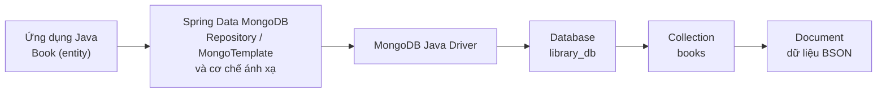
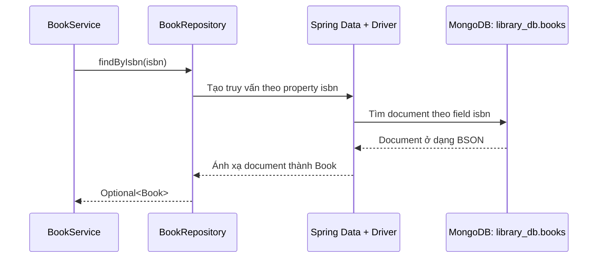

# Bản đồ khái niệm: database, collection, document, BSON, entity và repository

Khi học Spring Data MongoDB, cần phân biệt hai phía của một ứng dụng: **MongoDB lưu dữ liệu dưới dạng document trong collection của một database**, còn **Spring Data MongoDB giúp mã Java ánh xạ dữ liệu đó thành entity và truy cập thông qua repository hoặc `MongoTemplate`**. Sáu khái niệm trong tiêu đề tạo thành bản đồ để hiểu các thao tác đọc, ghi, truy vấn, aggregation và những chủ đề nâng cao về sau.

## 1. Bản đồ tổng thể



| Khái niệm | Thuộc lớp nào? | Vai trò | Ví dụ trong ứng dụng quản lý sách |
| --- | --- | --- | --- |
| **Database** | MongoDB | Không gian tên chứa các collection | `library_db` |
| **Collection** | MongoDB | Tập hợp các document; nơi thao tác và lập chỉ mục | `books` |
| **Document** | MongoDB | Đơn vị dữ liệu gồm các cặp tên trường – giá trị, có thể lồng nhau | Một sách có `_id`, `isbn`, `title`, `author` |
| **BSON** | MongoDB | Định dạng nhị phân dùng để biểu diễn document, hỗ trợ các kiểu dữ liệu riêng | `_id` kiểu `ObjectId`, ngày kiểu BSON Date |
| **Entity** | Java / Spring Data | Đối tượng Java được ánh xạ đến dữ liệu document | Lớp `Book` gắn `@Document(collection = "books")` |
| **Repository** | Java / Spring Data | Giao diện truy cập dữ liệu với các thao tác CRUD và phương thức truy vấn | `BookRepository extends MongoRepository<Book, ObjectId>` |

Hai nhóm đầu và sau không đồng nghĩa với nhau: **document là dữ liệu được lưu**, **entity là biểu diễn trong chương trình**, còn **repository là cách chương trình thao tác với dữ liệu**. BSON là định dạng của document, không phải một collection hay một đối tượng Java.

## 2. Database → collection → document

Giả sử một ứng dụng thư viện lưu dữ liệu như sau:

```text
MongoDB server / deployment
└── database: library_db
    ├── collection: books
    │   ├── document: sách có _id = ObjectId("507f1f77bcf86cd799439011")
    │   └── document: sách có _id = ObjectId("507f191e810c19729de860ea")
    └── collection: readers
        └── document: thông tin một độc giả
```

### Database: phạm vi tổ chức dữ liệu

`library_db` là tên database, dùng để nhóm các collection liên quan trong cùng ứng dụng. Một MongoDB deployment có thể chứa nhiều database. Khi một ứng dụng sử dụng Spring Data MongoDB, database đích thường được xác định bằng cấu hình kết nối; tên database không phải thuộc tính của `BookRepository`.

Ví dụ cấu hình URI kết nối cho một ứng dụng Spring Boot sử dụng thuộc tính `spring.data.mongodb.uri`:

```properties
spring.data.mongodb.uri=mongodb://localhost:27017/library_db
```

Đường dẫn cuối URI chỉ định database `library_db`. Trong môi trường thật, URI có thể chứa thông tin xác thực, replica set hoặc các tham số khác; ví dụ này giả định MongoDB đang chạy cục bộ.

### Collection: nhóm các document

`books` là collection chứa các document về sách. Collection gần giống bảng của cơ sở dữ liệu quan hệ ở vai trò nhóm bản ghi, nhưng các document trong cùng collection không bắt buộc có cấu trúc trường giống hệt nhau. MongoDB có thể áp dụng quy tắc kiểm tra schema khi cấu hình, vì vậy “schema linh hoạt” không có nghĩa là không cần thiết kế dữ liệu.

Chỉ mục (index), ví dụ chỉ mục phục vụ tìm sách theo `isbn`, gắn với collection. Truy vấn MongoDB thường hướng tới một collection cụ thể, chẳng hạn `db.books.find(...)`.

### Document: đơn vị dữ liệu

Document biểu diễn một đối tượng nghiệp vụ, gồm các trường và giá trị. Một document có thể chứa chuỗi, số, ngày, mảng và document lồng nhau. Mỗi document trong collection có trường `_id`, và giá trị `_id` phải duy nhất **trong collection đó**.

Ví dụ thao tác trực tiếp bằng `mongosh`:

```javascript
use library_db

db.books.insertOne({
  isbn: "978-604-00-0000-1",
  title: "Nhập môn Spring Data MongoDB",
  author: "An",
  publication_year: 2025
})

db.books.findOne({ isbn: "978-604-00-0000-1" })
```

Nếu không cung cấp `_id`, trình điều khiển MongoDB thường tạo một `ObjectId` cho document mới. Giá trị `_id` không nhất thiết luôn là `ObjectId`: ứng dụng có thể chọn kiểu định danh khác, miễn phù hợp với quy tắc của MongoDB và thiết kế ánh xạ.

## 3. BSON: document thực sự được biểu diễn thế nào?

Ta thường xem document qua cú pháp giống JSON vì dễ đọc. Tuy nhiên, MongoDB sử dụng **BSON (Binary JSON)**, một định dạng nhị phân có kiểu dữ liệu rõ ràng. Ví dụ sau sử dụng **Extended JSON** để thể hiện kiểu BSON bằng văn bản:

```json
{
  "_id": { "$oid": "507f1f77bcf86cd799439011" },
  "isbn": "978-604-00-0000-1",
  "title": "Nhập môn Spring Data MongoDB",
  "author": "An",
  "publication_year": 2025,
  "created_at": { "$date": "2025-02-10T08:00:00Z" },
  "tags": ["java", "mongodb"]
}
```

`{"$oid": "..."}` và `{"$date": "..."}` là cách **hiển thị dưới dạng Extended JSON** của `ObjectId` và BSON Date; không phải chuỗi JSON thông thường được lưu nguyên văn như vậy trong mọi trường hợp.

| Kiểu dữ liệu MongoDB/BSON | Ví dụ ý nghĩa | Kiểu Java thường gặp khi ánh xạ |
| --- | --- | --- |
| String | Tên sách, tác giả | `String` |
| Int32 / Int64 | Năm xuất bản, số lượt mượn | `Integer` / `Long` |
| Boolean | Trạng thái còn hàng | `Boolean` / `boolean` |
| ObjectId | Định danh document | `org.bson.types.ObjectId` hoặc `String` với quy tắc chuyển đổi phù hợp |
| Date | Thời điểm tạo dữ liệu | `Date`, `Instant` hoặc kiểu ngày giờ được cấu hình chuyển đổi |
| Array | Danh sách nhãn | `List<String>` |
| Embedded document | Thông tin nhà xuất bản nằm trong một sách | Đối tượng Java lồng trong entity |
| Decimal128 | Số thập phân cần độ chính xác phù hợp | `Decimal128` hoặc kiểu Java có chuyển đổi tương ứng |

**Điểm cần nhớ:** JSON là cách trình bày quen thuộc; BSON là định dạng dữ liệu dùng trong MongoDB và giao tiếp với driver. Không được suy ra kiểu trường chỉ bằng cách nhìn hình dạng JSON, nhất là với định danh, thời gian và số thập phân.

## 4. Entity: hình ảnh của document trong mã Java

Spring Data MongoDB cung cấp cơ chế mapping giữa **field trong document** và **property của lớp Java**. Với ví dụ trên, ta tạo entity `Book`:

```java
import org.bson.types.ObjectId;
import org.springframework.data.annotation.Id;
import org.springframework.data.mongodb.core.index.Indexed;
import org.springframework.data.mongodb.core.mapping.Document;
import org.springframework.data.mongodb.core.mapping.Field;

@Document(collection = "books")
public class Book {

    @Id
    private ObjectId id;

    @Indexed(unique = true)
    private String isbn;

    private String title;
    private String author;

    @Field("publication_year")
    private Integer publicationYear;

    protected Book() {
        // Dành cho cơ chế khởi tạo đối tượng khi ánh xạ dữ liệu.
    }

    public Book(String isbn, String title, String author, Integer publicationYear) {
        this.isbn = isbn;
        this.title = title;
        this.author = author;
        this.publicationYear = publicationYear;
    }

    public ObjectId getId() {
        return id;
    }

    public String getIsbn() {
        return isbn;
    }

    public String getTitle() {
        return title;
    }

    public String getAuthor() {
        return author;
    }

    public Integer getPublicationYear() {
        return publicationYear;
    }
}
```

Nhìn vào các annotation có thể đọc được quy tắc ánh xạ:

| Thành phần Java | Ý nghĩa khi lưu vào MongoDB |
| --- | --- |
| `@Document(collection = "books")` | Gắn entity với collection `books` |
| `@Id` trên `id` | Ánh xạ `id` của Java đến `_id` trong document |
| `@Field("publication_year")` | Ánh xạ property `publicationYear` đến trường `publication_year` |
| `@Indexed(unique = true)` trên `isbn` | Khai báo metadata để tạo chỉ mục duy nhất theo `isbn` khi cơ chế tạo index được thực thi |
| Không gắn `@Field` trên `title`, `author` | Theo mặc định sử dụng tên field tương ứng với property |

Chú ý với `@Indexed`: **khai báo annotation không bảo đảm index đã tồn tại trong database**. Việc tạo index tự động phụ thuộc cấu hình/phiên bản Spring Data và quy trình khởi tạo index; trong hệ thống thật nên xác minh index trong collection hoặc quản lý bằng migration. Ràng buộc duy nhất chỉ có hiệu lực ở phía database sau khi unique index thực sự được tạo.

Entity không nhất thiết chứa mọi trường của document. Trong ví dụ Extended JSON có `created_at` và `tags`, nhưng lớp `Book` không khai báo hai property này; Spring Data có thể đọc các trường được ánh xạ và bỏ qua những trường không khai báo trong đối tượng Java. Nếu ứng dụng cần lưu hoặc xử lý các trường đó, nên bổ sung property và quy tắc mapping tương ứng.

## 5. Repository: truy cập document thông qua entity

Repository là một **abstraction trong Java**. Ta định nghĩa interface; Spring Data MongoDB cung cấp phần triển khai tại thời điểm chạy để thực hiện các thao tác với collection tương ứng.

```java
import java.util.List;
import java.util.Optional;
import org.bson.types.ObjectId;
import org.springframework.data.mongodb.repository.MongoRepository;

public interface BookRepository extends MongoRepository<Book, ObjectId> {

    Optional<Book> findByIsbn(String isbn);

    List<Book> findByAuthor(String author);
}
```

Trong `MongoRepository<Book, ObjectId>`:

- `Book` là kiểu entity được quản lý.
- `ObjectId` là kiểu của property định danh `Book.id`, **không phải tên database**.
- `findByIsbn` và `findByAuthor` là các phương thức truy vấn được xây dựng từ tên property Java. Khi ánh xạ có `@Field`, Spring Data dùng thông tin mapping để tạo truy vấn MongoDB với tên trường lưu trữ phù hợp.

Sử dụng repository trong một service:

```java
import java.util.Optional;
import org.springframework.stereotype.Service;

@Service
public class BookService {

    private final BookRepository bookRepository;

    public BookService(BookRepository bookRepository) {
        this.bookRepository = bookRepository;
    }

    public Book addBook() {
        Book book = new Book(
            "978-604-00-0000-1",
            "Nhập môn Spring Data MongoDB",
            "An",
            2025
        );
        return bookRepository.save(book);
    }

    public Optional<Book> findBook(String isbn) {
        return bookRepository.findByIsbn(isbn);
    }
}
```

Trong luồng này, `save(book)` khiến Spring Data chuyển đối tượng `Book` thành document để ghi vào `books`; `findByIsbn(...)` gửi truy vấn rồi chuyển document đọc được thành `Book`. Nếu entity chưa có định danh, thao tác lưu thường tạo bản ghi mới; với entity đã có định danh, `save` có thể ghi đè/cập nhật document cùng `_id` theo ngữ nghĩa lưu của Spring Data. **Không nên hiểu `save` luôn tương đương lệnh `insertOne`**.

Repository cung cấp các thao tác như `findById`, `findAll`, `save`, `deleteById` và truy vấn suy ra từ tên phương thức. Với các truy vấn phức tạp hơn, có thể khai báo `@Query` hoặc dùng `MongoTemplate`.

## 6. MongoTemplate ở đâu trong bản đồ?

`MongoTemplate` cũng là cách truy cập MongoDB qua Spring Data, nhưng API cho phép mô tả trực tiếp tiêu chí truy vấn, cập nhật và các thao tác chuyên sâu hơn. Nó sử dụng cùng cơ chế ánh xạ entity/document như repository.

```java
import java.util.List;
import org.springframework.data.mongodb.core.MongoTemplate;
import org.springframework.data.mongodb.core.query.Criteria;
import org.springframework.data.mongodb.core.query.Query;

public class BookQueries {

    private final MongoTemplate mongoTemplate;

    public BookQueries(MongoTemplate mongoTemplate) {
        this.mongoTemplate = mongoTemplate;
    }

    public List<Book> publishedSince(int year) {
        Query query = Query.query(
            Criteria.where("publicationYear").gte(year)
        );
        return mongoTemplate.find(query, Book.class);
    }
}
```

Ở ví dụ trên, tiêu chí dùng **tên property Java** `publicationYear`. Khi thực hiện truy vấn trên entity `Book`, mapping sẽ chuyển sang tên field lưu trữ `publication_year`. Lệnh `mongoTemplate.find(query, Book.class)` chọn collection dựa trên mapping `@Document` của `Book` và trả kết quả dạng `List<Book>`.

| Nhu cầu | Công cụ thường phù hợp |
| --- | --- |
| CRUD thông thường, truy vấn đơn giản theo thuộc tính | `MongoRepository` |
| Truy vấn định nghĩa bằng tên phương thức hoặc annotation | Repository |
| Truy vấn động với nhiều điều kiện | `MongoTemplate` hoặc custom repository |
| Aggregation, thao tác cập nhật phức tạp, xử lý chi tiết theo API MongoDB | `MongoTemplate` hoặc API repository phù hợp |
| Xử lý luồng bất đồng bộ theo mô hình reactive | `ReactiveMongoRepository` / `ReactiveMongoTemplate` và driver reactive tương ứng |

Reactive repository không phải một kiểu collection mới: nó thay đổi cách ứng dụng làm việc với kết quả và I/O, trong khi dữ liệu vẫn nằm trong database, collection và document MongoDB.

## 7. Đối chiếu với hệ quản trị quan hệ và các nhầm lẫn thường gặp

| Góc nhìn | MongoDB / Spring Data MongoDB | Gợi liên tưởng khi đã học SQL |
| --- | --- | --- |
| Không gian dữ liệu | Database | Database |
| Nhóm dữ liệu | Collection | Table (chỉ gần tương đương) |
| Đơn vị dữ liệu | Document | Row (chỉ gần tương đương) |
| Cấu trúc dữ liệu | BSON có thể chứa array/document lồng nhau | Row với các column có schema xác định |
| Mô hình trong ứng dụng | Java entity được mapping | Entity trong ORM/JPA (không cùng cơ chế lưu trữ) |
| Lớp truy cập | Repository hoặc `MongoTemplate` | Repository hoặc công cụ truy cập SQL |

Một số quy tắc giúp tránh hiểu nhầm:

1. **Collection không phải Java class.** Một class `Book` thường ánh xạ vào collection `books`, nhưng cấu hình mapping và thiết kế ứng dụng quyết định mối liên hệ thực tế.
2. **Document không phải entity.** Document là dữ liệu trong MongoDB; entity là đối tượng Java được tạo ra/biến đổi khi đọc ghi.
3. **BSON không đồng nghĩa JSON thuần.** BSON hỗ trợ `ObjectId`, Date và nhiều kiểu khác cần được nhận diện đúng.
4. **Repository không được lưu trong MongoDB.** Đây là API phía ứng dụng; MongoDB chỉ lưu dữ liệu và các cấu trúc quản trị tương ứng.
5. **Tên property Java có thể khác tên field BSON.** `publicationYear` và `publication_year` là một ví dụ; `@Field` xác lập phép ánh xạ.
6. **Document không bắt buộc phẳng.** Có thể dùng mảng và document lồng nhau khi phù hợp với cách truy vấn và cập nhật.
7. **Định danh và index cần được thiết kế rõ.** `_id` bảo đảm duy nhất trong collection; các ràng buộc như unique `isbn` cần chỉ mục được tạo thực sự.

## 8. Lần theo một yêu cầu từ Java đến MongoDB

Giả sử người dùng cần tìm sách có ISBN `978-604-00-0000-1`:



Đọc sơ đồ từ trái sang phải cho thấy rõ giới hạn trách nhiệm: **`BookService` xử lý nghiệp vụ; `BookRepository` cung cấp giao diện truy vấn; Spring Data và driver chuyển đổi/truyền lệnh; MongoDB lưu và tìm document**. Khi triển khai tối ưu hiệu năng, cần xét cả truy vấn do Spring Data tạo và index thực tế ở collection; chỉ nhìn tên hàm repository là chưa đủ.

## 9. Tự kiểm tra kiến thức

Với đoạn mã `BookRepository extends MongoRepository<Book, ObjectId>` và database `library_db` có collection `books`, hãy tự trả lời:

1. `Book`, `books` và `library_db` lần lượt là gì? **Đáp án:** entity Java, collection MongoDB, database MongoDB.
2. Vì sao document có trường `_id` nhưng class có property `id`? **Đáp án:** `@Id` ánh xạ định danh giữa hai biểu diễn.
3. Vì sao tiêu chí `Criteria.where("publicationYear")` có thể truy vấn field `publication_year`? **Đáp án:** Spring Data dùng metadata mapping của `@Field` khi xây dựng truy vấn theo entity.
4. `findByIsbn` nằm trong BSON, collection hay repository? **Đáp án:** repository của ứng dụng; nó tạo truy vấn đến document trong collection.
5. Chỉ thêm `@Indexed(unique = true)` có chắc MongoDB đã chặn ISBN trùng? **Đáp án:** chưa; phải xác minh unique index đã được tạo trong collection.

**Ghi nhớ để học tiếp:** database chứa collection, collection chứa document, document sử dụng BSON; Spring Data ánh xạ document thành entity, còn repository và `MongoTemplate` là những con đường truy cập dữ liệu từ mã Java. Các chủ đề truy vấn, aggregation, index, transaction, reactive access, kiểm thử và chẩn đoán hiệu năng đều dựa trên bản đồ cơ bản này.
