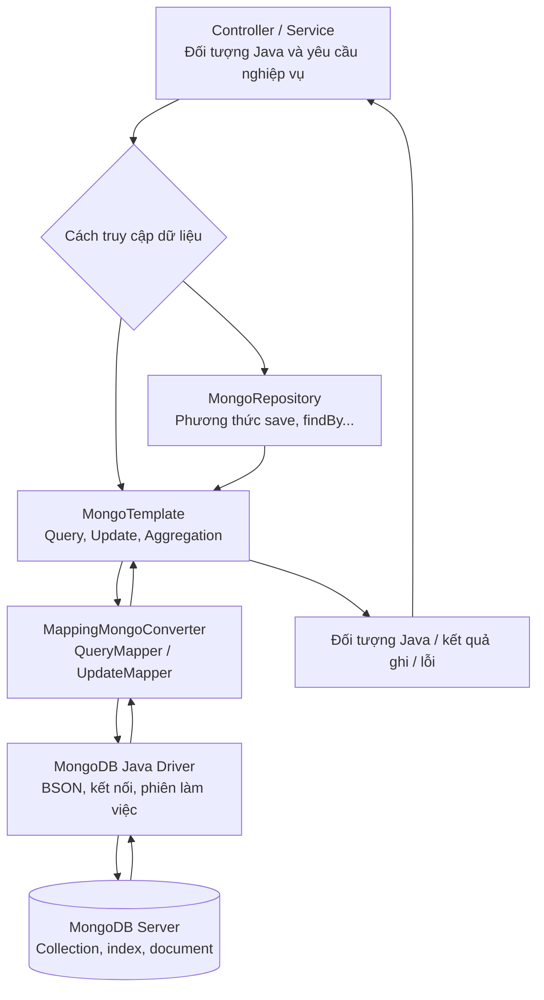

# Luồng xử lý từ đối tượng Java đến lệnh MongoDB và kết quả trả về

Trong ứng dụng Java, ta thường thao tác với các đối tượng nghiệp vụ như `PurchaseOrder` thay vì tự tạo tài liệu BSON hoặc gửi lệnh qua giao thức MongoDB. **Spring Data MongoDB** nối hai thế giới đó: ánh xạ đối tượng Java thành document, chuyển điều kiện truy vấn thành bộ lọc MongoDB, gọi MongoDB Java Driver và biến dữ liệu đọc được thành kết quả mà ứng dụng sử dụng.

Bài học này đi theo một yêu cầu từ đầu đến cuối, để thấy rõ trách nhiệm của **repository**, **`MongoTemplate`**, bộ chuyển đổi dữ liệu, driver và MongoDB Server. Các thao tác chính gồm ghi, đọc, cập nhật, aggregation, truy cập reactive, cùng những điểm cần quan sát khi kiểm thử hoặc chẩn đoán hiệu năng.

## 1. Bức tranh tổng thể



Sơ đồ mô tả **các trách nhiệm logic**, không ngụ ý mỗi hộp tương ứng với một lần gọi mạng riêng biệt. Khi sử dụng repository thông thường, Spring Data triển khai thao tác qua các thành phần MongoDB Operations; khi dùng `MongoTemplate`, ứng dụng gọi trực tiếp lớp thao tác đó. Cả hai đều dùng cơ chế mapping và driver bên dưới.

Một yêu cầu điển hình:

1. Service tạo đối tượng Java và gọi `repository.save(order)`.
2. Spring Data xác định collection, trạng thái đối tượng mới/cũ, các trường cần ghi và quy tắc chuyển đổi.
3. Driver mã hóa yêu cầu dưới dạng BSON, sử dụng kết nối tới MongoDB Server và nhận phản hồi.
4. Spring Data diễn giải kết quả hoặc lỗi; service nhận lại đối tượng, danh sách, số lượng bản ghi chịu tác động hoặc kiểu kết quả phù hợp với API đã gọi.

**Phân biệt ba lớp dữ liệu:** đối tượng Java là mô hình ứng dụng; BSON document là dữ liệu MongoDB lưu trữ/truyền nhận; đối tượng kết quả như `UpdateResult` mô tả **hiệu quả của thao tác**, không phải chính document.

## 2. Xây dựng mô hình Java để theo dõi luồng

Giả sử ứng dụng quản lý đơn mua hàng. Mỗi đơn lưu trong collection `purchase_orders` với mã khách hàng, trạng thái và tổng tiền theo đơn vị đồng Việt Nam.

```java
import org.springframework.data.annotation.Id;
import org.springframework.data.mongodb.core.mapping.Document;
import org.springframework.data.mongodb.core.mapping.Field;

@Document(collection = "purchase_orders")
public class PurchaseOrder {
    @Id
    private String id;

    @Field("customer_id")
    private String customerId;

    private String status;

    @Field("total_vnd")
    private long totalVnd;

    public PurchaseOrder() {}

    public PurchaseOrder(String customerId, String status, long totalVnd) {
        this.customerId = customerId;
        this.status = status;
        this.totalVnd = totalVnd;
    }

    public String getId() { return id; }
    public String getCustomerId() { return customerId; }
    public String getStatus() { return status; }
    public long getTotalVnd() { return totalVnd; }
}
```

Trong ví dụ này:

| Thành phần Java | Ý nghĩa khi ánh xạ sang MongoDB |
| --- | --- |
| `@Document(collection = "purchase_orders")` | Chỉ định collection cho entity. |
| `@Id String id` | Thuộc tính định danh gắn với trường `_id` của document. |
| `@Field("customer_id")` | Đổi tên trường lưu trữ từ `customerId` thành `customer_id`. |
| `status` | Giữ tên trường `status` khi không có quy tắc ánh xạ khác. |
| `@Field("total_vnd") long totalVnd` | Ghi tên `total_vnd`; giá trị `long` thường biểu diễn bằng BSON Int64. |

Spring Data có thể truy cập các field để ánh xạ dù không có setter công khai. Constructor rỗng ở đây giúp ví dụ đơn giản; Spring Data cũng hỗ trợ nhiều dạng constructor và đối tượng bất biến khi cấu hình phù hợp.

Với `@Id String`, giá trị chuỗi có dạng ObjectId hợp lệ có thể được chuyển sang BSON ObjectId theo quy tắc mặc định; khi tạo bản ghi mới chưa có ID, MongoDB/driver có thể sinh ObjectId và Spring Data chuyển về `String`. Vì vậy **kiểu Java và kiểu BSON của `_id` không nhất thiết giống nhau**. Nếu ứng dụng cần ID là chuỗi nguyên dạng, hãy chủ động xác định chiến lược ID (chẳng hạn `@MongoId`) thay vì dựa vào chuyển đổi mặc định.

Ứng dụng Spring Boot có thể cung cấp cấu hình kết nối MongoDB và bean `MongoTemplate`/repository qua Spring Data MongoDB starter, sau đó inject các thành phần này vào service. Ví dụ tiếp theo giả định kết nối và collection đã sẵn sàng; không cần tự mở `MongoClient` mới cho mỗi yêu cầu.

## 3. Luồng ghi: từ `save()` đến document

Khai báo repository:

```java
import java.util.List;
import org.springframework.data.mongodb.repository.MongoRepository;

public interface PurchaseOrderRepository
        extends MongoRepository<PurchaseOrder, String> {

    List<PurchaseOrder> findByCustomerIdAndStatus(
            String customerId, String status);
}
```

Service tạo và lưu một đơn:

```java
PurchaseOrder draft = new PurchaseOrder("KH-101", "NEW", 1250000L);
PurchaseOrder saved = purchaseOrderRepository.save(draft);

String generatedId = saved.getId();
```

Luồng diễn ra theo thứ tự logic:

1. **Repository nhận entity.** Triển khai repository của Spring Data xác định đây là entity mới hay đã có. Với ví dụ `id == null`, thao tác thường đi theo đường **insert**; với entity đã tồn tại, `save` thường lưu toàn bộ trạng thái ánh xạ của entity. Nếu dùng `@Version`, cơ chế nhận diện entity và kiểm soát phiên bản cũng tham gia.
2. **Xác định collection và metadata.** Mapping context đọc `@Document`, `@Id`, `@Field` và các quy tắc chuyển đổi. Không phải tên thuộc tính Java nào cũng bằng tên trường trên MongoDB.
3. **Chuyển entity thành BSON document.** `MappingMongoConverter` chuyển các giá trị, document lồng nhau, collection, enum, ID và kiểu tùy biến theo cấu hình. Các entity callback như `BeforeConvertCallback` hoặc `BeforeSaveCallback`, nếu được đăng ký, có thể tham gia ở các mốc tương ứng.
4. **Thực thi qua driver.** `MongoTemplate` sử dụng MongoDB Java Driver để gửi thao tác tới server. Driver quản lý BSON, kết nối, lựa chọn server, session và việc nhận phản hồi; Spring Data không tự xây dựng giao thức mạng MongoDB.
5. **Hoàn tất phía Java.** Khi lệnh ghi thành công theo chế độ xác nhận ghi đã cấu hình, Spring Data trả entity đã lưu. Với ID được sinh, đối tượng trả về có ID; các callback sau lưu có thể tham gia trước khi trả kết quả.

Document lưu trên server có thể được biểu diễn trong MongoDB Shell như sau (ID minh họa):

```javascript
{
  _id: ObjectId("674000000000000000000101"),
  customer_id: "KH-101",
  status: "NEW",
  total_vnd: NumberLong("1250000"),
  _class: "com.example.orders.PurchaseOrder"
}
```

Trường `_class` trong ví dụ thể hiện metadata kiểu mà bộ converter mặc định **có thể** ghi; giá trị và sự hiện diện thực tế phụ thuộc package, cấu hình type mapper và kiểu đối tượng. Chuỗi biểu diễn MongoDB Shell ở trên minh họa document lưu trữ; nó **không phải bản ghi bắt gói tin** mà driver gửi.

### `insert`, `save` và cập nhật từng phần khác nhau thế nào?

| API | Mục đích | Điều cần lưu ý |
| --- | --- | --- |
| `repository.save(entity)` / `mongoTemplate.save(entity)` | Lưu entity mới hoặc trạng thái hiện tại của entity theo quy tắc nhận diện ID/phiên bản. | Với entity đã có, lưu toàn bộ có thể ghi đè dữ liệu nếu trước đó chỉ nạp một phần document hoặc đối tượng bị cũ. |
| `mongoTemplate.insert(entity)` | Chỉ thêm document mới. | ID trùng hoặc vi phạm unique index có thể làm thao tác thất bại. |
| `mongoTemplate.updateFirst(query, update, type)` | Cập nhật các trường cụ thể trên document khớp điều kiện. | Phù hợp với thay đổi cục bộ và toán tử nguyên tử như `$set`, `$inc`. |
| `mongoTemplate.findAndModify(...)` | Tìm và sửa trong một thao tác, có thể trả document trước/sau cập nhật. | Phải chỉ rõ muốn trả trạng thái mới nếu cần. |

Đừng dùng một entity bị thiếu field do phép chiếu (projection) rồi `save` như cách cập nhật một field: các field không được nạp có nguy cơ bị ghi đè. Để đổi trạng thái đơn hàng, nên cập nhật đúng trường cần đổi.

## 4. Luồng đọc: từ phương thức Java đến truy vấn MongoDB

Với repository:

```java
List<PurchaseOrder> orders =
        purchaseOrderRepository.findByCustomerIdAndStatus("KH-101", "NEW");
```

Spring Data phân tích tên phương thức `findByCustomerIdAndStatus` thành điều kiện trên **thuộc tính Java** `customerId` và `status`. Thành phần ánh xạ truy vấn sau đó đổi `customerId` thành `customer_id`. Bộ lọc MongoDB tương đương về ý nghĩa là:

```javascript
db.purchase_orders.find({
  customer_id: "KH-101",
  status: "NEW"
});
```

Một cách viết tường minh bằng `MongoTemplate`:

```java
import java.util.List;
import org.springframework.data.domain.Sort;
import org.springframework.data.mongodb.core.MongoTemplate;
import org.springframework.data.mongodb.core.query.Criteria;
import org.springframework.data.mongodb.core.query.Query;

Query query = Query.query(
    Criteria.where("customerId").is("KH-101")
            .and("status").is("NEW")
);
query.with(Sort.by(Sort.Direction.DESC, "totalVnd"));

List<PurchaseOrder> result =
        mongoTemplate.find(query, PurchaseOrder.class);
```

Ở đây `Query` dùng tên thuộc tính Java; Spring Data chuyển cả điều kiện trên `customerId` lẫn sắp xếp theo `totalVnd` thành tên trường BSON tương ứng. Nếu truy vấn trực tiếp bằng native driver hoặc MongoDB Shell, phải dùng tên field **thực sự lưu trong database**.

Đường về từ MongoDB gồm:

1. Server tìm document khớp bộ lọc, dùng index khi bộ tối ưu truy vấn chọn index phù hợp.
2. Driver nhận các BSON document từ cursor, xử lý việc lấy tiếp các batch khi cần.
3. `MappingMongoConverter` dựng `PurchaseOrder`, ánh xạ `_id → id`, `customer_id → customerId`, `total_vnd → totalVnd`; `AfterConvertCallback` có thể xử lý tiếp nếu đã cấu hình.
4. `MongoTemplate`/repository trả `List<PurchaseOrder>`. Nếu không có document phù hợp, danh sách rỗng; với API `Optional<PurchaseOrder>`, kết quả có thể là `Optional.empty()`.

**QueryMapper** xử lý điều kiện, **UpdateMapper** xử lý tài liệu cập nhật, còn **MappingMongoConverter** chuyển đổi entity và document. Đây là những trách nhiệm khác nhau dù đều dựa trên metadata ánh xạ chung. Tránh nghĩ rằng Spring Data chỉ đổi tên field bằng cách thay chuỗi.

### Phép chiếu và phân trang

Có thể chỉ lấy các field cần thiết:

```java
Query small = Query.query(Criteria.where("status").is("NEW"));
small.fields().include("customerId").include("status");
small.limit(20);

List<PurchaseOrder> partial =
        mongoTemplate.find(small, PurchaseOrder.class);
```

Phép chiếu giúp giảm dữ liệu truyền và ánh xạ, nhưng các field không được đọc có thể nhận giá trị mặc định trong đối tượng Java (ví dụ `long` trở thành `0`). Với dữ liệu trả cho API, DTO/projection chuyên biệt thường rõ ràng hơn việc dùng entity thiếu dữ liệu. Phân trang bằng `Pageable` có thể phát sinh thêm truy vấn đếm tùy API và cách dùng; không nên mặc định một lời gọi repository đồng nghĩa đúng một lệnh MongoDB.

## 5. Luồng cập nhật: điều kiện và toán tử được ánh xạ thế nào?

Ví dụ cập nhật trạng thái của đúng một đơn:

```java
import com.mongodb.client.result.UpdateResult;
import org.springframework.data.mongodb.core.query.Criteria;
import org.springframework.data.mongodb.core.query.Query;
import org.springframework.data.mongodb.core.query.Update;

Query byId = Query.query(Criteria.where("id").is(generatedId));
Update changes = new Update().set("status", "PAID");

UpdateResult updateResult =
        mongoTemplate.updateFirst(byId, changes, PurchaseOrder.class);

long matched = updateResult.getMatchedCount();
long modified = updateResult.getModifiedCount();
```

Spring Data ánh xạ thuộc tính `id` trong `Query` thành `_id` và chuyển giá trị ID khi cần. Lệnh MongoDB tương đương về ý nghĩa:

```javascript
db.purchase_orders.updateOne(
  { _id: ObjectId("674000000000000000000101") },
  { $set: { status: "PAID" } }
);
```

`getMatchedCount()` cho biết số document khớp điều kiện; `getModifiedCount()` cho biết số document thật sự thay đổi. Hai số có thể khác nhau, chẳng hạn trường đã có sẵn giá trị `"PAID"`. Phản hồi thành công của `updateFirst` không có nghĩa một đơn hàng chắc chắn đã được sửa. Khi write concern không yêu cầu xác nhận, các số liệu xác nhận không sẵn có như trường hợp ghi được xác nhận.

Đối với bài toán vừa sửa vừa lấy dữ liệu mới, có thể dùng:

```java
import org.springframework.data.mongodb.core.FindAndModifyOptions;

PurchaseOrder updated = mongoTemplate.findAndModify(
    byId,
    new Update().set("status", "SHIPPED"),
    FindAndModifyOptions.options().returnNew(true),
    PurchaseOrder.class
);
```

Với `returnNew(true)`, kết quả là document **sau** cập nhật đã được ánh xạ thành `PurchaseOrder`, hoặc `null` khi không có bản ghi phù hợp. Nếu bỏ tùy chọn này, thao tác thường trả trạng thái **trước** cập nhật. Một thao tác `findAndModify` có tính nguyên tử ở cấp document.

Khi nhiều yêu cầu cùng sửa một document, ưu tiên điều kiện cập nhật phù hợp, toán tử `$inc`/`$set` hoặc optimistic locking bằng `@Version` tùy nghiệp vụ. Mẫu “đọc → sửa đối tượng → `save`” có thể bị lost update nếu các phiên ghi chồng lên nhau.

## 6. Luồng aggregation và kết quả không phải entity

Không phải truy vấn nào cũng trả `PurchaseOrder`. Chẳng hạn để tính doanh thu theo trạng thái, MongoDB có thể thực hiện aggregation:

```javascript
db.purchase_orders.aggregate([
  { $group: { _id: "$status", total: { $sum: "$total_vnd" } } },
  { $sort: { total: -1 } }
]);
```

Kết quả có dạng `{ _id: "PAID", total: ... }`, không còn cấu trúc của `PurchaseOrder`. Với Spring Data, ta có thể khai báo DTO kết quả:

```java
public record StatusRevenue(String id, long total) {}
```

```java
import static org.springframework.data.mongodb.core.aggregation.Aggregation.*;
import org.springframework.data.mongodb.core.aggregation.Aggregation;
import org.springframework.data.mongodb.core.aggregation.AggregationResults;

Aggregation pipeline = newAggregation(
    group("status").sum("totalVnd").as("total"),
    sort(Sort.Direction.DESC, "total")
);

AggregationResults<StatusRevenue> revenue =
        mongoTemplate.aggregate(
                pipeline, PurchaseOrder.class, StatusRevenue.class);

List<StatusRevenue> rows = revenue.getMappedResults();
```

Khi gắn với input type `PurchaseOrder.class`, Spring Data có ngữ cảnh để ánh xạ tên property `totalVnd` thành field `total_vnd` trong pipeline. Kiểu đầu ra phải phù hợp với cấu trúc do các stage tạo ra; nếu cần đặt tên trường cụ thể hoặc xử lý `_id`, hãy khai báo projection/DTO và mapping rõ ràng. Aggregation có thể dùng index ở một số stage như `$match` và `$sort`, nhưng không thể giả định cả pipeline đều sử dụng index.

## 7. Điều gì xảy ra khi lỗi hoặc có thay đổi dữ liệu?

| Hiện tượng | Nơi phát sinh | Phía Java quan sát |
| --- | --- | --- |
| Trùng `_id` hoặc vi phạm **unique index đã tồn tại** | MongoDB Server từ chối ghi | Spring Data thường dịch lỗi sang `DuplicateKeyException`. |
| Kết nối lỗi, timeout, server không khả dụng | Driver/kết nối/cụm MongoDB | Exception được truyền lên, thường qua hệ thống `DataAccessException` hoặc nguyên nhân driver liên quan. |
| Bộ lọc đọc không có dữ liệu | Server trả không có document phù hợp | Danh sách rỗng, `Optional.empty()` hoặc `null` tùy API. |
| Cập nhật không khớp document | MongoDB hoàn thành lệnh nhưng không có match | `UpdateResult.getMatchedCount() == 0` (khi ghi được xác nhận). |
| Xung đột `@Version` khi save | Điều kiện phiên bản không còn đúng | Có thể phát sinh `OptimisticLockingFailureException`. |
| Dữ liệu không chuyển được sang kiểu Java đích | Bước ánh xạ document | Lỗi conversion/mapping; cần kiểm tra dữ liệu gốc và custom converter. |

`@Indexed(unique = true)` chỉ khai báo **ý định** tạo unique index. MongoDB chỉ thực thi ràng buộc khi **index thực tế đã được tạo**. Việc tự tạo index từ annotation phụ thuộc cấu hình và vòng đời triển khai; trong môi trường production nên quản lý index bằng migration hoặc quy trình tạo index có kiểm soát.

Với giao dịch: ghi một document đơn lẻ có tính nguyên tử theo đảm bảo của MongoDB. Muốn một nhóm thay đổi trên nhiều document/collection cùng commit hoặc rollback cần transaction và hạ tầng hỗ trợ (replica set hoặc sharded cluster được cấu hình phù hợp), cùng `MongoTransactionManager` hoặc transaction manager reactive tương ứng. Chỉ đặt `@Transactional` mà thiếu session/transaction manager thích hợp chưa đủ để có transaction MongoDB mong muốn.

## 8. Reactive: cùng ý nghĩa truy vấn, khác thời điểm thực thi

Khi dùng Reactive Spring Data MongoDB, service có thể gọi `ReactiveMongoRepository` hoặc `ReactiveMongoTemplate` và nhận `Mono<T>`/`Flux<T>`.

```java
import reactor.core.publisher.Flux;
import reactor.core.publisher.Mono;
import org.springframework.data.mongodb.repository.ReactiveMongoRepository;

public interface ReactivePurchaseOrderRepository
        extends ReactiveMongoRepository<PurchaseOrder, String> {

    Flux<PurchaseOrder> findByCustomerId(String customerId);
}

// Trong service reactive:
Mono<PurchaseOrder> saved = reactiveRepository.save(
        new PurchaseOrder("KH-202", "NEW", 320000L));
Flux<PurchaseOrder> orders =
        reactiveRepository.findByCustomerId("KH-202");
```

Publisher thông thường là **lazy**: thao tác MongoDB diễn ra khi luồng được subscribe, không phải ngay lúc gán biến `saved` hoặc `orders`. Các bước mapping BSON, gửi lệnh, nhận dữ liệu và ánh xạ kết quả vẫn có mặt, nhưng driver reactive phối hợp với cơ chế phát tín hiệu và backpressure. Không gọi `subscribe()` tùy tiện bên trong service để “ép chạy”; hãy trả publisher cho tầng gọi để quản lý vòng đời, xử lý lỗi và transaction context. Tránh `block()` trên luồng xử lý request reactive.

Reactive không tự làm truy vấn nhanh hơn hoặc sửa được truy vấn thiếu index. Chọn reactive khi toàn bộ chuỗi xử lý và nhu cầu đồng thời I/O phù hợp; giữ cách truy cập synchronous nếu ứng dụng dựa trên mô hình thread blocking thông thường.

## 9. Theo dõi đường đi thực tế khi kiểm thử và chẩn đoán

Khi lệnh chạy sai hoặc chậm, kiểm tra lần lượt từ gần service xuống server:

1. **Đầu vào Java:** giá trị ID, trạng thái, trường tùy chọn, object mới hay cũ, kiểu dữ liệu, transaction/session. Kiểm tra cả `@Field`, `@Id`, `@Version` và custom conversions.
2. **API gọi:** repository derived query, `@Query`, `MongoTemplate.find`, `updateFirst`, `save` hay aggregation? Phân biệt toàn bộ entity với cập nhật từng phần; xem kiểu return có đúng kỳ vọng.
3. **Truy vấn thực tế:** bật log có chọn lọc ở môi trường phát triển (ví dụ logger `org.springframework.data.mongodb.core.MongoTemplate` và logging command của MongoDB driver) để quan sát thao tác. Không ghi lộ thông tin nhạy cảm, token, thông tin khách hàng trong log production.
4. **Tại MongoDB:** kiểm tra document, tên field thực, index và execution plan bằng `explain("executionStats")`. Tách thời gian server xử lý, số document quét và thời gian ánh xạ/truyền mạng; đừng quy tất cả độ trễ cho mapping.
5. **Kết quả và lỗi:** xác nhận `matchedCount`, `modifiedCount`, kiểu trả về, trạng thái ghi có xác nhận và exception được dịch lên service.

Ví dụ kiểm tra truy vấn sử dụng index:

```javascript
db.purchase_orders
  .find({ customer_id: "KH-101", status: "NEW" })
  .explain("executionStats");
```

Hãy xem `winningPlan`, `totalDocsExamined`, `totalKeysExamined` và `nReturned`. Với truy vấn đọc nhiều theo `customer_id` rồi `status`, một compound index như `{ customer_id: 1, status: 1 }` **có thể** phù hợp; việc lựa chọn cần dựa trên tần suất truy vấn, tính chọn lọc và kết quả `explain`. Index giúp tìm nhanh hơn trong nhiều trường hợp nhưng làm tăng chi phí ghi và dung lượng lưu trữ.

Kiểm thử mapping thực tế với một MongoDB dành cho test (chẳng hạn Testcontainers) đặc biệt hữu ích để xác minh `_id`, tên field, index, converter, và hành vi cập nhật. Mock repository chỉ kiểm tra logic gọi phương thức; nó không chứng minh truy vấn MongoDB và phép ánh xạ sẽ chạy đúng trên server.

## 10. Tự kiểm tra kiến thức

**Tình huống A:** Entity khai báo `@Field("customer_id") String customerId`. Trong `Criteria.where(...)` đi cùng `MongoTemplate.find(query, PurchaseOrder.class)`, bạn viết `customerId` hay `customer_id`? **Trả lời:** nên viết `customerId` theo property Java để bộ ánh xạ chuyển sang `customer_id`. Trong MongoDB Shell, sử dụng `customer_id`.

**Tình huống B:** `updateFirst` trả `matchedCount = 1`, `modifiedCount = 0`. Có chắc thao tác thất bại? **Trả lời:** không. Document có thể đã mang đúng giá trị cần đặt.

**Tình huống C:** Bạn chỉ truy vấn `status` và `customerId` rồi gọi `save` với entity đó để đổi `status`. Rủi ro là gì? **Trả lời:** dữ liệu không được nạp có thể bị ghi đè bởi giá trị mặc định; hãy dùng update theo field hoặc nạp đầy đủ entity và kiểm soát đồng thời.

**Tình huống D:** Một lời gọi `reactiveRepository.save(order)` tạo `Mono` nhưng không được subscribe. MongoDB có chắc nhận lệnh? **Trả lời:** chưa; thao tác thông thường chỉ bắt đầu khi publisher được subscribe.

**Tình huống E:** Một truy vấn MongoDB trả đúng document trong Shell nhưng repository trả kết quả trống. Nên kiểm tra gì? **Trả lời:** giá trị và kiểu `_id`, tên field sau mapping, database/collection kết nối, điều kiện query, converter, collation và phạm vi session/transaction.

Điểm mấu chốt là luôn theo dõi **hai chiều**: khi ghi, Java entity → metadata và conversion → BSON/driver → MongoDB; khi đọc, document BSON → conversion → Java entity hoặc DTO. Repository giúp viết mã ở mức nghiệp vụ, còn `MongoTemplate` cung cấp quyền kiểm soát câu truy vấn và cập nhật; cả hai dựa trên cùng các quy tắc mapping cần được hiểu rõ khi thiết kế, kiểm thử và tối ưu truy cập dữ liệu.
