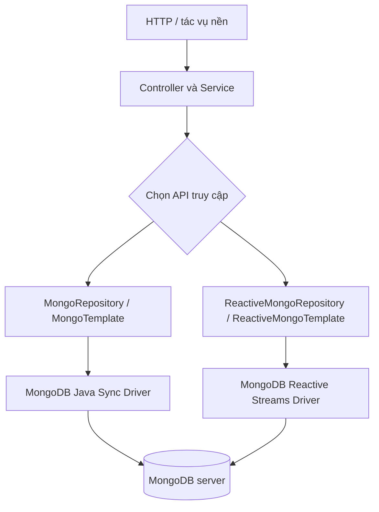

# Phân biệt API đồng bộ, reactive và các thư viện tương thích MongoDB

## 1. Bối cảnh: cùng MongoDB, khác cách ứng dụng chờ dữ liệu

Trong một ứng dụng Java, việc đọc danh sách sách từ MongoDB có thể được viết theo hai kiểu:

- **Đồng bộ (synchronous/blocking):** lời gọi truy vấn chờ kết quả rồi mới trả về `Book`, `List<Book>` hoặc `Optional<Book>`. Luồng đang gọi thường bị chiếm dụng trong thời gian chờ I/O.
- **Reactive (bất đồng bộ, non-blocking theo mô hình Reactive Streams):** lời gọi trả về một `Publisher`, thường được biểu diễn bằng `Mono<Book>` hoặc `Flux<Book>` trong Spring. Tác vụ I/O được điều phối khi có subscriber; dữ liệu, lỗi và tín hiệu hoàn tất đi qua một luồng sự kiện.

Cả hai cách đều truy cập cùng cơ sở dữ liệu MongoDB, sử dụng document BSON, truy vấn, aggregation và index. Khác biệt lớn nằm ở **API, driver, kiểu trả về, cách quản lý luồng xử lý và cách phối hợp với phần còn lại của ứng dụng**. Reactive không tự làm MongoDB xử lý một truy vấn nhanh hơn.

Trong phạm vi **SPRING_DATA_MONGODB**, Spring Data giúp kết nối MongoDB, ánh xạ document thành đối tượng Java và thao tác qua repository hoặc template. Khi quyết định dùng API đồng bộ hay reactive, cần xét từ HTTP/service đến driver, giao dịch, kiểm thử và khả năng chẩn đoán hiệu năng.

## 2. Phân biệt ba tầng: MongoDB, driver và Spring Data

Một request không gọi trực tiếp MongoDB từ annotation `@Document`. Nó đi qua các tầng:



| Tầng | Vai trò | Điều cần hiểu |
| --- | --- | --- |
| MongoDB server | Lưu document, thực hiện truy vấn, aggregation, index và transaction | Không tự quyết định API Java phải blocking hay reactive. |
| MongoDB Java driver | Xử lý kết nối, BSON, lệnh MongoDB, cursor và I/O | Sync driver và Reactive Streams driver có API khác nhau. |
| Spring Data MongoDB | Mapping `@Document`, tạo truy vấn, repository, template, tích hợp Spring | Cung cấp **hai nhánh API** dựa trên hai loại driver. |
| Reactor | `Mono`, `Flux`, operator, scheduler và cơ chế subscribe | Là thư viện lập trình reactive, không phải một MongoDB driver. |
| Spring MVC / WebFlux | Xử lý HTTP ở tầng web | Lựa chọn web framework có ảnh hưởng đến mô hình thực thi nhưng **không tự chuyển** lời gọi MongoDB blocking thành non-blocking. |

**Điểm dễ nhầm:** `MongoTemplate` và `ReactiveMongoTemplate` đều là Spring Data MongoDB, nhưng không thể thay thế cho nhau chỉ bằng cách đổi kiểu trả về. Chúng dùng hạ tầng kết nối khác nhau.

## 3. So sánh API đồng bộ và reactive

| Tiêu chí | Đồng bộ | Reactive |
| --- | --- | --- |
| API repository | `MongoRepository<T, ID>` | `ReactiveMongoRepository<T, ID>` |
| API template | `MongoTemplate` | `ReactiveMongoTemplate` |
| Driver chính | `com.mongodb.client.MongoClient` | `com.mongodb.reactivestreams.client.MongoClient` |
| Kết quả đọc một document | `Optional<T>` hoặc `T` | `Mono<T>` (0 hoặc 1 phần tử) |
| Kết quả đọc nhiều document | `List<T>`, `Stream<T>` hoặc cursor tùy API | `Flux<T>` (0 đến nhiều phần tử) |
| Thời điểm I/O | Thực hiện khi gọi phương thức blocking | Thường bắt đầu khi publisher được subscribe |
| Chờ dữ liệu | Thread gọi thường bị chặn trong lúc chờ I/O | Không cần chiếm thread để chờ I/O theo cách blocking |
| Xử lý lỗi | `try/catch`, ngoại lệ ném ra trong luồng gọi | Tín hiệu `onError` và các operator như `onErrorResume` |
| Phối hợp | Câu lệnh tuần tự, vòng lặp | `map`, `flatMap`, `filter`, `collectList`... |
| Kiểm thử thường gặp | JUnit và assertion trực tiếp | `StepVerifier` hoặc subscribe/await có kiểm soát trong test |
| Phù hợp | CRUD thông thường, ứng dụng vốn blocking, luồng xử lý tuần tự | Nhiều yêu cầu I/O đồng thời, pipeline reactive xuyên suốt, streaming |

**Backpressure** là khả năng subscriber báo nhu cầu nhận dữ liệu thông qua `request(n)` theo giao thức Reactive Streams. Nó giúp các thành phần phía sau không bị đẩy dữ liệu vô hạn ngoài kiểm soát; hiệu quả thực tế vẫn phụ thuộc cách driver lấy batch/cursor, operator và giới hạn MongoDB.

### Một request hoạt động như thế nào?

Với API đồng bộ:

1. Service gọi `repository.findById(id)`.
2. Thread gọi chờ driver nhận phản hồi từ MongoDB.
3. Repository trả về `Optional<Book>` hoặc ném ngoại lệ.
4. Controller tiếp tục tạo HTTP response.

Với API reactive:

1. Service trả về `Mono<Book>` mô tả thao tác cần thực hiện.
2. Thành phần tiêu thụ (ví dụ WebFlux) subscribe vào pipeline.
3. Driver thực hiện I/O, phát dữ liệu hoặc lỗi và tín hiệu kết thúc.
4. WebFlux ghi response dựa trên các tín hiệu đó.

Trong mã reactive, **đừng gọi `subscribe()` thủ công ở service/controller chỉ để “kích hoạt” truy vấn**. Làm vậy dễ tách thao tác khỏi quản lý lỗi, hủy request, transaction và vòng đời HTTP. Hãy trả publisher cho tầng gọi, hoặc ghép nó vào pipeline đang có.

## 4. Những thư viện và starter cần chọn đúng

| Công cụ / thư viện | Chức năng | Nên dùng khi nào? |
| --- | --- | --- |
| `org.mongodb:mongodb-driver-sync` | Driver MongoDB chính thức với API đồng bộ | Cần thao tác BSON, session hoặc API driver trực tiếp, không cần Spring Data. |
| `org.mongodb:mongodb-driver-reactivestreams` | Driver MongoDB chính thức trả Reactive Streams `Publisher` | Viết pipeline reactive hoặc dùng hạ tầng Spring Data reactive. |
| `spring-boot-starter-data-mongodb` | Starter Spring Boot cho Spring Data MongoDB đồng bộ | Dùng `MongoRepository`, `MongoTemplate` trong ứng dụng Spring Boot. |
| `spring-boot-starter-data-mongodb-reactive` | Starter Spring Boot cho Spring Data MongoDB reactive | Dùng `ReactiveMongoRepository`, `ReactiveMongoTemplate` và Reactor. |
| `spring-boot-starter-web` | Spring MVC, API HTTP thông dụng | Thường ghép với truy cập MongoDB đồng bộ. |
| `spring-boot-starter-webflux` | Spring WebFlux, HTTP theo mô hình reactive | Phù hợp nếu request xử lý non-blocking từ đầu đến cuối. |
| MongoDB Kotlin Coroutine Driver | API MongoDB cho `suspend`/`Flow` của Kotlin | Dự án Kotlin theo coroutine; không phải API Java `Mono`/`Flux` của Spring Data. |
| Morphia | ODM bên thứ ba cho Java/MongoDB | Một hướng mapping thay thế; không phải triển khai của `MongoRepository`. |
| Mongock | Hỗ trợ quản lý thay đổi/migration dữ liệu MongoDB | Bổ sung quy trình cập nhật dữ liệu, không thay thế driver hoặc template. |
| Testcontainers MongoDB | Khởi chạy MongoDB trong container để kiểm thử tích hợp | Kiểm thử mapping, truy vấn, index và hành vi thực tế của server. |

**Nhận diện đúng quan hệ phụ thuộc:**

- Spring Data MongoDB **sử dụng driver MongoDB** để giao tiếp với server. Spring Data không phải một database độc lập.
- `Mono` và `Flux` đến từ Reactor; driver Reactive Streams có kiểu nền tảng là `Publisher`. Spring Data tích hợp các kiểu Reactor để ứng dụng Java thuận tiện sử dụng.
- Tên starter là tên artifact; phiên bản thực tế nên được quản lý đồng bộ bằng Spring Boot dependency management/BOM. Không tự trộn tùy tiện các phiên bản Spring Data, MongoDB driver và Spring Boot.
- Một thư viện ghi là “hỗ trợ MongoDB” có thể chỉ hỗ trợ migration, ODM, test hoặc BSON. Điều đó không có nghĩa nó cung cấp cả hai API sync và reactive.

### Cấu hình phụ thuộc theo hướng tiếp cận

Ví dụ Maven sử dụng Spring Boot quản lý phiên bản:

```xml
<!-- Chọn cho ứng dụng truy cập MongoDB đồng bộ -->
<dependency>
    <groupId>org.springframework.boot</groupId>
    <artifactId>spring-boot-starter-data-mongodb</artifactId>
</dependency>
```

Hoặc với ứng dụng reactive:

```xml
<!-- Chọn cho ứng dụng truy cập MongoDB reactive -->
<dependency>
    <groupId>org.springframework.boot</groupId>
    <artifactId>spring-boot-starter-data-mongodb-reactive</artifactId>
</dependency>
```

Hai ví dụ là **hai lựa chọn cấu hình**, không phải yêu cầu cài cả hai. Khi cố ý dùng cả hai nhánh trong một ứng dụng, cần cấu hình rõ repository package, bean client/template và transaction tương ứng để tránh dùng nhầm.

## 5. Ví dụ Spring Data: cùng một yêu cầu, hai kiểu lập trình

Giả sử collection `books` chứa dữ liệu:

```json
{
  "_id": "b-101",
  "title": "MongoDB trong ứng dụng Java",
  "author": "Nguyen A",
  "publicationYear": 2024
}
```

Định nghĩa document dùng chung về mặt ý tưởng:

```java
import org.springframework.data.annotation.Id;
import org.springframework.data.mongodb.core.mapping.Document;

@Document(collection = "books")
public record Book(
    @Id String id,
    String title,
    String author,
    int publicationYear
) {}
```

Các đoạn mã bên dưới minh họa **hai cách triển khai thay thế** cùng yêu cầu “tìm sách theo tác giả”, không yêu cầu đặt hai repository vào cùng một ứng dụng.

### 5.1. Repository đồng bộ

```java
import java.util.List;
import org.springframework.data.mongodb.repository.MongoRepository;

public interface BookRepository extends MongoRepository<Book, String> {
    List<Book> findByAuthor(String author);
}
```

```java
import java.util.List;
import org.springframework.stereotype.Service;

@Service
public class BookService {
    private final BookRepository books;

    public BookService(BookRepository books) {
        this.books = books;
    }

    public List<Book> booksByAuthor(String author) {
        return books.findByAuthor(author);
    }
}
```

Khi gọi `booksByAuthor("Nguyen A")`, service chỉ đi tiếp khi truy vấn đã trả về danh sách hoặc xảy ra lỗi. Cách viết tuần tự dễ theo dõi, đặc biệt trong ứng dụng vốn sử dụng Spring MVC và các tích hợp blocking khác.

### 5.2. Repository reactive

```java
import org.springframework.data.mongodb.repository.ReactiveMongoRepository;
import reactor.core.publisher.Flux;

public interface ReactiveBookRepository
        extends ReactiveMongoRepository<Book, String> {
    Flux<Book> findByAuthor(String author);
}
```

```java
import org.springframework.stereotype.Service;
import reactor.core.publisher.Flux;

@Service
public class ReactiveBookService {
    private final ReactiveBookRepository books;

    public ReactiveBookService(ReactiveBookRepository books) {
        this.books = books;
    }

    public Flux<Book> booksByAuthor(String author) {
        return books.findByAuthor(author);
    }
}
```

Service trả về `Flux<Book>` cho tầng tiêu thụ; không cần chuyển ngay thành `List<Book>`. Các toán tử có thể được ghép trước khi subscribe:

```java
Flux<String> titles = reactiveBookService.booksByAuthor("Nguyen A")
    .filter(book -> book.publicationYear() >= 2020)
    .map(Book::title);
```

Nếu cần toàn bộ danh sách, `collectList()` trả về `Mono<List<Book>>`. Đây vẫn là publisher: nó **chỉ phát danh sách khi nguồn hoàn tất**, và gom các phần tử trong bộ nhớ. Không nên dùng cho một tập kết quả không giới hạn.

### 5.3. Template khi truy vấn động

Repository method-name phù hợp truy vấn đơn giản. Khi điều kiện được tạo động, cần query, aggregation hoặc cập nhật có kiểm soát, template thường linh hoạt hơn:

```java
import org.springframework.data.domain.Sort;
import org.springframework.data.mongodb.core.query.Criteria;
import org.springframework.data.mongodb.core.query.Query;

Query query = Query.query(Criteria.where("publicationYear").gte(2020))
    .with(Sort.by(Sort.Direction.DESC, "publicationYear"))
    .limit(20);

// Với MongoTemplate:
List<Book> result = mongoTemplate.find(query, Book.class);

// Với ReactiveMongoTemplate (trong một cách triển khai riêng):
Flux<Book> stream = reactiveMongoTemplate.find(query, Book.class);
```

Hai lệnh `find` thể hiện cách dùng tương ứng của từng template; trong mã thực tế cần khai báo biến `mongoTemplate` hoặc `reactiveMongoTemplate` và chọn một loại phù hợp. Điều kiện, sort và index ở MongoDB vẫn cần được thiết kế theo cách tương tự.

### 5.4. HTTP response và xử lý kết quả rỗng

Một controller WebFlux có thể trả publisher trực tiếp:

```java
import org.springframework.http.ResponseEntity;
import org.springframework.web.bind.annotation.GetMapping;
import org.springframework.web.bind.annotation.PathVariable;
import org.springframework.web.bind.annotation.RestController;
import reactor.core.publisher.Mono;

@RestController
public class ReactiveBookController {
    private final ReactiveBookRepository books;

    public ReactiveBookController(ReactiveBookRepository books) {
        this.books = books;
    }

    @GetMapping("/books/{id}")
    public Mono<ResponseEntity<Book>> getOne(@PathVariable String id) {
        return books.findById(id)
            .map(ResponseEntity::ok)
            .defaultIfEmpty(ResponseEntity.notFound().build());
    }
}
```

`Mono.empty()` biểu thị không tìm thấy document, nên controller chuyển thành HTTP 404 bằng `defaultIfEmpty`. Lỗi thực sự, ví dụ mất kết nối MongoDB, đi qua tín hiệu lỗi và cần được xử lý bằng cơ chế exception handling/retry phù hợp.

## 6. Khi nào nên chọn cách nào?

| Tình huống | Hướng thường phù hợp | Lý do |
| --- | --- | --- |
| Ứng dụng Spring MVC CRUD thông thường, nghiệp vụ tuyến tính | Đồng bộ | Đơn giản về luồng gọi, logging, debug và tích hợp với các thư viện blocking. |
| Dịch vụ WebFlux có nhiều luồng I/O đồng thời, cần stream dữ liệu | Reactive | Có thể tận dụng non-blocking I/O và pipeline Reactor xuyên suốt. |
| Hệ thống dùng JDBC blocking ở phần lớn bước | Cân nhắc tiếp tục đồng bộ | Đổi riêng MongoDB sang reactive không biến toàn bộ chuỗi xử lý thành non-blocking. |
| Service gửi dữ liệu thay đổi liên tục bằng stream | Reactive | Phù hợp với Flux, hủy subscription và quản lý nhu cầu dữ liệu. |
| Batch job nhỏ, chạy tuần tự và dễ kiểm soát | Đồng bộ | Giảm độ phức tạp không cần thiết; tối ưu query/index trước khi đổi API. |
| Nhóm đã có nền tảng Reactor, metrics và kiểm thử reactive | Reactive nếu tải I/O chứng minh lợi ích | Dễ duy trì khi toàn bộ stack và năng lực vận hành cùng phù hợp. |

**Tiêu chí quyết định không phải “reactive luôn nhanh hơn”.** Với cùng query, server, dữ liệu và index, thời gian xử lý trên MongoDB có thể tương đương. Reactive chủ yếu giúp sử dụng thread hiệu quả hơn trong tình huống có nhiều thao tác I/O chờ đồng thời; đổi lại, pipeline và việc debug có thể khó hơn.

## 7. Các giới hạn và lỗi tích hợp thường gặp

### 7.1. Gọi `block()` trong pipeline WebFlux

```java
// Không nên đặt trong đường xử lý request WebFlux:
Book book = reactiveBooks.findById(id).block();
```

`block()` biến đoạn gọi thành chờ đồng bộ và có thể gây nghẽn hoặc lỗi nếu chạy trên thread non-blocking. Trong controller/service reactive, hãy dùng `map`, `flatMap` và trả về `Mono`/`Flux`. Với nguồn dữ liệu chỉ có API blocking, có thể tách công việc sang scheduler phù hợp bằng `Mono.fromCallable(...).subscribeOn(Schedulers.boundedElastic())` như một biện pháp cô lập; cách đó **không biến** driver blocking thành driver non-blocking.

### 7.2. Nhầm kiểu client và template

`com.mongodb.client.MongoClient` thuộc sync driver; `com.mongodb.reactivestreams.client.MongoClient` thuộc reactive driver. Tên class gần giống nhưng không hoán đổi được. Cấu hình dependency, bean Spring và repository phải tương ứng.

### 7.3. Dùng `subscribe()` rồi bỏ qua kết quả

```java
// Dễ gây mất kiểm soát lỗi và vòng đời thao tác:
reactiveBooks.save(book).subscribe();

// Nên giữ thao tác trong pipeline để caller quản lý:
Mono<Book> saved = reactiveBooks.save(book);
```

Với thao tác cập nhật có side effect, cần xác định rõ **ai subscribe, khi nào và xử lý lỗi thế nào**. Publisher có thể chưa thực thi nếu không có subscriber; ngược lại, nhiều subscription có thể kích hoạt nhiều lần thao tác với nguồn cold.

### 7.4. Nhầm reactive với song song CPU hoặc không giới hạn bộ nhớ

Reactive I/O không mặc định tăng sức mạnh xử lý CPU. `flatMap` có thể tạo concurrency, nhưng cần giới hạn phù hợp; `collectList` và `buffer` vẫn có thể tiêu tốn nhiều RAM. Cursor/batch, giới hạn số bản ghi và pagination vẫn rất quan trọng.

### 7.5. Transaction ở hai nhánh không dùng chung ngữ cảnh

Đồng bộ có `MongoTransactionManager`, còn reactive có `ReactiveMongoTransactionManager` và ngữ cảnh transaction được truyền trong reactive pipeline. Không thể giả định một transaction Spring đồng bộ bao luôn các thao tác reactive phát sinh từ publisher. MongoDB multi-document transaction yêu cầu topology hỗ trợ (ví dụ replica set hoặc sharded cluster phù hợp) và cấu hình session/transaction chính xác.

### 7.6. “MongoDB-compatible” không đồng nghĩa tương thích mọi tính năng

Một dịch vụ hoặc database công bố hỗ trợ giao thức/API MongoDB có thể khác về phiên bản lệnh, BSON, aggregation stage, index, transaction, change stream hay session. Khi dùng MongoDB-compatible service, cần kiểm tra **ma trận tính năng của chính dịch vụ**, phiên bản driver và kiểm thử các tính năng ứng dụng thực sự sử dụng. Chỉ kết nối thành công không chứng minh mọi truy vấn và transaction đều chạy đúng.

## 8. Truy vấn, aggregation và index: phần chung của hai API

Dù chọn đồng bộ hay reactive, hiệu năng thường phụ thuộc mạnh vào **mô hình dữ liệu và cách truy vấn**:

- Tạo index theo filter, sort, tính chọn lọc và pattern truy cập thực tế; dùng `explain` để xem execution plan và số document được scan.
- Dùng projection nếu chỉ cần một phần document; giới hạn tập kết quả bằng `limit` hoặc pagination phù hợp.
- Đẩy các phép lọc/tổng hợp thích hợp vào MongoDB bằng query/aggregation thay vì tải toàn bộ rồi lọc ở ứng dụng.
- Cẩn thận với aggregation tạo dữ liệu trung gian quá lớn, `sort` không dùng index và các truy vấn không có giới hạn.
- Theo dõi connection pool, timeout, command latency, số request đang chờ và tài nguyên server. Backpressure trong ứng dụng không sửa được một truy vấn MongoDB thiếu index.

Ví dụ nghiệp vụ: nếu trang “Sách xuất bản từ năm 2020” có hàng triệu document, thay `List` bằng `Flux` có thể giúp tiêu thụ luồng kết quả theo nhịp phù hợp, nhưng truy vấn vẫn nên có filter, sort, limit và index. Nên kiểm tra `explain` trước khi kết luận bottleneck ở cách lập trình.

## 9. Kiểm thử và quan sát hệ thống

**Nhánh đồng bộ:** sử dụng JUnit, gọi repository/template, rồi kiểm tra kết quả và exception. Với tích hợp thật, dùng MongoDB test instance (ví dụ Testcontainers) để xác nhận mapping `_id`, query, index và hành vi transaction.

**Nhánh reactive:** ngoài kiểm thử tích hợp với MongoDB thật, dùng `reactor-test` và `StepVerifier` để xác nhận dữ liệu, tín hiệu hoàn tất và lỗi:

```java
import reactor.test.StepVerifier;

StepVerifier.create(reactiveBooks.findById("b-101"))
    .expectNextMatches(book -> book.title().contains("MongoDB"))
    .verifyComplete();
```

Đo lường nên có cả thông số end-to-end (latency, throughput, error rate) và thông số MongoDB (query latency, pool, CPU, index usage). So sánh sync/reactive bằng **cùng workload, cùng query, cùng index và điều kiện tải**; đo riêng độ trễ mỗi request lẫn mức tiêu thụ thread/bộ nhớ khi concurrency tăng.

## 10. Bài tập tự thực hành

Xây dựng API lấy sách theo tác giả và năm xuất bản:

1. Tạo collection `books` cùng một số document mẫu và kiểm tra mapping với `@Document`.
2. Viết phương thức Spring Data đồng bộ trả `List<Book>` và phương thức reactive tương đương trả `Flux<Book>`.
3. Thử thêm điều kiện năm xuất bản, sort và `limit` qua template tương ứng.
4. Với reactive, dùng `StepVerifier` kiểm tra trường hợp có dữ liệu, không có dữ liệu và có lỗi.
5. Tạo index phù hợp, dùng `explain` so sánh execution plan trước/sau. Quan sát rằng việc đổi API Java không thay thế công việc tối ưu query.
6. Giải thích cách xử lý lỗi, timeout, huỷ request và transaction khác nhau giữa hai cách triển khai.

**Câu hỏi tự kiểm tra:** Vì sao `Mono<List<Book>>` vẫn là reactive nhưng không phải lựa chọn tốt để gom hàng triệu document? Khi nào phải dùng `ReactiveMongoTemplate` thay vì `MongoTemplate`? Vì sao một API WebFlux gọi repository đồng bộ không tự trở thành non-blocking?

## Ghi nhớ

MongoDB là hệ quản trị dữ liệu; driver quyết định cách giao tiếp; Spring Data cung cấp lớp mapping, repository và template. **`MongoRepository`/`MongoTemplate` là đồng bộ; `ReactiveMongoRepository`/`ReactiveMongoTemplate` là reactive.** Chọn nhánh theo toàn bộ kiến trúc và nhu cầu vận hành, sau đó tối ưu query, aggregation, index và kiểm thử với MongoDB thực tế ở cả hai trường hợp.
