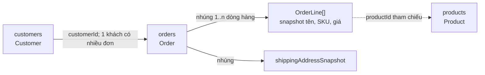

# Lộ trình học và mô hình sản phẩm–khách hàng–đơn hàng dùng xuyên suốt tài liệu

## 1. Mục tiêu của bài học

Trong toàn bộ lộ trình **Spring Data MongoDB**, chúng ta phát triển một hệ thống bán hàng thu nhỏ, gọi là **Mini Commerce**. Hệ thống có ba đối tượng nghiệp vụ chính: **sản phẩm (Product)**, **khách hàng (Customer)** và **đơn hàng (Order)**. Cùng một mô hình dữ liệu sẽ được sử dụng khi học kết nối MongoDB, ánh xạ document, truy vấn bằng repository hoặc `MongoTemplate`, aggregation, index, transaction, truy cập reactive, kiểm thử và chẩn đoán hiệu năng.

Sau bài này, người học có thể:

- Giải thích vai trò của Spring Data MongoDB giữa ứng dụng Java/Spring và cơ sở dữ liệu MongoDB.
- Vẽ được quan hệ nghiệp vụ sản phẩm–khách hàng–đơn hàng, xác định dữ liệu nào cần nhúng và dữ liệu nào chỉ nên tham chiếu bằng định danh.
- Nhận diện các collection, document, trường dữ liệu, ràng buộc nghiệp vụ và index sẽ dùng ở các bài sau.
- Biết thứ tự học hợp lý, đầu ra thực hành của từng chặng và các tình huống cần kiểm chứng.
- Phân biệt tác vụ phù hợp với `MongoRepository`, `MongoTemplate`, aggregation, transaction và Reactive MongoDB.

**Kiến thức đầu vào:** Java cơ bản (class, collection, `BigDecimal`, `Instant`), lập trình Spring Boot, HTTP/REST và khái niệm CRUD. Người mới với MongoDB nên tìm hiểu thêm database, collection, document BSON, `_id` và query filter. Mã minh họa sử dụng Java 17 trở lên với các API quen thuộc của Spring Data MongoDB; phiên bản thư viện thực tế nên được quản lý đồng bộ bằng Spring Boot.

## 2. Bức tranh tổng thể: các chặng học và sản phẩm đầu ra

Mỗi chặng bổ sung một khả năng vào cùng ứng dụng Mini Commerce. Có thể đi theo thứ tự dưới đây; phần reactive là một nhánh triển khai riêng sau khi đã hiểu luồng đồng bộ.

| Chặng | Nội dung trọng tâm | Bài thực hành trên Mini Commerce | Kết quả cần đạt |
| --- | --- | --- | --- |
| 1. Khởi tạo | MongoDB, cấu hình kết nối, Spring Boot starter | Kết nối tới database `mini_commerce`, đọc/ghi sản phẩm mẫu | Ứng dụng truy cập được MongoDB |
| 2. Ánh xạ | `@Document`, `@Id`, `@Field`, BSON, kiểu dữ liệu | Tạo mô hình `Product`, `Customer`, `Order` | Document lưu đúng cấu trúc và kiểu |
| 3. Repository | `MongoRepository`, derived query, phân trang, sắp xếp | Tra cứu sản phẩm theo SKU, xem lịch sử đơn của khách | CRUD và tìm kiếm đơn giản |
| 4. MongoTemplate | `Query`, `Criteria`, `Update`, cập nhật có điều kiện | Trừ tồn kho nếu số lượng còn đủ | Hiểu truy vấn/cập nhật có kiểm soát |
| 5. Thiết kế truy vấn | Filter, projection, pagination, compound index | Lọc sản phẩm theo danh mục; liệt kê đơn mới nhất | Truy vấn phản ánh nhu cầu màn hình/API |
| 6. Aggregation | `$match`, `$unwind`, `$group`, `$sort` | Báo cáo sản phẩm bán chạy và doanh thu | Tổng hợp dữ liệu ngay trong MongoDB |
| 7. Transaction | Replica set, `MongoTransactionManager`, `@Transactional` | Tạo đơn và giảm tồn kho nhất quán | Xử lý nhiều document có ranh giới rõ |
| 8. Reactive access | `ReactiveMongoRepository`, `ReactiveMongoTemplate`, `Mono`/`Flux` | Truy vấn danh mục bằng API reactive | Phân biệt truy cập non-blocking với blocking |
| 9. Kiểm thử | Unit test, integration test, Testcontainers | Kiểm tra index duy nhất, tồn kho, lịch sử đơn | Phát hiện sai dữ liệu và sai truy vấn |
| 10. Hiệu năng | `explain`, index, log, pool, observability | Đo truy vấn đơn theo khách, tối ưu truy vấn chậm | Có bằng chứng trước và sau tối ưu |

Không nhất thiết dùng mọi kỹ thuật cho mọi nghiệp vụ. Các thao tác CRUD phổ biến thường phù hợp với repository; cập nhật nguyên tử, query động hoặc aggregation phức tạp thường cần `MongoTemplate`. Transaction chỉ dành cho trường hợp cần giữ tính nhất quán xuyên nhiều document. Reactive phù hợp khi **toàn bộ luồng I/O** của chức năng cũng được xây dựng theo mô hình reactive.

## 3. Bài toán Mini Commerce và ngôn ngữ nghiệp vụ chung

Giả sử cửa hàng bán hàng trực tuyến cần đáp ứng bốn nhu cầu:

1. Nhân viên tạo và cập nhật sản phẩm, giá bán, danh mục, trạng thái bán và số lượng tồn kho.
2. Khách hàng đăng ký, lưu thông tin liên hệ và địa chỉ nhận hàng.
3. Khách đặt một đơn gồm một hoặc nhiều sản phẩm; hệ thống chốt tên, SKU và đơn giá tại thời điểm đặt.
4. Nhân viên xem đơn theo khách hàng, thống kê số lượng bán và kiểm tra các truy vấn chậm.

Các thuật ngữ xuyên suốt:

| Thuật ngữ | Ý nghĩa | Quy tắc quan trọng |
| --- | --- | --- |
| `Product` | Mặt hàng đang được bán | `sku` là mã nghiệp vụ duy nhất; `price` là giá hiện tại |
| `Customer` | Người mua | `email` được chuẩn hóa trước khi kiểm tra duy nhất |
| `Order` | Lần đặt mua của một khách | Có `customerId`, thời điểm đặt, trạng thái và danh sách dòng hàng |
| `OrderLine` | Một dòng hàng nằm trong đơn | Có `productId` cùng tên/SKU/đơn giá **chụp tại lúc đặt** |
| `shippingAddressSnapshot` | Địa chỉ giao của đơn | Được chụp vào đơn để lịch sử không đổi theo hồ sơ khách |
| `idempotencyKey` | Khóa nhận diện yêu cầu đặt đơn | Giúp tránh tạo hai đơn từ cùng một lần gửi lại yêu cầu |

### 3.1. Quan hệ giữa các đối tượng



Đây là mô hình theo **ranh giới truy cập dữ liệu** chứ không phải bản sao quan hệ SQL:

- `products` và `customers` là các collection độc lập, vì chúng có vòng đời và truy vấn riêng.
- `orders` lưu `customerId` để tìm các đơn của một khách. Không tự động nhúng toàn bộ hồ sơ khách vào mọi đơn.
- Các `OrderLine` được **nhúng** trong `Order` vì dòng hàng luôn được đọc cùng đơn và là một phần của đơn. MongoDB cập nhật nguyên tử một document, nên việc sửa các dòng hàng trong một đơn không đòi hỏi transaction nhiều document.
- `OrderLine.productId` là tham chiếu đến sản phẩm gốc, còn `sku`, `productName` và `unitPrice` là dữ liệu lịch sử. Khi sản phẩm đổi tên hoặc đổi giá, đơn đã đặt vẫn thể hiện chính xác giao dịch khi đó.
- Địa chỉ giao cũng được chụp vào đơn, thay vì phụ thuộc vào địa chỉ hiện tại của khách.

Không dùng `@DBRef` mặc định cho mô hình này: tham chiếu ID rõ ràng giúp chủ động điều khiển số truy vấn và cách tải dữ liệu. Có thể cân nhắc cơ chế tham chiếu khác khi yêu cầu thực tế chứng minh được lợi ích.

### 3.2. Quyết định thiết kế trước khi viết code

| Quyết định | Quy ước dùng xuyên suốt | Lý do |
| --- | --- | --- |
| Database và collection | `mini_commerce`, `products`, `customers`, `orders` | Tên nhất quán khi đọc log, query và viết test |
| ID kỹ thuật | `_id` mặc định của MongoDB (có thể ánh xạ bằng `String @Id`) | Tách ID kỹ thuật khỏi SKU/email |
| Tham chiếu | `customerId` và `productId` lưu dạng chuỗi ID | Không ép MongoDB thực hiện join cho tác vụ đọc thông thường |
| Tiền | Java `BigDecimal`, MongoDB `Decimal128` | Tránh sai số làm tròn của số thực nhị phân |
| Thời gian | Java `Instant`, lưu theo thời điểm UTC | Tránh nhầm múi giờ khi lọc và thống kê |
| Tồn kho | `stock` là số nguyên không âm | Cho phép cập nhật có điều kiện khi đặt hàng |
| Tổng tiền | `totalAmount = sum(quantity × unitPrice)` | Không tin vào số tiền do client gửi lên |
| Trạng thái đơn | Ban đầu dùng `PLACED` và `CANCELLED` | Dễ học trước khi mở rộng quy trình thanh toán/giao hàng |
| Dữ liệu lịch sử | Nhúng snapshot của dòng hàng, địa chỉ giao | Giữ đúng lịch sử khi thực thể gốc thay đổi |
| Khóa gửi lại | `idempotencyKey` unique trong `orders` | Giảm nguy cơ ghi trùng đơn |

**Lưu ý về ID:** trong Spring Data MongoDB, `String` được đánh dấu `@Id` có thể được chuyển sang BSON `ObjectId` khi thích hợp. Các trường tham chiếu thông thường như `customerId`/`productId` trong ví dụ được coi là chuỗi; phải dùng nhất quán khi ghi và truy vấn. Nếu chọn lưu tham chiếu bằng BSON `ObjectId`, hãy điều chỉnh kiểu và cách ánh xạ ở tất cả chỗ sử dụng, không trộn lẫn tùy ý.

## 4. Bộ dữ liệu mẫu thống nhất cho tất cả bài

Mỗi collection bên dưới có một document minh họa. Cú pháp là **MongoDB Extended JSON**: `$oid` biểu diễn ObjectId, `$numberDecimal` biểu diễn Decimal128 và `$date` biểu diễn thời điểm. Khi đọc bằng `mongosh`, giá trị có thể được hiển thị dưới dạng `ObjectId(...)`, `NumberDecimal(...)` hoặc `ISODate(...)`.

### 4.1. Sản phẩm

```json
{
  "_id": { "$oid": "665000000000000000000001" },
  "sku": "LAP-001",
  "name": "Bàn phím cơ Mini",
  "category": "phu-kien",
  "price": { "$numberDecimal": "129900.00" },
  "stock": 20,
  "active": true,
  "createdAt": { "$date": "2026-11-01T02:00:00Z" }
}
```

`sku` định danh mặt hàng với hệ thống bán hàng; `price` là giá đang áp dụng và có thể thay đổi sau này. `stock` thuộc sản phẩm, không sao chép vào các dòng hàng của đơn.

### 4.2. Khách hàng

```json
{
  "_id": { "$oid": "665000000000000000000002" },
  "fullName": "Nguyen Thi Lan",
  "email": "lan@example.test",
  "phone": "0900000000",
  "defaultAddress": {
    "recipient": "Nguyen Thi Lan",
    "street": "12 Duong Mau",
    "city": "TP Ho Chi Minh",
    "country": "VN"
  },
  "createdAt": { "$date": "2026-11-02T03:00:00Z" }
}
```

Địa chỉ mặc định là dữ liệu có thể thay đổi; đơn hàng sử dụng bản sao địa chỉ ở thời điểm đặt. Email nên được chuẩn hóa (ví dụ, trim và lowercase theo chính sách ứng dụng) trước khi ghi, đồng thời có unique index.

### 4.3. Đơn hàng

```json
{
  "_id": { "$oid": "665000000000000000000003" },
  "customerId": "665000000000000000000002",
  "idempotencyKey": "checkout-0001",
  "status": "PLACED",
  "lines": [
    {
      "productId": "665000000000000000000001",
      "sku": "LAP-001",
      "productName": "Bàn phím cơ Mini",
      "quantity": 2,
      "unitPrice": { "$numberDecimal": "129900.00" },
      "lineTotal": { "$numberDecimal": "259800.00" }
    }
  ],
  "shippingAddressSnapshot": {
    "recipient": "Nguyen Thi Lan",
    "street": "12 Duong Mau",
    "city": "TP Ho Chi Minh",
    "country": "VN"
  },
  "totalAmount": { "$numberDecimal": "259800.00" },
  "placedAt": { "$date": "2026-11-20T02:00:00Z" }
}
```

Ví dụ trên có một dòng hàng: `2 × 129900.00 = 259800.00`. Khi nhập dữ liệu thử, cần bảo đảm đơn được tạo thành công thì tồn kho tương ứng đã giảm từ 20 còn 18; ba document JSON ở đây thể hiện **hình dạng dữ liệu minh họa**, không phải ảnh chụp trạng thái nhất quán sau khi giao dịch đã chạy.

Để luyện aggregation phong phú hơn, người học có thể bổ sung sản phẩm thứ hai và nhiều đơn ở các ngày khác nhau, nhưng vẫn giữ nguyên cấu trúc document.

## 5. Từ document MongoDB sang lớp Java

Spring Data MongoDB cung cấp lớp ánh xạ giữa Java object và BSON document. `MongoRepository` xử lý phần lớn thao tác CRUD; `MongoTemplate` cho phép chủ động thiết kế query, update và aggregation. Đây là các thành phần thường dùng trong ứng dụng Spring Boot:

```text
HTTP API / Service
       |
       +--> MongoRepository --------+
       |                            |
       +--> MongoTemplate ----------+--> MongoDB driver --> MongoDB
       |
       +--> Mapping: @Document, @Id, @Field, ...
```

### 5.1. Ánh xạ Product

```java
import java.math.BigDecimal;
import java.time.Instant;
import org.springframework.data.annotation.Id;
import org.springframework.data.mongodb.core.index.Indexed;
import org.springframework.data.mongodb.core.mapping.Document;
import org.springframework.data.mongodb.core.mapping.Field;
import org.springframework.data.mongodb.core.mapping.FieldType;

@Document(collection = "products")
public class Product {
    @Id
    private String id;

    @Indexed(unique = true)
    private String sku;

    private String name;
    private String category;

    @Field(targetType = FieldType.DECIMAL128)
    private BigDecimal price;

    private int stock;
    private boolean active;
    private Instant createdAt;

    // Constructor không tham số, getter/setter hoặc cách khởi tạo
    // phù hợp với phiên bản Spring Data đang sử dụng.
}
```

`@Document` xác định collection; `@Id` ánh xạ sang `_id`; `@Indexed(unique = true)` khai báo yêu cầu index duy nhất; `@Field(targetType = FieldType.DECIMAL128)` đảm bảo `BigDecimal` được lưu thành Decimal128. Khai báo annotation index **không đồng nghĩa index chắc chắn được tạo**: cần thiết lập quy trình tạo index khi khởi tạo môi trường hoặc migration. Không mặc định dựa vào tự động tạo index ở production.

### 5.2. Ánh xạ Customer và Order

Các lớp dưới đây nêu trường cần có; phần constructor/getter/setter được lược bớt để tập trung vào cách ánh xạ. `OrderLine` là object nhúng, không có collection hay `@Id` độc lập.

```java
@Document(collection = "customers")
public class Customer {
    @Id
    private String id;

    @Indexed(unique = true)
    private String email;

    private String fullName;
    private String phone;
    private ShippingAddress defaultAddress;
    private Instant createdAt;
    // Constructor / getter / setter
}

public class ShippingAddress {
    private String recipient;
    private String street;
    private String city;
    private String country;
    // Constructor / getter / setter
}

public class OrderLine {
    private String productId;
    private String sku;
    private String productName;
    private int quantity;

    @Field(targetType = FieldType.DECIMAL128)
    private BigDecimal unitPrice;

    @Field(targetType = FieldType.DECIMAL128)
    private BigDecimal lineTotal;
    // Constructor / getter / setter
}

@Document(collection = "orders")
@CompoundIndex(
    name = "customer_placed_idx",
    def = "{ 'customerId': 1, 'placedAt': -1 }"
)
public class Order {
    @Id
    private String id;

    private String customerId;

    @Indexed(unique = true)
    private String idempotencyKey;

    private String status;
    private List<OrderLine> lines;
    private ShippingAddress shippingAddressSnapshot;

    @Field(targetType = FieldType.DECIMAL128)
    private BigDecimal totalAmount;

    private Instant placedAt;
    // Constructor / getter / setter
}
```

Các import tương ứng gồm `List`, `BigDecimal`, `Instant`, `Id`, `Indexed`, `CompoundIndex`, `Document`, `Field` và `FieldType`. Trong ứng dụng thực tế, có thể dùng enum cho trạng thái đơn, bean validation cho dữ liệu đầu vào và thiết kế class immutable nếu đội ngũ đã quen cách ánh xạ của Spring Data.

**Quy tắc tiền tệ:** chỉ thực hiện nhân/cộng bằng `BigDecimal`, kiểm tra `quantity > 0`, chuẩn hóa thang số theo đồng tiền và quy tắc làm tròn của hệ thống. Không dùng `double` để tính tiền. Khi tạo đơn, server tải giá hiện tại từ `products` và tự tính `lineTotal`, `totalAmount`; không lấy giá do client gửi.

## 6. Những thao tác thực hành sẽ tái sử dụng trong các bài sau

### 6.1. Truy vấn phổ biến bằng repository

```java
public interface ProductRepository
        extends MongoRepository<Product, String> {
    Optional<Product> findBySku(String sku);

    Page<Product> findByActiveTrueAndCategory(
        String category, Pageable pageable);
}

public interface OrderRepository
        extends MongoRepository<Order, String> {
    Page<Order> findByCustomerIdOrderByPlacedAtDesc(
        String customerId, Pageable pageable);

    Optional<Order> findByIdempotencyKey(String idempotencyKey);
}
```

Các interface cần import `MongoRepository`, `Optional`, `Page` và `Pageable`. Đây là điểm khởi đầu cho API `GET /products?category=phu-kien`, `GET /customers/{id}/orders` và thao tác tra cứu SKU. Kết quả phân trang có thể tạo bằng `PageRequest.of(page, size)`; mọi API cần giới hạn `size` hợp lý và sắp xếp xác định.

### 6.2. Cập nhật tồn kho có điều kiện bằng MongoTemplate

Một luồng đặt hàng không được đọc `stock` rồi ghi đè một con số mới không có điều kiện; hai request đồng thời có thể bán quá tồn. Mẫu sau yêu cầu **tồn kho còn đủ** ngay tại thời điểm cập nhật:

```java
public boolean reserveStock(
        MongoTemplate mongoTemplate, String productId, int quantity) {
    if (quantity <= 0) {
        throw new IllegalArgumentException("Quantity must be positive");
    }

    Query filter = Query.query(
        Criteria.where("_id").is(productId)
            .and("active").is(true)
            .and("stock").gte(quantity)
    );
    Update update = new Update().inc("stock", -quantity);

    UpdateResult result =
        mongoTemplate.updateFirst(filter, update, Product.class);
    return result.getModifiedCount() == 1;
}
```

Các import thường dùng: `MongoTemplate`, `Query`, `Criteria`, `Update` và `com.mongodb.client.result.UpdateResult`. Phương thức này giả sử ID đã được ánh xạ nhất quán, trả về `false` nếu sản phẩm không tồn tại, ngừng bán hoặc thiếu hàng. Với **một sản phẩm**, đây là cập nhật nguyên tử ở cấp document. Với **một đơn gồm nhiều sản phẩm**, cần transaction nếu muốn hoặc tất cả lần trừ kho và ghi đơn đều thành công, hoặc tất cả cùng rollback.

### 6.3. Luồng tạo đơn và ranh giới transaction

Một service đặt đơn có thể tuân theo thứ tự sau:

1. Xác thực người mua và `idempotencyKey`; tìm đơn đã lưu với khóa này để trả kết quả cũ nếu có.
2. Tải `Customer` và các `Product` được yêu cầu; từ chối sản phẩm ngừng bán hoặc số lượng không hợp lệ.
3. Với từng sản phẩm, thực hiện cập nhật có điều kiện `stock >= quantity` để giảm tồn.
4. Tạo các `OrderLine` chứa snapshot sản phẩm, sao chép địa chỉ giao và tính tổng bằng `BigDecimal`.
5. Ghi `Order` trạng thái `PLACED`; trả về ID đơn.

Các bước giảm tồn và ghi đơn cần chạy cùng một **MongoDB multi-document transaction** nếu yêu cầu nhất quán tức thời:

```java
@Configuration
class MongoTransactionConfig {
    @Bean
    MongoTransactionManager mongoTransactionManager(
            MongoDatabaseFactory factory) {
        return new MongoTransactionManager(factory);
    }
}

@Service
class CheckoutService {
    // Các repository, MongoTemplate được inject qua constructor.

    @Transactional
    public String placeOrder(PlaceOrderCommand command) {
        // Kiểm tra khách, sản phẩm, số lượng.
        // Trừ stock có điều kiện cho mọi sản phẩm.
        // Tạo snapshot dòng hàng và lưu Order.
        // Trả ID của Order đã lưu.
        throw new UnsupportedOperationException(
            "Triển khai nghiệp vụ tại bài transaction");
    }
}
```

Đoạn `placeOrder` là **khung minh họa ranh giới giao dịch**, chưa phải service chạy được. Các bài transaction sau sẽ bổ sung triển khai và test đầy đủ. `MongoTransactionManager` cần import từ `org.springframework.data.mongodb.MongoTransactionManager`; `MongoDatabaseFactory` từ `org.springframework.data.mongodb.MongoDatabaseFactory`.

**Điều kiện bắt buộc:** multi-document transaction cần MongoDB chạy dưới dạng replica set hoặc sharded cluster tương thích, kể cả khi phát triển local với một node replica set. MongoDB standalone thông thường không đáp ứng yêu cầu này. Tránh tự gọi phương thức `@Transactional` từ chính cùng instance nếu dựa vào proxy của Spring. Transaction có thể gặp write conflict hoặc lỗi tạm thời: cần thiết kế retry có giới hạn, idempotency và xử lý duplicate key; chỉ kiểm tra tồn tại trước khi insert **không đủ** để chống ghi trùng khi có cạnh tranh.

### 6.4. Aggregation: top sản phẩm theo doanh thu

Vì `lines` được nhúng trong đơn, muốn thống kê theo sản phẩm ta cần tách các phần tử của mảng khi chạy pipeline:

```java
Aggregation pipeline = Aggregation.newAggregation(
    Aggregation.match(
        Criteria.where("status").is("PLACED")
            .and("placedAt").gte(from).lt(to)
    ),
    Aggregation.unwind("lines"),
    Aggregation.group("lines.productId")
        .sum("lines.quantity").as("unitsSold")
        .sum("lines.lineTotal").as("revenue"),
    Aggregation.sort(Sort.Direction.DESC, "revenue"),
    Aggregation.limit(10)
);

AggregationResults<Document> result =
    mongoTemplate.aggregate(pipeline, "orders", Document.class);
List<Document> topProducts = result.getMappedResults();
```

`from` và `to` là hai giá trị `Instant` xác định khoảng thời gian nửa mở `[from, to)`. Các import cần thiết gồm `Aggregation`, `AggregationResults`, `Criteria`, `Sort`, `org.bson.Document` và `List`. Trong báo cáo thực tế cần xác định rõ quy tắc đơn bị hủy/hoàn tiền: ví dụ đơn `CANCELLED` không được tính doanh thu. Nếu thêm trạng thái mới, hãy điều chỉnh filter và quy tắc báo cáo.

### 6.5. Reactive access là một nhánh triển khai

```java
public interface ReactiveProductRepository
        extends ReactiveMongoRepository<Product, String> {
    Flux<Product> findByActiveTrueAndCategory(String category);
}

// Trong service reactive:
Mono<Product> one = reactiveProductRepository.findById(productId);
Flux<Product> catalog =
    reactiveProductRepository.findByActiveTrueAndCategory("phu-kien");
```

Các kiểu `Mono`, `Flux` đến từ Project Reactor; `ReactiveMongoRepository` đến từ Spring Data MongoDB Reactive. Nhánh này cần starter/driver reactive tương ứng. Không gọi `block()` trong luồng xử lý non-blocking và không tùy tiện ghép repository đồng bộ vào chuỗi reactive. Nếu transaction được triển khai theo reactive, phải dùng transaction manager và cơ chế quản lý ngữ cảnh giao dịch reactive phù hợp thay vì sử dụng trực tiếp mẫu đồng bộ phía trên.

## 7. Chỉ mục dự kiến và cách kiểm chứng

Không tạo mọi index có thể nghĩ ra. Hãy bắt đầu từ **truy vấn đã xác định** và đo số document phải duyệt. Một tập index hợp lý cho Mini Commerce:

| Collection | Index dự kiến | Truy vấn được hỗ trợ | Điều cần chú ý |
| --- | --- | --- | --- |
| `products` | `{ sku: 1 }` unique | Tìm sản phẩm theo SKU | Phải xử lý trùng SKU trước khi tạo index |
| `products` | `{ active: 1, category: 1, price: 1 }` | Lọc hàng đang bán theo danh mục, sắp giá | Đo thực tế trước khi giữ index |
| `customers` | `{ email: 1 }` unique | Tra cứu tài khoản bằng email chuẩn hóa | Chính sách chữ hoa/chữ thường phải thống nhất |
| `orders` | `{ idempotencyKey: 1 }` unique | Chống gửi trùng yêu cầu đặt hàng | Xác định phạm vi duy nhất của khóa theo thiết kế |
| `orders` | `{ customerId: 1, placedAt: -1 }` | Lịch sử đơn mới nhất theo khách | Thứ tự trường của compound index có ý nghĩa |
| `orders` | `{ status: 1, placedAt: -1 }` | Lọc đơn theo trạng thái và thời gian | Chỉ thêm nếu màn hình/báo cáo cần |

MongoDB đã tự có index theo `_id`. Annotation `@Indexed` và `@CompoundIndex` mô tả ý định ánh xạ, nhưng trong môi trường triển khai cần kiểm soát khâu tạo index/migration, nhất là với dữ liệu đã tồn tại. Có thể khảo sát một truy vấn trong `mongosh`:

```javascript
db.orders
  .find({ customerId: "665000000000000000000002" })
  .sort({ placedAt: -1 })
  .explain("executionStats");
```

Quan sát `winningPlan`, `totalDocsExamined`, `totalKeysExamined`, `nReturned` và thời gian thực thi. Mục tiêu là hiểu số bản ghi phải đọc và query plan, không chỉ nhìn thời gian của một lần chạy. Với dữ liệu ít, MongoDB có thể chọn kế hoạch khác với production; nên kiểm chứng trên tập dữ liệu đủ đại diện.

## 8. Bộ API và bài thực hành tối thiểu

Gợi ý API dùng làm nền cho các bài repository/service/controller. Đây là **hợp đồng thực hành**, không yêu cầu phải triển khai toàn bộ ngay ở bài tổng quan.

| API | Đầu vào chính | Kết quả / quy tắc |
| --- | --- | --- |
| `POST /api/products` | SKU, tên, giá, tồn, danh mục | Tạo sản phẩm; không nhận SKU trùng |
| `GET /api/products` | `category`, `page`, `size`, `sort` | Danh sách hàng đang bán, phân trang |
| `GET /api/products/{id}` | Product ID | Chi tiết sản phẩm hoặc 404 |
| `POST /api/customers` | Họ tên, email, địa chỉ | Chuẩn hóa email, tránh trùng |
| `GET /api/customers/{id}/orders` | Customer ID, pagination | Đơn mới nhất trước |
| `POST /api/orders` | Customer ID, danh sách `productId + quantity`, `idempotencyKey` | Server tra giá, trừ kho, tạo đơn và trả ID |
| `GET /api/reports/top-products` | `from`, `to` | Top sản phẩm theo doanh thu đã chốt |

Ví dụ payload tạo đơn:

```json
{
  "customerId": "665000000000000000000002",
  "idempotencyKey": "checkout-0001",
  "items": [
    {
      "productId": "665000000000000000000001",
      "quantity": 2
    }
  ]
}
```

Client **không gửi `unitPrice` hoặc `totalAmount`**. Server chịu trách nhiệm tính các giá trị đó. Trước khi ghi đơn, kiểm tra danh sách dòng hàng không rỗng, số lượng dương, product tồn tại và đang bán, hàng đủ tồn, khách hợp lệ, trạng thái hợp lệ và idempotency key có định dạng được chấp nhận. API nên có mã lỗi rõ ràng cho 400 (đầu vào sai), 404 (không tìm thấy), 409 (xung đột tồn kho/định danh), nhưng lựa chọn cụ thể tùy hợp đồng API của hệ thống.

## 9. Kiểm thử theo các bất biến nghiệp vụ

Trong các bài sau, thay vì chỉ kiểm tra một repository có lưu được object hay không, nên kiểm tra các **bất biến (invariants)** của Mini Commerce:

| Tình huống | Kỳ vọng cần kiểm tra |
| --- | --- |
| Tạo hai sản phẩm cùng SKU | Một thao tác thất bại khi unique index đã tồn tại |
| Tạo hai khách cùng email chuẩn hóa | Không có hai hồ sơ vi phạm uniqueness |
| Đặt hai chiếc khi stock = 1 | Không xuất hiện tồn kho âm hoặc hai đơn thành công vượt tồn |
| Đặt đơn nhiều dòng, dòng thứ hai hết hàng | Toàn bộ cập nhật stock và ghi đơn rollback nếu dùng transaction |
| Gửi lại cùng `idempotencyKey` | Không tạo thêm đơn độc lập |
| Đổi tên/giá sản phẩm sau khi đặt | Snapshot trong `OrderLine` giữ nguyên |
| Đổi địa chỉ mặc định của khách | Địa chỉ giao trong đơn cũ không đổi |
| Đơn bị hủy | Báo cáo doanh thu áp dụng đúng quy tắc trạng thái |
| Tìm đơn theo khách + thời gian | Kết quả đúng thứ tự và kiểm tra được query plan |

Integration test nên chạy với **MongoDB thật trong môi trường kiểm thử**, thường bằng Testcontainers, để kiểm tra việc ánh xạ BSON, hoạt động index, aggregation và transaction. MongoDB in-memory giả lập có thể không phản ánh đúng các tính năng này. Riêng test transaction phải sử dụng replica set phù hợp. Những test về tính tiền nên dùng giá trị biên và so sánh `BigDecimal` theo quy ước scale của ứng dụng.

## 10. Các lỗi thường gặp trong suốt lộ trình

| Dấu hiệu | Nguyên nhân thường gặp | Cách tiếp cận |
| --- | --- | --- |
| Tiền lệch vài đơn vị hoặc mất phần thập phân | Dùng `double`, conversion không đúng | Dùng `BigDecimal`/`Decimal128`; kiểm tra BSON thực tế |
| Lịch sử đơn thay đổi khi giá sản phẩm đổi | Đơn chỉ lưu liên kết tới sản phẩm | Lưu snapshot ở `OrderLine` |
| Có đơn nhưng tồn kho chưa trừ đủ | Nhiều cập nhật riêng biệt, thiếu transaction | Quy định ranh giới transaction, kiểm tra rollback |
| Tồn kho âm khi có nhiều request | Read–modify–write không có điều kiện | Dùng `$inc` với filter `stock >= quantity` |
| `@Transactional` báo lỗi không hỗ trợ | MongoDB chưa chạy replica set hoặc cấu hình transaction sai | Kiểm tra topology và transaction manager |
| Trùng SKU/email dù có `@Indexed` | Unique index thực tế chưa được tạo | Kiểm tra `getIndexes()` và quy trình migration |
| Query theo lịch sử đơn chậm | Thiếu index hoặc filter/sort không khớp | Phân tích `explain("executionStats")` |
| API reactive vẫn nghẽn | Gọi I/O đồng bộ hoặc `block()` | Giữ nhất quán pipeline non-blocking |
| Order lưu ID kiểu không đồng nhất | Lẫn BSON ObjectId và String tham chiếu | Thống nhất kiểu lưu, mapping và query |

## 11. Tiêu chí hoàn thành chặng tổng quan

Trước khi đi vào bài thực hành chuyên sâu, hãy tự trả lời được:

1. Tại sao `OrderLine` nằm trong document đơn hàng, còn `Product` nằm ở collection riêng?
2. Khi sản phẩm đổi giá, những trường nào của đơn cũ phải được giữ nguyên?
3. Truy vấn `GET /customers/{id}/orders` cần index nào, vì sao thứ tự các khóa trong index có ý nghĩa?
4. Khi hai request cùng đặt món hàng cuối cùng, thao tác cập nhật tồn kho phải có điều kiện gì?
5. Vì sao giảm tồn của nhiều sản phẩm và ghi đơn có thể cần multi-document transaction? MongoDB phải được chạy ở topology nào?
6. Repository và `MongoTemplate` phù hợp với các tác vụ nào trong mô hình này?
7. Muốn thống kê doanh thu theo sản phẩm từ mảng `lines` thì pipeline aggregation cần những bước nào?
8. Làm thế nào kiểm chứng tính đúng đắn và hiệu năng bằng integration test, index và `explain`?

**Đầu ra mong đợi:** người học mô tả được ba collection, một order chứa snapshot dòng hàng và địa chỉ giao, danh sách API nền tảng và lộ trình từ CRUD đến kiểm thử/hiệu năng. Ở các bài tiếp theo, hãy tiếp tục dùng cùng tên collection, trường dữ liệu và quy tắc nghiệp vụ của Mini Commerce để dễ đối chiếu giữa repository, template, aggregation, transaction và reactive.
