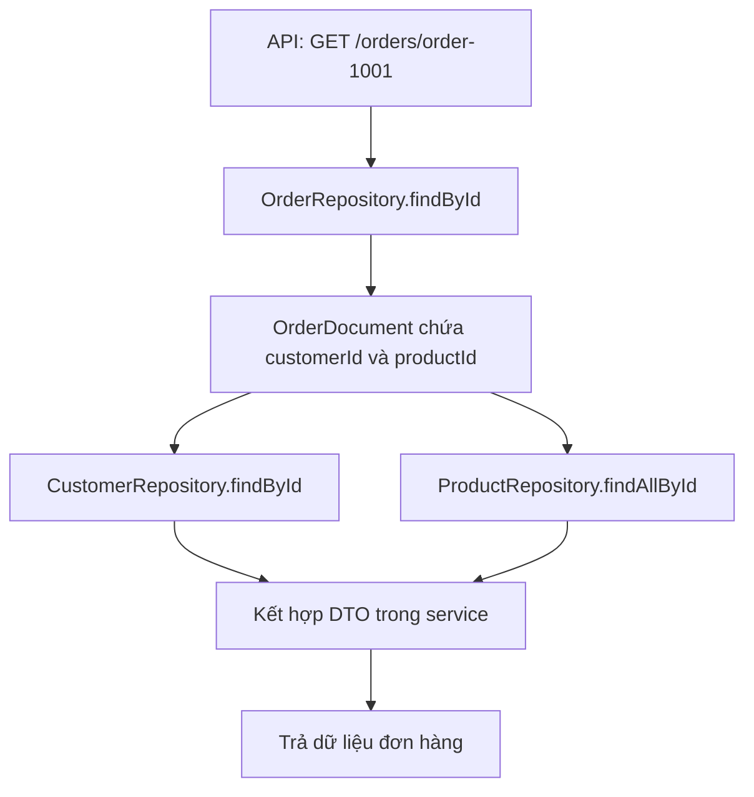

# Tham chiếu bằng ID và tải tường minh qua repository hoặc template

## 1. Bài toán: đơn hàng cần dữ liệu của khách hàng và sản phẩm

Giả sử một ứng dụng bán hàng có ba tập dữ liệu:

- `customers` chứa thông tin tài khoản khách hàng.
- `products` chứa danh mục sản phẩm, tên hiển thị và giá bán hiện hành.
- `orders` chứa đơn hàng, người mua và các dòng sản phẩm đã đặt.

Một đơn hàng phải biết **khách hàng nào** đã đặt và **những sản phẩm nào** được mua. Trong MongoDB, cách đơn giản để biểu diễn mối liên hệ là lưu **ID của document liên quan** bên trong document đơn hàng:

```javascript
// Collection customers
{
  _id: "customer-01",
  displayName: "Nguyễn Hà",
  email: "ha@example.test"
}

// Collection products
{
  _id: "product-10",
  name: "Bàn phím cơ",
  currentPrice: NumberDecimal("1250000"),
  active: true
}

// Collection orders
{
  _id: "order-1001",
  customerId: "customer-01",
  placedAt: ISODate("2026-11-20T02:00:00Z"),
  items: [
    {
      productId: "product-10",
      productNameAtPurchase: "Bàn phím cơ",
      quantity: 2,
      unitPriceAtPurchase: NumberDecimal("1200000")
    }
  ],
  total: NumberDecimal("2400000")
}
```

Đây là **tham chiếu bằng ID**: `orders.customerId` trỏ tới `customers._id`, còn `orders.items[].productId` trỏ tới `products._id`. Thực chất các ID là dữ liệu nằm trong document đơn hàng; MongoDB **không tự tải** khách hàng hoặc sản phẩm chỉ vì ID trùng với một document khác.

Trong module **SPRING_DATA_MONGODB**, Spring Data MongoDB hỗ trợ kết nối, ánh xạ document sang đối tượng Java và truy cập bằng repository hoặc `MongoTemplate`. Bài này trình bày cách:

1. Chọn trường ID và kiểu BSON thống nhất.
2. Lưu tham chiếu như một trường Java thông thường.
3. **Tải tường minh** document liên quan bằng repository hoặc `MongoTemplate`.
4. Giảm truy vấn thừa khi tải nhiều đơn hàng.
5. Xử lý tham chiếu không tồn tại, dữ liệu nguồn thay đổi, nhất quán và hiệu năng.
6. Hiểu sự khác nhau giữa cách tải tường minh với `@DBRef`, `@DocumentReference` và `$lookup`.

Mục tiêu không phải biến MongoDB thành hệ cơ sở dữ liệu quan hệ, mà là thiết kế luồng đọc/ghi có chủ đích theo dữ liệu nghiệp vụ.

## 2. Tham chiếu bằng ID khác gì nhúng document?

Có hai lựa chọn căn bản để gắn dữ liệu liên quan vào một document.

**Nhúng (embedding):** sao chép những trường thuộc cùng ranh giới nghiệp vụ vào document cha.

```javascript
{
  _id: "order-1001",
  shippingAddress: {
    recipient: "Nguyễn Hà",
    city: "Đà Nẵng",
    street: "12 Nguyễn Văn Linh"
  }
}
```

**Tham chiếu (referencing):** lưu ID của một document có vòng đời riêng.

```javascript
{
  _id: "order-1001",
  customerId: "customer-01"
}
```

| Tiêu chí | Nhúng dữ liệu | Lưu ID rồi tải tường minh |
| --- | --- | --- |
| Đọc một document cha | Có sẵn dữ liệu con đã nhúng | Cần truy vấn thêm nếu muốn dữ liệu nguồn |
| Cập nhật đối tượng dùng chung | Có thể phải cập nhật nhiều bản sao | Cập nhật document nguồn một lần |
| Quan hệ một-nhiều tăng không giới hạn | Dễ làm document quá lớn | Các document liên quan tồn tại độc lập |
| Vòng đời dữ liệu | Thích hợp khi dữ liệu con phụ thuộc cha | Thích hợp khi dữ liệu nguồn tồn tại độc lập |
| Tính nhất quán giữa nhiều document | Không phát sinh với dữ liệu ở cùng document | Phải thiết kế cách xử lý thay đổi đồng thời |
| Khả năng truy vấn | Tìm trong trường lồng nhau, có thể dùng index | Tìm bằng ID, phối hợp kết quả ở ứng dụng hoặc `$lookup` |

Một thiết kế thực tế thường **kết hợp cả hai**: đơn hàng lưu `productId` làm tham chiếu, đồng thời nhúng `productNameAtPurchase` và `unitPriceAtPurchase` để giữ nguyên lịch sử mua hàng. Giá hiện hành có thể đổi mà dữ liệu đã xác nhận trong đơn không đổi.

Tránh nhúng *toàn bộ* đơn hàng vào document khách hàng, vì số đơn có thể tăng không giới hạn; MongoDB có giới hạn kích thước BSON document thông thường là 16 MiB.

## 3. “Tải tường minh” nghĩa là gì?

Với một trường Java thông thường:

```java
String customerId;
```

Spring Data MongoDB chỉ ánh xạ giá trị ID. Khi đọc một `OrderDocument` từ collection `orders`, framework **không tự chạy thêm truy vấn** để tìm `CustomerDocument`. Dịch vụ muốn tên khách hàng phải tự gọi:

```java
CustomerDocument customer = customerRepository
    .findById(order.customerId())
    .orElseThrow();
```

Quy trình điển hình:



Lợi ích của việc tải tường minh là người lập trình biết **lúc nào** cần dữ liệu liên quan, **trường nào** cần trả về, **bao nhiêu truy vấn** sẽ phát sinh và **xử lý thế nào** khi document đích không còn.

Không phải màn hình nào cũng cần tải toàn bộ quan hệ. Ví dụ danh sách đơn hàng có thể chỉ dùng `customerId`, `placedAt` và `total`; màn hình chi tiết mới cần bổ sung thông tin khách hàng. Đọc ít dữ liệu hơn có thể giảm độ trễ, số lần truyền và chi phí truy vấn.

## 4. Thiết kế model với ID thuần trong Spring Data MongoDB

### 4.1. Thống nhất kiểu ID và tên trường

Ví dụ sử dụng **ID dạng chuỗi** như `"customer-01"` và `"product-10"` ở cả phía Java và BSON MongoDB. Có thể khai báo `@MongoId(FieldType.STRING)` để làm rõ mong muốn giữ `_id` là BSON string:

```java
import org.springframework.data.mongodb.core.mapping.Document;
import org.springframework.data.mongodb.core.mapping.FieldType;
import org.springframework.data.mongodb.core.mapping.MongoId;

@Document(collection = "customers")
public record CustomerDocument(
    @MongoId(FieldType.STRING)
    String id,
    String displayName,
    String email
) {}
```

```java
import java.math.BigDecimal;

import org.springframework.data.mongodb.core.mapping.Document;
import org.springframework.data.mongodb.core.mapping.Field;
import org.springframework.data.mongodb.core.mapping.FieldType;
import org.springframework.data.mongodb.core.mapping.MongoId;

@Document(collection = "products")
public record ProductDocument(
    @MongoId(FieldType.STRING)
    String id,
    String name,
    @Field(targetType = FieldType.DECIMAL128)
    BigDecimal currentPrice,
    boolean active
) {}
```

Và document đơn hàng:

```java
import java.math.BigDecimal;
import java.time.Instant;
import java.util.List;

import org.springframework.data.mongodb.core.mapping.Document;
import org.springframework.data.mongodb.core.mapping.Field;
import org.springframework.data.mongodb.core.mapping.FieldType;
import org.springframework.data.mongodb.core.mapping.MongoId;

@Document(collection = "orders")
public record OrderDocument(
    @MongoId(FieldType.STRING)
    String id,
    String customerId,
    Instant placedAt,
    List<OrderLine> items,
    @Field(targetType = FieldType.DECIMAL128)
    BigDecimal total
) {
    public record OrderLine(
        String productId,
        String productNameAtPurchase,
        int quantity,
        @Field(targetType = FieldType.DECIMAL128)
        BigDecimal unitPriceAtPurchase
    ) {}
}
```

Các type `CustomerDocument`, `ProductDocument` và `OrderDocument` được đặt trong các tệp Java thích hợp. `OrderLine` là một **subdocument** bên trong `OrderDocument`; các `productId` của nó là field chuỗi bình thường.

Cần phân biệt:

- `@MongoId(FieldType.STRING)` trên `id` quy định cách lưu khóa chính `_id` của chính document ấy.
- `customerId` và `productId` là **trường tham chiếu thường**. Chúng không tự có annotation `@Id` hay `@MongoId`, vì chúng không phải khóa chính của document đang chứa chúng.
- `@Field(targetType = FieldType.DECIMAL128)` giúp lưu `BigDecimal` dưới BSON Decimal128 theo mapping phù hợp. Điều này liên quan độ chính xác tiền tệ, **không** liên quan cơ chế tham chiếu.

Nếu hệ thống dùng BSON `ObjectId`, vẫn có thể tham chiếu bằng ID, nhưng kiểu ID ở nguồn và kiểu BSON của trường tham chiếu phải thống nhất. Đừng mặc định một chuỗi gồm 24 ký tự hex là BSON ObjectId: `"64b000000000000000000001"` và `ObjectId("64b000000000000000000001")` có kiểu khác nhau.

### 4.2. Repository cho mỗi aggregate

```java
import org.springframework.data.mongodb.repository.MongoRepository;

public interface CustomerRepository
        extends MongoRepository<CustomerDocument, String> {}

public interface ProductRepository
        extends MongoRepository<ProductDocument, String> {}

public interface OrderRepository
        extends MongoRepository<OrderDocument, String> {}
```

`MongoRepository` cung cấp các thao tác như `findById(...)`, `findAllById(...)`, `insert(...)` và `save(...)`. Phương thức `findById(...)` trả về `Optional` trong API imperative, thích hợp cho việc xử lý tài liệu không tồn tại.

Không cần thêm `@DBRef` hay `@DocumentReference` vào `customerId`/`productId` để thực hiện cách tiếp cận này; giữ nguyên ID và gọi repository khi cần chính là **tải tường minh**.

## 5. Ví dụ cơ bản: đọc đơn rồi tải khách hàng

### 5.1. Truy vấn từng bước

Một service có thể tải document đơn hàng, rồi tùy nhu cầu mới tải khách hàng:

```java
import java.util.Optional;

import org.springframework.stereotype.Service;

@Service
public class OrderCustomerService {
    private final OrderRepository orders;
    private final CustomerRepository customers;

    public OrderCustomerService(
        OrderRepository orders,
        CustomerRepository customers
    ) {
        this.orders = orders;
        this.customers = customers;
    }

    public record OrderCustomerView(
        String orderId,
        String customerId,
        String customerDisplayName
    ) {}

    public OrderCustomerView getCustomerOfOrder(String orderId) {
        OrderDocument order = orders.findById(orderId)
            .orElseThrow(() ->
                new IllegalArgumentException("Không tìm thấy đơn hàng")
            );

        Optional<CustomerDocument> customer =
            customers.findById(order.customerId());

        return new OrderCustomerView(
            order.id(),
            order.customerId(),
            customer.map(CustomerDocument::displayName)
                    .orElse("(Tài khoản không còn khả dụng)")
        );
    }
}
```

Đoạn code minh họa **hai truy vấn**: một tìm đơn theo `_id`, một tìm khách theo `_id`. Nếu khách hàng đã bị xóa hoặc bị ẩn, service trả về thông báo thay thế theo chính sách hiển thị giả định. Trong hệ thống khác, nghiệp vụ có thể yêu cầu lỗi rõ ràng thay vì fallback.

Cách kiểm tra tham chiếu thiếu cần được quyết định theo đối tượng:

| Quan hệ | Cách xử lý thiếu tham chiếu có thể phù hợp |
| --- | --- |
| Đơn hàng → tài khoản khách hàng | Hiển thị tên/địa chỉ snapshot nếu có; giữ lịch sử đơn |
| Đơn hàng → sản phẩm hiện hành | Hiển thị thông tin đã mua; tắt liên kết đến trang sản phẩm |
| Phiếu duyệt → người phê duyệt bắt buộc | Trả lỗi nghiệp vụ hoặc báo dữ liệu bất nhất |
| Bản nháp → tài nguyên tạm bị xóa | Cho phép người dùng chọn lại hoặc bỏ phần bị thiếu |

Không nên áp dụng một quy tắc “thiếu ID thì bỏ qua” cho mọi quan hệ.

### 5.2. Truy vấn trả về đúng dữ liệu đã chốt

Khi sản phẩm thay đổi tên hoặc giá, màn hình lịch sử giao dịch phải dùng những thuộc tính đã nhúng:

```java
OrderDocument order = orders.findById("order-1001")
    .orElseThrow();

for (OrderDocument.OrderLine line : order.items()) {
    System.out.println(line.productNameAtPurchase());
    System.out.println(line.unitPriceAtPurchase());
}
```

`ProductDocument.name` và `ProductDocument.currentPrice` là dữ liệu **hiện hành**. Chỉ tải chúng nếu màn hình thực sự cần, ví dụ muốn hiển thị “Xem sản phẩm đang bán”, không dùng chúng để tính lại số tiền đơn cũ.

## 6. Tải nhiều sản phẩm một lần, tránh N+1 query

### 6.1. Lỗi N+1 thường gặp

Giả sử một đơn có 20 dòng hàng. Cách ngây thơ là duyệt từng dòng và gọi:

```java
for (OrderDocument.OrderLine line : order.items()) {
    ProductDocument product = products
        .findById(line.productId())
        .orElse(null);
    // Render line...
}
```

Nếu tất cả các ID khác nhau, sau **một truy vấn lấy đơn**, đoạn này có thể tạo **20 truy vấn lấy sản phẩm**. Khi hiển thị 50 đơn, số truy vấn có thể tăng theo số dòng của tất cả đơn. Đây là biến thể của vấn đề **N+1**: càng nhiều bản ghi, càng nhiều lần gọi database.

Độ trễ thường chịu tác động bởi số vòng trao đổi mạng, số kết nối và thời gian xử lý query; ngay cả truy vấn theo `_id` có index vẫn có chi phí cố định cho mỗi lần gọi.

### 6.2. Giải pháp: gom ID duy nhất và `findAllById`

Tải từng loại document theo lô:

```java
import java.util.LinkedHashSet;
import java.util.Map;
import java.util.Set;
import java.util.HashMap;
import java.util.List;

import org.springframework.stereotype.Service;

@Service
public class OrderDetailsService {
    private final OrderRepository orders;
    private final CustomerRepository customers;
    private final ProductRepository products;

    public OrderDetailsService(
        OrderRepository orders,
        CustomerRepository customers,
        ProductRepository products
    ) {
        this.orders = orders;
        this.customers = customers;
        this.products = products;
    }

    public record LineView(
        String productId,
        String purchasedName,
        String currentName,
        int quantity
    ) {}

    public record OrderDetailsView(
        String orderId,
        String customerName,
        List<LineView> lines
    ) {}

    public OrderDetailsView load(String orderId) {
        OrderDocument order = orders.findById(orderId)
            .orElseThrow(() ->
                new IllegalArgumentException("Không tìm thấy đơn hàng")
            );

        // Loại ID trùng, giữ thứ tự gặp đầu tiên.
        Set<String> ids = new LinkedHashSet<>();
        for (OrderDocument.OrderLine line : order.items()) {
            ids.add(line.productId());
        }

        // Một lời gọi repository cho tập ID, không gọi mỗi dòng.
        Map<String, ProductDocument> byId = new HashMap<>();
        for (ProductDocument p : products.findAllById(ids)) {
            byId.put(p.id(), p);
        }

        List<LineView> lines = order.items().stream()
            .map(line -> {
                ProductDocument current = byId.get(line.productId());

                return new LineView(
                    line.productId(),
                    line.productNameAtPurchase(),
                    current == null ? null : current.name(),
                    line.quantity()
                );
            })
            .toList();

        String customerName = customers.findById(order.customerId())
            .map(CustomerDocument::displayName)
            .orElse("(Tài khoản không còn khả dụng)");

        return new OrderDetailsView(order.id(), customerName, lines);
    }
}
```

Với một đơn, cách này thường tạo **ba lời gọi truy cập dữ liệu ở mức repository**:

1. Lấy `OrderDocument`.
2. Lấy một tập `ProductDocument` theo tất cả `productId` duy nhất.
3. Lấy `CustomerDocument`.

Không phụ thuộc trực tiếp vào việc đơn có 2 hay 20 dòng hàng. `findAllById(ids)` nhận tập ID và trả những document tìm được; không nên giả định **thứ tự kết quả** trùng thứ tự đầu vào. Do vậy, ví dụ chuyển kết quả thành `Map`, rồi duyệt danh sách `items` gốc để trả về đúng thứ tự.

Khi một ID không tồn tại, `byId.get(...)` trả về `null` và ví dụ để `currentName=null`. Trong UI có thể quyết định hiển thị nhãn thay thế; dữ liệu lịch sử `purchasedName` vẫn còn nguyên.

Với số ID rất lớn, nên **phân lô** hoặc phân trang thay vì xây một danh sách `$in` khổng lồ: kích thước request, bộ nhớ ứng dụng và giới hạn tài liệu/lệnh đều cần được tính đến. `findAllById` không tự giải quyết tất cả bài toán quy mô lớn.

### 6.3. Batch khi trả về *danh sách* đơn hàng

Nếu cần hiển thị 50 đơn một trang, tránh gọi `load(orderId)` 50 lần khi mỗi lần lại truy vấn khách và sản phẩm. Thay vào đó:

1. Phân trang `orders` bằng truy vấn có index.
2. Tập hợp tất cả `customerId` từ 50 đơn.
3. Tập hợp tất cả `productId` trong các dòng hàng.
4. Tải **theo lô** hai tập tài liệu nguồn, mỗi loại qua `findAllById` hoặc `MongoTemplate`.
5. Đưa kết quả về `Map<ID, Document>` và ghép dữ liệu theo thứ tự trang đơn ban đầu.

Với cách này, số lời gọi không tăng tuyến tính theo số dòng hàng, mặc dù kích thước dữ liệu trả về vẫn phụ thuộc số ID duy nhất.

Ví dụ repository để lấy các đơn gần nhất:

```java
import org.springframework.data.domain.Pageable;
import org.springframework.data.domain.Slice;
import org.springframework.data.mongodb.repository.MongoRepository;

public interface OrderRepository
        extends MongoRepository<OrderDocument, String> {

    Slice<OrderDocument> findByCustomerIdOrderByPlacedAtDesc(
        String customerId,
        Pageable pageable
    );
}
```

`Slice` hữu ích khi chỉ cần biết còn trang sau hay không; `Page` có thể phát sinh thêm truy vấn đếm tổng. Cần sử dụng `PageRequest` và index phục vụ lọc/sắp xếp phù hợp.

## 7. Tải tường minh bằng `MongoTemplate`

Repository gọn cho truy vấn theo ID; `MongoTemplate` phù hợp khi cần kiểm soát điều kiện, projection, sort, update hoặc aggregation.

### 7.1. Tải một document nguồn

```java
import org.springframework.data.mongodb.core.MongoTemplate;
import org.springframework.data.mongodb.core.query.Criteria;
import org.springframework.data.mongodb.core.query.Query;

public CustomerDocument findCustomer(
    MongoTemplate template,
    String customerId
) {
    Query query = Query.query(
        Criteria.where("_id").is(customerId)
    );

    return template.findOne(query, CustomerDocument.class);
}
```

`findOne` trả về `null` khi không có document. Code gọi phải xử lý trường hợp này. Khi truyền class `CustomerDocument.class`, `MongoTemplate` dùng metadata của entity để xác định collection, chuyển kiểu và ánh xạ kết quả sang Java.

Có thể dùng phương thức theo ID cho trường hợp đơn giản:

```java
CustomerDocument customer =
    mongoTemplate.findById(customerId, CustomerDocument.class);
```

Trong ví dụ này, cả hai dùng cùng collection và ID dạng BSON string. Nếu dùng `@Id String` hoặc cấu hình converter chuyển string dạng hex sang ObjectId, phải xác định rõ kiểu BSON của `_id` để tránh lỗi tìm không thấy.

### 7.2. Tải theo danh sách ID với `Query.in(...)`

```java
import java.util.Collection;
import java.util.List;

import org.springframework.data.mongodb.core.MongoTemplate;
import org.springframework.data.mongodb.core.query.Criteria;
import org.springframework.data.mongodb.core.query.Query;

public List<ProductDocument> loadProducts(
    MongoTemplate template,
    Collection<String> productIds
) {
    if (productIds.isEmpty()) {
        return List.of();
    }

    Query query = Query.query(
        Criteria.where("_id").in(productIds)
    );

    return template.find(query, ProductDocument.class);
}
```

Trên MongoDB, bộ lọc tương ứng về ý tưởng là:

```javascript
db.products.find({
  _id: { $in: ["product-10", "product-11"] }
});
```

`MongoTemplate.find(...)` trả về danh sách entity đã qua mapping. Nó **không** tự đưa tài liệu đích vào trong `OrderDocument`; việc ghép dựa trên ID vẫn thuộc responsibility của service.

### 7.3. Projection: chỉ đọc trường cần thiết

Nếu màn hình chỉ cần tên hiện hành, có thể yêu cầu MongoDB trả về ít trường hơn:

```java
Query query = Query.query(
    Criteria.where("_id").in(productIds)
);

query.fields()
     .include("_id")
     .include("name");

List<ProductDocument> partialProducts =
    mongoTemplate.find(query, ProductDocument.class);
```

**Lưu ý:** đây là **entity được tải một phần**. Những field không được projection có thể nhận `null` hoặc giá trị mặc định tương ứng trong Java. Tránh `save(...)` entity tải một phần vì có nguy cơ ghi lại document thiếu field. Với API lớn, nên dùng DTO/projection riêng hoặc đọc trực tiếp document thô cho một truy vấn đọc tối ưu.

Dù sử dụng projection, vẫn cần đo performance thực tế. Trả ít trường không tự bảo đảm query nhanh hơn nếu điều kiện lọc/sort thiếu index.

### 7.4. Khác nhau giữa truy vấn mapped và truy vấn raw

`MongoTemplate.find(query, ProductDocument.class)` đi qua Spring Data mapping. Nếu model có `@Field("display_name")`, truy vấn xây từ property Java có thể được ánh xạ sang BSON field tương ứng.

Ngược lại, khi dùng driver thô:

```java
import org.bson.Document;
import static com.mongodb.client.model.Filters.eq;

Document raw = mongoTemplate
    .getCollection("products")
    .find(eq("_id", "product-10"))
    .first();
```

Driver trả về `org.bson.Document`, không tự ánh xạ theo `ProductDocument`. Tên field phải là tên BSON thực sự. Cách đọc thô hữu ích khi chẩn đoán sai kiểu ID, sai tên trường hoặc đối chiếu dữ liệu đã lưu.

## 8. Tham chiếu bằng ID không tự bảo đảm toàn vẹn

Khác với khóa ngoại trong cơ sở dữ liệu quan hệ, việc ghi:

```javascript
db.orders.insertOne({
  _id: "order-9999",
  customerId: "customer-does-not-exist",
  items: [{ productId: "product-missing", quantity: 1 }]
});
```

không tự bị MongoDB từ chối chỉ vì document đích không tồn tại. MongoDB không tạo ràng buộc khóa ngoại giữa `orders.customerId` và `customers._id` từ các field trên.

Vì vậy, cần xác định **bất biến nghiệp vụ** và nơi thực thi:

- Khi tạo đơn: xác minh khách hàng và sản phẩm có thể được sử dụng tại thời điểm chấp nhận.
- Khi tải đơn: xử lý document đích đã bị xóa, ngừng bán hoặc ẩn do chính sách.
- Khi xóa khách hàng hoặc sản phẩm: quyết định **từ chối xóa**, **soft delete**, **giữ snapshot**, hay **xử lý tham chiếu** theo quy định dữ liệu và nghiệp vụ.
- Khi di chuyển, thay ID hoặc nhập dữ liệu: bảo đảm bên lưu ID và bên sở hữu `_id` dùng chung quy tắc kiểu, chuẩn hóa và mapping.

Ngay cả khi service gọi `findById` trước `insert(order)`, vẫn có thể xảy ra **race condition**: document nguồn bị xóa hoặc thay đổi giữa hai thao tác. Cần thiết kế thêm nếu hệ thống yêu cầu bảo đảm mạnh hơn là “tồn tại tại thời điểm kiểm tra”.

Một thiết kế phổ biến là giữ document sản phẩm đã ngừng bán với `active=false` thay vì xóa cứng; các đơn cũ vẫn liên hệ được tới nguồn. Tuy nhiên, chính sách bảo vệ/xóa dữ liệu cá nhân có thể đòi hỏi cách xử lý khác; không mặc định soft delete là câu trả lời cho mọi loại dữ liệu.

## 9. Tính nhất quán và transaction khi tham chiếu qua nhiều document

### 9.1. Một document là một ranh giới atomicity

MongoDB bảo đảm một thao tác ghi trên **một document** là nguyên tử. Ví dụ lưu `OrderDocument` cùng danh sách `items` trong cùng document có thể dùng một thao tác `insert`.

Nhưng ghi đơn, giảm tồn kho và cập nhật điểm khách hàng là thay đổi trên **nhiều document**. Tham chiếu bằng ID không tự gộp chúng thành một transaction.

Nếu ứng dụng cần transaction đa document, MongoDB hỗ trợ khả năng này trên môi trường triển khai phù hợp (ví dụ replica set hoặc sharded cluster được cấu hình đúng). Với Spring Data MongoDB imperative, có thể cấu hình `MongoTransactionManager` và dùng `@Transactional`. Luồng reactive sử dụng `ReactiveMongoTransactionManager` cùng cơ chế truyền transaction context phù hợp.

Điều này có chi phí vận hành và không thay thế việc thiết kế idempotency, xử lý tranh chấp tồn kho hoặc điều phối với hệ thống thanh toán bên ngoài.

### 9.2. Đọc nhiều truy vấn có thể thấy dữ liệu ở các thời điểm khác nhau

Giả sử:

```text
T1: API đọc orders(order-1001), productId = product-10
T2: Người quản trị đổi tên products(product-10)
T3: API đọc products(product-10)
T4: API trả về chi tiết đơn
```

Kết quả là **order snapshot cũ** và **product hiện hành mới** cùng xuất hiện. Điều đó không nhất thiết sai: nếu giao diện phân biệt hai nguồn thông tin thì đây có thể chính là mục tiêu. Nhưng nếu nghiệp vụ yêu cầu một ảnh chụp nhất quán trên nhiều document tại cùng một mốc, cần cân nhắc read concern, session, transaction hoặc mô hình snapshot dữ liệu nghiệp vụ thích hợp.

Dùng transaction đọc nhiều document khi cần bảo đảm có chủ đích; đừng mặc định mỗi chuỗi `findById` độc lập có cùng một thời điểm quan sát.

### 9.3. Cập nhật trạng thái có điều kiện

Với nghiệp vụ thay đổi trạng thái đơn, không cần tải cả khách hàng và sản phẩm nếu chỉ cập nhật một field:

```java
import com.mongodb.client.result.UpdateResult;
import org.springframework.data.mongodb.core.query.Criteria;
import org.springframework.data.mongodb.core.query.Query;
import org.springframework.data.mongodb.core.query.Update;

Query query = Query.query(
    Criteria.where("_id").is("order-1001")
            .and("status").is("PAID")
);

Update update = new Update()
    .set("status", "SHIPPED");

UpdateResult result = mongoTemplate.updateFirst(
    query, update, OrderDocument.class
);

if (result.getMatchedCount() != 1) {
    throw new IllegalStateException("Không thể chuyển trạng thái");
}
```

Đây là **minh họa thao tác theo điều kiện** trên một entity `orders` có field `status` trong schema triển khai. Model `OrderDocument` tối giản ở mục 4 chưa khai báo `status`; khi áp dụng ví dụ này, cần bổ sung field và quy tắc chuyển trạng thái trong mô hình nghiệp vụ.

Cách cập nhật có điều kiện giúp tránh trường hợp hai request cùng ghi đè một trạng thái đơn. Nó không kiểm tra tính tồn tại của `customerId` hay `productId` nếu chúng không thuộc điều kiện truy vấn.

## 10. Tải tường minh khác `@DBRef` và `@DocumentReference` thế nào?

Spring Data MongoDB có các cơ chế biểu diễn tham chiếu ở mức mapping. Cần hiểu rõ ranh giới của từng cách:

| Cách biểu diễn | Dữ liệu lưu trong BSON | Ai thực hiện tải document đích? | Điểm cần chú ý |
| --- | --- | --- | --- |
| **String/ObjectId thuần** | `customerId: "customer-01"` | Service gọi repository/`MongoTemplate` | Kiểm soát luồng đọc và batch; cần tự ghép kết quả |
| `@DBRef` | Giá trị BSON DBRef, ví dụ `{ "$ref": "customers", "$id": ... }` | Spring Data giải tham chiếu khi đọc property theo cấu hình | Có thể phát sinh thêm truy vấn; quan sát lazy loading và hiệu năng |
| `@DocumentReference` | Thông thường là ID hoặc giá trị tham chiếu đơn giản, tùy cấu hình lookup | Spring Data giải tham chiếu dựa trên lookup | Linh hoạt hơn DBRef; cần hiểu lúc resolve, thứ tự và truy vấn phụ |
| `$lookup` aggregation | Không cần thay cách lưu ID | MongoDB ghép dữ liệu trong pipeline | Có thể hữu ích cho truy vấn phức hợp; cần kiểm tra index và chi phí |

### 10.1. ID thuần giữ cho luồng tải dễ kiểm soát

```java
@Document(collection = "orders")
public record SimpleOrder(
    @MongoId(FieldType.STRING) String id,
    String customerId
) {}
```

Ở đây `customerId` là scalar. Khi repository đọc `SimpleOrder`, Spring Data trả về ID; không cần mở thêm truy vấn.

### 10.2. `@DBRef` là mô hình khác

Ví dụ đơn giản về liên hệ dạng DBRef:

```java
import org.springframework.data.annotation.Id;
import org.springframework.data.mongodb.core.mapping.DBRef;
import org.springframework.data.mongodb.core.mapping.Document;

@Document(collection = "orders")
class DbRefOrder {
    @Id String id;

    @DBRef
    CustomerDocument customer;
}
```

Khi dùng `@DBRef`, trường lưu không đơn giản giống `customerId` thông thường nữa; Spring Data ghi giá trị tham chiếu theo quy ước DBRef, và việc lấy `customer` được framework xử lý. Chỉ cần đặt `@DBRef` không biến nó thành **khóa ngoại được MongoDB kiểm tra**.

Đọc một danh sách lớn đối tượng có DBRef có thể phát sinh nhiều truy vấn phụ. `lazy=true` trì hoãn một số việc tải nhưng có điều kiện sử dụng proxy, thời điểm truy cập và chi phí riêng. Không dùng lazy loading như một giải pháp tự động cho N+1.

### 10.3. `@DocumentReference` cũng không phải ID thuần

Ví dụ:

```java
import org.springframework.data.annotation.Id;
import org.springframework.data.mongodb.core.mapping.Document;
import org.springframework.data.mongodb.core.mapping.DocumentReference;

@Document(collection = "orders")
class LinkedOrder {
    @Id String id;

    @DocumentReference
    CustomerDocument customer;
}
```

Với các thiết lập mặc định thường gặp, Spring Data có thể lưu ID và tự resolve document nguồn khi ánh xạ `customer`. Các tùy chọn như `lookup`, `collection` và `lazy` cho phép tùy biến cách tra cứu. Cần kiểm tra phiên bản Spring Data đang dùng và BSON thực tế; `@DocumentReference` không đồng nghĩa với việc lưu toàn bộ document đích.

Nếu nhu cầu của bạn là **chủ động quyết định lúc nào cần tải** hoặc **batch nhiều ID theo đúng một kế hoạch**, ID thuần cùng repository/`MongoTemplate` thường dễ kiểm soát hơn. Nếu quan hệ ở mức domain cần được resolve tự động, có thể cân nhắc các annotation tương ứng sau khi đánh giá mẫu truy vấn và chi phí.

## 11. Khi nào dùng `$lookup` thay cho tải tường minh?

MongoDB có aggregation stage `$lookup` để ghép document từ collection khác. Ví dụ đơn chứa `customerId` và collection `customers` chứa `_id` cùng kiểu BSON string:

```javascript
db.orders.aggregate([
  { $match: { _id: "order-1001" } },
  {
    $lookup: {
      from: "customers",
      localField: "customerId",
      foreignField: "_id",
      as: "customer"
    }
  },
  {
    $project: {
      _id: 1,
      customerId: 1,
      customer: { $first: "$customer" },
      items: 1,
      total: 1
    }
  }
]);
```

`$lookup` tạo một mảng ở field `customer`; `$first` lấy phần tử đầu khi kỳ vọng chỉ có tối đa một khách trùng `_id`. Nếu không có tham chiếu hợp lệ, trường khách có thể vắng mặt hoặc nhận giá trị tương ứng trong projection, tùy pipeline. Khi triển khai cần xử lý thiếu tham chiếu rõ ràng.

**So sánh:**

- **Tải tường minh ở service:** phù hợp khi API đã có mô hình entity, cần cache, dùng repository, batch nhiều loại tài liệu, điều kiện hiển thị tùy nghiệp vụ.
- **`$lookup`:** phù hợp khi muốn ghép hoặc lọc theo dữ liệu nguồn ngay trong aggregation pipeline, hoặc khi query cần thực hiện tiếp các stage trên dữ liệu đã ghép.

Không mặc định `$lookup` luôn nhanh hơn nhiều query batch, hoặc luôn chậm hơn. Hiệu năng phụ thuộc kích thước tập dữ liệu, số document được ghép, index ở collection đích, phân bố quan hệ và kế hoạch thực thi. Dùng `explain("executionStats")` để đo trên dữ liệu đại diện.

Spring Data MongoDB hỗ trợ xây dựng pipeline bằng `Aggregation` và `MongoTemplate.aggregate(...)`. Lựa chọn API nên theo nhu cầu truy vấn, không theo sở thích cú pháp.

## 12. Chỉ mục và kế hoạch truy vấn cho các tham chiếu

### 12.1. Trường `_id` của đích đã có index

MongoDB tạo unique index mặc định trên `_id` trong collection thông thường. Vì vậy, tìm `customers` hoặc `products` bằng `_id` là đường truy cập cơ bản và thường hiệu quả.

Tuy vậy, **index trên collection đích không giúp tất cả truy vấn trên collection nguồn**. Ví dụ tìm đơn của khách hàng cần index ở `orders.customerId`, không chỉ ở `customers._id`:

```javascript
db.orders.createIndex({ customerId: 1, placedAt: -1 });

db.orders.find({ customerId: "customer-01" })
  .sort({ placedAt: -1 })
  .limit(20)
  .explain("executionStats");
```

Với ứng dụng truy vấn đơn theo sản phẩm trong mảng dòng hàng:

```javascript
db.orders.createIndex({
  "items.productId": 1,
  placedAt: -1
});

db.orders.find({
  "items.productId": "product-10"
}).sort({ placedAt: -1 })
  .limit(20);
```

Do `items` là mảng, index trên `items.productId` là **multikey index**. Điều này có các quy tắc riêng khi kết hợp nhiều trường mảng, sort và lọc. Không tạo index trên mọi ID chỉ vì chúng là tham chiếu: hãy dựa vào những truy vấn thực tế cần chạy.

### 12.2. Chi phí khi batch theo nhiều ID

Truy vấn `{ _id: { $in: ids } }` tận dụng index `_id`, nhưng vẫn có chi phí cho việc xử lý nhiều giá trị, truyền kết quả, deserialization và tạo `Map` trong Java. Một danh sách hàng trăm nghìn ID không phải một batch hợp lý chỉ vì tránh được N+1.

Một chiến lược phù hợp có thể là:

- Phân trang ở collection nguồn trước.
- Gom ID duy nhất trong **một trang** hoặc một khối công việc có kích thước giới hạn.
- Tải theo batch từng loại document.
- Cache dữ liệu nguồn tương đối ổn định nếu phù hợp, kèm chính sách invalidation/TTL.
- Dùng projection khi chỉ cần vài trường, và đo lượng dữ liệu truyền.

Nếu dùng cache, phải phân biệt nội dung hiện hành với snapshot lịch sử. Dữ liệu sản phẩm từ cache có thể cũ; trường tiền đã được chốt trong `OrderDocument` không được phụ thuộc giá cache hiện hành.

### 12.3. Chẩn đoán thực tế

Khi API chi tiết đơn hàng chậm, hãy đo:

| Chỉ số | Câu hỏi cần trả lời |
| --- | --- |
| Số query một request | Có tải từng sản phẩm riêng lẻ hay không? |
| Số ID duy nhất | Có thể gom để tải một lần không? |
| Thời gian từng query | Query nào chậm: orders hay products? |
| `totalDocsExamined`/`totalKeysExamined` | Query có index phù hợp không? |
| Số document nguồn không tìm thấy | Có tham chiếu treo hoặc dữ liệu đang bị xóa? |
| Kích thước BSON trả về | Có tải thừa mô tả dài hoặc ảnh/metadata? |
| Thời gian kết hợp DTO | Có tạo nhiều object, map quá lớn hoặc lookup lặp? |
| Số lần đọc lại do retry | Có cache/transaction hoặc xử lý lỗi gây gọi lặp? |

Không được suy ra rằng **mọi** query theo `_id` đều nhanh như nhau: độ trễ còn phụ thuộc tải hệ thống, kết nối mạng, phân phối dữ liệu, kích thước document và cấu hình cluster.

## 13. Reactive access: tải tham chiếu theo lô mà không chặn

Ứng dụng Spring WebFlux có thể dùng `ReactiveMongoRepository` hoặc `ReactiveMongoTemplate`. Mục tiêu vẫn là **đọc ID trước, rồi chủ động tải dữ liệu liên quan**, nhưng các thao tác trả về `Mono`/`Flux`.

Ví dụ interface:

```java
import org.springframework.data.mongodb.repository.ReactiveMongoRepository;

public interface ReactiveOrderRepository
        extends ReactiveMongoRepository<OrderDocument, String> {}

public interface ReactiveProductRepository
        extends ReactiveMongoRepository<ProductDocument, String> {}
```

Tải danh sách sản phẩm theo lô:

```java
import java.util.LinkedHashSet;
import java.util.Map;
import java.util.Set;

import reactor.core.publisher.Mono;

public Mono<Map<String, ProductDocument>> loadReferencedProducts(
    String orderId,
    ReactiveOrderRepository orders,
    ReactiveProductRepository products
) {
    return orders.findById(orderId)
        .switchIfEmpty(Mono.error(
            new IllegalArgumentException("Không tìm thấy đơn")
        ))
        .flatMap(order -> {
            Set<String> ids = new LinkedHashSet<>();
            for (OrderDocument.OrderLine line : order.items()) {
                ids.add(line.productId());
            }

            if (ids.isEmpty()) {
                return Mono.just(Map.of());
            }

            return products.findAllById(ids)
                .collectMap(ProductDocument::id);
        });
}
```

`findAllById(ids)` là một đường tải theo tập ID ở mức repository reactive; đừng thay nó bằng `Flux.fromIterable(ids).flatMap(products::findById)` nếu mục tiêu là giảm số query tới MongoDB. `collectMap(...)` cũng **không hứa giữ thứ tự**: lúc render vẫn cần duyệt danh sách dòng hàng gốc.

Reactive giúp tổ chức xử lý không chặn trong hệ thống phù hợp, nhưng không tự giải quyết thiếu document, tính nhất quán, collation, index hoặc chênh lệch giữa snapshot và dữ liệu nguồn. Tránh gọi `block()` bên trong luồng xử lý reactive của server.

## 14. Kiểm thử đọc tham chiếu và các tình huống biên

Dùng kiểm thử tích hợp với MongoDB thật trong môi trường test (có thể dùng Testcontainers) để kiểm chứng mapping, truy vấn và hành vi thiếu quan hệ. Một bộ tình huống nên bao gồm:

| Trường hợp | Kết quả mong đợi |
| --- | --- |
| Đơn có `customerId` và một `productId` hợp lệ | Repository tải đúng hai document nguồn |
| Đơn có hai dòng trùng `productId` | Tập ID duy nhất chỉ tải sản phẩm một lần |
| `findAllById` trả kết quả khác thứ tự đầu vào | DTO vẫn theo đúng thứ tự dòng hàng của đơn |
| Một `productId` không tồn tại | Không làm mất tên/giá snapshot; áp dụng chính sách fallback |
| Khách hàng bị xóa hoặc ẩn | API xử lý rõ ràng, không giả định document đích luôn tồn tại |
| Giá sản phẩm hiện hành thay đổi | Giá trong lịch sử đơn không bị sửa |
| ID chuỗi giống ObjectId | Query dùng đúng kiểu BSON string theo `@MongoId(FieldType.STRING)` |
| Danh sách 50 đơn có nhiều sản phẩm trùng | Batch ID theo trang, không tải mỗi dòng một query |
| Có dữ liệu đầu vào thiếu/malformed ID | Validation trả lỗi phù hợp, không tạo tham chiếu sai |
| Cập nhật nguồn đồng thời lúc tạo đơn | Hành vi đáp ứng chính sách giá và transaction/kiểm tra phiên bản nếu yêu cầu |

### 14.1. Ví dụ kiểm thử tải theo ID

Ví dụ dưới đây minh họa cách đánh giá kết quả trả về, giả định đã có Spring Boot test, MongoDB test riêng và repository được inject:

```java
import static org.assertj.core.api.Assertions.assertThat;

import java.math.BigDecimal;
import java.time.Instant;
import java.util.List;

import org.junit.jupiter.api.Test;
import org.springframework.beans.factory.annotation.Autowired;
import org.springframework.boot.test.context.SpringBootTest;

@SpringBootTest
class OrderDetailsIntegrationTest {

    @Autowired CustomerRepository customers;
    @Autowired ProductRepository products;
    @Autowired OrderRepository orders;
    @Autowired OrderDetailsService details;

    @Test
    void loadsProductByIdButPreservesPurchasedName() {
        customers.insert(new CustomerDocument(
            "customer-test-001", "Nguyễn Hà", "ha@example.test"
        ));

        products.insert(new ProductDocument(
            "product-test-001",
            "Tên sản phẩm mới",
            new BigDecimal("1500000"),
            true
        ));

        orders.insert(new OrderDocument(
            "order-test-001",
            "customer-test-001",
            Instant.parse("2026-11-20T02:00:00Z"),
            List.of(new OrderDocument.OrderLine(
                "product-test-001",
                "Tên sản phẩm khi mua",
                1,
                new BigDecimal("1200000")
            )),
            new BigDecimal("1200000")
        ));

        OrderDetailsService.OrderDetailsView actual =
            details.load("order-test-001");

        assertThat(actual.customerName()).isEqualTo("Nguyễn Hà");
        assertThat(actual.lines()).hasSize(1);
        assertThat(actual.lines().get(0).purchasedName())
            .isEqualTo("Tên sản phẩm khi mua");
        assertThat(actual.lines().get(0).currentName())
            .isEqualTo("Tên sản phẩm mới");
    }
}
```

Bài test cần dữ liệu cô lập theo từng lượt chạy: ví dụ dùng collection riêng, xóa dữ liệu test đã tạo khi cần, hoặc dùng ID duy nhất tránh trùng. Đoạn này minh họa **logic kiểm chứng**, không khẳng định đã có cấu hình Testcontainers hoặc đã chạy test trong repository.

### 14.2. Kiểm tra kiểu BSON của tham chiếu

Có thể đọc trực tiếp bằng `mongosh`:

```javascript
db.orders.aggregate([
  { $match: { _id: "order-1001" } },
  { $unwind: "$items" },
  {
    $project: {
      _id: 0,
      customerIdType: { $type: "$customerId" },
      productIdType: { $type: "$items.productId" }
    }
  }
]);
```

Nếu đã chọn ID string, cả hai trường cần là `"string"`. Khi truy vấn document đích, hãy kiểm tra `_id` của `customers` và `products` cũng là BSON string, tránh trộn với ObjectId.

Document có thể được nhập thủ công hoặc từ các phiên bản ứng dụng khác nhau. Lưu ý: một service dùng `findById` và mapping Java có thể đọc được một số kiểu ID nhờ converter; điều đó **không** chứng minh toàn bộ collection có BSON type đồng nhất.

## 15. Những lỗi phổ biến và cách xử lý

**“Có `customerId` nghĩa là tự có `CustomerDocument`.”** Không đúng với field chuỗi thông thường. Service phải gọi repository hoặc `MongoTemplate` khi cần.

**“`findAllById` luôn giữ nguyên thứ tự ID đầu vào.”** Không nên phụ thuộc vào giả định này. Xây `Map<ID, Document>` rồi ghép theo danh sách gốc.

**“Mọi tham chiếu luôn tồn tại.”** MongoDB không kiểm tra khóa ngoại cho field ID thuần. Phải xử lý thiếu dữ liệu và có chính sách xóa/ẩn phù hợp.

**“Thêm `@DBRef` để giảm số query.”** Annotation có thể tự giải tham chiếu, nhưng cũng có thể phát sinh các lần đọc phụ; cần đo bằng truy vấn thực tế. Khi kiểm soát batch là yêu cầu chính, ID thuần thường dễ dự đoán hơn.

**“Dùng `@DocumentReference` sẽ tự tạo transaction.”** Reference mapping không phải transaction và không bảo đảm khóa ngoại. Cách đồng bộ nhiều document phải được thiết kế riêng.

**“Dùng `$lookup` chắc chắn nhanh hơn.”** Phụ thuộc kích thước dữ liệu, điều kiện và index. So sánh bằng `explain` và phép đo của API trên dữ liệu đại diện.

**“Đã lưu tham chiếu thì không cần snapshot.”** Với đơn hàng, tên và đơn giá đã thỏa thuận thường phải được lưu vào đơn; document sản phẩm hiện hành có thể đổi.

**“Gọi `findById` trên mỗi item cũng ổn vì `_id` có index.”** Truy vấn riêng vẫn phải trả chi phí round-trip và xử lý. Tập hợp ID để tải một lần cho mỗi trang thường hiệu quả hơn.

## 16. Checklist khi chọn tham chiếu bằng ID

1. **Xác định vòng đời:** document nguồn tồn tại độc lập hay dữ liệu nên nhúng trong aggregate cha?
2. **Thống nhất ID:** kiểu Java và BSON của `_id` và trường tham chiếu phải tương thích.
3. **Tách dữ liệu hiện hành và lịch sử:** những gì cần giữ ở thời điểm giao dịch phải được snapshot nếu nghiệp vụ yêu cầu.
4. **Chọn thời điểm tải:** màn hình nào thực sự cần dữ liệu nguồn? Có thể bỏ qua query khi chỉ cần ID không?
5. **Batch:** có thể lấy nhiều ID duy nhất bằng `findAllById` hoặc `Query.in(...)` thay vì N+1 không?
6. **Xử lý trường hợp thiếu:** nguồn bị xóa/ngừng bán/ẩn thì API trả dữ liệu gì?
7. **Đặt index:** collection nguồn dùng `_id`, collection chứa tham chiếu cần index theo mẫu truy vấn thực tế.
8. **Xử lý đồng thời:** có cần kiểm tra phiên bản, giữ giá, transaction hay cơ chế idempotency không?
9. **Kiểm tra hiệu năng:** đếm số query, đo độ trễ, đọc `explain("executionStats")` và kiểm tra batch size.
10. **Kiểm thử:** xác minh dữ liệu có/không có tham chiếu, thứ tự dòng, kiểu BSON, snapshot và cập nhật đồng thời.

**Tư duy cốt lõi:** tham chiếu bằng ID là một cách lưu **mối liên hệ**; tải tường minh là cách ứng dụng **chủ động biến liên hệ đó thành dữ liệu cần dùng**. Với Spring Data MongoDB, dùng repository cho thao tác theo ID đơn giản và `MongoTemplate` khi cần kiểm soát query, projection hoặc aggregation. Thiết kế tốt giúp truy vấn có thể đo đạc, tránh N+1, giữ đúng lịch sử đơn hàng và làm rõ ranh giới nhất quán giữa các document.

