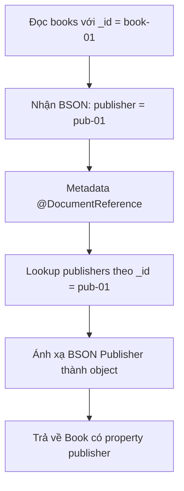

# @DocumentReference và tham chiếu mặc định theo ID

## 1. Mục tiêu và bối cảnh

Trong MongoDB, một document có thể **nhúng** thông tin liên quan ngay bên trong nó hoặc **lưu định danh tham chiếu** đến document khác. Spring Data MongoDB cung cấp annotation `@DocumentReference` để biểu diễn mối quan hệ tham chiếu trong model Java mà vẫn giữ cấu trúc lưu trữ linh hoạt.

Ví dụ, một cuốn sách có nhà xuất bản. Nếu tên nhà xuất bản thay đổi, ứng dụng thường muốn sửa một document `publishers` và để các cuốn sách tham chiếu đến nhà xuất bản đó. Khi dùng `@DocumentReference` mặc định, document sách lưu **giá trị ID** của nhà xuất bản; Spring Data MongoDB dùng ID ấy để tìm và dựng lại object khi đọc.

Đây là nội dung thuộc chương **Tham chiếu tài liệu** trong module **SPRING_DATA_MONGODB**. Hiểu cơ chế này giúp bạn sử dụng `MongoTemplate` và repository đúng cách, thiết kế query/index hợp lý, tránh tải dữ liệu không cần thiết và xử lý tính nhất quán khi các document có vòng đời độc lập. Các kỹ thuật tương tự cần được cân nhắc trong aggregation, transaction, reactive access, kiểm thử và chẩn đoán hiệu năng.

Sau bài học, bạn có thể:

1. Mô tả chính xác cách `@DocumentReference` **mặc định** lưu giá trị tham chiếu và truy vấn qua `_id`.
2. Phân biệt `@DocumentReference` với embedded document, lưu ID thủ công và `@DBRef`.
3. Ánh xạ một tham chiếu đơn hoặc danh sách tham chiếu sang Java, đọc/ghi bằng repository và `MongoTemplate`.
4. Nhận biết chi phí resolve tham chiếu, trường hợp dữ liệu mục tiêu không tồn tại và giới hạn của tải lazy.
5. Thiết kế index, kiểm thử BSON thực tế và đưa ra phương án cập nhật/xóa dữ liệu liên quan.

## 2. Mô hình dữ liệu minh họa

Giả sử hai collection là `publishers` và `books`:

```javascript
db.publishers.insertOne({
  _id: "pub-01",
  name: "Nhà xuất bản Tri Thức",
  country: "VN"
});

db.books.insertOne({
  _id: "book-01",
  title: "Học MongoDB",
  publisher: "pub-01",
  category: "database"
});
```

Trường `publisher` của sách chỉ chứa chuỗi `"pub-01"`. Nó **không** chứa thông tin `name` hay `country`; những thông tin này nằm trong document thuộc collection `publishers`.

```text
books                                      publishers
┌───────────────────────────┐             ┌────────────────────────────────┐
│ _id: "book-01"            │             │ _id: "pub-01"                  │
│ title: "Học MongoDB"      │             │ name: "Nhà xuất bản Tri Thức"   │
│ publisher: "pub-01" ──────┼────────────>│ country: "VN"                  │
└───────────────────────────┘             └────────────────────────────────┘
                    tham chiếu bằng ID
```

Đường liên hệ này do **ứng dụng quy ước và giải quyết**. MongoDB không tự áp đặt foreign key kiểu cơ sở dữ liệu quan hệ chỉ vì hai field có cùng giá trị. Xóa nhà xuất bản có thể làm sách còn lại một tham chiếu không giải quyết được nếu hệ thống không có quy tắc xử lý.

## 3. @DocumentReference mặc định hoạt động thế nào?

### 3.1. Annotation trên property

Ví dụ Java 17+ dùng `record` để ngắn gọn. Trong dự án, có thể đặt mỗi kiểu vào file riêng và khai báo `public` theo quy tắc Java.

```java
import org.springframework.data.annotation.Id;
import org.springframework.data.mongodb.core.mapping.Document;
import org.springframework.data.mongodb.core.mapping.DocumentReference;

@Document(collection = "publishers")
record Publisher(
    @Id String id,
    String name,
    String country
) {}

@Document(collection = "books")
record Book(
    @Id String id,
    String title,
    @DocumentReference Publisher publisher,
    String category
) {}
```

`@DocumentReference` được đặt ở property `publisher`. Java nhìn thấy `Publisher`, còn BSON của `books` mặc định lưu **giá trị ID của object được tham chiếu**. Với ID `"pub-01"`, bản ghi sách tương ứng với ví dụ ở mục 2. Điều kiện quan trọng là đối tượng Publisher đã có ID hợp lệ.

### 3.2. Lookup mặc định theo _id

Về mặt ý nghĩa, annotation mặc định sử dụng bộ lọc tương đương:

```javascript
{ "_id": "pub-01" }
```

Trong cú pháp lookup của `@DocumentReference`, biểu thức mặc định được mô tả là:

```text
{ '_id' : ?#{#target} }
```

`#target` là **giá trị tham chiếu đã được đọc từ document nguồn**. Với ví dụ của chúng ta, giá trị đó là `"pub-01"`. Spring Data MongoDB dùng nó để tra cứu document `Publisher` phù hợp ở collection đích, rồi ánh xạ thành object Java.

Có thể hình dung quá trình:



Sơ đồ mô tả **ý nghĩa resolve reference**. Chi tiết số lệnh truy vấn hoặc cách tối ưu tải nhiều phần tử có thể khác giữa các phiên bản Spring Data và hình dạng dữ liệu. Không nên giả định mỗi tham chiếu luôn tương đương đúng một round trip mạng.

### 3.3. Đặc điểm mặc định cần nhớ

| Thuộc tính | Hành vi của tham chiếu mặc định |
| --- | --- |
| Giá trị được lưu trong document nguồn | ID của document đích, không phải embedded document |
| Field tìm kiếm trong document đích | `_id` |
| Collection đích | Theo metadata entity được tham chiếu, ví dụ `@Document("publishers")` |
| Kiểu property Java sau khi đọc | `Publisher` |
| Chế độ tải | Thông thường eager; có thể yêu cầu `lazy = true` |
| Lưu/cập nhật document đích | Không mặc định cascade save |
| Ràng buộc tồn tại của document đích | Ứng dụng phải chủ động bảo đảm |

Lưu ý rằng `@DocumentReference` không có nghĩa là server thực hiện phép join mỗi khi đọc `books`. Spring Data có thể thực hiện bước tra cứu bổ sung trong tầng ứng dụng, trong khi truy vấn trực tiếp qua mongosh chỉ thấy ID đang lưu.

## 4. Thực hành ghi và đọc bằng Spring Data MongoDB

### 4.1. Khởi tạo dữ liệu theo đúng thứ tự

Với repository:

```java
import org.springframework.data.mongodb.repository.MongoRepository;

interface PublisherRepository
    extends MongoRepository<Publisher, String> {}

interface BookRepository
    extends MongoRepository<Book, String> {}
```

Ví dụ trong một service đã inject hai repository:

```java
Publisher publisher = publisherRepository.save(
    new Publisher("pub-01", "Nhà xuất bản Tri Thức", "VN")
);

Book book = bookRepository.save(
    new Book("book-01", "Học MongoDB", publisher, "database")
);
```

Publisher được lưu trước để có document đích và ID hợp lệ. Khi lưu `Book`, `@DocumentReference` mã hóa quan hệ thành ID; thao tác `bookRepository.save(...)` **không tự lưu mọi thay đổi của `Publisher`**.

Kiểm tra dữ liệu thực tế:

```javascript
db.books.findOne({ _id: "book-01" });
```

Đường dẫn `publisher` trong BSON dự kiến chứa chuỗi `"pub-01"`. Một số cấu hình mapping có thể lưu type metadata như `_class` ở document gốc; điều đó không làm trường `publisher` trở thành embedded Publisher.

### 4.2. Đọc và giải quyết tham chiếu

```java
Book loaded = bookRepository.findById("book-01")
    .orElseThrow();

System.out.println(loaded.publisher().name());
// Nhà xuất bản Tri Thức
```

Theo hành vi mặc định, khi Spring Data đọc Book và resolve thành công publisher, property Java sẽ chứa một object `Publisher`. Nếu bạn dùng driver trực tiếp hoặc mongosh để đọc document `books`, bạn chỉ nhận giá trị ID như BSON đã lưu.

Một lỗi thường gặp là lưu book với Publisher chưa có trong database rồi mong chờ `bookRepository.save(book)` sẽ tự tạo publisher. Đây không phải hành vi cascade mặc định. Đối với tham chiếu bị thiếu, cách giải quyết và giá trị thu được có thể tùy tính chất property, collection và phiên bản; **không xây dựng nghiệp vụ trên giả định document đích luôn tồn tại**. Hãy kiểm tra trước khi ghi hoặc xử lý reference không resolve được rõ ràng.

### 4.3. MongoTemplate cũng sử dụng metadata

```java
import org.springframework.data.mongodb.core.MongoTemplate;
import org.springframework.data.mongodb.core.query.Criteria;
import org.springframework.data.mongodb.core.query.Query;

class BookQueries {
    private final MongoTemplate template;

    BookQueries(MongoTemplate template) {
        this.template = template;
    }

    Book loadBook(String id) {
        return template.findOne(
            Query.query(Criteria.where("id").is(id)),
            Book.class
        );
    }
}
```

Khi kết quả được ánh xạ sang `Book.class`, converter biết property `publisher` là tham chiếu. Nếu bạn yêu cầu kết quả BSON `Document` hoặc dùng driver trực tiếp, bạn đang làm việc với ID vật lý, không nhất thiết có quá trình resolve như với domain entity.

## 5. So sánh embedding, @DocumentReference và @DBRef

### 5.1. Ba biểu diễn BSON khác nhau

**Nhúng document:**

```javascript
{
  _id: "book-01",
  title: "Học MongoDB",
  publisher: {
    _id: "pub-01",
    name: "Nhà xuất bản Tri Thức",
    country: "VN"
  }
}
```

**`@DocumentReference` mặc định:**

```javascript
{
  _id: "book-01",
  title: "Học MongoDB",
  publisher: "pub-01"
}
```

**`@DBRef`:**

```javascript
{
  _id: "book-01",
  title: "Học MongoDB",
  publisher: {
    "$ref": "publishers",
    "$id": "pub-01"
  }
}
```

`DBRef` là một cấu trúc BSON quy ước có `$ref`, `$id` và có thể có `$db`. Còn `@DocumentReference` mặc định lưu một **giá trị tham chiếu đơn giản** theo ID, không tự tạo DBRef BSON. Đừng dùng truy vấn dành cho `publisher.$id` nếu dữ liệu thực tế của bạn chỉ có `publisher: "pub-01"`.

### 5.2. Lựa chọn dựa trên cách sử dụng

| Cách mô hình hóa | Khi phù hợp | Đánh đổi |
| --- | --- | --- |
| Nhúng publisher | Snapshot thông tin tại thời điểm mua; đọc cùng book và hiếm cập nhật riêng | Dữ liệu lặp lại, phải đồng bộ nếu muốn thay đổi toàn hệ thống |
| `@DocumentReference` | Publisher có vòng đời riêng; nhiều sách cùng liên kết một publisher | Resolve có chi phí truy vấn; phải quản lý reference bị thiếu |
| `@DBRef` | Tích hợp hệ thống đang dùng BSON DBRef và có lý do duy trì | Dữ liệu lưu kiểu DBRef, quản lý/resolution khác tham chiếu ID thuần |
| Lưu `publisherId` dạng String thủ công | Chỉ cần ID; muốn chủ động điều khiển mọi truy vấn | Code tự tra cứu/map Publisher khi cần |

Trong thiết kế mới, dùng ID thuần có thể đơn giản và dễ tích hợp khi không cần metadata `$ref` trong BSON. Việc chọn `@DocumentReference` hay lưu `publisherId` thủ công phụ thuộc nhu cầu tự động resolve thành object và khả năng kiểm soát truy vấn của ứng dụng.

**Một quy tắc quan trọng:** MongoDB không áp đặt khóa ngoại cho cả ba cách ở trên. Chọn annotation không thay thế các kiểm tra tính nhất quán trong nghiệp vụ.

## 6. Kiểu ID quyết định khả năng resolve

### 6.1. String và ObjectId không giống nhau

Ví dụ:

```javascript
db.publishers.insertOne({
  _id: ObjectId("507f1f77bcf86cd799439011"),
  name: "Publisher A"
});
```

Nếu document nguồn lưu:

```javascript
{
  _id: "book-02",
  publisher: "507f1f77bcf86cd799439011"
}
```

thì không thể coi chuỗi publisher đó tương đương với BSON ObjectId có cùng nội dung chữ. Giá trị truy vấn BSON phải khớp cả **kiểu** và **giá trị** với `_id` thực tế trong `publishers`.

Spring Data có quy tắc chuyển ID đối với `@Id String` và một số trường hợp chuỗi 24 ký tự hexadecimal. Tuy nhiên, thay đổi annotation, converter hoặc nguồn ghi có thể dẫn tới sự khác biệt. Dùng `@MongoId(FieldType.STRING)` nếu hệ thống chủ đích lưu ID dưới dạng BSON String; dùng `ObjectId` nhất quán nếu hệ thống chọn ObjectId.

### 6.2. Hai cách thiết kế nhất quán

**Cách A — ID chuỗi nghiệp vụ:**

```java
@Document("publishers")
record PublisherWithStringId(
    @MongoId(FieldType.STRING) String id,
    String name
) {}
```

Trường nguồn có thể chứa `publisher: "pub-01"` và document đích có `_id: "pub-01"`.

**Cách B — ID ObjectId:**

```java
@Document("publishers")
record PublisherWithObjectId(
    @Id org.bson.types.ObjectId id,
    String name
) {}
```

Khi dùng `@DocumentReference` đến kiểu này, giá trị lưu ở nguồn cần tương ứng với BSON ObjectId. Hãy thử lưu/đọc thực tế trước khi tạo dữ liệu lớn, đặc biệt nếu ứng dụng còn có import script, các service bằng ngôn ngữ khác hoặc dữ liệu legacy.

**Lưu ý cho hai ví dụ:** Các import của `@Document`, `@Id`, `@MongoId` và `FieldType` tương ứng với những snippet đã giới thiệu; đây là các kiểu minh họa độc lập, không thay thế trực tiếp Publisher trong các ví dụ trước.

## 7. Danh sách tham chiếu và quan hệ một-nhiều

Một nhà sách có thể gắn nhiều tác giả cho mỗi cuốn sách. Mỗi tác giả có vòng đời riêng, nên một mảng ID là lựa chọn hợp lý nếu số tác giả mỗi cuốn thường nhỏ:

```java
import java.util.List;
import org.springframework.data.annotation.Id;
import org.springframework.data.mongodb.core.mapping.Document;
import org.springframework.data.mongodb.core.mapping.DocumentReference;

@Document("authors")
record Author(@Id String id, String displayName) {}

@Document("books")
record BookWithAuthors(
    @Id String id,
    String title,
    @DocumentReference List<Author> authors
) {}
```

Với các tác giả đã có ID `author-01`, `author-02`, BSON sách có dạng:

```javascript
{
  _id: "book-03",
  title: "Thiết kế với MongoDB",
  authors: ["author-01", "author-02"]
}
```

Spring Data có thể resolve những ID trong mảng thành `List<Author>`. Khi viết nghiệp vụ, phải xem xét nếu một ID trỏ đến document đã xóa: danh sách object đã resolve có thể không tương ứng hoàn toàn với danh sách ID gốc; không nên mặc định mọi reference đều hợp lệ.

**Giới hạn mô hình:** Một document chứa mảng reference có thể lớn dần. Nếu số phần tử tăng không giới hạn (ví dụ một tài khoản tham gia hàng triệu sự kiện), cân nhắc collection liên kết riêng thay vì một mảng ID rất dài. MongoDB giới hạn một BSON document ở mức **16 MiB**, và mảng dài cũng làm tăng chi phí đọc/ghi và index.

### 7.1. Truy vấn danh sách ID trực tiếp ở mongosh

```javascript
// Tìm sách chứa tham chiếu tới một tác giả.
db.books.find({ authors: "author-01" });

// Tìm sách chứa cả hai tác giả.
db.books.find({
  authors: { $all: ["author-01", "author-02"] }
});
```

Các truy vấn này thao tác trên **mảng ID được lưu** trong MongoDB, không cần fetch toàn bộ object tác giả. Khi cần kiểm tra hay lọc theo tên tác giả, hãy truy vấn collection tác giả trước, dùng `$lookup` thích hợp hoặc thiết kế dữ liệu bổ sung theo access pattern.

## 8. Lazy reference, eager reference và nguy cơ N+1

### 8.1. Eager là gì?

Với `@DocumentReference` không chỉ định `lazy`, Spring Data thường resolve reference trong quá trình dựng entity. Điều này tiện khi màn hình luôn hiển thị thông tin liên quan nhưng có thể làm phát sinh thêm truy vấn khi lấy danh sách nhiều document.

Ví dụ trang danh sách 100 cuốn sách chỉ cần `title` và `category`, nhưng domain `Book` có reference đến `Publisher`. Nếu query load toàn bộ Book và tự động resolve publisher, chương trình có thể phải đọc thêm dữ liệu nhà xuất bản dù màn hình không sử dụng.

### 8.2. Lazy giúp trì hoãn lúc resolve

Có thể yêu cầu tải trì hoãn:

```java
@Document("books")
class BookLazy {
    @Id
    String id;
    String title;

    @DocumentReference(lazy = true)
    PublisherEntity publisher;
}

@Document("publishers")
class PublisherEntity {
    @Id
    String id;
    String name;
}
```

Trong ví dụ này, hai class được để **không final** để dễ minh họa proxy; snippet cần import các annotation như ở mục 3. Khi Spring Data hỗ trợ tạo proxy cho property, truy vấn publisher được trì hoãn cho đến khi cần truy cập.

Lazy không có nghĩa là không bao giờ truy vấn. Một số thao tác như `toString()`, debugger, serialization JSON hoặc gọi getter có thể kích hoạt resolution. Entity dạng `record`/final class, kiểu property không thể proxy hoặc giới hạn module Java có thể gây vấn đề khi dùng lazy; cần kiểm thử với model và runtime thực tế.

### 8.3. Đo số query thay vì đoán

Khi hiển thị 100 sách với publisher, có thể có nhiều cách thực thi, tùy dữ liệu trùng lặp và cách framework giải quyết:

- Truy vấn lấy danh sách sách.
- Một hoặc nhiều truy vấn phụ để giải tham chiếu.
- Truy vấn bổ sung khi truy cập property lazy.

Hiện tượng **N+1 query** xảy ra khi việc lấy danh sách N document dẫn đến nhiều lượt truy vấn dữ liệu liên quan, làm tăng độ trễ. Đừng khẳng định chính xác N+1 cho mọi phiên bản hay mọi kiểu collection; hãy **đo số lệnh MongoDB thực tế** bằng command monitoring, log có giới hạn hoặc profiler.

Nếu trang chỉ cần ID nhà xuất bản, có thể dùng projection/DTO lấy scalar ID hoặc thiết kế trường `publisherId` tường minh. Nếu cần dữ liệu liên quan ở quy mô lớn, cân nhắc aggregation `$lookup`, snapshot một số trường nhỏ hoặc chiến lược đọc chuyên biệt.

## 9. Tham chiếu không tạo ra phép JOIN tự động trong mongosh

Khi gọi:

```javascript
db.books.findOne({ _id: "book-01" });
```

MongoDB trả document sách với `publisher: "pub-01"`, không tự lấy thêm object publisher. Nếu muốn kết hợp ở tầng database, có thể dùng aggregation:

```javascript
db.books.aggregate([
  { $match: { _id: "book-01" } },
  {
    $lookup: {
      from: "publishers",
      localField: "publisher",
      foreignField: "_id",
      as: "publisherDetails"
    }
  },
  {
    $unwind: {
      path: "$publisherDetails",
      preserveNullAndEmptyArrays: true
    }
  },
  {
    $project: {
      _id: 1,
      title: 1,
      "publisherDetails.name": 1,
      "publisherDetails.country": 1
    }
  }
]);
```

`$lookup` dựa vào việc `books.publisher` và `publishers._id` có kiểu BSON tương thích. Nếu tài liệu đích thiếu, mảng kết quả `publisherDetails` từ `$lookup` ban đầu sẽ rỗng; `preserveNullAndEmptyArrays` giữ document sách sau `$unwind`.

**Phân biệt:**

| Kỹ thuật | Nơi resolve | Kết quả |
| --- | --- | --- |
| `@DocumentReference` khi đọc entity | Tầng Spring Data mapping | Property Java `Publisher` |
| `$lookup` aggregation | Tầng MongoDB server | BSON kết hợp theo pipeline |
| Lưu `publisherId` và gọi repository riêng | Code application | Ứng dụng tự kiểm soát truy vấn |

Khi cần lọc/sắp xếp theo dữ liệu của publisher, hãy suy nghĩ từ query shape trước. Việc resolve reference bằng annotation không đồng nghĩa MongoDB có thể lọc `books` theo `publisher.name` như thể document đó đã được nhúng.

## 10. Truy vấn theo ID tham chiếu và thiết kế index

### 10.1. Tìm sách theo ID publisher

Truy vấn trực tiếp:

```javascript
db.books.find({ publisher: "pub-01" });
```

Không nên dùng:

```javascript
db.books.find({ "publisher._id": "pub-01" }); // Sai với scalar ID.
db.books.find({ "publisher.name": "Nhà xuất bản Tri Thức" }); // Sai cấu trúc.
```

Hai đường dẫn sai ở trên là ví dụ cố ý để phân tích lỗi: chúng chỉ có ý nghĩa nếu field `publisher` thực sự chứa embedded document với những trường con ấy.

Trong repository, có thể khai báo truy vấn theo **field BSON lưu ID**:

```java
import java.util.List;
import org.springframework.data.mongodb.repository.MongoRepository;
import org.springframework.data.mongodb.repository.Query;

interface BookSearchRepository extends MongoRepository<Book, String> {

    @Query("{ 'publisher' : ?0 }")
    List<Book> findByStoredPublisherId(String publisherId);
}
```

Ví dụ này dựa trên contract lưu String ID và tên field `publisher` như đã xác minh. Khi dùng custom lookup, đổi tên field bằng `@Field` hoặc dùng kiểu ID khác, hãy kiểm tra BSON query thực sự được gửi. Trong code ứng dụng, không nên suy ra mọi derived-query property path đều tự biến thành truy vấn join qua reference.

### 10.2. Index nào hỗ trợ?

MongoDB mặc định có index trên `publishers._id`, phục vụ bước lookup theo ID. Nếu nghiệp vụ thường xuyên tìm **sách theo publisher**, có thể cân nhắc:

```javascript
db.books.createIndex(
  { publisher: 1 },
  { name: "ix_books_publisher" }
);
```

Đây là index cho truy vấn `db.books.find({ publisher: "pub-01" })`, không thay thế index `publishers._id` khi resolve document đích. Với `authors: ["author-01", ...]`, index trên `authors` sẽ là **multikey index**. Những index này có chi phí lưu trữ và ghi; chỉ thêm khi access pattern thực sự cần.

Để đo, thử:

```javascript
db.books.find({ publisher: "pub-01" })
  .explain("executionStats");
```

Quan sát `winningPlan`, `IXSCAN`/`COLLSCAN`, `totalKeysExamined`, `totalDocsExamined` và `nReturned`. `explain` của query sách **không tự đo hết** các truy vấn phụ do Spring Data thực hiện sau đó để resolve reference; muốn đánh giá độ trễ của toàn màn hình phải đo cả số lần gọi database từ ứng dụng.

## 11. Vòng đời dữ liệu và tính nhất quán

### 11.1. Không có cascade save mặc định

Giả sử sửa tên publisher:

```java
Publisher changedPublisher = new Publisher(
    "pub-01",
    "Nhà xuất bản Tri Thức Mới",
    "VN"
);

Book changedBook = new Book(
    "book-01",
    "Học MongoDB",
    changedPublisher,
    "database"
);

bookRepository.save(changedBook);
```

Thao tác lưu Book ở đây cập nhật tham chiếu đến ID `pub-01`; **không thể coi đó là thao tác đổi tên document `publishers`**. Muốn sửa publisher, phải lưu/update publisher một cách tường minh:

```java
publisherRepository.save(changedPublisher);
```

Thực tế, để tránh ghi đè các field publisher khác do entity chứa dữ liệu cũ, có thể chọn update có điều kiện hoặc cơ chế optimistic locking tùy nghiệp vụ.

### 11.2. Xóa document đích có thể tạo tham chiếu mồ côi

```javascript
db.publishers.deleteOne({ _id: "pub-01" });

// Sách vẫn còn ID đang trỏ đến publisher vừa xóa:
db.books.findOne({ _id: "book-01" });
```

MongoDB không tự xóa Book hay xóa field `publisher` vì hai document trước đó có quan hệ qua ID. Ứng dụng cần quy định chính sách:

- **Cấm xóa** publisher khi còn sách tham chiếu.
- **Soft delete** publisher, giữ ID để các dữ liệu lịch sử vẫn truy cập được.
- **Dọn dẹp tham chiếu** hoặc gán publisher thay thế theo quy tắc nghiệp vụ.
- **Lưu snapshot** thông tin publisher trong book nếu lịch sử bắt buộc giữ tên tại thời điểm xuất bản.

Nếu nhiều collection phải thay đổi đồng thời theo một invariant nghiêm ngặt, cần transaction nhiều document hoặc thiết kế nhất quán tương đương. Tính nguyên tử của một lần cập nhật document **không mở rộng tự động** sang các document được tham chiếu.

### 11.3. Không lấy reference thay cho xác thực quyền

Nếu hệ thống có nhiều tenant, một Book mang `tenantId: "tenant-a"` nhưng tham chiếu `publisher: "pub-b"` vẫn có thể trỏ tới document ở tenant khác nếu code không kiểm soát. `@DocumentReference` chỉ định cách resolve, **không tự xác thực quyền liên tenant**.

Trong hệ thống nhiều tenant, hãy đặt các điều kiện kiểm tra quyền ở tầng service và định nghĩa rõ hợp đồng ID. Nếu ID chỉ unique trong từng tenant chứ không unique toàn collection, không thể dùng lookup mặc định chỉ theo `_id` mà không có chiến lược định danh/lookup phù hợp.

## 12. Khi nào cần lookup tùy biến?

Mặc định `@DocumentReference` lấy **ID làm pointer** và tìm theo `_id`. Spring Data cũng hỗ trợ tùy chọn `lookup` để tìm document theo một khóa khác, ví dụ mã nghiệp vụ không nằm trong `_id`.

Tuy nhiên, đổi `lookup` không chỉ là sửa câu truy vấn: **giá trị lưu trong nguồn phải đúng với khóa mà lookup sử dụng**. Nếu nguồn vẫn lưu `publisher: "pub-01"` nhưng lookup yêu cầu `{ acronym: "pub-01" }` trong khi `acronym` thực tế là `"NXB-TT"`, reference sẽ không resolve đúng.

Đối với lookup tùy biến, cần thiết kế đồng bộ:

1. Giá trị pointer được **ghi** ở document nguồn.
2. Câu `lookup` được sử dụng để **đọc** document đích.
3. Ràng buộc unique/index trên khóa đích nếu một pointer được kỳ vọng chỉ trả một document.
4. Cách thay đổi khóa nghiệp vụ, migration và xử lý tham chiếu cũ.
5. Test round trip, kể cả khi code khởi động lại và document được tạo từ nguồn khác.

Trong phạm vi bài này, nếu yêu cầu chỉ là «Book tham chiếu Publisher theo ID», **giữ cấu hình mặc định** là lựa chọn dễ kiểm tra nhất. Dùng custom pointer và lookup khi có access pattern rõ ràng, đồng thời xác nhận cơ chế ghi pointer phù hợp với phiên bản Spring Data đang sử dụng.

## 13. Kiểm thử và chẩn đoán

### 13.1. Kiểm tra BSON khi lưu

Một test tích hợp có thể làm theo thứ tự:

1. Tạo một Publisher với ID xác định, ví dụ `pub-test-01`.
2. Tạo Book có property `publisher` là object Publisher vừa lưu.
3. Đọc BSON `books` bằng driver/mongosh và xác nhận trường `publisher` là ID, không phải embedded object hoặc DBRef.
4. Đọc Book qua repository, xác nhận property `publisher.id` và `publisher.name` khớp dữ liệu đích.
5. Sửa Publisher độc lập, đọc Book lại từ database và kiểm tra dữ liệu publisher mới.
6. Xóa Publisher trong dữ liệu test rồi kiểm tra hành vi khi reference không resolve.

Ví dụ kiểm tra cấu trúc bằng mongosh:

```javascript
db.publishers.findOne({ _id: "pub-test-01" });

db.books.findOne(
  { _id: "book-test-01" },
  { publisher: 1, title: 1 }
);
```

Với dữ liệu test đã được lưu theo cơ chế mặc định, `publisher` cần chứa ID. Phải đối chiếu **BSON type** của ID, không chỉ chuỗi hiển thị.

### 13.2. Kiểm tra không có cascade

Một tình huống test có ích: tạo một Publisher trong bộ nhớ với `id = "pub-unsaved"` nhưng **không insert** vào `publishers`, rồi lưu Book tham chiếu đến publisher đó. Test phải chứng minh việc lưu Book không tự tạo document Publisher, đồng thời xác định chính sách ứng dụng khi truy xuất reference không hợp lệ.

Ở production, thường nên validate target tồn tại trước khi tạo quan hệ, đặc biệt nếu quan hệ là bắt buộc về mặt nghiệp vụ.

### 13.3. Kiểm tra chi phí truy vấn

Với màn hình danh sách sách, so sánh:

| Tình huống test | Điều cần đo |
| --- | --- |
| Lấy Book với reference eager | Số lệnh database và tổng độ trễ |
| Lấy Book có lazy reference nhưng không truy cập publisher | Có phát sinh truy vấn publisher không? |
| Sau đó gọi getter/serialize publisher lazy | Chi phí resolve và lỗi proxy có thể phát sinh |
| Projection chỉ lấy `title` | Có giảm lượng dữ liệu và số truy vấn liên quan? |
| Aggregation dùng `$lookup` | Số document scan, index, kích thước kết quả |

Thời gian chỉ có ý nghĩa trên tập dữ liệu và query shape tương đối giống production. Cũng cần phân biệt truy vấn nội bộ của Spring Data để resolve reference với câu lệnh `find` chính khi đọc entity.

### 13.4. Những lỗi thường gặp

| Triệu chứng | Nguyên nhân có thể | Kiểm tra hoặc sửa |
| --- | --- | --- |
| Đọc Book thấy publisher không có dữ liệu | ID đích không tồn tại hoặc kiểu BSON không khớp | Kiểm tra document đích và subtype/kiểu ID |
| Trong mongosh thấy chỉ có chuỗi ID | Đó là biểu diễn mặc định của `@DocumentReference` | Đọc bằng Spring Data nếu cần object |
| `publisher.name` trong truy vấn books không khớp | Publisher được lưu dạng scalar ID | Lọc bên đích trước, dùng `$lookup` hoặc thiết kế khác |
| Lưu Book không tạo Publisher | Không có cascade save mặc định | Lưu Publisher riêng, theo đúng vòng đời |
| Tải danh sách Book chậm | Resolve nhiều reference, có thể N+1 | Đo số query, dùng projection/lookup/snapshot |
| Lazy gặp lỗi proxy hoặc truy vấn bất ngờ | Model final/record hoặc serialization kích hoạt lazy | Kiểm thử entity, DTO và runtime |
| Có sách trỏ đến publisher đã xóa | Không có foreign key/cascade delete | Soft delete, kiểm tra trước xóa hoặc cleanup |
| Query theo publisher ID sai | Truy vấn theo `publisher._id` thay vì field scalar | Kiểm tra BSON thực tế và viết query đúng |
| Thay `@DBRef` bằng `@DocumentReference` rồi đọc dữ liệu cũ sai | BSON lưu DBRef khác BSON lưu ID thuần | Migration có kiểm soát, test dữ liệu lịch sử |

## 14. Bài thực hành có lời giải

### Bài 1 — Dự đoán BSON được lưu

**Đề bài:** Với `Book` có `id = "book-07"` và `publisher.id = "pub-01"`, trường `publisher` được lưu thế nào khi dùng `@DocumentReference` mặc định?

**Lời giải:**

```javascript
{
  _id: "book-07",
  title: "Một cuốn sách",
  publisher: "pub-01",
  category: "database"
}
```

Vì giá trị đích được xác định bằng ID, document sách lưu pointer `"pub-01"`. Không lưu toàn bộ Publisher và không tự sinh cấu trúc `$ref/$id`.

### Bài 2 — Vì sao đổi tên publisher không thay document book?

**Đề bài:** Publisher đổi tên từ «A» thành «B». Tại sao `db.books.findOne(...)` vẫn chỉ cho thấy `publisher: "pub-01"`?

**Lời giải:** Document `books` chỉ lưu ID; tên nhà xuất bản nằm trong collection `publishers`. Khi Spring Data resolve Book thành object, nó đọc thông tin mới theo ID. Truy vấn mongosh chỉ trả BSON vật lý của Book, không tự join.

### Bài 3 — Tìm sách theo publisher và index

**Đề bài:** Ứng dụng cần tìm các sách của Publisher `pub-01`. Hãy viết truy vấn mongosh và index có thể xem xét.

**Lời giải:**

```javascript
db.books.find({ publisher: "pub-01" });

db.books.createIndex(
  { publisher: 1 },
  { name: "ix_books_publisher" }
);
```

Index giúp tra cứu theo stored pointer nếu query này thường xuyên và có dữ liệu đủ lớn. Cần kiểm tra `explain("executionStats")` và chi phí ghi trước khi chốt.

### Bài 4 — Chọn embedding hay reference

**Đề bài:** Một đơn hàng phải giữ nguyên tên và địa chỉ giao hàng tại thời điểm đặt, nhưng khách hàng có thể đổi địa chỉ tài khoản. Có nên chỉ tham chiếu đến document địa chỉ hiện tại?

**Lời giải:** Nếu đơn cần dữ liệu lịch sử, nên **nhúng snapshot** địa chỉ nhận vào đơn. Có thể đồng thời giữ `customerId` để tham chiếu tài khoản hiện hành. Nếu chỉ dùng reference đến địa chỉ hiện tại, khi khách sửa địa chỉ, xem đơn cũ có thể cho thông tin sai thời điểm giao dịch.

### Bài 5 — Xác định lỗi khi mất publisher

**Đề bài:** Book còn `publisher: "pub-01"` nhưng document Publisher bị xóa. Hãy xác định lớp nào phải xử lý và hai chính sách hợp lý.

**Lời giải:** `@DocumentReference` không bảo đảm referential integrity. Tầng nghiệp vụ cần quyết định, ví dụ **không cho xóa** publisher đang được sử dụng hoặc **soft delete** publisher để vẫn đọc được dữ liệu lịch sử. Nếu cho phép xóa, phải xử lý khi resolve thất bại và xây dựng kế hoạch cleanup các reference.

### Bài 6 — So sánh @DBRef với @DocumentReference

**Đề bài:** Dữ liệu cũ lưu:

```javascript
publisher: { "$ref": "publishers", "$id": "pub-01" }
```

Hệ thống mới dùng `@DocumentReference` mặc định. Có thể chỉ đổi annotation rồi coi dữ liệu cũ đã chuyển sang ID thuần không?

**Lời giải:** Không. DBRef BSON có cấu trúc khác scalar ID BSON. Phải đánh giá dữ liệu cũ, xác định cách chuyển reference và chạy migration/kiểm thử tương thích. Đổi annotation trong Java không tự thay mọi BSON document đã lưu.

## 15. Checklist thiết kế và ghi nhớ

| Câu hỏi kiểm tra | Bằng chứng cần có |
| --- | --- |
| Document đích có vòng đời riêng không? | Lý do chọn reference thay vì embedding |
| ID đích là String hay ObjectId? | BSON `_id` và giá trị pointer ở nguồn tương thích |
| Đã lưu document đích trước chưa? | Test không dựa vào cascade mặc định |
| Truy vấn mặc định tìm theo trường nào? | `_id` từ `@DocumentReference` |
| Màn hình có thực sự cần object liên quan không? | Truy vấn/projection và chi phí resolve |
| Có dùng lazy reference không? | Test proxy, serialization và vòng đời phiên đọc |
| Có nhiều phần tử reference không? | Giới hạn cardinality, mảng ID và index phù hợp |
| Khi document đích bị xóa thì sao? | Chính sách referential integrity và test |
| Có yêu cầu nhất quán xuyên document không? | Transaction hoặc cơ chế đồng bộ phù hợp |
| Có dữ liệu DBRef/legacy không? | Migration và khả năng đọc dữ liệu cũ |
| Index nào thực sự cần? | Truy vấn theo stored ID, `_id` đích, số query và `explain` |

**Những quy tắc cần nhớ:**

1. `@DocumentReference` mặc định lưu **ID của entity đích** trong document nguồn và dùng lookup theo `_id` để resolve.
2. Object Java sau khi đọc có thể chứa entity được tham chiếu, nhưng BSON `books` vẫn chỉ lưu ID; MongoDB không tự join khi dùng `find`.
3. `@DocumentReference`, `@DBRef` và embedding có **biểu diễn BSON khác nhau**. Không đổi annotation mà bỏ qua dữ liệu cũ.
4. Tính nhất quán, cascade save/delete, quyền truy cập và vòng đời entity là trách nhiệm thiết kế nghiệp vụ, không tự xuất hiện nhờ annotation.
5. Lazy chỉ trì hoãn việc tải; phải kiểm tra proxy và đo truy vấn bổ sung, nhất là khi đọc danh sách lớn.
6. Thiết kế từ access pattern: khi cần lọc theo stored ID, dùng index ở collection nguồn; khi resolve theo `_id`, dùng index khóa đích; khi cần dữ liệu kết hợp quy mô lớn, cân nhắc `$lookup` hoặc mô hình khác.
