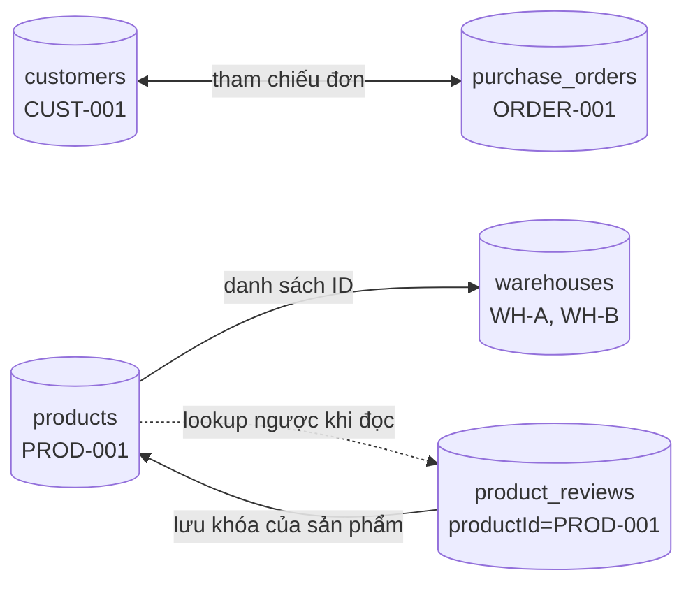
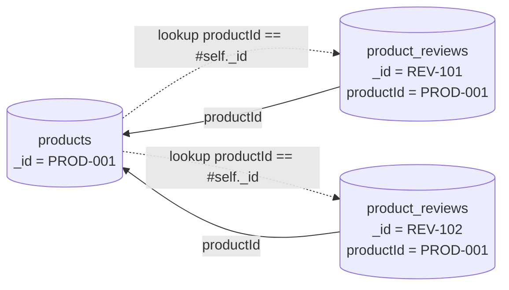

# Tham chiếu đơn, collection tham chiếu và tham chiếu ngược

> **Chương:** Tham chiếu tài liệu  
> **Phạm vi module:** `SPRING_DATA_MONGODB` — sử dụng Spring Data MongoDB để kết nối, ánh xạ document và thao tác dữ liệu qua `MongoTemplate` hoặc repository. Việc chọn tham chiếu ảnh hưởng trực tiếp đến thiết kế truy vấn, aggregation, index, transaction, reactive access, kiểm thử và chẩn đoán hiệu năng; bài này tập trung vào ba cách biểu diễn quan hệ: **tham chiếu một document**, **tham chiếu nhiều document qua collection**, và **truy vấn tham chiếu ngược**.

## 1. Tại sao cần tham chiếu document?

MongoDB khuyến khích thiết kế dữ liệu dựa trên cách ứng dụng **đọc và cập nhật**. Một đối tượng nhỏ được dùng cùng một thực thể cha thường thích hợp để **nhúng** (embed). Nhưng khi hai đối tượng có vòng đời độc lập, được nhiều nơi sử dụng hoặc tăng kích thước khó dự đoán, lưu ở những collection riêng rồi **tham chiếu** là một lựa chọn cần cân nhắc.

Ví dụ hệ thống bán hàng:

- `Customer` có hồ sơ khách hàng riêng, được nhiều đơn hàng sử dụng.
- `PurchaseOrder` có thể giữ một tham chiếu đến khách hàng thay vì sao chép toàn bộ hồ sơ.
- `Warehouse` là địa điểm lưu kho độc lập; một sản phẩm có thể được phân phối ở nhiều kho.
- `ProductReview` thuộc về một sản phẩm nhưng có số lượng tăng liên tục. Bản ghi review lưu `productId`; khi cần, ứng dụng truy vấn **ngược** từ sản phẩm để tìm danh sách review.



**Quan trọng:** MongoDB không tự tạo ràng buộc khóa ngoại giữa những document như cơ sở dữ liệu quan hệ. Một giá trị tham chiếu có thể trỏ tới document không còn tồn tại. Spring Data MongoDB cũng **không tự cascade save/delete** đối tượng được tham chiếu. Ứng dụng phải chủ động thiết kế thứ tự lưu, kiểm soát xóa và xử lý dữ liệu mồ côi.

### Nhúng hay tham chiếu?

| Tiêu chí | Nhúng vào document cha | Tham chiếu document riêng |
| --- | --- | --- |
| Vòng đời dữ liệu | Thường đi cùng cha | Có thể được quản lý độc lập |
| Đọc cả cha và con | Thường một lần đọc document | Có thể cần thêm truy vấn để resolve |
| Dữ liệu dùng ở nhiều nơi | Dễ bị sao chép | Một document đích có thể được nhiều nơi tham chiếu |
| Mảng tăng không giới hạn | Dễ làm document lớn, chạm giới hạn kích thước | Lưu nhiều document con ở collection riêng |
| Atomicity | Một thao tác trên một document là nguyên tử | Thay đổi nhiều document cần điều kiện/transaction nếu nghiệp vụ yêu cầu |
| Đồng bộ/cập nhật | Cập nhật ngay trong cha | Phải quản lý quan hệ và tính nhất quán giữa các document |

Không nên chuyển mọi thuộc tính thành reference. Chẳng hạn danh sách vài dòng hàng của một đơn thường phù hợp để nhúng, còn hồ sơ khách hàng dùng chung thường phù hợp làm reference.

## 2. Ba cơ chế biểu diễn quan hệ trong Spring Data MongoDB

Spring Data MongoDB cung cấp những lựa chọn khác nhau:

| Cơ chế | Dạng lưu trong BSON | Cách đọc |
| --- | --- | --- |
| **ID thủ công** (`String customerId`) | Trường scalar như `"customerId": "CUST-001"` | Ứng dụng gọi repository/template để tải đích |
| **`@DocumentReference`** | Mặc định là giá trị `_id` hoặc giá trị pointer tùy cấu hình | Spring Data tự resolve theo `lookup` khi materialize entity |
| **`@DBRef`** | DBRef theo dạng `$ref`, `$id`, đôi khi có `$db` | Spring Data đọc DBRef rồi resolve document đích |

`@DocumentReference` có từ Spring Data MongoDB 3.3 và hỗ trợ biểu diễn linh hoạt hơn định dạng DBRef. Cả `@DBRef` và `@DocumentReference` đều có thể tham chiếu **một đối tượng** hoặc **một tập các đối tượng**, nhưng không tự biến MongoDB thành ORM quan hệ với foreign key và cascade như JPA.

Các ví dụ tiếp theo dùng **ID chuỗi nghiệp vụ** như `CUST-001` và `PROD-001`. Chúng không phải chuỗi 24 ký tự hex của ObjectId, giúp minh họa BSON string rõ ràng. Trong hệ thống dùng `ObjectId` thật, phải thống nhất kiểu BSON của trường ID và trường khóa tham chiếu.

## 3. Tham chiếu đơn với @DocumentReference

### 3.1. Domain model: đơn hàng tham chiếu khách hàng

Giả sử có hai collection `customers` và `purchase_orders`. Mỗi đơn hàng gắn với **một khách hàng**:

```java
import org.springframework.data.annotation.Id;
import org.springframework.data.mongodb.core.mapping.Document;

@Document(collection = "customers")
public class Customer {
    @Id
    private String id;
    private String fullName;

    protected Customer() {}

    public Customer(String id, String fullName) {
        this.id = id;
        this.fullName = fullName;
    }

    public String getId() { return id; }
    public String getFullName() { return fullName; }
}
```

```java
import org.springframework.data.annotation.Id;
import org.springframework.data.mongodb.core.mapping.Document;
import org.springframework.data.mongodb.core.mapping.DocumentReference;

@Document(collection = "purchase_orders")
public class PurchaseOrder {
    @Id
    private String id;

    @DocumentReference
    private Customer customer;

    private String status;

    protected PurchaseOrder() {}

    public PurchaseOrder(String id, Customer customer, String status) {
        this.id = id;
        this.customer = customer;
        this.status = status;
    }

    public String getId() { return id; }
    public Customer getCustomer() { return customer; }
    public String getStatus() { return status; }
}
```

`@DocumentReference` trong `PurchaseOrder.customer` có các mặc định đáng nhớ:

- Trường tham chiếu lưu **giá trị ID của `Customer`**, thay vì nhúng đầy đủ `Customer`.
- `lookup` mặc định là truy vấn theo `_id` của collection đích, biểu diễn bằng `{ '_id': ?#{#target} }`.
- Collection đích mặc định được suy ra từ kiểu `Customer`, nghĩa là `customers` nhờ `@Document(collection = "customers")`.
- `lazy = false` theo mặc định: khi đọc `PurchaseOrder` qua mapping, Spring Data cố resolve customer ngay.

### 3.2. Lưu riêng đối tượng đích trước

Ví dụ hai repository:

```java
import org.springframework.data.mongodb.repository.MongoRepository;

public interface CustomerRepository
        extends MongoRepository<Customer, String> {}

public interface PurchaseOrderRepository
        extends MongoRepository<PurchaseOrder, String> {}
```

Luồng lưu nghiệp vụ:

```java
Customer customer = customerRepository.save(
    new Customer("CUST-001", "Nguyen An")
);

PurchaseOrder order = purchaseOrderRepository.save(
    new PurchaseOrder("ORDER-001", customer, "PENDING")
);
```

Sau khi lưu, có thể quan sát hai document trong `mongosh` (đã lược bỏ field type hint như `_class` nếu có):

```javascript
// customers
{
  _id: "CUST-001",
  fullName: "Nguyen An"
}

// purchase_orders
{
  _id: "ORDER-001",
  customer: "CUST-001",
  status: "PENDING"
}
```

Đây là **hai document ở hai collection**. Field `customer` của đơn hàng chứa ID để resolve. Nó không phải document `{fullName: ...}` và cũng không phải cấu trúc DBRef với `$ref`/`$id`.

**Không tự động lưu lan truyền:** gọi `purchaseOrderRepository.save(order)` chỉ lưu đơn hàng. Nếu `Customer` mới chưa tồn tại, reference không tự tạo một customer tương ứng trong database. Trong hệ thống thật, nên dùng service đảm nhận tạo/kiểm tra customer và xác định cách xử lý tình huống customer bị xóa.

### 3.3. Đọc một reference

```java
PurchaseOrder loaded =
    purchaseOrderRepository.findById("ORDER-001").orElseThrow();

String customerName = loaded.getCustomer().getFullName();
```

Spring Data đọc đơn hàng, nhận `customer = "CUST-001"`, rồi thực hiện lookup ở `customers` để dựng `Customer`. Do mặc định eager, việc đọc root có thể gây thêm truy vấn tới MongoDB. Số lần round trip và cách nhóm truy vấn phụ thuộc hình dạng dữ liệu, cơ chế resolve và phiên bản framework.

Nếu customer đích không tồn tại, quan hệ có thể không resolve được đầy đủ và thuộc tính trở thành `null`/không có đối tượng đích theo cách API xử lý; ứng dụng phải bảo vệ chỗ truy cập `getCustomer()` và có quy tắc xử lý dữ liệu mồ côi. Không nên coi việc có ID trong `purchase_orders` là bằng chứng tồn tại của document ở `customers`.

## 4. Một collection các tham chiếu: List, Set và nhiều đích

### 4.1. Dùng List<Warehouse> để tham chiếu nhiều kho

Một sản phẩm được phân phối ở nhiều kho, và mỗi kho tồn tại độc lập:

```java
import org.springframework.data.annotation.Id;
import org.springframework.data.mongodb.core.mapping.Document;

@Document(collection = "warehouses")
public class Warehouse {
    @Id
    private String id;
    private String name;

    protected Warehouse() {}

    public Warehouse(String id, String name) {
        this.id = id;
        this.name = name;
    }

    public String getId() { return id; }
    public String getName() { return name; }
}
```

```java
import java.util.List;
import org.springframework.data.annotation.Id;
import org.springframework.data.mongodb.core.mapping.Document;
import org.springframework.data.mongodb.core.mapping.DocumentReference;

@Document(collection = "catalog_items")
public class CatalogItem {
    @Id
    private String id;

    @DocumentReference(collection = "warehouses")
    private List<Warehouse> warehouses;

    protected CatalogItem() {}

    public CatalogItem(String id, List<Warehouse> warehouses) {
        this.id = id;
        this.warehouses = warehouses;
    }

    public String getId() { return id; }
    public List<Warehouse> getWarehouses() { return warehouses; }
}
```

`collection = "warehouses"` được ghi **tường minh** để minh họa thuộc tính `collection` của `@DocumentReference`. Nếu kiểu đích `Warehouse` đã có `@Document(collection = "warehouses")` như trên, có thể bỏ tham số này.

```java
Warehouse a = warehouseRepository.save(
    new Warehouse("WH-A", "Kho mien Bac")
);
Warehouse b = warehouseRepository.save(
    new Warehouse("WH-B", "Kho mien Nam")
);

CatalogItem saved = catalogItemRepository.save(
    new CatalogItem("PROD-001", List.of(a, b))
);
```

Trong đó `warehouseRepository` và `catalogItemRepository` là repository cho hai kiểu domain tương ứng. BSON có thể được biểu diễn như sau:

```json
{
  "_id": "PROD-001",
  "warehouses": ["WH-A", "WH-B"]
}
```

Khi đọc `CatalogItem` qua Spring Data, danh sách ID được resolve thành những object `Warehouse`. Tài liệu Spring Data MongoDB mô tả rằng các giá trị của collection reference có thể được ghép thành truy vấn dùng toán tử `$or`, và việc khôi phục thứ tự phần tử gốc là **best effort** trong những điều kiện lookup phù hợp. Nếu thứ tự là yêu cầu nghiệp vụ nghiêm ngặt, cần thiết kế field thứ tự và truy vấn/sort tường minh rồi kiểm thử.

### 4.2. Không biến mảng reference thành danh sách vô hạn

Mảng ID nhỏ và có giới hạn rõ ràng thường thích hợp để lưu ngay trong document cha. Nếu một sản phẩm có hàng triệu review hoặc một nhóm có hàng trăm nghìn người dùng, lưu tất cả ID vào một mảng trong root là lựa chọn kém vì:

- Root document sẽ tăng kích thước và chi phí cập nhật.
- MongoDB có giới hạn kích thước cho một BSON document (thông thường 16 MiB).
- Tải root có thể kích hoạt quá nhiều truy vấn resolve hoặc dựng một object graph rất lớn.
- Việc thêm/xóa thành viên liên tục làm cùng một document trở thành điểm tranh chấp cập nhật.

Thay vào đó, cho document con **giữ khóa ID của cha** và truy vấn theo khóa đó. Đây là cơ sở của **tham chiếu ngược** ở mục tiếp theo.

### 4.3. Lazy loading và thứ tự trong collection

```java
@DocumentReference(lazy = true, sort = "{ 'name' : 1 }")
private List<Warehouse> warehouses;
```

Ví dụ minh họa một lựa chọn **khác** cho field `CatalogItem.warehouses`: `lazy = true` trì hoãn resolve cho đến khi truy cập, còn `sort` cung cấp cách sắp xếp phía server cho kết quả resolve. Cần kiểm thử hành vi cụ thể với phiên bản driver/Spring Data, đặc biệt khi lookup tùy biến. Không nên kỳ vọng `lazy` làm mất chi phí truy vấn; nó chỉ thay đổi **thời điểm** phát sinh truy vấn.

Lazy reference có thể dùng proxy, dẫn tới những vấn đề khi:

- `toString()`, log, JSON serialization hoặc debugger vô tình gọi getter và kích hoạt truy vấn.
- Class/interface không thể proxy theo cấu hình Java hiện tại; kể từ Java 16, strong encapsulation có thể làm proxy dựa trên một số kiểu cụ thể gặp khó khăn.
- Đối tượng graph chứa reference vòng khiến quá trình serialization bị lặp hoặc quá nhiều lần đọc dữ liệu.

Ưu tiên khai báo field bằng interface như `List<Warehouse>` thay vì khóa vào một implementation cụ thể; kiểm tra với phiên bản Java và bộ thư viện đang chạy.

## 5. Tham chiếu ngược: con giữ khóa, cha truy vấn để tìm con

### 5.1. Bài toán sản phẩm có nhiều đánh giá

Giả sử mỗi `ProductReview` có một field `productId` trỏ đến `Product`. Số lượng review tăng theo thời gian. Ta muốn biểu diễn API domain `product.getReviews()` nhưng **không lưu cả danh sách review ID vào document `products`**.



Một lớp review có ID sản phẩm được lưu bình thường:

```java
import java.time.Instant;
import org.springframework.data.annotation.Id;
import org.springframework.data.mongodb.core.index.Indexed;
import org.springframework.data.mongodb.core.mapping.Document;

@Document(collection = "product_reviews")
public class ProductReview {
    @Id
    private String id;

    @Indexed
    private String productId;

    private int rating;
    private Instant createdAt;

    protected ProductReview() {}

    public ProductReview(
            String id, String productId, int rating, Instant createdAt) {
        this.id = id;
        this.productId = productId;
        this.rating = rating;
        this.createdAt = createdAt;
    }

    public String getId() { return id; }
    public String getProductId() { return productId; }
    public int getRating() { return rating; }
    public Instant getCreatedAt() { return createdAt; }
}
```

Trong class `Product`, khai báo **reference ngược chỉ để đọc**:

```java
import java.util.List;
import org.springframework.data.annotation.Id;
import org.springframework.data.annotation.ReadOnlyProperty;
import org.springframework.data.mongodb.core.mapping.Document;
import org.springframework.data.mongodb.core.mapping.DocumentReference;

@Document(collection = "products")
public class Product {
    @Id
    private String id;
    private String name;

    @ReadOnlyProperty
    @DocumentReference(
        lookup = "{ 'productId' : ?#{#self._id} }",
        sort = "{ 'createdAt' : -1 }"
    )
    private List<ProductReview> reviews;

    protected Product() {}

    public Product(String id, String name) {
        this.id = id;
        this.name = name;
    }

    public String getId() { return id; }
    public String getName() { return name; }
    public List<ProductReview> getReviews() { return reviews; }
}
```

**Giải thích annotation:**

- `@ReadOnlyProperty` cho biết field `reviews` **không được ghi vào document `products`**. Nó là thuộc tính chỉ đọc được dựng từ dữ liệu ở collection khác.
- `@DocumentReference(lookup = ...)` định nghĩa filter dùng để tìm review. Trong lookup này, `#self` là document **Product đang được đọc**, còn `#self._id` là giá trị `_id` thực tế của nó.
- `productId` trong expression là tên field **BSON của collection `product_reviews`**. Ở đây thuộc tính Java và BSON đều là `productId` vì không dùng `@Field`.
- `sort = "{ 'createdAt' : -1 }"` yêu cầu sắp xếp review mới trước; index cần được thiết kế theo truy vấn và sort thực tế.

Kết quả lưu trữ có thể như sau:

```javascript
// Collection products:
{ _id: "PROD-001", name: "But may" }

// Collection product_reviews:
{ _id: "REV-101", productId: "PROD-001", rating: 5,
  createdAt: ISODate("2026-11-19T09:00:00Z") }
{ _id: "REV-102", productId: "PROD-001", rating: 4,
  createdAt: ISODate("2026-11-20T09:00:00Z") }
```

Document `products` không có mảng `reviews`. Khi Spring Data materialize `Product` và resolve reference ngược, lookup tương đương việc tìm review với `productId = "PROD-001"`. Tùy cấu hình eager/lazy, truy vấn có thể diễn ra ngay lúc đọc hoặc khi truy cập property.

### 5.2. Lưu và cập nhật trong mô hình tham chiếu ngược

```java
Product product = productRepository.save(
    new Product("PROD-001", "But may")
);

productReviewRepository.save(new ProductReview(
    "REV-101", product.getId(), 5,
    Instant.parse("2026-11-19T09:00:00Z")
));

productReviewRepository.save(new ProductReview(
    "REV-102", product.getId(), 4,
    Instant.parse("2026-11-20T09:00:00Z")
));

Product loaded = productRepository.findById("PROD-001").orElseThrow();
List<ProductReview> reviews = loaded.getReviews();
```

Các tên `productRepository` và `productReviewRepository` tương ứng những bean `MongoRepository<Product, String>` và `MongoRepository<ProductReview, String>` được khai báo trong ứng dụng.

**Mối quan hệ thực sự được duy trì ở phía review.** Lưu `Product` **không** tự insert/update `ProductReview` chỉ vì trong RAM có danh sách `reviews`. Muốn chuyển một review sang sản phẩm khác, hãy cập nhật `productId` của review có kiểm soát; không thay đổi danh sách readonly trên cha rồi kỳ vọng MongoDB ghi sang phía con.

### 5.3. Kiểu dữ liệu giữa `#self._id` và khóa tham chiếu phải khớp

Đây là bẫy quan trọng với MongoDB: `@Id String id` có thể được Spring Data chuyển thành BSON `ObjectId` khi chuỗi giống ObjectId hợp lệ, còn một field `String productId` thông thường lại được lưu dưới dạng BSON string.

Ví dụ nếu `products._id` thực tế là `ObjectId("64b7a327f9c0b1e2d3a4f501")` nhưng `product_reviews.productId` là chuỗi `"64b7a327f9c0b1e2d3a4f501"`, lookup:

```javascript
db.product_reviews.find({
  productId: ObjectId("64b7a327f9c0b1e2d3a4f501")
})
```

sẽ **không khớp** giá trị BSON string. MongoDB phân biệt kiểu dữ liệu. Các ID `PROD-001` trong ví dụ chính tránh sự không đồng nhất này.

Khi dùng ObjectId thực sự, hãy định nghĩa cả `Product.id` và `ProductReview.productId` nhất quán ở tầng Java/BSON, ví dụ cùng dùng `org.bson.types.ObjectId`, hoặc chủ động cấu hình chuyển đổi. Kiểm tra dữ liệu raw qua `mongosh` thay vì chỉ so sánh chuỗi khi debug.

## 6. @DocumentReference không giống @DBRef

### 6.1. Dạng lưu DBRef

`@DBRef` là một cơ chế tham chiếu khác do Spring Data MongoDB hỗ trợ:

```java
import org.springframework.data.mongodb.core.mapping.DBRef;

@DBRef
private Customer customer;
```

Ví dụ BSON thường có dạng:

```javascript
{
  _id: "ORDER-001",
  customer: {
    $ref: "customers",
    $id: "CUST-001"
    // $db có thể xuất hiện khi chỉ rõ database.
  }
}
```

`$ref` là tên collection đích, `$id` là định danh document đích. Đây là cấu trúc tham chiếu BSON có quy ước riêng, khác với `@DocumentReference` mặc định lưu scalar ID.

### 6.2. So sánh chi tiết

| Khía cạnh | `@DBRef` | `@DocumentReference` |
| --- | --- | --- |
| Biểu diễn mặc định | BSON DBRef chứa `$ref`/`$id` | ID scalar của document đích |
| Collection đích | Thường được ghi trong DBRef | Mặc định suy theo kiểu, có thể khai báo `collection` |
| Custom lookup | Hạn chế theo định dạng DBRef | Cho phép `lookup` theo field khác `_id` |
| Collection của reference | `List<…>` và loại collection phù hợp | `List<…>`, map/collection phù hợp |
| Lazy loading | `@DBRef(lazy = true)` | `@DocumentReference(lazy = true)` |
| Cascade save/delete | **Không tự động** | **Không tự động** |
| Tham chiếu ngược chỉ đọc | Không phải ví dụ điển hình | `@ReadOnlyProperty` + lookup dùng `#self` |
| Reactive reference resolution | Kiểm tra hỗ trợ của phiên bản/API | Tài liệu Spring Data MongoDB 5.1.x nêu **chưa hỗ trợ đọc document reference qua reactive infrastructure** |

Nếu ứng dụng hiện đã lưu `DBRef`, chỉ đổi annotation từ `@DBRef` sang `@DocumentReference` mà không chuyển đổi dữ liệu có thể khiến mapping không đọc được reference cũ. Cần xác định dữ liệu BSON thực tế và migration hoặc hỗ trợ tương thích trước khi thay đổi cơ chế lưu.

### 6.3. Về tham chiếu khác collection, database

`@DocumentReference` có thuộc tính `collection` và `db` để chỉ rõ nơi chứa entity đích khi cần. Ví dụ:

```java
@DocumentReference(
    db = "customer_directory",
    collection = "customers"
)
private Customer customer;
```

Đây là **cấu hình minh họa**, chỉ áp dụng khi hạ tầng và quyền truy cập thật sự cho phép đọc database `customer_directory`. Không dùng tham chiếu chéo database như cách mặc định khi mọi service đang vận hành dữ liệu trong một database; cần đánh giá việc quản lý quyền, độ trễ, backup và phiên bản framework.

## 7. Tham chiếu bằng khóa nghiệp vụ thay vì _id

Không phải hệ thống nào cũng muốn trỏ tới `_id`. Ví dụ `Customer` có `customerCode` ổn định được dùng trong giao tiếp với hệ thống khác. `@DocumentReference(lookup = "...")` cho phép lookup qua khóa đó:

```java
import org.springframework.data.annotation.Id;
import org.springframework.data.mongodb.core.index.Indexed;
import org.springframework.data.mongodb.core.mapping.Document;

@Document(collection = "customers")
public class CustomerByCode {
    @Id
    private String id;

    @Indexed(unique = true)
    private String customerCode;

    protected CustomerByCode() {}

    public String getId() { return id; }
    public String getCustomerCode() { return customerCode; }
}
```

```java
@DocumentReference(lookup = "{ 'customerCode' : ?#{#target} }")
private CustomerByCode customer;
```

Lookup đọc một giá trị pointer từ document hiện tại rồi tìm customer theo `customerCode`. Khi **ghi** kiểu pointer khác ID mặc định, ứng dụng có thể cần đăng ký converter sang `DocumentPointer` để Spring Data biết giá trị nào sẽ được lưu trong field reference.

Ví dụ converter:

```java
import org.springframework.core.convert.converter.Converter;
import org.springframework.data.convert.WritingConverter;
import org.springframework.data.mongodb.core.mapping.DocumentPointer;

@WritingConverter
public class CustomerCodePointerConverter
        implements Converter<CustomerByCode, DocumentPointer<String>> {

    @Override
    public DocumentPointer<String> convert(CustomerByCode customer) {
        return () -> customer.getCustomerCode();
    }
}
```

Phải đăng ký converter này với `MongoCustomConversions` hoặc cơ chế cấu hình conversions được phiên bản Spring Data của dự án hỗ trợ. Nếu không có converter, một số dạng `lookup` có thể suy pointer bằng các property trong expression theo tài liệu, nhưng **không nên mặc định mọi lookup tùy chỉnh đều tự ghi đúng**: phải kiểm tra raw BSON sau khi save.

Nên đặt unique index cho khóa dùng lookup nếu mỗi tham chiếu dự kiến chỉ resolve một document. `@Indexed(unique = true)` chỉ biểu diễn ý định cấu hình; việc tạo index tự động phụ thuộc cài đặt và quy trình triển khai. Trong production cần xác minh index đã tồn tại và dữ liệu hiện tại không vi phạm uniqueness.

## 8. Đọc bằng repository, MongoTemplate và truy vấn chủ động

### 8.1. Khi cần đối tượng đích ngay

Khi use case thực sự cần `Customer` của `PurchaseOrder`, property `@DocumentReference` giúp tầng Java nhận về object đã được ánh xạ. Nhưng cần hiểu rằng code “một lần `findById`” **không có nghĩa một lần round trip tới MongoDB**.

```java
PurchaseOrder order =
    purchaseOrderRepository.findById("ORDER-001").orElseThrow();

Customer customer = order.getCustomer();
```

Nếu trang danh sách hiển thị 100 đơn và mỗi đơn cần customer, phải quan sát số truy vấn phát sinh khi resolve. Tùy cách tải và bộ dữ liệu, có nguy cơ nhiều truy vấn bổ sung tương tự hiện tượng **N+1**. Có thể cân nhắc DTO chứa snapshot phù hợp, cache với yêu cầu nhất quán rõ ràng, hoặc đọc theo lô khi cần.

### 8.2. Khi chỉ cần ID, đọc chủ động đơn giản hơn

Thay vì reference mapping, có thể lưu:

```java
@Document(collection = "purchase_orders")
public class OrderWithCustomerId {
    @Id
    private String id;
    private String customerId;

    // Constructor/getter được lược bỏ.
}
```

Sau đó gọi `customerRepository.findById(order.getCustomerId())` có chủ đích tại service. Mẫu này có ưu điểm dễ đo số query, dễ phân trang, dễ kiểm soát caching và phù hợp với reactive access. Đổi lại, code service phải xử lý trường hợp customer thiếu và ghép dữ liệu khi API cần thông tin cả hai document.

### 8.3. Query tham chiếu ngược trực tiếp bằng repository

Thay vì bắt buộc truy cập `product.getReviews()`, có thể viết:

```java
import org.springframework.data.domain.Page;
import org.springframework.data.domain.Pageable;
import org.springframework.data.mongodb.repository.MongoRepository;

public interface ProductReviewRepository
        extends MongoRepository<ProductReview, String> {

    Page<ProductReview> findByProductIdOrderByCreatedAtDesc(
        String productId, Pageable pageable
    );
}
```

Với số lượng review lớn, truy vấn phân trang trực tiếp là lựa chọn dễ kiểm soát hơn việc resolve một field `List<ProductReview>` không giới hạn. Dùng index tổng hợp phù hợp với `productId` và `createdAt`; khi cần thứ tự ổn định cho các review cùng timestamp, bổ sung tiêu chí phân biệt như `_id` và index tương ứng.

### 8.4. Aggregation $lookup là lựa chọn khác

`MongoTemplate` có Aggregation API để mô tả pipeline MongoDB. Khi cần kết hợp nhiều collection trên **phía server**, có thể dùng `$lookup` thay vì materialize root rồi resolve từng reference:

```javascript
db.purchase_orders.aggregate([
  { $match: { status: "PENDING" } },
  {
    $lookup: {
      from: "customers",
      localField: "customer",
      foreignField: "_id",
      as: "customerDetails"
    }
  }
])
```

Ví dụ áp dụng với `@DocumentReference` mặc định **đang lưu scalar ID trong `purchase_orders.customer`**. Nếu trường này là DBRef hoặc có schema pointer khác, `localField` phải được điều chỉnh. `$lookup` có điều kiện và giới hạn riêng (ví dụ yêu cầu collection có thể truy cập trong ngữ cảnh aggregation); hiệu năng vẫn phụ thuộc index, cardinality, kích thước kết quả và topology MongoDB.

## 9. Nhất quán dữ liệu, transaction, index và reactive access

### 9.1. Không có cascade hoặc foreign key tự động

Giả sử xóa `Customer CUST-001` nhưng vẫn còn `PurchaseOrder` tham chiếu đến ID này. MongoDB không tự xóa đơn hàng, cũng không ngăn thao tác xóa customer chỉ vì có tham chiếu. Do đó hãy thiết kế quy tắc:

- **Restrict:** từ chối xóa customer nếu còn đơn hàng liên quan.
- **Soft delete:** đánh dấu customer ngừng hoạt động, giữ dữ liệu cần cho lịch sử.
- **Detach/cascade có kiểm soát:** xử lý các reference liên quan qua service, job hoặc event, cân nhắc audit và tính nguyên tử.
- **Snapshot dữ liệu:** đơn hàng thường nên giữ một số thông tin khách hàng/giá tại thời điểm giao dịch, ngay cả khi tham chiếu tới hồ sơ hiện tại.

Nếu một thao tác nghiệp vụ phải cập nhật nhiều document một cách nguyên tử, xem xét multi-document transaction khi topology MongoDB hỗ trợ và Spring Data được cấu hình transaction manager phù hợp. **Tham chiếu không tự mở transaction.** Một collection reference cũng không khiến nhiều lần ghi khác document trở thành một thao tác nguyên tử.

### 9.2. Index cho tham chiếu ngược và lookup tùy biến

Với `ProductReview`, truy vấn thường là “review của sản phẩm P, mới nhất trước”:

```javascript
db.product_reviews.createIndex({
  productId: 1,
  createdAt: -1
})

db.product_reviews.find({ productId: "PROD-001" })
  .sort({ createdAt: -1 })
  .explain("executionStats")
```

Index theo `productId` giúp lọc, thêm `createdAt` có thể hỗ trợ sort phù hợp. Index tăng chi phí ghi và lưu trữ nên phải dựa trên query shape thật, không tạo cho mọi field. Với lookup theo `customerCode`, cần index trên **collection khách hàng**, tại đúng field BSON đích; không chỉ index field reference ở document nguồn.

### 9.3. Reactive access có giới hạn riêng

Theo tài liệu Spring Data MongoDB 5.1.x, cơ chế **đọc/resolve document reference qua reactive infrastructure không được hỗ trợ**. Không nên thiết kế một luồng `ReactiveMongoRepository` dựa trên giả định `@DocumentReference` hoặc `@DBRef` sẽ tự hoạt động giống stack imperative. Cần xác minh khả năng theo đúng version của dự án.

Một lựa chọn rõ ràng trong kiến trúc reactive là **lưu scalar ID** rồi thực hiện các truy vấn async có chủ đích:

```java
// Ví dụ minh họa: entity lưu customerId thay vì @DocumentReference.
Mono<Customer> customerMono =
    reactiveOrderRepository.findById(orderId)
        .flatMap(order ->
            reactiveCustomerRepository.findById(order.getCustomerId())
        );
```

Ở đây `reactiveOrderRepository` trả về kiểu entity có `getCustomerId()`, `reactiveCustomerRepository` làm truy vấn tới collection `customers`; các bean và kiểu dữ liệu cần khai báo tương ứng trong dự án. Dùng `Mono.zip` hoặc `Flux.flatMap` khi cần kết hợp thêm dữ liệu và kiểm soát concurrency, tránh tự ý chuyển sang blocking call trong event loop.

## 10. Kiểm thử và chẩn đoán quan hệ

Một bộ integration test có ý nghĩa nên dùng MongoDB thực dành cho test (ví dụ Testcontainers ở topology phù hợp). Kiểm tra cả dữ liệu **BSON thực tế** và object được materialize; chỉ assert rằng `repository.save` không ném exception là chưa đủ.

| Kịch bản | Điều cần kiểm chứng |
| --- | --- |
| Tham chiếu đơn | Root BSON lưu `customer: "CUST-001"`; `findById` resolve đúng `Customer`. |
| Không cascade save | Lưu order với customer chưa được insert không tự tạo customer; có xử lý orphan rõ ràng. |
| Collection reference | Mảng `warehouses` chứa ID thay vì document nhúng; đọc lại có các warehouse phù hợp. |
| Lookup ngược | `products` không lưu mảng `reviews`; `Product.getReviews()` tìm qua `productId`. |
| Dữ liệu cùng khóa ở nhiều kiểu BSON | Lookup theo `ObjectId` không khớp field String, phát hiện và sửa schema. |
| Lượng reference lớn | Phân trang review qua repository; kiểm tra index và số document bị scan. |
| Lazy loading | Truy cập getter mới phát sinh resolve; thử cả log, debugger/JSON serialization. |
| Xóa document đích | Quy tắc restrict/soft delete/detach hoạt động và không để API lỗi bất ngờ. |
| Transaction | Khi cần nhiều document atomic, test rollback trên replica set hợp lệ. |
| Reactive | Dùng ID thủ công và kết hợp các truy vấn reactive; không giả định automatic reference resolution. |

### Các lỗi thường gặp

**Lỗi 1 — tham chiếu được lưu nhưng đọc ra null.** Kiểm tra document đích còn tồn tại, collection/database đích, tên field và **BSON type của ID**. Với custom lookup, kiểm tra cả chỉ mục và converter tạo pointer.

**Lỗi 2 — lưu parent không sinh child.** Đây là hành vi dự kiến vì không có cascade save mặc định. Lưu child bằng repository/template riêng, sau đó cập nhật khóa quan hệ.

**Lỗi 3 — danh sách reference trở nên chậm.** Kiểm tra số lượng reference, eager/lazy, truy vấn resolve, round trip, kích thước document và `explain("executionStats")`. Với danh sách tăng lớn, chuyển sang child giữ foreign ID và truy vấn phân trang.

**Lỗi 4 — reverse lookup luôn trả mảng trống.** Kiểm tra `#self._id` mang BSON ObjectId hay String, field `productId` trên review có đúng tên BSON và cùng kiểu hay không; kiểm tra giá trị dữ liệu và collection đích.

**Lỗi 5 — vòng reference gây lỗi serialization.** Không trả nguyên cả entity graph nhiều chiều ra API. Dùng DTO chỉ chứa trường cần thiết, hoặc chủ động trả ID thay cho object có thể lặp vòng.

**Lỗi 6 — query aggregation không nối được dữ liệu.** `$lookup` cần `localField`/`foreignField` trỏ đúng **schema thực tế**. Tham chiếu `@DocumentReference` mặc định lưu scalar ID, còn `@DBRef` lưu cấu trúc BSON khác.

## 11. Bài thực hành: xây dựng ba kiểu quan hệ

Xây dựng ứng dụng Spring Data MongoDB cho sản phẩm và khách hàng:

1. **Tham chiếu đơn:** tạo `Customer` và `PurchaseOrder` với `@DocumentReference Customer customer`. Lưu khách hàng trước, lưu đơn hàng sau. Dùng `mongosh` kiểm tra root chỉ chứa ID customer.
2. **Collection tham chiếu:** tạo hai `Warehouse`, cho `CatalogItem` chứa `List<Warehouse>`. Lưu riêng các warehouse, lưu catalog item, đọc lại và so sánh kết quả.
3. **Tham chiếu ngược:** tạo `Product` và nhiều `ProductReview` có `productId`. Gắn `@ReadOnlyProperty` và `@DocumentReference(lookup = "{ 'productId' : ?#{#self._id} }")` trên `Product.reviews`; xác nhận document `products` không có mảng ID review.
4. **Kiểm thử dữ liệu lỗi:** xóa một warehouse hoặc dùng sai kiểu `productId`, quan sát cách ứng dụng xử lý trường hợp không resolve được.
5. **Tối ưu truy vấn:** tạo index trên `product_reviews(productId, createdAt)`; chạy `explain` và so sánh với truy vấn trước khi tạo index trên dữ liệu test đủ lớn.
6. **Thiết kế API:** so sánh endpoint trả về object graph đầy đủ và endpoint trả DTO có ID + summary, đo số truy vấn MongoDB và kích thước phản hồi.

### Câu hỏi tự kiểm tra

- Vì sao `@DocumentReference` mặc định có thể lưu một scalar ID mà vẫn trả về `Customer` trong Java?
- Vì sao `@DBRef` không có cùng dạng BSON với `@DocumentReference`?
- `@DocumentReference(collection = "...")` khác gì một field `List<Warehouse>` không có annotation?
- Trong tham chiếu ngược, document nào sở hữu khóa `productId`? Vì sao cần `@ReadOnlyProperty` ở phía cha?
- `#target` và `#self._id` khác nhau thế nào trong lookup?
- Vì sao mảng chứa hàng trăm nghìn reference ID không phù hợp với document cha?
- Trường hợp `ObjectId` và `String` cùng biểu diễn một mã bằng chữ, tại sao query vẫn có thể không khớp?
- Khi nào nên tự join bằng repository/service, khi nào cân nhắc aggregation `$lookup`?
- Trong ứng dụng reactive, cần lưu ý gì về hỗ trợ reference resolution?

## 12. Ghi nhớ và tài liệu tham khảo

- **Tham chiếu đơn** gắn một document đích với root, thường lưu `_id` đích khi dùng `@DocumentReference` mặc định.
- **Collection reference** có thể lưu một mảng ID; chỉ thích hợp khi kích thước và chi phí resolve có thể kiểm soát.
- **Tham chiếu ngược** giữ khóa ở document con; `@ReadOnlyProperty` + `@DocumentReference(lookup = "... #self._id ...")` giúp đọc danh sách con mà không ghi mảng ID vào cha.
- **`@DBRef`** và **`@DocumentReference`** dùng dạng BSON khác nhau; cần migration nếu chuyển đổi dữ liệu đã lưu.
- **Không có foreign key/cascade tự động**; ứng dụng chịu trách nhiệm thứ tự lưu, xử lý document mồ côi và transaction khi cần.
- **Index và BSON type** quyết định lookup có đúng và nhanh hay không. Với số lượng con lớn, ưu tiên truy vấn phân trang.
- **Reactive access** cần kiểm tra khả năng hỗ trợ theo phiên bản; với hạ tầng chưa hỗ trợ resolve reference, lưu ID scalar và tự kết hợp truy vấn.

Tài liệu chính thức để đối chiếu từng phiên bản:

- [Spring Data MongoDB — Using DBRefs and Document References](https://docs.spring.io/spring-data/mongodb/reference/mongodb/mapping/document-references.html)
- [Spring Data MongoDB — Object Mapping](https://docs.spring.io/spring-data/mongodb/reference/mongodb/mapping/mapping.html)
- [Spring Data MongoDB — Repository Query Methods](https://docs.spring.io/spring-data/mongodb/reference/mongodb/repositories/query-methods.html)
- [Spring Data MongoDB — Aggregation Framework Support](https://docs.spring.io/spring-data/mongodb/reference/mongodb/aggregation-framework.html)
