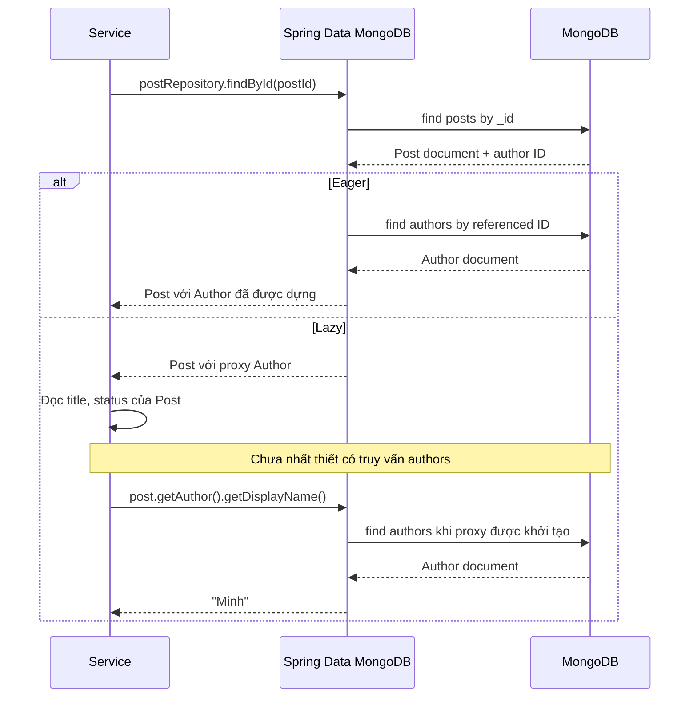
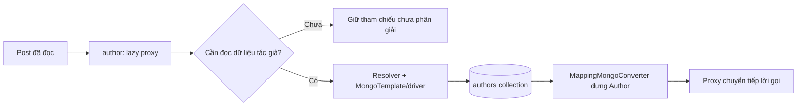

# Tải ngay, tải trì hoãn (lazy loading), proxy và vòng đời session

Một đơn hàng có thể tham chiếu khách hàng, một bài viết tham chiếu tác giả, và một dự án tham chiếu danh sách người tham gia. Với **Spring Data MongoDB**, chúng ta có thể lưu khóa định danh của đối tượng khác trong document rồi cho framework dựng lại đối tượng Java được tham chiếu. Việc **dựng đối tượng ngay lúc đọc cha** hay **trì hoãn đến khi ứng dụng sử dụng thuộc tính** ảnh hưởng trực tiếp đến số truy vấn, độ trễ, khả năng xử lý lỗi và ranh giới transaction.

Trong chương **Tham chiếu tài liệu**, bài này giải thích sự khác nhau giữa **eager loading** và **lazy loading**, vai trò của **proxy**, thời điểm MongoDB thực sự nhận lệnh, và điều gì xảy ra khi một đối tượng được truy cập sau khi session hoặc transaction đã kết thúc. Ví dụ dùng `MongoTemplate` và repository đồng bộ; cuối bài trình bày cách áp dụng cùng tư duy trong ứng dụng reactive.

## 1. Tham chiếu document là gì?

Giả sử collection `authors` chứa tác giả và collection `posts` chứa bài viết. Một bài có thể lưu ID tác giả thay vì nhúng toàn bộ thông tin tác giả:

```javascript
// authors
{
  _id: ObjectId("674000000000000000000101"),
  display_name: "Minh",
  bio: "Viết về Java và MongoDB"
}

// posts
{
  _id: ObjectId("674000000000000000000201"),
  title: "Giới thiệu Spring Data MongoDB",
  author: ObjectId("674000000000000000000101"),
  status: "PUBLISHED"
}
```

Document `posts` ở trên chỉ lưu **BSON ObjectId** trong trường `author`. Muốn đọc `display_name`, ứng dụng hoặc Spring Data phải truy vấn collection `authors`. MongoDB không tự tải document liên quan chỉ vì hai trường có giá trị ID khớp nhau, cũng không tự cung cấp khóa ngoại hoặc xóa cascade.

Ba lựa chọn thường gặp:

| Cách mô hình hóa | Dữ liệu lưu trong `posts.author` | Điều xảy ra khi đọc |
| --- | --- | --- |
| Nhúng `AuthorSnapshot` | Document lồng chứa tên, thông tin cần thiết | Dữ liệu có ngay trong một document; không truy vấn collection `authors` |
| Giữ `ObjectId authorId` | Một ID đơn thuần | Service chủ động gọi repository/template lấy tác giả khi cần |
| `@DBRef` hoặc `@DocumentReference` | DBRef hoặc giá trị tham chiếu theo cấu hình | Spring Data có thể tự phân giải đối tượng liên quan, ngay lập tức hoặc qua proxy |

Việc chọn tham chiếu thay vì nhúng phụ thuộc kích thước dữ liệu, tần suất đọc cùng nhau, số phần tử, vòng đời cập nhật và nhu cầu truy vấn từ hai phía. **Không có quy tắc mọi quan hệ Java đều phải dùng annotation tham chiếu.**

## 2. Eager loading và lazy loading khác nhau tại thời điểm nào?

Giả sử `Post` có thuộc tính Java `Author author`.

**Eager loading (tải ngay):** trong quá trình Spring Data đọc và ánh xạ `Post`, framework truy vấn để lấy `Author` liên quan. Sau khi `findById(...)` hoàn tất, đối tượng tham chiếu thường đã được phân giải.

**Lazy loading (tải trì hoãn):** khi ánh xạ `Post`, framework gán vào thuộc tính `author` một **proxy**. Đến lúc ứng dụng thực sự truy cập dữ liệu của tác giả, proxy mới yêu cầu resolver tải document đích.



Sơ đồ mô tả trường hợp **một tham chiếu đơn**. Số lệnh thực tế phụ thuộc annotation, cách gom tham chiếu, cache cục bộ, dữ liệu đã được tải và đường truy cập. Eager **không đồng nghĩa** một câu truy vấn MongoDB duy nhất, còn lazy **không đồng nghĩa** truy vấn được tối ưu thành JOIN ở server.

| Tiêu chí | Eager | Lazy |
| --- | --- | --- |
| Khi nào bắt đầu phân giải tham chiếu? | Trong luồng tải entity cha | Khi proxy được sử dụng theo cách cần dữ liệu đích |
| Đọc entity cha mà không dùng quan hệ | Có thể tốn I/O ngoài nhu cầu | Có thể tránh I/O cho quan hệ không dùng |
| Thời gian gọi `findById` | Có thể lớn hơn do phải lấy reference | Có thể nhỏ hơn, nhưng chi phí chuyển đến thời điểm truy cập |
| Khi reference không còn tồn tại | Vấn đề có thể lộ ra lúc đọc cha | Vấn đề có thể lộ ra khi proxy được khởi tạo |
| Dễ dự đoán số truy vấn | Dễ hơn nếu đồ thị quan hệ nhỏ | Có nguy cơ N+1 khi duyệt nhiều cha |
| Đối tượng sau khi rời service | Thường đã có dữ liệu tham chiếu | Có thể còn proxy chưa được giải và cần truy cập DB về sau |

## 3. Ví dụ với `@DocumentReference`

`@DocumentReference` là cơ chế tham chiếu document của Spring Data MongoDB. Ở cấu hình mặc định thông thường, thuộc tính tham chiếu được lưu bằng **ID của document đích**, và Spring Data tìm document đích bằng ID đó. Có thể định nghĩa lookup tùy chỉnh cho những trường hợp đặc biệt, nhưng cần bảo đảm giá trị lưu và điều kiện lookup khớp nhau.

### 3.1. Định nghĩa entity và repository

```java
import org.bson.types.ObjectId;
import org.springframework.data.annotation.Id;
import org.springframework.data.mongodb.core.mapping.Document;
import org.springframework.data.mongodb.core.mapping.Field;

@Document("authors")
public class Author {
    @Id
    private ObjectId id;

    @Field("display_name")
    private String displayName;

    private String bio;

    public Author() {}

    public Author(String displayName, String bio) {
        this.displayName = displayName;
        this.bio = bio;
    }

    public ObjectId getId() { return id; }
    public String getDisplayName() { return displayName; }
    public String getBio() { return bio; }
}
```

```java
import org.bson.types.ObjectId;
import org.springframework.data.annotation.Id;
import org.springframework.data.mongodb.core.mapping.Document;
import org.springframework.data.mongodb.core.mapping.DocumentReference;

@Document("posts")
public class Post {
    @Id
    private ObjectId id;

    private String title;
    private String status;

    @DocumentReference(lazy = true)
    private Author author;

    public Post() {}

    public Post(String title, String status, Author author) {
        this.title = title;
        this.status = status;
        this.author = author;
    }

    public ObjectId getId() { return id; }
    public String getTitle() { return title; }
    public String getStatus() { return status; }
    public Author getAuthor() { return author; }
}
```

```java
import org.bson.types.ObjectId;
import org.springframework.data.mongodb.repository.MongoRepository;

interface AuthorRepository extends MongoRepository<Author, ObjectId> {}
interface PostRepository extends MongoRepository<Post, ObjectId> {}
```

Đối tượng `Author` ở ví dụ này là một **document riêng**. Spring Data không tự lưu cascade một `Author` chưa tồn tại khi `Post` được lưu; phải tạo author trước, sau đó lưu post:

```java
Author author = authorRepository.save(
        new Author("Minh", "Viết về Java và MongoDB"));

Post created = postRepository.save(
        new Post("Giới thiệu Spring Data MongoDB", "PUBLISHED", author));
```

Với cách ánh xạ `@DocumentReference` mặc định, document `posts` lưu giá trị `author` tương ứng **ID** của `Author`, tương tự BSON minh họa ở mục 1. Lưu một `Post` có tham chiếu không mặc nhiên cập nhật các thay đổi khác của `Author`; muốn cập nhật tác giả phải lưu/cập nhật document `authors` bằng thao tác riêng.

### 3.2. Quan sát khác biệt khi tải

```java
Post loaded = postRepository.findById(created.getId())
        .orElseThrow();

String title = loaded.getTitle(); // Trường nằm trong document posts.
String name = loaded.getAuthor().getDisplayName();
```

Với `@DocumentReference(lazy = true)`, `loaded.getTitle()` không cần đọc `authors`. Việc gọi `getDisplayName()` trên proxy `Author` có thể kích hoạt truy vấn đến collection `authors`, rồi trả giá trị. Proxy thường giữ đối tượng đã phân giải cho lần sử dụng tiếp theo của **chính proxy đó**; đây không phải một lời hứa về cache dùng chung cho mọi entity hoặc request.

Để chuyển sang tải ngay, đổi cấu hình mapping của field thành:

```java
@DocumentReference(lazy = false)
private Author author;
```

`lazy = false` là chế độ mặc định của `@DocumentReference`. Lúc đó Spring Data cố gắng phân giải tác giả trong quá trình ánh xạ `Post`; thời điểm `findById` trả kết quả thường đã bao gồm chi phí này. **Chỉ chọn một cấu hình** trong entity thực tế; hai đoạn minh họa là các phương án thay thế.

## 4. So sánh với `@DBRef`

`@DBRef` là cách biểu diễn tham chiếu theo cấu trúc **MongoDB DBRef**, gồm tên collection và ID đích, có thể có database. Ví dụ:

```java
import org.springframework.data.mongodb.core.mapping.DBRef;

// Trong Post, thay annotation trên field author:
@DBRef(lazy = true)
private Author author;
```

Hình dạng BSON DBRef điển hình là:

```javascript
{
  _id: ObjectId("674000000000000000000201"),
  title: "Giới thiệu Spring Data MongoDB",
  author: {
    "$ref": "authors",
    "$id": ObjectId("674000000000000000000101")
  }
}
```

Trường `author` lúc này chứa **metadata tham chiếu**, không phải toàn bộ `Author`. `@DBRef` và `@DocumentReference` đều có tùy chọn `lazy`; cả hai có thể yêu cầu I/O bổ sung để phân giải giá trị liên quan. MongoDB Server không tự thực thi JOIN chỉ vì document chứa DBRef.

| Vấn đề | `@DBRef` | `@DocumentReference` |
| --- | --- | --- |
| Giá trị lưu mặc định | BSON DBRef với `$ref`, `$id` và có thể `$db` | Thường là ID của document đích |
| Định nghĩa đích | Từ metadata DBRef và mapping | Từ loại property, collection và lookup |
| Điều kiện lookup | Dựa trên tham chiếu DBRef | Mặc định theo ID; có thể cấu hình cách lookup |
| Lazy | `@DBRef(lazy = true)` | `@DocumentReference(lazy = true)` |
| Cascade save | Không tự động | Không tự động |
| Đọc hàng loạt | Có thể tối ưu khi các DBRef cùng collection, nhưng cần đo truy vấn | Cách resolver gom/tải phụ thuộc truy vấn, mapping và phiên bản |
| Tính toàn vẹn tham chiếu | Ứng dụng tự quản lý | Ứng dụng tự quản lý |

Không nên thay `@DBRef` thành `@DocumentReference` trên collection đang hoạt động mà chưa kiểm tra định dạng BSON đã lưu. Một bên thường lưu **DBRef**, bên kia thường lưu **ID thuần**; đổi annotation có thể khiến dữ liệu cũ không được phân giải đúng. Cần migration hoặc mapping tương thích được kiểm thử.

## 5. Proxy là gì và việc gì làm nó được khởi tạo?

**Proxy** là một đối tượng Java thay mặt cho đối tượng được tham chiếu. Tại thời điểm đọc `Post`, nó cho phép property `author` có kiểu phù hợp với mô hình Java mà chưa bắt buộc thực hiện truy vấn đích. Khi có thao tác cần dữ liệu thực, proxy nhờ thành phần resolver của Spring Data truy vấn và dựng `Author`.



Những điểm dễ gây hiểu nhầm:

1. **Có proxy không có nghĩa đã có dữ liệu đích.** Việc `Post` được trả thành công không chứng minh `Author` vẫn tồn tại trong database.
2. **Không phải chỉ có getter nghiệp vụ mới kích hoạt tải.** Debugger mở rộng object, gọi `toString()`, `equals()` hoặc `hashCode()`, logging và serializer có thể đụng tới proxy. Hành vi cụ thể tùy loại proxy và phương thức được gọi.
3. **Tạo proxy có giới hạn kỹ thuật.** Tùy kiểu property, framework có thể dùng cơ chế proxy dựa trên interface hoặc subclass. Class `final`, record, constructor khó truy cập hoặc module Java chặn reflective access có thể khiến lazy proxy không tạo được như mong muốn.
4. **Không có identity map toàn cục mặc định như một ORM SQL.** Hai document cha tham chiếu cùng tác giả có thể nhận hai proxy và phát sinh nhiều truy vấn khi chúng lần lượt được sử dụng.
5. **Lazy không phải cơ chế đồng bộ dữ liệu.** Một proxy đã tải tác giả không tự biết document `authors` vừa thay đổi từ request khác.

Đối với collection tham chiếu, khai báo theo **interface** như `List<Author>` thường thuận lợi hơn khai báo cứng `ArrayList<Author>`: proxy có thể không thay thế được một concrete collection class bị hạn chế khởi tạo hoặc truy cập reflection. Trên một số cấu hình Java mới với strong encapsulation, việc tạo proxy cho lớp thư viện Java có thể báo lỗi truy cập; ưu tiên sửa kiểu khai báo và thiết kế mapping trước khi cân nhắc tùy chọn JVM mở module.

Đối với quan hệ phải trả qua REST API, **không nên đưa nguyên entity chứa lazy proxy vào JSON serializer**. Serializer có thể tự kích hoạt truy vấn ngoài ý muốn, kéo dài response, gây N+1 hoặc vướng vòng tham chiếu giữa các entity. Tạo DTO có đúng dữ liệu API cần và phân giải tham chiếu tại service là cách kiểm soát rõ ràng hơn.

## 6. Vòng đời MongoClient, ClientSession và transaction

Cụm từ “session đã đóng nên lazy loading thất bại” thường được biết đến từ các ORM như JPA/Hibernate. Với Spring Data MongoDB, cần phân biệt **MongoClient**, **MongoDB ClientSession** và **transaction context** thay vì áp dụng nguyên xi mô hình persistence context của JPA.

### 6.1. MongoClient và vòng đời truy cập dữ liệu

`MongoClient` là thành phần giữ cấu hình kết nối và quản lý connection pool. Trong ứng dụng Spring Boot, client thường là bean sống suốt vòng đời ứng dụng và được chia sẻ giữa các thao tác. Lazy proxy cần khả năng tiếp cận hạ tầng truy vấn **ở thời điểm thực sự phân giải**.

Nếu client đã bị đóng, bean/factory bị hủy hoặc context không còn dùng được, truy vấn phát sinh từ proxy có thể thất bại. Ngược lại, việc phương thức service kết thúc **không tự động đồng nghĩa lazy proxy không thể tải nữa**: nếu hạ tầng còn sống, nó vẫn có thể truy vấn ở một thời điểm muộn hơn, nhưng thao tác đó không nhất thiết nằm trong session/transaction ban đầu.

### 6.2. ClientSession và transaction dùng để làm gì?

MongoDB `ClientSession` mang ngữ cảnh phiên làm việc cho những tính năng như transaction và causal consistency khi được cấu hình. Trong Spring Data MongoDB đồng bộ, `MongoTransactionManager` có thể gắn session/transaction với luồng công việc đang thực thi thông qua cơ chế Spring. Với reactive, `ReactiveMongoTransactionManager` gắn ngữ cảnh transaction vào chuỗi Reactor.

Khi một lazy proxy được giải **sau** ranh giới transaction:

- Không được giả định truy vấn tham chiếu vẫn thuộc transaction vừa hoàn tất.
- Nếu hạ tầng còn mở, truy vấn có thể thực thi bằng ngữ cảnh khác và thấy trạng thái dữ liệu mới hơn hoặc khác so với lúc đọc entity cha.
- Nếu logic resolver phụ thuộc một session đã đóng hoặc context bị giải phóng, lần phân giải có thể lỗi.
- Việc session/transaction hoàn tất không biến một proxy chưa tải thành một bản snapshot bất biến.

### 6.3. Chủ động phân giải trong ranh giới nghiệp vụ

Nếu một API cần đồng thời thông tin bài viết và tác giả, hãy lấy cả hai khi còn ở tầng service và có ranh giới truy cập dữ liệu rõ ràng:

```java
public record PostDetail(String id, String title, String authorName) {}

class PostDetailService {
    private final PostRepository posts;

    PostDetailService(PostRepository posts) {
        this.posts = posts;
    }

    PostDetail findDetail(ObjectId postId) {
        Post post = posts.findById(postId).orElseThrow();

        // Truy cập property ở đây để chủ động phân giải nếu đang lazy.
        String authorName = post.getAuthor().getDisplayName();

        return new PostDetail(
                post.getId().toHexString(), post.getTitle(), authorName);
    }
}
```

DTO trả về chỉ gồm giá trị đã xác định; tầng JSON không cần biết `Author` là proxy hay entity thật. Đoạn code sử dụng `ObjectId` từ ví dụ trước và có thể bổ sung exception nghiệp vụ cho post/author không tồn tại.

Khi **nghiệp vụ yêu cầu một snapshot nhất quán trên nhiều document**, phải thiết kế transaction rõ ràng với `MongoTransactionManager`, `MongoDatabaseFactory` và hạ tầng MongoDB hỗ trợ (replica set hoặc sharded cluster phù hợp). Ví dụ:

```java
import org.springframework.transaction.annotation.Transactional;

@Transactional(readOnly = true)
public PostDetail loadForConsistentBusinessRead(ObjectId postId) {
    Post post = posts.findById(postId).orElseThrow();
    String authorName = post.getAuthor().getDisplayName();
    return new PostDetail(
        post.getId().toHexString(), post.getTitle(), authorName);
}
```

Đây là **minh họa phương thức trong một Spring service đã cấu hình transaction manager**, không phải mã có thể tự tạo transaction chỉ nhờ annotation. Phải kiểm tra read concern/transaction options theo yêu cầu nhất quán thực tế. Không nên mở transaction đa document chỉ để khắc phục cách serialize lazy proxy ở một API thông thường; có thể đọc rõ ràng theo lô hoặc dùng aggregation.

### 6.4. Vòng đời của một document đã rời transaction

Ngay cả khi object `Post` được giữ trong cache hoặc truyền sang thread khác, reference lazy cũng không được bảo đảm tự cập nhật, tự gắn vào session mới hay mang theo quyền truy cập của request trước. Phân quyền cần được kiểm tra ở service/API theo user, tenant và mục đích truy vấn, không mặc nhiên suy ra từ việc proxy tồn tại. Tránh lưu proxy chưa khởi tạo vào session HTTP, queue hoặc DTO rồi dựa vào một transaction cũ để phân giải ở nơi khác.

## 7. N+1 query và chi phí truy cập khi duyệt danh sách

Giả sử cần trả về 100 bài viết cùng tên tác giả:

```java
List<Post> posts = postRepository.findAll();
for (Post post : posts) {
    System.out.println(post.getAuthor().getDisplayName());
}
```

Với lazy reference, một truy vấn lấy `posts` có thể kéo theo nhiều truy vấn đọc `authors` khi từng proxy được sử dụng: trường hợp **N+1**. Eager cũng không tự bảo đảm một truy vấn: chi phí có thể chỉ chuyển từ vòng lặp sang giai đoạn ánh xạ. Số command thực tế phụ thuộc chiến lược phân giải, gom tham chiếu cùng collection, cache và phiên bản Spring Data.

Nếu mỗi post có `m` tham chiếu và service đọc `n` post, số lần I/O do tham chiếu có thể tăng theo kích thước đồ thị dữ liệu. Truy vấn nhanh ở môi trường thử nghiệm 10 post có thể không còn phù hợp với 10.000 post.

### Phương án A: chỉ lấy dữ liệu thực sự cần

Nếu màn hình danh sách chỉ hiển thị title và status, trả về DTO/projection của hai thuộc tính đó thay vì truy cập `author`. Lazy phù hợp khi phần lớn request **không cần** quan hệ này.

### Phương án B: lưu ID tường minh và truy vấn theo lô

Với API luôn cần danh sách tác giả, một read model chứa `authorId` có thể đơn giản hơn tự phân giải từng proxy:

```java
import org.bson.types.ObjectId;
import org.springframework.data.annotation.Id;
import org.springframework.data.mongodb.core.mapping.Document;
import org.springframework.data.mongodb.core.mapping.Field;

// Read model dùng cho document posts lưu author dạng ObjectId thuần.
@Document("posts")
class PostListRecord {
    @Id
    private ObjectId id;
    private String title;

    @Field("author")
    private ObjectId authorId;

    public ObjectId getId() { return id; }
    public String getTitle() { return title; }
    public ObjectId getAuthorId() { return authorId; }
}
```

Thao tác theo lô (trong service đã inject `MongoTemplate`):

```java
import java.util.List;
import java.util.Map;
import java.util.function.Function;
import java.util.stream.Collectors;
import org.springframework.data.mongodb.core.query.Criteria;
import org.springframework.data.mongodb.core.query.Query;

List<PostListRecord> page = mongoTemplate.find(
    Query.query(Criteria.where("status").is("PUBLISHED")).limit(20),
    PostListRecord.class);

List<ObjectId> authorIds = page.stream()
    .map(PostListRecord::getAuthorId)
    .filter(java.util.Objects::nonNull)
    .distinct()
    .toList();

List<Author> authors = authorIds.isEmpty() ? List.of() :
    mongoTemplate.find(
        Query.query(Criteria.where("id").in(authorIds)),
        Author.class);

Map<ObjectId, Author> authorsById = authors.stream()
    .collect(Collectors.toMap(Author::getId, Function.identity()));
```

Với dữ liệu mặc định của `@DocumentReference`, `posts.author` là BSON ObjectId nên `PostListRecord` đọc được mà không cần resolver. Đây là **read model cho truy vấn**, không nên dùng để ghi đè document `posts` vì nó thiếu các field khác. Sau khi có map theo ID, xây DTO bằng cách ghép hai tập kết quả, xử lý rõ trường hợp tác giả đã bị xóa. Cần xét giới hạn kích thước `$in` và phân trang thay vì gom một lượng ID vô hạn.

### Phương án C: dùng MongoDB aggregation `$lookup`

Với `@DocumentReference` lưu ID thuần, MongoDB có thể ghép dữ liệu phía server:

```javascript
db.posts.aggregate([
  { $match: { status: "PUBLISHED" } },
  { $limit: 20 },
  {
    $lookup: {
      from: "authors",
      localField: "author",
      foreignField: "_id",
      as: "author_data"
    }
  },
  {
    $unwind: {
      path: "$author_data",
      preserveNullAndEmptyArrays: true
    }
  },
  {
    $project: {
      title: 1,
      authorName: "$author_data.display_name"
    }
  }
]);
```

`$lookup` là phép nối dữ liệu thực hiện ở server, **khác với cơ chế lazy proxy phía Java**. Kiểu BSON của `posts.author` và `authors._id` phải tương thích. Khi dùng `@DBRef`, trường lưu là DBRef thay vì ObjectId thuần nên đường dẫn join khác; cần kiểm tra BSON thật trước khi sao chép pipeline. Cần thiết kế index cho `$match` và kiểm tra `explain("executionStats")` để đánh giá chi phí.

## 8. Lazy loading và JSON serialization

Một controller trả thẳng entity có thể gây truy vấn ngoài dự kiến:

```java
// Không nên dùng trực tiếp trong API khi entity có lazy reference:
@GetMapping("/posts/{id}")
Post getPost(@PathVariable ObjectId id) {
    return postRepository.findById(id).orElseThrow();
}
```

Nếu Jackson truy cập `getAuthor()` và các getter của `Author` để dựng JSON, proxy có thể được phân giải ở giai đoạn serialize response; lỗi truy cập MongoDB lúc này xảy ra **sau** khi service đã trả về. Quan hệ hai chiều còn có nguy cơ đệ quy vô hạn trong JSON.

Phương án rõ ràng hơn:

```java
@GetMapping("/posts/{id}")
PostDetail getPostDetail(@PathVariable ObjectId id) {
    return postDetailService.findDetail(id);
}
```

Khi dựng `PostDetail` ngay trong service, ứng dụng kiểm soát chính xác trường nào cần tải và thời điểm truy vấn. Nếu muốn trả dữ liệu gọn hơn chỉ gồm ID tác giả, hãy xây DTO chỉ chứa `authorId` và không gọi các getter của lazy proxy.

## 9. Reference bị thiếu, thay đổi hoặc xóa

MongoDB không kiểm tra khóa ngoại giữa hai collection. Tình huống sau có thể xảy ra:

1. Service đọc một `Post` có `author` trỏ đến ID `A`.
2. Document `authors._id = A` bị xóa hoặc thay đổi trước lúc lazy proxy được sử dụng.
3. Khi proxy cần phân giải, resolver không tìm được bản ghi hoặc đọc trạng thái mới khác với lúc tải post.

Đừng dựa vào một hành vi mặc định duy nhất cho mọi kiểu reference và phiên bản (ví dụ luôn trả `null` hoặc luôn ném exception). Hãy kiểm thử cách resolver, cách biểu diễn quan hệ tùy chọn, và quy định cách service xử lý **tham chiếu mồ côi**. Nếu quan hệ là bắt buộc, có thể trả lỗi nghiệp vụ rõ ràng hoặc kiểm tra toàn vẹn khi ghi; nếu không bắt buộc, DTO có thể cho phép `authorName = null`.

Đổi `Author.displayName` không tự làm một proxy đã được khởi tạo trong Java cập nhật giá trị. Muốn dữ liệu mới, cần đọc lại theo chiến lược phù hợp. Xóa `Author` cũng không tự cascade đến `Post` trừ khi ứng dụng chủ động xây dựng quy trình xóa hoặc transaction tương ứng.

## 10. Kiểm thử eager, lazy và vòng đời truy cập

Một integration test cần có MongoDB thực trong môi trường cô lập, ví dụ Testcontainers. Test dưới đây xác nhận association được đọc đúng khi sử dụng `@DocumentReference(lazy = true)`:

```java
import static org.assertj.core.api.Assertions.assertThat;

import org.junit.jupiter.api.Test;
import org.springframework.beans.factory.annotation.Autowired;
import org.springframework.boot.test.autoconfigure.data.mongo.DataMongoTest;

@DataMongoTest
class PostReferenceTest {
    @Autowired AuthorRepository authors;
    @Autowired PostRepository posts;

    @Test
    void shouldResolveAuthorWhenAccessingReference() {
        Author author = authors.save(new Author("Minh", "Java và MongoDB"));
        Post saved = posts.save(new Post("Chủ đề tham chiếu",
                "PUBLISHED", author));

        Post loaded = posts.findById(saved.getId()).orElseThrow();

        assertThat(loaded.getTitle()).isEqualTo("Chủ đề tham chiếu");
        assertThat(loaded.getAuthor().getDisplayName()).isEqualTo("Minh");
    }
}
```

Test trên chứng minh đọc được quan hệ nhưng **chưa chứng minh thời điểm** truy vấn `authors`. Muốn khẳng định lazy, hãy sử dụng command monitoring của MongoDB Driver hoặc bộ đếm lệnh trong môi trường test: đếm lệnh `find` nhắm vào collection `authors` **sau** khi đã lấy `Post`, rồi gọi `getAuthor().getDisplayName()` và so sánh. Tránh gọi `toString()`, mở proxy trong debugger hoặc serialize entity giữa hai mốc đo vì chúng có thể chủ động giải reference.

Các trường hợp quan trọng:

| Kiểm thử | Điều cần xác minh |
| --- | --- |
| Eager với document tham chiếu tồn tại | Relation được phân giải trong luồng tải cha; số lệnh thực tế |
| Lazy với chỉ đọc title | Không tự phát sinh truy vấn `authors` do test vô tình truy cập proxy |
| Lazy sau khi gọi getter của author | Có truy vấn phân giải và nhận đúng dữ liệu |
| Author bị xóa trước lúc giải proxy | Quy tắc lỗi/giá trị thiếu được ứng dụng xử lý rõ |
| Duyệt danh sách nhiều posts | Phát hiện N+1 và đo số command |
| Gọi proxy sau ranh giới transaction | Kiểm chứng session/transaction thực tế, trạng thái dữ liệu và lỗi khi hạ tầng đóng |
| JSON response | Không truy vấn ngầm hoặc trả graph object quá lớn ngoài hợp đồng |
| Dữ liệu cũ có DBRef | Không nhầm dạng DBRef với ObjectId thuần sau khi đổi annotation |

Với transaction, cần MongoDB topology hỗ trợ (replica set hoặc sharded cluster được cấu hình phù hợp). Test tự đóng `MongoClient` của cả Spring context chỉ để xem proxy lỗi có thể gây ảnh hưởng sang test khác; tốt hơn dùng client/context cô lập. Không dùng mock repository để kết luận proxy Spring Data có hoạt động đúng, vì mock không tái hiện cơ chế resolver thực.

## 11. Reactive MongoDB: giữ truy vấn trong publisher chain

Trong ứng dụng reactive, nguyên tắc tránh I/O bất ngờ còn quan trọng hơn. Thay vì để một đối tượng lazy tự truy vấn khi serializer hoặc thread khác chạm vào nó, có thể lưu ID tham chiếu tường minh và kết hợp các truy vấn bằng `Mono`/`Flux`.

Ví dụ dùng read model `PostListRecord` với `authorId`:

```java
import org.bson.types.ObjectId;
import reactor.core.publisher.Mono;

Mono<PostDetail> loadDetail(
        ObjectId postId,
        ReactivePostListRepository posts,
        ReactiveAuthorRepository authors) {
    return posts.findById(postId)
        .flatMap(post -> authors.findById(post.getAuthorId())
            .map(author -> new PostDetail(
                post.getId().toHexString(),
                post.getTitle(),
                author.getDisplayName())));
}
```

Ở đây `ReactivePostListRepository` và `ReactiveAuthorRepository` là hai `ReactiveMongoRepository` cần khai báo theo entity/ID tương ứng. `PostListRecord` ánh xạ `author` thành `authorId` như mục 7. Khi một tham chiếu thiếu, publisher phía trong có thể kết thúc rỗng; service cần dùng `switchIfEmpty` nếu nghiệp vụ yêu cầu lỗi rõ ràng. Cách ghép `flatMap` bảo đảm truy vấn tác giả nằm trong cùng reactive chain, dễ kiểm soát subscription, lỗi và transaction context.

`ReactiveMongoTransactionManager` duy trì ngữ cảnh qua Reactor Context; không thể giả định một tham chiếu được phân giải muộn bên ngoài chain sẽ tự tham gia transaction ban đầu. Cơ chế hỗ trợ reference và lazy proxy có thể khác nhau giữa đường sync/reactive và phiên bản Spring Data; ưu tiên các thao tác reactive tường minh cho quan hệ quan trọng, rồi kiểm thử trên driver thực tế.

## 12. Hướng dẫn lựa chọn và lỗi thường gặp

| Nhu cầu | Phương án nên cân nhắc | Lý do |
| --- | --- | --- |
| Cần cả post và tác giả trên phần lớn request chi tiết | Eager với graph nhỏ hoặc truy vấn theo lô/DTO | Không đẩy I/O bất ngờ sang serializer |
| Chỉ đôi khi cần tác giả khi đọc post | Lazy trên quan hệ nhỏ, kiểm soát nơi sử dụng | Tránh tải reference không cần thiết |
| Trang danh sách nhiều nghìn posts | Projection + batch query hoặc `$lookup` | Giảm nguy cơ N+1 |
| Cần truy vấn ở cả hai phía, quan hệ lớn | Lưu ID tường minh và index thích hợp | Dễ phân trang, đo truy vấn và giữ vòng đời rõ |
| Phải xử lý nhiều document trong một transaction | Tải dữ liệu cần dùng trong ranh giới transaction | Bảo đảm câu truy vấn tham gia ngữ cảnh mong muốn |
| API HTTP trả dữ liệu cho frontend | DTO sau khi đã phân giải ở service | Hạn chế proxy leak và vòng tham chiếu JSON |
| Cần dùng reactive end-to-end | Kết hợp các repository/reactive template trong `Mono`/`Flux` | Kiểm soát subscription và Reactor Context |

Những lỗi dễ gặp nhất là đánh đồng lazy với miễn phí truy vấn, giả định `@DBRef` tự tạo JOIN, serialize entity chứa proxy, đưa proxy chưa giải sang transaction khác, hoặc nhầm thao tác `save(parent)` sẽ tự lưu entity được tham chiếu. Khi chẩn đoán, hãy xác định rõ **document BSON đang lưu gì**, **annotation nào được dùng**, **truy vấn nào xảy ra tại mốc nào**, và **lúc đó client/session/transaction có còn hợp lệ không**.

## 13. Tự kiểm tra

**Tình huống A.** `Post.author` khai báo `@DocumentReference(lazy = true)`. Service chỉ lấy `post.getTitle()`. Có chắc cần truy vấn `authors`? **Không**: thông thường chưa cần phân giải `author`; nhưng log/debugger/serializer có thể kích hoạt nếu chạm proxy.

**Tình huống B.** Một service tải 200 post rồi duyệt `post.getAuthor().getDisplayName()`. Phần chậm nằm ở đâu? **Có thể ở các truy vấn phân giải tham chiếu bổ sung**. Hãy đo command count và cân nhắc batch query hoặc aggregation.

**Tình huống C.** Một proxy lazy được sử dụng sau khi `@Transactional` kết thúc. Có luôn ném lỗi giống JPA `LazyInitializationException` không? **Không thể kết luận như vậy.** Spring Data MongoDB không có cùng mô hình persistence context của JPA; nếu hạ tầng còn sống, có thể phát sinh truy vấn mới, nhưng không mặc nhiên thuộc transaction ban đầu. Nếu client/session cần thiết đã đóng, có thể lỗi.

**Tình huống D.** Đổi `@DBRef(lazy = true)` sang `@DocumentReference(lazy = true)` mà không chuyển dữ liệu cũ. Có an toàn không? **Không nên giả định** vì cấu trúc BSON của DBRef và tham chiếu ID thuần khác nhau; cần thử readback và migration.

**Tình huống E.** Sau khi `postRepository.save(post)`, `Author` mới chưa từng lưu có chắc xuất hiện trong `authors`? **Không**: Spring Data MongoDB không tự cascade save thông thường cho association reference.

**Tình huống F.** Vì sao trả trực tiếp `Post` từ REST controller có thể làm tăng độ trễ? **Serializer có thể truy cập lazy reference**, khởi động thêm truy vấn ngoài phạm vi service và có nguy cơ serialize cả graph không mong muốn.

Với Spring Data MongoDB, **eager** quyết định phân giải reference trong lúc đọc entity, còn **lazy** dời việc đó tới lúc sử dụng thông qua **proxy**. Độ trễ chỉ được dời, không biến mất. Hiểu ranh giới của `MongoClient`, `ClientSession`, transaction và cơ chế resolver sẽ giúp thiết kế tham chiếu nhất quán, chọn thời điểm tải phù hợp và kiểm soát hiệu năng trước khi đưa dữ liệu ra ngoài service.
