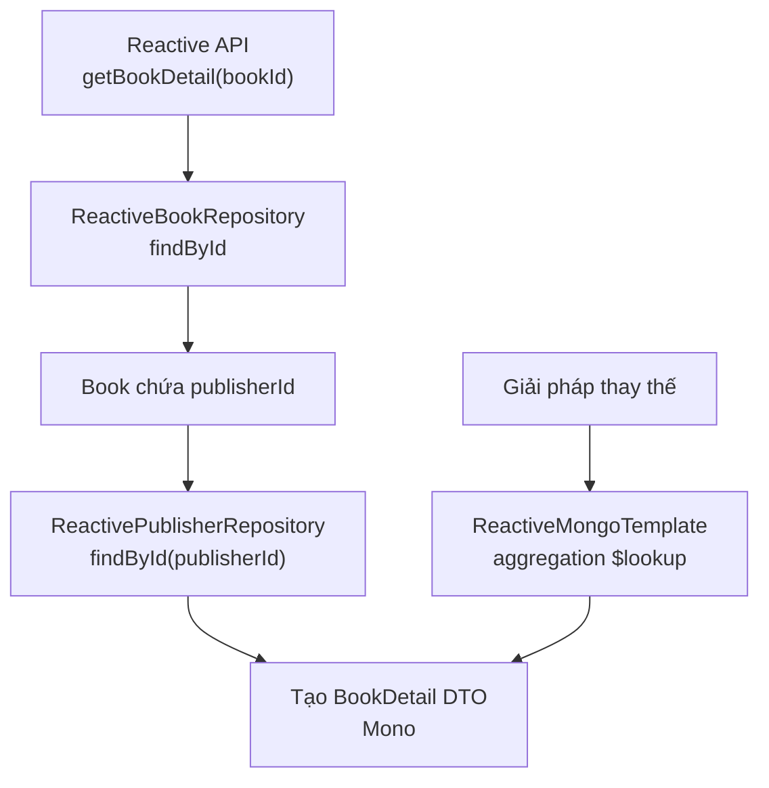

# Giới hạn tham chiếu trong reactive và truy vấn suy diễn

## 1. Vì sao tham chiếu trở thành vấn đề khi truy vấn reactive?

Trong MongoDB, dữ liệu thường được tổ chức thành **document** nằm trong **collection**. Với Spring Data MongoDB, ứng dụng Java có thể ánh xạ document thành entity và truy cập bằng `MongoTemplate` hoặc repository. Khi một đối tượng nghiệp vụ cần dùng dữ liệu của đối tượng khác, lập trình viên phải quyết định **nhúng dữ liệu**, **lưu tham chiếu**, hoặc **thực hiện truy vấn kết hợp**.

Ví dụ, một cuốn sách (`Book`) thuộc một nhà xuất bản (`Publisher`). Nhà xuất bản có thể được nhiều cuốn sách sử dụng, có vòng đời riêng và thường được cập nhật độc lập. Nếu lưu sách và nhà xuất bản trong hai collection, một document sách có thể chỉ lưu `publisher_id`:

```javascript
// Collection: books
{
  _id: "BOOK-1001",
  title: "Nhập môn Spring Data MongoDB",
  language: "vi",
  publisher_id: "PUB-01"
}

// Collection: publishers
{
  _id: "PUB-01",
  name: "Nhà xuất bản Ví dụ",
  country: "VN"
}
```

Trong bài này, có hai giới hạn cần hiểu rõ:

1. **Reactive reference resolution:** tài liệu Spring Data MongoDB nêu rõ hạ tầng reactive không hỗ trợ đọc và tự giải quyết các document reference được khai báo theo cơ chế mapping như `@DBRef`/`@DocumentReference`. Ứng dụng reactive nên tổ chức việc tải dữ liệu liên quan một cách tường minh.
2. **Derived queries:** phương thức suy diễn như `findByPublisherId(...)` tạo điều kiện trên các field của document đang được truy vấn. Nó **không tự join** sang collection `publishers` để lọc theo `Publisher.name`.

Hiểu đúng hai điểm này giúp tránh xây dựng repository trông có vẻ hợp lý nhưng không thực thi đúng ý định, đồng thời tránh các lần truy vấn thừa, dữ liệu tham chiếu bị thiếu hoặc việc chặn luồng trong ứng dụng reactive.

## 2. Ba cách biểu diễn liên kết giữa các document

Để không nhầm một **tham chiếu do ứng dụng tự quản lý** với **tham chiếu được Spring Data tự resolve**, hãy so sánh:

| Cách lưu | Ví dụ field trong BSON của `books` | Cách đọc dữ liệu liên quan | Lưu ý trong reactive |
| --- | --- | --- | --- |
| **ID tường minh** | `publisher_id: "PUB-01"` | Ứng dụng đọc `Publisher` bằng một truy vấn khác hoặc `$lookup` | Thích hợp cho `ReactiveMongoRepository` và `ReactiveMongoTemplate` |
| **`@DBRef`** | `publisher: DBRef("publishers", "PUB-01")`, tương ứng cấu trúc `$ref`/`$id` | Mapping trong luồng đồng bộ giải quyết reference | Không dựa vào tự resolve khi dùng hạ tầng reactive |
| **`@DocumentReference`** | Mặc định lưu pointer, thường chỉ là giá trị ID `publisher: "PUB-01"` | Mapping trong luồng đồng bộ dùng `lookup` để tìm document đích | Không dựa vào tự resolve khi dùng hạ tầng reactive |
| **Nhúng** | `publisher: { name: "...", country: "VN" }` | Đọc ngay cùng document sách | Phù hợp khi chỉ cần snapshot và dữ liệu nhỏ, nhưng cần chính sách đồng bộ |

### `@DBRef` là gì?

`@DBRef` đánh dấu property trong entity đồng bộ để lưu một **MongoDB DBRef** theo định dạng reference quy ước. Trên BSON, DBRef thường gồm tên collection (`$ref`), ID (`$id`) và có thể có database (`$db`). Khi dùng mapping đồng bộ, framework có thể resolve DBRef về object liên quan, eager hoặc lazy theo cấu hình.

Ví dụ minh họa **cho nhánh mapping đồng bộ**:

```java
import org.springframework.data.mongodb.core.mapping.DBRef;

@DBRef(lazy = true)
private Publisher publisher;
```

`lazy = true` chỉ làm chậm thời điểm nạp trong cách sử dụng có hỗ trợ proxy; không biến DBRef thành một luồng reactive và không loại bỏ truy vấn bổ sung khi dữ liệu được truy cập.

### `@DocumentReference` khác thế nào?

`@DocumentReference` cho phép lưu pointer theo nhiều dạng, thông dụng nhất là giá trị ID của document đích. Khi đọc trong hạ tầng mapping đồng bộ, Spring Data thực hiện truy vấn tới collection đích bằng quy tắc `lookup`; có thể cấu hình `lookup` tùy biến khi không liên kết theo `_id`.

```java
import org.springframework.data.mongodb.core.mapping.DocumentReference;

@DocumentReference
private Publisher publisher;
```

Với cấu hình mặc định, trường `publisher` thường lưu một ID BSON, **không phải toàn bộ document Publisher**, và không giống cấu trúc DBRef. `@DocumentReference` cũng **không tự cascade save**: khi sửa publisher, ứng dụng phải lưu publisher một cách riêng biệt.

Các đoạn annotation ở mục này nhằm so sánh cơ chế **đồng bộ**. Phần thực hành reactive bên dưới sử dụng **field ID tường minh**, không đặt hai annotation trên entity reactive.

## 3. Giới hạn cần ghi nhớ của hạ tầng reactive

Spring Data MongoDB cung cấp `ReactiveMongoRepository` và `ReactiveMongoTemplate` để làm việc với driver reactive, thường trả về `Mono<T>` hoặc `Flux<T>`. Dữ liệu chỉ được truy xuất khi luồng được subscribe, và các bước truy vấn được ghép bằng toán tử của Reactor.

Trong phần *Using Document References* của tài liệu Spring Data MongoDB, giới hạn được nêu rõ: **không hỗ trợ đọc document references bằng reactive infrastructure**. Do đó, không nên viết code reactive với kỳ vọng:

```java
// Ví dụ KHÔNG dùng làm hợp đồng tự resolve tham chiếu trong reactive.
@DocumentReference(lazy = true)
private Publisher publisher;
```

rồi cho rằng khi gọi `reactiveBookRepository.findById(...)`, trường `publisher` sẽ tự được nạp bằng một chuỗi truy vấn reactive. Điều đó không phải khả năng mà tài liệu bảo đảm.

Mô hình an toàn, dễ quan sát là:

- Lưu `publisherId` (đồng nhất với giá trị `_id` của Publisher) trong `Book`.
- Truy vấn sách bằng `ReactiveBookRepository`.
- Khi cần chi tiết nhà xuất bản, dùng `ReactivePublisherRepository` hoặc `ReactiveMongoTemplate` để đọc tường minh.
- Dùng `flatMap`, `zip`, `collectList` và các toán tử Reactor để ghép dữ liệu, hoặc dùng pipeline MongoDB `$lookup` cho trường hợp cần join ở database.



**Không gọi `block()` hoặc dùng `MongoTemplate` đồng bộ trực tiếp trong pipeline xử lý request reactive** như một cách “resolve reference nhanh”. Việc chặn luồng có thể làm giảm khả năng xử lý đồng thời và gây lỗi khi chạy trên các thread không cho phép blocking. Nếu phải tích hợp thư viện blocking vì lý do bất khả kháng, cần thiết kế riêng scheduler và giới hạn tải; đó không phải giải pháp mặc định cho tham chiếu MongoDB.

## 4. Mô hình dữ liệu thực hành dùng ID tường minh

Ta tiếp tục ví dụ sách – nhà xuất bản. Chọn **ID dạng BSON String** có định dạng `BOOK-1001` và `PUB-01` để dễ đọc, với `@MongoId(FieldType.STRING)` để tránh sự nhầm lẫn giữa String ID và ObjectId.

### `Publisher.java`

```java
package com.example.library;

import org.springframework.data.mongodb.core.mapping.Document;
import org.springframework.data.mongodb.core.mapping.FieldType;
import org.springframework.data.mongodb.core.mapping.MongoId;

@Document(collection = "publishers")
public class Publisher {

    @MongoId(FieldType.STRING)
    private String id;
    private String name;
    private String country;

    protected Publisher() {}

    public Publisher(String id, String name, String country) {
        this.id = id;
        this.name = name;
        this.country = country;
    }

    public String getId() { return id; }
    public String getName() { return name; }
    public String getCountry() { return country; }
}
```

### `Book.java`

```java
package com.example.library;

import org.springframework.data.mongodb.core.mapping.Document;
import org.springframework.data.mongodb.core.mapping.Field;
import org.springframework.data.mongodb.core.mapping.FieldType;
import org.springframework.data.mongodb.core.mapping.MongoId;

@Document(collection = "books")
public class Book {

    @MongoId(FieldType.STRING)
    private String id;
    private String title;
    private String language;

    @Field("publisher_id")
    private String publisherId;

    protected Book() {}

    public Book(String id, String title, String language, String publisherId) {
        this.id = id;
        this.title = title;
        this.language = language;
        this.publisherId = publisherId;
    }

    public String getId() { return id; }
    public String getTitle() { return title; }
    public String getLanguage() { return language; }
    public String getPublisherId() { return publisherId; }
}
```

Property `publisherId` chỉ lưu khóa tham chiếu. Spring Data không tìm thêm Publisher khi ánh xạ Book, nên entity hoạt động như một document thông thường trong truy cập reactive. Annotation `@Field("publisher_id")` chỉ định tên BSON của field; derived query trên entity dùng property Java `publisherId`.

### Dữ liệu mẫu trong `mongosh`

```javascript
use library_reactive_demo

db.publishers.insertMany([
  { _id: "PUB-01", name: "Nhà xuất bản Ví dụ", country: "VN" },
  { _id: "PUB-02", name: "Open Books", country: "SG" }
])

db.books.insertMany([
  {
    _id: "BOOK-1001",
    title: "Nhập môn Spring Data MongoDB",
    language: "vi",
    publisher_id: "PUB-01"
  },
  {
    _id: "BOOK-1002",
    title: "Reactive MongoDB thực hành",
    language: "vi",
    publisher_id: "PUB-01"
  },
  {
    _id: "BOOK-1003",
    title: "Data Access Patterns",
    language: "en",
    publisher_id: "PUB-02"
  }
])
```

Chỉ chạy các lệnh `insertMany` trên database thực hành còn trống, vì chạy lại với cùng `_id` sẽ gây lỗi duplicate key. Để ứng dụng kết nối đúng database, với Spring Boot 3.x có thể cấu hình `spring.data.mongodb.uri=mongodb://localhost:27017/library_reactive_demo` và starter `spring-boot-starter-data-mongodb-reactive`. Tên dependency hoặc property có thể khác theo thế hệ Spring Boot; hãy kiểm tra bản framework của dự án trước khi áp dụng ví dụ.

## 5. Truy vấn suy diễn thực sự truy vấn điều gì?

Spring Data repository hỗ trợ **query derivation**: diễn giải tên phương thức từ các property của entity và dựng điều kiện MongoDB. Điều này không tương đương truy vấn quan hệ của ORM.

```java
package com.example.library;

import java.util.Collection;
import reactor.core.publisher.Flux;
import org.springframework.data.mongodb.repository.ReactiveMongoRepository;

public interface ReactiveBookRepository
        extends ReactiveMongoRepository<Book, String> {

    Flux<Book> findByPublisherId(String publisherId);

    Flux<Book> findByPublisherIdIn(Collection<String> publisherIds);

    Flux<Book> findByLanguageOrderByTitleAsc(String language);

    Flux<Book> findByPublisherIdAndLanguageOrderByTitleAsc(
        String publisherId, String language);
}
```

```java
package com.example.library;

import reactor.core.publisher.Flux;
import org.springframework.data.mongodb.repository.ReactiveMongoRepository;

public interface ReactivePublisherRepository
        extends ReactiveMongoRepository<Publisher, String> {

    Flux<Publisher> findByName(String name);
}
```

Ở ví dụ này, `findByPublisherId("PUB-01")` tương ứng với truy vấn trên collection `books`:

```javascript
db.books.find({ publisher_id: "PUB-01" })
```

Tương tự, `findByPublisherIdAndLanguageOrderByTitleAsc(...)` lọc theo `publisher_id` và `language`, rồi sắp xếp `title` trong **books**. Cả hai không cần đọc collection `publishers` vì toàn bộ field cần lọc đều có sẵn trong document sách.

### Những điều phương thức suy diễn không tự làm

Giả sử yêu cầu là “tìm sách có **tên nhà xuất bản** bằng `Nhà xuất bản Ví dụ`”. Collection `books` chỉ có `publisher_id`, không có `publisher.name`. Vì vậy:

- Không thể đổi `findByPublisherId` thành `findByPublisherName` rồi mong nó tự chuyển sang truy vấn collection `publishers`.
- Nếu entity `Book` không khai báo property `publisherName`, query derivation có thể không phân tích được property và báo lỗi khi khởi tạo repository.
- Ngay cả khi một model có property tham chiếu kiểu object, việc phân tích đường dẫn property **không tự tạo một phép join sang collection khác**. Điều kiện thực thi vẫn phải khớp với hình dạng BSON của collection nguồn.

**Khác biệt với object được nhúng:** nếu `Book` thật sự lưu `publisherSnapshot: { name: "..." }` dưới dạng embedded document, một derived query trên `publisherSnapshot.name` có thể được xây từ property lồng nhau, vì field đó thuộc **cùng document Book**. Đây là truy vấn nested field, không phải theo tham chiếu.

| Câu hỏi | BSON `books` có đủ dữ liệu? | Phương án truy vấn |
| --- | --- | --- |
| Sách thuộc `publisher_id = PUB-01` | Có | `findByPublisherId` |
| Sách tiếng Việt, sắp theo tiêu đề | Có | `findByLanguageOrderByTitleAsc` |
| Sách do nhà xuất bản tên `X` phát hành | Không, tên ở `publishers` | Truy vấn publishers rồi books, hoặc `$lookup` |
| Sách có `publisherSnapshot.name = X` được nhúng | Có, nếu field được lưu | Derived query theo embedded property |

## 6. Cách 1: ghép dữ liệu tường minh bằng Reactor

Với reactive repository, ta có thể lấy sách rồi lấy nhà xuất bản theo `publisherId`. Cách làm này rõ ràng, dễ kiểm tra lỗi khi reference không tồn tại và giữ được luồng non-blocking.

### Trả một DTO đã ghép thông tin

```java
package com.example.library;

public record BookDetail(
    String bookId,
    String title,
    String publisherId,
    String publisherName
) {}
```

```java
package com.example.library;

import java.util.NoSuchElementException;
import org.springframework.stereotype.Service;
import reactor.core.publisher.Mono;

@Service
public class BookDetailService {

    private final ReactiveBookRepository books;
    private final ReactivePublisherRepository publishers;

    public BookDetailService(
            ReactiveBookRepository books,
            ReactivePublisherRepository publishers) {
        this.books = books;
        this.publishers = publishers;
    }

    public Mono<BookDetail> getBookDetail(String bookId) {
        return books.findById(bookId)
            .switchIfEmpty(Mono.error(
                new NoSuchElementException("Không có sách: " + bookId)))
            .flatMap(book ->
                publishers.findById(book.getPublisherId())
                    .map(publisher -> new BookDetail(
                        book.getId(),
                        book.getTitle(),
                        publisher.getId(),
                        publisher.getName()
                    ))
                    .switchIfEmpty(Mono.error(
                        new IllegalStateException(
                            "Thiếu nhà xuất bản: " + book.getPublisherId()
                        )))
            );
    }
}
```

Luồng trên thực hiện tối đa hai thao tác tìm kiếm tuần tự: đọc Book rồi đọc Publisher. Nó không có lệnh `block()`. Nếu Book không tồn tại, trả `Mono.error` với lỗi khác với trường hợp Book còn nhưng `publisherId` trỏ tới Publisher đã bị xóa.

Có thể chọn chính sách khác khi thiếu Publisher, ví dụ trả DTO với `publisherName = null`, nếu nghiệp vụ cho phép; điều quan trọng là **quyết định rõ ràng** thay vì mặc định reference được framework tự khôi phục.

### Tìm sách theo tên nhà xuất bản qua hai truy vấn

Giả sử một tên nhà xuất bản có thể khớp nhiều document, dùng `Flux<Publisher>`. Sau khi đọc các ID của Publisher, tìm sách có `publisher_id` thuộc danh sách đó bằng `$in`:

```java
public Flux<Book> findBooksByPublisherName(String publisherName) {
    return publishers.findByName(publisherName)
        .map(Publisher::getId)
        .collectList()
        .flatMapMany(ids ->
            ids.isEmpty()
                ? Flux.empty()
                : books.findByPublisherIdIn(ids)
        );
}
```

Đây là **phương thức bổ sung trong `BookDetailService`**, cần import `reactor.core.publisher.Flux`. Thao tác tạo ra một truy vấn publisher và, nếu có ID, một truy vấn book; nó không thực hiện một truy vấn book cho từng publisher.

Đối với số lượng ID rất lớn, `collectList()` có thể chiếm nhiều bộ nhớ và `$in` có giới hạn kích thước/chi phí. Khi đó nên xét phân trang, pipeline `$lookup`, hoặc mô hình tìm kiếm khác. Đối với luồng lớn cần tuân thủ giới hạn bộ nhớ và backpressure; không nên tự động gom toàn bộ dữ liệu của hệ thống.

### Tránh N+1 khi có nhiều sách

Một cách viết thuận tay nhưng kém hiệu quả trên trang danh sách là:

```java
// Có thể sinh một truy vấn publisher cho mỗi Book.
return books.findByLanguageOrderByTitleAsc("vi")
    .flatMap(book ->
        publishers.findById(book.getPublisherId())
            .map(publisher -> new BookDetail(
                book.getId(),
                book.getTitle(),
                publisher.getId(),
                publisher.getName()
            ))
    );
```

Đối với 100 sách, đoạn này có thể tạo khoảng 100 lần truy vấn Publisher (kể cả nhiều sách cùng tham chiếu một Publisher). Đó là vấn đề **N+1**. `flatMap` có thể thực thi nhiều truy vấn đồng thời nhưng không xóa chi phí round trip; nó còn có thể làm tăng tải và khiến thứ tự kết quả khác thứ tự sách ban đầu.

Giải pháp: giới hạn trang sách, gom **các publisherId khác nhau** của trang, tải Publisher theo batch bằng `findAllById`, xây map theo ID rồi ghép DTO. Với danh sách lớn hoặc bộ lọc cần join, có thể dùng `$lookup` phía server. Phải đo và chọn theo dữ liệu thực.

## 7. Cách 2: join bằng `$lookup` trong aggregation reactive

MongoDB hỗ trợ stage `$lookup` để kết hợp dữ liệu giữa hai collection trong aggregation. Spring Data MongoDB cung cấp `ReactiveMongoTemplate.aggregate(...)` để chạy pipeline và nhận `Flux` mà không chuyển sang API đồng bộ.

Trước tiên thử trực tiếp trong `mongosh`:

```javascript
db.books.aggregate([
  {
    $lookup: {
      from: "publishers",
      localField: "publisher_id",
      foreignField: "_id",
      as: "publisher"
    }
  },
  { $unwind: "$publisher" },
  { $match: { "publisher.name": "Nhà xuất bản Ví dụ" } },
  {
    $project: {
      _id: 0,
      title: 1,
      publisherName: "$publisher.name"
    }
  }
])
```

Ở đây:

1. `$lookup` dùng `books.publisher_id` đối chiếu với `publishers._id`.
2. `$unwind` chuyển array `publisher` từ `$lookup` thành một object theo từng kết quả.
3. `$match` lọc theo tên nhà xuất bản sau khi join.
4. `$project` trả đúng hai trường của DTO.

Nếu Publisher không tồn tại, `$unwind` mặc định loại document sách đó. Khi muốn **giữ sách không có Publisher**, phải chọn `preserveNullAndEmptyArrays` và quy định cách xuất dữ liệu còn thiếu.

### Thực hiện từ Spring Data MongoDB

```java
package com.example.library;

public record BookPublisherRow(
    String title,
    String publisherName
) {}
```

```java
package com.example.library;

import org.springframework.data.mongodb.core.ReactiveMongoTemplate;
import org.springframework.data.mongodb.core.aggregation.Aggregation;
import org.springframework.data.mongodb.core.query.Criteria;
import org.springframework.stereotype.Service;
import reactor.core.publisher.Flux;

import static org.springframework.data.mongodb.core.aggregation.Aggregation.*;

@Service
public class BookJoinQuery {

    private final ReactiveMongoTemplate template;

    public BookJoinQuery(ReactiveMongoTemplate template) {
        this.template = template;
    }

    public Flux<BookPublisherRow> findByPublisherName(String name) {
        Aggregation aggregation = newAggregation(
            lookup("publishers", "publisher_id", "_id", "publisher"),
            unwind("publisher"),
            match(Criteria.where("publisher.name").is(name)),
            project("title")
                .and("publisher.name").as("publisherName")
                .andExclude("_id")
        );

        return template.aggregate(
            aggregation, "books", BookPublisherRow.class);
    }
}
```

Khi khai báo pipeline theo **tên collection dạng chuỗi** trong ví dụ này, các field `publisher_id`, `publisher.name` là tên BSON. Để tránh nhầm lẫn giữa property Java và field lưu trữ, hãy kiểm tra pipeline được gửi đến database, nhất là khi sử dụng `@Field`, custom converters hoặc aggregation mapping theo entity.

`$lookup` là join thực sự ở phía MongoDB, nhưng không phải phép join miễn phí. Nó có chi phí CPU/bộ nhớ và hiệu năng phụ thuộc số bản ghi, điều kiện lọc, index ở collection đích và giới hạn pipeline. Không nên dùng `$lookup` cho mọi request chỉ vì dễ viết; đôi khi đọc riêng hai collection hoặc lưu snapshot một số field quan trọng sẽ hợp lý hơn.

## 8. Index, tính nhất quán và rủi ro của tham chiếu

### Index phục vụ hai bước đọc

Với cách lấy Publisher theo tên rồi lấy Book theo publisherId, các index ứng viên:

```javascript
db.publishers.createIndex(
  { name: 1 },
  { name: "publishers_name" }
)

db.books.createIndex(
  { publisher_id: 1, language: 1, title: 1 },
  { name: "books_publisher_language_title" }
)
```

Index trên `publishers._id` đã có mặc định. Index compound ở `books` hữu ích cho truy vấn lọc theo `publisher_id` và `language` rồi sắp `title`, nhưng cần kiểm tra `explain("executionStats")` với dữ liệu thật. Nếu truy vấn chủ yếu lọc `language` mà không có `publisher_id`, thứ tự index này không chắc phù hợp; nên thiết kế theo access pattern.

Đối với `$lookup`, MongoDB có thể tận dụng index ở field `foreignField` trong collection đích khi điều kiện và hình dạng pipeline cho phép. Tuy vậy, nếu lọc theo `publisher.name` chỉ sau khi đọc rất nhiều sách, pipeline có thể tốn tài nguyên. Cần so sánh plan và độ trễ với cách truy vấn hai bước.

### Không có foreign key/cascade tự động như một hệ ORM quan hệ

Với field `publisher_id` lưu ID tường minh, MongoDB không tự đảm bảo publisher đích tồn tại. `@DBRef` hoặc `@DocumentReference` cũng không tự biến việc lưu Book thành một thao tác lưu Publisher theo kiểu cascade mặc định.

Một hệ thống thực tế cần quyết định:

- **Thứ tự ghi:** lưu Publisher trước rồi mới tạo Book tham chiếu tới ID đó khi quy trình cho phép.
- **Khi xóa Publisher:** chặn xóa nếu còn Book, thay bằng trạng thái ngừng hoạt động, hoặc cho phép tham chiếu thiếu và xử lý ở tầng đọc.
- **Khi Publisher đổi tên:** trang chi tiết có thể đọc tên hiện tại; hóa đơn hoặc đơn hàng cũ cần tên tại thời điểm giao dịch thì nên lưu **snapshot** riêng.
- **Tính nhất quán đa document:** khi một nghiệp vụ phải cập nhật cả Book lẫn Publisher, cân nhắc transaction nếu hạ tầng MongoDB và driver hỗ trợ, hoặc quy trình bù/idempotency.
- **Quyền truy cập:** chỉ biết `publisherId` không chứng minh người dùng được phép xem Publisher; cần kiểm tra tenant và quyền truy cập trước khi trả dữ liệu liên quan.

Tham chiếu dễ gây lỗi kiểu dữ liệu: `_id` có thể là BSON ObjectId trong khi `publisher_id` lại là BSON String nhìn giống hệt 24 ký tự hex. Điều kiện so sánh trong `$lookup` hoặc truy vấn tường minh có thể không khớp. Hãy chọn một quy tắc ID rõ ràng, kiểm tra `$type` và viết kiểm thử đọc/ghi thực tế.

## 9. Truy vấn suy diễn, nested property và tham chiếu: bảng phân biệt

| Tình huống | Ví dụ property/BSON | Derived query có thể làm gì? | Điều kiện cần thêm |
| --- | --- | --- | --- |
| Scalar ID trong Book | `publisherId` → `publisher_id` | `findByPublisherId(...)` | Không cần đọc collection đích |
| Embedded PublisherSnapshot | `publisherSnapshot.name` nằm trong Book | Có thể suy diễn theo đường dẫn property lồng nhau | Tên field đúng với BSON được nhúng |
| `@DocumentReference` trỏ theo ID | Field BSON `publisher` chứa ID | Có thể tìm Book theo giá trị field lưu trữ nếu xây query đúng | Không tự join sang `publishers.name` |
| `@DBRef` ở nhánh đồng bộ | Field BSON theo cấu trúc DBRef | Truy vấn phải xét cấu trúc BSON thực tế | Không tự đổi truy vấn field của document đích thành join |
| Lọc theo `Publisher.name` lưu ở collection khác | `books.publisher_id` + `publishers.name` | Không có derived method tự join | Hai truy vấn, `$lookup` hoặc denormalization có chủ đích |

Đặc biệt, tên phương thức `findByPublisherName` chỉ có ý nghĩa khi `Book` có property `publisherName` hoặc một đường dẫn property được Spring Data phân tích hợp lệ **và** dữ liệu tương ứng tồn tại trong document Book. Một method parse được không bảo đảm kết quả truy vấn xuyên reference đúng; phải xem BSON và câu lệnh được tạo.

Nếu phải lọc theo thông tin Publisher ở rất nhiều màn hình, nhóm thiết kế có thể lưu thêm `publisher_name_snapshot` hoặc `publisher_search_name` trong Book nhằm phục vụ truy vấn nhanh. Nhưng đó là **denormalization**: cần thống nhất trường nào phản ánh tên lịch sử, trường nào cần cập nhật theo tên hiện tại và cơ chế đồng bộ dữ liệu khi Publisher đổi tên.

## 10. Kiểm thử reactive và kiểm tra truy vấn thực tế

Nên kiểm thử với **MongoDB thật** trong môi trường tích hợp, ví dụ container MongoDB dùng cho test, vì các lỗi tham chiếu phụ thuộc nhiều vào kiểu BSON và hình dạng truy vấn. Test cần chạy cùng cấu hình Spring Data/driver như ứng dụng mục tiêu.

### Kiểm thử một luồng ghép dữ liệu

Sau khi đã tạo Publisher `PUB-01` và Book `BOOK-1001` như dữ liệu mẫu, dùng `StepVerifier` của `reactor-test`:

```java
import reactor.test.StepVerifier;

StepVerifier.create(bookDetailService.getBookDetail("BOOK-1001"))
    .expectNextMatches(detail ->
        detail.bookId().equals("BOOK-1001")
        && detail.publisherId().equals("PUB-01")
        && detail.publisherName().equals("Nhà xuất bản Ví dụ")
    )
    .verifyComplete();
```

Đoạn trên thuộc một bài test đã inject `bookDetailService` và có dependency `reactor-test`. Nó kiểm tra kết quả ghép đúng, không tạo hoặc khởi động một dự án test đầy đủ trong bài viết.

Những tình huống cần kiểm tra thêm:

1. **Book không tồn tại:** `getBookDetail(...)` trả lỗi đúng chính sách.
2. **Publisher thiếu:** Book có `publisher_id` nhưng không có document tương ứng; ứng dụng phải xử lý rõ ràng.
3. **Trùng tên nhà xuất bản:** `findBooksByPublisherName` xử lý nhiều publisher ID theo chính sách nghiệp vụ.
4. **Sai kiểu ID:** Book lưu `publisher_id` String, Publisher `_id` lại ObjectId; truy vấn không khớp dù chữ hiển thị giống nhau.
5. **Danh sách nhiều sách cùng publisher:** đo số lần truy vấn khi dùng `flatMap` so với cách batch hoặc `$lookup`.
6. **Thứ tự kết quả:** `flatMap` không nhất thiết giữ thứ tự của Flux ban đầu; nếu thứ tự danh sách quan trọng, phải dùng `concatMap`/`flatMapSequential` hoặc sắp xếp kết quả phù hợp, đồng thời cân nhắc tải.
7. **Reactive end-to-end:** luồng không gọi `block()` trên thread xử lý request; test nên kiểm tra cả đường đi repository, service và API.
8. **Index và aggregation:** dùng `explain("executionStats")` để xem index scan, tài liệu đã duyệt và số lần đọc thực tế.

### Chẩn đoán các lỗi thường gặp

| Triệu chứng | Nguyên nhân khả dĩ | Cách kiểm tra |
| --- | --- | --- |
| Field reference không được tự resolve trong repository reactive | Hạ tầng reactive không hỗ trợ đọc document references qua cơ chế mapping | Lưu ID tường minh, truy vấn target bằng reactive repository hoặc `$lookup` |
| `findByPublisherName(...)` không chạy hoặc không ra kết quả | Property không có trên Book, hoặc BSON không chứa tên nhà xuất bản | Xem entity, document `books` và truy vấn do repository tạo |
| Lấy một trang sách gây nhiều truy vấn | N+1 khi `flatMap` gọi `findById` cho mỗi sách | Batch distinct ID, giới hạn trang hoặc dùng `$lookup` |
| `$lookup` cho Publisher rỗng | Sai tên collection/field hoặc String ID khác ObjectId ID | Kiểm tra `$type` và lệnh aggregation trực tiếp trong `mongosh` |
| Dữ liệu thiếu sau `$unwind` | Tham chiếu đích không tồn tại và `$unwind` mặc định loại array rỗng | Quy định xử lý orphan reference; cân nhắc preserveNullAndEmptyArrays |
| Ứng dụng reactive bị kẹt/độ trễ tăng | Trộn truy cập blocking trong luồng xử lý | Kiểm tra `block()` và API đồng bộ, dùng reactive APIs |
| Kết quả danh sách đổi thứ tự sau khi ghép | `flatMap` phát kết quả theo thời điểm hoàn tất | Dùng cách ghép giữ thứ tự nếu nghiệp vụ cần |
| Lưu Book nhưng Publisher sửa đổi không được cập nhật | Không có cascading save mặc định | Lưu Publisher riêng và xác định boundary transaction |

## 11. Cách chọn giải pháp theo mục tiêu

| Mục tiêu | Phương án thường phù hợp | Đánh đổi cần đo |
| --- | --- | --- |
| Chỉ cần danh sách sách theo publisher ID | Field `publisherId` và derived query | Đơn giản, ít round trip |
| Trả chi tiết một sách kèm Publisher | Hai truy vấn reactive với `flatMap` | Có thêm một round trip |
| Tìm sách theo tên Publisher | Tìm Publisher trước rồi `publisherIdIn`, hoặc `$lookup` | Số bản ghi, index, tài nguyên join |
| Hiển thị hàng chục sách kèm tên Publisher | Batch publisher IDs của một trang hoặc aggregation | Bộ nhớ và thứ tự kết quả |
| Lưu tên Publisher tại thời điểm giao dịch | Nhúng snapshot vào document nghiệp vụ | Dữ liệu trùng có chủ đích, cần mô tả ngữ nghĩa |
| Ứng dụng chỉ dùng stack đồng bộ và cần mapping reference | Có thể cân nhắc `@DBRef` hoặc `@DocumentReference` | Chi phí resolve, lazy proxy, không cascade |
| Ứng dụng reactive cần truy cập liên kết | ID tường minh + repository/template reactive | Phải tự thiết kế tải liên kết, tính nhất quán và xử lý lỗi |

Một bước thiết kế thực tế là viết ra **mẫu truy cập trước**: người dùng cần filter theo ID hay tên, có bao nhiêu document mỗi trang, cần dữ liệu lịch sử hay hiện tại, và tỉ lệ đọc/ghi như thế nào. Từ đó chọn mô hình embed/reference, index và cách ghép dữ liệu. Reactive không thay đổi những nguyên tắc mô hình dữ liệu, nhưng buộc ta quan tâm rõ hơn đến đường truy vấn và số lượt I/O.

## 12. Tự luyện tập và kiểm tra kiến thức

**Bài tập 1.** Một Book có field BSON `publisher_id: "PUB-01"`; Publisher có `name: "Nhà xuất bản Ví dụ"` trong collection khác. Có thể chỉ khai báo `findByPublisherName("Nhà xuất bản Ví dụ")` để repository reactive tự join không?

**Đáp án:** Không. Truy vấn suy diễn không tự join qua collection khác. Hãy tìm Publisher theo name để lấy ID rồi tìm Book theo ID, hoặc dùng aggregation `$lookup`.

**Bài tập 2.** Một entity reactive khai báo `@DocumentReference(lazy = true) Publisher publisher` và muốn trả `publisher.getName()` mà không thực hiện query tường minh. Giới hạn là gì?

**Đáp án:** Hạ tầng reactive không hỗ trợ đọc/tự resolve document reference theo cơ chế mapping đó. Dùng ID tường minh và một bước reactive để tải Publisher, hoặc join bằng `$lookup`.

**Bài tập 3.** Kết quả `$lookup` không có nhà xuất bản dù chuỗi ID nhìn giống hệt nhau. Cần kiểm tra gì?

**Đáp án:** Kiểu BSON của `books.publisher_id` và `publishers._id`, tên collection, tên field, sự tồn tại của document đích và index; String và ObjectId không mặc nhiên tương đương.

**Bài tập 4.** Danh sách 200 Book gọi `findById` một lần cho từng Publisher, trong khi chỉ có 5 Publisher khác nhau. Cách cải thiện?

**Đáp án:** Thu các Publisher ID khác nhau của trang, tải theo batch rồi ghép DTO; cân nhắc aggregation `$lookup` và đo hiệu năng thực tế.

**Bài tập 5.** Cần in lại tên nhà xuất bản đúng như tại ngày đặt hàng dù tên hiện tại đã đổi. Nên đọc reference hiện tại hay lưu snapshot?

**Đáp án:** Lưu snapshot của tên tại thời điểm giao dịch trong document nghiệp vụ cần lịch sử; reference tới Publisher hiện tại phục vụ nhu cầu khác.

**Ghi nhớ:** `@DBRef` và `@DocumentReference` mô tả cơ chế tham chiếu trong mapping đồng bộ, còn **hạ tầng reactive không hỗ trợ tự đọc các document reference theo cách đó**. Repository derived query lọc dựa trên BSON của collection đang truy vấn và không tự thực hiện join. Trong Spring Data MongoDB reactive, mô hình dễ kiểm soát là **lưu ID tường minh, ghép bằng Mono/Flux hoặc dùng `$lookup`**, sau đó kiểm tra kiểu BSON, số lượt truy vấn, index và các trường hợp tham chiếu bị thiếu.

### Tài liệu đối chiếu

- Spring Data MongoDB, **Using DBRefs / Using Document References**: https://docs.spring.io/spring-data/mongodb/reference/mongodb/mapping/document-references.html
- Spring Data MongoDB, **Defining Query Methods**: https://docs.spring.io/spring-data/mongodb/reference/repositories/query-methods-details.html
- Spring Data MongoDB, **Aggregation Framework Support**: https://docs.spring.io/spring-data/mongodb/reference/mongodb/aggregation-framework.html
