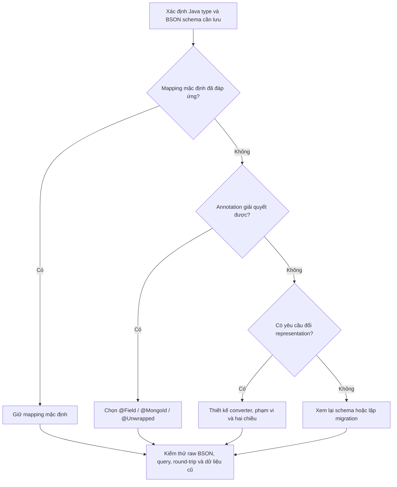

# Khi nào dùng converter thay vì ánh xạ mặc định?

Spring Data MongoDB có thể chuyển phần lớn Java object sang BSON document mà không cần viết converter riêng. `String` thường thành BSON String, các số Java thành BSON numeric, `Instant` có thể thành BSON Date, còn POJO con thường được lưu như embedded document. Nhưng đôi khi **hợp đồng dữ liệu trong MongoDB khác với cấu trúc Java**: một value object cần lưu thành một chuỗi, một hệ thống cũ sử dụng mã đặc biệt, hoặc một thư viện cung cấp kiểu mà mapper không biết dựng lại. Những trường hợp đó mới là lý do đáng cân nhắc custom converter.

Bài thuộc chương **Chuyển đổi dữ liệu** này giúp bạn lựa chọn giữa mapping mặc định, metadata như `@Field` và custom conversion trong Spring Data MongoDB. Quyết định ảnh hưởng đến cách `MongoRepository` và `MongoTemplate` ghi, đọc, tạo query, bảo trì index và kiểm thử tính tương thích của dữ liệu.

Sau bài học, bạn có thể:

- Giải thích vai trò của `MappingMongoConverter`, `MongoCustomConversions`, `@ReadingConverter` và `@WritingConverter`.
- Phân biệt vấn đề cần giải quyết bằng annotation, converter, auditing, callback hoặc migration.
- Viết và đăng ký converter hai chiều cho một domain value object.
- Kiểm tra BSON thực tế, round-trip Java–MongoDB, query và tác động lên dữ liệu legacy.
- Tránh converter tác động quá rộng, chuyển đổi mất thông tin, hoặc trộn BSON type trên cùng một field.

## 1. Ánh xạ mặc định hoạt động như thế nào?

Thông thường, `MappingMongoConverter` của Spring Data đọc metadata entity rồi chuyển các thuộc tính Java thành field BSON. MongoDB Java Driver đảm nhiệm codec và truyền dữ liệu BSON. Với entity:

```java
import java.time.Instant;
import java.util.List;
import org.bson.types.ObjectId;
import org.springframework.data.annotation.Id;
import org.springframework.data.mongodb.core.mapping.Document;

@Document(collection = "articles")
public class Article {
    @Id
    private ObjectId id;
    private String title;
    private int views;
    private Instant createdAt;
    private List<String> tags;
    private Author author;

    protected Article() {}

    public static class Author {
        private String name;
        private String country;
        protected Author() {}
    }
}
```

Một document tương ứng có thể trông như sau:

```javascript
{
  _id: ObjectId("665f1f2a4b6c7d8e9f001234"),
  title: "Spring Data MongoDB",
  views: 120,
  createdAt: ISODate("2026-11-20T02:00:00Z"),
  tags: ["spring", "mongodb"],
  author: { name: "Minh", country: "VN" }
}
```

Ví dụ lược bỏ metadata `_class` có thể được Spring Data ghi tùy cấu hình. Với cấu trúc này, ánh xạ mặc định thường đã đáp ứng nhu cầu. Tạo converter chỉ để diễn đạt việc `String` được lưu thành String hoặc List thành array sẽ làm tăng mã không cần thiết.

### Ba tầng chuyển đổi khác nhau

| Thành phần | Chịu trách nhiệm | Ví dụ |
| --- | --- | --- |
| Jackson/HTTP JSON | Biểu diễn Java object trong request và response REST | `@JsonProperty`, `ObjectMapper` |
| Spring Data MongoDB mapping | Chuyển entity và property sang BSON theo metadata | `@Document`, `@Field`, `MappingMongoConverter` |
| MongoDB Java Driver/BSON codec | Biểu diễn kiểu BSON và giao tiếp với MongoDB | `ObjectId`, `Decimal128`, `BsonDocument` |

Một JSON field trên API đổi tên nhờ `@JsonProperty` không có nghĩa BSON field đã đổi tên. Một converter được đăng ký với Spring Data MongoDB cũng không mặc nhiên thay đổi JSON mà REST API gửi ra. Kiểm thử từng đường dữ liệu theo đúng mục đích.

## 2. Bảng quyết định: khi nào thực sự cần converter?

| Yêu cầu | Công cụ nên cân nhắc đầu tiên | Khi nào converter phù hợp |
| --- | --- | --- |
| Đổi tên field BSON | `@Field("stored_name")` | Không cần converter chỉ để đổi tên |
| Chọn collection | `@Document(collection = "...")` | Không dùng converter |
| Chọn định danh ObjectId hay String | `@Id`, `@MongoId`, kiểu Java phù hợp | Khi có hợp đồng ID đặc biệt cần chuyển đổi có kiểm soát |
| Lưu `BigDecimal` thành Decimal128 | `@Field(targetType = FieldType.DECIMAL128)` | Nếu định dạng phức tạp hơn việc chọn BSON type |
| Nhúng POJO con | Mapping mặc định | Chỉ khi phải thay toàn bộ hình dạng BSON |
| Trải phẳng value object con | `@Unwrapped` khi phù hợp | Không cần converter chỉ để flatten |
| Lưu domain value object thành scalar BSON String | Xem liệu có mapping sẵn đúng hợp đồng không | **Phù hợp** nếu cần hai chiều domain object ↔ String |
| Đọc representation legacy khác hiện tại | Migration và phương án tương thích | Converter đọc tạm thời hoặc dài hạn theo chính sách |
| Làm sạch input, kiểm tra nghiệp vụ | Constructor/domain validator/service | Không giao converter việc quyết định nghiệp vụ ngoài chuyển đổi |
| Ghi `createdAt`, `updatedAt` | Auditing và callback phù hợp | Không phải lý do mặc định viết converter |
| Cập nhật nhiều document trong một giao dịch | Transaction/service | Converter không tạo transaction |

**Nguyên tắc:** chọn cơ chế nhỏ nhất giải quyết đúng yêu cầu. Metadata mô tả vị trí hoặc kiểu lưu; converter mô tả cách **biến đổi giá trị** giữa domain và BSON.

## 3. Khi annotation và mapping mặc định là đủ

### 3.1. Tên field

```java
import org.springframework.data.mongodb.core.mapping.Field;

@Field("display_name")
private String displayName;
```

Field Java `displayName` được lưu thành BSON `display_name`. Query `MongoTemplate` có ngữ cảnh entity thường sử dụng đường dẫn thuộc tính Java:

```java
Query query = Query.query(
    Criteria.where("displayName").is("Bàn phím")
);
Product product = mongoTemplate.findOne(query, Product.class);
```

Trong `mongosh`, truy vấn dùng tên BSON thực: `{ display_name: "Bàn phím" }`. Không có nhu cầu tạo `Converter<String, String>` để đổi tên field.

### 3.2. `BigDecimal` và Decimal128

```java
import java.math.BigDecimal;
import org.springframework.data.mongodb.core.mapping.Field;
import org.springframework.data.mongodb.core.mapping.FieldType;

@Field(targetType = FieldType.DECIMAL128)
private BigDecimal unitPrice;
```

Trong một số cấu hình phổ biến, Spring Data MongoDB lưu `BigDecimal` mặc định như BSON String. `FieldType.DECIMAL128` yêu cầu sử dụng BSON Decimal128 cho property này. Khi chỉ một field cần Decimal128, một converter `BigDecimal -> Decimal128` đăng ký toàn cục là phạm vi quá rộng.

Decimal128 có giới hạn độ chính xác 34 chữ số thập phân có nghĩa. Nếu giá trị `BigDecimal` vượt giới hạn BSON, phải xác định quy tắc làm tròn hoặc từ chối dữ liệu. Converter không thể bảo toàn thông tin vượt khả năng biểu diễn của kiểu đích.

### 3.3. Embedded object và enum

Spring Data thường ánh xạ `Address` thành nested BSON document, một `List` thành BSON array và enum thành tên hằng chuỗi. Nếu tất cả những hành vi đó phù hợp, không cần converter. Khi đổi tên enum constant mà dữ liệu cũ vẫn lưu tên trước đó, cân nhắc mã bền vững, converter hoặc migration.

### 3.4. Định danh, ngày giờ, UUID

Với `ObjectId`, `String` ID và `UUID`, ưu tiên chọn đúng Java type, `@Id` hoặc `@MongoId` và cấu hình UUID representation/codec nhất quán. Với `Instant` dùng làm thời điểm sự kiện, BSON Date đã là biểu diễn phổ biến và có độ phân giải mili giây. Đừng viết converter chỉ để vá một schema mà các hệ thống liên quan đang ghi không nhất quán; nên điều tra BSON thực trước.

## 4. Khi custom converter mang lại giá trị

### 4.1. Domain value object lưu như một scalar

Một ứng dụng dùng `CurrencyCode` nhằm không cho domain nhận tùy ý mọi `String`, nhưng database cần field `currency` là BSON String như `"VND"`. Nếu để mapping thông thường xử lý record hoặc POJO, kết quả có thể là một nested document như `{ value: "VND" }`. Converter hai chiều cho phép domain giữ kiểu mạnh mà BSON vẫn tuân thủ schema String.

### 4.2. Định dạng lưu đặc biệt

Một giá trị như mã vùng, mã nghiệp vụ, bit flags hoặc value object của thư viện ngoài có thể cần lưu bằng String, số hoặc BSON Binary theo hợp đồng đã thống nhất. Converter hữu ích khi có quy tắc rõ ràng và đọc lại được đầy đủ. Nếu truy vấn thường xuyên cần các field con thì lưu nested document có thể phù hợp hơn nén toàn bộ object thành String.

### 4.3. Tương thích dữ liệu cũ

Ví dụ DB cũ lưu trạng thái `"A"` hoặc `"S"` trong khi domain mới dùng `ACTIVE` và `SUSPENDED`. Converter đọc có thể chuyển mã cũ sang enum/domain type, converter ghi có thể dùng biểu diễn mới. Tuy nhiên, truy vấn theo kiểu mới không tự tìm được mọi document dùng format cũ. Phải kiểm tra query và có kế hoạch migration hoặc giai đoạn đọc tương thích.

### 4.4. Kiểu của thư viện thứ ba

Khi một immutable type của thư viện không có converter/codec mặc định phù hợp, có thể định nghĩa việc đọc/ghi sang BSON type được hỗ trợ. Converter phải xác định hai chiều, tránh phụ thuộc phiên bản thư viện không kiểm soát và tránh mọi side effect.

## 5. Ví dụ hoàn chỉnh: `CurrencyCode` được lưu dưới BSON String

### 5.1. Domain value object

```java
import java.util.Objects;

public record CurrencyCode(String value) {
    public CurrencyCode {
        Objects.requireNonNull(value, "currency");
        if (!value.matches("[A-Z]{3}")) {
            throw new IllegalArgumentException(
                "Mã tiền tệ phải gồm ba chữ cái in hoa"
            );
        }
    }
}
```

Record chỉ kiểm tra định dạng. Nếu muốn kiểm tra một mã có tồn tại trong danh mục ISO 4217, domain phải bổ sung quy tắc riêng. Việc tạo object là một bước bảo vệ invariant, còn converter chỉ biến đổi biểu diễn.

### 5.2. Converter ghi

```java
import org.springframework.core.convert.converter.Converter;
import org.springframework.data.convert.WritingConverter;

@WritingConverter
public final class CurrencyCodeWriteConverter
        implements Converter<CurrencyCode, String> {

    @Override
    public String convert(CurrencyCode source) {
        return source.value();
    }
}
```

### 5.3. Converter đọc

```java
import org.springframework.core.convert.converter.Converter;
import org.springframework.data.convert.ReadingConverter;

@ReadingConverter
public final class CurrencyCodeReadConverter
        implements Converter<String, CurrencyCode> {

    @Override
    public CurrencyCode convert(String source) {
        return new CurrencyCode(source);
    }
}
```

`@ReadingConverter` và `@WritingConverter` làm rõ hướng chuyển đổi, đặc biệt quan trọng nếu source/target liên quan các kiểu đơn giản mà framework có thể coi là native. Dữ liệu sai như `"vnd"` bị constructor từ chối: tránh âm thầm biến sai thành giá trị hợp lệ giả.

### 5.4. Đăng ký với `MongoCustomConversions`

```java
import java.util.List;
import org.springframework.context.annotation.Bean;
import org.springframework.context.annotation.Configuration;
import org.springframework.data.mongodb.core.convert.MongoCustomConversions;

@Configuration
public class MongoConversionConfig {

    @Bean
    MongoCustomConversions mongoCustomConversions() {
        return new MongoCustomConversions(List.of(
            new CurrencyCodeWriteConverter(),
            new CurrencyCodeReadConverter()
        ));
    }
}
```

Đây là API đăng ký converter phổ biến; phiên bản Spring Data khác nhau có thể có thêm DSL hoặc cơ chế cấu hình. Khi áp dụng, kiểm tra API đúng phiên bản trong dự án. Một ứng dụng chỉ nên có **cấu hình conversion nhất quán**, chứa đủ các converter đang sử dụng, để tránh nhiều bean gây xung đột hoặc mất converter đã đăng ký trước đó. Với Spring Boot, xác nhận bean được nạp vào application context và được auto-configuration sử dụng.

### 5.5. Entity sử dụng value object

```java
import java.math.BigDecimal;
import org.bson.types.ObjectId;
import org.springframework.data.annotation.Id;
import org.springframework.data.mongodb.core.mapping.Document;
import org.springframework.data.mongodb.core.mapping.Field;
import org.springframework.data.mongodb.core.mapping.FieldType;

@Document(collection = "priced_products")
public class PricedProduct {
    @Id
    private ObjectId id;
    private String sku;
    private CurrencyCode currency;

    @Field(targetType = FieldType.DECIMAL128)
    private BigDecimal price;

    protected PricedProduct() {}

    public PricedProduct(
            String sku, CurrencyCode currency, BigDecimal price) {
        this.sku = sku;
        this.currency = currency;
        this.price = price;
    }

    public ObjectId getId() { return id; }
    public String getSku() { return sku; }
    public CurrencyCode getCurrency() { return currency; }
    public BigDecimal getPrice() { return price; }
}
```

Khi lưu thành công qua mapping Spring Data, dữ liệu có thể trông như sau:

```javascript
{
  _id: ObjectId("665f1f2a4b6c7d8e9f001234"),
  sku: "BK-001",
  currency: "VND",
  price: NumberDecimal("129000.00")
}
```

Field `currency` là BSON String **nhờ converter**; `price` là Decimal128 **nhờ metadata `@Field`**. Ví dụ lược bỏ `_class` có thể xuất hiện theo cấu hình Spring Data. Đừng dựa vào cách JSON REST hiển thị hai field để suy ra BSON type thật.

### 5.6. Ghi, đọc và truy vấn qua `MongoTemplate`

```java
import java.math.BigDecimal;
import org.springframework.data.mongodb.core.MongoTemplate;
import org.springframework.data.mongodb.core.query.Criteria;
import org.springframework.data.mongodb.core.query.Query;

public void demonstrate(MongoTemplate template) {
    PricedProduct saved = template.insert(new PricedProduct(
        "BK-001",
        new CurrencyCode("VND"),
        new BigDecimal("129000.00")
    ));

    PricedProduct loaded = template.findById(
        saved.getId(), PricedProduct.class
    );

    if (loaded == null ||
            !"VND".equals(loaded.getCurrency().value())) {
        throw new IllegalStateException("Không thể đọc đúng mã tiền tệ");
    }

    Query query = Query.query(
        Criteria.where("currency").is(new CurrencyCode("VND"))
    );
    template.find(query, PricedProduct.class);
}
```

Khi Spring Data biết domain type `PricedProduct.class`, nó có thông tin để xử lý property và giá trị trong câu query. Tuy nhiên, đường ghi entity, raw driver, pipeline `Document` tự xây và `@Query` JSON không nhất thiết đi qua cùng một cơ chế chuyển đổi. **Kiểm thử query thực tế** là cần thiết, nhất là với custom converter có cấu trúc phức tạp.

Một repository cùng loại có thể khai báo:

```java
import java.util.List;
import org.bson.types.ObjectId;
import org.springframework.data.mongodb.repository.MongoRepository;

public interface PricedProductRepository
        extends MongoRepository<PricedProduct, ObjectId> {

    List<PricedProduct> findByCurrency(CurrencyCode currency);
}
```

Derived query dùng tên thuộc tính Java `currency`. Hãy kiểm thử `findByCurrency(new CurrencyCode("VND"))` trả về các document đã lưu currency là BSON String.

## 6. Converter theo kiểu và converter theo từng property

### 6.1. Converter được đăng ký chung theo kiểu

`MongoCustomConversions` chứa quy tắc chuyển đổi dựa trên kiểu nguồn và kiểu đích. Khi đã đăng ký `CurrencyCode -> String` và chiều ngược lại, các entity có field `CurrencyCode` thường cùng sử dụng một hợp đồng lưu trữ.

Đây là điểm mạnh nếu toàn bộ ứng dụng đều thống nhất rằng `CurrencyCode` luôn lưu thành BSON String. Nhưng sẽ nguy hiểm nếu cùng một Java type phải có **hai cách lưu khác nhau** trong các field khác nhau.

Ví dụ:

```java
class UserProfile {
    private String displayName;   // Giữ nguyên
    private String secretNote;    // Có yêu cầu định dạng riêng
}
```

Không nên đăng ký converter `String -> String` toàn cục chỉ nhằm biến đổi `secretNote`: nó có thể ảnh hưởng đến mọi String đang đọc/ghi. Thay vào đó, dùng một value object riêng (nếu đây là khái niệm domain) hoặc cơ chế chuyển đổi theo property.

### 6.2. Property-specific conversion

Các phiên bản Spring Data hỗ trợ *property conversions* thông qua cơ chế như `PropertyValueConverter` và metadata tương ứng. Cách này hữu ích khi logic phải gắn với **một field cụ thể**, có thể cần ngữ cảnh của property, thay vì tác động toàn bộ kiểu Java.

Trước khi áp dụng, xác minh API và cách đăng ký dành cho **phiên bản Spring Data MongoDB** dự án sử dụng. API property converter có khác biệt giữa các phiên bản, nên bài này tập trung vào converter theo kiểu với ví dụ hoàn chỉnh ở phần 5, thay vì đưa một đoạn cấu hình có thể không biên dịch trên stack đang dùng.

### 6.3. Tránh kiểu nguồn và đích quá chung

Những khai báo cần cân nhắc kỹ:

- `Converter<Object, String>`: có thể chặn quá nhiều object không liên quan.
- `Converter<Document, Object>`: rất rộng, dễ xung đột cơ chế dựng domain object.
- `Converter<String, String>`: khó giới hạn đúng field nếu đăng ký toàn cục.
- `Converter<Number, Long>`: có thể làm mất phần thập phân và thay loại dữ liệu trong nhiều entity.

Tốt hơn là tạo kiểu domain có nghĩa, khai báo nguồn/đích rõ ràng, chỉ đăng ký những converter đã được kiểm thử. Nếu yêu cầu là chuyển đổi **kiểu BSON của một thuộc tính** mà annotation xử lý được, nên sử dụng annotation.

## 7. Dữ liệu legacy: converter không tự di chuyển dữ liệu cũ

Giả sử collection đang có nhiều representation:

```javascript
{ sku: "A", currency: "VND" }           // Chuẩn mới: BSON String
{ sku: "B", currency: { code: "VND" } } // Cũ: embedded document
{ sku: "C", currency: null }            // BSON Null
{ sku: "D" }                            // Thiếu field
```

Converter `Converter<String, CurrencyCode>` ở phần 5 chỉ đọc được trường hợp BSON String. Nó không tự biến nested document thành String, không tự xử lý field thiếu và cũng không cập nhật dữ liệu cũ trong MongoDB.

### 7.1. Xác định thực trạng với `$type`

```javascript
db.priced_products.aggregate([
  {
    $group: {
      _id: { $type: "$currency" },
      documents: { $sum: 1 }
    }
  },
  { $sort: { documents: -1 } }
]);
```

Ví dụ có thể trả nhóm `"string"`, `"object"`, `"null"` hoặc `"missing"`. Mỗi nhóm cần quyết định rõ có được hỗ trợ không, có cần migration không và xử lý sai dữ liệu như thế nào.

### 7.2. Chọn chiến lược chuyển đổi

| Chiến lược | Phù hợp khi | Cần kiểm soát |
| --- | --- | --- |
| **Migration một lần** | Có thể cập nhật dữ liệu cũ trong cửa sổ thay đổi được quản lý | Backup/rollback, tính idempotent, kiểm tra dữ liệu sau chạy |
| **Đọc cả cũ và mới tạm thời** | Nhiều phiên bản ứng dụng cùng hoạt động khi triển khai dần | Các converter/đường đọc thực sự hỗ trợ mọi BSON type cần thiết |
| **Ghi chuẩn mới, đọc dạng cũ** | Đang tiến tới một schema đích cố định | Query/index vẫn phải xử lý dữ liệu cũ hoặc dữ liệu cũ cần được backfill |
| **Giữ định dạng cũ** | Dữ liệu do nhiều hệ thống dùng và chưa thể đổi hợp đồng | Ghi rõ schema, không vô tình thay representation giữa các dịch vụ |

Nếu converter đọc hỗ trợ `"P"` và `"PAID"` rồi trả cùng một trạng thái domain `PAID`, câu query raw `{ status: "PAID" }` **không** tự tìm document có `status: "P"`. Hãy kiểm thử truy vấn theo đại diện cũ và mới; khi cần, sử dụng truy vấn tạm theo nhiều giá trị hoặc migration trước khi sử dụng index/query theo format mới.

### 7.3. Không dùng converter nguồn `Object` để bắt mọi dữ liệu lỗi

Một cách xử lý hấp dẫn là tạo `Converter<Object, CurrencyCode>` có nhiều nhánh `if` cho String, Document, Number... Nhưng phạm vi rộng của `Object` có thể gây ảnh hưởng bất ngờ trong bộ ánh xạ và làm khó xác định lúc nào converter chạy. Hãy ưu tiên:

1. Khảo sát BSON type hiện tại.
2. Thiết kế migration hoặc converter đọc **đúng từng source type** mà framework hỗ trợ.
3. Kiểm thử lộ trình đọc/ghi và query sau chuyển đổi.
4. Loại bỏ logic tương thích khi không còn dữ liệu cũ cần hỗ trợ.

### 7.4. Null và missing không phải là String rỗng

MongoDB phân biệt:

```javascript
{ currency: null }  // BSON Null
{ }                 // Không có field currency
{ currency: "" }    // BSON String rỗng
```

Các conversion pipeline thường xử lý `null` riêng; đừng dựa vào việc converter nhất định được gọi với giá trị `null`. Khi ánh xạ vào Java reference property, trường hợp missing và BSON Null đều có thể trở thành `null`. Nếu cần ba trạng thái trong domain, thiết kế hợp đồng dữ liệu tương ứng và dùng `$exists`, `$type` để kiểm tra.

## 8. Tác động của converter lên query, index và aggregation

### 8.1. Query theo BSON thực tế

Nếu converter chuyển `CurrencyCode("VND")` thành BSON String `"VND"`, truy vấn raw tương ứng:

```javascript
db.priced_products.find({
  currency: "VND",
  sku: "BK-001"
});
```

MongoDB không biết `CurrencyCode` và không so sánh String `"VND"` với một document `{value:"VND"}` như cùng một giá trị. Index cũng được tạo dựa trên **field và giá trị BSON thực**, không dựa trên Java domain type.

```javascript
db.priced_products.createIndex(
  { currency: 1, sku: 1 },
  { name: "idx_currency_sku" }
);

db.priced_products.find({
  currency: "VND",
  sku: "BK-001"
}).explain("executionStats");
```

Để đánh giá hiệu năng query, quan sát `winningPlan`, `totalKeysExamined` và `totalDocsExamined` cùng dữ liệu đại diện. Index mới không tự xóa hoặc đổi index cũ trên `currency.code` nếu schema cũ sử dụng nested document.

### 8.2. Aggregation raw và thông tin type

```javascript
db.priced_products.aggregate([
  { $match: { currency: "VND" } },
  {
    $group: {
      _id: "$currency",
      count: { $sum: 1 }
    }
  }
]);
```

Đây là BSON aggregation chạy trên MongoDB server. Không có bước dựng `CurrencyCode` trong `$group`. Với typed aggregation của Spring Data, một số property path và giá trị có thể được mapper xử lý, nhưng các stage JSON/raw `Document`, alias và phép toán chuyên biệt cần được kiểm chứng riêng. Tránh giả định converter bảo đảm mọi biểu thức trong pipeline tự động chuyển sang format domain.

### 8.3. Converter có thể làm mất khả năng lọc trên trường con

Nếu một `Address` từng được lưu thành:

```javascript
{ address: { city: "Ha Noi", country: "VN" } }
```

nhưng sau này được converter thành một chuỗi như `"Ha Noi|VN"`, query `"address.city"` và index trên trường con không còn áp dụng. Việc nén object thành scalar chỉ phù hợp khi những điều kiện truy vấn và cập nhật theo field con không phải yêu cầu quan trọng. Quyết định converter phải xuất phát từ cách ứng dụng **đọc, lọc và sửa dữ liệu**, không chỉ từ việc giảm số dòng Java.

## 9. Converter khác gì auditing, callback, Jackson và JPA?

| Cơ chế | Dùng cho | Không thay thế |
| --- | --- | --- |
| **Custom Mongo converter** | Thay representation Java value ↔ BSON | Domain service, migration và transaction |
| `@Field`, `@MongoId`, `@Unwrapped` | Metadata tên, kiểu, định danh và flatten | Logic chuyển đổi tùy biến ngoài phạm vi annotation |
| `@CreatedDate`, `@LastModifiedDate` | Auditing metadata tạo/sửa | Chuyển đổi scalar domain |
| `BeforeConvertCallback` hoặc callback khác | Hành vi ở thời điểm xử lý entity | Một schema migration hàng loạt |
| Jackson `JsonSerializer` / `JsonDeserializer` | JSON API hoặc message JSON | BSON persistence mapping |
| JPA `AttributeConverter` | Ánh xạ giá trị của JPA vào SQL column | Spring Data MongoDB conversion |
| MongoDB JSON Schema validator | Ràng buộc kiểu và cấu trúc dữ liệu trong database | Converter đọc/ghi ở Java |
| MongoDB transaction | Đồng bộ nhiều thao tác ghi khi cần atomic commit | Ánh xạ value object |

Ví dụ "mỗi entity mới cần `createdAt`" thường là việc của auditing. "Khi ghi hóa đơn, kiểm tra tổng tiền" thường là việc của aggregate/service. "Gửi email sau lưu" là workflow/service bên ngoài. Nhồi tất cả hành vi này vào một converter sẽ tạo side effect khó kiểm thử và có thể được kích hoạt nhiều lần ngoài ý định.

Với reactive access (`ReactiveMongoTemplate` hoặc reactive repository), quá trình ánh xạ vẫn cần converter nhất quán, nhưng converter đồng bộ không nên gọi HTTP hoặc chờ I/O. Một conversion path chặn thread có thể ảnh hưởng đến throughput và độ trễ của ứng dụng reactive.

## 10. Kiểm thử: object round-trip là chưa đủ

Giả sử Spring Data lưu `CurrencyCode` như nested document mặc định và cũng đọc lại thành công. Một unit test chỉ so sánh `CurrencyCode("VND")` trước/sau sẽ **không phát hiện** sai hợp đồng BSON String. Cần kiểm tra cả ba mặt:

1. **Converter logic:** chuyển đúng hai chiều và từ chối dữ liệu sai.
2. **Raw BSON:** field lưu đúng BSON type và format mong đợi.
3. **Query và update:** giá trị domain đưa vào filter/update được chuyển nhất quán với dữ liệu đã lưu.

### 10.1. Unit test cho converter

```java
import static org.junit.jupiter.api.Assertions.*;
import org.junit.jupiter.api.Test;

class CurrencyCodeConverterTest {
    private final CurrencyCodeWriteConverter writer =
        new CurrencyCodeWriteConverter();
    private final CurrencyCodeReadConverter reader =
        new CurrencyCodeReadConverter();

    @Test
    void convertsBothDirections() {
        CurrencyCode original = new CurrencyCode("VND");
        String stored = writer.convert(original);

        assertEquals("VND", stored);
        assertEquals(original, reader.convert(stored));
    }

    @Test
    void rejectsInvalidValue() {
        assertThrows(IllegalArgumentException.class,
            () -> reader.convert("vnd"));
    }
}
```

Unit test này kiểm tra logic thuần, chưa chứng minh converter đã được đăng ký vào Spring Data MongoDB.

### 10.2. Integration test với MongoDB thật

Ví dụ sau dùng JUnit 5 và Spring Boot Test. Hãy cấu hình test application context nhận `MongoConversionConfig` và kết nối tới database **chỉ phục vụ kiểm thử**:

```java
import static org.junit.jupiter.api.Assertions.*;
import static com.mongodb.client.model.Filters.eq;

import java.math.BigDecimal;
import org.bson.Document;
import org.bson.types.Decimal128;
import org.junit.jupiter.api.Test;
import org.springframework.beans.factory.annotation.Autowired;
import org.springframework.boot.test.context.SpringBootTest;
import org.springframework.data.mongodb.core.MongoTemplate;
import org.springframework.data.mongodb.core.query.Criteria;
import org.springframework.data.mongodb.core.query.Query;

@SpringBootTest
class CurrencyCodeMongoIntegrationTest {
    @Autowired
    MongoTemplate template;

    @Test
    void writesBsonStringAndReadsCurrencyCode() {
        PricedProduct product = template.insert(
            new PricedProduct(
                "BK-IT-001",
                new CurrencyCode("VND"),
                new BigDecimal("129000.00")
            )
        );

        try {
            Document raw = template.getCollection("priced_products")
                .find(eq("_id", product.getId()))
                .first();

            assertNotNull(raw);
            assertEquals("VND", raw.getString("currency"));
            assertTrue(raw.get("price") instanceof Decimal128);

            PricedProduct loaded = template.findById(
                product.getId(), PricedProduct.class
            );
            assertNotNull(loaded);
            assertEquals("VND", loaded.getCurrency().value());

            Query query = Query.query(
                Criteria.where("_id").is(product.getId())
                    .and("currency").is(new CurrencyCode("VND"))
            );
            assertTrue(template.exists(query, PricedProduct.class));
        } finally {
            template.remove(product);
        }
    }
}
```

Test thực tế nên dùng dữ liệu/ID không trùng và database tách biệt để tránh ảnh hưởng các test khác. Ví dụ này cần MongoDB hoặc Testcontainers MongoDB đang hoạt động và đúng cấu hình Spring; mã được đưa vào tài liệu để thực hành, **chưa được chạy trong lúc soạn bài**.

### 10.3. Quan sát bằng `mongosh`

Sau khi ứng dụng ghi một document thử:

```javascript
db.priced_products.findOne(
  { sku: "BK-IT-001" },
  { _id: 0, sku: 1, currency: 1, price: 1 }
);

db.priced_products.aggregate([
  { $match: { sku: "BK-IT-001" } },
  {
    $project: {
      _id: 0,
      currencyType: { $type: "$currency" },
      priceType: { $type: "$price" }
    }
  }
]);
```

Kết quả mong đợi: `currencyType` là `"string"` và `priceType` là `"decimal"`. Nếu integration test đã xóa document trong `finally`, truy vấn mongosh không còn kết quả; hãy chủ động tạo dữ liệu thử riêng để quan sát.

### 10.4. Những ca kiểm thử nên bổ sung

- Null, missing và chuỗi rỗng: chúng có được phân biệt đúng theo hợp đồng không?
- Dữ liệu sai định dạng có ném lỗi rõ ràng hay bị đổi thành giá trị mặc định?
- Dữ liệu legacy có đọc được không, và query có tìm đúng các phiên bản dữ liệu không?
- Converter có làm thay đổi những field `String` khác ngoài ý muốn không?
- Repository derived query, `MongoTemplate` update và aggregation có cùng quy ước BSON không?
- Khi thay schema, ứng dụng phiên bản cũ có đọc được document do phiên bản mới ghi không?
- Chuyển đổi có giữ precision, timezone và mọi giá trị domain quan trọng không?

## 11. Lỗi thường gặp và hướng xử lý

| Triệu chứng | Nguyên nhân thường gặp | Cách xử lý |
| --- | --- | --- |
| `CurrencyCode` lưu thành nested document | Converter chưa được đăng ký hoặc config không được nạp | Xem `MongoCustomConversions` và BSON thực |
| Viết đúng nhưng đọc không về value object | Thiếu `@ReadingConverter` hoặc thiếu đăng ký chiều đọc | Kiểm tra unit test hai chiều và integration test |
| Giá trị cũ làm ứng dụng đọc lỗi | Định dạng BSON legacy khác hợp đồng mới | Thống kê bằng `$type`, lên kế hoạch migration |
| `BigDecimal` lưu thành String thay vì Decimal128 | Chưa quy định target type cho field | Dùng `@Field(targetType = FieldType.DECIMAL128)` và kiểm tra `$type` |
| Converter ảnh hưởng field không liên quan | Converter nguồn/đích quá chung | Tạo domain value object hoặc property converter |
| Query theo object không tìm document | Query value chưa chuyển đúng hoặc BSON cũ có format khác | Xác minh BSON và query thực qua integration test |
| Đổi Jackson annotation nhưng BSON không đổi | REST JSON và Mongo mapping là hai tầng khác nhau | Dùng metadata Mongo thích hợp |
| Converter đọc chậm khi load nhiều document | Parser nặng hoặc I/O ngoài nằm trong converter | Giữ converter nhanh, thuần và không có side effect |
| Đăng ký converter rồi dữ liệu cũ vẫn giữ schema cũ | Converter không thực hiện migration database | Thực hiện migration có xác minh và rollback |
| Không còn query được trường con | Đã nén object thành String/Binary | Giữ nested document hoặc field truy vấn bổ sung |

## 12. Quy trình lựa chọn trước khi thêm converter



Trước khi đăng ký converter, tự trả lời:

1. Java source/target type và BSON type thực tế là gì?
2. Tất cả field có cùng kiểu Java đều phải dùng cùng quy tắc không?
3. Converter có thể đảo ngược mà không mất thông tin không? Có giới hạn precision, timezone hay null không?
4. Dữ liệu cũ có những representation nào và cách đọc/migration ra sao?
5. Query, index và aggregation có hoạt động với format BSON mới không?
6. Quy tắc có thuần, nhanh và đủ rõ để kiểm thử độc lập không?
7. Khi triển khai nhiều phiên bản ứng dụng, có yêu cầu giữ tương thích ngược hay không?

## 13. Bài tập tự luyện

**Bài 1 — Chọn cơ chế.** Một entity có `displayName` cần lưu thành `display_name`, `BigDecimal price` cần Decimal128 và `CurrencyCode currency` cần BSON String. Phân loại mapping mặc định, annotation hoặc custom converter cho từng field và giải thích lựa chọn.

**Bài 2 — Viết converter.** Tạo record `LanguageCode` chứa mã ngôn ngữ hai ký tự in thường, lưu thành BSON String. Viết `@WritingConverter`, `@ReadingConverter` và đăng ký. Kiểm thử giá trị hợp lệ và không hợp lệ.

**Bài 3 — Dữ liệu cũ.** Trạng thái đơn hàng được lưu dưới ba dạng: `"P"`, `"PAID"` và `{ code: "P" }`. Đề xuất schema đích, chiến lược migration, cách query trong giai đoạn hai phiên bản cùng hoạt động và giới hạn của converter chỉ có chiều đọc.

**Bài 4 — Phạm vi.** Hai field đều là `String` nhưng chỉ một field cần định dạng đặc biệt. Giải thích tại sao `Converter<String, String>` toàn cục nguy hiểm. Đề xuất dùng value object hoặc property-specific conversion.

**Bài 5 — Kiểm tra BSON.** Ghi một `PricedProduct` vào database thử nghiệm. Dùng `mongosh` kiểm tra `currency` có kiểu `string`, `price` có kiểu `decimal`; thử đưa giá trị `"vnd"` vào currency và dự đoán kết quả khi repository đọc lại.

**Bài 6 — Query và index.** Một nhóm đề xuất dùng converter nén `Address(city,country)` thành String. Phân tích ảnh hưởng lên query theo city, index trên country và migration từ nested document.

**Bài 7 — Phân vai trách nhiệm.** Hệ thống cần tự điền `createdAt`, kiểm tra tổng tiền hóa đơn, mã hóa field, gửi email và lưu `CurrencyCode` dưới BSON String. Chỉ ra việc nào thuộc auditing, service, giải pháp bảo mật hoặc converter.

### Ghi nhớ

**Ánh xạ mặc định là lựa chọn đầu tiên** khi BSON đã phù hợp với Java domain. Dùng annotation để thay tên/kiểu lưu khi framework hỗ trợ. Dùng converter khi một **kiểu giá trị cần representation BSON khác theo hợp đồng rõ ràng**. Hãy giới hạn phạm vi, tách converter khỏi business logic và JSON API, kiểm chứng cả hai chiều Java ↔ BSON, loại BSON thực tế, query, index và dữ liệu legacy trước khi áp dụng vào hệ thống.
