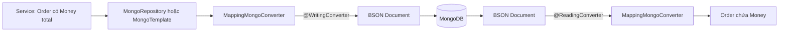

# Viết @ReadingConverter và @WritingConverter

## 1. Khi nào Spring Data MongoDB cần converter tùy chỉnh?

**Spring Data MongoDB** cung cấp `MappingMongoConverter` để chuyển đối tượng Java thành document BSON và khôi phục đối tượng từ dữ liệu trong MongoDB. Với các kiểu thông dụng như `String`, `Integer`, `Long`, `Instant` hoặc những entity có trường ánh xạ rõ ràng, quy tắc mặc định thường đã đủ. Tuy nhiên, ứng dụng có thể cần **một biểu diễn BSON khác với cấu trúc Java**.

Ví dụ, domain model có value object `Money` chứa số tiền theo đơn vị nhỏ nhất và mã tiền tệ. Khi lưu, ta muốn MongoDB nhận cấu trúc ổn định:

```javascript
{
  _id: "order-1001",
  total: {
    minorUnits: NumberLong("1999"),
    currency: "USD"
  }
}
```

Trong Java, đối tượng `Money` có thể có logic xác thực bất biến; trong BSON, nó là một `Document` chứa hai trường đơn giản. Nếu cần kiểm soát chính xác việc ghi và đọc kiểu này, ta có thể viết hai converter:

- **`@WritingConverter`:** chuyển `Money` của Java thành `org.bson.Document` để ghi.
- **`@ReadingConverter`:** chuyển `org.bson.Document` được đọc từ MongoDB thành `Money` của Java.

Khả năng này hữu ích cho value object, schema dữ liệu kế thừa, định dạng ngày giờ tùy biến và những trường cần biểu diễn lưu trữ riêng. Trong bài này, các ví dụ dùng Spring Data MongoDB với `MongoTemplate` và repository; metadata converter cũng có ý nghĩa khi ứng dụng dùng `ReactiveMongoTemplate` hoặc repository reactive.

**Mục tiêu:** hiểu chiều chuyển đổi, viết và đăng ký converter đúng cách, nhìn thấy BSON thật, kiểm thử hai chiều, xử lý dữ liệu thiếu/sai kiểu và biết khi nào không nên dùng custom converter.

## 2. Luồng chuyển đổi giữa Java và MongoDB



| Thành phần | Vai trò |
| --- | --- |
| `Converter<S, T>` | Interface của Spring cho một phép chuyển đổi từ kiểu nguồn `S` sang kiểu đích `T`. |
| `@WritingConverter` | Đánh dấu converter được dùng ở **chiều ghi** dữ liệu theo quy tắc đăng ký của Spring Data. |
| `@ReadingConverter` | Đánh dấu converter được dùng ở **chiều đọc** dữ liệu từ store. |
| `MongoCustomConversions` | Nơi khai báo các converter tùy chỉnh để infrastructure biết và đăng ký. |
| `MappingMongoConverter` | Thành phần sử dụng metadata mapping, các kiểu BSON và các converter để đọc/ghi entity. |
| MongoDB Java driver | Gửi/nhận BSON; không tự hiểu mọi annotation trên domain class nếu dùng BSON thô. |

Hai annotation **không tự làm converter được sử dụng chỉ bằng cách đặt lên class**. Spring Data yêu cầu đăng ký converter tường minh. Ví dụ một class có `@Component` cũng không nên được xem là bằng chứng rằng nó đã tham gia `MongoCustomConversions`.

### 2.1. Cách Spring Data nhận diện chiều chuyển đổi

Khi một phía là kiểu mà MongoDB driver/store có thể xử lý trực tiếp, Spring Data thường suy ra chiều từ cặp kiểu generic của converter:

```java
// Ghi: domain object -> native store type.
Converter<Money, org.bson.Document>

// Đọc: native store type -> domain object.
Converter<org.bson.Document, Money>
```

Nhưng nếu **cả hai phía đều là kiểu native**, chẳng hạn `Converter<String, Long>`, hệ thống có thể không suy ra an toàn liệu đó là conversion đọc hay ghi. `@ReadingConverter` và `@WritingConverter` loại bỏ sự mơ hồ này.

**Không dùng converter quá rộng** như một quy tắc “mọi `String` đều thành `Long`” nếu chỉ một thuộc tính cần chuyển đổi. Một converter đăng ký sai phạm vi có thể làm những trường khác bị chuyển đổi ngoài ý muốn.

## 3. Thiết kế ví dụ: Money là value object

Để tách rõ nghiệp vụ và lưu trữ, dùng `Money` chứa:

- `minorUnits`: số nguyên 64 bit của đơn vị tiền tệ nhỏ nhất theo quy ước của hệ thống;
- `currency`: mã tiền tệ ISO 4217, ví dụ `USD`.

Trong ví dụ `USD`, `1999` đơn vị nhỏ nhất tương ứng **19,99 USD**. Với tiền tệ khác, số chữ số thập phân và đơn vị nhỏ nhất có thể khác; không được giả định mọi tiền tệ có hai chữ số thập phân.

```java
package example.orders;

import java.util.Currency;
import java.util.Objects;

public record Money(long minorUnits, String currency) {

    public Money {
        Objects.requireNonNull(currency, "currency");
        Currency.getInstance(currency); // Từ chối mã tiền tệ không hợp lệ.
    }
}
```

Ví dụ dùng Java record; `Money` không mang `@Document` vì đây là **value object bên trong entity**, không phải root document có collection riêng.

Định nghĩa entity `Order`:

```java
package example.orders;

import org.springframework.data.annotation.Id;
import org.springframework.data.mongodb.core.mapping.Document;

@Document(collection = "orders")
public class Order {

    @Id
    private String id;

    private Money total;

    public Order() {
    }

    public Order(String id, Money total) {
        this.id = id;
        this.total = total;
    }

    public String getId() {
        return id;
    }

    public Money getTotal() {
        return total;
    }
}
```

Các class converter trong những phần sau đặt trong cùng package `example.orders` hoặc import đầy đủ theo cấu trúc thực tế của dự án.

## 4. Viết @WritingConverter: Money → BSON Document

Một writing converter triển khai `Converter<Money, Document>`:

```java
package example.orders;

import org.bson.Document;
import org.springframework.core.convert.converter.Converter;
import org.springframework.data.convert.WritingConverter;

@WritingConverter
public class MoneyWriteConverter implements Converter<Money, Document> {

    @Override
    public Document convert(Money source) {
        return new Document("minorUnits", source.minorUnits())
            .append("currency", source.currency());
    }
}
```

Ở đây:

1. `source` là value object ở Java, không phải BSON đã được lưu.
2. `minorUnits` là Java `long`; driver có thể biểu diễn thành **BSON Int64**.
3. `currency` là `String`, được lưu như **BSON String**.
4. `Document` trả về chỉ mô tả phần tử giá trị `total`. Spring Data tiếp tục ánh xạ entity `Order` và trường `_id` ở cấp cha.

Khi lưu:

```java
import org.springframework.data.mongodb.core.MongoTemplate;

Order order = new Order("order-1001", new Money(1999L, "USD"));
mongoTemplate.save(order);
```

Document trong MongoDB tương đương:

```javascript
{
  _id: "order-1001",
  total: {
    minorUnits: NumberLong("1999"),
    currency: "USD"
  }
}
```

**Điểm quan trọng:** converter viết ra **kiểu và cấu trúc lưu trữ**, vì vậy thay đổi tên `minorUnits` thành `amount` hoặc đổi `Long` sang `String` là thay đổi schema dữ liệu. Một khi schema được sử dụng bởi query, index, aggregation hoặc service khác, cần quản lý nó như hợp đồng dữ liệu.

### 4.1. Vì sao không viết converter thẳng sang JSON?

MongoDB lưu BSON, không lưu “chuỗi JSON” trừ khi ta cố ý đưa một `String` chứa nội dung JSON vào field. Viết `Converter<Money, String>` để lưu `"{\"amount\": ...}"` khiến MongoDB không thể truy vấn trực tiếp `total.minorUnits` bằng cách thông thường. Khi mục tiêu là lưu **document con có thể truy vấn**, trả `Document` phù hợp hơn.

Một converter sang `String` vẫn có thể đúng cho value object đơn giản chỉ mang một giá trị (ví dụ mã định danh có định dạng chuẩn), nhưng đó là quyết định khác với mô hình `Money` gồm hai thành phần.

## 5. Viết @ReadingConverter: BSON Document → Money

Để đọc, ta triển khai phép chuyển đổi ngược:

```java
package example.orders;

import org.bson.Document;
import org.springframework.core.convert.converter.Converter;
import org.springframework.data.convert.ReadingConverter;

@ReadingConverter
public class MoneyReadConverter implements Converter<Document, Money> {

    @Override
    public Money convert(Document source) {
        Object value = source.get("minorUnits");
        long minorUnits;

        if (value instanceof Long number) {
            minorUnits = number;
        } else if (value instanceof Integer number) {
            // Cho phép bản ghi legacy có BSON Int32.
            minorUnits = number.longValue();
        } else {
            throw new IllegalArgumentException(
                "total.minorUnits phải là BSON Int64 hoặc Int32"
            );
        }

        String currency = source.getString("currency");
        if (currency == null) {
            throw new IllegalArgumentException(
                "total.currency không được thiếu"
            );
        }

        return new Money(minorUnits, currency);
    }
}
```

`Document` trong ví dụ do MongoDB driver cung cấp. Khi field chứa BSON Int64, Java thường nhận `Long`; khi field là BSON Int32, Java nhận `Integer`. Cả hai đều có thể đổi sang `long` **mà không mất phần nguyên**. Converter này **cố ý từ chối `Double` và `String`** để tránh làm tròn hoặc tự đoán ý nghĩa dữ liệu chưa có quy ước.

Lời gọi `source.getString("currency")` cũng giúp phát hiện dữ liệu sai kiểu: nếu field không phải String, driver có thể báo lỗi chuyển kiểu thay vì âm thầm dùng một giá trị khác.

Nếu document nguồn có toàn bộ field `total` bị thiếu hoặc bằng BSON `null`, Spring Data có thể xử lý thuộc tính ở mức null mà **không gọi `convert(null)`**. Không nên giả định converter luôn có cơ hội thay thế mọi giá trị null bằng `Money(0, "USD")`. Thiếu tiền và tiền bằng 0 là hai trạng thái nghiệp vụ khác nhau.

### 5.1. Không được im lặng biến dữ liệu sai thành giá trị hợp lệ

Ví dụ nguy hiểm:

```java
// Tránh làm thế này với dữ liệu tài chính:
long units = ((Number) source.get("minorUnits")).longValue();
```

Nếu field chứa `Double(19.9)`, `longValue()` có thể cắt phần lẻ và cho ra 19. Dữ liệu đọc lại có vẻ hợp lệ nhưng thực tế bị biến đổi. Converter là ranh giới xác thực, vì vậy hãy kiểm tra đúng kiểu BSON, phạm vi, đơn vị và quy tắc tương thích legacy.

## 6. Đăng ký bằng MongoCustomConversions

Hai converter ở trên chỉ được hạ tầng mapping sử dụng khi đăng ký. Với ứng dụng **Spring Boot** dựa vào auto-configuration MongoDB, có thể khai báo bean `MongoCustomConversions`:

```java
package example.orders;

import org.springframework.context.annotation.Bean;
import org.springframework.context.annotation.Configuration;
import org.springframework.data.mongodb.core.convert.MongoCustomConversions;

@Configuration(proxyBeanMethods = false)
public class MongoConversionConfiguration {

    @Bean
    MongoCustomConversions mongoCustomConversions() {
        return MongoCustomConversions.create(adapter -> {
            adapter.registerConverter(new MoneyWriteConverter());
            adapter.registerConverter(new MoneyReadConverter());
        });
    }
}
```

Spring Boot sẽ sử dụng bean này khi cấu hình Spring Data MongoDB thông thường; cần đặt configuration trong vùng component scan hoặc import trực tiếp khi kiểm thử.

**Nếu dự án đang có `MongoCustomConversions` riêng**, hãy bổ sung hai converter vào cấu hình đang dùng thay vì vô tình tạo thêm bean cạnh tranh. Và nếu đang tùy biến thêm cách xử lý Java time, BigDecimal hoặc các converter khác, cần giữ lại cấu hình đó.

### 6.1. Dự án tự cấu hình MongoDB bằng AbstractMongoClientConfiguration

Nếu không dựa vào auto-configuration Boot mà tự kế thừa `AbstractMongoClientConfiguration`, Spring Data cung cấp hook để thêm converter:

```java
import org.springframework.data.mongodb.core.convert.MongoCustomConversions;

// Bên trong lớp extends AbstractMongoClientConfiguration:
@Override
protected void configureConverters(
        MongoCustomConversions.MongoConverterConfigurationAdapter adapter) {
    adapter.registerConverter(new MoneyWriteConverter());
    adapter.registerConverter(new MoneyReadConverter());
}
```

Đây là **một cách cấu hình thay thế**, không phải đoạn code phải thêm song song với bean ở trên. Cấu hình đầy đủ của `AbstractMongoClientConfiguration` còn cần database name và các thiết lập kết nối, nằm ngoài phạm vi ví dụ này.

### 6.2. Cần gì trong dependencies?

Với Spring Boot, starter đồng bộ thường là:

```xml
<dependency>
    <groupId>org.springframework.boot</groupId>
    <artifactId>spring-boot-starter-data-mongodb</artifactId>
</dependency>
```

Nhánh reactive thường dùng:

```xml
<dependency>
    <groupId>org.springframework.boot</groupId>
    <artifactId>spring-boot-starter-data-mongodb-reactive</artifactId>
</dependency>
```

Các lớp `Converter`, `@ReadingConverter` và `@WritingConverter` được cung cấp qua hệ sinh thái Spring Data/Spring Framework tương ứng. Nên để Spring Boot dependency management quản lý các phiên bản tương thích. Không cần cài một thư viện riêng chỉ để sử dụng hai annotation này.

## 7. Thao tác qua repository và MongoTemplate

Khi bean conversion được Spring Data MongoDB nhận diện, service chỉ cần lưu và đọc entity bình thường:

```java
package example.orders;

import org.springframework.data.mongodb.repository.MongoRepository;

public interface OrderRepository extends MongoRepository<Order, String> {
}
```

```java
package example.orders;

import org.springframework.stereotype.Service;

@Service
public class OrderService {

    private final OrderRepository repository;

    public OrderService(OrderRepository repository) {
        this.repository = repository;
    }

    public Order createSample() {
        return repository.save(
            new Order("order-1001", new Money(1999L, "USD"))
        );
    }

    public Order load(String id) {
        return repository.findById(id)
            .orElseThrow(() ->
                new IllegalArgumentException("Không có đơn hàng: " + id)
            );
    }
}
```

Trong một trường hợp bình thường:

1. Service tạo `Order` chứa `Money`.
2. Repository yêu cầu mapping entity.
3. `MoneyWriteConverter` chuyển `Money` thành document con.
4. Driver ghi BSON vào MongoDB.
5. Khi đọc, `MoneyReadConverter` tái tạo `Money` từ document con.

`MongoTemplate.save(order)` và `MongoTemplate.findById(id, Order.class)` cũng dùng cùng hạ tầng mapping. Hầu hết code nghiệp vụ không cần tự gọi converter.

### 7.1. Query theo field thật trong BSON

Khi đã dùng converter viết `total` thành `Document`, truy vấn MongoDB thô có thể dùng tên trường lưu thực tế:

```javascript
db.orders.find({
  "total.currency": "USD",
  "total.minorUnits": { $gte: NumberLong("1000") }
});

db.orders.createIndex({
  "total.currency": 1,
  "total.minorUnits": 1
});
```

**Đừng mặc định typed query bằng `Criteria.where("total.minorUnits")` luôn được Spring Data hiểu như một property path thông thường:** vì custom converter có thể làm `Money` được xem như một giá trị chuyển đổi đơn, không phải một persistent entity con cần mapper duyệt tiếp. Khi query theo cấu trúc nội bộ do converter tạo, hãy kiểm chứng filter BSON thực tế, `explain` và index được dùng; hoặc dùng một mô hình embedded entity thông thường nếu cần truy vấn nhiều trường con một cách thường xuyên.

Một custom converter không tự tạo index, không làm query chạy nhanh hơn và không thay thế thiết kế document.

## 8. Kiểm thử converter riêng lẻ

Trước khi kiểm thử cả MongoDB, nên kiểm tra quy tắc chuyển đổi như một hàm:

```java
package example.orders;

import static org.junit.jupiter.api.Assertions.*;

import org.bson.Document;
import org.junit.jupiter.api.Test;

class MoneyConverterUnitTest {

    private final MoneyWriteConverter writer = new MoneyWriteConverter();
    private final MoneyReadConverter reader = new MoneyReadConverter();

    @Test
    void writesAndReadsMoneyWithoutLosingMinorUnits() {
        Money original = new Money(9_007_199_254_740_993L, "USD");

        Document bson = writer.convert(original);

        assertEquals(
            9_007_199_254_740_993L,
            bson.getLong("minorUnits")
        );
        assertEquals("USD", bson.getString("currency"));

        Money restored = reader.convert(bson);
        assertEquals(original, restored);
    }

    @Test
    void supportsLegacyInt32WithoutRounding() {
        Document bson = new Document("minorUnits", 25)
            .append("currency", "USD");

        assertEquals(new Money(25L, "USD"), reader.convert(bson));
    }

    @Test
    void rejectsFloatingPointAndMissingCurrency() {
        Document fractional = new Document("minorUnits", 19.99)
            .append("currency", "USD");
        assertThrows(
            IllegalArgumentException.class,
            () -> reader.convert(fractional)
        );

        Document missingCurrency =
            new Document("minorUnits", 100L);
        assertThrows(
            IllegalArgumentException.class,
            () -> reader.convert(missingCurrency)
        );
    }
}
```

Kiểm thử này xác nhận logic của hai converter nhưng **chưa chứng minh Spring đã đăng ký chúng**, và cũng chưa chứng minh kiểu BSON thực tế sau khi đi qua MongoDB driver. Cần thêm một kiểm thử tích hợp.

## 9. Kiểm thử tích hợp: đọc lại raw BSON và entity

Ví dụ sau dùng `MongoTemplate` để kiểm tra ba điều:

- Bean conversion được nạp vào context của ứng dụng;
- `Money` được ghi thành document con đúng các kiểu BSON;
- Spring Data đọc lại được object `Money` với giá trị không đổi.

```java
package example.orders;

import static com.mongodb.client.model.Filters.eq;
import static org.junit.jupiter.api.Assertions.*;

import java.util.UUID;
import org.bson.Document;
import org.junit.jupiter.api.Test;
import org.springframework.beans.factory.annotation.Autowired;
import org.springframework.boot.test.autoconfigure.data.mongo.DataMongoTest;
import org.springframework.context.annotation.Import;
import org.springframework.data.mongodb.core.MongoTemplate;

@DataMongoTest
@Import(MongoConversionConfiguration.class)
class MoneyMongoMappingTest {

    @Autowired
    MongoTemplate mongoTemplate;

    @Test
    void converterIsAppliedWhenWritingAndReading() {
        String id = "order-" + UUID.randomUUID();
        Money amount = new Money(9_007_199_254_740_993L, "USD");

        mongoTemplate.save(new Order(id, amount));

        Document raw = mongoTemplate.getCollection("orders")
            .find(eq("_id", id))
            .first();

        assertNotNull(raw);
        Document storedTotal = raw.get("total", Document.class);
        assertNotNull(storedTotal);
        assertEquals(
            amount.minorUnits(),
            storedTotal.getLong("minorUnits")
        );
        assertEquals(
            amount.currency(),
            storedTotal.getString("currency")
        );

        Order loaded = mongoTemplate.findById(id, Order.class);
        assertNotNull(loaded);
        assertEquals(amount, loaded.getTotal());
    }
}
```

**Lưu ý về môi trường:** `@DataMongoTest` cấu hình Spring context chuyên cho MongoDB, nhưng không tự bảo đảm MongoDB server sẵn sàng. Có thể dùng Testcontainers MongoDB hoặc một instance kiểm thử riêng. Import/annotation của test slice có thể khác giữa các major version Spring Boot; điều chỉnh theo BOM của dự án.

Nếu kiểm thử `loaded.getTotal()` PASS nhưng `storedTotal` không đúng cấu trúc, nguyên nhân có thể là mapping vẫn đang dùng quy tắc mặc định thay vì converter, hoặc hệ thống có một converter khác được ưu tiên. **Raw BSON** là bằng chứng quan trọng để phân biệt hai tình huống.

## 10. Khi nào không nên dùng converter toàn kiểu?

`MongoCustomConversions` là đăng ký theo **cặp kiểu nguồn/đích**, có phạm vi rộng trong mapping context. Nếu mỗi `Money` của ứng dụng phải được lưu cùng cách, phạm vi đó hợp lý. Nhưng nếu một trường cần lưu đơn vị nhỏ nhất còn trường khác phải lưu chuỗi có ký hiệu, converter toàn kiểu có thể gây bất ngờ.

| Nhu cầu | Lựa chọn phù hợp |
| --- | --- |
| Một value object luôn lưu dưới một cấu trúc BSON nhất quán | `@WritingConverter` / `@ReadingConverter` đăng ký trong `MongoCustomConversions` |
| Chỉ muốn đổi target BSON type cho một property | `@Field(targetType = ...)` nếu được kiểu đích hỗ trợ |
| Chỉ **một property** có quy tắc chuyển đổi đặc biệt | Xem xét property-specific value conversion của Spring Data hoặc tách kiểu domain riêng |
| Cần JSON hiển thị khác BSON | DTO và Jackson serialization/deserialization |
| Cần chuyển đổi trong aggregation đang chạy trên server | `$convert`, `$toString`, `$toDecimal`... của MongoDB |
| Cần ánh xạ document con thông thường và query sâu vào nhiều field | Cân nhắc embedded value object được Spring Data mapping mặc định |
| Cần truy vấn một collection độc lập | Entity/repository riêng; converter không tạo collection |

### 10.1. Phân biệt với @Field và @JsonSerialize

`@Field` của Spring Data điều khiển cách một property được ánh xạ vào BSON, ví dụ đổi tên hoặc chỉ rõ target type. Nó không phải lớp xử lý arbitrary business transformation. `@JsonSerialize` của Jackson điều khiển output JSON từ REST, **không tự thay đổi BSON mà Spring Data lưu**.

Ví dụ, khi chỉ cần `BigDecimal` lưu thành Decimal128:

```java
import java.math.BigDecimal;
import org.springframework.data.mongodb.core.mapping.Field;
import org.springframework.data.mongodb.core.mapping.FieldType;

@Field(targetType = FieldType.DECIMAL128)
private BigDecimal amount;
```

Đây thường là cách ngắn gọn hơn so với viết converter toàn cục `BigDecimal -> Decimal128`. Việc lưu `BigDecimal` mặc định có thể thay đổi giữa các major version Spring Data MongoDB; cần xem cấu hình big-number representation trong phiên bản đang sử dụng.

### 10.2. Phân biệt với MongoDB driver Codec

MongoDB Java driver có `Codec` và `CodecRegistry` cho chuyển đổi ở tầng driver. Spring Data có `MappingMongoConverter` với metadata của entity. Nếu service ghi `org.bson.Document` trực tiếp bằng raw driver, nó không tự gọi `MoneyWriteConverter` đã đăng ký cho Spring Data mapping. Đừng suy luận rằng cấu hình một converter tại tầng Spring Data sẽ áp dụng cho mọi kiểu ghi BSON trong ứng dụng.

## 11. Lỗi phổ biến và cách chẩn đoán

| Triệu chứng | Khả năng xảy ra | Kiểm tra |
| --- | --- | --- |
| Converter không bao giờ được gọi | Chưa đăng ký, bean không được nạp, code đi đường raw driver | Xem bean `MongoCustomConversions`, test raw BSON, kiểm tra đường ghi |
| Ghi đúng nhưng đọc thất bại | Thiếu `@ReadingConverter` hoặc schema thực tế khác với reader | Kiểm tra kiểu/field bằng `$type` và raw `Document` |
| Đọc được dữ liệu cũ nhưng dữ liệu mới không đúng | Writer và reader có quy ước không đối xứng | Kiểm thử round trip và kiểm tra BSON |
| Dữ liệu tiền bị cắt phần thập phân | Ép `Double` sang `long` bằng `longValue` | Loại bỏ ép kiểu mơ hồ, quy định đơn vị và kiểu BSON |
| Một converter ảnh hưởng những thuộc tính không liên quan | Đăng ký converter quá rộng hoặc hai kiểu native | Thu hẹp cặp kiểu, dùng annotation hướng hoặc property converter |
| Query theo property con không tìm được | MongoDB lưu tên field khác, mapping coi value object như kiểu được chuyển đổi | Xem BSON thực, filter sinh ra, index và `explain` |
| Entity save/read PASS nhưng payload API mất số | Jackson/JavaScript Number, hợp đồng HTTP | Kiểm tra JSON round trip và dùng định dạng an toàn cho số lớn |
| Phiên bản mới đọc lỗi document cũ | Reader không hỗ trợ schema cũ | Phân loại version, migration và kiểm thử mẫu legacy |
| Test unit PASS nhưng integration FAIL | Chưa đăng ký converter hoặc MongoDB driver cho BSON khác kỳ vọng | Test với context Boot và raw MongoDB instance |

Một quy trình điều tra hữu ích:

1. Kiểm tra kiểu Java của field và cặp generic `Converter<S, T>`.
2. Kiểm tra import đúng `org.springframework.data.convert.ReadingConverter` hoặc `WritingConverter`.
3. Xác nhận converter đã được đăng ký vào `MongoCustomConversions` thực sự được Boot/Spring Data sử dụng.
4. Ghi một mẫu nhỏ, xem raw BSON, gồm kiểu `Int32`/`Int64`/`Double`/`Decimal128` khi cần.
5. Đọc lại bằng repository/template; xem lỗi conversion gốc thay vì nuốt exception.
6. Nếu có query/update, kiểm tra tên BSON thực và execution plan.

## 12. Dữ liệu legacy và thiết kế schema version

Giả sử phiên bản đầu của ứng dụng lưu:

```javascript
{
  _id: "order-old-001",
  total: {
    minorUnits: NumberInt("1999"),
    currency: "USD"
  }
}
```

Writer mới luôn tạo `Int64`, reader ở phần 5 vẫn chấp nhận `Int32` cũ. Đây là **tương thích đọc có chủ đích**, hợp lý vì chuyển một số nguyên có dấu 32 bit sang 64 bit không mất giá trị.

Nhưng nếu phiên bản cũ lưu:

```javascript
{
  _id: "order-old-002",
  total: "19.99"
}
```

đây không còn là một document con. `Converter<Document, Money>` không thể xử lý trực tiếp BSON String trong field `total`. Thêm một reader `Converter<String, Money>` chỉ an toàn nếu **đã biết currency, scale và nguồn gốc của chuỗi**. Nếu “19.99” không có thông tin tiền tệ, tự mặc định thành USD có thể thay đổi ý nghĩa dữ liệu; cần metadata bên ngoài hoặc migration có xác nhận.

Khi thay đổi schema, nên:

1. Thống kê các dạng dữ liệu đang tồn tại (raw BSON, `$type`, null/missing);
2. Xác định quy ước nguồn và cách kiểm tra lỗi;
3. Tạo test cho từng phiên bản document;
4. Triển khai reader tương thích hoặc chuyển dữ liệu theo lô có thể kiểm tra;
5. Chuyển writer sang format mới;
6. Theo dõi số record legacy và chỉ bỏ đường đọc cũ sau khi hoàn tất migration.

Ví dụ kiểm tra kiểu BSON của field `total`:

```javascript
db.orders.aggregate([
  {
    $group: {
      _id: { $type: "$total" },
      count: { $sum: 1 }
    }
  },
  { $sort: { count: -1 } }
]);
```

Nếu có `string`, `object`, `null` hoặc `missing`, phải quyết định ứng dụng đối xử với từng trạng thái như thế nào. Một converter không nên âm thầm biến dữ liệu thiếu/sai định dạng thành số tiền bằng 0.

## 13. Reactive MongoDB và các lưu ý vận hành

`ReactiveMongoTemplate` và `ReactiveMongoRepository` vẫn sử dụng cơ chế mapping/conversion của Spring Data MongoDB, nhưng cách biểu diễn kết quả là `Mono` hoặc `Flux`.

```java
import org.springframework.data.mongodb.repository.ReactiveMongoRepository;

interface ReactiveOrderRepository
        extends ReactiveMongoRepository<Order, String> {
}
```

```java
import reactor.core.publisher.Mono;

Mono<Order> saved = reactiveRepository.save(
    new Order("order-reactive-1", new Money(1999L, "USD"))
);

Mono<Money> restored = reactiveRepository
    .findById("order-reactive-1")
    .map(Order::getTotal);
```

Ví dụ trên giả định `reactiveRepository` đã được inject. Hai dòng tạo publisher không bảo đảm thứ tự chạy; trong ứng dụng cần **ghép pipeline** để load chỉ xảy ra sau save:

```java
Mono<Money> savedAndRestored = reactiveRepository
    .save(new Order("order-reactive-1", new Money(1999L, "USD")))
    .flatMap(order -> reactiveRepository.findById(order.getId()))
    .map(Order::getTotal);
```

Converter `Money -> Document` và `Document -> Money` vẫn chạy như logic chuyển đổi đồng bộ trong bộ nhớ. **Không đặt các thao tác I/O blocking, gọi HTTP hoặc truy vấn database bên trong `convert()`**: mapping có thể diễn ra trên đường xử lý reactive, và I/O blocking trong converter làm giảm lợi ích của mô hình non-blocking.

Converter cũng cần **thread-safe** nếu đăng ký một instance dùng chung. Hãy viết hàm chuyển đổi thuần, không lưu trạng thái mutable theo request trong field của converter. Tránh lấy giờ hệ thống hoặc thông tin user hiện tại để tạo cùng một giá trị đầu vào thành nhiều dạng BSON khác nhau; làm vậy khiến truy vết và kiểm thử khó hơn.

## 14. Bài tập thực hành

### Bài 1 — Converter hai chiều

Tạo value object `PhoneNumber` có `countryCode` và `nationalNumber`. Viết `@WritingConverter` để lưu thành một document con có hai trường và `@ReadingConverter` để đọc lại. Đăng ký converter, lưu entity bằng `MongoRepository` và xác nhận raw BSON.

### Bài 2 — Dữ liệu thiếu và sai kiểu

Với `MoneyReadConverter`, thử những document:

- `{minorUnits: NumberLong("100"), currency: "USD"}`;
- `{minorUnits: NumberInt("100"), currency: "USD"}`;
- `{minorUnits: 1.5, currency: "USD"}`;
- `{minorUnits: "100", currency: "USD"}`;
- `{minorUnits: NumberLong("100")}`.

Ghi lại trường hợp hợp lệ, trường hợp converter phải báo lỗi và vì sao không nên tự ép `Double` hoặc String sang số nguyên.

### Bài 3 — Kiểm thử registration

Tạo hai test: unit test trực tiếp `writer.convert(reader.convert(...))` và integration test qua `MongoTemplate`. Thử tạm bỏ converter khỏi `MongoCustomConversions` để quan sát BSON khác nhau thế nào; khôi phục cấu hình và chỉ giữ test xác nhận đường ghi mong muốn.

### Bài 4 — Truy vấn và index

Đánh index `total.currency` + `total.minorUnits` trên MongoDB, tìm đơn hàng USD có tổng ít nhất 1.000 minor units. Đối chiếu raw query với query được tạo qua `MongoTemplate`, dùng `explain("executionStats")` để xác nhận index và đường dẫn field.

### Bài 5 — Lựa chọn giải pháp tối thiểu

Với ba yêu cầu sau, hãy chọn custom converter, `@Field(targetType = ...)` hoặc DTO:

1. Lưu `BigDecimal` dưới BSON Decimal128.
2. Lưu `PhoneNumber` dưới dạng String chuẩn E.164.
3. Trả số tiền dạng chuỗi thập phân trong JSON nhưng lưu BSON Decimal128.

Giải thích sự khác biệt giữa **định dạng lưu trữ**, **domain model** và **định dạng truyền tải**.

### Câu hỏi tự kiểm tra

- Annotation `@ReadingConverter` và `@WritingConverter` khác nhau về chiều chuyển đổi như thế nào?
- Vì sao có annotation mà không đăng ký vào `MongoCustomConversions` vẫn có thể khiến converter không được dùng?
- Vì sao `Converter<String, Long>` là một trường hợp cần đặc biệt cẩn thận?
- Tại sao phải kiểm tra raw BSON thay vì chỉ so sánh entity trước/sau `save`?
- Khi nào nên dùng `@Field(targetType = ...)` thay cho custom converter?
- Converter có nên thực hiện truy vấn bổ sung hoặc đọc dữ liệu theo request không? Vì sao?

## Ghi nhớ

Trong **Spring Data MongoDB**, **`@WritingConverter`** xác định phép chuyển đổi từ object Java sang dạng lưu trữ BSON, còn **`@ReadingConverter`** xác định phép khôi phục dữ liệu BSON thành object Java. Cần triển khai `Converter<S, T>` với cặp kiểu đúng và **đăng ký tường minh trong `MongoCustomConversions`**. Converter giúp kiểm soát biểu diễn dữ liệu nhưng cũng tạo hợp đồng schema cần quản lý, kiểm thử và migration. Hãy giữ converter nhỏ, thuần, an toàn với dữ liệu thiếu/sai kiểu và xác minh bằng raw BSON cùng kiểm thử tích hợp. Khi chỉ cần đổi một kiểu BSON cho một field, ưu tiên cơ chế mapping đơn giản hơn; khi cần thay đổi định dạng JSON, xử lý ở tầng DTO/serialization.

## Tài liệu tham khảo

- [Spring Data MongoDB — Custom Conversions](https://docs.spring.io/spring-data/mongodb/reference/mongodb/mapping/custom-conversions.html)
- [Spring Data Commons — Custom Conversions và converter disambiguation](https://docs.spring.io/spring-data/mongodb/reference/data-commons/custom-conversions.html)
- [Spring Data MongoDB — MongoCustomConversions API](https://docs.spring.io/spring-data/mongodb/docs/current/api/org/springframework/data/mongodb/core/convert/MongoCustomConversions.html)
