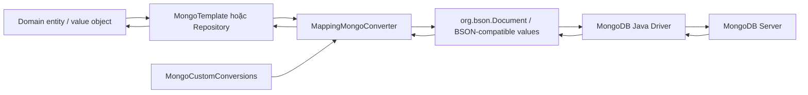

# Đăng ký MongoCustomConversions

Khi lưu một đối tượng Java vào MongoDB, **Spring Data MongoDB** phải chuyển dữ liệu giữa kiểu Java và BSON của MongoDB. Các kiểu quen thuộc như `String`, `Integer`, `Date` và nhiều collection đã có quy tắc chuyển đổi sẵn. Nhưng ứng dụng thực tế thường dùng **value object** như `EmailAddress`, `Money`, mã định danh chuyên biệt hoặc dữ liệu kế thừa có định dạng BSON không giống model Java.

Trong chương **Chuyển đổi dữ liệu** của module `SPRING_DATA_MONGODB`, bài này hướng dẫn đăng ký converter bằng `MongoCustomConversions`, phân biệt **đọc** và **ghi**, tích hợp với `MappingMongoConverter`, `MongoTemplate` và repository, kiểm thử định dạng BSON, xử lý thay đổi schema và lưu ý khi nâng cấp Spring Data. Những nền tảng ấy hỗ trợ các bài tiếp theo về query, aggregation, index, transaction, reactive access và chẩn đoán hiệu năng dữ liệu.

> **Thông điệp trọng tâm:** `MongoCustomConversions` là nơi **đăng ký quy tắc chuyển đổi dữ liệu**, không phải MongoDB Java Driver hay chuỗi kết nối. Converter ảnh hưởng trực tiếp đến cách lưu và đọc BSON; một thay đổi converter có thể là **thay đổi schema** dù class domain gần như không đổi.

## 1. Mục tiêu học tập

Sau khi hoàn thành, bạn có thể:

1. Mô tả vai trò của `MongoCustomConversions` và `MappingMongoConverter` trong hai chiều chuyển đổi Java ↔ BSON.
2. Viết `Converter<JavaType, StoreType>` cho chiều ghi và `Converter<StoreType, JavaType>` cho chiều đọc.
3. Dùng `@WritingConverter` và `@ReadingConverter` để khai báo chiều chuyển đổi rõ ràng.
4. Đăng ký converter trong Spring Boot qua một bean `MongoCustomConversions`.
5. Phân biệt đăng ký converter khi dùng Spring Boot auto-configuration với cấu hình thủ công bằng `AbstractMongoClientConfiguration`.
6. Kiểm tra dữ liệu thực lưu trong collection, cả thao tác đọc lại qua `MongoTemplate`/repository và truy vấn dựa trên value object.
7. Xử lý tình huống converter bị đăng ký thiếu, quá rộng, không đối xứng hoặc phá vỡ dữ liệu cũ.
8. Phân biệt type converter, property converter và `@Field(targetType = …)`; cấu hình biểu diễn `BigDecimal` theo phiên bản Spring Data.
9. Xây dựng checklist kiểm thử trước khi triển khai thay đổi conversion lên ứng dụng thật.

## 2. MongoCustomConversions nằm ở đâu trong đường đi dữ liệu?



Khi **ghi** một document, `MappingMongoConverter` quan sát metadata của entity (như `@Document`, `@Id` và `@Field`), rồi chuyển từng thuộc tính sang kiểu BSON được hỗ trợ. Với một kiểu tùy biến đã đăng ký, nó có thể ưu tiên converter phù hợp trước khi đi theo cách mapping object thông thường.

Khi **đọc**, `MappingMongoConverter` nhận các giá trị từ BSON và tạo instance của entity. Nó có thể dùng reading converter để chuyển lại thành value object của ứng dụng.

| Thành phần | Vai trò thực tế |
| --- | --- |
| `MongoCustomConversions` | Đăng ký/tra cứu converter và cung cấp thông tin về kiểu đơn giản (`SimpleTypeHolder`) cho hệ thống mapping. |
| `MappingMongoConverter` | Thực hiện object mapping và chuyển đổi giữa entity Java, các giá trị được hỗ trợ và BSON document. |
| `Converter<S, T>` | Hàm chuyển một giá trị từ kiểu nguồn `S` sang kiểu đích `T`. |
| `@ReadingConverter` | Chỉ rõ quy tắc dùng để đọc giá trị từ store vào domain. |
| `@WritingConverter` | Chỉ rõ quy tắc dùng để ghi giá trị từ domain ra store. |
| `MongoTemplate` | API đồng bộ chạy query, update, aggregation, insert/save; dùng cơ chế mapping bên dưới. |
| `MongoRepository` | API repository cũng sử dụng mapping/conversion tương ứng. |
| MongoDB Java Driver | Quản lý kết nối, BSON codec, session và gửi lệnh; không thay thế vai trò `MongoCustomConversions`. |

**Phân biệt:** `MongoCustomConversions` thuộc Spring Data; `CodecRegistry` thuộc driver. Đăng ký một `Codec` ở tầng driver không đồng nghĩa Spring Data sẽ tự động coi một Java value object như một kiểu đơn giản trong tất cả các thao tác mapping.

### Khi không cần custom conversion

Nếu một object lồng nhau có cấu trúc tự nhiên:

```java
public record Address(String street, String city) {}
```

Spring Data thường có thể lưu nó thành BSON object:

```json
{
  "address": {
    "street": "12 Nguyen Trai",
    "city": "Ha Noi"
  }
}
```

Bạn không cần tự viết converter chỉ để ánh xạ record hoặc class thông thường. Converter cần thiết khi **muốn thay đổi biểu diễn lưu trữ**, chẳng hạn thay `EmailAddress` từ object `{ "value": "..." }` thành **chuỗi BSON**, hoặc cần đọc định dạng dữ liệu cũ.

## 3. Ví dụ nghiệp vụ: EmailAddress được lưu như một BSON string

Giả sử model domain muốn dùng `EmailAddress` để chặn email rỗng và gom quy tắc chuẩn hóa, nhưng collection hiện lưu email ở dạng chuỗi:

```json
{
  "_id": "CUS-101",
  "displayName": "Lan",
  "email": "lan@example.test"
}
```

Nếu không có custom converter, một Java record `EmailAddress(String value)` có thể được coi là object lồng nhau và ghi thành:

```json
{
  "_id": "CUS-101",
  "displayName": "Lan",
  "email": {
    "value": "lan@example.test"
  }
}
```

Hai định dạng **khác schema**. Các query như `{"email": "lan@example.test"}` và unique index đặt trên `email` không có cùng ý nghĩa khi dữ liệu bị chuyển thành object. Ta cần đăng ký hai converter để giữ dạng scalar BSON string.

### 3.1. Khai báo value object bất biến

```java
package dev.learning.customer;

import java.util.Locale;
import java.util.Objects;

public record EmailAddress(String value) {

    public EmailAddress {
        Objects.requireNonNull(value, "email");
        value = value.trim().toLowerCase(Locale.ROOT);

        // Kiểm tra tối thiểu cho ví dụ; chưa phải bộ xác thực email đầy đủ.
        int at = value.indexOf('@');
        if (at <= 0 || at == value.length() - 1 || value.contains(" ")) {
            throw new IllegalArgumentException("Địa chỉ email không hợp lệ");
        }
    }
}
```

Record là immutable ở mức component; `String` cũng là kiểu immutable. Constructor thực hiện chuẩn hóa **giá trị mà hệ thống đã quyết định lưu**. Không áp dụng quy tắc viết thường vào mọi dữ liệu email mà không xem yêu cầu nghiệp vụ và chiến lược so sánh của ứng dụng; ví dụ chỉ minh họa một chính sách cụ thể.

Tạo entity chứa value object:

```java
package dev.learning.customer;

import org.springframework.data.annotation.Id;
import org.springframework.data.mongodb.core.mapping.Document;

@Document("customers")
public record Customer(
        @Id String id,
        String displayName,
        EmailAddress email) {
}
```

Mục tiêu: dùng `EmailAddress` trong Java, nhưng field `email` của MongoDB là một **BSON string**.

## 4. Viết @WritingConverter: từ domain sang BSON

Một writing converter nhận value object Java và trả giá trị native mà MongoDB Java Driver xử lý được:

```java
package dev.learning.customer;

import org.springframework.core.convert.converter.Converter;
import org.springframework.data.convert.WritingConverter;

@WritingConverter
public final class EmailAddressWriteConverter
        implements Converter<EmailAddress, String> {

    @Override
    public String convert(EmailAddress source) {
        return source.value();
    }
}
```

Luồng:

```text
Java                         Spring Data                     MongoDB
EmailAddress("lan@...")  ->   EmailAddressWriteConverter  ->  "lan@..."
```

- `EmailAddress` là kiểu riêng của domain.
- `String` là kiểu có thể được BSON/driver xử lý trực tiếp.
- Khi mapping thuộc tính `Customer.email`, converter có thể thay thế cách chuyển thành nested document bằng một string.
- Annotation `@WritingConverter` làm rõ converter **chỉ phục vụ ghi**.

Trong ví dụ, converter không gọi API mạng và không ghi database. Nó chỉ mô tả biến đổi một giá trị.

### Converter nên là hàm thuần

Một converter tốt thường:

- Không phụ thuộc vào `MongoTemplate` hay repository để truy vấn thêm dữ liệu.
- Không gọi HTTP, gửi email hoặc tạo side effect.
- Không thay đổi `source`.
- Không tự sinh ngẫu nhiên một giá trị khác mỗi lần ghi.
- Có hành vi xác định, dễ kiểm thử.
- Ném lỗi có ý nghĩa cho dữ liệu không phù hợp, thay vì âm thầm ghi sai.

Nếu cần mã hóa dữ liệu nhạy cảm, nên dùng cơ chế và chuẩn mã hóa phù hợp, quản lý khóa riêng, đồng thời cân nhắc giải pháp mã hóa field chuyên biệt của MongoDB. Converter tự viết không tự động bảo đảm bảo mật hoặc khả năng truy vấn.

## 5. Viết @ReadingConverter: từ BSON về domain

Reading converter là chiều ngược lại:

```java
package dev.learning.customer;

import org.springframework.core.convert.converter.Converter;
import org.springframework.data.convert.ReadingConverter;

@ReadingConverter
public final class EmailAddressReadConverter
        implements Converter<String, EmailAddress> {

    @Override
    public EmailAddress convert(String source) {
        return new EmailAddress(source);
    }
}
```

Luồng:

```text
MongoDB                          Spring Data                   Java
"lan@example.test"           ->   EmailAddressReadConverter -> EmailAddress(...)
```

Khi entity được đọc từ MongoDB, Spring Data có thể truyền string cho reading converter và nhận lại `EmailAddress`.

**Đặc tính cần kiểm thử:** với mọi giá trị hợp lệ trong phạm vi ứng dụng, kết quả đọc lại phải khớp kỳ vọng:

```text
read(write(EmailAddress("lan@example.test")))
    == EmailAddress("lan@example.test")
```

Không phải mọi converter đều bắt buộc đảo ngược tuyệt đối: ví dụ converter làm tròn, chuẩn hóa hoặc loại bỏ dữ liệu có thể mang tính một chiều. Nhưng nếu một thay đổi khiến dữ liệu không thể khôi phục, phải ghi rõ ràng và có migration/test phù hợp.

## 6. Đăng ký MongoCustomConversions trong Spring Boot

Annotation `@ReadingConverter` và `@WritingConverter` **không làm cho Spring Data tự động quét và đăng ký class converter**. Cần đăng ký instance của chúng.

Trong dự án Spring Boot dùng `spring-boot-starter-data-mongodb`, cách trực tiếp là tạo một bean `MongoCustomConversions`:

```java
package dev.learning.customer;

import org.springframework.context.annotation.Bean;
import org.springframework.context.annotation.Configuration;
import org.springframework.data.mongodb.core.convert.MongoCustomConversions;

@Configuration(proxyBeanMethods = false)
public class MongoConversionConfiguration {

    @Bean
    MongoCustomConversions mongoCustomConversions() {
        return MongoCustomConversions.create(adapter -> {
            adapter.registerConverter(new EmailAddressWriteConverter());
            adapter.registerConverter(new EmailAddressReadConverter());
        });
    }
}
```

`MongoCustomConversions.create(...)` cung cấp `MongoConverterConfigurationAdapter` để cấu hình các converter và tùy chọn MongoDB cụ thể. Cách này phù hợp với Spring Data MongoDB 4.5 và 5.x; ưu tiên **một bean rõ ràng** để tránh các class config khác vô tình cung cấp những tập converter khác nhau.

Khi vẫn dùng auto-configuration mặc định, Spring Boot lấy bean `MongoCustomConversions` và đưa vào hệ thống mapping MongoDB. Thông thường bạn **không cần** tự tạo `MappingMongoConverter` hoặc `MongoTemplate`.

### 6.1. Maven dependency

Với Spring Boot (parent/BOM đã được chọn phù hợp), dependency cơ bản:

```xml
<dependencies>
    <dependency>
        <groupId>org.springframework.boot</groupId>
        <artifactId>spring-boot-starter-data-mongodb</artifactId>
    </dependency>

    <dependency>
        <groupId>org.springframework.boot</groupId>
        <artifactId>spring-boot-starter-test</artifactId>
        <scope>test</scope>
    </dependency>
</dependencies>
```

Các import chính:

| API | Package |
| --- | --- |
| `MongoCustomConversions` | `org.springframework.data.mongodb.core.convert` |
| `@ReadingConverter` / `@WritingConverter` | `org.springframework.data.convert` |
| `Converter<S, T>` | `org.springframework.core.convert.converter` |
| `MongoTemplate` | `org.springframework.data.mongodb.core` |
| `MappingMongoConverter` | `org.springframework.data.mongodb.core.convert` |

Giữ phiên bản Spring Data MongoDB, Spring Data Commons và Java Driver đồng bộ với BOM của Spring Boot; việc thêm dependency thủ công sai version có thể gây lỗi chuyển đổi hoặc mapping khi runtime.

### 6.2. Có thể đăng ký bằng constructor nhận danh sách

Một dạng phổ biến trong các dự án cũ:

```java
@Bean
MongoCustomConversions mongoCustomConversions() {
    return new MongoCustomConversions(java.util.List.of(
            new EmailAddressWriteConverter(),
            new EmailAddressReadConverter()
    ));
}
```

Cách này hợp lệ ở những nhánh còn hỗ trợ constructor đó. Tuy nhiên, phương thức `create(adapter -> …)` rõ ràng và thuận tiện hơn khi cần thêm cấu hình native Java Time, BigDecimal hoặc property conversions.

### 6.3. Không nhầm với Spring MVC ConversionService

Một `Converter<EmailAddress, String>` được đăng ký trong `MongoCustomConversions` phục vụ mapping MongoDB. Nó **không tự động** chuyển query parameter HTTP của Spring MVC hay JSON request/response của Jackson theo cùng quy tắc. Spring MVC có conversion service riêng, Jackson có serializer/deserializer riêng.

Nếu cùng value object xuất hiện tại nhiều ranh giới (REST, messaging, MongoDB), xác định rõ ràng nơi cần conversion và kiểm thử từng đường dữ liệu.

## 7. Cấu hình thủ công qua AbstractMongoClientConfiguration

Nếu ứng dụng **không để Spring Boot quản lý toàn bộ cấu hình MongoDB** mà dùng `AbstractMongoClientConfiguration`, bạn có thể ghi đè hook cấu hình converter:

```java
package dev.learning.customer;

import org.springframework.context.annotation.Configuration;
import org.springframework.data.mongodb.config.AbstractMongoClientConfiguration;
import org.springframework.data.mongodb.core.convert.MongoCustomConversions
        .MongoConverterConfigurationAdapter;

@Configuration
public class ManualMongoConfiguration
        extends AbstractMongoClientConfiguration {

    @Override
    protected String getDatabaseName() {
        return "customer_lab";
    }

    @Override
    protected void configureConverters(
            MongoConverterConfigurationAdapter adapter) {
        adapter.registerConverter(new EmailAddressWriteConverter());
        adapter.registerConverter(new EmailAddressReadConverter());
    }
}
```

Cần hiểu ranh giới:

- Đây là một **đường cấu hình thay thế** cho ứng dụng tự quản lý MongoDB context.
- `AbstractMongoClientConfiguration` cung cấp `MongoTemplate`, mapping context và các bean liên quan theo quy trình của nó.
- Với ứng dụng Spring Boot thông thường, dùng **bean `MongoCustomConversions` ở mục 6** đơn giản hơn và tránh thêm cấu hình database/factory không cần thiết.
- Đừng đặt cả hai cách vào cùng một ứng dụng thử rồi giả định framework tự chọn “đúng” bean khi có nhiều bean `MongoTemplate`/`MongoDatabaseFactory`/`MongoCustomConversions`.

Bất kể dùng cách nào, mục tiêu cuối là **converter thực sự được `MappingMongoConverter` của đường chạy đang dùng tiếp nhận**.

## 8. Kiểm tra kết quả với MongoTemplate

Sau khi đăng ký, một lời gọi `MongoTemplate.insert` sẽ chuyển `EmailAddress` sang BSON string.

```java
package dev.learning.customer;

import org.springframework.data.mongodb.core.MongoTemplate;
import org.springframework.stereotype.Service;

@Service
public class CustomerService {
    private final MongoTemplate mongoTemplate;

    public CustomerService(MongoTemplate mongoTemplate) {
        this.mongoTemplate = mongoTemplate;
    }

    public Customer create(String id, String name, String rawEmail) {
        Customer input = new Customer(
                id, name, new EmailAddress(rawEmail));

        return mongoTemplate.insert(input);
    }

    public Customer getById(String id) {
        Customer found =
                mongoTemplate.findById(id, Customer.class);
        if (found == null) {
            throw new IllegalArgumentException(
                    "Customer không tồn tại: " + id);
        }
        return found;
    }
}
```

Ví dụ gọi:

```java
Customer created = customerService.create(
        "CUS-101", "Lan", " LAN@EXAMPLE.TEST ");
Customer found = customerService.getById("CUS-101");

System.out.println(found.email().value());
// lan@example.test
```

Collection có dạng mong muốn:

```javascript
db.customers.findOne({ _id: "CUS-101" });
```

```json
{
  "_id": "CUS-101",
  "displayName": "Lan",
  "email": "lan@example.test"
}
```

**Kiểm tra thực tế thay vì chỉ in entity:** chỉ việc `found.email()` trả `EmailAddress` chưa chứng minh BSON được lưu như string. Để xác minh định dạng, đọc document thô bằng `mongoTemplate.getCollection("customers")` hoặc công cụ MongoDB tương ứng.

Một số cấu hình mapping có thể ghi thêm `_class`; ví dụ JSON ở trên chỉ tập trung vào trường liên quan đến conversion.

## 9. MongoRepository và query trên value object

`MongoRepository` cũng tham gia cùng cơ chế mapping, nếu repository đang dùng cùng `MongoDatabaseFactory`/`MappingMongoConverter`:

```java
package dev.learning.customer;

import java.util.Optional;

import org.springframework.data.mongodb.repository.MongoRepository;

public interface CustomerRepository
        extends MongoRepository<Customer, String> {

    Optional<Customer> findByEmail(EmailAddress email);
}
```

```java
Customer stored = repository.insert(
        new Customer(
                "CUS-102",
                "Minh",
                new EmailAddress("minh@example.test")));

Optional<Customer> hit = repository.findByEmail(
        new EmailAddress("MINH@EXAMPLE.TEST"));
```

Repository query phải biểu diễn giá trị tìm kiếm tương thích với kiểu BSON đã lưu. Với property có kiểu `EmailAddress`, hệ thống mapping có thể dùng writing conversion khi tạo query. Tuy nhiên, kiểm thử **cả query đầu vào lẫn BSON thực tế** là cần thiết, đặc biệt nếu dùng `@Query` JSON raw, aggregation stage tự xây, `BasicQuery` hoặc pipeline đi qua API mức thấp.

### 9.1. Query bằng MongoTemplate

```java
import org.springframework.data.mongodb.core.query.Criteria;
import org.springframework.data.mongodb.core.query.Query;

Query query = Query.query(
        Criteria.where("email").is(
                new EmailAddress("lan@example.test")));

Customer result = mongoTemplate.findOne(
        query, Customer.class);
```

Ở đây Java code thể hiện domain value object; Spring Data mapping có nhiệm vụ biểu diễn giá trị thành BSON string.

Đừng trộn hai cách truy vấn tùy tiện:

```javascript
// Tương thích với converter ghi EmailAddress -> String:
db.customers.find({ email: "lan@example.test" });

// Không khớp document lưu email dạng string:
db.customers.find({ "email.value": "lan@example.test" });
```

Nếu collection có unique index `{ email: 1 }`, việc thay biểu diễn email từ object thành string là thay đổi có ảnh hưởng đến index và dữ liệu. Phải xem lại schema và kế hoạch migration.

## 10. Converter disambiguation: tại sao cần @ReadingConverter / @WritingConverter?

Spring Data thường suy ra chiều converter dựa vào kiểu nguồn và kiểu đích:

- `EmailAddress → String`: đích là kiểu native mà store hiểu, nên thường được coi là writing conversion.
- `String → EmailAddress`: nguồn là kiểu native, nên thường được coi là reading conversion.

Nhưng nếu **cả hai đầu đều là kiểu native**, chẳng hạn:

```java
Converter<String, Long>
```

Framework không thể luôn suy ra converter dành cho lúc đọc hay ghi. Nếu vô tình đăng ký sai chiều, một conversion rất rộng có thể ảnh hưởng nhiều property không liên quan.

Vì vậy nên ghi annotation tường minh:

```java
@ReadingConverter
final class LegacyIdReadConverter
        implements Converter<String, LegacyId> {
    @Override
    public LegacyId convert(String source) {
        return new LegacyId(source);
    }
}
```

Nếu quy tắc chỉ áp dụng cho **một field** cụ thể, không nên đăng ký converter toàn cục giữa hai kiểu phổ biến như `String` và `String`. Hãy xem `@ValueConverter` hoặc property conversion (mục 12).

### Hai converter có cùng cặp kiểu

Tránh đăng ký hai `Converter<String, EmailAddress>` với thuật toán khác nhau rồi dựa vào “cái nào được chọn trước”. Phạm vi và thứ tự có thể làm cấu hình khó đoán. Nên có một quy tắc đọc rõ ràng, được kiểm thử với dữ liệu cũ và mới; nếu cần migration đặc thù, giải quyết bằng schema/version hoặc converter biết phân biệt nguồn dữ liệu.

## 11. Khi nào viết converter cho cả document?

Không chỉ scalar value object, converter còn có thể thao tác với `org.bson.Document`. Ví dụ collection cũ lưu giá trị tiền trong một object nhúng có tên field `minor_units` và `ccy`; domain muốn đọc thành record `Money`.

```json
{
  "_id": "PAY-101",
  "amount": {
    "minor_units": 12500,
    "ccy": "VND"
  }
}
```

Domain:

```java
package dev.learning.payment;

import java.util.Objects;

public record Money(long minorUnits, String currency) {
    public Money {
        if (minorUnits < 0) {
            throw new IllegalArgumentException("Số tiền âm");
        }
        Objects.requireNonNull(currency, "currency");
        if (currency.isBlank()) {
            throw new IllegalArgumentException("Thiếu mã tiền tệ");
        }
    }
}
```

Writing converter:

```java
package dev.learning.payment;

import org.bson.Document;
import org.springframework.core.convert.converter.Converter;
import org.springframework.data.convert.WritingConverter;

@WritingConverter
public final class MoneyWriteConverter
        implements Converter<Money, Document> {

    @Override
    public Document convert(Money source) {
        return new Document("minor_units", source.minorUnits())
                .append("ccy", source.currency());
    }
}
```

Reading converter:

```java
package dev.learning.payment;

import org.bson.Document;
import org.springframework.core.convert.converter.Converter;
import org.springframework.data.convert.ReadingConverter;

@ReadingConverter
public final class MoneyReadConverter
        implements Converter<Document, Money> {

    @Override
    public Money convert(Document source) {
        Object raw = source.get("minor_units");
        if (!(raw instanceof Long minorUnits)) {
            throw new IllegalArgumentException(
                    "amount.minor_units phải là BSON Int64");
        }

        return new Money(
                minorUnits,
                source.getString("ccy"));
    }
}
```

Thêm hai converter đó **vào cùng bean đã đăng ký ở mục 6**:

```java
@Bean
MongoCustomConversions mongoCustomConversions() {
    return MongoCustomConversions.create(adapter -> {
        adapter.registerConverter(new EmailAddressWriteConverter());
        adapter.registerConverter(new EmailAddressReadConverter());
        adapter.registerConverter(new MoneyWriteConverter());
        adapter.registerConverter(new MoneyReadConverter());
    });
}
```

**Cảnh báo về dữ liệu:** ví dụ chủ động yêu cầu BSON Int64 vì `Money` dùng `long` và writing converter luôn ghi `Long`. Một document cũ có BSON Int32 hoặc Decimal128 sẽ bị từ chối; nếu cần hỗ trợ chúng, hãy triển khai nhánh migration/conversion chính xác theo từng kiểu. Không dùng `Number.longValue()` một cách mù quáng vì nó có thể âm thầm cắt phần thập phân.

Với converter `Money ↔ Document`, việc Spring Data biết `Money` là kiểu có converter có thể thay đổi cách nó map mọi property có kiểu `Money`, kể cả trong các nested document và danh sách. Hãy cân nhắc mức ảnh hưởng trước khi áp dụng toàn cục.

### Tại sao không chuyển mọi entity thành Document bằng converter?

Một `Converter<Customer, Document>` ở mức root có thể chiếm quyền xử lý mapping mặc định của `MappingMongoConverter`. Khi đó bạn phải tự xử lý các field như `_id`, `_class`, nested property, version, auditing và các định dạng mà framework vốn đã làm. Chỉ dùng cách này khi **thực sự cần kiểm soát toàn bộ biểu diễn**, và kiểm thử đầy đủ các đường ghi/đọc.

Đối với một hoặc hai field cụ thể, converter của value object hoặc property converter thường an toàn và dễ bảo trì hơn.

## 12. Type converter, property converter và @Field(targetType)

Không phải nhu cầu nào cũng cần custom converter toàn kiểu.

| Công cụ | Phạm vi | Khi nên dùng |
| --- | --- | --- |
| `MongoCustomConversions` + `Converter<S,T>` | Tất cả property/giá trị mà type converter áp dụng trong mapping context | Kiểu domain chuyên biệt phải có cùng biểu diễn BSON ở nhiều entity. |
| `@Field(targetType = …)` | Một property và kiểu lưu mong muốn | Chọn BSON type phù hợp, ví dụ `DECIMAL128` cho giá trị thập phân. |
| `@ValueConverter` | Một property đã gắn annotation | Một trường cần quy tắc chuyển riêng, không nên tác động toàn kiểu. |
| `PropertyValueConverter` đăng ký qua adapter | Một property xác định trong model | Không muốn annotate entity hoặc cần cấu hình tập trung. |
| Custom `CodecRegistry` của MongoDB Driver | Tầng BSON codec của driver | Dùng API driver trực tiếp hoặc kiểu codec cần thiết ở lớp driver; không thay thế đăng ký type mapping của Spring Data. |

Ví dụ **property converter** dành riêng cho một field có thể dùng:

```java
import org.springframework.data.convert.ValueConverter;

// Property cụ thể sử dụng converter đã triển khai:
@ValueConverter(SecretFieldConverter.class)
private String secretToken;
```

`SecretFieldConverter` ở đây là **tên lớp minh họa**, phải được triển khai theo `PropertyValueConverter` với kiểu/context phù hợp trước khi code có thể biên dịch. Khi cần xử lý mã hóa, thiết kế key management, thuật toán và khả năng truy vấn là một phần của bài toán, không chỉ annotation.

Nếu dùng đăng ký bằng code, `MongoConverterConfigurationAdapter` cung cấp các API như `configurePropertyConversions(...)`. Một số cách đăng ký theo method reference cần proxy method; **record/final class** có thể làm cách đó không áp dụng được. Đường dẫn lồng nhau bằng dot notation trong API đăng ký property converter cũng có giới hạn: không coi `"address.street"` là tên property trực tiếp hợp lệ trong mọi đăng ký.

## 13. BigDecimal và BigInteger: điểm khác giữa Spring Data MongoDB 4.5 và 5.x

Đây là tình huống rất đáng chú ý khi nâng **Spring Boot 3.5 / Spring Data MongoDB 4.5** lên **Spring Boot 4.x / Spring Data MongoDB 5.x**.

### 13.1. Tại sao kiểu BSON quan trọng?

MongoDB hỗ trợ `Decimal128` để lưu giá trị thập phân theo chuẩn BSON. Với một số tiền `12.50`:

```javascript
// BSON string:
{ amount: "12.50" }

// BSON Decimal128:
{ amount: NumberDecimal("12.50") }
```

Hai cách lưu khác kiểu. Chuỗi được sắp xếp **theo thứ tự từ điển**, có thể sai với thứ tự số; Decimal128 hỗ trợ so sánh và phép toán số theo khả năng của MongoDB.

Nếu collection trước đây đã lưu amount là string, chuyển sang Decimal128 mà không migration có thể khiến cùng một field tồn tại hai BSON type, ảnh hưởng sort, range query, index và aggregation.

### 13.2. Quy tắc theo phiên bản

| Spring Data MongoDB | Biểu diễn `BigDecimal`/`BigInteger` |
| --- | --- |
| **4.5.x** | Có hành vi mặc định lịch sử chuyển kiểu số lớn thành **String**; có thể dùng `@Field(targetType = DECIMAL128)` hoặc cấu hình conversion để lưu Decimal128. |
| **5.0.x / 5.1.x** | **Không còn mặc định một biểu diễn** cho các kiểu số lớn này: cần khai báo representation khi dự án lưu những giá trị đó. |

Một cấu hình Spring Data 5.x chọn Decimal128 làm representation:

```java
import org.springframework.context.annotation.Bean;
import org.springframework.context.annotation.Configuration;
import org.springframework.data.mongodb.core.convert.MongoCustomConversions;
import org.springframework.data.mongodb.core.convert.MongoCustomConversions
        .BigDecimalRepresentation;

@Configuration(proxyBeanMethods = false)
class DecimalConversionConfiguration {

    @Bean
    MongoCustomConversions mongoCustomConversions() {
        return MongoCustomConversions.create(adapter -> {
            adapter.bigDecimal(BigDecimalRepresentation.DECIMAL128);
            adapter.registerConverter(new EmailAddressWriteConverter());
            adapter.registerConverter(new EmailAddressReadConverter());
        });
    }
}
```

**Trong một ứng dụng, chỉ tạo một bean `MongoCustomConversions` phù hợp**, ghép các converter cần thiết vào đó. Đoạn config trên là **phương án thay thế** cho bean ở mục 6, không phải bean thứ hai để copy vào cùng project.

Nếu cần giữ tương thích dữ liệu cũ dạng String mà vẫn cho phép property riêng lưu Decimal128, tài liệu Spring Data 5.x hướng dẫn có thể khai báo **nhiều representation**, trong đó biểu diễn đứng đầu là mặc định:

```java
adapter.bigDecimal(
        BigDecimalRepresentation.STRING,
        BigDecimalRepresentation.DECIMAL128);
```

Khi một property chỉ rõ target:

```java
import java.math.BigDecimal;

import org.springframework.data.mongodb.core.mapping.Field;
import org.springframework.data.mongodb.core.mapping.FieldType;

public record Payment(
        @Field(targetType = FieldType.DECIMAL128)
        BigDecimal amount) {
}
```

hãy kiểm tra bản MongoDB Spring Data đang sử dụng và test định dạng BSON cuối cùng. Có trường hợp biểu diễn số lớn vượt phạm vi/độ chính xác của Decimal128; không được ép chuyển và âm thầm làm tròn tiền. Nếu yêu cầu tính toán tiền bằng số nguyên đơn vị nhỏ nhất, `long` có thể là lựa chọn phù hợp với giới hạn số tiền của nghiệp vụ.

### 13.3. Không trộn representation một cách ngẫu nhiên

Nếu một field đã có string và Decimal128 xen lẫn, truy vấn phạm vi có thể tạo kết quả bất ngờ. Khi nâng cấp:

1. Thống kê BSON type đang có trong field.
2. Chọn format đích theo yêu cầu nghiệp vụ.
3. Chuẩn bị migration và kiểm thử dữ liệu biên.
4. Chốt custom conversion và `@Field` đúng với format đích.
5. Chạy lại query, aggregation, index, sort và tính toán số học.

Chỉ chạy test object Java sau khi round-trip là chưa đủ: hai representation khác nhau có thể cùng map về `BigDecimal` nhưng khác nhau ở behavior của MongoDB.

## 14. Java Time và múi giờ khi cấu hình conversion

Với `LocalDate`, `LocalTime`, `LocalDateTime`, các converter mặc định lịch sử của Spring Data có thể dùng **múi giờ hệ thống** trong quá trình chuyển đổi. MongoDB Java Driver có cơ chế native Java Time dựa trên UTC.

Khi cần nhất quán về múi giờ, cấu hình rõ chính sách trong adapter:

```java
@Bean
MongoCustomConversions mongoCustomConversions() {
    return MongoCustomConversions.create(adapter -> {
        adapter.useNativeDriverJavaTimeCodecs();
        adapter.registerConverter(new EmailAddressWriteConverter());
        adapter.registerConverter(new EmailAddressReadConverter());
    });
}
```

Đây cũng là **phương án thay thế cho bean `MongoCustomConversions` chính**; hãy ghép vào một bean duy nhất của ứng dụng.

Một số lưu ý:

- `Instant` biểu diễn thời điểm trên timeline; `LocalDateTime` không mang offset/time zone.
- Việc đổi converter date/time có thể thay đổi giá trị mà dữ liệu cũ được diễn giải, nhất là nếu trước đây ứng dụng chạy ở các múi giờ khác nhau.
- Lưu timestamp theo UTC và biểu diễn múi giờ ở ranh giới ứng dụng thường dễ kiểm soát hơn.
- Cần kiểm thử trước/sau migration với timestamp gần ranh giới ngày, giờ mùa hè (nếu có), và các trường thiếu zone.

Không dùng converter tùy ý để giải quyết thiếu mô hình time zone. Chọn kiểu domain phù hợp và quy ước dữ liệu trước khi cấu hình serialization.

## 15. Kiểm thử converter: ba mức khác nhau

Một bài kiểm thử tốt nên xác minh **logic chuyển đổi**, **mapping BSON**, rồi **truy vấn thực tế**.

### 15.1. Unit test converter, không cần MongoDB

```java
package dev.learning.customer;

import static org.junit.jupiter.api.Assertions.assertEquals;

import org.junit.jupiter.api.Test;

class EmailAddressConvertersTest {

    @Test
    void writeAndReadBack() {
        EmailAddress original =
                new EmailAddress(" LAN@EXAMPLE.TEST ");

        String stored =
                new EmailAddressWriteConverter().convert(original);
        EmailAddress restored =
                new EmailAddressReadConverter().convert(stored);

        assertEquals("lan@example.test", stored);
        assertEquals(original, restored);
    }
}
```

Test này rất nhanh, giúp kiểm tra hai chiều nhưng **không xác minh converter đã được đăng ký** vào `MappingMongoConverter`.

### 15.2. Integration test kiểm tra BSON thật

Khi có MongoDB test với URI riêng và Spring Boot đã nạp bean `MongoCustomConversions`:

```java
package dev.learning.customer;

import static org.junit.jupiter.api.Assertions.*;

import java.util.UUID;

import org.bson.Document;
import org.junit.jupiter.api.Test;
import org.springframework.beans.factory.annotation.Autowired;
import org.springframework.boot.test.context.SpringBootTest;
import org.springframework.data.mongodb.core.MongoTemplate;

@SpringBootTest
class CustomerConversionIntegrationTest {

    @Autowired MongoTemplate template;

    @Test
    void storesScalarEmailAndReadsValueObject() {
        String id = "CUS-" + UUID.randomUUID();

        Customer customer = new Customer(
                id,
                "Lan",
                new EmailAddress(" LAN@EXAMPLE.TEST "));

        template.insert(customer);

        // Driver đọc BSON document thô, không map sang Customer.
        Document raw = template.getCollection("customers")
                .find(new Document("_id", id))
                .first();

        assertNotNull(raw);
        assertTrue(raw.get("email") instanceof String);
        assertEquals("lan@example.test", raw.getString("email"));

        Customer restored = template.findById(id, Customer.class);

        assertNotNull(restored);
        assertEquals(
                new EmailAddress("lan@example.test"),
                restored.email());
    }
}
```

Kỳ vọng của test: `email` trong BSON là string, dữ liệu đọc lại trong Java là `EmailAddress`. Dùng ID có tiền tố `CUS-` giúp tránh nhầm conversion `@Id String` thành BSON ObjectId cho chuỗi hex 24 ký tự.

Integration test ghi dữ liệu thật vào collection test; hãy cấp database hoặc container riêng, không sử dụng production. Test trên **cùng dòng MongoDB Server** với môi trường mục tiêu khi cần bảo đảm tương thích.

### 15.3. Kiểm thử query bằng value object

```java
@Test
void queryUsesCustomWritingConversion() {
    String id = "CUS-" + java.util.UUID.randomUUID();
    template.insert(new Customer(
            id,
            "Minh",
            new EmailAddress("minh@example.test")));

    var query = org.springframework.data.mongodb.core.query.Query.query(
            org.springframework.data.mongodb.core.query.Criteria
                    .where("email")
                    .is(new EmailAddress("MINH@EXAMPLE.TEST")));

    Customer found = template.findOne(query, Customer.class);

    assertNotNull(found);
    assertEquals(id, found.id());
}
```

Kiểm thử này quan trọng vì ứng dụng có thể đọc/ghi đúng nhưng query chứa object khác kiểu BSON so với dữ liệu đã lưu nếu query được tạo qua đường mapping khác.

### 15.4. Test dữ liệu cũ

Tạo hai bộ dữ liệu thử:

- BSON đang dùng trong production trước khi thêm converter.
- BSON dự kiến sau khi thêm converter.

Nếu converter mới chỉ đọc được định dạng mới, việc rollout có thể khiến document cũ không thể materialize. Khi cần hỗ trợ song song, có thể bổ sung reading converter dựa trên **kiểu BSON nguồn khác nhau** (ví dụ `Document → EmailAddress` cho schema cũ và `String → EmailAddress` cho schema mới), nhưng phải kiểm thử kỹ và tránh xung đột converter.

Không nên bắt converter thay đổi schema bằng cách tự gọi database trong lúc đọc từng field. Migration dữ liệu thường rõ ràng hơn khi thay đổi format trên quy mô lớn.

## 16. Tác động đến query, aggregation, index, transaction và reactive

**Query và aggregation:** các API Spring Data có thể áp dụng mapping khi lập query, nhưng pipeline JSON thô, các expression đặc biệt và thao tác driver trực tiếp có thể không chuyển giá trị theo cách như `MongoTemplate` object mapping. Nếu BSON field được lưu khác kiểu, các biểu thức `$match`, `$sort`, `$group` hoặc `$sum` có thể trả kết quả khác. Hãy kiểm tra pipeline thật.

**Index và unique constraint:** converter thay đổi BSON type hoặc đường dẫn field có thể làm index đang có không còn phù hợp. Ví dụ từ `email.value` sang `email` cần xem lại unique index. Nếu conversion của ID hoặc khóa được thay đổi, nguy cơ trùng hoặc không tìm thấy record phải được xử lý có chủ đích.

**Transaction:** converter chạy trong quá trình mapping trước hoặc trong thao tác đọc/ghi; nó **không tạo transaction**. Transaction MongoDB vẫn cần topology, transaction manager và session phù hợp. Một lỗi conversion có thể khiến nghiệp vụ thất bại; cách rollback phụ thuộc ranh giới transaction thực tế.

**Reactive:** `ReactiveMongoTemplate` và `ReactiveMongoRepository` dùng cơ chế mapping tương ứng, nhưng trả `Mono`/`Flux`. Converter đồng bộ dạng `Converter<S,T>` cần nhanh, không block để gọi HTTP hoặc truy cập database. Nếu converter làm I/O trong reactive pipeline, bạn có thể làm nghẽn luồng xử lý.

**Hiệu năng:** converter được gọi rất nhiều lần khi đọc/ghi collection lớn. Tránh format/parse phức tạp, cấp phát không cần thiết, regex biên dịch mỗi lần, network hoặc lookup stateful. Với lượng dữ liệu lớn, đo throughput và memory allocations cùng hệ thống query/index.

## 17. Những lỗi thường gặp

| Hiện tượng | Nguyên nhân đáng kiểm tra | Hướng xử lý |
| --- | --- | --- |
| Converter có `@ReadingConverter` nhưng không chạy | Chưa đăng ký trong `MongoCustomConversions` | Tạo một bean đăng ký converter; xác minh wiring. |
| Đọc được object nhưng BSON lưu sai kiểu | Thiếu writing converter hoặc bị mapping mặc định xử lý | Kiểm tra cặp kiểu, annotation và raw BSON. |
| BSON đúng nhưng không tạo được domain object | Thiếu reading converter, dữ liệu cũ khác schema hoặc constructor từ chối | Test dữ liệu cũ/mới, conversion path và validation. |
| `findByEmail` không tìm thấy bản ghi | Query không dùng đúng value object hoặc BSON hiện có khác format | Kiểm tra query được tạo và field thực lưu; test query với MongoTemplate. |
| Toàn bộ String/Long trong app bị ảnh hưởng | Converter giữa hai kiểu quá rộng hoặc chiều không rõ | Dùng `@ReadingConverter`/`@WritingConverter` và property converter khi cần. |
| Khi nâng cấp, `BigDecimal` không lưu như trước | Spring Data 5.x thay đổi yêu cầu chọn representation | Cấu hình `bigDecimal(...)`, test Decimal128/String và chuẩn bị migration. |
| Dữ liệu thời gian lệch vài giờ | Converter Java Time khác chính sách timezone trước đó | Chốt UTC/local time rule và test dữ liệu cũ. |
| Lỗi mapping chỉ khi chạy production | BSON có dữ liệu thiếu/sai kiểu, khác dữ liệu test | Lấy mẫu schema đã ẩn thông tin nhạy cảm, viết migration/test tương thích. |
| Dùng `MongoClient` thuần không thấy converter | Bỏ qua Spring Data mapping layer | Dùng Spring Data API hoặc cấu hình codec tương ứng ở tầng driver. |
| Tạo hai bean `MongoCustomConversions` | Cấu hình cạnh tranh hoặc bean injection không rõ | Gộp quy tắc vào một bean theo kiến trúc ứng dụng. |
| Converter gọi repository gây truy vấn lặp lại | Vi phạm vai trò pure transformation | Di chuyển logic cần I/O ra service/batch migration. |

### Quy trình chẩn đoán nhanh

1. Xác minh **Spring Boot/Spring Data MongoDB** và các dependency thực tế.
2. Xác minh bean `MongoCustomConversions` đã được nạp trong application context.
3. Xác minh `MappingMongoConverter` mà `MongoTemplate`/repository đang dùng nhận cùng cấu hình conversion.
4. Kiểm thử converter riêng bằng input hợp lệ và không hợp lệ.
5. Ghi một document mẫu vào database test, đọc lại BSON thô.
6. Đọc object qua `MongoTemplate` và query theo value object.
7. Kiểm tra dữ liệu cũ, index, aggregation và các đường ghi qua driver trực tiếp.

## 18. Bài tập thực hành

### Bài 1 — Giá trị email có kiểu riêng

Tạo `EmailAddress` và hai converter để `Customer.email` lưu thành BSON string. Đăng ký bean `MongoCustomConversions`. Viết test xác nhận BSON thô và object Java khi đọc lại.

**Yêu cầu đạt:** MongoDB giữ `email: "lan@example.test"`, còn Java giữ `EmailAddress`; input có khoảng trắng được chuẩn hóa theo constructor.

### Bài 2 — Đọc schema cũ

Giả sử dữ liệu cũ lưu:

```json
{ "email": { "value": "lan@example.test" } }
```

Thiết kế một reading converter `Document → EmailAddress` để đọc cùng với converter `String → EmailAddress` cho dữ liệu mới. Giải thích tại sao cần migration trước khi xóa đường đọc schema cũ.

### Bài 3 — Lưu Money như object nhúng

Tạo converter `Money ↔ Document` với field BSON `minor_units`, `ccy`. Dùng collection `payments` lưu 2 bản ghi, đọc lại và xác minh kiểu của `minor_units` là số nguyên thích hợp.

**Yêu cầu đạt:** Không mất giá trị tiền do ép kiểu sai; test có số lớn, số âm và field thiếu.

### Bài 4 — Chọn BigDecimal representation

Dự án đang dùng Spring Data MongoDB 4.5 và có field amount dưới dạng string. Nhóm muốn nâng lên 5.x và chuyển một số field sang Decimal128. Lập kế hoạch cấu hình `MongoCustomConversions`, `@Field(targetType = DECIMAL128)` và migration để giữ kết quả sort/range query chính xác.

### Bài 5 — Query và index sau thay đổi conversion

Trước khi đổi converter, MongoDB lưu `email.value`. Sau đổi converter, lưu `email` dạng string. Liệt kê những query, index, unique constraint và pipeline aggregation cần rà soát.

### Bài 6 — Cặp kiểu native gây mơ hồ

Một developer đăng ký `Converter<String, Long>` với ý định chỉ áp dụng lúc đọc một trường cụ thể. Giải thích rủi ro, dùng annotation nào để chọn chiều và khi nào cần chuyển sang property converter.

### Đáp án gợi ý

1. `EmailAddressWriteConverter` và `EmailAddressReadConverter` được đăng ký bằng `MongoCustomConversions.create(adapter -> …)`; kiểm thử raw BSON và round-trip.
2. Cần phân biệt BSON nguồn là `Document` hoặc `String`, không tự động xóa khả năng đọc dữ liệu cũ; kết hợp migration và kiểm thử.
3. Converter phải xử lý kiểu/range chính xác; nếu định dạng cố định ở BSON Int64, từ chối giá trị không phù hợp.
4. Spring Data MongoDB 5.x cần định nghĩa representation cho `BigDecimal`; chuẩn bị migration thay vì đổi config mà không quan sát dữ liệu.
5. Đổi tên/kiểu BSON field ảnh hưởng query/index/pipeline; cần thay đổi có kiểm soát.
6. Dùng `@ReadingConverter` để chỉ rõ chiều; property converter khi quy tắc chỉ dành cho một field cụ thể.

## 19. Checklist trước khi đưa vào hệ thống

- [ ] Xác định kiểu Java/domain và **kiểu BSON đích** cho mọi converter.
- [ ] Tạo cặp reading/writing converter hoặc ghi rõ lý do chỉ cần một chiều.
- [ ] Đánh dấu `@ReadingConverter` / `@WritingConverter`, nhất là khi kiểu native xuất hiện ở hai đầu.
- [ ] Đăng ký **tường minh** trong một bean `MongoCustomConversions` và xác minh wiring với `MappingMongoConverter`.
- [ ] Test đơn vị converter trên giá trị biên, null/missing và dữ liệu lỗi.
- [ ] Test tích hợp **raw BSON** để biết format đang được lưu.
- [ ] Test round-trip, query, sort, range filter và aggregation có liên quan.
- [ ] Xem lại index, unique constraint và các tài liệu schema cũ.
- [ ] Với Spring Data MongoDB 5.x, chốt representation cho `BigDecimal`/`BigInteger` nếu ứng dụng sử dụng chúng.
- [ ] Chốt chính sách Java Time/time zone khi lưu và đọc dữ liệu cũ.
- [ ] Tránh converter side effect, network I/O hoặc lookup database.
- [ ] Đánh giá ảnh hưởng của conversion trong reactive pipeline và transaction.
- [ ] Lưu kế hoạch migration và rollback khi thay đổi BSON format.

## 20. Tài liệu tham khảo chính thức

1. [Spring Data MongoDB 5.1 — Custom Conversions](https://docs.spring.io/spring-data/mongodb/reference/mongodb/mapping/custom-conversions.html): `Converter`, hai chiều đọc/ghi, đăng ký, BigDecimal.
2. [Spring Data MongoDB 4.5 — Custom Conversions](https://docs.spring.io/spring-data/mongodb/reference/4.5/mongodb/mapping/custom-conversions.html): biểu diễn mặc định số lớn trước thay đổi 5.x.
3. [Spring Data MongoDB — Object Mapping](https://docs.spring.io/spring-data/mongodb/reference/mongodb/mapping/mapping.html): `MappingMongoConverter`, constructor, property mapping.
4. [Spring Data MongoDB — Property Converters](https://docs.spring.io/spring-data/mongodb/reference/mongodb/mapping/property-converters.html): `@ValueConverter`, `PropertyValueConverter` và adapter.
5. [Spring Data MongoDB — Mapping Configuration](https://docs.spring.io/spring-data/mongodb/reference/mongodb/mapping/mapping.html): phần cấu hình mapping context và `MappingMongoConverter`.
6. [Spring Data MongoDB — Saving, Updating, and Removing Documents](https://docs.spring.io/spring-data/mongodb/reference/mongodb/template-crud-operations.html): thao tác qua `MongoTemplate`.
7. [Spring Data MongoDB — MongoCustomConversions API](https://docs.spring.io/spring-data/mongodb/reference/api/java/org/springframework/data/mongodb/core/convert/MongoCustomConversions.html): các phương thức tạo và cấu hình adapter.
8. [MongoDB Manual — BSON Types](https://www.mongodb.com/docs/manual/reference/bson-types/): kiểu dữ liệu được MongoDB lưu trữ.
9. [MongoDB Java Driver — BSON](https://www.mongodb.com/docs/drivers/java/sync/current/data-formats/bson/): BSON và codec của Java Driver.

**Kết luận:** `MongoCustomConversions` giúp Spring Data MongoDB chuyển đổi value object và BSON theo quy tắc do ứng dụng kiểm soát. Hãy đăng ký tường minh, giữ phép biến đổi dễ kiểm thử, xác minh kiểu BSON thật và đánh giá tác động của thay đổi conversion lên dữ liệu lịch sử, query, index và aggregation.
