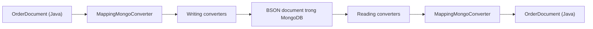

# Chuyển đổi kiểu miền sang giá trị BSON hoặc Document

## 1. Bài toán: đối tượng miền không nhất thiết giống dữ liệu lưu

Trong ứng dụng Java, **kiểu miền (domain type)** mô tả một khái niệm có ý nghĩa nghiệp vụ. Ví dụ:

- `Sku`: mã sản phẩm đã được kiểm tra định dạng, không phải một `String` tùy ý.
- `Money`: số tiền đi cùng loại tiền tệ, không đơn thuần là một `BigDecimal`.
- `Address`: địa chỉ có cấu trúc, thay vì một chuỗi tự do.
- `OrderStatus`: trạng thái theo bộ mã nghiệp vụ, có thể khác tên hằng số `enum` trong Java.

MongoDB lưu **BSON**: mỗi field có tên và giá trị thuộc một trong các kiểu BSON như `string`, `int`, `long`, `decimal`, `date`, `object`, `array` hoặc `null`. BSON không hiểu trực tiếp quy tắc kiểm tra SKU hay ý nghĩa của một record `Money` trong Java.

**Spring Data MongoDB** có cơ chế ánh xạ để chuyển qua lại giữa Java object và BSON. Với phần lớn kiểu dữ liệu, `MappingMongoConverter` và các converter có sẵn đã đủ. Khi ứng dụng muốn biểu diễn một kiểu miền theo hợp đồng lưu trữ cụ thể, có thể dùng **custom conversion**:

- `@WritingConverter`: chuyển kiểu miền sang giá trị thích hợp để ghi vào MongoDB.
- `@ReadingConverter`: dựng lại kiểu miền từ dữ liệu đã lưu.
- `MongoCustomConversions`: đăng ký các converter để Spring Data sử dụng.

Bài thuộc chương **Chuyển đổi dữ liệu** của module **SPRING_DATA_MONGODB**. Ngoài việc ánh xạ document, ta sẽ dùng repository hoặc `MongoTemplate` để ghi và đọc, kiểm tra BSON thực tế, xem ảnh hưởng tới truy vấn, aggregation, index, transaction, reactive access và cách kiểm thử/chẩn đoán sai lệch dữ liệu.

Mục tiêu cuối cùng là tạo được một **hợp đồng lưu trữ ổn định**, trong khi Java vẫn sử dụng những kiểu có ý nghĩa rõ ràng.

## 2. Luồng chuyển đổi từ Java tới BSON và ngược lại

Khi gọi `repository.insert(entity)` hoặc `mongoTemplate.save(entity)`, Spring Data chuyển đối tượng thành dữ liệu phù hợp với MongoDB trước khi gửi tới driver. Khi đọc, Spring Data nhận BSON từ driver rồi dựng lại object Java.



Sơ đồ lược giản các bước để dễ hiểu: Spring Data dùng thông tin entity, loại property, các bộ chuyển đổi mặc định và converter tùy chỉnh trong quá trình mapping; không phải mọi field đều bắt buộc đi qua một custom converter.

| Thành phần | Nhiệm vụ | Ví dụ |
| --- | --- | --- |
| **Domain type** | Diễn tả ý nghĩa và bất biến nghiệp vụ | `Sku("KB-87")`, `Money(1250000, VND)` |
| **Writing converter** | Quy định biểu diễn ghi ra | `Sku` → BSON `string` |
| **Reading converter** | Tái tạo đối tượng miền | BSON `string` → `Sku` |
| **BSON scalar** | Giá trị đơn trong MongoDB | `"KB-87"`, `NumberDecimal("1250000")` |
| **BSON subdocument** | Nhóm các field liên quan | `{ amount: NumberDecimal(...), currency: "VND" }` |
| **Mapping metadata** | Chỉ định collection, tên field, ID, type hint | `@Document`, `@MongoId`, `@Field` |
| **Repository / MongoTemplate** | Đường truy cập dữ liệu đã ánh xạ | `insert`, `findById`, `Query` |

Phải phân biệt ba câu hỏi:

1. **Java đang có kiểu gì?** Ví dụ `Sku`, `Money`, `Instant`.
2. **BSON đang lưu kiểu gì?** Ví dụ `string`, `object` chứa `decimal`, `date`.
3. **Lúc đọc lại có giữ nguyên ý nghĩa không?** Ví dụ đơn giá, đơn vị tiền và mã SKU có cùng giá trị sau một vòng ghi/đọc hay không.

Một lần đọc trả về object Java “trông đúng” chưa chứng minh dữ liệu trong database có đúng kiểu mong muốn. Converter có thể đã âm thầm chuyển một BSON string cũ thành kiểu Java hiện hành.

## 3. Khi nào nên tạo custom converter?

Trước khi viết converter, xem liệu mapping mặc định đã đủ hay chưa.

### 3.1. Những trường hợp có thể dùng mapping mặc định

Ví dụ `CustomerDocument` có các thuộc tính `String`, `boolean`, `Instant` và một record `Address` lồng nhau:

```java
import java.time.Instant;
import org.springframework.data.mongodb.core.mapping.Document;
import org.springframework.data.mongodb.core.mapping.MongoId;
import org.springframework.data.mongodb.core.mapping.FieldType;

@Document(collection = "customers")
public record CustomerDocument(
    @MongoId(FieldType.STRING) String id,
    String displayName,
    boolean active,
    Instant registeredAt,
    Address address
) {
    public record Address(
        String city,
        String district,
        String street
    ) {}
}
```

Spring Data có thể ánh xạ `Address` thành một subdocument bằng các field tương ứng. **Không cần** custom converter chỉ vì ứng dụng có record lồng nhau.

Nếu yêu cầu của `BigDecimal` chỉ là lưu dưới BSON Decimal128, có thể dùng:

```java
import java.math.BigDecimal;
import org.springframework.data.mongodb.core.mapping.Field;
import org.springframework.data.mongodb.core.mapping.FieldType;

@Field(targetType = FieldType.DECIMAL128)
BigDecimal amount;
```

Đoạn trên là ví dụ khai báo một **field bên trong class**, không phải một tệp Java độc lập. Annotation `@Field` tác động lên cách ánh xạ property, thường đơn giản và an toàn hơn việc đăng ký converter toàn cục chỉ để đổi một kiểu số.

### 3.2. Khi custom converter có ích

Custom converter phù hợp nếu cần:

- Lưu **value object** có kiểm tra dữ liệu như `Sku` thành BSON `string` thay vì subdocument `{ value: "..." }`.
- Lưu một kiểu miền phức hợp như `Money` thành subdocument có **schema có chủ đích**, chẳng hạn `amount` kiểu Decimal128 và `currency` kiểu string.
- Đọc/ghi một định dạng BSON do hệ thống khác hoặc dữ liệu lịch sử quy định.
- Tập trung hóa một quy tắc mã hóa/giải mã để không phải sao chép logic ở nhiều repository hoặc service.

Không nên tạo converter cho mọi class. Converter làm tăng mã cần bảo trì, có thể ảnh hưởng các đường truy vấn và khiến dữ liệu khó giải mã nếu thay đổi quy tắc mà không migration.

**Quy tắc chọn lựa:** nếu chỉ cần đổi tên field, thử `@Field`; nếu cần cấu trúc lồng nhau thông thường, dùng mapping object; nếu cần **biểu diễn BSON đặc thù** hoặc **chuyển đổi giá trị có hợp đồng riêng**, cân nhắc custom converter.

## 4. Ví dụ 1: chuyển `Sku` thành BSON string

### 4.1. Định nghĩa value object trong Java

Giả sử mã SKU trong hệ thống có quy tắc: chữ ASCII viết hoa, số, dấu gạch ngang hoặc gạch dưới, độ dài từ 2 đến 40 ký tự. Đây là một **quy định minh họa** cho cửa hàng, không phải quy chuẩn chung của SKU.

```java
import java.util.Locale;
import java.util.Objects;

public record Sku(String value) {

    public Sku {
        Objects.requireNonNull(value, "SKU is required");
        value = value.strip().toUpperCase(Locale.ROOT);

        if (!value.matches("[A-Z0-9][A-Z0-9_-]{1,39}")) {
            throw new IllegalArgumentException(
                "SKU không đúng định dạng: " + value
            );
        }
    }
}
```

`new Sku(" kb-87 ")` cho giá trị canonical `"KB-87"`. Một `Sku` hợp lệ không thể chứa giá trị tùy ý mà chưa qua constructor kiểm tra.

Có những nghiệp vụ coi SKU phân biệt chữ hoa/thường hoặc cho phép Unicode; khi đó **không được áp dụng quy tắc viết hoa ở trên**. Thiết kế domain type phải phản ánh quy tắc đã thống nhất với hệ thống nguồn.

### 4.2. Writing converter: `Sku` → `String`

```java
import org.springframework.core.convert.converter.Converter;
import org.springframework.data.convert.WritingConverter;

@WritingConverter
public final class SkuToString
        implements Converter<Sku, String> {

    @Override
    public String convert(Sku source) {
        return source.value();
    }
}
```

Khi converter được đăng ký, Spring Data có thể chuyển property kiểu `Sku` thành một BSON `string` chứa mã đã chuẩn hóa, ví dụ `"KB-87"`.

Annotation `@WritingConverter` chỉ rõ **chiều ghi**. Nó đặc biệt hữu ích khi hai đầu chuyển đổi liên quan đến kiểu đơn giản mà Spring Data coi là giá trị gốc, tránh nhầm hướng khi phân loại converter.

### 4.3. Reading converter: `String` → `Sku`

```java
import org.springframework.core.convert.converter.Converter;
import org.springframework.data.convert.ReadingConverter;

@ReadingConverter
public final class StringToSku
        implements Converter<String, Sku> {

    @Override
    public Sku convert(String source) {
        return new Sku(source);
    }
}
```

Khi đọc document vào entity có property `Sku`, converter dựng lại value object và chạy validation trong constructor.

Điều này có một hệ quả quan trọng: nếu collection cũ chứa SKU không hợp lệ như `"???"`, việc **đọc** có thể thất bại ngay tại converter. Tùy nghiệp vụ, có thể quyết định fail-fast, sửa dữ liệu trước khi triển khai hoặc hỗ trợ định dạng cũ trong giai đoạn chuyển đổi. Không nên âm thầm biến mã lỗi thành một SKU mặc định vì sẽ làm mất khả năng truy vết sản phẩm.

### 4.4. BSON mong đợi

Nếu entity Java khai báo:

```java
Sku sku;
```

thì dữ liệu BSON được ghi thông qua converter có dạng:

```javascript
{
  sku: "KB-87"
}
```

Cách biểu diễn này khác với mapping mặc định có thể dùng subdocument:

```javascript
{
  sku: { value: "KB-87" }
}
```

**Hợp đồng lưu trữ phải chọn một dạng.** Khi thêm converter vào một collection đã có nhiều document theo dạng cũ, đừng giả định reader mới tự xử lý được cả hai dạng: `StringToSku` đọc string, không có nghĩa nó cũng đọc được object `{ value: ... }`.

## 5. Ví dụ 2: chuyển `Money` thành một BSON subdocument

### 5.1. Vì sao `Money` cần cả giá trị và loại tiền?

`BigDecimal("1250000")` chưa đủ nói lên đây là VND, USD hay một đơn vị khác. Với giao dịch hoặc báo giá, ta có thể muốn một value object chứa cả **số tiền** và **currency**.

```java
import java.math.BigDecimal;
import java.util.Currency;
import java.util.Objects;

public record Money(BigDecimal amount, Currency currency) {

    public Money {
        Objects.requireNonNull(amount, "amount is required");
        Objects.requireNonNull(currency, "currency is required");
    }
}
```

Ví dụ giá sản phẩm:

```java
Money unitPrice = new Money(
    new BigDecimal("1250000"),
    Currency.getInstance("VND")
);
```

Trong MongoDB, ta chọn cấu trúc:

```javascript
{
  amount: NumberDecimal("1250000"),
  currency: "VND"
}
```

Sự lựa chọn này bảo đảm amount là **BSON Decimal128** và currency là **BSON string**. Nó giúp truy vấn theo currency hoặc amount khi cần. Quy tắc làm tròn, số chữ số thập phân được phép và xử lý giá âm phải do nghiệp vụ quy định thêm; bản thân value object tối giản chưa đủ cho hệ thống thanh toán hoàn chỉnh.

### 5.2. Writing converter: `Money` → `org.bson.Document`

`org.bson.Document` là đối tượng Java của MongoDB Driver, thường dùng như cấu trúc map các cặp tên field/giá trị. Ở đây, writing converter kiểm soát **hình dạng của subdocument**:

```java
import org.bson.Document;
import org.bson.types.Decimal128;
import org.springframework.core.convert.converter.Converter;
import org.springframework.data.convert.WritingConverter;

@WritingConverter
public final class MoneyToDocument
        implements Converter<Money, Document> {

    @Override
    public Document convert(Money source) {
        return new Document(
            "amount",
            new Decimal128(source.amount())
        ).append(
            "currency",
            source.currency().getCurrencyCode()
        );
    }
}
```

`new Decimal128(BigDecimal)` yêu cầu số nằm trong phạm vi Decimal128; những giá trị quá lớn hoặc có biểu diễn không phù hợp có thể gây lỗi chuyển đổi. Không nên bắt lỗi rồi tự cắt bớt chữ số tiền. Cần thống nhất precision, scale và quy tắc làm tròn từ lớp nghiệp vụ.

**Lưu ý:** `Document` ở ví dụ là **dữ liệu của một property kiểu Money**, không phải toàn bộ entity `OrderDocument`. Converter tạo hai field `amount` và `currency` bên trong field chứa `Money`.

### 5.3. Reading converter: `org.bson.Document` → `Money`

Chiều đọc phải tái tạo được kiểu miền và kiểm tra BSON thực tế:

```java
import java.util.Currency;

import org.bson.Document;
import org.bson.types.Decimal128;
import org.springframework.core.convert.converter.Converter;
import org.springframework.data.convert.ReadingConverter;

@ReadingConverter
public final class DocumentToMoney
        implements Converter<Document, Money> {

    @Override
    public Money convert(Document source) {
        Object rawAmount = source.get("amount");

        if (!(rawAmount instanceof Decimal128 decimal)) {
            throw new IllegalArgumentException(
                "Money.amount phải là BSON Decimal128"
            );
        }

        String currencyCode = source.getString("currency");

        if (currencyCode == null || currencyCode.isBlank()) {
            throw new IllegalArgumentException(
                "Money.currency không được thiếu"
            );
        }

        return new Money(
            decimal.bigDecimalValue(),
            Currency.getInstance(currencyCode)
        );
    }
}
```

Converter trên **cố ý đọc nghiêm ngặt**: một document lưu `amount: "1250000"` dạng string hoặc `amount: 1250000.0` dạng double sẽ bị từ chối. Đây là ưu điểm khi muốn bảo vệ hợp đồng BSON, nhưng có thể làm dữ liệu cũ không đọc được.

Nếu dữ liệu lịch sử dùng kiểu khác, hãy thiết kế migration hoặc reader tương thích có kiểm soát. Không tự coi mọi chuỗi hay số thực đều là Decimal128 vì có thể phát sinh sai lệch tiền tệ.

### 5.4. Vì sao không chỉ chuyển `Money` thành một chuỗi?

Có thể mã hóa tiền như `"VND:1250000"`, nhưng khi đó truy vấn theo tiền tệ hoặc lọc số tiền theo ngưỡng khó hơn, phải parse string và tự giữ quy tắc format. Một BSON subdocument có hai field rõ ràng sẽ giúp kiểm soát kiểu, index và aggregation tốt hơn.

Tuy nhiên, nếu chỉ cần serialize nguyên giá trị để hiển thị và không bao giờ truy vấn theo thành phần, định dạng scalar cũng có thể phù hợp. Lựa chọn phải dựa vào cách ứng dụng **đọc, ghi và phân tích** dữ liệu.

## 6. Đăng ký converter với `MongoCustomConversions`

Chỉ khai báo class có `@WritingConverter` hoặc `@ReadingConverter` chưa đủ nếu nó không được đăng ký vào cấu hình chuyển đổi mà `MongoTemplate` và repository thực tế sử dụng.

Ví dụ cấu hình Spring:

```java
import java.util.List;

import org.springframework.context.annotation.Bean;
import org.springframework.context.annotation.Configuration;
import org.springframework.data.mongodb.core.convert.MongoCustomConversions;

@Configuration
public class MongoConversionConfig {

    @Bean
    public MongoCustomConversions mongoCustomConversions() {
        return new MongoCustomConversions(
            List.of(
                new SkuToString(),
                new StringToSku(),
                new MoneyToDocument(),
                new DocumentToMoney()
            )
        );
    }
}
```

Cấu hình trên minh họa cách đăng ký tập converter trong dự án sử dụng API `MongoCustomConversions` hỗ trợ constructor nhận danh sách converters. Tùy dòng phiên bản Spring Data, cách tạo/đăng ký có thể có thêm API cấu hình khác. Khi ứng dụng đã có `MongoCustomConversions`, hãy **hợp nhất các converter mới** vào bean hiện tại hoặc cấu hình đúng đường mapper đang dùng; đừng khai báo hai bean cạnh tranh rồi giả định mọi converter đều được dùng.

Cần phân biệt:

- **`@WritingConverter` / `@ReadingConverter`:** mô tả hướng chuyển đổi của converter.
- **`MongoCustomConversions`:** danh sách chuyển đổi được đăng ký cho MongoDB mapping.
- **`MappingMongoConverter`:** bộ chuyển đổi entity hoàn chỉnh, dùng metadata và custom conversions.
- **`MongoTemplate` / `MongoRepository`:** API gọi đến mapper khi ghi/đọc document.

Converter cụ thể cho `Sku` và `Money` giúp giảm nguy cơ vô tình thay đổi mọi field kiểu `String` hoặc `BigDecimal` trong ứng dụng. Không nên đăng ký một converter tổng quát `String ↔ Document` nếu nó có thể làm thay đổi những field khác mà không có ranh giới rõ.

**Hãy kiểm tra cấu hình thật:** một dự án có thể tự tạo `MappingMongoConverter`, template hoặc context riêng; bean đã định nghĩa ở một nơi chưa chắc đã áp dụng cho một đường truy cập được cấu hình độc lập.

## 7. Ánh xạ entity sử dụng cả hai converter

### 7.1. Document đơn hàng

Ta tạo một model ngắn gọn:

```java
import java.time.Instant;

import org.springframework.data.mongodb.core.mapping.Document;
import org.springframework.data.mongodb.core.mapping.FieldType;
import org.springframework.data.mongodb.core.mapping.MongoId;

@Document(collection = "orders")
public record OrderDocument(
    @MongoId(FieldType.STRING)
    String id,

    Sku sku,

    Money unitPrice,

    int quantity,

    Instant placedAt
) {}
```

Chúng ta **không** đặt `@DBRef` hay `@DocumentReference` trên `Sku` và `Money`. Đây là hai **giá trị** của một đơn hàng, không phải các liên kết tự động tới collection khác.

`@MongoId(FieldType.STRING)` giúp xác định `_id` dạng BSON string. Trong khi đó, property `sku` được writing converter biến thành BSON string, còn `unitPrice` được biến thành BSON subdocument.

### 7.2. Ghi bằng repository

```java
import java.math.BigDecimal;
import java.time.Instant;
import java.util.Currency;

import org.springframework.data.mongodb.repository.MongoRepository;

public interface OrderRepository
        extends MongoRepository<OrderDocument, String> {}
```

Trong một service đã được inject `OrderRepository`:

```java
OrderDocument created = new OrderDocument(
    "order-1001",
    new Sku("kb-87"),
    new Money(
        new BigDecimal("1250000"),
        Currency.getInstance("VND")
    ),
    2,
    Instant.parse("2026-11-20T02:00:00Z")
);

OrderDocument saved = orderRepository.insert(created);

OrderDocument readBack = orderRepository
    .findById(saved.id())
    .orElseThrow();
```

Nếu registration và mapping hoạt động như dự kiến, document BSON lưu trong MongoDB có dạng:

```javascript
{
  _id: "order-1001",
  sku: "KB-87",
  unitPrice: {
    amount: NumberDecimal("1250000"),
    currency: "VND"
  },
  quantity: 2,
  placedAt: ISODate("2026-11-20T02:00:00Z")
}
```

Document có thể có thêm field `_class` theo cấu hình type mapping của Spring Data. Mẫu hiển thị trên tập trung vào các field nghiệp vụ. Giá trị BSON `date` có độ chính xác theo mili giây; không nên suy rằng mọi giá trị nano của `Instant` được giữ nguyên.

Nếu chỉ xem `readBack.unitPrice()` trong Java mà không kiểm tra BSON thực tế, ta chưa chứng minh field `amount` đã được lưu dưới **Decimal128** đúng như hợp đồng.

### 7.3. Phân biệt converter với ánh xạ tự động record

Nếu **không đăng ký** `MoneyToDocument` và `DocumentToMoney`, Spring Data vẫn có thể tự ánh xạ `Money` thành subdocument với các field `amount` và `currency` hoặc biểu diễn khác theo converter mặc định. Việc tự mapping **không bảo đảm** field `amount` là Decimal128 hay `currency` là string mã ISO đúng như mong muốn.

Tạo custom converter là quyết định kỹ thuật để **khóa hình dạng dữ liệu**; hãy chỉ làm khi thật sự cần hợp đồng ấy, và thêm kiểm thử khi thay đổi mã converter.

## 8. Xác minh BSON thực tế trong `mongosh` và raw driver

### 8.1. Đọc bằng `mongosh`

Chạy các lệnh sau trên **database kiểm thử** đã được service ghi dữ liệu vào:

```javascript
db.getName();
db.orders.findOne({ _id: "order-1001" });
```

Để quan sát kiểu chính xác:

```javascript
const doc = db.orders.findOne({ _id: "order-1001" });

if (doc != null) {
  print(EJSON.stringify(doc, null, 2, { relaxed: false }));
}
```

Trong canonical Extended JSON, số tiền Decimal128 thường thể hiện dưới khóa `"$numberDecimal"`. `EJSON` là cách **hiển thị** BSON; nó không thay đổi cách lưu.

Kiểm tra bằng `$type`:

```javascript
db.orders.aggregate([
  { $match: { _id: "order-1001" } },
  {
    $project: {
      _id: 0,
      idType: { $type: "$_id" },
      skuType: { $type: "$sku" },
      unitPriceType: { $type: "$unitPrice" },
      amountType: { $type: "$unitPrice.amount" },
      currencyType: { $type: "$unitPrice.currency" },
      quantityType: { $type: "$quantity" },
      placedAtType: { $type: "$placedAt" }
    }
  }
]);
```

Kết quả dự kiến về **kiểu**, tùy cách Spring Data mã hóa `int quantity` và cấu hình thông thường:

```json
{
  "idType": "string",
  "skuType": "string",
  "unitPriceType": "object",
  "amountType": "decimal",
  "currencyType": "string",
  "quantityType": "int",
  "placedAtType": "date"
}
```

Một `$type` aggregation trả về `"missing"` nếu field không tồn tại. Nếu `unitPrice` là BSON string hoặc `amount` là BSON double, đó là bằng chứng cần xem lại converter đang được sử dụng, đường ghi dữ liệu hoặc document được tạo từ phiên bản cũ.

### 8.2. Đọc raw BSON qua `MongoTemplate`

Spring Data MongoDB cho phép truy cập collection ở mức MongoDB Driver:

```java
import org.bson.Document;
import org.bson.types.Decimal128;

import static com.mongodb.client.model.Filters.eq;

Document raw = mongoTemplate
    .getCollection("orders")
    .find(eq("_id", "order-1001"))
    .first();

if (raw == null) {
    throw new IllegalStateException("Không tìm thấy đơn");
}

String storedSku = raw.getString("sku");
Document storedMoney = raw.get("unitPrice", Document.class);
Decimal128 storedAmount = storedMoney.get(
    "amount", Decimal128.class
);
String storedCurrency = storedMoney.getString("currency");

System.out.println(storedSku);
System.out.println(storedAmount.bigDecimalValue());
System.out.println(storedCurrency);
```

Đoạn trên giả định `mongoTemplate` đã được inject. Khác với `mongoTemplate.findById(..., OrderDocument.class)`, đường `getCollection(...)` trả về `org.bson.Document` từ driver và **không chuyển đối tượng thành `Money`**. Đó là lý do nó hữu ích để xác nhận hình dạng BSON do converter ghi ra.

## 9. Truy vấn theo kiểu miền đã chuyển đổi

### 9.1. Truy vấn `Sku` với `MongoTemplate`

Với tên field `sku` đã lưu thành BSON string, raw query là:

```javascript
db.orders.find({ sku: "KB-87" });
```

Ở phía Java, khi xây query theo metadata của `OrderDocument`, Spring Data có thể dùng writing conversion cho giá trị query:

```java
import org.springframework.data.mongodb.core.query.Criteria;
import org.springframework.data.mongodb.core.query.Query;

Query query = Query.query(
    Criteria.where("sku").is(new Sku("kb-87"))
);

List<OrderDocument> orders =
    mongoTemplate.find(query, OrderDocument.class);
```

Ví dụ giả định `List`, `mongoTemplate` và các import đã có. Trong ứng dụng thật, phải **kiểm chứng query BSON phát sinh** hoặc kiểm thử tích hợp; không phải tất cả API driver, aggregation thô hoặc query tự xây bằng `Document` đều đi qua cùng metadata conversion.

Nếu ứng dụng dùng trực tiếp MongoDB Java Driver, hãy gửi **giá trị đã chuyển**:

```java
mongoTemplate.getCollection("orders")
    .find(com.mongodb.client.model.Filters.eq("sku", "KB-87"));
```

Không đưa instance `Sku` vào một raw driver filter rồi mặc định driver biết `SkuToString` của Spring Data.

### 9.2. Truy vấn thành phần của `Money`

Vì `Money` được lưu thành subdocument, có thể lọc theo currency và số tiền bằng dot notation trong `mongosh`:

```javascript
db.orders.find({
  "unitPrice.currency": "VND",
  "unitPrice.amount": { $gte: NumberDecimal("1000000") }
});
```

Không nên so sánh trực tiếp giá trị tiền ở hai loại tiền tệ khác nhau. Với bộ lọc hoặc thống kê có nhiều currency, phải tách nhóm hoặc áp dụng quy tắc quy đổi đã được xác định.

Một index minh họa cho truy vấn trên:

```javascript
db.orders.createIndex({
  "unitPrice.currency": 1,
  "unitPrice.amount": 1
});
```

Đây là index trên **tên field BSON thật**. Nếu sau này converter thay `unitPrice.amount` thành `unitPrice.value`, tất cả query/index/migration liên quan phải được đánh giá lại. Đừng thay đổi schema chỉ vì đổi tên class `Money` trong Java.

### 9.3. Aggregation theo các field đã chuyển đổi

Một pipeline aggregation có thể tổng hợp thành tiền từng loại tiền:

```javascript
db.orders.aggregate([
  {
    $group: {
      _id: "$unitPrice.currency",
      totalAmount: {
        $sum: {
          $multiply: ["$unitPrice.amount", "$quantity"]
        }
      },
      orderCount: { $sum: 1 }
    }
  }
]);
```

Ví dụ minh họa **tổng giá trị các dòng hàng trong collection mẫu**, chưa phải doanh thu kế toán: không xét giảm giá, thuế, hoàn tiền, các đơn hủy hay chính sách ghi nhận. Nếu field `unitPrice.amount` bị lưu thành string trong dữ liệu cũ, pipeline có thể cho kết quả sai hoặc phát sinh lỗi tùy biểu thức và trường hợp; hãy thống kê `$type` trước khi phân tích.

Spring Data hỗ trợ dựng pipeline qua `MongoTemplate.aggregate(...)`, nhưng cần phân biệt tên property Java và **tên BSON do converter tạo**. Các field bên trong `org.bson.Document` của `Money` không phải nhất thiết là property entity được Spring Data ánh xạ như một subdocument thường; hãy kiểm thử query thực tế khi dùng aggregation builders.

## 10. Converter và vòng đời dữ liệu khi schema thay đổi

### 10.1. Đổi converter là đổi hợp đồng lưu trữ

Giả sử phiên bản đầu lưu tiền thành:

```javascript
{ unitPrice: "VND:1250000" }
```

Phiên bản sau dùng:

```javascript
{
  unitPrice: {
    amount: NumberDecimal("1250000"),
    currency: "VND"
  }
}
```

Nếu chỉ thay `MoneyToDocument` và `DocumentToMoney`, dữ liệu cũ dạng string vẫn tồn tại. Khi đọc, Spring Data có thể không chọn được reader phù hợp hoặc đọc không đúng. Việc **build code thành công không phải migration dữ liệu**.

Một kế hoạch hợp lý gồm:

1. Thống kê các dạng BSON trong collection (`$type`, `$exists`) và đo số bản ghi bị ảnh hưởng.
2. Xác định định dạng chuẩn, cách quy đổi từ dữ liệu cũ, quy tắc làm tròn và lỗi không thể chuyển.
3. Lập chiến lược deploy ứng dụng/reader có tương thích hai định dạng khi cần chạy nhiều phiên bản song song.
4. Thử migration trên dữ liệu cô lập và kiểm chứng giá trị tiền trước/sau.
5. Cập nhật writer, migration và reader theo thứ tự được thiết kế; theo dõi lỗi chuyển đổi.
6. Chỉ bỏ đường đọc tương thích cũ sau khi xác minh các bản ghi lịch sử đã được xử lý.

Đôi khi nên lưu `schemaVersion` hoặc `moneyFormatVersion` nếu nhiều định dạng phải tồn tại có chủ đích. Không nên tạo nhiều converter nguồn giống nhau chỉ để “hy vọng” framework tự đoán schema.

### 10.2. Tìm các kiểu dữ liệu đang tồn tại

```javascript
db.orders.aggregate([
  {
    $group: {
      _id: {
        unitPriceType: { $type: "$unitPrice" },
        amountType: { $type: "$unitPrice.amount" },
        currencyType: { $type: "$unitPrice.currency" }
      },
      documents: { $sum: 1 }
    }
  },
  { $sort: { documents: -1 } }
]);
```

Trên collection lớn, pipeline này có thể tốn tài nguyên. Cần chạy trên dữ liệu mẫu đại diện, môi trường phù hợp hoặc có kế hoạch kiểm tra tác động trước khi chạy toàn bộ trong production.

### 10.3. Null và field không tồn tại

Không nên mặc định Spring Data sẽ gọi custom converter với giá trị `null`. Các cơ chế mapping/conversion thường xử lý null hoặc field vắng mặt ở lớp bên ngoài; record constructor hoặc field Java có thể nhận null/default theo mapping và cấu hình.

Ví dụ:

```javascript
{ _id: "a", unitPrice: null }
{ _id: "b" }
{ _id: "c", unitPrice: { amount: NumberDecimal("1250000") } }
```

Ba document trên khác nhau: null tường minh, field không tồn tại và subdocument thiếu currency. Nếu nghiệp vụ yêu cầu `Money` luôn có hai thành phần, cần phối hợp validation ở API/service, kiểm tra đọc trong converter và schema validation MongoDB. Không nên tự gán `currency="VND"` cho dữ liệu thiếu mà không có hợp đồng nghiệp vụ.

## 11. Kiểm thử tích hợp hai chiều

### 11.1. Cần kiểm tra gì?

Có ít nhất ba nhóm kiểm tra khác nhau:

| Nhóm | Câu hỏi |
| --- | --- |
| **Domain validation** | `Sku` từ chối mã không hợp lệ? `Money` ngăn giá trị null? |
| **BSON write** | `Sku` lưu string; `Money` lưu object có `Decimal128` và mã currency? |
| **BSON read / round-trip** | Đọc lại qua repository có dựng đúng `Sku`, `Money`, đúng số tiền và loại tiền? |

Unit test converter rất hữu ích nhưng không thay thế integration test: có thể converter đúng riêng lẻ, nhưng **không được đăng ký** hoặc đường repository thực tế dùng một converter khác.

### 11.2. Unit test converter

Ví dụ JUnit 5:

```java
import java.math.BigDecimal;
import java.util.Currency;

import org.bson.Document;
import org.bson.types.Decimal128;
import org.junit.jupiter.api.Test;

import static org.junit.jupiter.api.Assertions.*;

class MoneyConversionTest {

    private final MoneyToDocument writer = new MoneyToDocument();
    private final DocumentToMoney reader = new DocumentToMoney();

    @Test
    void preservesAmountAndCurrency() {
        Money input = new Money(
            new BigDecimal("19.95"),
            Currency.getInstance("USD")
        );

        Document stored = writer.convert(input);

        assertInstanceOf(Decimal128.class, stored.get("amount"));
        assertEquals("USD", stored.getString("currency"));
        assertEquals(input, reader.convert(stored));
    }

    @Test
    void rejectsWrongBsonAmountType() {
        Document invalid = new Document(
            "amount", "19.95"
        ).append("currency", "USD");

        assertThrows(
            IllegalArgumentException.class,
            () -> reader.convert(invalid)
        );
    }
}
```

Test trên không cần MongoDB; nó chỉ kiểm tra các converter như hàm Java. Dùng `BigDecimal("19.95")` với USD để minh họa số thập phân; với mỗi currency, quy tắc scale và làm tròn vẫn cần quy định theo nghiệp vụ.

### 11.3. Integration test: ghi repository, đọc BSON thô

Ví dụ sau giả định dự án có `@SpringBootTest` kết nối đến **MongoDB kiểm thử riêng** (chẳng hạn MongoDB Testcontainers) và repository, converter đã được cấu hình:

```java
import java.math.BigDecimal;
import java.time.Instant;
import java.util.Currency;

import org.bson.Document;
import org.bson.types.Decimal128;
import org.junit.jupiter.api.Test;
import org.springframework.beans.factory.annotation.Autowired;
import org.springframework.boot.test.context.SpringBootTest;
import org.springframework.data.mongodb.core.MongoTemplate;

import static com.mongodb.client.model.Filters.eq;
import static org.junit.jupiter.api.Assertions.*;

@SpringBootTest
class OrderConversionIntegrationTest {

    @Autowired OrderRepository orders;
    @Autowired MongoTemplate mongoTemplate;

    @Test
    void writesAndReadsDomainValuesUsingExpectedBson() {
        String id = "converter-test-001";

        OrderDocument input = new OrderDocument(
            id,
            new Sku("kb-87"),
            new Money(
                new BigDecimal("1250000"),
                Currency.getInstance("VND")
            ),
            2,
            Instant.parse("2026-11-20T02:00:00Z")
        );

        orders.insert(input);

        Document raw = mongoTemplate.getCollection("orders")
            .find(eq("_id", id))
            .first();

        assertNotNull(raw);
        assertEquals("KB-87", raw.getString("sku"));

        Document moneyDocument =
            raw.get("unitPrice", Document.class);
        assertNotNull(moneyDocument);

        Decimal128 amount =
            moneyDocument.get("amount", Decimal128.class);
        assertNotNull(amount);
        assertEquals(
            new BigDecimal("1250000"),
            amount.bigDecimalValue()
        );
        assertEquals(
            "VND", moneyDocument.getString("currency")
        );

        OrderDocument readBack = orders.findById(id)
            .orElseThrow();

        assertEquals(new Sku("KB-87"), readBack.sku());
        assertEquals(input.unitPrice(), readBack.unitPrice());
        assertEquals(2, readBack.quantity());
    }
}
```

Test cần dữ liệu cô lập; với ID cố định có thể phải dọn collection test hoặc tạo database mới mỗi lượt chạy. Đoạn code là **mẫu để triển khai**, không phải khẳng định kiểm thử đã được chạy trong dự án này.

Đối với hệ thống đã có dữ liệu nhiều phiên bản, bổ sung test đọc **document cũ** theo từng schema cần hỗ trợ. Nếu mục tiêu là phát hiện loại BSON khác lạ, test phải đọc giá trị thật thay vì chỉ nhìn object Java sau mapping.

## 12. Chẩn đoán khi converter không chạy như mong đợi

| Triệu chứng | Nguyên nhân cần kiểm tra | Cách xác minh |
| --- | --- | --- |
| `Sku` lưu thành `{value:"KB-87"}` | Writing converter chưa được đăng ký/không áp dụng | Đọc raw BSON, kiểm tra `MongoCustomConversions` và mapper |
| Repository trả `Sku` lỗi khi đọc | BSON cũ không phải string, mã không hợp lệ, thiếu reader | `$type` trên `sku`; test reader trực tiếp |
| `Money.amount` là double/string | Đường ghi bypass converter, converter cũ hoặc document thủ công | EJSON canonical, `$type`, raw driver |
| Mọi test converter đơn lẻ pass nhưng integration fail | Bean converter không nằm trong `MappingMongoConverter` thực dùng | Kiểm tra wiring và repository/template instance |
| Query bằng `new Sku(...)` không trả dữ liệu | Giá trị query không qua converter, dữ liệu không canonical hoặc tên field sai | So sánh query mapped/raw và kiểm tra BSON lưu |
| Đọc `Money` thất bại do thiếu `currency` | Schema cũ/field bị bỏ qua/ghi sai | Dùng `$exists`, `$type`, kiểm tra dữ liệu lịch sử |
| Sau đổi converter, document mới đúng còn document cũ lỗi | Thiếu giai đoạn migration hoặc reader tương thích | Thống kê kiểu theo collection và test dữ liệu cũ |
| Query theo `unitPrice.amount` chậm | Thiếu index đúng path, dữ liệu sai kiểu, selectivity thấp | `getIndexes()`, `explain("executionStats")` |
| Decimal128 không nhận BigDecimal | Ngoài phạm vi biểu diễn hoặc sai quy tắc làm tròn | Test biên về precision, scale, currency |
| Reactive trả lỗi mapping khác imperative | Đường template/repository có cấu hình conversions khác | Ghi bằng hai đường, đọc raw BSON, đối chiếu converter |

### 12.1. Logging và chẩn đoán query

Trong môi trường kiểm thử, có thể bật log phù hợp cho Spring Data MongoDB để xem command và đường query. Nhưng log có thể chứa dữ liệu nhạy cảm như tên, email hoặc mã định danh; không bật logging dữ liệu chi tiết tùy tiện ở production.

Khi truy vấn chậm, dùng:

```javascript
db.orders.getIndexes();

db.orders.find({
  sku: "KB-87",
  "unitPrice.currency": "VND"
}).explain("executionStats");
```

Quan sát `COLLSCAN`/`IXSCAN`, `totalDocsExamined`, `totalKeysExamined` và thời gian thực thi. Một converter đúng về dữ liệu không tự tạo index; việc chọn index phải theo các field BSON và mẫu truy vấn thực tế.

## 13. Transaction, cập nhật theo điều kiện và reactive access

### 13.1. Thao tác trên một document vẫn tuân theo quy tắc atomicity

MongoDB bảo đảm một thao tác ghi lên **một document** có tính nguyên tử. Nếu dùng Spring Data `MongoTemplate.updateFirst(...)` để đổi `unitPrice`, conversion phải được xem xét trên đường cập nhật, và field mới cần dùng đúng cấu trúc BSON.

Ví dụ bên trong service:

```java
import java.math.BigDecimal;
import java.util.Currency;

import org.springframework.data.mongodb.core.query.Criteria;
import org.springframework.data.mongodb.core.query.Query;
import org.springframework.data.mongodb.core.query.Update;

Money nextPrice = new Money(
    new BigDecimal("1290000"),
    Currency.getInstance("VND")
);

Query query = Query.query(
    Criteria.where("_id").is("order-1001")
);

Update update = new Update()
    .set("unitPrice", nextPrice);

mongoTemplate.updateFirst(
    query, update, OrderDocument.class
);
```

Khi Spring Data mapping cập nhật theo entity, giá trị property có thể được chuyển bằng custom writer; cần kiểm tra BSON sau khi update và không suy rằng mọi cách dùng raw `Document` hoặc driver đều đi qua converter. Trong nghiệp vụ đơn hàng thật, thay giá đã chốt có thể không được phép; ví dụ chỉ minh họa **đường chuyển đổi trong update**, không phải khuyến nghị sửa giá lịch sử tùy ý.

Nếu phải cập nhật cùng lúc một đơn và các document khác (tồn kho, báo giá...), dùng transaction đa document khi nghiệp vụ và môi trường MongoDB cho phép, hoặc chiến lược đồng bộ khác. Converter không tạo transaction và không bảo đảm hai document luôn nhất quán.

### 13.2. Reactive MongoDB

`ReactiveMongoRepository` và `ReactiveMongoTemplate` cũng sử dụng cơ chế mapping phù hợp với cấu hình converter của chúng. Về ý tưởng:

```java
Mono<OrderDocument> created =
    reactiveOrderRepository.insert(input);

Mono<OrderDocument> reloaded =
    reactiveOrderRepository.findById("order-1001");
```

Đây là fragment bên trong luồng reactive đã có `input` và repository, không phải ví dụ class độc lập. Khi triển khai thật, phải đảm bảo registration converter trên **ReactiveMongoTemplate** đang dùng và kiểm chứng BSON bằng truy vấn đọc tương ứng. Không gọi `block()` trong luồng xử lý reactive của server chỉ để kiểm tra dữ liệu.

Nếu dùng transaction reactive, cần `ReactiveMongoTransactionManager` cùng context transaction thích hợp. Không nên hiểu việc chuyển đổi `Money` thành `Document` là một tính năng đồng bộ hay bảo vệ tranh chấp dữ liệu: đó chỉ là ánh xạ giá trị.

## 14. Bài thực hành gợi ý

Thực hành theo từng bước trên MongoDB kiểm thử:

1. Tạo `Sku` và `Money` theo quy tắc miền đã định; viết hai cặp converter và đăng ký qua `MongoCustomConversions`.
2. Tạo `OrderDocument` cùng repository; ghi một đơn có `Sku("kb-87")` và `Money(1250000, VND)`.
3. Dùng `mongosh` đọc document, chuyển sang canonical EJSON và kiểm tra `$type` của `sku`, `unitPrice`, `unitPrice.amount` và `unitPrice.currency`.
4. Đọc lại bằng repository; so sánh các value object sau round-trip.
5. Truy vấn theo `sku` qua `MongoTemplate`, sau đó đối chiếu với raw query trong `mongosh`.
6. Tạo thêm một document kiểm thử có `unitPrice` dạng string cũ, rồi quan sát reader mới xử lý ra sao.
7. Thống kê các BSON type đang có; đề xuất migration trước khi sửa data.
8. Thiết kế index nếu có nhu cầu lọc theo `sku` hoặc `unitPrice.currency`; đánh giá bằng `explain("executionStats")`.
9. Thử các trường hợp `Money.amount` vượt phạm vi Decimal128, thiếu currency, `Sku` sai định dạng và document thiếu field.
10. Viết integration test bảo vệ hợp đồng BSON để thay đổi converter sau này không phá dữ liệu lịch sử.

## 15. Checklist trước khi đưa custom converter vào dự án

- **Có thật sự cần custom converter?** Kiểm tra trước khả năng ánh xạ mặc định, `@Field` và record lồng nhau.
- **BSON contract có rõ ràng?** Chỉ định tên field, BSON type, quy tắc null/missing và phiên bản dữ liệu.
- **Cả chiều ghi và đọc đều có?** Nếu chỉ một chiều, tài liệu phải nói rõ lý do.
- **Converter đã đăng ký đúng mapper?** Xác minh repository, `MongoTemplate` và reactive template nếu có.
- **Giá trị có thể round-trip không?** Thử tiền, currency, SKU, kiểu số và các trường hợp biên.
- **Đường query có đúng BSON không?** Phân biệt query mapped và driver raw; dùng index theo path thật.
- **Dữ liệu cũ có đọc được không?** Có kế hoạch migration hoặc tương thích khi schema đổi.
- **Có kiểm thử tích hợp?** Ghi qua repository rồi đọc BSON thô, sau đó đọc lại entity.
- **Có đo hiệu năng không?** Phân tích aggregation, index và query plan trên dữ liệu đại diện.
- **Bất biến nghiệp vụ ở đâu?** Domain validation, service và database validator cần phối hợp; converter không thay thế transaction hay validation nghiệp vụ.

**Kết luận:** chuyển đổi kiểu miền sang BSON scalar hoặc `org.bson.Document` giúp ứng dụng giữ model Java giàu ý nghĩa mà vẫn kiểm soát được dữ liệu lưu trong MongoDB. Với Spring Data MongoDB, hãy dùng `@WritingConverter`, `@ReadingConverter` và `MongoCustomConversions` khi cần một biểu diễn BSON cụ thể, rồi kiểm chứng bằng **document thực tế**, round-trip repository/`MongoTemplate`, kiểm thử tích hợp và truy vấn có index. Hợp đồng chuyển đổi tốt phải đồng thời rõ ràng về **giá trị, kiểu BSON, khả năng đọc dữ liệu cũ và ảnh hưởng tới truy vấn**.

