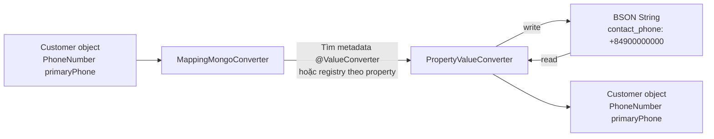

# @ValueConverter và PropertyValueConverter cho từng thuộc tính

## 1. Bối cảnh và mục tiêu

Trong **Spring Data MongoDB**, `MappingMongoConverter` chuyển các đối tượng Java thành document BSON và dựng lại đối tượng khi đọc. Hệ thống **Mini Commerce** của chúng ta có `Product`, `Customer` và `Order`; các đối tượng này không nhất thiết phải có hình dạng Java giống hoàn toàn hình dạng được lưu trong MongoDB.

Ví dụ: ứng dụng muốn dùng một value object `PhoneNumber` có quy tắc kiểm tra dữ liệu, nhưng trong collection `customers` lại muốn lưu số điện thoại liên hệ ở dạng BSON **String** để thuận tiện với dữ liệu hiện có. Một thuộc tính `PhoneNumber` khác có thể vẫn được lưu thành document nhúng. Nếu tạo converter áp dụng cho *toàn bộ kiểu* `PhoneNumber`, cả hai thuộc tính sẽ bị thay đổi cách lưu. Đây là tình huống cần **chuyển đổi theo từng thuộc tính**.

Spring Data cung cấp hai cách khai báo:

- **`@ValueConverter`**: đặt converter trực tiếp trên field của entity.
- **`PropertyValueConverter`**: giao diện quy định cách chuyển **domain → store (write)** và **store → domain (read)**; có thể đăng ký bằng annotation hoặc qua cấu hình lập trình.

Sau bài học, bạn có thể:

1. Giải thích thời điểm Spring Data MongoDB gọi property converter và sự khác biệt với converter theo kiểu dữ liệu.
2. Viết `PropertyValueConverter` hai chiều, gắn bằng `@ValueConverter` và nhận đúng giá trị ở mỗi phía.
3. Đăng ký converter theo tên thuộc tính bằng `MongoCustomConversions` khi không muốn đặt annotation trên entity.
4. Kiểm tra sự khác nhau giữa **BSON field name**, **Java property name**, kiểu domain và kiểu store.
5. Xử lý giá trị null, dữ liệu lỗi, dữ liệu cũ và các thay đổi có thể ảnh hưởng query/index/aggregation.
6. Kiểm thử cả converter, repository/`MongoTemplate` và BSON thực tế; hiểu giới hạn với raw driver, reactive access và transaction.

**Điều kiện thực hành:** Spring Boot đã khai báo `spring-boot-starter-data-mongodb`, MongoDB truy cập được, Java 17+, hiểu `@Document`, `@Id` và giá trị nhúng. API minh họa phù hợp với các dòng Spring Data MongoDB hỗ trợ property converter; khi áp dụng cần đối chiếu phiên bản thực tế do Spring Boot BOM quản lý.

## 2. Property converter nằm ở đâu trong quá trình mapping?



Không phải mọi lần chuyển đổi dữ liệu đều dùng property converter:

| Cơ chế | Phạm vi quyết định | Ví dụ trong Mini Commerce |
| --- | --- | --- |
| Mapping mặc định | Theo kiểu Java/BSON và metadata entity | `String` thành BSON String, object thành document nhúng |
| `@Field(name = "...")` | Tên field lưu, có thể cả `targetType` | `unitPrice` lưu thành `unit_price` kiểu Decimal128 |
| `@ReadingConverter` / `@WritingConverter` | Quy tắc chuyển đổi theo **cặp kiểu** đã đăng ký | Chuyển một value object thành `String` ở mọi vị trí áp dụng |
| `@ValueConverter` | **Một field cụ thể** của entity | Chỉ `Customer.primaryPhone` lưu String |
| Đăng ký `PropertyValueConverter` theo property | Một property được chỉ định trong cấu hình | `Customer.primaryPhone` chuyển đổi dù entity không có annotation |
| `@Transient` | Bỏ hẳn field khỏi mapping | Nhãn hiển thị chỉ dùng trong bộ nhớ |
| Jackson/DTO | Dữ liệu vào/ra JSON API, không quyết định BSON | Không công khai thông tin nhạy cảm trên HTTP response |

Điểm phân biệt là **phạm vi**. Một converter toàn cục cho `PhoneNumber → String` có thể tác động đến nhiều field của `Customer`, `Order` hoặc entity khác. Property converter cho phép hai thuộc tính có cùng Java type được lưu **khác cách**, theo hợp đồng từng thuộc tính.

## 3. API chính: @ValueConverter và PropertyValueConverter

### 3.1. Annotation

```java
import org.springframework.data.convert.ValueConverter;

// Đặt trên field:
@ValueConverter(PhoneNumberStringConverter.class)
private PhoneNumber primaryPhone;
```

`@ValueConverter` thuộc **Spring Data Commons**, đặt trên field để chỉ định class converter. Đây là annotation của tầng persistence, không phải annotation của Jackson, MongoDB validator hoặc cơ chế phân quyền. Khi converter được tìm thấy và khởi tạo, Spring Data sử dụng nó để ánh xạ **giá trị field đó**.

### 3.2. Giao diện PropertyValueConverter

API khái niệm:

```java
public interface PropertyValueConverter<DV, SV, C extends ValueConversionContext<?>> {
    DV read(SV value, C context);
    SV write(DV value, C context);
    // Có thêm readNull(context) và writeNull(context).
}
```

*Đây là chữ ký rút gọn để giải thích ý nghĩa; khi viết implementation, generic bound đầy đủ còn gắn với `PersistentProperty` như Javadoc chính thức.*

| Tham số | Vai trò |
| --- | --- |
| `DV` (Domain Value) | Kiểu thuộc tính Java, ví dụ `PhoneNumber` |
| `SV` (Store Value) | Kiểu giá trị BSON mà driver có thể lưu, ví dụ `String` |
| `C` (Conversion Context) | Ngữ cảnh chuyển đổi; có thông tin property và API chuyển đổi giá trị lồng nhau |
| `read(SV, C)` | Chuyển **BSON → Java** |
| `write(DV, C)` | Chuyển **Java → BSON** |
| `readNull(C)` / `writeNull(C)` | Hook xử lý `null`, mặc định trả `null` |

Trong MongoDB có giao diện tiện dụng:

```java
import org.springframework.data.mongodb.core.convert.MongoValueConverter;
```

`MongoValueConverter<DV, SV>` kế thừa `PropertyValueConverter<DV, SV, MongoConversionContext>`, giúp không phải viết generic context dài. Nếu dự án dùng phiên bản chưa có interface tiện ích đó, có thể triển khai trực tiếp `PropertyValueConverter` với `ValueConversionContext<MongoPersistentProperty>` phù hợp phiên bản.

### 3.3. Nguyên tắc thiết kế converter

- `read(write(value))` cần trả lại **cùng giá trị nghiệp vụ** đối với mọi input hợp lệ. Nếu là chuẩn hóa mất thông tin (ví dụ loại khoảng trắng không có quy tắc), phải định nghĩa chuẩn hóa ở boundary rõ ràng.
- `write` phải tạo giá trị driver lưu được, chẳng hạn String, Decimal128, BSON Date, Document hoặc cấu trúc thích hợp; không mặc định trả object phức tạp mà không rõ converter phía sau sẽ xử lý ra sao.
- `read` phải nhận **kiểu đang thực sự tồn tại** trong collection. Dữ liệu legacy khác kiểu có thể cần migration hoặc converter đọc tương thích.
- Converter nên thuần, có chi phí nhỏ, không chứa mutable state theo request; một converter có thể được **cache và tái sử dụng**.
- Không tự ý gọi HTTP, database khác hoặc thao tác blocking kéo dài trong converter. Nó có thể được gọi ở nhiều vị trí mapping, kể cả trong luồng reactive.

## 4. Ví dụ chính: lưu số điện thoại liên hệ thành BSON String

### 4.1. Value object PhoneNumber

Trong ứng dụng mẫu, số điện thoại được chuẩn hóa theo một biểu diễn giống E.164: dấu `+` theo sau là các chữ số, không có dấu cách. Đây là **mô hình thực hành**, không thay thế thư viện kiểm tra số điện thoại theo quốc gia nếu sản phẩm có yêu cầu quốc tế phức tạp.

`PhoneNumber.java`:

```java
package com.example.minicommerce.domain;

import java.util.Objects;

public record PhoneNumber(String e164) {
    public PhoneNumber {
        Objects.requireNonNull(e164, "e164");
        if (!e164.matches("\\+[1-9]\\d{7,14}")) {
            throw new IllegalArgumentException(
                "Phone number must use a normalized +digits format");
        }
    }
}
```

Quy tắc ở constructor đảm bảo object Java hợp lệ. Nó không sửa chuỗi đầu vào không hợp lệ một cách âm thầm. Ví dụ `new PhoneNumber("+84900000000")` hợp lệ; `new PhoneNumber("0900000000")` không hợp lệ theo **chính sách của bài thực hành**.

### 4.2. Converter hai chiều

`PhoneNumberStringConverter.java`:

```java
package com.example.minicommerce.mapping;

import org.springframework.data.mongodb.core.convert.MongoConversionContext;
import org.springframework.data.mongodb.core.convert.MongoValueConverter;
import com.example.minicommerce.domain.PhoneNumber;

public final class PhoneNumberStringConverter
        implements MongoValueConverter<PhoneNumber, String> {

    @Override
    public PhoneNumber read(
            String storedValue, MongoConversionContext context) {
        return new PhoneNumber(storedValue);
    }

    @Override
    public String write(
            PhoneNumber domainValue, MongoConversionContext context) {
        return domainValue.e164();
    }
}
```

Phân tích:

1. Khi **ghi** `PhoneNumber("+84900000000")`, `write` trả `String "+84900000000"`.
2. Khi **đọc** BSON String, `read` tạo lại `PhoneNumber` và áp dụng kiểm tra hợp lệ.
3. `MongoConversionContext` được framework truyền vào. Ví dụ đơn giản chưa cần dùng đến metadata hay `context.read/write(...)`, nhưng context hữu ích với các chuyển đổi chứa cấu trúc lồng nhau.
4. Converter không cần state và có constructor mặc định không tham số, thuận tiện cho cơ chế khởi tạo mặc định.

Nếu source BSON chứa chuỗi không hợp lệ như `"0900000000"`, constructor sẽ ném lỗi. Đây là hành vi có chủ đích để phát hiện dữ liệu chưa được chuẩn hóa; trong hệ thống đang có dữ liệu cũ phải chuẩn bị migration hoặc chính sách đọc tương thích.

### 4.3. Đặt @ValueConverter trên đúng một property

`Customer.java`:

```java
package com.example.minicommerce.domain;

import org.springframework.data.annotation.Id;
import org.springframework.data.convert.ValueConverter;
import org.springframework.data.mongodb.core.mapping.Document;
import org.springframework.data.mongodb.core.mapping.Field;
import com.example.minicommerce.mapping.PhoneNumberStringConverter;

@Document(collection = "customers")
public class Customer {
    @Id
    private String id;

    private String fullName;

    @Field("contact_phone")
    @ValueConverter(PhoneNumberStringConverter.class)
    private PhoneNumber primaryPhone;

    // Cùng Java type, nhưng không có @ValueConverter:
    private PhoneNumber backupPhone;

    public Customer() {}

    public Customer(String id, String fullName,
            PhoneNumber primaryPhone, PhoneNumber backupPhone) {
        this.id = id;
        this.fullName = fullName;
        this.primaryPhone = primaryPhone;
        this.backupPhone = backupPhone;
    }

    public String getId() { return id; }
    public void setId(String id) { this.id = id; }

    public String getFullName() { return fullName; }
    public void setFullName(String fullName) {
        this.fullName = fullName;
    }

    public PhoneNumber getPrimaryPhone() { return primaryPhone; }
    public void setPrimaryPhone(PhoneNumber primaryPhone) {
        this.primaryPhone = primaryPhone;
    }

    public PhoneNumber getBackupPhone() { return backupPhone; }
    public void setBackupPhone(PhoneNumber backupPhone) {
        this.backupPhone = backupPhone;
    }
}
```

`@Field("contact_phone")` đổi **tên BSON**, còn `@ValueConverter(...)` đổi **biểu diễn giá trị BSON**. Chúng giải quyết hai vấn đề độc lập.

Trong ví dụ này:

| Java property | Java type | BSON key | BSON value |
| --- | --- | --- | --- |
| `id` | `String` | `_id` | String ID |
| `fullName` | `String` | `fullName` | String |
| `primaryPhone` | `PhoneNumber` | `contact_phone` | **String** do converter tạo |
| `backupPhone` | `PhoneNumber` | `backupPhone` | **Document nhúng** theo mapping mặc định |

### 4.4. Dữ liệu lưu thực tế

Giả sử một service tạo khách hàng:

```java
Customer customer = new Customer(
    "customer-001",
    "Nguyen Thi Lan",
    new PhoneNumber("+84900000000"),
    new PhoneNumber("+84911111111")
);

mongoTemplate.save(customer);
```

Với cấu hình mapping thông thường, BSON tương ứng có cấu trúc:

```json
{
  "_id": "customer-001",
  "fullName": "Nguyen Thi Lan",
  "contact_phone": "+84900000000",
  "backupPhone": {
    "e164": "+84911111111"
  },
  "_class": "com.example.minicommerce.domain.Customer"
}
```

Metadata `_class` có thể khác tùy chiến lược type mapping. **Đối chiếu bản chất**: `contact_phone` là BSON String, còn `backupPhone` là document. Đây là bằng chứng rõ nhất cho chuyển đổi **theo property**, không tác động toàn cục tới `PhoneNumber`.

Khi đọc:

```java
Customer loaded = mongoTemplate.findById(
    "customer-001", Customer.class);

if (loaded == null) {
    throw new IllegalStateException("Customer not found");
}

System.out.println(loaded.getPrimaryPhone().e164());
// +84900000000

System.out.println(loaded.getBackupPhone().e164());
// +84911111111
```

Đọc qua `MongoRepository<Customer, String>` cũng đi qua mapping converter, nên cùng một quy tắc được áp dụng cho entity đã khai báo.

## 5. Cách thứ hai: đăng ký PropertyValueConverter bằng chương trình

Không phải lúc nào ta cũng muốn domain entity phụ thuộc annotation chuyển đổi. Khi dùng entity từ thư viện không sửa được, khi tách policy persistence khỏi model, hoặc khi quy tắc chỉ áp dụng cho một module, ta có thể **đăng ký converter cho property** bằng cấu hình.

### 5.1. Cấu hình MongoCustomConversions

**Phương án thay thế**: bỏ `@ValueConverter(PhoneNumberStringConverter.class)` khỏi `Customer.primaryPhone`, giữ `@Field("contact_phone")`, sau đó đăng ký converter vào context bằng `MongoCustomConversions`:

```java
package com.example.minicommerce.config;

import org.springframework.context.annotation.Bean;
import org.springframework.context.annotation.Configuration;
import org.springframework.data.mongodb.core.convert.MongoCustomConversions;

import com.example.minicommerce.domain.Customer;
import com.example.minicommerce.mapping.PhoneNumberStringConverter;

@Configuration
public class CustomerPropertyConversionConfiguration {

    @Bean
    MongoCustomConversions mongoCustomConversions() {
        return MongoCustomConversions.create(adapter -> {
            adapter.configurePropertyConversions(registrar -> {
                registrar.registerConverter(
                    Customer.class,
                    "primaryPhone",
                    new PhoneNumberStringConverter()
                );
            });
        });
    }
}
```

Giải thích:

- `Customer.class`: kiểu entity chứa field.
- `"primaryPhone"`: **tên Java property**, không phải `"contact_phone"` của BSON.
- `new PhoneNumberStringConverter()`: instance chịu trách nhiệm hai chiều read/write của đúng property.
- `MongoCustomConversions.create(...)`: cung cấp converter configuration để Spring Data MongoDB tạo mapping converter.

Đây là mẫu dành cho ứng dụng đang dùng auto-configuration phù hợp của Spring Boot. Nếu dự án đã có bean `MongoCustomConversions` hoặc đã tùy chỉnh `AbstractMongoClientConfiguration`, **gộp phần đăng ký này vào cấu hình hiện hữu**; không khai báo bean thứ hai tùy tiện rồi đoán Spring sẽ chọn đúng.

Không cần gắn cả annotation và đăng ký programmatic cho cùng một property trong bài thực hành. Chọn một cách, sau đó kiểm tra raw BSON và kết quả đọc. Việc khai báo trùng hoặc thay đổi thứ tự ưu tiên giữa các cách cấu hình có thể gây nhầm lẫn khi nâng cấp.

### 5.2. PropertyValueConverterRegistrar và registry

`PropertyValueConverterRegistrar` là API tập hợp các quy tắc theo property. Nó hỗ trợ đăng ký theo **tên field** hoặc theo tham chiếu property kiểu an toàn ở những phiên bản tương ứng.

Một đoạn cấu hình tổng quát hơn:

```java
MongoCustomConversions conversions =
    MongoCustomConversions.create(adapter -> {
        adapter.configurePropertyConversions(registrar ->
            registrar.registerConverter(
                Customer.class,
                "primaryPhone",
                new PhoneNumberStringConverter()
            )
        );
    });
```

Nếu cần tự tạo `SimplePropertyValueConversions`, framework cũng cung cấp `PropertyValueConverterRegistrar.buildRegistry()` và cơ chế `PropertyValueConverterFactory`. Với một quy tắc đơn giản, `adapter.configurePropertyConversions(...)` thường dễ quản lý hơn việc tự lắp toàn bộ registry/factory.

**Chú ý với nested path:** đăng ký `registerConverter(Customer.class, "address.street", ...)` theo chuỗi đường dẫn có dấu chấm **không được hỗ trợ** để điều hướng xuyên các lớp con trong kiểu đăng ký này. Muốn chuyển `Address.street`, đăng ký trên **kiểu sở hữu property** là `Address.class` và tên field `"street"`, hoặc đặt `@ValueConverter` trực tiếp ở field đó.

### 5.3. Đăng ký với class/bean có dependency

Một số converter cần cấu hình từ ứng dụng, ví dụ policy chuẩn hóa theo quốc gia, bộ codec hay thành phần mã hóa đã được kiểm soát. Cơ chế `PropertyValueConverterFactory` có thể hỗ trợ tạo converter từ Spring `ApplicationContext` qua factory nhận biết bean.

Điểm cần quan tâm:

1. Không giả định converter luôn được Spring tạo qua constructor injection khi chỉ viết `@ValueConverter(MyConverter.class)`. Hãy kiểm tra factory đang dùng.
2. Với converter có dependency, dùng factory phù hợp và kiểm tra vòng đời bean/caching, thay vì tự truy cập bean trong static method.
3. Converter có thể được cache và tái sử dụng giữa nhiều request; tránh giữ dữ liệu khách hàng trong field instance.
4. Nếu xử lý dữ liệu nhạy cảm thực sự, sử dụng thuật toán và hệ thống quản lý khóa được thiết kế cho mục đích đó; ví dụ chuyển thành chuỗi trong bài **không phải mã hóa**.

## 6. Một chiều đọc và một chiều ghi phải nhất quán

Với `PhoneNumberStringConverter`:

```text
Java: PhoneNumber("+84900000000")
          |
          | write
          v
BSON: "+84900000000"
          |
          | read
          v
Java: PhoneNumber("+84900000000")
```

Phép chuyển đổi là **đối xứng về giá trị nghiệp vụ**, dù kiểu dữ liệu phía Java và MongoDB khác nhau.

Nếu một converter chỉ triển khai chiều `write` hoặc `read` theo một định dạng không tương thích, ta có thể ghi document được nhưng không dựng lại object sau khi restart. Điều này đặc biệt nguy hiểm với:

- Enum hoặc mã sản phẩm được đổi tên.
- Trường số tiền được chuyển thành String không có quy tắc locale.
- Số điện thoại lúc ghi được chuẩn hóa nhưng lúc đọc lại đòi định dạng khác.
- Dữ liệu có nhiều phiên bản cấu trúc BSON.

Lưu ý: `@ValueConverter` **không tự chuyển mọi giá trị String của collection**. Nó được tìm theo metadata của một property; thao tác driver thô, shell và các pipeline BSON viết tay vẫn có thể lưu giá trị khác kiểu.

## 7. Null, trường thiếu và dữ liệu lỗi

`PropertyValueConverter` có bốn hook quan trọng:

```java
public interface PropertyValueConverter<DV, SV, C> {
    DV read(SV value, C context);
    SV write(DV value, C context);
    DV readNull(C context);
    SV writeNull(C context);
}
```

*Chữ ký trên là sơ đồ rút gọn để giải thích hook, không phải interface Java nguyên văn.*

Trong giao diện thực tế, `read` và `write` dành cho giá trị khác null; `readNull`/`writeNull` có default implementation trả null. Cách ghi field null hoặc bỏ field còn phụ thuộc cơ chế mapping và cấu hình, do đó phải kiểm tra **BSON thực tế** thay vì giả định.

### 7.1. Không biến null thành một số điện thoại giả

Giả sử `backupPhone` là tùy chọn. Cách làm rõ ràng là cho phép `null` trong domain hoặc dùng DTO để thể hiện trạng thái chưa có số điện thoại, rồi kiểm tra yêu cầu nghiệp vụ trước khi lưu.

Không nên mặc định:

```java
// Chỉ là ví dụ cần tránh:
@Override
public String writeNull(MongoConversionContext context) {
    return "UNKNOWN";
}
```

Nếu dùng sentinel `"UNKNOWN"`, lần đọc phải có quy tắc xử lý tương ứng; nó có thể xung đột với unique index, validation và truy vấn đếm số điện thoại hợp lệ. Chỉ dùng sentinel khi schema đã định nghĩa rõ và có test hai chiều.

### 7.2. Document cũ không có field

Đầu vào:

```json
{
  "_id": "customer-legacy-01",
  "fullName": "Khách hàng cũ"
}
```

Khi đọc, `primaryPhone` có thể là null do không có dữ liệu. Code API phải quyết định rõ trường này tùy chọn hay bắt buộc. Annotation converter **không thay** bean validation, MongoDB schema validation hoặc quy tắc tại service layer.

### 7.3. Document cũ chứa sai kiểu

Giả sử dữ liệu trước đây dùng document nhúng:

```json
{
  "_id": "customer-legacy-02",
  "contact_phone": {
    "e164": "+84900000000"
  }
}
```

Converter hiện tại nhận `String` ở phương thức `read`, nên không thể tự giả định sẽ đọc được BSON Document này. Cần một kế hoạch **migration** hoặc một converter tương thích tạm thời có chủ đích cho nhiều biểu diễn BSON. Đừng bỏ qua lỗi mapping để trả về số điện thoại trống: việc đó che khuất dữ liệu sai.

## 8. @ValueConverter khác gì @ReadingConverter và @WritingConverter?

Spring Data MongoDB còn có các converter theo **cặp kiểu**:

```java
@WritingConverter
class PhoneWriteConverter
        implements Converter<PhoneNumber, String> {
    @Override
    public String convert(PhoneNumber source) {
        return source.e164();
    }
}

@ReadingConverter
class PhoneReadConverter
        implements Converter<String, PhoneNumber> {
    @Override
    public PhoneNumber convert(String source) {
        return new PhoneNumber(source);
    }
}
```

Các class trên cần import `org.springframework.core.convert.converter.Converter`, `org.springframework.data.convert.ReadingConverter` và `WritingConverter`. Nếu đăng ký global, converter áp dụng theo phạm vi cặp kiểu được hệ thống conversion dùng; nó có thể ảnh hưởng các field khác ngoài `Customer.primaryPhone`. Một cặp kiểu như `String ↔ PhoneNumber` cũng cần cân nhắc hướng đọc/ghi vì String là native BSON type và được dùng ở rất nhiều nơi.

| Câu hỏi | Type converter global | Property converter |
| --- | --- | --- |
| Có đăng ký theo tên field? | Không phải đặc điểm chính | Có |
| Một kiểu domain có thể lưu nhiều dạng tại hai property? | Khó kiểm soát bằng một rule toàn cục | Phù hợp |
| Cần annotation `@ReadingConverter` và `@WritingConverter`? | Dùng cho định hướng global converter | Không bắt buộc; `PropertyValueConverter` có cả `read` và `write` |
| Có thể dùng conversion context theo property? | Không có context property tương đương mặc định | Có |
| Có ảnh hưởng entity khác? | Có thể, tùy cặp kiểu đã đăng ký | Chỉ property được gắn/đăng ký |

Nếu muốn chỉnh BSON type đích của `BigDecimal` trên **một field** như `Product.price` hoặc `OrderLine.unitPrice`, thường bắt đầu bằng `@Field(targetType = FieldType.DECIMAL128)`. Không cần tạo property converter mới chỉ để biến mọi giá tiền thành String; việc String không có ngữ nghĩa số sẽ làm phức tạp range query, sort và aggregation.

## 9. Tác động đến query, index và aggregation

Property converter kiểm soát biểu diễn dữ liệu khi object được mapping, nhưng câu lệnh truy vấn và update có nhiều đường đi:

- `repository.save(customer)` và `mongoTemplate.insert(customer)` dùng mapping của entity.
- `mongoTemplate.findById(..., Customer.class)` và repository đọc entity bằng mapping.
- `MongoTemplate` với `Query`/`Update` dựa vào metadata mapping cho một số phép chuyển tên/giá trị; **khả năng áp dụng property converter với từng toán tử/phương thức có thể phụ thuộc API và phiên bản Spring Data MongoDB**.
- Lệnh `mongosh`, native driver `getCollection(...).updateOne(...)` hoặc pipeline BSON thô **không đi qua Java property converter**.

Vì vậy, đừng mặc định một query viết bằng object `PhoneNumber` sẽ được chuyển thành đúng String trong mọi code path. Kiểm thử truy vấn thực tế, nhất là `@Query`, `Criteria`, `Update` và aggregation.

### 9.1. Truy vấn raw BSON theo tên field đã lưu

```javascript
db.customers.findOne({
  contact_phone: "+84900000000"
})
```

Lệnh này dùng **BSON field name** `contact_phone` và giá trị store-native String, đúng với document ví dụ. Khi viết mapped query trong Java, property name là `primaryPhone`; cần xác minh mapper đang sử dụng cơ chế conversion nào.

### 9.2. Unique index dựa trên biểu diễn thực tế

Nếu ứng dụng muốn đảm bảo số liên hệ đã được chuẩn hóa là duy nhất, index phải tạo trên **field BSON**:

```javascript
db.customers.createIndex(
  { contact_phone: 1 },
  {
    unique: true,
    partialFilterExpression: {
      contact_phone: { $type: "string" }
    }
  }
)
```

Đây là ví dụ cho field tùy chọn: unique index có partial filter chỉ xét document mà `contact_phone` là String. Quy tắc thật cần quyết định số điện thoại có thể được dùng lại giữa các tài khoản hay không, dữ liệu trùng đã tồn tại hay chưa và chuẩn hóa có nhất quán không. **Property converter không tự tạo unique index**.

### 9.3. Aggregation vận hành trên BSON, không trên value object Java

```javascript
db.customers.aggregate([
  { $match: { contact_phone: { $type: "string" } } },
  {
    $group: {
      _id: { $substrCP: ["$contact_phone", 0, 3] },
      customers: { $sum: 1 }
    }
  }
])
```

Pipeline minh họa cách nhóm chuỗi theo vài ký tự đầu; **không dùng tiền tố này để suy ra quốc gia hoặc nhà mạng chính xác** trong hệ thống thực tế. Mục tiêu là thấy MongoDB làm việc với String đã lưu, không có thông tin runtime về `PhoneNumber`.

Nếu code Java đổi representation từ String sang Document trong tương lai, tất cả query, index, aggregation và báo cáo liên quan cần được cập nhật hoặc giữ tương thích tạm thời.

## 10. Cập nhật từng trường và ranh giới mapping

Ứng dụng Mini Commerce có thể cập nhật khách hàng, sản phẩm và đơn hàng bằng nhiều thao tác:

| Thao tác | Tầng chuyển đổi | Điều cần kiểm tra |
| --- | --- | --- |
| `repository.save(customer)` | Entity mapping | Field `primaryPhone` được ghi đúng BSON String |
| `mongoTemplate.insert(customer)` | Entity mapping | BSON thực tế đúng schema |
| `mongoTemplate.findById(..., Customer.class)` | Entity mapping đọc | `PhoneNumber` được dựng lại |
| `mongoTemplate.updateFirst(...)` | Mapped update | Kiểm thử conversion theo property và phiên bản |
| `mongoTemplate.getCollection("customers").updateOne(...)` | Native driver | Truyền trực tiếp giá trị BSON đúng kiểu; converter của entity không được gọi |
| `db.customers.updateOne(...)` | mongosh | Dùng BSON schema, không dùng tên property Java |

Khi cập nhật thông tin liên hệ qua raw driver, dùng store value:

```javascript
db.customers.updateOne(
  { _id: "customer-001" },
  { $set: { contact_phone: "+84922222222" } }
)
```

Nếu có những hệ thống khác ghi vào collection, hãy quy định schema và kiểm soát input ở **mọi đường ghi**. Không coi `@ValueConverter` là cơ chế bảo mật để ngăn raw update hoặc ép dữ liệu không hợp lệ.

Trong luồng đặt hàng, `Order` có thể chụp số liên hệ giao nhận (`deliveryPhoneSnapshot`) tại lúc tạo đơn. Nếu property đó cũng dùng `PhoneNumber` và cần lưu String, hãy gắn/đăng ký converter **riêng cho property của Order**. Việc converter đã áp dụng ở `Customer.primaryPhone` không tự làm `Order.deliveryPhoneSnapshot` đổi kiểu.

## 11. Kiểm thử một cách đáng tin cậy

Cần kiểm tra **hai lớp**:

1. **Converter contract**: `read` và `write` cho giá trị khác null có khôi phục đúng domain value không?
2. **Integration mapping**: khi dùng `MongoTemplate` hoặc repository, BSON lưu **đúng kiểu** và khi đọc lại **đúng object** không?

### 11.1. Unit test trực tiếp converter

```java
import static org.junit.jupiter.api.Assertions.*;

import org.junit.jupiter.api.Test;
import com.example.minicommerce.domain.PhoneNumber;
import com.example.minicommerce.mapping.PhoneNumberStringConverter;

class PhoneNumberStringConverterTest {
    private final PhoneNumberStringConverter converter =
        new PhoneNumberStringConverter();

    @Test
    void roundTrip() {
        PhoneNumber original = new PhoneNumber("+84900000000");

        // Converter đơn giản không sử dụng context;
        // context thật được Spring Data cung cấp trong mapping.
        String stored = converter.write(original, null);
        assertEquals("+84900000000", stored);
        assertEquals(original, converter.read(stored, null));
    }

    @Test
    void rejectsInvalidStoredValue() {
        assertThrows(IllegalArgumentException.class,
            () -> converter.read("not-a-phone", null));
    }
}
```

**Giới hạn của test trên:** nó chỉ hợp lệ cho converter **không truy cập context** như ví dụ này. API contract của `PropertyValueConverter` yêu cầu Spring Data cung cấp conversion context; test converter thực tế dựa vào context cần tạo fixture/context tương ứng hoặc ưu tiên integration test. Không truyền null context cho converter sử dụng `context.getProperty()` hay `context.read/write()`.

### 11.2. Integration test kiểm tra raw BSON

Ví dụ dành cho database test riêng, với cấu hình annotation ở mục 4:

```java
package com.example.minicommerce;

import static org.junit.jupiter.api.Assertions.*;

import org.bson.Document;
import org.junit.jupiter.api.Test;
import org.springframework.beans.factory.annotation.Autowired;
import org.springframework.boot.test.context.SpringBootTest;
import org.springframework.data.mongodb.core.MongoTemplate;

import com.example.minicommerce.domain.Customer;
import com.example.minicommerce.domain.PhoneNumber;

@SpringBootTest
class CustomerPropertyConversionIntegrationTest {

    @Autowired
    MongoTemplate template;

    @Test
    void usesDifferentStoreShapesForSameDomainType() {
        String id = "property-conversion-test";
        var raw = template.getCollection("customers");
        raw.deleteOne(new Document("_id", id));

        try {
            Customer customer = new Customer(
                id,
                "Nguyen Thi Lan",
                new PhoneNumber("+84900000000"),
                new PhoneNumber("+84911111111")
            );

            template.insert(customer);

            Document bson =
                raw.find(new Document("_id", id)).first();
            assertNotNull(bson);

            assertEquals(
                "+84900000000",
                bson.getString("contact_phone"));

            Object nested = bson.get("backupPhone");
            assertInstanceOf(Document.class, nested);
            assertEquals(
                "+84911111111",
                ((Document) nested).getString("e164"));

            Customer loaded = template.findById(
                id, Customer.class);
            assertNotNull(loaded);
            assertEquals(
                new PhoneNumber("+84900000000"),
                loaded.getPrimaryPhone());
            assertEquals(
                new PhoneNumber("+84911111111"),
                loaded.getBackupPhone());
        } finally {
            raw.deleteOne(new Document("_id", id));
        }
    }
}
```

Test này xác minh được **hai thuộc tính cùng Java type nhưng hai hình dạng BSON khác nhau**. Sử dụng MongoDB thật hoặc Testcontainers để kiểm chứng đúng driver, mapping converter và configuration đang chạy. Đoạn dọn fixture chỉ dùng trong database test, không hướng tới production.

Nếu chuyển từ annotation sang **đăng ký programmatic**, chạy lại chính bài test đó sau khi bỏ annotation và bổ sung bean cấu hình ở mục 5. Đây là cách xác nhận registry đã thật sự được Spring Boot dùng.

### 11.3. Ma trận test nên có khi đưa vào sản phẩm

| Tình huống | Kỳ vọng |
| --- | --- |
| `PhoneNumber` hợp lệ | `write` trả String đúng, `read` dựng đúng value object |
| BSON String không đúng chính sách | Có lỗi/đường xử lý được định nghĩa, không bỏ qua âm thầm |
| `primaryPhone = null` | Hành vi null/missing được xác định bằng test thực tế |
| `backupPhone` không có converter | Vẫn lưu dạng document như thiết kế |
| Raw BSON thiếu `contact_phone` | Entity/DTO xử lý null một cách có chủ đích |
| Lưu bằng repository | Áp dụng cùng rule với MongoTemplate |
| Đăng ký programmatic không có annotation | Kết quả giống phương án declarative |
| Query theo phone | Query dùng đúng property/BSON name và kiểu String |
| Raw update phone | Giá trị được ghi theo schema, đọc lại không lỗi |
| Index unique | Hai số đã chuẩn hóa giống nhau bị chặn theo chính sách |
| Dữ liệu legacy dạng document | Được phát hiện, có migration hoặc reader tương thích |
| Luồng reactive (nếu sử dụng) | `StepVerifier` xác minh read/write và không có đoạn blocking |

## 12. Nâng cấp hoặc đổi representation khi đã có dữ liệu

Giả sử phiên bản đầu tiên lưu:

```json
{
  "_id": "customer-001",
  "contact_phone": {
    "e164": "+84900000000"
  }
}
```

Sau khi thêm `@ValueConverter`, phiên bản mới muốn lưu:

```json
{
  "_id": "customer-001",
  "contact_phone": "+84900000000"
}
```

Thay code không tự động chuyển toàn bộ dữ liệu cũ. Vì vậy cần quy trình:

1. **Kiểm kê BSON type** hiện có của `contact_phone` bằng `$type`; đếm dữ liệu String, Object, Null và field thiếu.
2. **Kiểm tra nguồn dữ liệu**: chuỗi có đúng quy tắc đã chuẩn hóa không, object cũ có đầy đủ `e164` không, có giá trị sai hoặc trùng?
3. **Xác định khả năng chạy đồng thời nhiều phiên bản** ứng dụng. Nếu phiên bản cũ vẫn ghi object còn phiên bản mới ghi String, cần giai đoạn chuyển tiếp và tương thích rõ ràng.
4. **Sao lưu và thử trên staging** trước khi thao tác vào document thật.
5. **Migration theo lô**, quan sát số bản ghi đã đổi và lỗi; không mặc định updateMany là transaction xuyên mọi document.
6. **Kiểm chứng sau migration**: readback bằng ứng dụng mới, raw BSON, query theo phone, unique index và API liên quan.

Kiểm kê type:

```javascript
db.customers.aggregate([
  {
    $group: {
      _id: { $type: "$contact_phone" },
      count: { $sum: 1 }
    }
  },
  { $sort: { count: -1 } }
])
```

Chỉ sau khi đã xác nhận các document nhúng đều có field `e164` hợp lệ, có thể thử migration trong database **test/staging**:

```javascript
db.customers.updateMany(
  {
    contact_phone: { $type: "object" },
    "contact_phone.e164": { $type: "string" }
  },
  [
    {
      $set: {
        contact_phone: "$contact_phone.e164"
      }
    }
  ]
)
```

Pipeline chỉ chuyển những document khớp filter; nó **không kiểm tra đầy đủ** cú pháp/độ duy nhất của số điện thoại. Một số document có dữ liệu lỗi hoặc field thiếu sẽ cần xử lý riêng. Nếu định đổi representation nhiều lần, hãy lưu lại version/schema policy bên ngoài converter và có test dữ liệu cũ để tránh “mỗi lần deploy một kiểu BSON”.

## 13. Reactive access, transaction và hiệu năng

### 13.1. Reactive MongoDB

Với `spring-boot-starter-data-mongodb-reactive`, converter vẫn là quy tắc của tầng mapping, trong khi repository/template trả `Mono` và `Flux`. Không đặt lệnh blocking như HTTP call, truy vấn database khác hoặc `Thread.sleep` trong converter vì việc chuyển đổi có thể diễn ra ngay trên đường thực thi reactive.

```java
public interface ReactiveCustomerRepository
        extends ReactiveMongoRepository<Customer, String> {
}
```

Đoạn interface cần import `ReactiveMongoRepository`; khi test, subscribe qua `StepVerifier`. Kiểm tra converter thực sự được đăng ký cho **ReactiveMongoTemplate** đang sử dụng, nhất là khi ứng dụng đồng thời có cả cấu hình MongoDB đồng bộ và reactive.

### 13.2. Transaction

Property converter xử lý **biểu diễn field**, không tự cung cấp atomicity hay isolation. Tạo `Order` cùng giảm `Product.stock` có thể cần transaction multi-document trên MongoDB topology hỗ trợ, nhưng transaction không giúp cứu một document mà converter đã mã hóa sai định dạng.

Nếu một lần lưu khách hàng thất bại do số điện thoại không hợp lệ, xử lý lỗi ở service/HTTP boundary với thông báo phù hợp, không nuốt lỗi mapping. Với các thao tác cập nhật concurrent, vẫn cần unique index, cập nhật nguyên tử/optimistic locking hoặc transaction theo nhu cầu.

### 13.3. Hiệu năng

- Property converter được gọi thường xuyên trong các lần đọc/ghi; nên giữ thuật toán rẻ và quyết định được kết quả.
- Đừng tạo client mạng/crypto context đắt tiền ở mỗi `read` hoặc `write`.
- Quy trình factory và cache converter phải phù hợp với dependency/bean lifecycle.
- Index được tạo trên **giá trị BSON đã chuyển**, không trên Java value object. Khi đổi representation phải rà soát lại index và query plan.
- Theo dõi `explain("executionStats")` với query thực tế nếu đọc theo số liên hệ là tác vụ có lưu lượng lớn.

## 14. Các lỗi thường gặp

| Dấu hiệu | Nguyên nhân phổ biến | Hướng xử lý |
| --- | --- | --- |
| `@ValueConverter` không có tác dụng | Import nhầm hoặc converter không được framework khởi tạo | Dùng `org.springframework.data.convert.ValueConverter`, kiểm tra factory và raw BSON |
| Converter báo lỗi kiểu dữ liệu khi đọc | BSON cũ là Document nhưng `read` nhận String | Kiểm kê và migration/read-compatible converter |
| Không inject được dependency trong converter | Factory mặc định không dùng Spring Bean | Cấu hình `PropertyValueConverterFactory` bean-aware hoặc đăng ký instance |
| Cả `primaryPhone` và `backupPhone` cùng thành String | Đã đăng ký converter toàn cục theo type | Chuyển về property-level converter, kiểm thử scope |
| Đăng ký converter nhưng không thấy effect | Registry chưa được gắn vào `MongoCustomConversions` đang dùng | Kiểm tra bean/factory/context và test |
| Registry không nhận `"contact_phone"` | Dùng tên BSON trong `registerConverter` | Dùng **Java property name** `"primaryPhone"` |
| Đăng ký `"address.street"` thất bại | Dot path không được hỗ trợ cho registrar | Đăng ký converter trên `Address.street` ở class sở hữu field |
| Ghi được nhưng đọc không được | `read`/`write` không đối xứng hoặc dữ liệu legacy khác định dạng | Test round-trip và cold-start readback |
| Query bằng object Java trả kết quả lạ | Query operator/API không áp dụng conversion như kỳ vọng | Kiểm tra mapped query, MongoDB BSON và phiên bản |
| Update raw driver làm dữ liệu sai schema | Driver không dùng entity mapper | Dùng store-native type, validate/giới hạn đường ghi |
| Null bị ghi thành sentinel gây trùng index | `writeNull` tự thay null bằng giá trị đặc biệt | Định nghĩa chính sách null, index và test |
| REST trả lộ số điện thoại | Nhầm persistence annotation với JSON security | Kiểm soát DTO, Jackson và quyền truy cập API |
| Lưu sai tiền thành String | Áp dụng converter không cần thiết cho BigDecimal | Dùng `Decimal128` và `@Field(targetType=DECIMAL128)` khi phù hợp |
| Reactive pipeline bị nghẽn | Converter gọi thao tác blocking/ngoại vi | Đưa nghiệp vụ ra service, giữ converter thuần |

## 15. Bài tập và tiêu chí hoàn thành

**Bài tập 1 — Annotation:** tạo `PhoneNumber`, `PhoneNumberStringConverter`, gắn `@ValueConverter` vào `Customer.primaryPhone`. Lưu và đọc khách hàng, kiểm tra BSON String `contact_phone`.

**Bài tập 2 — Cùng kiểu, khác biểu diễn:** bổ sung `Customer.backupPhone` cùng kiểu `PhoneNumber` nhưng không gắn converter. Xác minh field này được lưu như document nhúng và không chịu quy tắc của `primaryPhone`.

**Bài tập 3 — Programmatic:** bỏ annotation trên `primaryPhone`, đăng ký converter bằng `MongoCustomConversions.create(... configurePropertyConversions(...))` theo tên `"primaryPhone"`. Chạy lại integration test; kết quả BSON phải nhất quán.

**Bài tập 4 — Dữ liệu cũ:** đưa vào database test một document có `contact_phone` dạng document `{"e164": "..."}`. Quan sát hành vi đọc của converter mới. Kiểm kê `$type`, lập kế hoạch chuyển sang String và xác minh lại bằng repository.

**Bài tập 5 — Query và index:** tạo nhiều khách hàng với số điện thoại đã chuẩn hóa, tìm bằng raw `mongosh` theo `contact_phone`, tạo unique index theo chính sách và kiểm chứng trường hợp trùng số.

**Bài tập mở rộng:** một `Order` có `deliveryPhoneSnapshot` kiểu `PhoneNumber`. Cấu hình converter riêng cho property này và giải thích vì sao không tự động được hưởng annotation từ `Customer.primaryPhone`.

Tự kiểm tra:

1. `@ValueConverter` và `PropertyValueConverter` giải quyết vấn đề gì mà converter toàn cục theo type khó thực hiện?
2. Khi ghi và đọc, các tham số `DV`, `SV`, `MongoConversionContext` có ý nghĩa gì?
3. Vì sao `@Field("contact_phone")` và `@ValueConverter(...)` không thay thế nhau?
4. Với `registerConverter(Customer.class, "primaryPhone", ...)`, có dùng tên BSON `"contact_phone"` được không?
5. Vì sao converter nhận String không tự đọc được dữ liệu lịch sử chứa BSON Document?
6. Vì sao vẫn phải kiểm tra null, BSON raw, query/index, reactive pipeline và mọi đường cập nhật?

**Kết quả mong đợi:** người học triển khai được một converter hai chiều cho **một thuộc tính cụ thể**, chứng minh những field khác cùng domain type không bị ảnh hưởng, kiểm tra đúng BSON và đọc dữ liệu cũ có kiểm soát. Nền tảng này giúp quản lý thiết kế mapping, query, aggregation, index, transaction, reactive access và kiểm thử Spring Data MongoDB một cách nhất quán.

## Tài liệu tham khảo

- [Spring Data MongoDB — Property Converters](https://docs.spring.io/spring-data/mongodb/reference/mongodb/mapping/property-converters.html): `@ValueConverter`, `PropertyValueConverter`, đăng ký programmatic, factory và registry.
- [Spring Data Commons — PropertyValueConverter API](https://docs.spring.io/spring-data/commons/docs/current/api/org/springframework/data/convert/PropertyValueConverter.html): generic, `read`/`write` và `readNull`/`writeNull`.
- [Spring Data Commons — ValueConverter API](https://docs.spring.io/spring-data/commons/docs/current/api/org/springframework/data/convert/ValueConverter.html): annotation tại field.
- [Spring Data MongoDB — MongoValueConverter API](https://docs.spring.io/spring-data/mongodb/docs/current/api/org/springframework/data/mongodb/core/convert/MongoValueConverter.html): interface tiện ích với `MongoConversionContext`.
- [Spring Data MongoDB — Custom Conversions](https://docs.spring.io/spring-data/mongodb/reference/mongodb/mapping/custom-conversions.html): converter theo kiểu và quy tắc định hướng đọc/ghi.
- [Spring Data MongoDB — Object Mapping](https://docs.spring.io/spring-data/mongodb/reference/mongodb/mapping/mapping.html): ánh xạ entity, BSON và cách lưu document nhúng.
