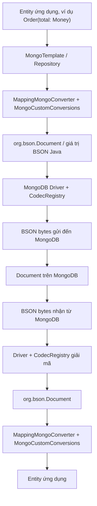
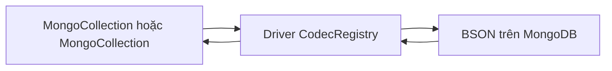
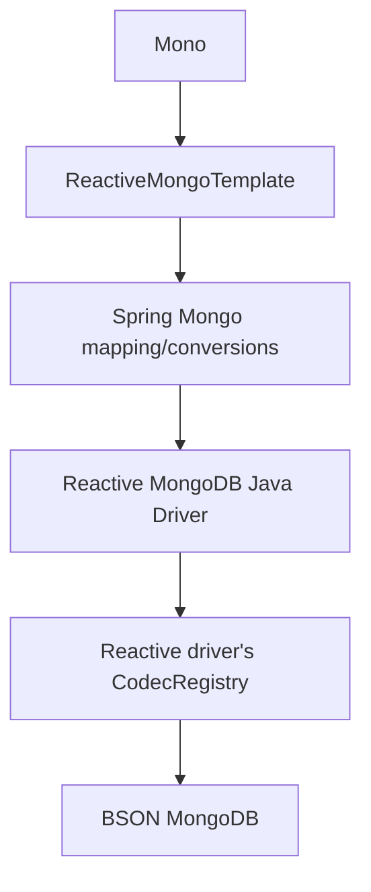

# Phân biệt converter của Spring Data với CodecRegistry của MongoDB Java Driver

## 1. Bài toán: cùng một document nhưng có hai tầng chuyển đổi

Spring Data MongoDB cung cấp `MongoTemplate`, repository và các API reactive để ứng dụng Java đọc, ghi và ánh xạ document. Khi một ứng dụng lưu entity Java vào MongoDB, thường có **hai tầng chuyển đổi khác nhau** tham gia:

1. **Spring Data mapping/conversion** biến object trong mô hình ứng dụng thành biểu diễn dữ liệu được Spring Data quản lý, thường là `org.bson.Document`, và biến dữ liệu đọc trở lại object.
2. **MongoDB Java Driver codec** biến dữ liệu Java/BSON mà driver nhận được thành các byte BSON gửi qua mạng, rồi giải mã byte BSON trả về thành kiểu Java mà driver được yêu cầu trả về.

Giả sử trong ứng dụng đặt hàng có kiểu `Money` gồm số tiền và mã tiền tệ. API muốn làm việc với object `Money(BigDecimal amount, String currency)`, trong khi MongoDB lưu:

```json
{
  "_id": "ORD-001",
  "total": {
    "amount": { "$numberDecimal": "125000.50" },
    "currency": "VND"
  }
}
```

Với `MongoTemplate`, bạn có thể đăng ký một **Spring Converter** để biến `Money` thành một `Document` chứa `Decimal128` và chuyển ngược lại. Driver sau đó dùng **CodecRegistry** để mã hóa `Document`, `Decimal128` và `String` sang BSON. Nếu truy cập trực tiếp `MongoCollection` từ driver, các Spring Converter không tự động được gọi chỉ vì chúng tồn tại trong `ApplicationContext`.

Bài học thuộc chương **Chuyển đổi dữ liệu** giúp trả lời:

- `MappingMongoConverter`, `MongoCustomConversions`, `Converter`, `@ReadingConverter` và `@WritingConverter` dùng ở đâu?
- `Codec<T>`, `CodecProvider` và `CodecRegistry` của Java Driver làm gì?
- Truy cập bằng `MongoTemplate`/repository khác ra sao so với `MongoCollection<Document>` hoặc `MongoCollection<MyPojo>` trực tiếp?
- Nên chọn cơ chế nào khi có value object, kiểu BSON đặc biệt, POJO codec, reactive access và schema tồn tại?
- Làm thế nào chứng minh dữ liệu **thực sự đã lưu ở BSON type nào**, tìm đúng nguyên nhân lỗi conversion và kiểm tra hiệu năng?

## 2. Nhìn toàn bộ luồng ghi/đọc



Sơ đồ mô tả **đường đi thường gặp với Spring Data MongoDB**, không phải mọi API đều bắt buộc trải qua cùng hai tầng. Khi dùng **raw driver**, có thể không có `MappingMongoConverter`:



| Câu hỏi | Spring Data Converter / `MappingMongoConverter` | Driver `CodecRegistry` |
|---|---|---|
| Chủ sở hữu | Spring Data MongoDB | MongoDB Java Driver |
| Tầng hoạt động | Mapping object domain ↔ biểu diễn MongoDB | Serialization/deserialization kiểu Java ↔ BSON |
| API quan trọng | `MongoCustomConversions`, `Converter`, `@ReadingConverter`, `@WritingConverter` | `Codec<T>`, `CodecProvider`, `CodecRegistry` |
| Nhận biết `@Id`, `@Field`, `@Document`? | Có, theo mapping metadata Spring Data | Không tự hiểu annotation mapping của Spring Data |
| Cách đăng ký | Spring `ApplicationContext` / `MongoCustomConversions` | `MongoClientSettings`, `MongoDatabase.withCodecRegistry`, `MongoCollection.withCodecRegistry` |
| Đường đọc ghi hay dùng | `MongoTemplate`, `ReactiveMongoTemplate`, Spring repositories | `MongoCollection<T>` của sync/reactive driver |
| Xử lý `Document`, `Decimal128`, BSON primitives | Có thể tạo/đọc những kiểu đó khi mapping | Dùng các codec phù hợp để ghi/đọc BSON |
| Thay đổi loại dữ liệu bên MongoDB? | Có thể, tùy converter và mapper | Có thể, tùy codec, nhưng phải xem kiểu BSON cuối cùng |
| Tự động thay thế cho cơ chế còn lại? | **Không** | **Không** |

**Điểm mấu chốt:** một Spring Converter chuyển `Money -> Document` không có nghĩa driver đã có một `Codec<Money>`. Ngược lại, một `Codec<Money>` dùng được khi driver được giao giá trị `Money` không có nghĩa `MappingMongoConverter` sẽ bỏ qua metadata domain và gọi codec đó cho mọi field.

## 3. Spring Data MongoDB mapping converter

### 3.1. MappingMongoConverter xử lý những gì?

`MappingMongoConverter` là triển khai trung tâm của `MongoConverter`, sử dụng metadata mapping của Spring Data MongoDB. Trong những thao tác có mapping entity, nó hiểu các annotation và quy tắc như:

- `@Document` xác định collection/type mapping.
- `@Id` và `@MongoId` liên quan đến ánh xạ khóa `_id`, bao gồm quy tắc chuyển đổi ID theo cấu hình.
- `@Field` ánh xạ tên thuộc tính Java sang tên BSON hoặc chỉ định target type.
- Nested value object, collection, map và cơ chế type hints như `_class` được xử lý theo metadata, converter và cấu hình của dự án.
- `MongoCustomConversions` đăng ký các chuyển đổi cho kiểu ứng dụng mà mapper mặc định không thể hoặc không nên tự suy ra.

Ví dụ entity:

```java
import org.springframework.data.annotation.Id;
import org.springframework.data.mongodb.core.mapping.Document;

@Document("orders")
public class PurchaseOrder {
    @Id
    private String id;
    private Money total;

    protected PurchaseOrder() {}

    public PurchaseOrder(String id, Money total) {
        this.id = id;
        this.total = total;
    }

    public String getId() { return id; }
    public Money getTotal() { return total; }
}
```

Ở đây `total` là một **domain value object**. Nếu không có converter tùy biến, Spring Data có thể ánh xạ nó dựa trên các thuộc tính/constructor như một nested object, tùy kiểu và cấu hình. Khi yêu cầu BSON chính xác là `Decimal128` cho tiền, nên quy định cách chuyển đổi một cách tường minh.

### 3.2. Converter khác với Codec ở mức chữ ký API

Một Spring Converter tuân theo:

```java
import org.springframework.core.convert.converter.Converter;

public interface Converter<S, T> {
    T convert(S source);
}
```

Nó nhận một object và trả một object khác. Ví dụ:

```text
Money                    --> org.bson.Document
org.bson.Document        --> Money
java.time.YearMonth      --> String
String                   --> java.time.YearMonth
```

Một MongoDB Driver `Codec<T>` làm việc trực tiếp với `BsonReader`/`BsonWriter` và ngữ cảnh mã hóa/giải mã:

```java
public interface Codec<T> extends Encoder<T>, Decoder<T> {
    Class<T> getEncoderClass();
}
```

Định hướng sử dụng khác nhau: **converter** chuyển giữa biểu diễn object; **codec** chuyển giữa một biểu diễn object và **luồng dữ liệu BSON**. Không nên viết codec chỉ để thay tên field của một entity Spring Data mà `@Field` đã giải quyết được.

### 3.3. @ReadingConverter và @WritingConverter

Khi kiểu nguồn/đích là kiểu tùy biến, annotation giúp Spring Data biết hướng chuyển đổi:

- `@WritingConverter`: giá trị ứng dụng → dạng lưu ở MongoDB.
- `@ReadingConverter`: dạng đã đọc từ MongoDB → giá trị ứng dụng.

Không phải mọi converter Spring dùng trong hệ thống đều là Mongo converter. Một converter dùng cho MVC binding, JSON Jackson hay Spring `ConversionService` khác không mặc nhiên được áp dụng vào Spring Data MongoDB. Ngược lại, `MongoCustomConversions` là nơi đăng ký rõ ràng conversion dành cho mapping MongoDB.

## 4. Ví dụ hoàn chỉnh: Money -> Document chứa Decimal128

### 4.1. Định nghĩa value object Money

Để hạn chế sai số tiền, dùng `BigDecimal` trong Java và BSON `Decimal128` khi cần độ chính xác dạng thập phân; tránh dùng `double` cho dữ liệu tiền tệ cần so sánh chính xác.

```java
import java.math.BigDecimal;

public record Money(BigDecimal amount, String currency) {
    public Money {
        if (amount == null || currency == null || currency.isBlank()) {
            throw new IllegalArgumentException("Money is incomplete");
        }
    }
}
```

`BigDecimal` có phạm vi biểu diễn rộng hơn `Decimal128` ở một số trường hợp. Đảm bảo giá trị nằm trong giới hạn chính xác/phạm vi exponent của BSON Decimal128; khi không biểu diễn được, phải xử lý lỗi theo yêu cầu nghiệp vụ, không âm thầm làm tròn.

### 4.2. Viết @WritingConverter

```java
import org.bson.Document;
import org.bson.types.Decimal128;
import org.springframework.core.convert.converter.Converter;
import org.springframework.data.convert.WritingConverter;

@WritingConverter
public final class MoneyWritingConverter
        implements Converter<Money, Document> {

    @Override
    public Document convert(Money source) {
        return new Document("amount", new Decimal128(source.amount()))
            .append("currency", source.currency());
    }
}
```

Ở tầng Spring Data, kết quả `convert(...)` là một `Document` chứa `Decimal128` và `String`. Chưa có lệnh mạng hoặc BSON bytes nào được tạo chỉ bởi lời gọi converter. Khi được chuyển đến driver, `DocumentCodec` và các codec mặc định tương ứng mới chịu trách nhiệm mã hóa thành BSON.

### 4.3. Viết @ReadingConverter

```java
import org.bson.Document;
import org.bson.types.Decimal128;
import org.springframework.core.convert.converter.Converter;
import org.springframework.data.convert.ReadingConverter;

@ReadingConverter
public final class MoneyReadingConverter
        implements Converter<Document, Money> {

    @Override
    public Money convert(Document source) {
        Decimal128 raw = source.get("amount", Decimal128.class);
        String currency = source.getString("currency");
        if (raw == null || currency == null) {
            throw new IllegalArgumentException("Invalid stored money value");
        }
        return new Money(raw.bigDecimalValue(), currency);
    }
}
```

Converter đọc ở trên yêu cầu dữ liệu đã lưu đúng schema. Nếu collection có dữ liệu legacy lưu số tiền dưới dạng `String` hoặc `Double`, `source.get(..., Decimal128.class)` không nên được kỳ vọng tự chuyển đổi; cần quy định rõ migration hoặc xử lý đa phiên bản với kiểm thử.

### 4.4. Đăng ký vào MongoCustomConversions

```java
import java.util.List;
import org.springframework.context.annotation.Bean;
import org.springframework.context.annotation.Configuration;
import org.springframework.data.mongodb.core.convert.MongoCustomConversions;

@Configuration
public class MoneyConversionsConfig {
    @Bean
    MongoCustomConversions mongoCustomConversions() {
        return new MongoCustomConversions(List.of(
            new MoneyWritingConverter(),
            new MoneyReadingConverter()
        ));
    }
}
```

Khi ứng dụng dùng Spring Boot auto-configuration thông thường, bean `MongoCustomConversions` được dùng khi cấu hình `MappingMongoConverter`. Với dự án tự xây `MongoDatabaseFactory`/`MappingMongoConverter` hoặc có nhiều template, phải bảo đảm **đúng converter instance** được nối vào các template cần dùng. Tùy phiên bản Spring Data, cũng có builder/API đăng ký conversion khác; không khai báo nhiều bean `MongoCustomConversions` mâu thuẫn mà không rõ cơ chế ưu tiên.

### 4.5. Lưu và đọc bằng MongoTemplate

```java
import java.math.BigDecimal;
import org.springframework.data.mongodb.core.MongoTemplate;

PurchaseOrder order = new PurchaseOrder(
    "ORD-001",
    new Money(new BigDecimal("125000.50"), "VND")
);

mongoTemplate.insert(order);

PurchaseOrder loaded = mongoTemplate.findById(
    "ORD-001", PurchaseOrder.class);

Money total = loaded.getTotal();
System.out.println(total.amount());   // 125000.50
System.out.println(total.currency()); // VND
```

Đoạn code giả định `mongoTemplate` đã được inject vào service hoặc test. Kiểm tra **raw BSON** để chắc chắn đã lưu đúng kiểu:

```java
import org.bson.Document;
import org.bson.types.Decimal128;

Document stored = mongoTemplate.getCollection("orders")
    .find(new Document("_id", "ORD-001"))
    .first();

Document nested = stored.get("total", Document.class);
Decimal128 amount = nested.get("amount", Decimal128.class);

System.out.println(amount.bigDecimalValue()); // 125000.50
System.out.println(nested.getString("currency")); // VND
```

`mongoTemplate.getCollection(...)` ở đây trả về collection của **driver**, giúp nhìn document sau khi BSON đã được giải mã thành `org.bson.Document`. Nó không phải đường đọc mapping object `PurchaseOrder`. Trong `mongosh`, kiểm tra bằng:

```javascript
db.orders.findOne({ _id: "ORD-001" });

db.orders.aggregate([
  { $match: { _id: "ORD-001" } },
  {
    $project: {
      bsonType: { $type: "$total.amount" },
      currency: "$total.currency"
    }
  }
]);
// bsonType kỳ vọng: "decimal"
```

Nếu không có tùy chỉnh khác ảnh hưởng dữ liệu, `total` được lưu là nested document, `total.amount` có BSON type Decimal128, và `total.currency` là BSON String. Mục đích của hai converter là mô hình domain rõ ràng và biểu diễn BSON thống nhất, không tạo các network connection riêng.

## 5. CodecRegistry của MongoDB Java Driver

### 5.1. Codec là đơn vị đọc/ghi BSON

MongoDB Java Driver cần một `Codec<T>` để mã hóa một kiểu dữ liệu Java thành BSON và giải mã BSON về kiểu mà phần gọi driver mong đợi. Những codec phổ biến được driver cung cấp sẵn bao gồm:

- `DocumentCodec` cho `org.bson.Document`.
- Codec cho `String`, `Integer`, `Long`, `Double`, `Boolean` và các giá trị BSON phù hợp.
- `Decimal128Codec` cho `org.bson.types.Decimal128`.
- Các codec khác có trong tập codec mặc định và các provider đi kèm driver.

`CodecRegistry` là bộ tra cứu **theo Java class**: driver hỏi registry để lấy codec tương ứng. `CodecProvider` có thể xây dựng hoặc cung cấp codec khi registry cần một kiểu cụ thể. Registry không phải bảng mapping field của Spring Data và không tự đọc metadata `@Field`/`@Id`.

Ví dụ dữ liệu BSON có giá trị decimal:

```json
{ "amount": { "$numberDecimal": "125000.50" } }
```

Khi đọc vào `Document.class` bằng driver, `amount` thường là một instance `Decimal128`. Khi đọc vào một POJO driver đã được cấu hình codec, kiểu Java của `amount` phụ thuộc codec/model đó. Spring Data có thể tiếp tục chuyển nó sang `BigDecimal` hoặc `Money` nếu đang chạy qua `MappingMongoConverter`.

### 5.2. Tự viết Codec cho một kiểu riêng

Giả sử raw driver cần ghi kiểu `ExternalId` như BSON String. Có thể định nghĩa:

```java
public record ExternalId(String value) {
    public ExternalId {
        if (value == null || value.isBlank()) {
            throw new IllegalArgumentException("ExternalId must be present");
        }
    }
}
```

```java
import org.bson.BsonReader;
import org.bson.BsonWriter;
import org.bson.codecs.Codec;
import org.bson.codecs.DecoderContext;
import org.bson.codecs.EncoderContext;

public final class ExternalIdCodec implements Codec<ExternalId> {
    @Override
    public Class<ExternalId> getEncoderClass() {
        return ExternalId.class;
    }

    @Override
    public void encode(
            BsonWriter writer, ExternalId value, EncoderContext context) {
        writer.writeString(value.value());
    }

    @Override
    public ExternalId decode(
            BsonReader reader, DecoderContext context) {
        return new ExternalId(reader.readString());
    }
}
```

Codec này ghi **BSON String**, không ghi document có field `value`. Khi một driver API yêu cầu `Codec<ExternalId>` thì codec biết cách đọc lại String thành `ExternalId`. Tuy nhiên, bản thân BSON String **không mang tên class `ExternalId`**. Vì thế khi raw driver đọc vào một `Document` thông thường, `DocumentCodec` có thể trả `String`, bởi nó chỉ thấy BSON type String, không có thông tin domain Java gốc.

Đây là khác biệt quan trọng: **khả năng mã hóa một kiểu Java không bảo đảm mọi đường đọc raw BSON đều tự khôi phục chính kiểu ấy.** Muốn giải mã vào `ExternalId`, phải dùng một model/codec có schema hoặc ngữ cảnh rõ ràng để xác định kiểu cần tạo.

### 5.3. Đăng ký CodecRegistry cho raw MongoCollection

Ví dụ khai báo registry cho MongoDB Java Driver đồng bộ:

```java
import com.mongodb.MongoClientSettings;
import com.mongodb.client.MongoClient;
import com.mongodb.client.MongoCollection;
import org.bson.Document;
import org.bson.codecs.configuration.CodecRegistry;

import static org.bson.codecs.configuration.CodecRegistries.fromCodecs;
import static org.bson.codecs.configuration.CodecRegistries.fromRegistries;
import static com.mongodb.client.model.Filters.eq;

// client là MongoClient driver đồng bộ, do ứng dụng sở hữu/inject.
CodecRegistry registry = fromRegistries(
    fromCodecs(new ExternalIdCodec()),
    MongoClientSettings.getDefaultCodecRegistry()
);

MongoCollection<Document> rawCollection = client
    .getDatabase("demo")
    .getCollection("events", Document.class)
    .withCodecRegistry(registry);

rawCollection.insertOne(
    new Document("_id", "EVT-001")
        .append("externalId", new ExternalId("A-42"))
);

Document stored = rawCollection.find(eq("_id", "EVT-001")).first();
Object rawValue = stored.get("externalId");
System.out.println(rawValue);            // A-42
System.out.println(rawValue.getClass()); // java.lang.String
```

Trong đường ghi, khi `DocumentCodec` cần mã hóa giá trị `ExternalId`, registry tùy biến có thể cung cấp `ExternalIdCodec`. Trong đường đọc về `Document`, BSON String được giải mã thành String. Đường đọc vào một class có trường `ExternalId` có thể sử dụng codec đó nếu POJO codec và schema được cấu hình phù hợp.

Ví dụ trên chỉ thay registry cho **collection** trả về từ `withCodecRegistry(...)`; nó không thay cấu hình toàn bộ `MongoClient` và không sửa bean `MongoCustomConversions` của Spring Data. Hãy tránh tạo nhiều collection wrapper với các registry khác nhau mà không biết đoạn mã nào đang dùng wrapper nào.

### 5.4. CodecRegistry ở cấp client, database và collection

Driver cho phép cung cấp registry khi tạo `MongoClient`, đồng thời có API trả về một `MongoDatabase` hoặc `MongoCollection` với registry khác:

```java
MongoClientSettings settings = MongoClientSettings.builder()
    .codecRegistry(registry)
    .build();

// MongoClients.create(settings) tạo client với registry đã chỉ định.
// MongoDatabase.withCodecRegistry(registry) và
// MongoCollection.withCodecRegistry(registry) tạo view tương ứng.
```

Đoạn trên minh họa vị trí cấu hình; khi tạo client thật còn cần connection string, credential, TLS và các settings khác. Nếu thay registry mặc định, nên **kết hợp** registry tùy biến với các codec mặc định thay vì bỏ chúng, bởi driver vẫn cần codec cho `Document` và các kiểu BSON chuẩn.

**Thứ tự đăng ký có thể quan trọng:** `fromRegistries(...)` tra cứu qua các registry theo thứ tự cho đến khi tìm được codec. Đặt custom registry trước default registry khi bạn thực sự muốn codec tùy biến được ưu tiên cho một kiểu đã có codec mặc định. Không thay codec cho kiểu chuẩn trên phạm vi rộng nếu chưa đánh giá tính tương thích dữ liệu.

## 6. Raw POJO codec không phải Spring Data entity mapper

Raw Java Driver có `PojoCodecProvider` để đọc/ghi POJO theo các convention và annotation mà **driver** hiểu. Đây là một cơ chế khác với `MappingMongoConverter` của Spring Data.

Ví dụ POJO riêng cho raw driver:

```java
import org.bson.codecs.pojo.annotations.BsonId;

public class RawEvent {
    @BsonId
    private String id;
    private String title;

    public RawEvent() {}
    public String getId() { return id; }
    public void setId(String id) { this.id = id; }
    public String getTitle() { return title; }
    public void setTitle(String title) { this.title = title; }
}
```

Kết hợp registry POJO với default registry:

```java
import com.mongodb.MongoClientSettings;
import com.mongodb.client.MongoCollection;
import org.bson.codecs.configuration.CodecRegistry;
import org.bson.codecs.pojo.PojoCodecProvider;

import static org.bson.codecs.configuration.CodecRegistries.fromProviders;
import static org.bson.codecs.configuration.CodecRegistries.fromRegistries;

CodecRegistry pojoRegistry = fromRegistries(
    MongoClientSettings.getDefaultCodecRegistry(),
    fromProviders(PojoCodecProvider.builder()
        .automatic(true)
        .build())
);

MongoCollection<RawEvent> events = client
    .getDatabase("demo")
    .getCollection("events", RawEvent.class)
    .withCodecRegistry(pojoRegistry);

RawEvent event = new RawEvent();
event.setId("EVT-002");
event.setTitle("Order created");
events.insertOne(event);
```

Trong ví dụ này:

- `@BsonId` là annotation của **driver POJO codec**; khác với `@Id` của Spring Data.
- `PojoCodecProvider` xây codec cho `RawEvent`, không nhờ vào bean `MongoCustomConversions`.
- Spring Data `@Document("events")` và `@Field` không tự trở thành quy tắc cho `PojoCodecProvider`.
- Cùng một class Java nếu dùng cả `MongoTemplate` lẫn raw `MongoCollection<MyPojo>` có thể tạo BSON khác nhau khi hai tầng mapping dùng các convention khác nhau.

Raw driver POJO codec hữu ích khi ứng dụng chủ ý dùng driver trực tiếp, cần mô hình riêng hoặc muốn kiểm soát BSON serialization ở tầng driver. Nếu ứng dụng chủ yếu sử dụng Spring Data repository và `MongoTemplate`, trước tiên nên dùng các API mapping của Spring Data để tránh song song hai hệ quy tắc ánh xạ cùng một collection.

## 7. Trường hợp đặc biệt: BigDecimal và Decimal128

Một ví dụ thường gặp khiến người học nhầm hai cơ chế là chuyển đổi `BigDecimal`. MongoDB hỗ trợ BSON `Decimal128`, nhưng quyết định **Java BigDecimal sẽ được lưu dưới dạng nào** còn tùy Spring Data mapping, annotation và converter.

Nếu chỉ cần một field `BigDecimal` đơn giản, Spring Data MongoDB hỗ trợ khai báo target type trực tiếp:

```java
import java.math.BigDecimal;
import org.springframework.data.annotation.Id;
import org.springframework.data.mongodb.core.mapping.Document;
import org.springframework.data.mongodb.core.mapping.Field;
import org.springframework.data.mongodb.core.mapping.FieldType;

@Document("invoices")
public class Invoice {
    @Id
    private String id;

    @Field(targetType = FieldType.DECIMAL128)
    private BigDecimal amount;

    // Constructor/getter/setter phù hợp được thêm trong ứng dụng.
}
```

Với mapping hỗ trợ, `@Field(targetType = FieldType.DECIMAL128)` yêu cầu Spring Data ghi field `amount` ở BSON Decimal128. Điều này có thể đơn giản hơn viết custom converter toàn cục cho `BigDecimal`. Mặc định của Spring Data với `BigDecimal` có thể khác mong muốn (ví dụ lưu dưới dạng string tùy version/configuration), nên luôn kiểm tra BSON type thực tế.

Nếu cần biến đổi **cả value object `Money`** thành một cấu trúc document riêng, custom converter tại mục 4 là phù hợp. Nếu chỉ cần thay **tên field**, dùng `@Field("...")`. Nếu cần chuyển **BigDecimal thành Decimal128** trên một field, `targetType` có thể đủ. Đừng tự tạo codec xử lý cả entity khi yêu cầu chỉ là một quy tắc mapping đơn giản của Spring Data.

| Yêu cầu | Cơ chế nên xem xét trước |
|---|---|
| Đổi `postalCode` thành BSON `post_code` | Spring `@Field("post_code")` |
| Entity có ID, type hints, nested object theo Spring | `MappingMongoConverter` |
| Value object `Money` ↔ BSON document riêng | `@ReadingConverter`/`@WritingConverter` + `MongoCustomConversions` |
| `BigDecimal` tại một field cần BSON Decimal128 | `@Field(targetType = FieldType.DECIMAL128)` |
| Raw driver ghi/đọc kiểu `ExternalId` đặc biệt | `Codec<ExternalId>` + `CodecRegistry` và model tương thích |
| Raw driver serialize POJO | `PojoCodecProvider` + codec registry |
| Cùng schema cho Java, Node.js, Python | Định nghĩa hợp đồng BSON độc lập với thư viện ánh xạ của từng ngôn ngữ |

Khi dùng `Decimal128` trong index/query/aggregation, dữ liệu BSON nhất quán có ý nghĩa thực tế: `$sum`, `$gte`, sort và index phụ thuộc kiểu dữ liệu, không chỉ chuỗi ký tự hiển thị. Nếu có dữ liệu cũ lưu `amount` dưới dạng String, đừng kỳ vọng tăng `maxPoolSize` hoặc đổi codec trong ứng dụng tự migration toàn collection.

## 8. Hai tầng ảnh hưởng lẫn nhau ở đâu?

Phân biệt hai tầng không có nghĩa chúng hoàn toàn tách biệt ở mọi tình huống. `MongoTemplate` và repository dùng driver để thực hiện I/O, vì thế **giá trị mà Spring Data tạo ra cuối cùng vẫn phải có codec phù hợp** để driver ghi BSON. Khi đọc, dữ liệu đã được driver decode sang một kiểu Java trước khi Spring Data chuyển thành domain object.

### 8.1. Cùng một kiểu Money, đường đi có thể khác nhau

Xét cùng một object `Money` ở mục 4:

| Đường truy cập | Ai nhìn thấy `Money`? | Ai thực hiện chuyển đổi? | Kết quả có thể xảy ra |
|---|---|---|---|
| `mongoTemplate.insert(PurchaseOrder)`, đã đăng ký Money converters | `MappingMongoConverter` nhìn thấy `Money` | Spring chuyển `Money → Document`; driver mã hóa `Document` | Ghi nested document có `amount: Decimal128` |
| `MongoRepository<PurchaseOrder, String>.save(...)` với cùng mapping context | Spring Data repository/template | Cùng bộ Mongo conversions và driver bên dưới | Tương tự đường template theo cấu hình |
| `MongoCollection<Document>.insertOne(...)` với `Money` nhúng trong `Document` | Driver thấy trực tiếp giá trị `Money` | Cần codec cho `Money` hoặc quy tắc driver tương thích | Có thể báo lỗi thiếu codec |
| `MongoCollection<RawOrder>.insertOne(...)` | Raw driver thấy `RawOrder` | Cần `Codec<RawOrder>`/POJO codec và codec cho field liên quan | Có thể ghi BSON khác với Spring mapping |
| `MongoCollection<Document>.find(...)` | Driver trả `Document` | Driver codec decode BSON types | `amount` có thể là `Decimal128`; chưa có `Money` |
| `mongoTemplate.findOne(..., PurchaseOrder.class)` | Spring converter nhận giá trị driver decode | Spring đọc nested `Document → Money` | Trả domain object chứa `Money` |

Trong cột thứ ba, giá trị cụ thể phụ thuộc registry, kiểu collection, cách tạo converter, custom codecs và phiên bản đang chạy. **Thứ tự cần suy luận là “API gọi → object được trao cho tầng nào → tầng đó có converter/codec cho kiểu nào?”**; không suy diễn một thứ tự ưu tiên toàn cục giữa mọi converter và codec.

### 8.2. Có codec cho Money không bắt buộc Spring gọi codec đó

Nếu `MoneyWritingConverter` đã biến `Money` thành `Document`, driver nhận một `Document`. Vì vậy một codec do bạn tự đăng ký cho `Money` có thể **không được gọi trên chính field đó** trong đường `MongoTemplate`.

Ngược lại, nếu một Spring custom converter tạo ra object của một class lạ mà default driver registry không có codec, thao tác ghi vẫn có thể gặp lỗi codec ở tầng driver. Converter và codec là các thành phần phối hợp; một tầng không bảo đảm hoàn thành trách nhiệm của tầng kia.

### 8.3. Ghi và đọc có thể không đối xứng

Giả sử bản cũ chỉ đăng ký `MoneyWritingConverter`, còn bản mới có thêm `MoneyReadingConverter`. Lệnh insert vẫn có thể ghi đúng BSON, nhưng khi đọc thành domain object, Spring Data cần biết cách khởi tạo `Money` từ biểu diễn đã lưu. Hãy đăng ký và kiểm thử **cả hai hướng** đối với kiểu tùy biến, đặc biệt khi object immutable hoặc không có constructor mặc định.

Tương tự, custom codec biết `ExternalId → BSON String` không có nghĩa mọi `Document` đọc lại sẽ tạo `ExternalId`. Bản thân BSON String không chứa class Java. Cần thiết kế schema/mapping chiều đọc để không mất type information.

## 9. Query, Update và Aggregation cũng đi qua các cơ chế ánh xạ

### 9.1. Truy vấn giá trị domain qua MongoTemplate

Spring Data MongoDB ánh xạ query theo metadata và conversion khi biết entity type. Nếu lưu `PurchaseOrder.total` dưới dạng nested document, một truy vấn điển hình là:

```java
import java.math.BigDecimal;
import org.springframework.data.mongodb.core.query.Criteria;
import org.springframework.data.mongodb.core.query.Query;

Query matchTotal = Query.query(
    Criteria.where("total").is(
        new Money(new BigDecimal("125000.50"), "VND")
    )
);

PurchaseOrder found = mongoTemplate.findOne(
    matchTotal, PurchaseOrder.class
);
```

Nếu converter được áp dụng trong đường query và không có mapping tùy biến mâu thuẫn, giá trị `Money` sẽ được ánh xạ thành cấu trúc BSON tương ứng. **Bắt buộc kiểm thử điều kiện query thực tế**: với equality trên **toàn bộ embedded document**, thứ tự field BSON và các field được ghi có thể ảnh hưởng kết quả, nên không giả định hai document cùng ý nghĩa nghiệp vụ luôn so khớp.

Khi chỉ quan tâm số tiền:

```java
Query byAmount = Query.query(
    Criteria.where("total.amount")
        .gte(new org.bson.types.Decimal128(
            new BigDecimal("100000.00")
        ))
);

var matches = mongoTemplate.find(byAmount, PurchaseOrder.class);
```

Ở đây giá trị so sánh là `Decimal128` đúng với kiểu BSON đã chọn. Việc dùng `BigDecimal` trực tiếp trong criteria và để mapping tự chuyển sang kiểu mong đợi **có thể** hoạt động theo mapping/version, nhưng không nên mặc định nếu schema đã tùy biến sâu. Đoạn test phải xác minh cả query được gửi và kiểu lưu trong MongoDB.

### 9.2. Update phải tuân theo schema cuối cùng

Cập nhật đúng schema nested từ raw driver:

```javascript
db.orders.updateOne(
  { _id: "ORD-001" },
  { $set: { "total.amount": NumberDecimal("130000.25") } }
);
```

Cập nhật qua `MongoTemplate` có thể dùng một phần đường dẫn Java khi mapper hiểu entity:

```java
import org.springframework.data.mongodb.core.query.Update;

mongoTemplate.updateFirst(
    Query.query(Criteria.where("id").is("ORD-001")),
    new Update().set(
        "total",
        new Money(new BigDecimal("130000.25"), "VND")
    ),
    PurchaseOrder.class
);
```

Converter ghi của `Money` nên tạo cùng cấu trúc với thao tác insert. Nếu raw driver gửi một `Money` object mà registry không có codec, hoặc gửi `String` thay vì `Decimal128`, schema có thể không nhất quán giữa các đường ghi. Đừng dùng `$set` trên `"total.amount"` mà chỉ dựa vào kiểu Java của domain khi chưa biết đường dẫn có được ánh xạ qua Spring hay không.

### 9.3. Aggregation hoạt động trên dữ liệu BSON

Aggregation chạy trong MongoDB, nên toán tử như `$sum`, `$multiply` và `$gte` làm việc trên **kiểu BSON mà server thực sự lưu**:

```javascript
db.orders.aggregate([
  { $match: { "total.currency": "VND" } },
  {
    $group: {
      _id: "$total.currency",
      revenue: { $sum: "$total.amount" }
    }
  }
]);
```

Đây là cách tính tổng số tiền có cùng đơn vị tiền tệ, khi `total.amount` là kiểu số phù hợp. Nếu field đang lưu String, `$sum` không mặc nhiên parse chuỗi ra Decimal128, kết quả có thể sai hoặc bỏ qua các giá trị không phải số. Chọn đúng kiểu lưu BSON ảnh hưởng trực tiếp đến khả năng aggregation, index và thống kê.

Khi dùng `TypedAggregation`/`MongoTemplate.aggregate(...)`, Spring có thể ánh xạ property paths theo domain type; với stage `Document`/raw expression, phải kiểm tra xem nó có được ánh xạ hay không. Tên field vật lý trong ví dụ này là `total.amount` và `total.currency`.

### 9.4. Index và dữ liệu khác kiểu

Một index có thể được khai báo:

```javascript
db.orders.createIndex(
  { "total.currency": 1, "total.amount": 1 },
  { name: "ix_order_currency_amount" }
);
```

Index không tự chuyển String, Double và Decimal128 thành cùng một giá trị nghiệp vụ. Nếu ứng dụng từng lưu `amount` theo nhiều kiểu, cần kiểm tra phân bố BSON type, sửa dữ liệu và chạy query đúng định dạng. Chỉ đổi một Spring converter hoặc CodecRegistry **không chuyển đổi dữ liệu cũ** bên trong collection.

## 10. ReactiveMongoTemplate có khác cơ chế conversion không?

Spring Data MongoDB có cả `MongoTemplate` (đồng bộ) và `ReactiveMongoTemplate` (reactive). Khi thao tác theo **Spring Data mapping**, mô hình converter, metadata và custom conversions về cơ bản vẫn là cơ chế Spring Data; còn I/O dùng Java Driver reactive và codec registry đi kèm client reactive.



Ví dụ:

```java
import org.springframework.data.mongodb.core.ReactiveMongoTemplate;
import reactor.core.publisher.Mono;

public class ReactiveOrderService {
    private final ReactiveMongoTemplate template;

    public ReactiveOrderService(ReactiveMongoTemplate template) {
        this.template = template;
    }

    public Mono<PurchaseOrder> save(PurchaseOrder order) {
        return template.insert(order);
    }
}
```

Khi dự án dùng cả sync và reactive, cần kiểm tra **cả hai template** đã nhận đúng `MongoCustomConversions`, Mongo mapping context và các registry đã dự định. Không tự cho rằng đăng ký codec trên `com.mongodb.client.MongoClient` sẽ đồng thời thay registry của `com.mongodb.reactivestreams.client.MongoClient`; đó là hai client API khác nhau, có thể sở hữu hai bộ cấu hình.

Custom Spring Converter dùng trong nhiều request cần an toàn khi thực thi đồng thời; tránh mutable shared state và side effects. Trong pipeline reactive, converter chạy như một phần thao tác mapping và không phải nơi phù hợp cho network I/O blocking hoặc xử lý chậm bất định. Nếu conversion tốn CPU lớn, đo tác động lên throughput và latency trước khi tối ưu.

## 11. Chẩn đoán lỗi: lỗi Spring Converter hay lỗi driver Codec?

Lỗi chuyển đổi có thể xảy ra ở nhiều giai đoạn. Hãy bắt đầu từ **API thực sự được gọi** và thông báo lỗi, thay vì vội đăng ký cả converter và codec cho cùng class.

| Biểu hiện | Tầng nghi vấn | Điểm kiểm tra |
|---|---|---|
| `CodecConfigurationException: Can't find a codec for class ...` | Driver `CodecRegistry` | Raw driver đang nhận object class nào? Registry có codec/PojoCodecProvider cho class đó không? |
| `ConverterNotFoundException` | Spring ConversionService/`MongoCustomConversions` hoặc conversion ở tầng khác | Hướng chuyển đổi nào bị thiếu, bean conversions có được nối vào `MappingMongoConverter` không? |
| `MappingInstantiationException` hoặc lỗi constructor/property | Spring Data mapping | Constructor, record component, null, trường thiếu, custom converter và tên field |
| `ClassCastException` khi đọc `Decimal128` | Trạng thái BSON hoặc code ép kiểu raw `Document` | Field hiện có BSON type gì: decimal, string, double, int? |
| `findById` không trả object sau khi dùng raw POJO driver | Hai đường mapping khác nhau | BSON `_id`, tên field, cách driver POJO map ID, Spring `@Id` và giá trị thật |
| Document có `_class` ngoài mong đợi | Spring type hint/mapping | Cấu hình `MappingMongoConverter`, kiểu trường polymorphic và converter đã đăng ký |
| Aggregation tính tổng sai | BSON schema/aggregation | Giá trị `amount` đang lưu dạng số hay string, pipeline có xử lý dữ liệu thiếu/null không? |
| Lưu bằng template thành công nhưng raw driver thất bại | Codec chỉ có cho kiểu mà Spring tạo ra | Raw driver có trực tiếp nhận domain class mà chưa có codec? |
| Ghi thành công nhưng đọc về sai kiểu | Hai chiều conversion không tương xứng | Reading converter, codec decode target, discriminator, legacy schema |

### 11.1. Quy trình cô lập lỗi năm bước

1. **Xác định entry point:** thao tác qua `MongoTemplate`/repository, `ReactiveMongoTemplate` hay trực tiếp `MongoCollection<T>`?
2. **Đọc raw document:** dùng `mongosh` hoặc `MongoCollection<Document>` để thấy tên field và kiểu BSON thực tế, không suy ra từ `toString()` của POJO.
3. **Kiểm tra tầng ánh xạ:** với Spring, xem `MongoCustomConversions`, mapping metadata, constructor và converter; với raw driver, xem `CodecRegistry`, kiểu collection và POJO provider.
4. **Thử hai chiều:** cùng dữ liệu, kiểm tra **domain → BSON** và **BSON → domain**. Đôi khi chỉ một hướng được cấu hình.
5. **So sánh query và schema:** xác nhận field path, kiểu `_id`, `Decimal128`/`String`, type hints và index phù hợp. Rà soát dữ liệu đã tồn tại từ phiên bản trước.

Ví dụ kiểm tra kiểu số tiền trong `mongosh`:

```javascript
db.orders.aggregate([
  {
    $project: {
      _id: 1,
      amountType: { $type: "$total.amount" },
      currencyType: { $type: "$total.currency" }
    }
  },
  { $sort: { _id: 1 } }
]);
```

Khi thấy `amountType: "string"` nhưng code đọc yêu cầu `Decimal128`, hãy xử lý schema dữ liệu hoặc converter đọc legacy; thêm `Codec<Decimal128>` sẽ không tự chuyển String cũ thành Decimal128.

### 11.2. Logging và visibility

Trong môi trường test, có thể bật debug logging của Spring Data MongoDB và command monitoring của MongoDB Driver để quan sát query/command, đồng thời xác định API nào sinh BSON. Tránh bật logging mọi document hoặc mọi giá trị dữ liệu trên production vì có thể tăng overhead và rò rỉ thông tin nhạy cảm. Với sự cố khó tái hiện, so sánh cấu hình phiên bản driver, Spring Data và converter/registry thực tế ở từng instance.

Lỗi `CodecConfigurationException` thường đến từ driver thiếu codec cho class khi encode/decode. Lỗi Spring `ConverterNotFoundException` lại liên quan đến chuyển object giữa các type. Hai lỗi có thể xuất hiện ở cùng nghiệp vụ nhưng cần sửa **ở đúng tầng**.

## 12. Kiểm thử cả round-trip và BSON thực tế

Test chỉ assert `PurchaseOrder` đọc lại có giá trị `125000.50` chưa đủ; ứng dụng có thể ghi String rồi đọc lại thành `BigDecimal`, trong khi hệ thống cần BSON Decimal128 cho aggregation và index. Nên kiểm tra **ba thứ**:

1. **Round-trip domain:** object trước ghi và sau đọc giữ ý nghĩa nghiệp vụ.
2. **Raw BSON:** field được lưu đúng tên, đúng kiểu BSON, đúng null/missing policy.
3. **Tương thích giữa entry points:** cùng schema có thể đọc đúng qua `MongoTemplate`, repository, raw driver hoặc service reactive nếu đó là yêu cầu thực tế.

Ví dụ integration test với JUnit 5/AssertJ, giả định MongoDB test đang hoạt động, bean conversions đã đăng ký và `mongoTemplate` được inject:

```java
import java.math.BigDecimal;
import org.bson.Document;
import org.bson.types.Decimal128;
import org.junit.jupiter.api.Test;

import static org.assertj.core.api.Assertions.assertThat;

@Test
void moneyIsStoredAsDecimal128AndReadBack() {
    PurchaseOrder original = new PurchaseOrder(
        "ORD-CONVERT-TEST",
        new Money(new BigDecimal("125000.50"), "VND")
    );

    mongoTemplate.insert(original);

    Document raw = mongoTemplate.getCollection("orders")
        .find(new Document("_id", "ORD-CONVERT-TEST"))
        .first();

    assertThat(raw).isNotNull();
    Document total = raw.get("total", Document.class);
    assertThat(total.get("amount"))
        .isInstanceOf(Decimal128.class);
    assertThat(total.get("currency")).isEqualTo("VND");

    PurchaseOrder loaded = mongoTemplate.findById(
        "ORD-CONVERT-TEST", PurchaseOrder.class);

    assertThat(loaded).isNotNull();
    assertThat(loaded.getTotal().amount())
        .isEqualByComparingTo("125000.50");
    assertThat(loaded.getTotal().currency())
        .isEqualTo("VND");
}
```

Test này minh họa logic assert; trong dự án thật cần cấu hình database cô lập, cleanup và những annotation test thích hợp. Hãy bảo đảm `_id` là String BSON như dự định; Spring Data có quy tắc chuyển String ID giống `ObjectId` theo trường hợp, nên khi ID có hình dạng ObjectId cần kiểm tra raw `_id` và ánh xạ thích hợp.

### 12.1. Kiểm thử đường raw driver riêng

Nếu dự án thật sự dùng `ExternalIdCodec`, test thêm:

```text
Given: raw MongoCollection<Document> dùng registry custom
When : ghi Document có externalId = new ExternalId("A-42")
Then : raw BSON chứa externalId dưới dạng BSON String
When : đọc document đó về Document
Then : externalId là Java String

Given: MongoCollection<RawEvent> dùng POJO codec registry
When : ghi và đọc lại RawEvent
Then : _id và title đúng tên field, đúng kiểu và đúng giá trị
```

Kết quả “raw `Document` trả String” là hành vi có chủ đích của mô hình BSON đã chọn; không coi đó là lỗi chỉ vì kiểu đầu vào là `ExternalId`.

### 12.2. Trường hợp biên của Money

| Đầu vào | Mong muốn cần kiểm tra |
|---|---|
| `new BigDecimal("0.00")` | Lưu/đọc không đổi ý nghĩa; biết quy tắc scale của nghiệp vụ |
| Giá trị âm | Hợp lệ hay bị validation từ chối tùy loại số tiền |
| Giá trị rất lớn/precision vượt Decimal128 | Báo lỗi có kiểm soát, không âm thầm làm tròn |
| `Money == null` | Missing hoặc BSON null theo hợp đồng mapping, không mặc định gọi converter với null |
| Chỉ có `currency`, thiếu `amount` | Reading converter phát hiện schema không hợp lệ |
| Amount lưu String legacy | Có migration hoặc converter đọc đa dạng được kiểm thử |
| Amount lưu Double legacy | Xử lý chuyển đổi tránh sai số và quy tắc làm tròn |
| Cùng collection do raw driver và template cùng ghi | BSON type và field name nhất quán |
| Entity có subtypes | Quy tắc `_class`/discriminator rõ ràng, không làm mất subtype |

Trong reactive integration test, kiểm tra kết quả qua `StepVerifier` hoặc cơ chế tương đương; không dựa trên mock converter đơn giản để kết luận pipeline đã dùng đúng registry và BSON serialization.

## 13. Migration dữ liệu khi thay đổi converter hoặc codec

Đổi từ cách lưu tiền dưới dạng String sang Decimal128 là một thay đổi **schema dữ liệu**, dù class Java không đổi:

```javascript
// Schema cũ
{ _id: "OLD-01", total: { amount: "125000.50", currency: "VND" } }

// Schema mới
{ _id: "NEW-01", total: {
    amount: NumberDecimal("125000.50"), currency: "VND"
} }
```

Nếu chỉ deploy `MoneyReadingConverter` mới như mục 4, document `OLD-01` có thể gây lỗi đọc do `amount` chưa phải `Decimal128`. Cần có lộ trình:

1. **Kiểm kê** BSON types và phân bố giá trị: String hợp lệ, String không parse được, Double, Decimal128, null, missing.
2. **Chốt schema đích** và nguyên tắc precision/scale/currency, quy định cách xử lý dữ liệu sai.
3. **Triển khai đường đọc tương thích** nếu cần deploy không gián đoạn, hoặc tạm dừng ghi phù hợp trong giai đoạn migration.
4. **Backfill có kiểm soát** sang Decimal128, chia batch và đo tác động lên cluster; xử lý các giá trị lỗi, không bỏ qua âm thầm.
5. **Chuyển toàn bộ đường ghi** (Spring template, repository, raw driver, reactive services) sang schema thống nhất.
6. **Kiểm chứng** kiểu BSON, kết quả aggregation, index và round-trip. Chỉ loại bỏ đường đọc legacy khi dữ liệu và các service đã được chuyển đổi.

Để khảo sát số document theo kiểu amount:

```javascript
db.orders.aggregate([
  {
    $group: {
      _id: { $type: "$total.amount" },
      count: { $sum: 1 }
    }
  },
  { $sort: { _id: 1 } }
]);
```

Nếu dữ liệu legacy là String thập phân hợp lệ và đã có kế hoạch backup/rollback, có thể nghiên cứu **aggregation pipeline update** với `$convert` hoặc `$toDecimal` để chuẩn hóa. Ví dụ minh họa một bản ghi test:

```javascript
db.orders.updateOne(
  { _id: "OLD-01", "total.amount": { $type: "string" } },
  [
    {
      $set: {
        "total.amount": {
          $convert: {
            input: "$total.amount",
            to: "decimal",
            onError: "$total.amount",
            onNull: null
          }
        }
      }
    }
  ]
);
```

Giá trị không đổi khi không parse được (do `onError` giữ nguyên giá trị cũ) **không có nghĩa migration đã thành công cho document đó**. Bắt buộc khảo sát lại `$type`, log danh sách giá trị lỗi, đối chiếu dữ liệu/precision và xử lý cụ thể. Trước khi chạy trên production phải xét concurrent writes, index và data validation; backfill không được tự ý ghi đè dữ liệu mới hơn.

Đổi `CodecRegistry` ở client **không hồi tố mã hóa lại byte BSON đã lưu**. Tương tự, thay `MongoCustomConversions` không tự sửa collection; nó chỉ ảnh hưởng những thao tác đi qua converter từ khi cấu hình mới có hiệu lực.

## 14. Hiệu năng, tài nguyên và quyết định thiết kế

Conversion chạy trên đường dữ liệu nóng của ứng dụng. Một converter tạo nhiều intermediate `Document`, parse JSON cho mỗi record hoặc gọi dịch vụ bên ngoài trong `convert(...)` có thể làm tăng latency và lượng allocation. Nhưng tối ưu tầng conversion chỉ có ý nghĩa sau khi đã đo:

- Thời gian command MongoDB, network, checkout pool, server-side query/index.
- Số document được deserialize và kích thước mỗi document.
- Chi phí conversion theo profiling (CPU, allocation, GC).
- Số lượng entry points sử dụng cùng schema và số kiểu dữ liệu cần hỗ trợ.

Spring Converter là lựa chọn tự nhiên cho value object trong ứng dụng Spring Data. Driver Codec hữu ích khi **driver trực tiếp** cần hỗ trợ kiểu Java đặc biệt hoặc một thư viện muốn kiểm soát BSON encoding/decoding ở mức thấp. Sự lựa chọn không được quyết định bằng giả định “Codec luôn nhanh hơn Converter”; benchmark tổng thể gồm I/O, memory, GC và độ phức tạp bảo trì mới có ý nghĩa.

Một số quy tắc thực tế:

- Dùng **constructor/value object bất biến** và converter không có state chia sẻ thay đổi.
- Giới hạn chuyển đổi phức tạp khi đọc hàng triệu document; dùng projection, paging/batch và aggregation phía server khi phù hợp.
- Không khởi tạo `MongoClient` hoặc `CodecRegistry` mới cho từng request; chia sẻ và cấu hình qua Spring lifecycle hoặc chủ sở hữu tương ứng.
- Nếu custom codec cần danh sách codec khác, tránh tạo vòng lặp resolution hoặc phụ thuộc thứ tự registry không rõ ràng.
- Không đăng ký converter rộng như `Object -> String` nếu có thể ảnh hưởng nhiều domain type ngoài ý định; hạn chế chính xác nguồn/đích và hướng đọc/ghi.
- Cân nhắc sự nhất quán schema trên mọi ngôn ngữ/hệ thống; tên Java class không phải một phần bắt buộc của BSON.

## 15. Thực hành: chứng minh hai tầng thực sự khác nhau

**Bối cảnh:** xây dịch vụ Spring Data MongoDB lưu đơn hàng, gồm `id` và `total: Money`. Mục tiêu là JSON/BSON của `total.amount` dùng Decimal128, còn lớp Java tiếp tục dùng `BigDecimal`.

1. Tạo `Money` record, entity `PurchaseOrder` và hai converter theo mục 4. Đăng ký qua `MongoCustomConversions`.
2. Dùng `MongoTemplate.insert(...)` lưu `ORD-001` rồi `findById(...)` đọc lại. Kiểm tra kiểu Java `Money` và giá trị thập phân.
3. Dùng `mongoTemplate.getCollection("orders")` đọc raw `Document`, kiểm tra `total.amount instanceof Decimal128`.
4. Dùng `mongosh` chạy `$type` và aggregation `$sum`, ghi nhận BSON type thực tế.
5. Tạo một `MongoCollection<Document>` raw chứa `Money` **mà không có custom Codec<Money>`. Quan sát lỗi thiếu codec (nếu registry không cung cấp codec khác) và giải thích vì sao `MoneyWritingConverter` không được gọi.
6. Đăng ký `ExternalIdCodec` cho raw collection, ghi `ExternalId`, sau đó đọc về `Document` để thấy field giải mã thành String. Giải thích vai trò của BSON type.
7. Thử `PojoCodecProvider` với `RawEvent`. So sánh `@BsonId` của driver với `@Id` của Spring.
8. Tạo một document legacy có `total.amount` kiểu String; thử đọc bằng converter yêu cầu Decimal128, ghi nhận lỗi và đề xuất migration.
9. Nếu có reactive stack, ghi/đọc bằng `ReactiveMongoTemplate` và kiểm tra mapping/BSON cùng schema.

**Tiêu chí hoàn thành:** chỉ ra được API nào dùng `MappingMongoConverter`, API nào dùng `CodecRegistry`; biết đăng ký converter và codec đúng vị trí; kiểm tra được BSON type; giải thích được vì sao raw driver có thể thiếu codec dù Spring repository vẫn hoạt động; và xây được kế hoạch chuyển đổi schema không làm mất dữ liệu.

## 16. Ghi nhớ nhanh

| Câu hỏi | Câu trả lời |
|---|---|
| Spring Converter có phải BSON Codec không? | Không. Converter đổi giữa object; codec đọc/ghi BSON. |
| `MongoTemplate` có sử dụng driver không? | Có. Spring mapping tạo biểu diễn dữ liệu, driver mã hóa và gửi BSON. |
| Đăng ký `MongoCustomConversions` có đủ cho raw `MongoCollection<MyPojo>`? | Không. Raw driver dùng codec registry của chính nó. |
| `CodecRegistry` có hiểu `@Document`, `@Field`, `@Id` của Spring? | Không tự động. Đó là metadata Spring Data. |
| Đọc một BSON String vào `Document` có tự tạo custom Java class không? | Không, cần thông tin target type/codec tương ứng. |
| Muốn một `BigDecimal` field lưu BSON Decimal128? | Xem `@Field(targetType = FieldType.DECIMAL128)` trước khi tự viết converter toàn cục. |
| Cần domain value object ↔ BSON document tùy biến? | Dùng `@WritingConverter` + `@ReadingConverter` và đăng ký MongoCustomConversions. |
| Đổi converter hoặc codec có tự sửa dữ liệu cũ? | Không. Cần migration hoặc đọc tương thích khi có nhiều schema. |
| Cách xác nhận schema đúng? | Đọc raw BSON, chạy `$type` và test cả ghi lẫn đọc qua các API thực tế. |

Phân biệt **Spring Data conversion** với **Java Driver CodecRegistry** giúp thiết kế đúng tầng mở rộng, tránh cấu hình trùng lặp và giữ kiểu dữ liệu MongoDB nhất quán. Đó là nền tảng để repository, `MongoTemplate`, aggregation, index, transaction và reactive access cùng làm việc an toàn với một hợp đồng BSON.

**Tài liệu nên đối chiếu theo phiên bản đang dùng:** [Spring Data MongoDB — Custom Conversions](https://docs.spring.io/spring-data/mongodb/reference/mongodb/mapping/custom-conversions.html), [MongoDB Java Driver — Codecs](https://www.mongodb.com/docs/drivers/java/sync/current/fundamentals/data-formats/codecs/), [MongoDB Java Driver — POJO data format](https://www.mongodb.com/docs/drivers/java/sync/current/fundamentals/data-formats/document-data-format-pojo/). Nội dung là bài học và ví dụ cho môi trường kiểm thử; quy tắc mapping, constructor, CodecRegistry và khả năng tương thích cụ thể cần xác minh với dependency trong dự án.
