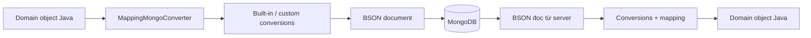

# Chuyển đổi ngày giờ, tiền tệ và giá trị đặc thù

> **Chương:** Chuyển đổi dữ liệu  
> **Phạm vi:** `SPRING_DATA_MONGODB` — sử dụng Spring Data MongoDB để kết nối, ánh xạ document và thao tác MongoDB qua `MongoTemplate` hoặc repository. Trong bài này, người học lựa chọn kiểu BSON phù hợp cho **thời điểm, ngày nghiệp vụ, tiền tệ và value object**, triển khai chuyển đổi tùy chỉnh, rồi kiểm chứng dữ liệu thô bằng truy vấn, aggregation và integration test. Các lựa chọn kiểu dữ liệu còn ảnh hưởng đến index, transaction, reactive access và chẩn đoán hiệu năng.

## 1. Vì sao chuyển đổi dữ liệu là quyết định thiết kế?

Một trường trong Java có thể biểu đạt nhiều ý nghĩa hơn kiểu BSON chứa nó. Ví dụ:

- `Instant` biểu diễn một **thời điểm tuyệt đối**; BSON Date lưu số mili giây tính từ Unix epoch.
- `LocalDate` biểu diễn **một ngày trên lịch**, không tự có giờ hoặc múi giờ. Ép nó vào BSON Date có thể tạo ra sai lệch ngày khi đổi múi giờ.
- `BigDecimal` biểu diễn số thập phân chính xác; BSON double có biểu diễn dấu phẩy động nhị phân và không phù hợp với nhiều phép tính tài chính.
- `Money(amount, currency)` có **hai thành phần và bất biến nghiệp vụ**, trong khi MongoDB chỉ thấy document, chuỗi hoặc số tùy cách ta thiết kế.
- `UUID`, enum, `Duration` hay kiểu đánh dấu trạng thái riêng có thể cần quy ước lưu ổn định qua các phiên bản ứng dụng.

Spring Data MongoDB dùng `MappingMongoConverter`, metadata mapping và các conversion đã đăng ký để biến giá trị Java thành BSON khi **ghi**, và làm ngược lại khi **đọc**. MongoDB Java Driver đảm nhiệm việc mã hóa BSON và giao tiếp với server.



**Mục tiêu của conversion không chỉ là để `save()` chạy được.** Ta còn cần đọc lại không mất giá trị, truy vấn đúng kiểu, lập index hiệu quả, tổng hợp số liệu chính xác và có cách chuyển đổi dữ liệu lịch sử khi schema thay đổi.

## 2. Phân biệt kiểu Java, kiểu BSON và ý nghĩa nghiệp vụ

| Dữ liệu nghiệp vụ | Kiểu Java đề xuất | Kiểu BSON/cách lưu | Lưu ý |
| --- | --- | --- | --- |
| Thời điểm sự kiện xảy ra | `Instant` | **Date** (mili giây UTC) | Không lưu múi giờ gốc; giới hạn độ phân giải mili giây. |
| Thời điểm ở phía Java legacy | `java.util.Date` | **Date** | Cùng epoch millis; cần tránh API thay đổi được nếu domain bất biến. |
| Thời điểm cần hiển thị theo vùng | `Instant` + `ZoneId` | **Date** + chuỗi vùng, nếu cần giữ vùng | Múi giờ hiển thị là quy tắc riêng với thời điểm tuyệt đối. |
| Ngày sinh/ngày chốt sổ | `LocalDate` | **Chuỗi ISO `yyyy-MM-dd`** hoặc quy ước BSON Date có định nghĩa vùng | Không có một thời điểm UTC duy nhất vốn có cho ngày lịch. |
| Giá trị tiền có phần thập phân | `BigDecimal` | **Decimal128** hoặc số nguyên đơn vị nhỏ nhất | Tránh BSON double; ghi rõ đơn vị và chính sách làm tròn. |
| Tiền kèm mã tiền tệ | `Money` | Document `{ amount, currency }` hoặc số nguyên + mã | Không cộng trực tiếp hai loại tiền khác nhau. |
| Trạng thái cố định | `enum` | Chuỗi code ổn định | Đổi tên enum có thể ảnh hưởng dữ liệu cũ. |
| Định danh ngẫu nhiên | `UUID` hoặc `String` | BSON Binary UUID hoặc chuỗi | Thống nhất representation và subtype trước khi lưu. |
| Thời lượng | `Duration` | Số mili giây/giây có tên field rõ đơn vị | Không xem duration là timestamp. |
| Tệp nhị phân | `byte[]` | BSON Binary, hoặc GridFS cho tệp lớn | Cân nhắc giới hạn kích thước document và cách truy xuất. |

**Phân biệt:** bảng mô tả các **lựa chọn schema**, không khẳng định mọi kiểu Java ở đây đều được chuyển theo đúng lựa chọn đó mà không cần cấu hình. Ví dụ `BigDecimal` muốn được lưu chắc chắn bằng Decimal128 nên khai báo `@Field(targetType = FieldType.DECIMAL128)`; các kiểu đặc thù khác có thể cần converter riêng.

## 3. Chuyển đổi ngày giờ: BSON Date lưu một thời điểm, không lưu timezone

### 3.1. BSON Date và `Instant`

MongoDB BSON Date về mặt logic là số nguyên 64 bit biểu diễn **số mili giây từ 1970-01-01T00:00:00Z**. Khi dùng BSON Date, giá trị không mang theo `ZoneId`, tên múi giờ hoặc offset mà người dùng đã nhập. MongoDB có thể hiển thị dưới dạng ISO UTC để dễ đọc:

```javascript
{
  "_id": "EVT-001",
  "occurredAt": ISODate("2026-11-20T02:15:30.123Z")
}
```

Trong Java:

```java
import java.time.Instant;

Instant occurredAt =
    Instant.parse("2026-11-20T02:15:30.123Z");
```

`Instant` biểu diễn đúng một thời điểm trên timeline. Hai chuỗi sau chỉ **cùng một thời điểm**:

```text
2026-11-20T02:15:30.123Z
2026-11-20T09:15:30.123+07:00
```

Khi lưu cùng một `Instant` bằng BSON Date, hai cách hiển thị có cùng giá trị epoch millis. Để hiển thị theo Việt Nam:

```java
import java.time.ZoneId;
import java.time.ZonedDateTime;

ZonedDateTime localView =
    occurredAt.atZone(ZoneId.of("Asia/Ho_Chi_Minh"));

// 2026-11-20T09:15:30.123+07:00[Asia/Ho_Chi_Minh]
```

**Độ chính xác:** `Instant` có thể chứa phần lẻ đến nano giây, nhưng BSON Date chỉ lưu **mili giây**. Nếu input là `2026-11-20T02:15:30.123456789Z`, không thể bảo toàn toàn bộ 9 chữ số thập phân khi ghi bằng BSON Date. Với yêu cầu độ phân giải cao hơn, thiết kế thêm trường nanosecond/epoch-nano hoặc định dạng riêng có test; không mặc định `save/read` sẽ giữ nguyên mọi chữ số.

### 3.2. `LocalDateTime` không phải một thời điểm tuyệt đối

`LocalDateTime` chỉ có ngày và giờ, **không chứa timezone hoặc offset**. Ví dụ `2026-11-20T09:00:00` có thể là 09:00 tại Hà Nội, Tokyo hoặc Paris và tương ứng nhiều `Instant` khác nhau.

```java
import java.time.LocalDateTime;
import java.time.ZoneId;
import java.time.Instant;

LocalDateTime wallClock = LocalDateTime.of(2026, 11, 20, 9, 0);
ZoneId businessZone = ZoneId.of("Asia/Ho_Chi_Minh");
Instant instant = wallClock.atZone(businessZone).toInstant();

// instant: 2026-11-20T02:00:00Z
```

Spring Data MongoDB có cơ chế chuyển đổi các kiểu `java.time`; việc sử dụng converter JSR-310 của Spring hay native Java Time codecs của driver **có thể ảnh hưởng cách `LocalDateTime`/`LocalDate` được diễn giải theo timezone**. Khi dùng kiểu không có timezone với BSON Date, hành vi cụ thể phụ thuộc cấu hình conversion và phiên bản. Đừng để `ZoneId.systemDefault()` của container hoặc máy chạy ngầm định quyết định thời điểm giao dịch.

**Khuyến nghị:** đối với event timestamp, persisted field nên là `Instant` và chuyển wall-clock time sang `Instant` ở biên API bằng `ZoneId` đã biết. Chỉ dùng `LocalDateTime` làm dữ liệu persisted khi đã công bố rõ quy ước múi giờ và kiểm thử trên nhiều JVM timezone.

### 3.3. Ngày trên lịch: `LocalDate`

Ngày sinh, hạn thanh toán theo ngày và ngày chốt sổ không nhất thiết có một thời điểm UTC duy nhất. Nếu doanh nghiệp chỉ quan tâm **ngày** và không cần tính toán timestamp, có thể lưu chuỗi ISO:

```java
import java.time.LocalDate;

LocalDate dueDate = LocalDate.of(2026, 11, 30);
String dueDateIso = dueDate.toString(); // "2026-11-30"

LocalDate restored = LocalDate.parse(dueDateIso);
```

```json
{
  "_id": "BILL-001",
  "dueDate": "2026-11-30"
}
```

Chuỗi ISO `yyyy-MM-dd` có thứ tự từ điển phù hợp với thứ tự lịch **khi mọi giá trị cùng định dạng chuẩn và cùng cách biểu diễn ngày**. Đổi lại, phép toán date aggregation sẽ khác so với BSON Date; cần parse rõ kiểu nếu dùng các toán tử xử lý ngày.

Cũng có thể lưu `LocalDate` bằng BSON Date theo quy ước cố định (chẳng hạn “00:00 tại một múi giờ được công bố”), nhưng phải thống nhất khi ghi/đọc và hiểu rằng khi đổi timezone hiển thị có thể thấy ngày khác. **BSON Date không có kiểu date-only riêng.**

### 3.4. Offset, vùng và giờ mùa hè

`OffsetDateTime` giữ offset tại một thời điểm; `ZonedDateTime` giữ cả quy tắc vùng (ví dụ `Europe/Berlin`). Không nên mặc định những kiểu này có converter tự động theo đúng semantics mong muốn trong mọi phiên bản Spring Data MongoDB.

Một lựa chọn cho lịch họp hoặc lịch chạy định kỳ:

```json
{
  "startAt": { "$date": "2026-11-20T02:00:00Z" },
  "zoneId": "Asia/Ho_Chi_Minh",
  "localStartText": "2026-11-20T09:00:00"
}
```

- `startAt` dùng cho sắp xếp, so sánh thời điểm và index.
- `zoneId` giữ vùng người dùng hoặc nghiệp vụ lựa chọn.
- `localStartText` chỉ cần nếu cần giữ đúng wall-clock input ban đầu, ví dụ phục vụ lịch lặp hoặc audit.

Ở vùng có daylight saving time (DST), một `LocalDateTime` có thể **không tồn tại** hoặc **xảy ra hai lần**. Khi đổi lịch địa phương thành `Instant`, phải quyết định chính sách cho gap/overlap, thay vì mặc định ghép ngày giờ với một offset bất kỳ.

## 4. Ví dụ entity lưu timestamp và số tiền

Để dễ kiểm tra BSON, dưới đây dùng `Invoice` dưới dạng Java record và `@Field` khai báo rõ Decimal128. Dự án giả định dùng Java 17+ và phiên bản Spring Data MongoDB hỗ trợ record.

```java
import java.math.BigDecimal;
import java.time.Instant;
import org.springframework.data.annotation.Id;
import org.springframework.data.mongodb.core.mapping.Document;
import org.springframework.data.mongodb.core.mapping.Field;
import org.springframework.data.mongodb.core.mapping.FieldType;

@Document(collection = "invoices")
public record Invoice(
    @Id String id,
    Instant occurredAt,
    @Field(targetType = FieldType.DECIMAL128) BigDecimal totalAmount,
    String currencyCode,
    String businessDate
) {}
```

Tạo object:

```java
Invoice invoice = new Invoice(
    "INV-001",
    Instant.parse("2026-11-20T02:15:30.123Z"),
    new BigDecimal("1250.50"),
    "USD",
    "2026-11-20"
);

Invoice saved = invoiceRepository.save(invoice);
```

`invoiceRepository` là một bean:

```java
import org.springframework.data.mongodb.repository.MongoRepository;

public interface InvoiceRepository
        extends MongoRepository<Invoice, String> {}
```

Ví dụ dạng **Extended JSON** của document sau khi lưu (lược bỏ `_class` nếu có):

```json
{
  "_id": "INV-001",
  "occurredAt": { "$date": "2026-11-20T02:15:30.123Z" },
  "totalAmount": { "$numberDecimal": "1250.50" },
  "currencyCode": "USD",
  "businessDate": "2026-11-20"
}
```

`$date` và `$numberDecimal` là cú pháp hiển thị các kiểu BSON, **không phải các object nghiệp vụ lồng nhau** trong document thật. `@Field(targetType = FieldType.DECIMAL128)` yêu cầu field `BigDecimal` được ghi dưới dạng BSON Decimal128; cần xác minh kiểu thực tế sau khi ghi và thử nghiệm với phiên bản framework đang chạy.

## 5. Tiền tệ: không dùng floating-point nhị phân cho số tiền

### 5.1. `double` dễ tạo sai số biểu diễn

`double` theo chuẩn IEEE 754 không thể biểu diễn chính xác nhiều số thập phân:

```java
double binary = 0.1d + 0.2d;
System.out.println(binary); // Thường hiển thị 0.30000000000000004

BigDecimal decimal = new BigDecimal("0.1")
    .add(new BigDecimal("0.2"));
System.out.println(decimal); // 0.3
```

Đối với hóa đơn, giá sản phẩm và kế toán, dùng `BigDecimal` với quy tắc scale/rounding phù hợp, hoặc dùng **số nguyên đơn vị nhỏ nhất** (minor unit, ví dụ cent đối với USD) nếu miền giá trị và cách làm tròn được xác định.

**Đặc biệt:** tránh `new BigDecimal(0.1)` vì constructor đó lấy chính xác giá trị `double` vốn đã không biểu diễn được 0.1. Dùng `new BigDecimal("0.1")` hoặc `BigDecimal.valueOf(0.1)` khi đầu vào buộc là `double`.

### 5.2. Decimal128 và các lựa chọn lưu giá trị

| Cách lưu | BSON ví dụ | Khi thích hợp | Đánh đổi |
| --- | --- | --- | --- |
| `Decimal128` | `NumberDecimal("1250.50")` | Cần tính tổng, lọc khoảng và aggregation số thập phân chính xác ở server | Giới hạn định dạng Decimal128; cần hỗ trợ từ driver/tool. |
| Integer minor units | `125050` cent | Ứng dụng dùng một đơn vị chuẩn và miền số trong `long` | Cần lưu/biết đơn vị; đổi tỉ lệ, currency có số lẻ khác nhau sẽ phức tạp. |
| String decimal | `"1250.50"` | Lưu để tương thích dữ liệu hoặc không cần thao tác số trên server | Query/sort/aggregation dạng số không tự hoạt động như Decimal128. |
| BSON double | `1250.5` | Thông số đo lường được phép có sai số nhị phân | Thường không phù hợp cho tiền tệ/kế toán. |

Về mặt ý nghĩa, `Decimal128` là decimal floating-point với **34 chữ số có nghĩa**, không cho phép biểu diễn mọi `BigDecimal` bất kỳ. Khi chuyển giá trị có độ chính xác/độ lớn vượt khả năng Decimal128, cần xử lý lỗi hoặc chính sách chuẩn hóa tại biên, không được làm tròn âm thầm nếu nghiệp vụ không cho phép. `Decimal128` cũng có những giá trị đặc biệt của decimal floating-point; dữ liệu tài chính thường cần validation chỉ cho phép số hữu hạn hợp lệ.

Nếu dự án trước đây lưu `BigDecimal` dưới dạng chuỗi hoặc double, **việc thêm `@Field(targetType = DECIMAL128)` không tự chuyển đổi document cũ**. Cần migration, dual-read thích hợp và kiểm thử schema hỗn hợp trước khi chuyển hoàn toàn.

### 5.3. Kiểm soát mã tiền và số chữ số sau dấu phẩy

Chỉ có một con số `1250.50` chưa đủ để biết đó là USD, EUR hay một đơn vị khác. Dùng mã tiền tệ theo một quy ước thống nhất như ISO 4217:

```java
import java.math.BigDecimal;
import java.math.RoundingMode;
import java.util.Currency;

Currency usd = Currency.getInstance("USD");
int fractionDigits = usd.getDefaultFractionDigits(); // 2

BigDecimal amount = new BigDecimal("1250.50")
    .setScale(fractionDigits, RoundingMode.UNNECESSARY);
```

`RoundingMode.UNNECESSARY` sẽ từ chối giá trị phải làm tròn. Trong nghiệp vụ khác, có thể cần `HALF_UP` hoặc `HALF_EVEN`; chính sách nào đúng phải do quy định kế toán và sản phẩm quyết định. Không suy luận mọi currency đều có hai chữ số lẻ (ví dụ JPY thường có 0), và `Currency.getDefaultFractionDigits()` không thay thế được toàn bộ quy tắc giá/thuế/khuyến mại của doanh nghiệp.

**Không tổng hợp tiền giữa các currency khi chưa có tỷ giá và thời điểm quy đổi xác định.** MongoDB có thể cộng hai con số Decimal128 thuộc các mã tiền khác nhau mà không biết nghiệp vụ đã sai.

## 6. Custom converter cho value object `Money`

Khi domain có nhiều thuộc tính tiền, một value object sẽ tốt hơn một `BigDecimal` trần:

```java
import java.math.BigDecimal;
import java.util.Currency;
import java.util.Objects;

public record Money(BigDecimal amount, String currencyCode) {
    public Money {
        Objects.requireNonNull(amount, "amount");
        Objects.requireNonNull(currencyCode, "currencyCode");
        Currency.getInstance(currencyCode); // Kiểm tra mã tiền hợp lệ.
    }
}
```

Nếu để Spring Data map object thông thường, `Money` có thể được lưu như **document nhúng** với các field tương ứng, tùy converter/type metadata. Nhưng nếu cần ép `amount` thành Decimal128 và `currencyCode` vào một schema ổn định, có thể tạo **converter hai chiều**.

### 6.1. Ghi `Money` thành BSON Document

```java
import org.bson.Document;
import org.bson.types.Decimal128;
import org.springframework.core.convert.converter.Converter;
import org.springframework.data.convert.WritingConverter;

@WritingConverter
public class MoneyWriteConverter implements Converter<Money, Document> {

    @Override
    public Document convert(Money money) {
        return new Document("amount",
                new Decimal128(money.amount()))
            .append("currencyCode", money.currencyCode());
    }
}
```

`new Decimal128(BigDecimal)` sẽ chuyển sang loại BSON decimal thích hợp khi giá trị trong giới hạn Decimal128. Dữ liệu nên được validate (scale, precision, currency) **trước** khi converter chạy. Với ứng dụng tài chính, không nên để converter tự âm thầm làm tròn một giá trị không hợp lệ.

### 6.2. Đọc BSON Document thành `Money`

```java
import java.math.BigDecimal;
import org.bson.Document;
import org.bson.types.Decimal128;
import org.springframework.core.convert.converter.Converter;
import org.springframework.data.convert.ReadingConverter;

@ReadingConverter
public class MoneyReadConverter implements Converter<Document, Money> {

    @Override
    public Money convert(Document document) {
        Decimal128 bsonAmount =
            document.get("amount", Decimal128.class);
        BigDecimal amount = bsonAmount.bigDecimalValue();
        String currencyCode = document.getString("currencyCode");
        return new Money(amount, currencyCode);
    }
}
```

Đoạn đọc này cố ý đòi `amount` là Decimal128: nếu dữ liệu cũ đang là string hoặc double, cần **migration** hoặc một converter chuyển tiếp xử lý rõ từng kiểu trước khi đưa vào domain. Không cast tùy tiện hoặc đổi double sang decimal rồi cho rằng đã khôi phục độ chính xác ban đầu.

### 6.3. Đăng ký conversion

Với một phiên bản Spring Data MongoDB cung cấp constructor `MongoCustomConversions(List<?>)`, có thể đăng ký converters thông qua bean:

```java
import java.util.List;
import org.springframework.context.annotation.Bean;
import org.springframework.context.annotation.Configuration;
import org.springframework.data.mongodb.core.convert.MongoCustomConversions;

@Configuration
public class MongoConversionConfiguration {

    @Bean
    MongoCustomConversions mongoCustomConversions() {
        return new MongoCustomConversions(List.of(
            new MoneyWriteConverter(),
            new MoneyReadConverter()
        ));
    }
}
```

API đăng ký có thể có dạng builder/adapter khác giữa các phiên bản Spring Data; kiểm tra cách kết hợp custom converters với cấu hình mặc định của Boot và `MongoMappingContext` để bảo toàn những converter có sẵn. Hai annotation `@WritingConverter` và `@ReadingConverter` giúp mô tả **chiều chuyển đổi** khi Spring Data phân loại converter; đăng ký một chiều sẽ không tự làm xuất hiện chiều còn lại.

Entity sử dụng value object:

```java
import org.springframework.data.annotation.Id;
import org.springframework.data.mongodb.core.mapping.Document;

@Document(collection = "orders_with_money")
public record OrderWithMoney(
    @Id String id,
    Money total
) {}
```

Kết quả BSON mong đợi:

```json
{
  "_id": "ORD-M-001",
  "total": {
    "amount": { "$numberDecimal": "1250.50" },
    "currencyCode": "USD"
  }
}
```

**Một converter toàn cục áp dụng cho mọi property kiểu `Money` trong `MongoCustomConversions` phù hợp.** Nếu các collection cần schema tiền khác nhau, cân nhắc thiết kế value object/convert riêng cho từng nhu cầu thay vì thay đổi toàn cục gây ảnh hưởng đến dữ liệu đã lưu.

### 6.4. Khi nào không cần custom converter?

Nếu chỉ cần field `BigDecimal` độc lập, `@Field(targetType = FieldType.DECIMAL128)` như ở `Invoice` thường đơn giản và dễ nhìn thấy ý định ngay ở entity. Nếu `Money` chỉ là một object nhúng có hai thuộc tính và bạn kiểm soát mapping bằng annotation, không bắt buộc phải viết converter. Chỉ tạo converter khi có **hợp đồng BSON ổn định và chuyển đổi không được diễn đạt rõ bằng mapping có sẵn**.

## 7. Các giá trị đặc thù khác: enum, UUID, duration, ObjectId và binary

### 7.1. Enum có tên dễ đổi, dữ liệu lưu trữ thì không

```java
public enum PaymentStatus {
    PENDING,
    SETTLED,
    FAILED
}
```

Spring Data MongoDB thường ánh xạ enum sang **chuỗi tên** như `"SETTLED"` trong document, nhưng hãy xác nhận kiểu BSON trên phiên bản dự án. Nếu đổi hằng `SETTLED` thành `PAID` ở code, document lịch sử vẫn chứa `"SETTLED"` và có thể không còn đọc được theo enum mới.

Cách quản trị ổn định hơn cho domain lâu dài là có **mã lưu trữ không đổi**, kết hợp converter hoặc property riêng:

```java
public enum PaymentState {
    WAITING("W"),
    SUCCESS("S"),
    REJECTED("R");

    private final String code;

    PaymentState(String code) { this.code = code; }
    public String getCode() { return code; }
}
```

Ở ví dụ này, **chỉ định nghĩa code chưa đủ để Spring Data tự lưu code**. Muốn BSON chứa `"S"` thay vì `"SUCCESS"`, cần mapper/converter hai chiều hoặc mô hình lưu `String stateCode` một cách tường minh. Trong converter đọc, nên xử lý giá trị chưa biết theo chính sách tương thích thay vì mặc định ánh xạ sang trạng thái sai.

### 7.2. UUID và BSON Binary representation

`UUID` có thể được lưu dưới dạng **BSON Binary subtype UUID** hoặc chuỗi, tùy codec và cấu hình lưu trữ. UUID representation là chi tiết quan trọng của MongoDB Java Driver; những representation cũ và `STANDARD` không được phép trộn ngẫu nhiên.

Các lựa chọn:

- Dùng `String` chứa dạng chuẩn `xxxxxxxx-xxxx-xxxx-xxxx-xxxxxxxxxxxx` để schema rõ và tương thích nhiều client, chấp nhận tốn dung lượng hơn BSON Binary.
- Dùng BSON Binary với UUID representation được cấu hình nhất quán; đọc/ghi phải cùng cách biểu diễn.
- Khi chuyển từ binary UUID đời cũ sang `STANDARD`, thực hiện migration và xác minh bằng dữ liệu thô; thay đổi cấu hình driver không tự chuyển BSON đã lưu.

Trường `@Id` còn có quy tắc chuyển `String`/`ObjectId` đặc biệt, nên **ID UUID và ID ObjectId là hai quyết định tách biệt**. Trước khi lưu dữ liệu thật, hãy chốt kiểu BSON cho `_id` và giữ ổn định qua các môi trường.

### 7.3. `Duration` và đơn vị đo

Một thời lượng là khoảng cách thời gian, không phải Date:

```java
import java.time.Duration;

Duration timeout = Duration.ofSeconds(45);
long timeoutMillis = timeout.toMillis(); // 45000
```

Có thể lưu `timeoutMillis: 45000` hoặc `timeoutSeconds: 45`; tên trường phải thể hiện **đơn vị**. Khi đọc, dùng `Duration.ofMillis(...)` hoặc `Duration.ofSeconds(...)` tương ứng. Không dùng Date để lưu thời lượng vì Date mang ý nghĩa một thời điểm từ epoch.

Với dữ liệu đo lường khác như nhiệt độ, dung lượng, khoảng cách hoặc điểm địa lý, cùng nguyên tắc: **lưu giá trị và đơn vị trong schema rõ ràng**. Nếu cần truy vấn geospatial trên server, dùng kiểu GeoJSON/Point và index phù hợp thay vì tùy ý lưu một record `latitude, longitude` rồi kỳ vọng MongoDB tự hiểu là GeoJSON.

### 7.4. `ObjectId`, binary và document lớn

`ObjectId` là loại BSON phổ biến cho `_id`; `org.bson.types.ObjectId` ở Java có thể biểu diễn trực tiếp. Nếu domain muốn ID nghiệp vụ `"INV-001"` hoặc UUID thay thế, hãy quyết định kiểu BSON dựa trên truy vấn, indexing và các hệ thống tích hợp.

`byte[]` có thể được lưu dưới BSON Binary; **không nên nhúng file lớn không giới hạn vào document**. MongoDB có giới hạn kích thước document BSON (thường 16 MiB). Với dữ liệu tệp lớn, cân nhắc GridFS hoặc object storage và lưu metadata/reference trong collection.

## 8. Truy vấn và aggregation phụ thuộc kiểu BSON đã chọn

Một lựa chọn conversion sai có thể không gây lỗi lúc ghi, nhưng làm truy vấn range, sort và aggregation trả kết quả bất ngờ.

### 8.1. Range query với `Instant`

Truy vấn các invoice xảy ra trong ngày 20/11/2026 theo múi giờ Việt Nam phải đổi **ranh giới ngày địa phương** sang `Instant`:

```java
import java.time.LocalDate;
import java.time.ZoneId;
import java.time.Instant;
import org.springframework.data.mongodb.core.query.Criteria;
import org.springframework.data.mongodb.core.query.Query;

ZoneId zone = ZoneId.of("Asia/Ho_Chi_Minh");
LocalDate day = LocalDate.of(2026, 11, 20);

Instant from = day.atStartOfDay(zone).toInstant();
Instant until = day.plusDays(1).atStartOfDay(zone).toInstant();

Query query = Query.query(
    Criteria.where("occurredAt").gte(from).lt(until)
);
```

Khoảng **nửa mở [from, until)** tránh lỗi ở thời điểm cuối ngày và hoạt động đúng khi ngày tại những vùng có DST dài 23 hoặc 25 giờ. Không cộng mặc định 24 giờ cho mọi ngày lịch trên toàn cầu.

Với `Invoice`, Spring Data mapping `Instant` sang BSON Date cho query và có thể tận dụng index `occurredAt` nếu đã tạo. Chẩn đoán bằng `explain("executionStats")` với query thật; xem số document quét và chiến lược index thay vì chỉ quan sát độ trễ qua một lần chạy nhỏ.

### 8.2. Aggregation số tiền bằng Decimal128

Nếu `totalAmount` thực sự là Decimal128, MongoDB có thể dùng các toán tử số để cộng:

```javascript
db.invoices.aggregate([
  { $match: { currencyCode: "USD" } },
  {
    $group: {
      _id: "$currencyCode",
      total: { $sum: "$totalAmount" },
      invoiceCount: { $sum: 1 }
    }
  }
])
```

Đừng cộng tiền từ nhiều currency bằng pipeline bỏ qua `currencyCode`. Nếu document cũ lưu số tiền dưới dạng string, `$sum` không tự xử lý nó giống Decimal128; phải thực hiện migration hoặc chuyển kiểu có kiểm soát, đồng thời phân tích hiệu năng của phép chuyển trong aggregation.

### 8.3. Index và schema hỗn hợp

```javascript
db.invoices.createIndex({ occurredAt: 1 })
db.invoices.createIndex({ currencyCode: 1, totalAmount: 1 })
```

Nếu cùng field `totalAmount` tồn tại dưới cả Decimal128, String và double, MongoDB có thể sắp xếp/lọc theo quy tắc BSON type, khiến kết quả không tương ứng với so sánh số học mong đợi. Một unique index cũng cần xét giá trị, kiểu và quy tắc collation. **Chuẩn hóa kiểu trước khi đánh giá index/query** là bước rất quan trọng của kế hoạch migration.

## 9. Kiểm thử conversion và dữ liệu thô

Để chắc chắn round-trip, nên dùng MongoDB test thật (chẳng hạn Testcontainers), lưu object qua Spring Data rồi đọc **raw BSON** và đọc lại qua repository. Không kiểm tra chỉ bằng JSON API vì Jackson có quy tắc serialization riêng.

### 9.1. Kiểm tra `Invoice`

```java
Invoice original = new Invoice(
    "INV-T1",
    Instant.parse("2026-11-20T02:15:30.123Z"),
    new BigDecimal("1250.50"),
    "USD",
    "2026-11-20"
);

invoiceRepository.save(original);
Invoice reloaded = invoiceRepository.findById("INV-T1").orElseThrow();

// Giá trị cần kiểm tra bằng assertion framework:
// reloaded.occurredAt().equals(original.occurredAt())
// reloaded.totalAmount().compareTo(original.totalAmount()) == 0
// reloaded.currencyCode().equals("USD")
```

`BigDecimal.compareTo` kiểm tra giá trị số học; `BigDecimal.equals` còn so cả scale. Nếu nghiệp vụ yêu cầu bảo toàn scale chính xác, hãy thêm assertion về `scale()` và raw Decimal128, không mặc định so sánh giá trị số là đủ.

Kiểm tra trong `mongosh`:

```javascript
const invoice = db.invoices.findOne({ _id: "INV-T1" });
printjson(invoice);
print(typeof invoice.currencyCode);
print(invoice.totalAmount?._bsontype);
```

Ở phía Java, đọc trực tiếp `Document` và xác nhận kiểu:

```java
import org.bson.Document;
import org.bson.types.Decimal128;
import com.mongodb.client.model.Filters;

Document raw = mongoTemplate.getCollection("invoices")
    .find(Filters.eq("_id", "INV-T1"))
    .first();

// Assert trong test:
// raw != null
// raw.get("totalAmount") instanceof Decimal128
// raw.getDate("occurredAt").toInstant()
//      .equals(Instant.parse("2026-11-20T02:15:30.123Z"))
```

Tương tự, khi dùng `Money` custom converter, xác nhận `total.amount` (ở collection `orders_with_money`) là BSON Decimal128 và đọc lại được mã currency. Nếu chỉ quan sát `BigDecimal` trả về trong Java mà không xem BSON, một converter khác có thể đã lưu thành String nhưng vẫn khiến test Java qua vòng đọc/ghi có vẻ thành công.

### 9.2. Bộ trường hợp biên cần có

| Nhóm | Dữ liệu test | Điều cần xác minh |
| --- | --- | --- |
| Timestamp | Epoch, trước/sau epoch, mili giây lẻ | Đúng instant và loại BSON Date. |
| Precision | `.123456789` nano giây | Phát hiện rõ phần độ chính xác bị mất khi lưu BSON Date. |
| Timezone | UTC và Asia/Ho_Chi_Minh | Cùng instant có cùng giá trị BSON; ngày local được tính đúng. |
| DST | Một ngày có gap/overlap tại vùng có DST | Chính sách giải quyết thời điểm không tồn tại/không duy nhất. |
| Date only | 28/02, 29/02, 31/12, ngày cuối/tháng | Không đổi ngày khi đọc ở máy JVM khác timezone. |
| Decimal | `0.1 + 0.2`, số âm, số rất lớn, số có scale cao | Không rơi về double; phát hiện vượt khả năng Decimal128. |
| Money | USD, JPY, VND, mã không hợp lệ | Quy tắc scale và currency được áp dụng. |
| Legacy schema | String/double từng dùng cho tiền | Migration hoặc converter chuyển tiếp hoạt động có chủ đích. |
| Enum | Giá trị cũ đã đổi tên | Có chiến lược mã ổn định hoặc migration. |
| UUID | Chuỗi vs BSON Binary subtype | Representation nhất quán khi lọc bằng ID. |
| Custom converter | Ghi/đọc `Money`, field thiếu/null | Thấy lỗi rõ hoặc fallback có kiểm soát; không nuốt dữ liệu hỏng. |

## 10. Lỗi phổ biến và cách chẩn đoán

| Triệu chứng | Nguyên nhân thường gặp | Hướng điều tra |
| --- | --- | --- |
| Giờ hiển thị lệch 7 tiếng | Nhầm UTC với giờ `Asia/Ho_Chi_Minh` hoặc coi `LocalDateTime` là `Instant`. | Đọc raw BSON Date, in epoch millis và timezone dùng khi hiển thị. |
| Ngày sinh/hạn thanh toán thành ngày hôm trước | Lưu ngày lịch thành mốc 00:00 ở timezone này, đọc ở timezone khác. | Chọn schema date-only rõ ràng và migration dữ liệu nếu cần. |
| `Instant` mất chữ số nano | BSON Date chỉ có mili giây. | Test precision; thay schema nếu yêu cầu cao hơn. |
| Tiền 0.1 + 0.2 ra giá trị lẻ | Dùng `double` hoặc tạo `BigDecimal` từ `double`. | Dùng decimal string/minor units/Decimal128; theo dõi dữ liệu đã ghi. |
| Aggregation `$sum` không cộng được field tiền | Field đang là String hoặc schema hỗn hợp. | Xem BSON type, chuyển dữ liệu sang Decimal128 hoặc minor unit. |
| Converter `Money` không chạy | Chưa đăng ký, sai chiều conversion hoặc bị bean config khác thay thế. | Kiểm tra `MongoCustomConversions`, `@ReadingConverter`/`@WritingConverter` và raw BSON. |
| Giá trị Decimal128 vượt giới hạn | `BigDecimal` có precision/exponent không phù hợp. | Validate miền giá trị, scale/precision trước khi lưu. |
| Enum cũ không đọc được | Đã đổi tên hằng enum nhưng document vẫn dùng tên cũ. | Dùng mã lưu ổn định, converter chuyển tiếp hoặc migration. |
| Query UUID không khớp dù chuỗi nhìn giống nhau | Dữ liệu là BSON Binary khác representation hoặc String. | Kiểm tra raw BSON, UUID representation và cách truyền giá trị query. |
| Test chạy trên máy dev đúng nhưng CI khác kết quả | System timezone/locale khác, thiếu cấu hình conversion. | Dùng timezone explicit, test chéo môi trường và dữ liệu thô. |

**Phân tầng nguyên nhân:** xem giá trị đầu vào/API → domain Java → MongoDB conversion → kiểu BSON trên server → query/aggregation → domain sau đọc → JSON response. Chẩn đoán theo từng ranh giới này giúp phân biệt lỗi của converter với lỗi hiển thị hoặc lỗi truy vấn.

## 11. Kịch bản chuyển đổi dữ liệu đã tồn tại

Giả sử `invoices.totalAmount` trước đây được lưu dạng chuỗi:

```json
{ "_id": "INV-OLD", "totalAmount": "1250.50", "currencyCode": "USD" }
```

Phiên bản mới muốn chuyển sang Decimal128. Các bước hợp lý:

1. **Thống kê BSON type hiện tại** cho `totalAmount` và những giá trị không parse được; tính tỷ lệ document có kiểu String, double, Decimal128 và field bị thiếu.
2. **Chốt quy tắc số học**: cách xử lý scale, precision, currency không hợp lệ và giá trị làm tròn cũ. Giá trị double đã mất chính xác không thể được khôi phục tự động chỉ bằng cast.
3. **Chuẩn bị migration có thể kiểm chứng** với cơ chế backup/rollback phù hợp; trên tập dữ liệu lớn phải đo tải và tốc độ batch.
4. **Cập nhật ứng dụng** để đọc được schema chuyển tiếp trong giai đoạn migration nếu có nhiều phiên bản cùng chạy.
5. **Chuyển dữ liệu thành Decimal128**, kiểm chứng giá trị/kiểu BSON và số document trước/sau; xử lý các bản ghi lỗi riêng.
6. **Chỉ sau khi schema ổn định**, áp dụng các query, aggregation và index được thiết kế cho Decimal128.

**Thay annotation Java không phải migration trên MongoDB.** Tương tự, đổi cách lưu `LocalDateTime`, enum hay UUID phải có kế hoạch với document cũ; dữ liệu persisted có vòng đời dài hơn class Java đang biên dịch.

## 12. Bài thực hành và câu hỏi tự kiểm tra

### Bài thực hành: hóa đơn đa tiền tệ

Tạo API quản lý `Invoice` với các trường `id`, `occurredAt`, `totalAmount`, `currencyCode` và `businessDate`. Yêu cầu:

1. Lưu `occurredAt` bằng `Instant`/BSON Date; API nhận giờ địa phương kèm timezone, chuyển thành `Instant` trước khi ghi.
2. Lưu `businessDate` dưới dạng chuỗi ISO `yyyy-MM-dd`, ghi rõ đây là ngày nghiệp vụ độc lập với instant.
3. Lưu `totalAmount` dưới Decimal128 với `@Field(targetType = FieldType.DECIMAL128)`; không nhập số tiền dưới dạng `double`.
4. Thêm một entity `OrderWithMoney` dùng `Money` và converter hai chiều; xác nhận field nested `total.amount` là Decimal128.
5. Viết repository truy vấn invoice trong một ngày Việt Nam theo `occurredAt` bằng khoảng nửa mở; thử cả `MongoTemplate` và kiểm tra index.
6. Viết aggregation tính tổng theo `currencyCode`; chứng minh rằng bỏ `currencyCode` khỏi nhóm sẽ khiến báo cáo có thể sai về nghiệp vụ.
7. Thêm dữ liệu cũ `totalAmount: "1250.50"`, đề xuất chiến lược migration và test đọc/ghi với schema mới.

### Câu hỏi tự đánh giá

- Vì sao `Instant` và `LocalDateTime` có ý nghĩa khác nhau khi lưu một sự kiện?
- Tại sao BSON Date không ghi nhớ tên múi giờ gốc?
- Vì sao ngày trên lịch có thể không nên lưu thành Date ở 00:00 UTC?
- Khi nào chọn integer minor units, khi nào chọn Decimal128?
- `@Field(targetType = FieldType.DECIMAL128)` thay đổi điều gì trên field `BigDecimal`?
- Tại sao `new BigDecimal(0.1)` không phải cách khởi tạo số tiền chính xác?
- Vì sao converter cho `Money` cần cả chiều đọc và chiều ghi?
- Đổi tên enum hoặc thay UUID representation tác động gì tới document cũ?
- Khi ứng dụng đọc được `BigDecimal`, vì sao vẫn cần kiểm tra loại BSON bằng raw query?

## 13. Ghi nhớ và tài liệu tham khảo

- **Timestamp:** `Instant` gắn với thời điểm UTC và phù hợp cho BSON Date; Date chỉ giữ độ chính xác mili giây, không giữ timezone gốc.
- **Ngày lịch:** `LocalDate` khác timestamp; chọn cách lưu date-only minh bạch và thống nhất toàn hệ thống.
- **Tiền tệ:** dùng `BigDecimal`/Decimal128 hoặc số nguyên minor units theo quy tắc rõ ràng; không dùng `double` cho số tiền cần chính xác.
- **Decimal128:** khai báo `@Field(targetType = FieldType.DECIMAL128)` khi muốn lưu `BigDecimal` dưới loại BSON cụ thể và kiểm chứng raw BSON.
- **Value object:** `Money` cần chứa cả `amount` lẫn `currency`; converter hai chiều chỉ nên được thêm khi thực sự cần schema riêng.
- **Giá trị đặc thù:** enum, UUID, duration, ID và binary đều cần quyết định representation ổn định, có kế hoạch migration.
- **Hiệu năng và tính đúng:** query, index và aggregation phải làm việc trên **loại BSON thực sự đã lưu**, không chỉ kiểu khai báo trong Java.

Tài liệu chính thức nên đối chiếu với phiên bản đang sử dụng:

- [Spring Data MongoDB — Mapping](https://docs.spring.io/spring-data/mongodb/reference/mongodb/mapping/mapping.html)
- [Spring Data MongoDB — Custom Conversions](https://docs.spring.io/spring-data/mongodb/reference/mongodb/mapping/custom-conversions.html)
- [MongoDB — BSON Types](https://www.mongodb.com/docs/manual/reference/bson-types/)
- [MongoDB — Decimal128](https://www.mongodb.com/docs/manual/tutorial/model-monetary-data/)
