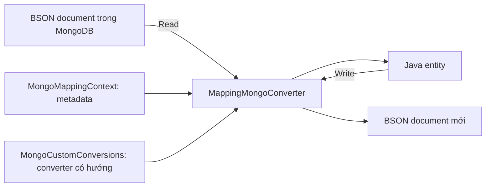

# Chuyển đổi một chiều, null và dữ liệu không hợp lệ

## 1. Mục tiêu và bài toán thực tế

MongoDB lưu dữ liệu dưới các kiểu BSON, còn ứng dụng Java làm việc với class, enum, value object và các kiểu thời gian, số học. **Spring Data MongoDB** sử dụng cơ chế chuyển đổi dữ liệu để đi giữa hai thế giới đó. Trong một ứng dụng đã vận hành, khó khăn thường không nằm ở một document hoàn hảo mà ở **dữ liệu không đồng nhất**: bản ghi cũ lưu mã trạng thái `"A"`, bản ghi mới lưu `"ACTIVE"`; có bản ghi thiếu trường, có bản ghi ghi `null` và có bản ghi chứa giá trị chưa từng được hệ thống cho phép.

Bài thuộc chương **Chuyển đổi dữ liệu** của module **SPRING_DATA_MONGODB**. Nội dung áp dụng trực tiếp khi dùng `MongoTemplate` hoặc repository để kết nối, đọc/ghi và ánh xạ document; đồng thời giúp kiểm thử, xây dựng migration, thiết kế truy vấn và index, chẩn đoán các lỗi mà đôi khi bị nhầm thành lỗi kết nối hoặc hiệu năng.

Sau bài này, bạn có thể:

1. Phân biệt **reading conversion** với **writing conversion** và hiểu tại sao một converter chỉ áp dụng một chiều.
2. Dùng `@ReadingConverter`, `@WritingConverter` và `MongoCustomConversions` theo đúng hướng chuyển đổi.
3. Giải thích sự khác nhau giữa trường **không tồn tại**, trường **có giá trị `null`** và trường **có giá trị sai kiểu/sai miền giá trị**.
4. Xử lý dữ liệu legacy theo chính sách rõ ràng, không che giấu lỗi bằng giá trị mặc định tùy tiện.
5. Kiểm tra cả chiều đọc, chiều ghi, BSON thực tế và truy vấn sau khi chuẩn hóa dữ liệu.

Ví dụ sử dụng Java 17+, Spring Data MongoDB và `mongosh`. Khi áp dụng vào dự án, cần đối chiếu phiên bản Spring Data, Spring Boot, MongoDB driver và các custom converter đã tồn tại.

## 2. Chuyển đổi dữ liệu nằm ở đâu?

Một ứng dụng thường có đường đi như sau:



`MongoMappingContext` cung cấp metadata về entity và property, ví dụ `@Document` và `@Field`. `MappingMongoConverter` xử lý việc đọc/ghi object, dùng cơ chế chuyển đổi mặc định và converter được đăng ký. `MongoTemplate` và repository thao tác trên domain entity thông qua các thành phần này; driver và MongoDB server nhận các giá trị BSON.

Điểm cần giữ riêng:

| Khái niệm | Nhiệm vụ |
| --- | --- |
| Metadata mapping | Biết property Java nào ứng với field BSON nào |
| Reading converter | Chuyển một giá trị từ dạng lưu trữ sang kiểu Java khi đọc |
| Writing converter | Chuyển một giá trị Java sang dạng lưu trữ khi ghi |
| Validation | Kiểm tra giá trị có hợp lệ với hợp đồng dữ liệu/nghiệp vụ không |
| Migration | Thay đổi **document đã tồn tại** để phù hợp schema mới |
| Query mapping | Chuyển field path và giá trị filter/update khi thực thi truy vấn |

Converter là công cụ biến đổi giá trị. Việc định nghĩa converter **không tự sửa toàn bộ dữ liệu đang nằm trong database**, không tạo index và không thay thế ràng buộc nghiệp vụ.

## 3. Đọc một chiều khác với ghi một chiều

### 3.1. Hai hướng có thể độc lập

Giả sử collection `orders` từng lưu:

```javascript
// Bản ghi cũ (legacy).
{ _id: "order-001", state: "A", amount: NumberDecimal("120000") }

// Bản ghi mới.
{ _id: "order-002", state: "ACTIVE", amount: NumberDecimal("85000") }
```

Domain Java hiện tại chỉ muốn làm việc với:

```java
public enum OrderState {
    ACTIVE,
    SUSPENDED
}
```

Ta có thể xây dựng quy tắc **đọc rộng, ghi chuẩn**:

```text
READ:   "A"       -> OrderState.ACTIVE
        "ACTIVE"  -> OrderState.ACTIVE
        "S"       -> OrderState.SUSPENDED
        "SUSPENDED" -> OrderState.SUSPENDED

WRITE:  OrderState.ACTIVE    -> "ACTIVE"
        OrderState.SUSPENDED -> "SUSPENDED"
```

Ở đây, dữ liệu cũ vẫn đọc được, nhưng bản ghi **mới** được ghi theo một quy ước chuẩn. Quy tắc đọc không nhất thiết là phép nghịch đảo một-một của quy tắc ghi: cả `"A"` và `"ACTIVE"` cùng đọc thành một giá trị Java.

### 3.2. Vì sao cần khai báo hướng?

Spring Data MongoDB có thể nhận biết nhiều chuyển đổi theo kiểu nguồn/đích. Tuy nhiên, chuyển đổi giữa hai kiểu được xem là **kiểu đơn giản của store** (ví dụ `String` ↔ `String` hoặc một số kiểu số) có thể khó phân định là reading hay writing. Các annotation:

- `@ReadingConverter`: xác định converter được dùng ở **chiều đọc**.
- `@WritingConverter`: xác định converter được dùng ở **chiều ghi**.

khai báo ý định rõ ràng và giúp framework đăng ký đúng chiều. Hai annotation nằm trong package `org.springframework.data.convert`; chúng không phải annotation đặt trên field BSON.

Khai báo một reading converter **không tự sinh writing converter tương ứng**, và ngược lại. Nếu không có custom writing converter, việc ghi sẽ sử dụng cơ chế mapping mặc định phù hợp với kiểu Java đó, hoặc có thể sinh biểu diễn ngoài mong muốn. Vì vậy luôn kiểm tra cả hai chiều.

## 4. Ví dụ reading converter cho dữ liệu trạng thái legacy

### 4.1. Model Java

```java
import org.springframework.data.annotation.Id;
import org.springframework.data.mongodb.core.mapping.Document;

@Document(collection = "orders")
public record Order(
    @Id String id,
    OrderState state
) {}
```

`OrderState` là enum đã định nghĩa ở mục 3. BSON `state` của bản ghi cũ chứa `"A"` hoặc `"S"`, trong khi tên enum mới là `ACTIVE`, `SUSPENDED`.

Nếu framework cố diễn giải chuỗi `"A"` thành tên enum trong khi không có converter phù hợp, nó có thể phát sinh lỗi chuyển đổi. Ta sẽ định nghĩa một reading converter nhận **cả hai dạng**:

```java
import java.util.Locale;
import org.springframework.core.convert.converter.Converter;
import org.springframework.data.convert.ReadingConverter;

@ReadingConverter
public final class OrderStateReadConverter
    implements Converter<String, OrderState> {

    @Override
    public OrderState convert(String source) {
        String code = source.trim().toUpperCase(Locale.ROOT);
        return switch (code) {
            case "A", "ACTIVE" -> OrderState.ACTIVE;
            case "S", "SUSPENDED" -> OrderState.SUSPENDED;
            default -> throw new IllegalArgumentException(
                "Unknown order state code"
            );
        };
    }
}
```

Converter chấp nhận các mã legacy đã biết và giá trị chuẩn mới. Với giá trị khác như `"??"`, nó **báo lỗi**. Nó không trả `OrderState.ACTIVE` làm giá trị mặc định chỉ để khiến dữ liệu xấu đọc được.

Hàm trên là logic chuyển đổi cho **giá trị String khác null**. Không nên dựa vào việc framework sẽ luôn gọi nó khi field thiếu hoặc `null`: hai trường hợp đó đi qua cơ chế binding/null handling của mapping layer và cần được xử lý riêng.

### 4.2. Đăng ký trong MongoCustomConversions

```java
import java.util.List;
import org.springframework.context.annotation.Bean;
import org.springframework.context.annotation.Configuration;
import org.springframework.data.mongodb.core.convert.MongoCustomConversions;

@Configuration
class MongoConversionConfiguration {

    @Bean
    MongoCustomConversions mongoCustomConversions() {
        return new MongoCustomConversions(
            List.of(new OrderStateReadConverter())
        );
    }
}
```

Khi ứng dụng dùng Spring Boot, cơ chế auto-configuration có thể dùng bean `MongoCustomConversions` này để cấu hình `MappingMongoConverter`. Nếu dự án đã tự định nghĩa converter hoặc cấu hình MongoDB, cần **hợp nhất các chuyển đổi hiện có** để tránh thay thế nhầm quy tắc quan trọng khác.

Với enum như `OrderState`, Spring Data có cơ chế ghi enum thành tên, ví dụ `ACTIVE`. Vì vậy có thể chỉ cần converter chiều đọc để hỗ trợ alias legacy. Dù vậy, hãy **xác minh BSON sau khi ghi** vì cấu hình hoặc converter khác trong dự án có thể thay đổi biểu diễn.

### 4.3. Khi cần writing converter riêng

Nếu hợp đồng lưu trữ yêu cầu viết mã ngắn `"A"`/`"S"`, có thể thêm:

```java
import org.springframework.core.convert.converter.Converter;
import org.springframework.data.convert.WritingConverter;

@WritingConverter
public final class OrderStateWriteConverter
    implements Converter<OrderState, String> {

    @Override
    public String convert(OrderState source) {
        return switch (source) {
            case ACTIVE -> "A";
            case SUSPENDED -> "S";
        };
    }
}
```

Khi dùng chiến lược này, phải đăng ký **cả hai** converter nếu cần đọc mã cũ và ghi mã ngắn. Đây là **phương án khác** với chính sách ghi chuẩn `"ACTIVE"`/`"SUSPENDED"` ở mục 3; không đồng thời chọn hai quy tắc ghi mâu thuẫn.

Một lưu ý quan trọng: `Converter<OrderState, String>` áp dụng cho kiểu nguồn/đích đó ở những vị trí mà custom conversion được sử dụng. Nếu chỉ có một field cần lưu mã ngắn nhưng nơi khác dùng tên enum, **converter toàn cục có thể quá rộng**. Trong các phiên bản hỗ trợ property-level conversion, có thể xem xét giải pháp theo property; nếu không, dùng kiểu domain hoặc field lưu trữ riêng thay vì áp quy tắc không phù hợp lên toàn ứng dụng.

## 5. Một converter một chiều có thể gây lệch round trip

Giả sử ứng dụng chỉ đăng ký `OrderStateReadConverter`, đọc document có `state: "A"`, rồi gọi `save` trên entity. Phép lưu có thể ghi lại `state: "ACTIVE"` theo cơ chế enum mặc định. Hai biểu diễn BSON khác nhau nhưng cùng giá trị domain.

```text
Document trước khi đọc: { state: "A" }
                    |
                    | reading conversion
                    v
Entity trong Java:   OrderState.ACTIVE
                    |
                    | default writing conversion
                    v
Document khi ghi:    { state: "ACTIVE" }
```

Điều này **có thể là mục tiêu migration**, nhưng cần xem xét:

1. Việc lưu một entity có thể thay đổi field ngay cả khi nghiệp vụ không chủ động sửa trạng thái.
2. Dữ liệu mới và cũ vẫn có thể cùng tồn tại nếu chưa chạy migration toàn bộ.
3. Query equality trên `"ACTIVE"` không tự khớp BSON `"A"`.
4. Các dịch vụ khác, batch cũ hoặc aggregation có thể đang giả định mã ngắn.
5. Cơ chế lưu toàn bộ entity cần được cân nhắc để tránh ghi đè thay đổi đồng thời.

**Round trip không đồng nghĩa dữ liệu BSON phải giữ nguyên byte** khi có quy tắc chuẩn hóa. Phải xác định loại bất biến nào được yêu cầu:

| Yêu cầu | Kiểm tra |
| --- | --- |
| Bảo toàn ý nghĩa domain | `read(write(entity))` tương đương entity ban đầu |
| Bảo toàn biểu diễn vật lý | BSON sau round trip không khác BSON trước |
| Chuẩn hóa dần | BSON mới theo chuẩn, vẫn đọc được BSON legacy |
| Tương thích dịch vụ khác | Writer/reader/query ở các dịch vụ có cùng contract |

Nếu mục tiêu là chuẩn hóa dần, hãy ghi rõ trong tài liệu migration rằng việc ghi lại document cũ có thể thay đổi biểu diễn field.

## 6. Thiếu trường, null và giá trị không hợp lệ là ba trạng thái khác nhau

Xét collection `orders`:

```javascript
db.orders.insertMany([
  { _id: "order-101", state: "ACTIVE" },
  { _id: "order-102", state: null },
  { _id: "order-103" },
  { _id: "order-104", state: "UNKNOWN" },
  { _id: "order-105", state: 17 }
]);
```

| Document | BSON thực tế | Ý nghĩa |
| --- | --- | --- |
| `order-101` | `state: "ACTIVE"` | Có giá trị String hợp lệ |
| `order-102` | `state: null` | Field tồn tại với BSON Null |
| `order-103` | Không có field `state` | Trường không tồn tại (missing) |
| `order-104` | `state: "UNKNOWN"` | Đúng kiểu String nhưng nằm ngoài miền giá trị |
| `order-105` | `state: 17` | Sai kiểu BSON theo hợp đồng String |

Đây là **năm tình huống khác nhau**. Một reading converter chỉ hỗ trợ mã trạng thái String không thể tự giải quyết toàn bộ:

- Với `"UNKNOWN"`, converter có thể nhận String nhưng phải quyết định báo lỗi hay xử lý giá trị legacy đã được phê duyệt.
- Với `17`, đường conversion có thể không tìm được converter phù hợp hoặc phát sinh lỗi; không giả định tự ép về String rồi xử lý đúng.
- Với `null` và missing, cơ chế ánh xạ có thể đưa property Java thành `null` (nếu kiểu cho phép), hoặc gặp lỗi khi constructor/validation yêu cầu giá trị.

### 6.1. Query phân biệt null và missing

```javascript
// Trường có mặt: bao gồm state: null.
db.orders.find({ state: { $exists: true } });

// Trường không có mặt.
db.orders.find({ state: { $exists: false } });

// Có giá trị BSON Null; loại trừ missing.
db.orders.find({ state: { $type: "null" } });

// Trong equality thông thường, null có thể khớp cả null và missing.
db.orders.find({ state: null });
```

Nếu yêu cầu «chỉ tìm trường bằng Null», dùng điều kiện phân biệt rõ (như `$type: "null"`) thay vì đoán rằng `{ state: null }` chỉ trả document có field tồn tại.

### 6.2. Việc ghi null có thể không giữ nguyên field

Trong Spring Data MongoDB, mapping mặc định thường **bỏ qua property có giá trị `null` khi ghi** thay vì luôn tạo trường với BSON Null. Ở những phiên bản hỗ trợ, có thể dùng cấu hình ngay trên property:

```java
import org.springframework.data.mongodb.core.mapping.Field;

public record DeliveryNote(
    @Field(write = Field.Write.ALWAYS) String note
) {}
```

Ý định của `Field.Write.ALWAYS` là ghi cả giá trị `null` để giữ trường trong document; hãy xác nhận bằng BSON test với đúng phiên bản Spring Data đang dùng. Ngược lại, một property optional không có quy tắc ghi null tường minh có thể biến thành **missing** khi lưu lại entity.

Phân biệt thêm giữa các lệnh update:

```javascript
// Tạo hoặc giữ field với BSON Null.
db.orders.updateOne(
  { _id: "order-101" },
  { $set: { state: null } }
);

// Xóa hẳn field khỏi document.
db.orders.updateOne(
  { _id: "order-101" },
  { $unset: { state: "" } }
);
```

Hai lệnh trên có ý nghĩa và kết quả lưu trữ khác nhau. Đừng dùng `$unset` chỉ vì API nhận chuỗi rỗng, nếu hợp đồng nghiệp vụ quy định `null` có ý nghĩa riêng.

### 6.3. Null và Optional trong domain

Với field tùy chọn, một trong những chiến lược là cho phép `null` ở Java và chuyển thành `Optional` tại service/API. Không nên mặc định mọi property `Optional<T>` trong persistent entity đều có hành vi mapping/constructor giống Java class thường; cần kiểm thử phiên bản và thiết kế cụ thể.

Với field bắt buộc như trạng thái đơn hàng, **không sử dụng `null` làm giá trị hợp lệ ngầm định**. Xác định:

- Có cần backfill `state` cho document cũ không?
- Trạng thái mặc định hợp lệ của nghiệp vụ có thật sự biết được không?
- Khi thiếu state, nên từ chối đọc/xử lý, đưa vào danh sách sửa dữ liệu hay tạo trạng thái `UNKNOWN` được mô hình hóa chính thức?

Nếu không thể xác định đúng trạng thái, tự gán `ACTIVE` chỉ để tránh lỗi là quyết định gây hại vì thay đổi ý nghĩa dữ liệu.

## 7. Vì sao converter thường không phải nơi xử lý null?

Các implementation chuyển đổi của Spring Data/Spring ConversionService thường không gọi `Converter<S,T>.convert(...)` với nguồn `null` theo cách một lời gọi Java trực tiếp có thể làm. Xử lý property thiếu hoặc null diễn ra ở cấp đọc document, khởi tạo entity và quy tắc null của mapping.

Vì vậy, một converter kiểu:

```java
@ReadingConverter
final class UnsafeStateConverter
    implements Converter<String, OrderState> {

    public OrderState convert(String source) {
        if (source == null) {
            return OrderState.ACTIVE;
        }
        return OrderState.valueOf(source);
    }
}
```

**không phải cách đáng tin** để bảo đảm tất cả field `null` hoặc missing được gán `ACTIVE`. Đây là ví dụ *không nên dùng*; ngoài việc có thể không nhận null, nó còn che giấu dữ liệu sai.

Nếu nghiệp vụ có quy tắc mặc định hóa thật sự, hãy đặt nó ở đúng cấp: migration/backfill, constructor/service với ý nghĩa rõ ràng, domain factory hoặc cơ chế mapping được hỗ trợ và đã được test.

Một số API property conversion chuyên biệt của Spring Data cung cấp hook xử lý `readNull`/`writeNull`. Khả năng này phụ thuộc phiên bản và cách đăng ký property converter, **khác** với việc mặc nhiên đợi `Converter<S,T>` phổ thông nhận null.

## 8. Xử lý dữ liệu không hợp lệ: fail fast, tương thích có giới hạn và sửa dữ liệu

### 8.1. Phân loại lỗi trước khi sửa

| Loại vấn đề | Ví dụ BSON | Câu hỏi cần trả lời |
| --- | --- | --- |
| Thiếu dữ liệu | Không có `state` | Có thể xác định giá trị đúng từ sự kiện khác không? |
| Null ngoài ý muốn | `state: null` | Null có được phép hay vi phạm schema? |
| Sai kiểu | `state: 17` | Có tồn tại quy ước số từ hệ thống cũ không? |
| Sai miền giá trị | `state: "UNKNOWN"` | Đây là trạng thái chính thức hay dữ liệu hỏng? |
| Sai định dạng | `amount: "12,00,0"` | Có parser lịch sử đáng tin và quy tắc locale không? |
| Mất độ chính xác | `amount: 0.1` (BSON Double) | Dữ liệu tiền có thể được khôi phục chính xác không? |
| Sai cấu trúc | `items: "BOOK-01"` thay vì array | Có thể chuyển an toàn thành danh sách không? |

Một converter quá rộng có thể khiến ứng dụng «đọc được» nhưng trả sai nghiệp vụ. Ví dụ, coi mọi chuỗi không nhận diện được là `ACTIVE` sẽ ảnh hưởng đến quyền xử lý đơn hàng và báo cáo.

### 8.2. Chính sách strict và tolerant có kiểm soát

**Strict conversion:** chỉ nhận giá trị đã quy định, báo lỗi rõ ràng với dữ liệu khác. Ví dụ `OrderStateReadConverter` ở mục 4.

**Tolerant conversion có giới hạn:** chấp nhận một tập mã legacy đã được xác nhận như `"A"`/`"S"`, chuẩn hóa khoảng trắng hoặc chữ hoa/thường nếu chính sách dữ liệu cho phép; vẫn từ chối mã không xác định.

**Quarantine/repair:** trong tác vụ import hoặc migration, ghi nhận ID của bản ghi lỗi vào báo cáo riêng để điều tra và sửa; hệ thống nghiệp vụ không được tự ngụy tạo giá trị khi thiếu căn cứ.

Không phải tất cả lỗi đều cần dừng toàn bộ hệ thống. Ví dụ một job nhập liệu có thể tách bản ghi hợp lệ và không hợp lệ; một API chuyển trạng thái quan trọng cần thất bại có kiểm soát nếu dữ liệu nền bị hỏng.

### 8.3. Exception có thể xuất hiện ở nhiều lớp

Một lỗi chuyển đổi có thể xuất hiện dưới dạng `IllegalArgumentException` từ converter, một exception của Spring conversion/mapping hoặc exception được bọc bởi tầng repository/template. Không nên phụ thuộc vào một thông báo lỗi chính xác nếu chưa kiểm chứng với phiên bản đang chạy.

Khi chẩn đoán:

1. Ghi nhận collection, ID document (đã được xử lý theo chính sách log), property và **BSON type** quan sát được.
2. Xác định converter nào được đăng ký, loại converter và thứ tự đường chuyển đổi.
3. Thử đọc một document tái hiện tối thiểu bằng `MongoConverter.read(...)`.
4. Xác nhận dữ liệu nguồn là legacy hợp lệ hay thật sự hỏng.
5. Sửa quy tắc conversion hoặc dữ liệu theo contract đã thống nhất.

Không ghi tùy tiện toàn bộ document hay giá trị nhạy cảm vào log production. Phân loại lỗi nên có metric/trace phù hợp và giới hạn dữ liệu đi kèm.

## 9. Ví dụ tiền tệ: giữ đúng kiểu BSON và độ chính xác

Một trường tiền thường cần `BigDecimal` ở Java và BSON Decimal128 ở MongoDB:

```java
import java.math.BigDecimal;
import org.springframework.data.mongodb.core.mapping.Document;
import org.springframework.data.mongodb.core.mapping.Field;
import org.springframework.data.mongodb.core.mapping.FieldType;

@Document("invoices")
public record Invoice(
    @org.springframework.data.annotation.Id String id,
    @Field(name = "amount", targetType = FieldType.DECIMAL128)
    BigDecimal amount
) {}
```

Document kỳ vọng:

```javascript
{
  _id: "inv-001",
  amount: NumberDecimal("129.50")
}
```

Ví dụ dữ liệu có vấn đề:

```javascript
{ _id: "inv-002", amount: "129.50" }  // Legacy String.
{ _id: "inv-003", amount: "N/A" }     // Không phải số hợp lệ.
{ _id: "inv-004", amount: 129.5 }     // BSON Double.
{ _id: "inv-005", amount: null }      // Thiếu giá trị tiền thực.
```

`@Field(targetType = FieldType.DECIMAL128)` mô tả **kiểu muốn ghi**. Nó không bảo đảm rằng mọi dữ liệu cũ có String/Double đều đọc được chính xác và hợp lệ. Khi chuyển dữ liệu legacy, cần quy định rõ:

- Có cho phép parser String thập phân với dấu chấm không? Locale có dấu phẩy hay dấu phân nhóm không?
- Giá trị BSON Double trước đây có mất độ chính xác không?
- Có cần giữ số chữ số thập phân hoặc quy tắc làm tròn không?
- `null`/missing có hợp lệ không, hay cần backfill từ dữ liệu nguồn?

Nếu dữ liệu quan trọng về tài chính, thường nên dùng schema/validation để hạn chế phát sinh BSON type mới sai quy ước, chứ không dựa hoàn toàn vào converter ở tầng đọc. Một converter `String → BigDecimal` toàn cục có thể ảnh hưởng nhiều field; cân nhắc phạm vi áp dụng và kiểm thử query tương ứng.

## 10. Query và index chịu ảnh hưởng của conversion

### 10.1. Java đọc được mã cũ không có nghĩa query tự tìm đủ

Giả sử reading converter hỗ trợ cả `"A"` và `"ACTIVE"`. Truy vấn trực tiếp:

```javascript
db.orders.find({ state: "ACTIVE" });
```

chỉ tìm document lưu chuỗi `"ACTIVE"`, không tự tìm document có `state: "A"`. MongoDB query planner không biết quy tắc alias do Java converter định nghĩa.

Trong giai đoạn chuyển tiếp, có thể truy vấn tường minh:

```javascript
db.orders.find({
  state: { $in: ["A", "ACTIVE"] }
});
```

Nhưng đây là giải pháp chuyển tiếp, cần được đặt đúng ở tầng xây dựng query và kiểm thử. Khi ứng dụng dùng `Criteria.where("state").is(OrderState.ACTIVE)`, query mapping sẽ mã hóa enum theo quy tắc chuyển đổi **chiều ghi/query** đang hoạt động; không suy ra tự động sinh điều kiện `$in` cho mọi alias mà reading converter chấp nhận.

### 10.2. Null, missing và index

Các document `state: null` và missing có thể cùng khớp một số query null nhưng không tương đương về cấu trúc. Khi thiết kế index hoặc partial index, cần xem chính xác filter của ứng dụng.

```javascript
db.orders.createIndex(
  { state: 1 },
  { name: "ix_orders_state" }
);

db.orders.find({
  state: { $in: ["A", "ACTIVE"] }
}).explain("executionStats");
```

Index giúp MongoDB tìm những giá trị BSON đang lưu, nhưng không sửa được mã trạng thái sai. Nếu dữ liệu trộn kiểu String/Number, index có thể chứa khóa với nhiều kiểu BSON; việc quét đúng hay sai vẫn phụ thuộc query filter.

### 10.3. Update trực tiếp có thể bỏ qua logic entity

```java
mongoTemplate.updateFirst(
    Query.query(Criteria.where("id").is("order-001")),
    new Update().set("state", "ACTIVE"),
    Order.class
);
```

Đoạn này minh họa cập nhật một field bằng giá trị String. Nó không đồng nghĩa với việc lấy một `Order` ra, chạy toàn bộ constructor/domain validation rồi lưu lại. Cần kiểm chứng query/update mapping và converter tương ứng, đặc biệt nếu hệ thống có business validation, auditing hay callback dựa trên entity lifecycle.

## 11. Chuẩn hóa dữ liệu bằng migration có kiểm soát

Khi mục tiêu cuối là lưu duy nhất `"ACTIVE"`/`"SUSPENDED"`, một migration minh họa là:

```javascript
db.orders.updateMany(
  { state: "A" },
  { $set: { state: "ACTIVE" } }
);

db.orders.updateMany(
  { state: "S" },
  { $set: { state: "SUSPENDED" } }
);
```

Các lệnh trên **chỉ xử lý hai mã legacy đã biết** và có thể chạy lại mà không biến đổi thêm những document đã chuyển. Chúng không tự khắc phục `state: 17`, `null`, missing hay giá trị `"UNKNOWN"`.

Trước khi chạy migration sản xuất, cần:

1. Kiểm kê giá trị và kiểu BSON thật bằng aggregation/đếm mẫu, xác định tất cả writer.
2. Xác định quy tắc chuyển đổi được business phê duyệt, đặc biệt với dữ liệu thiếu hoặc không hợp lệ.
3. Viết test cho bản ghi cũ, bản ghi mới và các lỗi; kiểm tra báo cáo dữ liệu không chuyển được.
4. Chạy thử trên bản sao dữ liệu; đo lượng document thay đổi và thời gian.
5. Phối hợp triển khai writer mới để không tiếp tục phát sinh mã legacy.
6. Thực hiện migration theo lô/cơ chế vận hành phù hợp; lưu checkpoint và kiểm tra sau chuyển.
7. Kiểm tra query/index, thống kê, dịch vụ tích hợp và kế hoạch rollback.

MongoDB bảo đảm tính nguyên tử **trên từng document** cho một update đơn document, nhưng `updateMany` không biến toàn bộ hàng nghìn document thành một giao dịch nguyên tử chung. Cần thiết kế xử lý lỗi giữa chừng và tránh cập nhật dựa trên trạng thái đã thay đổi đồng thời.

### 11.1. Kiểm kê mã trạng thái ở MongoDB

```javascript
db.orders.aggregate([
  {
    $group: {
      _id: {
        type: { $type: "$state" },
        value: "$state"
      },
      count: { $sum: 1 }
    }
  },
  { $sort: { count: -1 } }
]);
```

Với dữ liệu lớn, grouping theo mọi giá trị có thể tốn tài nguyên; có thể phân tích theo BSON type trước, giới hạn phạm vi hoặc dùng công cụ đánh giá phù hợp. Đừng chạy truy vấn kiểm kê nặng trên production mà chưa đánh giá tải.

### 11.2. Quy tắc tương thích hai chiều trong giai đoạn chuyển đổi

Một lộ trình thường dùng:

```text
Giai đoạn 1: Reader hỗ trợ mã cũ và mới; writer được chuẩn hóa.
Giai đoạn 2: Migration chuyển mã cũ đã biết; theo dõi dữ liệu sai.
Giai đoạn 3: Query và báo cáo chỉ cần mã chuẩn.
Giai đoạn 4: Bỏ hỗ trợ mã cũ khi đã đối soát và ngừng writer cũ.
```

Nếu hệ thống có nhiều service, không được bỏ reading converter trước khi các bản ghi cũ và mọi nguồn ghi legacy đã được xử lý. Ngược lại, giữ converter legacy vô thời hạn có thể che mất việc một batch cũ vẫn đang tạo dữ liệu lỗi.

## 12. Kiểm thử conversion theo ma trận dữ liệu

### 12.1. Test logic converter riêng

```java
import static org.junit.jupiter.api.Assertions.*;
import org.junit.jupiter.api.Test;

class OrderStateReadConverterTest {
    private final OrderStateReadConverter converter =
        new OrderStateReadConverter();

    @Test
    void supportsLegacyAndCanonicalCodes() {
        assertEquals(OrderState.ACTIVE, converter.convert("A"));
        assertEquals(OrderState.ACTIVE, converter.convert("ACTIVE"));
        assertEquals(OrderState.SUSPENDED, converter.convert("S"));
        assertEquals(OrderState.SUSPENDED, converter.convert("SUSPENDED"));
    }

    @Test
    void rejectsUnknownCode() {
        assertThrows(
            IllegalArgumentException.class,
            () -> converter.convert("UNKNOWN")
        );
    }
}
```

Test trên kiểm tra **logic đọc String**, chưa chứng minh Spring Data đã đăng ký converter hoặc gọi converter khi đọc entity.

### 12.2. Kiểm tra MappingMongoConverter trực tiếp

Với `MongoConverter` được cấu hình trong application/test context:

```java
import org.bson.Document;
import org.springframework.data.mongodb.core.convert.MongoConverter;

public final class MappingExamples {
    public static void inspect(MongoConverter converter) {
        Document legacy = new Document("_id", "order-legacy")
            .append("state", "A");

        Order loaded = converter.read(Order.class, legacy);
        if (loaded.state() != OrderState.ACTIVE) {
            throw new AssertionError("Legacy code was not converted");
        }

        Document written = new Document();
        converter.write(
            new Order("order-new", OrderState.ACTIVE),
            written
        );
        System.out.println(written.get("state")); // Kỳ vọng ACTIVE.
    }
}
```

Đoạn ví dụ đọc/ghi trong bộ nhớ và dự đoán writing enum mặc định. Hãy kiểm tra **giá trị BSON thực tế** thay vì chỉ nhìn đối tượng Java. Nếu kết quả ghi là `"A"`, kiểm tra xem một writing converter khác đã được đăng ký hay chưa.

### 12.3. Test null, missing và lỗi kiểu

| Dữ liệu đầu vào | Mong đợi cần xác nhận |
| --- | --- |
| `state: "A"` | Đọc được `ACTIVE` |
| `state: "ACTIVE"` | Đọc được `ACTIVE` |
| `state: "S"` | Đọc được `SUSPENDED` |
| `state: "UNKNOWN"` | Báo lỗi có kiểm soát, không tự đổi thành ACTIVE |
| `state: 17` | Không được chấp nhận im lặng nếu contract chỉ nhận String |
| `state: null` | Ánh xạ/validation xử lý theo hợp đồng, không được mặc định sai |
| Missing `state` | Có chính sách riêng để phát hiện/khôi phục/từ chối |
| Java `state == null` khi ghi | Kiểm tra BSON bị bỏ field hay ghi Null theo annotation/cấu hình |

Trong integration test, bổ sung test query cả legacy và canonical; test đọc một document sai bằng repository, kiểm tra exception được chuyển thành phản hồi nghiệp vụ hoặc lỗi xử lý đúng cách. Nếu dùng reactive repository, test thêm luồng lỗi `Mono`/`Flux` khi một document không ánh xạ được; một lỗi đọc có thể làm luồng dừng, không có nghĩa framework tự bỏ qua document hỏng.

## 13. Chẩn đoán lỗi và tiêu chí kiểm soát chất lượng dữ liệu

### 13.1. Chuỗi điều tra ngắn

```text
MongoDB document thực tế
    ↓  field có tồn tại không? Kiểu BSON nào?
MongoMappingContext / @Field / targetType
    ↓  đúng property Java chưa?
MongoCustomConversions
    ↓  converter đọc/ghi nào đang có hiệu lực?
Java entity sau read
    ↓  null, exception hay giá trị đúng?
Query/update BSON được gửi
    ↓  có tìm được legacy + canonical theo mục tiêu không?
Validation + migration + test
```

### 13.2. Sai lầm thường gặp

| Triệu chứng | Nguyên nhân có thể | Hướng xử lý |
| --- | --- | --- |
| Đọc mã legacy lỗi enum | Chỉ hỗ trợ tên enum chuẩn | Reading converter đọc có giới hạn |
| Lưu lại làm đổi `"A"` thành `"ACTIVE"` | Đọc rộng, ghi chuẩn | Xác định đây có phải migration mong muốn |
| Query theo `ACTIVE` thiếu document | BSON legacy vẫn là `"A"` | Query chuyển tiếp hoặc migration |
| Converter không bắt được field null | Null được xử lý ở mapping/binding | Xử lý null ở đúng cấp, test missing và null |
| Dữ liệu rỗng trở thành ACTIVE | Có fallback tùy tiện | Không gán giá trị nếu chưa có quy tắc nghiệp vụ |
| Converter hoạt động ở nhiều field ngoài dự kiến | Custom converter được đăng ký toàn cục | Giảm phạm vi hoặc dùng model/property conversion phù hợp |
| Gặp Number nhưng đợi String | BSON sai kiểu hoặc ETL ghi không đồng nhất | Kiểm kê kiểu, từ chối hoặc chuyển có quy tắc |
| BigDecimal mất độ chính xác | Dữ liệu cũ là Double/kiểu tiền không nhất quán | Kiểm tra precision và quy ước Decimal128 |
| Sửa annotation nhưng dữ liệu cũ không đổi | Metadata không phải migration | Chạy lộ trình sửa dữ liệu có kiểm soát |
| Test converter pass nhưng query vẫn sai | Chưa test query mapping/BSON filter | Integration test với DB và dữ liệu legacy |

### 13.3. Đừng biến lỗi dữ liệu thành lỗi hiệu năng

Một truy vấn có index phù hợp vẫn không trả kết quả nếu filter gửi `"ACTIVE"` còn document lưu `"A"`. Bắt đầu từ **kiểu và giá trị BSON**, rồi mới dùng `explain("executionStats")` để phân tích `IXSCAN`, `COLLSCAN`, `totalKeysExamined` và `totalDocsExamined`.

Theo dõi metric số document legacy, số document vi phạm schema, số lỗi conversion, tỷ lệ đọc/ghi thành công và thời gian migration. Các metric này giúp biết khi nào có thể bỏ hỗ trợ mã cũ và phát hiện writer nào tiếp tục ghi sai dữ liệu.

## 14. Bài thực hành có lời giải

### Bài 1 — Chỉ cần converter chiều nào?

**Đề bài:** Dữ liệu cũ lưu `"A"`, code Java dùng `OrderState.ACTIVE`; dữ liệu mới phải lưu `"ACTIVE"`. Cần converter nào?

**Lời giải:** Dùng `@ReadingConverter Converter<String, OrderState>` chấp nhận `"A"` và `"ACTIVE"`. Có thể dùng default enum writing để lưu `"ACTIVE"`, sau đó **kiểm thử** BSON ghi mới. Không đăng ký writing converter ghi `"A"` nếu mục tiêu là chuẩn hóa mã.

### Bài 2 — Phân biệt null và missing

**Đề bài:** Viết truy vấn tìm document có `state` tồn tại và bằng BSON Null; viết truy vấn tìm document thiếu field.

**Lời giải:**

```javascript
db.orders.find({ state: { $type: "null" } });
db.orders.find({ state: { $exists: false } });
```

Điều kiện `{ state: null }` thông thường có thể bao gồm cả hai nhóm; dùng điều kiện rõ ràng khi nghiệp vụ cần phân biệt.

### Bài 3 — Dữ liệu sai kiểu có được đổi mặc định không?

**Đề bài:** Một document có `state: 17`, nhưng danh sách mã cũ chỉ có `"A"`/`"S"`. Có nên biến 17 thành `ACTIVE` để màn hình tiếp tục chạy?

**Lời giải:** Không có căn cứ nghiệp vụ để làm vậy. Hãy xác định nguồn tạo số 17, đánh giá schema cũ và quy tắc chuyển đổi nếu có. Nếu không được xác nhận, đánh dấu dữ liệu không hợp lệ và xử lý lỗi có kiểm soát hoặc đưa vào quá trình sửa dữ liệu.

### Bài 4 — Query đúng trong giai đoạn chuyển đổi

**Đề bài:** Collection đang có cả `"A"` và `"ACTIVE"`. Viết truy vấn mongosh lấy tất cả đơn active logic.

**Lời giải:**

```javascript
db.orders.find({
  state: { $in: ["A", "ACTIVE"] }
});
```

Đây là query chuyển tiếp. Sau khi migration hoàn tất và writer cũ đã dừng, có thể chỉ dùng giá trị chuẩn `"ACTIVE"`.

### Bài 5 — Chọn cơ chế xử lý null lúc ghi

**Đề bài:** Hệ thống phân biệt «không có field note» với «note đã được xác nhận là không có nội dung và lưu null». Có thể mặc định mọi null đều được ghi thành BSON Null không?

**Lời giải:** Không nên giả định. Kiểm tra chính sách ghi null của mapping. Với phiên bản hỗ trợ, có thể dùng `@Field(write = Field.Write.ALWAYS)` ở property cần lưu null; với trường hợp bỏ field, dùng quy tắc ghi tương ứng. Viết integration test kiểm tra BSON sau `save` và update, đồng thời phân biệt `$set: {note: null}` với `$unset`.

### Bài 6 — Vì sao cần test cả đọc lẫn ghi?

**Đề bài:** Unit test xác nhận `"A"` đọc thành `ACTIVE`. Như vậy đã đủ kết luận hệ thống tương thích chưa?

**Lời giải:** Chưa. Còn cần xác nhận converter đã đăng ký vào `MappingMongoConverter` thực tế, enum được ghi thành biểu diễn nào, query lọc cả hai mã ra sao, bản ghi null/missing/sai kiểu được xử lý thế nào và các dịch vụ khác có đọc được dữ liệu mới hay không.

## 15. Checklist bàn giao

| Câu hỏi | Tiêu chí hoàn thành |
| --- | --- |
| Dữ liệu legacy nào được hỗ trợ? | Có danh sách mã cũ, kiểu BSON và nguồn xác nhận |
| Converter nào chạy ở chiều đọc? | `@ReadingConverter` được đăng ký và test |
| Converter nào chạy ở chiều ghi? | Default hoặc `@WritingConverter` được định nghĩa nhất quán |
| Null và missing có ý nghĩa riêng không? | Test `$exists`/`$type` và BSON sau khi ghi |
| Dữ liệu sai kiểu có bị nhận nhầm không? | Kiểm tra/exception theo hợp đồng |
| Có fallback làm thay đổi nghiệp vụ không? | Không tự điền ACTIVE/0/ngày hiện tại khi không có căn cứ |
| Query có tìm đủ dữ liệu cũ và mới không? | Query chuyển tiếp, index và integration test |
| Có migration/rollback không? | Thử nghiệm, checkpoint, writer cutover và đối soát |
| Đã quan sát BSON thực tế chưa? | Test `MongoConverter` và đọc từ MongoDB |
| Tác động đến reactive/batch đã được kiểm tra? | Xử lý lỗi read stream và các nguồn ghi khác |

**Ghi nhớ:** Chuyển đổi dữ liệu là một phần của hợp đồng lưu trữ dài hạn. **Đọc một chiều** giúp tương thích dữ liệu cũ, **ghi một chiều** quyết định chuẩn mới, còn **null**, **missing** và **giá trị không hợp lệ** đòi hỏi chính sách riêng. Hãy quyết định biểu diễn BSON mong muốn, kiểm thử đúng cả hai chiều và chỉ dùng migration khi cần thực sự thay đổi dữ liệu đã lưu.
