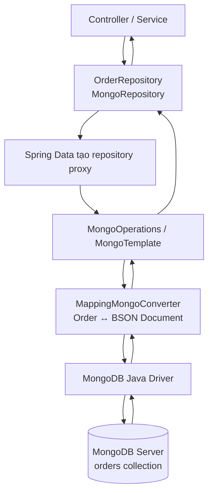
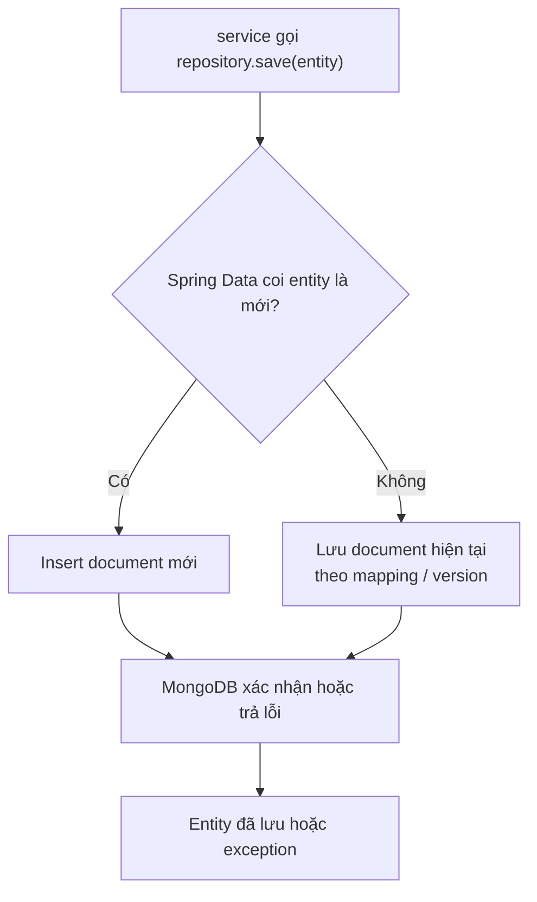

# Khai báo MongoRepository với entity và kiểu ID

Trong Spring Data MongoDB, một repository cho phép service thao tác với document thông qua interface Java: `save`, `insert`, `findById`, `findAll`, `deleteById` và các phương thức truy vấn tự định nghĩa. Để Spring Data tạo implementation đúng, cần khai báo **entity** biểu diễn document và **kiểu ID** nhất quán với thuộc tính định danh trong entity.

Bài học thuộc chương **Repository CRUD** của module **SPRING_DATA_MONGODB**. Trọng tâm là hiểu `MongoRepository<T, ID>` nhận hai kiểu gì, khai báo như thế nào, khi nào dùng `ObjectId` hay `String`, và cách kiểm chứng repository thực sự đọc/ghi đúng collection MongoDB. Những phần về index, truy vấn, transaction, reactive access và kiểm thử được đưa vào nơi chúng ảnh hưởng đến cách thiết kế repository.

## 1. MongoRepository nằm ở đâu trong kiến trúc?



Sơ đồ mô tả các trách nhiệm chính, không ngụ ý mọi bước đều là một lần gọi mạng. Spring Data cung cấp implementation repository khi application context khởi tạo; bạn thường chỉ viết **interface**. Các phương thức CRUD do framework triển khai dựa trên metadata mapping và `MongoTemplate`. Nếu cần điều khiển truy vấn, aggregation hay cập nhật từng trường chi tiết, service có thể dùng `MongoTemplate` riêng.

Định nghĩa cơ bản:

```java
public interface OrderRepository
        extends MongoRepository<Order, ObjectId> {
}
```

Hai tham số generic có ý nghĩa cụ thể:

| Ký hiệu | Trong ví dụ | Ý nghĩa |
| --- | --- | --- |
| `T` | `Order` | Kiểu entity Java mà repository lưu, đọc và ánh xạ |
| `ID` | `ObjectId` | Kiểu **thuộc tính ID của entity Java** dùng trong `findById`, `deleteById`, `existsById`, v.v. |

**Chú ý:** `ID` là kiểu ở phía Java, không phải tên collection, tên trường `_id` hay kiểu dữ liệu của tất cả các khóa nghiệp vụ. Tên collection và cách ánh xạ trường `_id` được quyết định bởi entity metadata.

## 2. Khai báo entity bằng `@Document` và `@Id`

Giả sử ứng dụng có collection `orders`. Mỗi đơn gồm mã khách hàng, trạng thái, tổng tiền và thời điểm tạo.

```java
import java.time.Instant;
import org.bson.types.ObjectId;
import org.springframework.data.annotation.Id;
import org.springframework.data.annotation.Version;
import org.springframework.data.mongodb.core.mapping.Document;
import org.springframework.data.mongodb.core.mapping.Field;

@Document(collection = "orders")
public class Order {
    @Id
    private ObjectId id;

    @Field("customer_id")
    private String customerId;

    private String status;

    @Field("total_vnd")
    private long totalVnd;

    private Instant createdAt;

    @Version
    private Long version;

    public Order() {}

    public Order(
            String customerId,
            String status,
            long totalVnd,
            Instant createdAt) {
        this.customerId = customerId;
        this.status = status;
        this.totalVnd = totalVnd;
        this.createdAt = createdAt;
    }

    public ObjectId getId() { return id; }
    public String getCustomerId() { return customerId; }
    public String getStatus() { return status; }
    public long getTotalVnd() { return totalVnd; }
    public Instant getCreatedAt() { return createdAt; }
    public Long getVersion() { return version; }

    public void markPaid() {
        this.status = "PAID";
    }
}
```

Các annotation chính:

| Annotation | Vai trò |
| --- | --- |
| `@Document(collection = "orders")` | Gắn entity với collection `orders`. |
| `@Id` | Đánh dấu thuộc tính Java dùng làm trường `_id` trong MongoDB. |
| `@Field("customer_id")` | Ánh xạ Java `customerId` sang BSON field `customer_id`. |
| `@Field("total_vnd")` | Ánh xạ `totalVnd` sang `total_vnd`. |
| `@Version` | Tham gia cơ chế optimistic locking khi lưu/cập nhật entity qua đường hỗ trợ versioning. |

Không bắt buộc mọi entity phải có setter công khai: Spring Data có cơ chế field/property access và constructor binding. Constructor không tham số ở đây giúp ví dụ dễ theo dõi; với immutable entity cần thiết kế constructor phù hợp. `@Document` cho biết đây là aggregate root được lưu ở collection riêng; một value object nhúng thường không cần `@Document`.

Document thực tế có thể được hiển thị trong mongosh như sau:

```javascript
{
  _id: ObjectId("674000000000000000000501"),
  customer_id: "KH-101",
  status: "NEW",
  total_vnd: NumberLong("1250000"),
  createdAt: ISODate("2026-11-20T02:00:00Z"),
  version: NumberLong("0"),
  _class: "com.example.orders.Order"
}
```

Đây là **minh họa**, không phải kết quả thực thi cố định. ID, timestamp, kiểu số của `version`, tên package và sự hiện diện của `_class` phụ thuộc dữ liệu và cấu hình. `_class` có thể được type mapper mặc định ghi làm metadata kiểu; đừng dùng nó như một field nghiệp vụ.

## 3. Khai báo `MongoRepository<Order, ObjectId>`

Import đúng interface:

```java
import java.util.List;
import org.bson.types.ObjectId;
import org.springframework.data.domain.Page;
import org.springframework.data.domain.Pageable;
import org.springframework.data.mongodb.repository.MongoRepository;

public interface OrderRepository
        extends MongoRepository<Order, ObjectId> {

    List<Order> findByCustomerIdAndStatus(
            String customerId, String status);

    Page<Order> findByCustomerId(
            String customerId, Pageable pageable);

    long countByStatus(String status);
}
```

Điểm quan trọng nhất ở dòng `extends`:

- `Order` là entity đã đánh dấu `@Document` và có thuộc tính `@Id ObjectId id`.
- `ObjectId` khớp với **kiểu Java của `Order.id`**.
- `OrderRepository` là interface; Spring Data tạo bean triển khai các phương thức kế thừa và phương thức derived query.
- Các phương thức như `findByCustomerIdAndStatus` dùng **tên property Java**, kể cả khi tên field BSON được đổi bằng `@Field`.

Với entity `Order` nêu trên, khai báo `MongoRepository<Order, String>` có thể trông tiện vì path variable HTTP là `String`, nhưng làm **hợp đồng kiểu Java bị lệch**. Một số phép chuyển đổi ID có thể xảy ra ở tầng framework, song không nên dựa vào chuyển đổi ngầm để che sai lệch giữa entity và repository.

Nếu muốn API nhận string ID, hãy parse ở service rồi gọi repository bằng `ObjectId` như phần 6.

## 4. Spring tạo repository bean như thế nào?

Trong một ứng dụng Spring Boot sử dụng starter MongoDB đồng bộ:

```text
org.springframework.boot:spring-boot-starter-data-mongodb
```

Thông thường, auto-configuration khởi tạo client, converter, `MongoTemplate` và hạ tầng repository từ cấu hình ứng dụng. Khi interface `OrderRepository` nằm trong phạm vi package được scan, service có thể inject nó bằng constructor:

```java
import org.springframework.stereotype.Service;

@Service
public class OrderService {
    private final OrderRepository orders;

    public OrderService(OrderRepository orders) {
        this.orders = orders;
    }

    public Order create(String customerId, long totalVnd) {
        return orders.insert(new Order(
            customerId, "NEW", totalVnd, java.time.Instant.now()));
    }
}
```

Không cần tự tạo `new OrderRepository()` vì repository là interface do Spring Data triển khai. Nếu interface ở ngoài phạm vi scan mặc định, có thể cấu hình tường minh:

```java
import org.springframework.context.annotation.Configuration;
import org.springframework.data.mongodb.repository.config.EnableMongoRepositories;

@Configuration
@EnableMongoRepositories(basePackageClasses = OrderRepository.class)
class MongoRepositoryConfiguration {
}
```

`@EnableMongoRepositories` minh họa **cấu hình chủ động khi cần**; trong ứng dụng Boot đã scan đúng package, thêm annotation một cách không cần thiết có thể làm cấu hình phức tạp hơn. Cần bảo đảm repository dùng đúng `MongoTemplate`/database khi hệ thống có nhiều kết nối MongoDB.

**Điều kiện thực tế để chạy:** ứng dụng có dependency MongoDB phù hợp, địa chỉ kết nối/database hợp lệ, entity/repository nằm trong phạm vi mapping và repository scanning, và MongoDB Server có thể truy cập. Chỉ viết interface Java không tự cấp quyền truy cập server.

## 5. Các phương thức CRUD kế thừa

`MongoRepository` cung cấp các thao tác CRUD mà bạn có thể gọi ngay:

| Phương thức | Kết quả Java thông thường | Ý nghĩa |
| --- | --- | --- |
| `insert(entity)` | Entity đã insert | Thêm document mới; trùng khóa có thể lỗi. |
| `save(entity)` | Entity đã lưu | Lưu entity mới hoặc trạng thái của entity hiện có, theo quy tắc nhận diện entity. |
| `saveAll(entities)` | Danh sách entity đã lưu | Lưu nhiều entity; không mặc định một transaction nguyên tử trên tất cả document. |
| `findById(id)` | `Optional<Order>` | Đọc một document theo ID. |
| `existsById(id)` | `boolean` | Kiểm tra sự tồn tại theo ID. |
| `findAll()` | `List<Order>` | Đọc tất cả; cần cẩn trọng với collection lớn. |
| `findAllById(ids)` | `List<Order>` | Đọc các document theo tập ID. |
| `count()` | `long` | Đếm document trong phạm vi repository. |
| `deleteById(id)` | `void` | Xóa theo ID; không đồng nghĩa lỗi nếu không tìm thấy document. |
| `delete(entity)` | `void` | Xóa entity; với `@Version` có thể kiểm tra optimistic locking. |

API thực tế có thể có overload và các phương thức khác tùy phiên bản Spring Data, nhưng mục tiêu là nhận biết **hợp đồng kiểu** và hành vi CRUD.

### 5.1. Thêm một đơn mới

```java
Order draft = new Order(
    "KH-101", "NEW", 1_250_000L, java.time.Instant.now());

Order inserted = orderRepository.insert(draft);
ObjectId newId = inserted.getId();
```

Với `id == null`, ID mới thường được sinh trong quá trình insert và entity trả về có ID. `insert` được dùng khi nghiệp vụ kỳ vọng tạo document mới; vi phạm unique index (kể cả `_id`) có thể khiến thao tác thất bại.

### 5.2. Đọc theo ID

```java
Optional<Order> found = orderRepository.findById(newId);

Order order = found.orElseThrow(() ->
    new IllegalArgumentException("Không tìm thấy đơn hàng"));
```

`Optional.empty()` là trạng thái hợp lệ khi không có document phù hợp. Đừng chuyển mọi trường hợp không tìm thấy thành lỗi kết nối MongoDB; ở API HTTP thường tách 404 (không có dữ liệu) và lỗi hệ thống (truy vấn thất bại).

### 5.3. Chỉnh sửa và lưu lại

```java
Order order = orderRepository.findById(newId).orElseThrow();
order.markPaid();

Order saved = orderRepository.save(order);
```

`save` dùng trạng thái entity hiện tại để ghi lại document. Trên entity có `@Version`, Spring Data dùng cơ chế version để phát hiện một số trường hợp ghi đè do dữ liệu cũ. Tuy nhiên, `save` trên entity được đọc qua phép chiếu (thiếu field) có thể gây mất dữ liệu; nếu chỉ cần sửa một vài trường, hãy cân nhắc `MongoTemplate.updateFirst` với `$set` và điều kiện tương ứng.

### 5.4. Xóa theo ID

```java
orderRepository.deleteById(newId);
boolean stillExists = orderRepository.existsById(newId);
```

Trong nhiều trường hợp, `deleteById` hoàn tất bình thường dù không có document cần xóa. Nếu nghiệp vụ yêu cầu biết **đã xóa bao nhiêu document** hoặc cần xóa có điều kiện theo trạng thái, `MongoTemplate.remove(query, Order.class)` trả `DeleteResult` để quan sát số bản ghi bị xóa khi có xác nhận ghi.

## 6. Chọn kiểu ID đúng: `ObjectId`, `String` và `@MongoId`

Trong MongoDB, trường `_id` không bắt buộc là ObjectId; ứng dụng có thể dùng string, số hoặc kiểu ID khác được MongoDB cho phép. Với Java repository, quan trọng là **chiến lược ID của entity và kiểu generic repository phải khớp nhau**.

### 6.1. Trường hợp A: `@Id ObjectId`

```java
@Document("orders")
class OrderByObjectId {
    @Id
    private ObjectId id;
}

interface OrderByObjectIdRepository
        extends MongoRepository<OrderByObjectId, ObjectId> {}
```

Java dùng `ObjectId`, MongoDB thường lưu BSON ObjectId. Đây là lựa chọn đơn giản nếu không có yêu cầu ID nghiệp vụ riêng.

### 6.2. Trường hợp B: `@Id String`

```java
@Document("orders")
class OrderByStringId {
    @Id
    private String id;
}

interface OrderByStringIdRepository
        extends MongoRepository<OrderByStringId, String> {}
```

Với `@Id String`, Spring Data MongoDB mặc định có quy tắc thử chuyển chuỗi dạng ObjectId hợp lệ thành **BSON ObjectId**; giá trị không chuyển được có thể được lưu dưới dạng BSON String. Đây là lý do kiểu Java `String` **không bảo đảm** collection lưu tất cả `_id` dưới dạng BSON String.

Một chuỗi có hình dạng `"674000000000000000000501"` và một BSON ObjectId tương ứng trông gần giống nhau khi hiển thị, nhưng MongoDB so sánh theo kiểu BSON. Nếu dữ liệu trong collection chứa cả String và ObjectId, một truy vấn tưởng đúng vẫn có thể không tìm thấy document.

### 6.3. Trường hợp C: cần ID là chuỗi nguyên dạng

Nếu mã đơn là `"ORDER-2026-0001"`, có thể yêu cầu giữ nguyên kiểu String bằng `@MongoId`:

```java
import org.springframework.data.mongodb.core.mapping.Document;
import org.springframework.data.mongodb.core.mapping.FieldType;
import org.springframework.data.mongodb.core.mapping.MongoId;

@Document("external_orders")
class ExternalOrder {
    @MongoId(FieldType.STRING)
    private String id;

    private String customerId;
}

interface ExternalOrderRepository
        extends MongoRepository<ExternalOrder, String> {}
```

`@MongoId(FieldType.STRING)` giúp thể hiện rõ ý định lưu `_id` dạng BSON String. Ngoài ra, `@MongoId` không chỉ định `FieldType` thường giữ kiểu định danh theo thuộc tính Java, tránh chuyển đổi String → ObjectId theo mặc định của `@Id`. Nếu chọn `@MongoId(FieldType.OBJECT_ID)` với property String, cần bảo đảm chuỗi có dạng ObjectId hợp lệ và kiểm thử quy tắc chuyển đổi theo phiên bản Spring Data đang dùng.

| Khai báo ID trên entity | Generic repository | Kiểu BSON mong muốn | Ghi chú |
| --- | --- | --- | --- |
| `@Id ObjectId id` | `MongoRepository<T, ObjectId>` | ObjectId | Phù hợp khóa MongoDB thông thường |
| `@Id String id` | `MongoRepository<T, String>` | Có thể ObjectId hoặc String | Phụ thuộc giá trị và quy tắc conversion |
| `@MongoId(FieldType.STRING) String id` | `MongoRepository<T, String>` | String | Phù hợp ID nghiệp vụ/ID ngoại vi |
| `@MongoId(FieldType.OBJECT_ID) String id` | `MongoRepository<T, String>` | ObjectId khi chuyển đổi hợp lệ | Cần kiểm tra ID đầu vào |

**Không đổi chiến lược `@Id` sang `@MongoId` trên một collection đang có dữ liệu mà không kiểm tra BSON thực.** Đổi mapping có thể khiến `findById` không khớp kiểu `_id` trước đây; muốn đổi loại ID phải có kế hoạch migration.

## 7. Ranh giới HTTP: nhận chuỗi nhưng gọi repository bằng ObjectId

REST API thường nhận ID từ đường dẫn như `/orders/674000000000000000000501`. Không vì vậy mà phải khai báo repository với `String` nếu entity đang dùng `ObjectId`.

```java
import java.util.Optional;
import org.bson.types.ObjectId;
import org.springframework.stereotype.Service;

@Service
class OrderLookupService {
    private final OrderRepository orders;

    OrderLookupService(OrderRepository orders) {
        this.orders = orders;
    }

    Optional<Order> findByExternalId(String rawId) {
        if (rawId == null || !ObjectId.isValid(rawId)) {
            throw new IllegalArgumentException(
                "ID phải là chuỗi ObjectId hợp lệ");
        }
        return orders.findById(new ObjectId(rawId));
    }
}
```

Để trả ID trong JSON, có thể đưa `order.getId().toHexString()` vào DTO. Nếu ID sai định dạng, tầng HTTP có thể trả **400 Bad Request**; ID đúng định dạng nhưng không có document thường tương ứng **404 Not Found**; lỗi MongoDB thực thi thất bại thuộc nhóm lỗi hệ thống khác.

`ObjectId.isValid(rawId)` chỉ xác nhận hình dạng chuỗi hợp lệ, không chứng minh document tồn tại hay người dùng có quyền đọc. Tầng service vẫn cần kiểm tra tenant, quyền truy cập và quy tắc nghiệp vụ.

## 8. Repository method theo tên property Java

Ngoài CRUD kế thừa, Spring Data có thể phân tích tên phương thức để xây truy vấn.

```java
List<Order> newOrders = orderRepository
    .findByCustomerIdAndStatus("KH-101", "NEW");
```

Vì entity khai báo `@Field("customer_id")`, Spring Data diễn giải `findByCustomerIdAndStatus` bằng property `customerId`, `status`, sau đó ánh xạ sang tên field trên BSON. Truy vấn tương đương về ý nghĩa:

```javascript
db.orders.find({
  customer_id: "KH-101",
  status: "NEW"
});
```

**Không đặt tên phương thức theo field BSON** như `findByCustomer_id` rồi mong Spring Data tự hiểu quy ước dấu gạch dưới; trong derived query, dấu gạch dưới còn có vai trò phân tách đường dẫn property. Hãy dùng tên property Java hoặc `@Query` khi cần kiểm soát đặc biệt.

Ví dụ phân trang:

```java
import org.springframework.data.domain.Page;
import org.springframework.data.domain.PageRequest;
import org.springframework.data.domain.Sort;

Page<Order> page = orderRepository.findByCustomerId(
    "KH-101",
    PageRequest.of(
        0,
        20,
        Sort.by(Sort.Direction.DESC, "createdAt"))
);
```

Kiểu `Page<Order>` có thể cần thêm truy vấn đếm tổng số phần tử. Với tải lớn và không cần tổng số, cân nhắc API dùng `Slice` hoặc chiến lược phân trang theo khóa để giảm chi phí. Index trên `customer_id` và thứ tự sắp xếp phù hợp có thể cải thiện tốc độ đọc; kiểm tra query plan bằng `explain("executionStats")` trong MongoDB.

Khi phương thức dự kiến trả nhiều document, dùng `List<Order>` hoặc `Page<Order>`. Chỉ dùng `Optional<Order>` khi truy vấn **về mặt hợp đồng** tối đa một kết quả; nếu dữ liệu có nhiều match nhưng query thiết kế theo kiểu một đối tượng, cần xem lại giới hạn và uniqueness.

## 9. Vòng đời entity: `isNew`, `insert`, `save` và `@Version`

Repository cần biết một entity được coi là **mới** hay **đã tồn tại** để quyết định đường ghi phù hợp. Đây không phải lúc nào cũng đồng nghĩa chỉ kiểm tra `id == null`.

Một số cơ chế nhận diện entity mới gồm:

1. Nếu entity có property `@Version` phù hợp, giá trị version ban đầu (ví dụ `null` đối với `Long`) thường tham gia quyết định entity còn mới.
2. Nếu không có version tham gia, giá trị ID chưa được gán thường báo hiệu entity mới.
3. Nếu entity triển khai `Persistable<ID>`, phương thức `isNew()` có thể cung cấp logic tùy biến.

Với `Order` có `@Version Long version` ở đầu bài, một `Order` mới có `version == null`. Lần lưu đầu thường đi theo đường insert, sau đó version được quản lý trong vòng đời lưu. Khi gọi `save` cho document đã tồn tại, Spring Data có thể dùng version để phát hiện xung đột cập nhật đồng thời.



Lưu ý:

- `insert(entity)` diễn đạt ý định thêm mới; nếu ID trùng với document đã có, thao tác có thể bị từ chối.
- `save(entity)` phù hợp thao tác lưu toàn bộ trạng thái entity, nhưng **không thay thế update từng field** trong mọi trường hợp.
- `@Version` giúp chống ghi đè trong các đường thao tác hỗ trợ optimistic locking, với yêu cầu write concern có xác nhận để nhận biết xung đột.
- Một nghiệp vụ ghi trên nhiều document **không tự trở thành transaction** chỉ vì gọi nhiều phương thức repository liên tiếp.

Nếu hai request đọc cùng một `Order` rồi cả hai thay trạng thái, versioning có thể khiến request lưu sau bị `OptimisticLockingFailureException` thay vì âm thầm ghi đè. Tầng service phải quyết định thử lại với dữ liệu mới, trả lỗi xung đột hay thực hiện quy trình nghiệp vụ khác.

## 10. Index và tính duy nhất liên quan đến repository

MongoDB duy trì unique index trên `_id` đối với collection thông thường, nhưng các field nghiệp vụ như `customer_id` hoặc `orderNumber` cần index riêng nếu được truy vấn thường xuyên hoặc có yêu cầu duy nhất.

Ví dụ muốn `orderNumber` là duy nhất:

```java
import org.springframework.data.mongodb.core.index.Indexed;

@Indexed(unique = true)
private String orderNumber;
```

Đây là đoạn minh họa một property bổ sung **bên trong entity**, không phải mã đầy đủ thay thế class `Order`. `@Indexed(unique = true)` khai báo ý định tạo unique index, nhưng ràng buộc chỉ có hiệu lực khi **index thực sự tồn tại trong MongoDB**. Việc auto-index creation phụ thuộc cấu hình và phiên bản; production nên quản lý index bằng migration hoặc quy trình triển khai rõ ràng.

```javascript
// Lệnh minh họa nếu doanh nghiệp quản lý index trực tiếp:
db.orders.createIndex({ orderNumber: 1 }, { unique: true });
```

Chọn index theo access pattern thực tế. Nếu thường lọc `customer_id` và sắp xếp theo `createdAt`, compound index như `{ customer_id: 1, createdAt: -1 }` có thể đáng cân nhắc. Kiểm tra `totalDocsExamined`, `totalKeysExamined`, `nReturned` và `winningPlan` bằng `explain`, đồng thời cân bằng chi phí ghi và dung lượng index.

## 11. Xử lý lỗi: phân biệt “không có” với “thao tác thất bại”

| Tình huống | Hành vi có thể quan sát | Cách xử lý |
| --- | --- | --- |
| `findById` không tìm thấy document | `Optional.empty()` | Trả 404 hoặc nghiệp vụ không tìm thấy |
| `insert` trùng `_id`/unique index | Thường phát sinh `DuplicateKeyException` | Xử lý xung đột ID hoặc ràng buộc nghiệp vụ |
| `save` xung đột version | `OptimisticLockingFailureException` | Đọc mới, thử lại có kiểm soát hoặc báo conflict |
| Chuỗi HTTP không phải ObjectId hợp lệ | `IllegalArgumentException` khi parse | Trả 400, không gửi query sai |
| MongoDB timeout/mất kết nối | Exception qua driver và hệ thống Spring Data | Theo dõi lỗi hệ thống, timeout, pool và trạng thái server |
| Gọi repository chưa được scan | Spring không có bean để inject | Kiểm tra package scan, starter và cấu hình |
| Truy vấn rỗng dù document tồn tại | Sai database/collection, field name hoặc kiểu BSON ID | Kiểm tra raw document và query mapping |

Đừng bao mọi exception bằng “Không tìm thấy đơn hàng”. Một `Optional.empty()` khác về bản chất với timeout hoặc lỗi chuyển đổi BSON. Khi sửa lỗi, bắt đầu từ entity, kiểu ID, đường kết nối và document thực tế.

## 12. ReactiveMongoRepository là loại repository khác

Nếu ứng dụng dùng **Reactive Spring Data MongoDB**, interface tương ứng là `ReactiveMongoRepository<T, ID>`, ví dụ:

```java
import org.bson.types.ObjectId;
import org.springframework.data.mongodb.repository.ReactiveMongoRepository;
import reactor.core.publisher.Flux;
import reactor.core.publisher.Mono;

interface ReactiveOrderRepository
        extends ReactiveMongoRepository<Order, ObjectId> {

    Flux<Order> findByCustomerId(String customerId);
    Mono<Order> findFirstByStatus(String status);
}
```

`ReactiveMongoRepository` trả `Mono<T>` và `Flux<T>`; các thao tác MongoDB thực thi theo vòng đời publisher khi có subscription. Không dùng `MongoRepository` trong WebFlux rồi bọc kết quả bằng `Mono.just(...)` và cho rằng driver đã trở thành non-blocking. Việc chọn đồng bộ hay reactive phải nhất quán với driver, template, cách xử lý I/O và transaction manager.

**Kiểu ID generic vẫn có cùng nguyên tắc:** entity `Order` có `@Id ObjectId` nên cả `MongoRepository<Order, ObjectId>` và `ReactiveMongoRepository<Order, ObjectId>` đều dùng `ObjectId` ở vị trí `ID`.

## 13. Kiểm thử repository với MongoDB thực

Kiểm thử việc khai báo repository cần xác minh nhiều hơn là interface biên dịch thành công. Mock `OrderRepository` kiểm tra logic service gọi phương thức, nhưng không chứng minh Spring Data tạo query đúng, ánh xạ đúng `_id` hoặc lưu field dưới tên BSON mong muốn.

Ví dụ integration test (giả định đã cấu hình MongoDB dành riêng cho test và bean repository/template):

```java
import static org.assertj.core.api.Assertions.assertThat;

import java.time.Instant;
import org.bson.Document;
import org.bson.types.ObjectId;
import org.junit.jupiter.api.Test;
import org.springframework.beans.factory.annotation.Autowired;
import org.springframework.boot.test.autoconfigure.data.mongo.DataMongoTest;

import static com.mongodb.client.model.Filters.eq;

@DataMongoTest
class OrderRepositoryIntegrationTest {
    @Autowired OrderRepository orders;
    @Autowired org.springframework.data.mongodb.core.MongoTemplate template;

    @Test
    void shouldInsertAndFindByObjectId() {
        Order created = orders.insert(
            new Order("KH-101", "NEW", 1_250_000L, Instant.now()));

        ObjectId id = created.getId();
        assertThat(id).isNotNull();
        assertThat(orders.findById(id)).isPresent();

        Document raw = template.getCollection("orders")
            .find(eq("_id", id)).first();

        assertThat(raw).isNotNull();
        assertThat(raw.get("_id")).isInstanceOf(ObjectId.class);
        assertThat(raw.getString("customer_id"))
            .isEqualTo("KH-101");
        assertThat(raw.getLong("total_vnd"))
            .isEqualTo(1_250_000L);
    }
}
```

Test đọc **raw document qua MongoDB driver** để xác nhận tên field và kiểu BSON, rồi dùng repository đọc lại theo `ObjectId`. Bài test giả định data test dùng MongoDB phù hợp, ví dụ Testcontainers; tùy phiên bản Spring Boot, package test slice và cấu hình kết nối có thể thay đổi. Không chạy kiểm thử này trên database production.

Các trường hợp nên kiểm tra bổ sung:

- Lưu entity có `@Id ObjectId` rồi query bằng ObjectId; thử truy vấn native bằng BSON String cùng nội dung hex để thấy sự khác biệt kiểu.
- Entity có `@MongoId(FieldType.STRING)`: kiểm tra `_id` lưu thực tế là BSON String, kể cả khi string có 24 ký tự hex.
- `findByCustomerIdAndStatus` ánh xạ đúng `customer_id` sau `@Field`.
- Ghi trùng unique index thật sự phát sinh lỗi; không chỉ kiểm tra annotation.
- Hai lần `save` cạnh tranh trên entity có `@Version` cho ra hành vi optimistic locking như thiết kế.
- Truy vấn phân trang trên dữ liệu đủ lớn để đo số lệnh và xem index có phù hợp.

## 14. Những lỗi khai báo thường gặp

1. **Generic ID sai:** khai báo `MongoRepository<Order, String>` trong khi entity là `@Id ObjectId`; hợp đồng API bị lệch và dễ phát sinh lỗi chuyển kiểu.
2. **Quên `@Id` hoặc đặt nhầm định danh:** Spring Data có quy tắc convention với property tên `id`, nhưng ghi rõ `@Id` giúp ý định rõ và dễ kiểm chứng hơn.
3. **Nhầm property Java và field BSON:** viết derived query bằng tên `customer_id` thay vì `customerId`.
4. **Repository không thành bean:** interface nằm ngoài phạm vi scanning hoặc cấu hình MongoDB repository thiếu/không đúng.
5. **`save` được hiểu là partial update:** dùng entity bị thiếu field để lưu lại làm mất dữ liệu; hãy dùng update theo field khi chỉ sửa một phần.
6. **Bỏ qua `@Version`:** hai request cùng đọc rồi ghi có thể gây lost update; cần chọn optimistic locking, conditional update hoặc transaction phù hợp.
7. **Tin `@Indexed(unique = true)` tự bảo đảm dữ liệu:** unique index phải thực sự tồn tại trên server.
8. **Trộn String và ObjectId trong cùng collection:** cùng giá trị nhìn giống nhau nhưng các query khác kiểu không khớp nhau.
9. **Gọi `findAll()` trên collection lớn:** có thể đọc nhiều document và tạo áp lực RAM; nên phân trang hoặc truy vấn có điều kiện.
10. **Trộn API sync/reactive:** đổi return type thành `Mono` không tự thay synchronous MongoClient bằng reactive client.

## 15. Bài thực hành và tự kiểm tra

**Bài thực hành:** tạo entity `Order` và `OrderRepository` như trên, dùng MongoDB dành cho phát triển để:

1. `insert` một đơn và quan sát `getId()`; kiểm tra `_id` trong mongosh.
2. Gọi `findById(ObjectId)` và `findByCustomerIdAndStatus(...)`; so sánh kết quả với raw document lưu ở `orders`.
3. Cập nhật status bằng `save`, sau đó thử `MongoTemplate.updateFirst` để thấy sự khác nhau giữa lưu entity và cập nhật từng field.
4. Tạo hai phiên đọc cùng một entity có `@Version`, thay đổi từ hai bản đọc và quan sát xung đột khi lưu.
5. Viết entity ID string `@MongoId(FieldType.STRING)`, kiểm tra loại BSON `_id` và so với `@Id String`.
6. Tạo index theo query thường dùng và xem `explain("executionStats")` trước/sau.

**Câu hỏi 1.** `@Id ObjectId id` thì generic thứ hai của repository nên là gì? **Đáp án:** `ObjectId`, vì `ID` biểu diễn kiểu thuộc tính ID ở phía Java.

**Câu hỏi 2.** Vì sao `findByCustomerIdAndStatus` vẫn đúng dù MongoDB lưu `customer_id`? **Đáp án:** Spring Data phân tích tên property Java và dùng `@Field` để ánh xạ sang field BSON.

**Câu hỏi 3.** `@Id String id` có bảo đảm `_id` trên MongoDB là BSON String không? **Đáp án:** không; chuỗi dạng ObjectId hợp lệ có thể được chuyển thành BSON ObjectId theo quy tắc mặc định.

**Câu hỏi 4.** Sau `repository.findById(id)`, kết quả `Optional.empty()` có phải lỗi kết nối không? **Đáp án:** không; đó là kết quả truy vấn không có document phù hợp.

**Câu hỏi 5.** Có phải `saveAll` tự bảo đảm mọi document cùng commit/rollback không? **Đáp án:** không; nếu nghiệp vụ cần tính nguyên tử đa document, phải thiết kế transaction với hạ tầng và transaction manager hỗ trợ.

**Câu hỏi 6.** API nhận ID là chuỗi thì có bắt buộc repository cũng dùng `String`? **Đáp án:** không; có thể chuyển chuỗi thành ObjectId ở ranh giới API và giữ repository dùng kiểu `ObjectId` đúng với entity.

Điểm quyết định khi khai báo repository là **chọn đúng cặp `<Entity, ID>`**: entity ánh xạ document và ID là kiểu thuộc tính định danh Java. Từ hợp đồng đó, Spring Data MongoDB cung cấp CRUD và derived queries, nhưng chất lượng dữ liệu vẫn phụ thuộc vào chiến lược BSON ID, index, quy tắc cập nhật và các bài kiểm thử với MongoDB thực.
