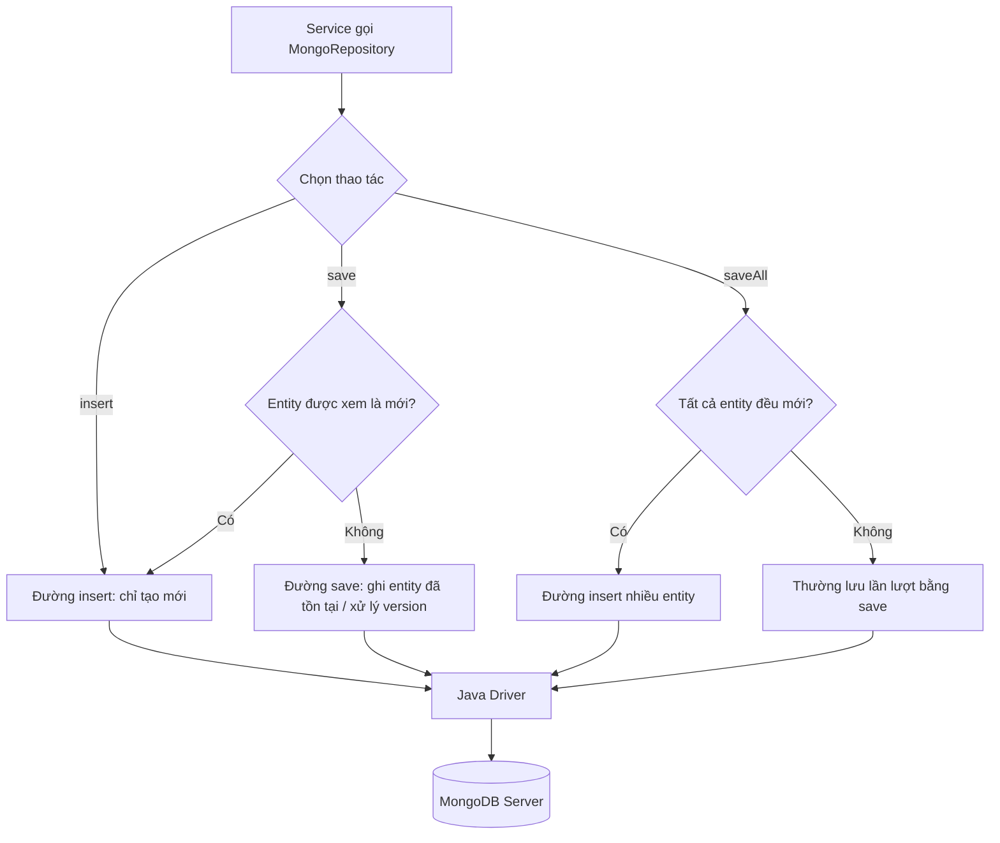
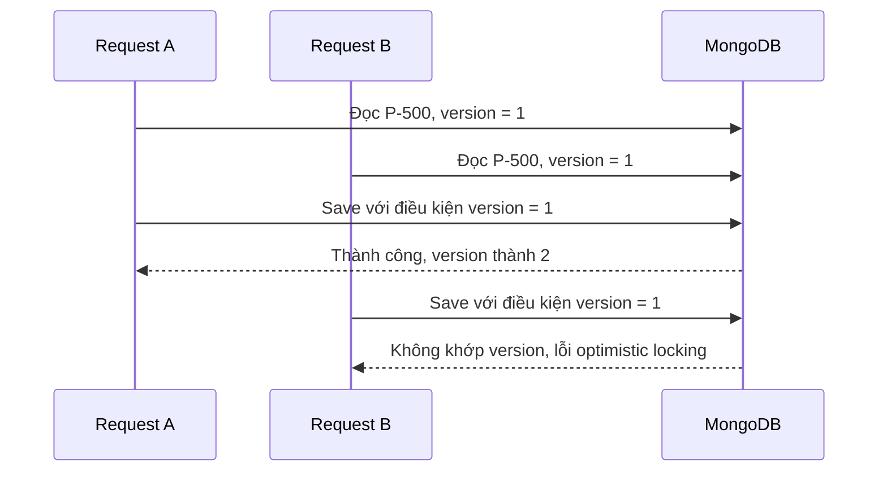

# Phân biệt `insert`, `save` và `saveAll`

Khi thao tác CRUD bằng **Spring Data MongoDB**, ba lời gọi `insert`, `save` và `saveAll` đều có thể làm dữ liệu xuất hiện trong collection, nhưng **ý nghĩa nghiệp vụ và cách thực thi không giống nhau**. Chọn nhầm API có thể khiến thao tác “tạo mới” ghi đè dữ liệu có sẵn, thao tác cập nhật bị lỗi khóa trùng hoặc một đợt ghi nhiều sản phẩm chỉ thành công một phần.

Bài học thuộc chương **Repository CRUD** của module `SPRING_DATA_MONGODB`. Nội dung tập trung vào `MongoRepository`, có đối chiếu với `MongoTemplate` và MongoDB Server để giải thích cơ chế ID, xác định entity mới (`isNew`), ánh xạ document, index, optimistic locking, kiểm thử và chẩn đoán hiệu năng. Các quy tắc thiết kế document, transaction và reactive access cũng ảnh hưởng trực tiếp tới việc sử dụng ba thao tác này.

Sau bài này, bạn có thể:

- Chọn `insert` khi **chỉ được phép tạo mới**, `save` khi **chấp nhận tạo mới hoặc lưu lại entity** tùy trạng thái, và `saveAll` để lưu nhiều entity.
- Giải thích vì sao `save` có thể gọi đường insert cho entity mới và đường ghi khác cho entity đã tồn tại.
- Dự đoán hành vi khi ID rỗng, ID đã tồn tại, ID được gán sẵn, có `@Version` hoặc vi phạm unique index.
- Hiểu vì sao `saveAll` **không mặc định là bulk update hoặc transaction nguyên tử**.
- Chọn cập nhật có điều kiện/`$set`/`$inc` khi chỉ cần đổi một vài trường, và kiểm thử trên MongoDB thật.

## 1. So sánh nhanh ba thao tác

| Phương thức | Ý nghĩa chủ đạo | Với entity mới | Với document đã có cùng `_id` | Điểm cần nhớ |
| --- | --- | --- | --- | --- |
| `repository.insert(entity)` | Tạo **document mới** | Chèn document | Thường lỗi duplicate key, không dùng để ghi đè | Phù hợp với API create và fixture chỉ được tạo lần đầu |
| `repository.save(entity)` | Lưu **một entity** | Thường đi theo đường insert nếu `isNew` là true | Với entity được nhận là đã tồn tại, lưu document theo ngữ nghĩa save; có thể thay thế nội dung | Kết quả phụ thuộc `isNew`, ID và `@Version` |
| `repository.saveAll(entities)` | Lưu **nhiều entity** | Có thể tối ưu thành insert hàng loạt nếu **tất cả** đều mới | Với tập có entity cũ, thường đi qua `save` từng entity | Không mặc định atomic, không hứa hẹn một lệnh bulk update duy nhất |

Tất cả đều ánh xạ Java object thành BSON qua Spring Data MongoDB, truyền lệnh bằng MongoDB Java Driver và ghi trên MongoDB Server. `MongoRepository` giúp đơn giản hóa CRUD; **unique index, kích thước BSON tối đa 16 MiB, tính nguyên tử từng document và xử lý giao dịch** vẫn do MongoDB quy định.



Sơ đồ mô tả cách triển khai thông dụng của **Spring Data MongoDB repository**; chi tiết tối ưu là implementation detail và có thể thay đổi theo phiên bản. Đặc biệt, **`save` không có nghĩa mọi lời gọi đều trở thành update**, và **`saveAll` không có nghĩa mọi lời gọi đều trở thành một batch nguyên tử**.

## 2. Chuẩn bị entity và repository minh họa

Giả sử hệ thống quản lý tồn kho có collection `products`. Ta dùng ID chuỗi có tiền tố `P-` để cố ý tránh việc diễn giải một chuỗi 24 ký tự hex thành BSON `ObjectId`. `@MongoId` giúp lưu kiểu `String` nhất quán:

```java
import org.springframework.data.mongodb.core.mapping.Document;
import org.springframework.data.mongodb.core.mapping.MongoId;

@Document(collection = "products")
public class Product {

    @MongoId
    private String id;

    private String sku;
    private String name;
    private long priceVnd;
    private int stock;
    private String description;

    protected Product() {}

    public Product(String id, String sku, String name,
                   long priceVnd, int stock, String description) {
        this.id = id;
        this.sku = sku;
        this.name = name;
        this.priceVnd = priceVnd;
        this.stock = stock;
        this.description = description;
    }

    public String getId() { return id; }
    public String getSku() { return sku; }
    public String getName() { return name; }
    public long getPriceVnd() { return priceVnd; }
    public int getStock() { return stock; }
    public String getDescription() { return description; }

    public void setName(String name) { this.name = name; }
    public void setPriceVnd(long priceVnd) { this.priceVnd = priceVnd; }
    public void setStock(int stock) { this.stock = stock; }
    public void setDescription(String description) {
        this.description = description;
    }
}
```

Khai báo repository:

```java
import java.util.Optional;
import org.springframework.data.mongodb.repository.MongoRepository;

public interface ProductRepository
        extends MongoRepository<Product, String> {
    Optional<Product> findBySku(String sku);
}
```

Các đoạn sau giả sử `ProductRepository productRepository` đã được Spring inject vào service và MongoDB test/local đã được cấu hình. Cần tạo collection/index theo quy trình của dự án khi có nhu cầu. Ví dụ, nếu mỗi SKU phải duy nhất:

```javascript
db.products.createIndex({ sku: 1 }, { unique: true });
```

MongoDB đã có unique index cho `_id`; index `sku` ở trên là **ràng buộc bổ sung**, cần bảo đảm dữ liệu hiện tại không trùng trước khi tạo. Chỉ khai báo `@Indexed` trong Java không đảm bảo index đã được tạo nếu cơ chế auto-index bị tắt.

## 3. `insert`: tạo mới, không ghi đè

### 3.1. Ví dụ insert thành công

```java
Product book = new Product(
        "P-001", "BK-001", "Sổ tay",
        85_000L, 50, "Bìa cứng"
);

Product created = productRepository.insert(book);
System.out.println(created.getId());  // P-001
```

MongoDB có document tương đương:

```javascript
{
  _id: "P-001",
  sku: "BK-001",
  name: "Sổ tay",
  priceVnd: NumberLong("85000"),
  stock: 50,
  description: "Bìa cứng"
}
```

`insert` nêu rõ mục đích **chỉ tạo một document mới**. Nếu collection đã có `_id = "P-001"`, thao tác insert với cùng `_id` thường bị MongoDB từ chối bằng duplicate key (`E11000`), được Spring Data chuyển thành exception thích hợp như `DuplicateKeyException`. Tương tự, nếu index `sku` là unique và SKU trùng, insert cũng lỗi.

**Ví dụ chạy lại cố ý tạo lỗi:**

```java
productRepository.insert(
        new Product("P-001", "BK-001", "Sổ tay bản khác",
                    99_000L, 30, null)
);
// Lỗi duplicate key nếu P-001 đã tồn tại;
// document P-001 cũ không bị ghi đè bởi lệnh insert.
```

Trong API `POST /products`, đây là hành vi mong muốn khi người dùng tạo một mã sản phẩm mới nhưng mã đó đã được dùng: trả một lỗi xung đột có ý nghĩa, không âm thầm thay giá/tồn kho.

### 3.2. Insert với ID chưa có

Nếu entity có ID `null` và thuộc tính ID hỗ trợ cơ chế sinh ID MongoDB, Spring Data/driver có thể tạo định danh, thường là `ObjectId` hoặc dạng chuỗi tương ứng theo mapping. Đừng dùng quy tắc “ID null thì chắc chắn là ObjectId” cho mọi kiểu Java; kết quả còn phụ thuộc kiểu ID, annotation và converter.

Với ID do nghiệp vụ quản lý như `"P-001"`, hãy tạo ID rõ ràng **trước khi insert**. Nếu API nhận ID từ client, cần kiểm tra định dạng, quyền sử dụng ID và các ràng buộc duy nhất. Không dựa vào việc ID khó đoán để thay thế phân quyền.

### 3.3. Chèn nhiều entity bằng `insert(Iterable)`

`MongoRepository` còn hỗ trợ `insert(Iterable<S>)`:

```java
import java.util.List;

List<Product> initialProducts = List.of(
        new Product("P-101", "BK-101", "Sổ tay A",
                50_000L, 20, null),
        new Product("P-102", "PN-102", "Bút A",
                15_000L, 100, null)
);

Iterable<Product> created = productRepository.insert(initialProducts);
```

Phương thức này có ý nghĩa **chèn nhiều document mới**. Nó không biến các phần tử có ID trùng thành update. Nếu một phần tử gặp lỗi unique index, các phần tử khác có thể **đã được ghi** tùy thứ tự và cách thực thi; đừng suy ra rằng mọi insert trong một collection tự động là giao dịch nguyên tử.

## 4. `save`: một phương thức, hai đường xử lý

`repository.save(entity)` là thao tác tổng quát để lưu trạng thái một entity. Trong triển khai Spring Data MongoDB repository thường gặp:

1. Spring Data xác định entity có **mới hay không** bằng `EntityInformation.isNew`.
2. Nếu là **mới**, repository chọn đường **insert**.
3. Nếu được xem là **đã tồn tại**, repository gọi đường `MongoOperations.save`; với entity không có version, có thể ghi theo ngữ nghĩa thay thế/upsert.
4. Nếu có `@Version`, Spring Data còn áp dụng cơ chế kiểm tra version khi ghi để hỗ trợ optimistic locking.

### 4.1. Save một entity mới

```java
Product created = productRepository.save(
        new Product(null, "BK-201", "Sổ tay mới",
                    65_000L, 40, null)
);
```

Vì ID đang `null` và không có `@Version`, entity thường được xem là mới và repository đi qua **đường insert**. Kết quả trả về là entity đã lưu (có thể có ID được tạo). Mã gọi nên dùng **giá trị trả về** thay vì giả định mọi loại entity bất biến/record sẽ tự biến đổi instance đầu vào.

### 4.2. Save một entity đã được tải từ database

```java
Product product = productRepository.findById("P-001")
        .orElseThrow();

product.setName("Sổ tay cao cấp");
product.setPriceVnd(95_000L);

Product updated = productRepository.save(product);
```

Đây là luồng chỉnh sửa thông thường: đọc entity hiện có, thay đổi field, rồi lưu lại. Với entity **không dùng `@Version`**, thao tác save ở tầng MongoDB có ngữ nghĩa **ghi lại nội dung document**; không nên coi nó là một lệnh `$set` chỉ cập nhật đúng những field setter vừa được gọi.

Ví dụ nếu tạo một instance chỉ có ID, tên và bỏ trống các field khác, rồi gọi `save`, có nguy cơ làm mất hoặc đặt lại dữ liệu của các field không được đưa vào object. Trường hợp cụ thể còn phụ thuộc mapping, converter và cách serialize các giá trị null, vì vậy hãy dùng **update theo field** khi chỉ muốn sửa vài thuộc tính.

### 4.3. Khi đã có ID nhưng repository vẫn xem là entity mới

Một ID `"P-999"` được gán sẵn **không chứng minh document đã tồn tại**. Với entity không có `@Version`, Spring Data thường dùng giá trị ID để xác định `isNew`. Entity có ID non-null có thể đi vào đường save dành cho entity cũ, và nếu MongoDB chưa có document tương ứng, thao tác lưu theo ngữ nghĩa upsert có thể **tạo document mới**.

```java
Product p = new Product(
        "P-999", "BK-999", "Sổ chưa có trong DB",
        75_000L, 10, null
);

productRepository.save(p);
// Có thể tạo document P-999 nếu chưa tồn tại,
// theo đường lưu của entity không version.
```

Nếu nghiệp vụ yêu cầu **“phải tồn tại mới được sửa”**, không thể dựa vào `save` đơn thuần để áp đặt điều kiện đó. Cần dùng điều kiện tồn tại hoặc version trong lệnh update, hoặc kiểm soát hợp lý ở service, đồng thời xét race condition giữa bước đọc và bước ghi.

### 4.4. `save` không tương đương “chỉ update một field”

Giả sử service chỉ cần tăng tồn kho 5 đơn vị. Đọc toàn bộ document, tăng `stock` trong Java và `save` có thể làm mất cập nhật của request khác nếu hai request dùng cùng bản dữ liệu cũ. Thay vào đó, MongoDB hỗ trợ cập nhật nguyên tử trên một document:

```java
import org.springframework.data.mongodb.core.MongoTemplate;
import org.springframework.data.mongodb.core.query.Criteria;
import org.springframework.data.mongodb.core.query.Query;
import org.springframework.data.mongodb.core.query.Update;

// Đoạn minh họa trong một service đã inject mongoTemplate.
Query query = Query.query(Criteria.where("_id").is("P-001"));
Update update = new Update().inc("stock", 5);

mongoTemplate.updateFirst(query, update, Product.class);
```

`$inc` được server áp dụng trên giá trị hiện có, tránh pattern read–modify–save đối với phép tăng đơn giản. Để đặt giá mới, dùng `new Update().set("priceVnd", 95_000L)`; để cập nhật khi còn tồn tại, kiểm tra `UpdateResult.getMatchedCount()` hoặc dùng `findAndModify` nếu cần nhận lại document.

**Lưu ý:** thao tác `MongoTemplate.updateFirst` trực tiếp như trên không tự cung cấp optimistic locking kiểu `save` có `@Version`. Nếu dữ liệu cần bảo vệ bằng version, hãy đưa điều kiện version vào query và cập nhật version theo chiến lược nhất quán.

## 5. `saveAll`: lưu nhiều entity và những điều không được giả định

`saveAll(Iterable<S>)` giúp người gọi truyền nhiều entity một lần và nhận tập kết quả đã lưu. Tuy nhiên, **tính chất của nó khác một lệnh bulk update được thiết kế tường minh**. Trong triển khai `SimpleMongoRepository` thông dụng, repository kiểm tra `isNew` của các entity:

- Nếu **tất cả** đều mới, repository có thể chọn tối ưu **insert nhiều entity** thông qua `MongoOperations.insertAll`.
- Nếu **có ít nhất một entity không mới**, implementation thường gọi `save` cho từng phần tử, và mỗi phần tử lại được xử lý theo trạng thái của chính nó.

Đó là hành vi của implementation Spring Data MongoDB thường dùng, **không phải cam kết rằng một phiên bản tương lai luôn gửi đúng số lệnh như vậy**. Cần kiểm tra source/tài liệu theo version và đo truy vấn thực tế khi tối ưu hiệu năng.

### 5.1. Tất cả entity đều mới

```java
import java.util.List;

List<Product> sample = List.of(
        new Product(null, "BK-301", "Sổ A",
                30_000L, 20, null),
        new Product(null, "BK-302", "Sổ B",
                35_000L, 25, null),
        new Product(null, "BK-303", "Sổ C",
                40_000L, 30, null)
);

Iterable<Product> savedProducts = productRepository.saveAll(sample);
```

Vì cả ba entity đều có ID `null` (và ví dụ chưa sử dụng `@Version`), repository thường coi chúng là mới và có thể đi vào đường **insert hàng loạt**. Khi dùng cho seed, hãy nhớ ID sinh tự động sẽ **khác ở mỗi lần seed**, gây dữ liệu trùng nếu gọi lại; muốn dữ liệu mẫu idempotent cần khóa ổn định và cơ chế `upsert`/`setOnInsert` riêng.

### 5.2. Tập trộn mới và đã tồn tại

```java
Product existing = productRepository.findById("P-001")
        .orElseThrow();
existing.setPriceVnd(100_000L);

Product brandNew = new Product(
        null, "BK-304", "Sổ D", 55_000L, 20, null
);

Iterable<Product> result = productRepository.saveAll(
        List.of(existing, brandNew)
);
```

Vì tập dữ liệu không hoàn toàn mới, đường thực thi phổ biến là **lần lượt gọi `save`**, trong đó `existing` đi theo đường lưu entity cũ và `brandNew` đi theo đường insert. Do đó `saveAll` **không bảo đảm giảm còn một round-trip**. Với danh sách lớn, số request mạng, chuyển đổi BSON, kiểm tra index và độ trễ có thể đáng kể.

### 5.3. Ba điều `saveAll` không tự cam kết

**Không mặc định atomic.** MongoDB bảo đảm tính nguyên tử của **một thao tác ghi trên một document**; một danh sách nhiều document không tự thành một transaction. Nếu phần tử thứ ba lỗi, phần tử thứ nhất và thứ hai có thể đã ghi.

**Không mặc định là bulk replace/update.** Tập có entity cũ thường được xử lý từng `save`. Khi cần hàng nghìn cập nhật đồng dạng, `BulkOperations` của `MongoTemplate` có thể phù hợp hơn sau khi phân tích nghiệp vụ.

**Không mặc định có cùng thứ tự thành công trong mọi chế độ.** Các batch insert hoặc bulk operation có cơ chế ordered/unordered tùy API/driver; đừng dùng `saveAll` như công cụ bảo đảm thứ tự nghiệp vụ hoặc rollback cả tập.

Ví dụ giả sử `sku` có unique index và tập gồm ba sản phẩm:

| Bản ghi | Tình huống | Kết quả có thể xảy ra |
| --- | --- | --- |
| `P-401` | Mới, SKU chưa có | Đã được chèn |
| `P-402` | Mới, SKU trùng unique index | Ghi thất bại |
| `P-403` | Mới, SKU chưa có | Có thể đã/chưa được ghi, tùy cách batch xử lý |

Đừng viết luồng nghiệp vụ giả định “catch exception thì chắc chắn không có sản phẩm nào được tạo”. Cần xử lý **partial success**, retry idempotent hoặc transaction đúng phạm vi khi thật sự bắt buộc tất cả cùng thành công.

## 6. `isNew`, ID và `@Version` quyết định đường ghi

Một phần dễ nhầm của `save` và `saveAll` là cách Spring Data xác định entity mới. Trong trường hợp thông thường:

1. Nếu entity có thuộc tính `@Version` kiểu wrapper, `version == null` thường biểu thị **entity mới**; version non-null biểu thị entity đã tồn tại.
2. Nếu không có version, Spring Data thường dựa vào ID: `id == null` là mới; ID có giá trị thường không mới.
3. Với entity thực thi `Persistable`, `isNew()` do entity cung cấp có thể thay đổi quyết định này.
4. Chi tiết có thể phụ thuộc `EntityInformation`/mapping và phiên bản Spring Data; đừng suy trạng thái chỉ từ việc ID được cấp hay chưa.

### 6.1. Trường hợp một ID được gán nhưng entity vẫn là mới

Ví dụ có `@Version Long version`:

```java
import org.springframework.data.annotation.Version;
import org.springframework.data.mongodb.core.mapping.Document;
import org.springframework.data.mongodb.core.mapping.MongoId;

@Document(collection = "versionedProducts")
public class VersionedProduct {
    @MongoId
    private String id;
    private String sku;
    private long priceVnd;

    @Version
    private Long version;

    protected VersionedProduct() {}

    public VersionedProduct(String id, String sku, long priceVnd) {
        this.id = id;
        this.sku = sku;
        this.priceVnd = priceVnd;
    }

    public String getId() { return id; }
    public Long getVersion() { return version; }
    public long getPriceVnd() { return priceVnd; }
    public void setPriceVnd(long priceVnd) { this.priceVnd = priceVnd; }
}
```

Với object mới `new VersionedProduct("P-500", "BK-500", 60_000L)`, `version == null`. Repository thường coi object này là **mới** và `save` chọn đường insert **mặc dù ID đã có giá trị**.

Nếu collection đã có `_id = "P-500"`, insert có thể báo duplicate key. Đây là hành vi khác với entity **không có `@Version`** nhưng ID non-null, vốn có thể đi qua đường upsert. Vì vậy quy tắc “`save` luôn ghi đè nếu trùng ID” là **sai**.

### 6.2. Optimistic locking giúp phát hiện ghi đè cùng lúc

Với entity có `@Version` và đã tồn tại, mỗi lần `save` thành công sẽ cập nhật version theo cơ chế Spring Data. Một luồng xử lý cơ bản:



Nếu hai request cùng đọc version cũ rồi cùng sửa, request đến sau không được âm thầm đè giá trị của request trước. Spring Data có thể báo `OptimisticLockingFailureException` khi ghi thất bại do version không khớp, với điều kiện mapping/version và write concern được cấu hình phù hợp. Khi xử lý lỗi này, ứng dụng có thể trả HTTP 409, yêu cầu tải lại hoặc retry theo nghiệp vụ có kiểm soát.

**Không nhầm với transaction:** `@Version` bảo vệ cạnh tranh trên một entity, còn transaction giải quyết tính nguyên tử của các thao tác nhiều document trên MongoDB deployment hỗ trợ. Một `saveAll` gồm nhiều entity có `@Version` vẫn **không tự trở thành một transaction**.

### 6.3. Thận trọng với `Persistable.isNew()`

Trong một số dự án có ID do hệ thống bên ngoài cấp, Spring Data cho phép entity implements `Persistable<ID>` để tự cung cấp `isNew()`. Đây là tính năng hữu ích nhưng dễ dùng sai:

- Trả `true` cho document đã tồn tại có thể khiến `save` chọn đường insert và nhận duplicate key.
- Trả `false` cho entity chưa tồn tại có thể dẫn tới đường save/upsert theo logic không mong muốn.
- Nếu một entity có trạng thái transient để tính `isNew()`, cần kiểm soát mapping field này để không lưu nhầm xuống BSON.

Chỉ dùng `Persistable` nếu cần quy tắc nhận biết entity mới đặc biệt, có test xác minh. Trong phần lớn CRUD đơn giản, ID ổn định và `@Version` đúng cách là đủ.

## 7. Tạo mới và chỉnh sửa: xây API có chủ đích

Ứng dụng thương mại điện tử thường có hai yêu cầu khác nhau: **tạo sản phẩm mới** và **sửa sản phẩm đã tồn tại**. Dù cùng trả về entity, cách bảo vệ dữ liệu phải khác.

### 7.1. Create: `insert` để không ghi đè

```java
import org.springframework.dao.DuplicateKeyException;
import org.springframework.stereotype.Service;

@Service
public class ProductCommandService {
    private final ProductRepository repository;

    public ProductCommandService(ProductRepository repository) {
        this.repository = repository;
    }

    public Product create(
            String id, String sku, String name, long priceVnd
    ) {
        if (priceVnd < 0) {
            throw new IllegalArgumentException("Giá phải không âm");
        }

        Product product = new Product(
                id, sku, name, priceVnd, 0, null);

        // Có thể phát sinh DuplicateKeyException:
        // service/controller nên ánh xạ thành HTTP 409 khi thích hợp.
        return repository.insert(product);
    }
}
```

Không nên chỉ kiểm tra `existsById` rồi `save` để bảo đảm không trùng: giữa hai lời gọi, request khác vẫn có thể tạo document. **Unique index trên server** cùng `insert` cung cấp sự bảo vệ cuối cùng; service bắt và ánh xạ lỗi thành phản hồi phù hợp.

### 7.2. Update: chỉ sửa trường được phép

Giả sử API `PATCH /products/{id}` chỉ cho đổi tên và giá. Thay vì tạo object `Product` thiếu các field còn lại rồi `save`, có thể dùng `MongoTemplate.updateFirst`:

```java
import org.springframework.data.mongodb.core.MongoTemplate;
import org.springframework.data.mongodb.core.query.Criteria;
import org.springframework.data.mongodb.core.query.Query;
import org.springframework.data.mongodb.core.query.Update;
import com.mongodb.client.result.UpdateResult;

public class ProductPatchService {
    private final MongoTemplate template;

    public ProductPatchService(MongoTemplate template) {
        this.template = template;
    }

    public boolean changeNameAndPrice(
            String id, String name, long priceVnd
    ) {
        Query query = Query.query(Criteria.where("_id").is(id));
        Update update = new Update()
                .set("name", name)
                .set("priceVnd", priceVnd);

        UpdateResult result = template.updateFirst(
                query, update, Product.class);
        return result.getMatchedCount() == 1;
    }
}
```

`updateFirst` không tạo document mới nếu không có kết quả khớp, và giữ nguyên những field không được cập nhật. Thêm validation cho `name`, `priceVnd` và các quyền sửa phù hợp trước khi gọi. Nếu cần đọc document mới sau cập nhật, `findAndModify` với `FindAndModifyOptions.returnNew(true)` là một lựa chọn.

Đối với những dữ liệu có tính cạnh tranh cao như tồn kho, số dư, giới hạn đặt hàng, hãy ưu tiên **update có điều kiện tại server** hoặc chiến lược version phù hợp. Không dùng `save` của bản snapshot cũ một cách tùy tiện.

### 7.3. Khi cần nhiều update có điều kiện

Với hàng nghìn sản phẩm cần cập nhật tồn kho, `saveAll` có thể không hiệu quả vì phải lưu từng entity và có thể ghi đè các field không cần thay đổi. `BulkOperations` hỗ trợ gom những thao tác update có điều kiện:

```java
import org.springframework.data.mongodb.core.BulkOperations;
import org.springframework.data.mongodb.core.MongoTemplate;
import org.springframework.data.mongodb.core.query.Criteria;
import org.springframework.data.mongodb.core.query.Query;
import org.springframework.data.mongodb.core.query.Update;

BulkOperations operations = mongoTemplate.bulkOps(
        BulkOperations.BulkMode.ORDERED, Product.class);

operations.updateOne(
        Query.query(Criteria.where("_id").is("P-001")),
        new Update().inc("stock", 5));
operations.updateOne(
        Query.query(Criteria.where("_id").is("P-002")),
        new Update().inc("stock", -2));

operations.execute();
```

Đây là **đoạn code minh họa trong service có `mongoTemplate`**. BulkOperations hỗ trợ nhiều thao tác trong một batch, nhưng **không tự cung cấp rollback cho tất cả document** và có thể không cung cấp một số cơ chế như entity lifecycle events hoặc optimistic locking như `repository.save`. Cần thiết kế `ordered/unordered`, xử lý lỗi từng thao tác và kiểm thử phù hợp trước khi thay thế code hiện có.

## 8. Tính nhất quán, transaction và retry

### 8.1. Một document và nhiều document có mức bảo đảm khác nhau

MongoDB đảm bảo **một thao tác ghi trên một document là nguyên tử**, kể cả khi lệnh cập nhật nhiều field của document đó. Điều này không đồng nghĩa ba phương thức repository có cùng mức đảm bảo:

- `insert(product)`: thao tác ghi một document; thành công hoặc lỗi cho document đó.
- `save(product)`: ghi một document theo đường xử lý của Spring Data; có thể có điều kiện version.
- `saveAll(products)`: nhiều document; có thể dừng vì lỗi khi trước đó một số document đã thành công.

Nếu nghiệp vụ yêu cầu **toàn bộ các ghi trên nhiều document cùng commit hoặc cùng rollback**, cần dùng **transaction MongoDB** trên topology hỗ trợ (ví dụ replica set/sharded cluster theo yêu cầu phiên bản), một transaction manager phù hợp và ranh giới `@Transactional` thực sự có hiệu lực. Transaction có chi phí; không dùng nó như giải pháp mặc định cho mọi đợt import.

### 8.2. Retry phải gắn với tính idempotent

Giả sử ứng dụng gửi `insert` nhưng kết nối bị ngắt trước khi nhận được kết quả: phía client có thể **không biết chắc server đã ghi hay chưa**. Gọi lại `insert` với cùng ID có thể gặp duplicate key nếu lần đầu đã thành công. Với nghiệp vụ tạo mới, có thể dùng **idempotency key** hoặc ID yêu cầu ổn định rồi xác minh trạng thái trước khi quyết định retry/đáp lỗi.

Với `save` không version, ghi lại một entity cũ có thể đè thay đổi của request khác; retry mù quáng nguy hiểm nếu dữ liệu đã khác. Với `saveAll`, retry cả danh sách sau lỗi có thể ghi lại các phần tử đã hoàn thành hoặc gây duplicate key ở đường insert. Nên ghi nhận ID, kết quả, trạng thái từng phần tử và thiết kế cách chạy lại an toàn.

| Trường hợp | Cách tiếp cận phù hợp |
| --- | --- |
| Gửi yêu cầu tạo một sản phẩm mới | `insert` và unique index, hoặc một workflow có idempotency key |
| Cập nhật tên/giá của sản phẩm đã tồn tại | `updateFirst` có điều kiện hoặc `save` trên entity đã tải với `@Version` |
| Tăng/giảm tồn kho | `$inc` kết hợp điều kiện số dư/tồn kho khi cần |
| Nạp danh sách hoàn toàn mới, cho phép ghi một phần | `insert(Iterable)` hoặc `saveAll` trên các entity mới và xử lý lỗi |
| Nạp hàng loạt có thể chạy lại nhiều lần | `upsert` theo khóa ổn định; xác định rõ `$set`/`$setOnInsert` |
| Nhiều thao tác phải nhất quán tuyệt đối | Transaction MongoDB được cấu hình và kiểm thử trên deployment hỗ trợ |

### 8.3. Reactive repository có cùng ý nghĩa nhưng kiểu trả về khác

Nếu ứng dụng sử dụng `ReactiveMongoRepository`, các thao tác tương ứng thường làm việc với `Mono`/`Flux` và driver reactive. Ý nghĩa nghiệp vụ **insert chỉ tạo mới**, **save dựa trên trạng thái entity** và **saveAll xử lý nhiều entity** vẫn là cơ sở để thiết kế. Nhưng phải hiểu việc thực thi diễn ra khi subscription và cơ chế kết hợp publisher, không sao chép máy móc giả định batch của `SimpleMongoRepository` blocking sang reactive.

Reactive access không tự bảo đảm một `Flux` nhiều ghi là transaction, không tự xử lý duplicate key và không loại bỏ nhu cầu index/optimistic locking.

## 9. Kiểm thử hành vi CRUD trên MongoDB thật

Một mock repository có thể xác nhận service đã gọi `save` hay `insert` nhưng không xác nhận **MongoDB đã tạo, thay thế hay từ chối document nào**. Với các quy tắc về duplicate key, ID, version và cập nhật, nên sử dụng MongoDB test instance cô lập (ví dụ Testcontainers) và test slice Spring Boot `@DataMongoTest`.

Ví dụ cho **Spring Boot 3.x**, sử dụng entity/repository ở mục 2 và một MongoDB test database trống được cấu hình riêng:

```java
import static org.assertj.core.api.Assertions.assertThat;
import static org.assertj.core.api.Assertions.assertThatThrownBy;

import java.util.List;
import org.junit.jupiter.api.Test;
import org.springframework.beans.factory.annotation.Autowired;
import org.springframework.boot.test.autoconfigure.data.mongo.DataMongoTest;
import org.springframework.dao.DuplicateKeyException;

@DataMongoTest
class ProductRepositoryCrudTest {

    @Autowired
    ProductRepository repository;

    @Test
    void insertRejectsDuplicateIdWithoutReplacingOldDocument() {
        repository.insert(new Product(
                "TEST-INS-1", "TEST-SKU-1", "Sản phẩm gốc",
                50_000L, 5, "Mô tả gốc"));

        assertThatThrownBy(() -> repository.insert(new Product(
                "TEST-INS-1", "TEST-SKU-2", "Bản khác",
                90_000L, 10, null)))
                .isInstanceOf(DuplicateKeyException.class);

        Product stored = repository.findById("TEST-INS-1")
                .orElseThrow();
        assertThat(stored.getName()).isEqualTo("Sản phẩm gốc");
        assertThat(stored.getPriceVnd()).isEqualTo(50_000L);
    }

    @Test
    void saveLoadedEntityChangesItsStoredValues() {
        repository.insert(new Product(
                "TEST-SAVE-1", "TEST-SKU-3", "Trước",
                60_000L, 8, "Không thay mô tả"));

        Product loaded = repository.findById("TEST-SAVE-1")
                .orElseThrow();
        loaded.setName("Sau");
        repository.save(loaded);

        Product stored = repository.findById("TEST-SAVE-1")
                .orElseThrow();
        assertThat(stored.getName()).isEqualTo("Sau");
        assertThat(stored.getDescription())
                .isEqualTo("Không thay mô tả");
    }

    @Test
    void saveAllHandlesExistingAndNewEntities() {
        repository.insert(new Product(
                "TEST-ALL-1", "TEST-SKU-4", "Cũ",
                40_000L, 4, null));

        Product existing = repository.findById("TEST-ALL-1")
                .orElseThrow();
        existing.setPriceVnd(45_000L);

        Product newcomer = new Product(
                null, "TEST-SKU-5", "Mới",
                55_000L, 9, null);

        Iterable<Product> written = repository.saveAll(
                List.of(existing, newcomer));

        assertThat(written).hasSize(2);
        assertThat(repository.findById("TEST-ALL-1")
                .orElseThrow().getPriceVnd()).isEqualTo(45_000L);
        assertThat(repository.findBySku("TEST-SKU-5")).isPresent();
    }
}
```

**Lưu ý khi đưa vào dự án:** `@DataMongoTest` không có nghĩa MongoDB Server tự tồn tại ở mọi máy; cần cung cấp một MongoDB test instance phù hợp và cô lập dữ liệu từng bài test. Không chạy test vào database production. Test trên chứng minh kết quả dữ liệu, còn số round-trip và chiến lược `saveAll` cần công cụ quan sát driver/command log hoặc profiler riêng khi thật sự cần đo.

Những ca khác đáng bổ sung cho nghiệp vụ:

| Ca kiểm thử | Kỳ vọng |
| --- | --- |
| `insert` trùng `_id` | Báo duplicate key, document cũ không bị thay thế |
| `insert` trùng `sku` có unique index | Server từ chối dữ liệu sai ràng buộc |
| `save` entity mới, ID null | Có document mới và ID hợp lệ theo mapping |
| `save` entity non-null ID không tồn tại, không version | Xác minh hành vi tạo mới/upsert theo implementation đang dùng |
| `save` với version cũ | Phát hiện cạnh tranh và báo lỗi optimistic locking khi cấu hình đúng |
| `saveAll` có một phần tử lỗi | Không giả định rollback các phần tử trước; thiết kế đối soát dữ liệu |
| Update tồn kho bằng `$inc` đồng thời | Không mất thao tác tăng/giảm hợp lệ |
| Ghi document vượt giới hạn 16 MiB | Nhận lỗi từ pipeline BSON/driver/server; service xử lý rõ ràng |

## 10. Lỗi thường gặp và cách chẩn đoán

| Triệu chứng | Nguyên nhân có thể | Cách xử lý |
| --- | --- | --- |
| `insert` báo `E11000` | Trùng `_id` hoặc unique index khác | Kiểm tra khóa/index, trả lỗi xung đột hoặc sửa dữ liệu đầu vào |
| `save` không cập nhật mà lại tạo document mới | ID/`isNew`/kiểu BSON không khớp với dữ liệu đang có | Kiểm tra `_id` thật, `@MongoId`/`@Id`, version và query |
| `save` báo duplicate key dù đã gán ID | `@Version` null hoặc `Persistable.isNew()` trả true khiến repository đi đường insert | Kiểm tra cơ chế nhận diện entity mới và vòng đời version |
| Một số field biến mất sau `save` | Object đưa vào `save` không chứa đầy đủ dữ liệu; lưu theo ngữ nghĩa thay thế document | Đọc entity đầy đủ hoặc dùng `Update` cho một số field |
| `saveAll` thành công một phần | Một phần tử lỗi, các phần tử khác đã ghi | Đối soát theo ID, thiết kế retry/idempotency hoặc transaction |
| `saveAll` chậm với tập trộn mới/cũ | Repository có thể gọi `save` riêng cho từng entity | Đo command/round-trip, cân nhắc bulk update hoặc chia batch |
| Ghi đè cập nhật của request khác | Read–modify–save không có version/điều kiện | Dùng `@Version` hoặc atomic update tại server |
| `save` báo optimistic locking failure | Version cũ, document đã bị xóa hoặc điều kiện ghi không khớp | Trả conflict, tải lại, áp quy tắc retry phù hợp |
| Query theo ID không thấy dữ liệu | BSON `String` khác BSON `ObjectId` dù cùng ký tự hex | Kiểm tra bằng `$type` và thống nhất mapping |
| API tạo lại fixture sau mỗi lần khởi động | ID null được sinh mới và gọi lại `saveAll` | Seed theo ID cố định/`setOnInsert` và cờ môi trường |

Có thể dùng `mongosh` kiểm tra trực tiếp:

```javascript
db.products.findOne({ _id: "P-001" });
db.products.getIndexes();
db.products.find({ sku: "BK-001" }).explain("executionStats");

// Quan sát loại BSON của ID và giá:
db.products.aggregate([
  {
    $project: {
      _id: 1,
      idType: { $type: "$_id" },
      priceType: { $type: "$priceVnd" }
    }
  },
  { $limit: 10 }
]);
```

`explain` cho biết kế hoạch và số bản ghi quét của truy vấn, không đo đầy đủ thời gian mạng/serialization của `saveAll`. Khi cần đánh giá hiệu năng ghi, quan sát số lệnh driver gửi, batch size, thời gian tổng, write concern và tải server. Hạn chế in giá trị bí mật hoặc toàn bộ document có dữ liệu nhạy cảm trong log.

## 11. Bài tập tình huống

Hệ thống quản lý khóa học có collection `courses` gồm `_id`, `code`, `title`, `studentCount` và `version`. Mỗi ngày có ba luồng:

1. Quản trị viên tạo khóa học mới và không được phép đè một `code` đã tồn tại.
2. Người biên tập đổi `title` cho khóa học hiện có, nhưng không được làm mất cập nhật đồng thời của người khác.
3. Tiến trình thống kê tăng `studentCount` theo các lượt đăng ký, có thể nhận hàng nghìn event.

Hãy chọn API và giải thích:

| Luồng | Lựa chọn gợi ý | Vì sao |
| --- | --- | --- |
| Tạo khóa học mới | `insert` và unique index trên `code` | Tạo mới rõ nghĩa; không ghi đè dữ liệu có cùng mã |
| Đổi tiêu đề từ bản entity có version | `save` với `@Version` hoặc update theo version | Kiểm soát ghi đè cạnh tranh |
| Tăng đếm học viên | `updateFirst` với `$inc` và điều kiện nghiệp vụ | Tính toán tại server, không cần tải/ghi lại cả document |
| Xử lý nhiều sự kiện tăng đếm | `BulkOperations` với các update có điều kiện và cơ chế idempotency | Tối ưu lệnh ghi, nhưng vẫn phải xử lý retry/partial failure |

**Câu hỏi mở:** nếu tiến trình tạo 1.000 khóa học bằng `saveAll`, một document ở giữa trùng unique `code` thì sao? Trả lời cần nêu rõ: `saveAll` không bảo đảm cả 1.000 document rollback; phải kiểm tra những gì đã ghi, phân biệt dữ liệu trùng và xây chiến lược retry có khóa ổn định hoặc transaction nếu nghiệp vụ thật sự yêu cầu.

## 12. Checklist trước khi chọn phương thức

1. **Mục tiêu là tạo mới hay lưu lại entity?** Nếu chỉ được tạo mới, ưu tiên `insert`.
2. **Entity có ID chưa?** ID non-null không nhất thiết đồng nghĩa document đã có; có `@Version` hay `Persistable.isNew()` không?
3. **Phải từ chối thay đổi nếu document không tồn tại?** `save` có thể upsert; xem xét update có điều kiện và kiểm tra matched count.
4. **Chỉ đổi vài field hay toàn bộ entity?** Nếu chỉ đổi vài field, dùng `Update`/`$set`/`$inc`.
5. **Có request khác ghi đồng thời không?** Cân nhắc optimistic locking, điều kiện version hoặc thao tác nguyên tử tại server.
6. **Danh sách nhiều entity có thể lỗi một phần không?** `saveAll` không mặc định transaction; định nghĩa retry/idempotency.
7. **Có ràng buộc unique cần enforce không?** Tạo/kiểm tra index thật tại MongoDB Server.
8. **Đã kiểm tra mapping và BSON type trên dữ liệu thực chưa?** String ID khác ObjectId.
9. **Có cần bulk write hiệu năng cao hoặc reactive access không?** Lựa chọn API thích hợp, đo trên phiên bản đang dùng.
10. **Đã kiểm thử với MongoDB cô lập chưa?** Bao phủ duplicate key, save entity mới/cũ, version và partial failure.

**Quy tắc ghi nhớ:** **`insert` bảo vệ ý nghĩa tạo mới; `save` quyết định đường ghi theo trạng thái entity và có thể ghi lại nội dung document; `saveAll` giúp lưu nhiều entity nhưng không hứa hẹn một bulk update hay transaction nguyên tử.** Hãy chọn API theo yêu cầu tạo/cập nhật, dùng `@Version` hoặc update có điều kiện để kiểm soát cạnh tranh, và xác minh hành vi bằng dữ liệu BSON thật trên MongoDB.
