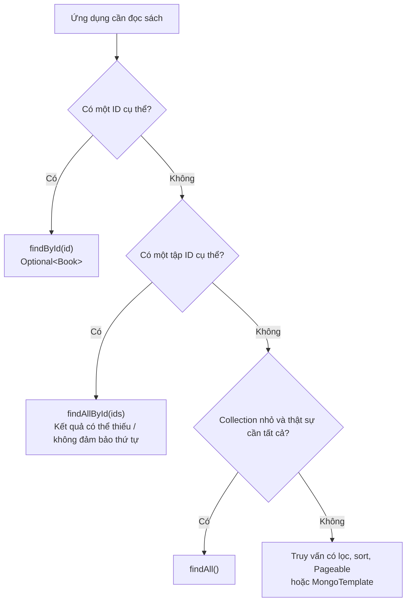

# findById, findAllById và findAll

## 1. Ba phương thức đọc cơ bản trong Repository CRUD

Khi sử dụng **Spring Data MongoDB**, ta ánh xạ một document MongoDB thành entity Java, rồi đọc và ghi dữ liệu thông qua `MongoRepository` hoặc `MongoTemplate`. Trong nhóm thao tác CRUD, ba phương thức phổ biến nhất để đọc dữ liệu là:

- **`findById(id)`**: tìm **một** document có định danh `_id` tương ứng.
- **`findAllById(ids)`**: tìm **nhiều** document có `_id` thuộc một tập ID được cung cấp.
- **`findAll()`**: lấy **toàn bộ** document trong collection mà repository quản lý.

Chúng đều có thể dùng ngay sau khi khai báo repository, không cần tự viết câu lệnh MongoDB. Tuy nhiên, ba phương thức có ngữ nghĩa khác nhau về **số kết quả**, **thứ tự**, **cách xử lý ID không tồn tại** và **chi phí truy vấn**.

| Phương thức | Đầu vào | Kết quả với `MongoRepository<Book, String>` trong Spring Data MongoDB 3.x | Điều cần nhớ |
| --- | --- | --- | --- |
| `findById(String id)` | Một ID không null | `Optional<Book>` | Không tìm thấy → `Optional.empty()` |
| `findAllById(Iterable<String> ids)` | Danh sách hoặc tập ID không null, không có phần tử null | `List<Book>` | Có thể thiếu kết quả cho ID không tồn tại; không hứa hẹn giữ thứ tự ID |
| `findAll()` | Không có đối số | `List<Book>` | Có thể tải toàn bộ collection, không có thứ tự mặc định được bảo đảm |

Định dạng kiểu trả về cụ thể có thể thay đổi theo giao diện repository và thế hệ Spring Data. Bảng trên dùng `MongoRepository` của Spring Data MongoDB 3.x, nơi những thao tác đọc nhiều trả về `List`. Với `CrudRepository` tổng quát, chữ ký của thao tác đọc nhiều thường là `Iterable<T>`; hãy đọc chữ ký API của phiên bản dự án đang dùng.

## 2. Mô hình ví dụ: lưu sách trong MongoDB

Để minh họa dễ kiểm tra, giả sử ứng dụng có database `library_demo` và collection `books`. Mỗi document chứa ID sách, ISBN, tên sách, thể loại và thời điểm tạo.

```javascript
// Collection: books
{
  _id: "BOOK-1001",
  isbn: "978-604-001-001-0",
  title: "Nhập môn Spring Data MongoDB",
  category: "backend",
  created_at: ISODate("2026-11-01T08:00:00Z")
}
```

Ở ví dụ này, `_id` là **BSON String** có tiền tố `BOOK-`, được ứng dụng cấp phát. Thực tế MongoDB cũng thường dùng `ObjectId`; lựa chọn kiểu nào sẽ quyết định kiểu tham số thứ hai của repository và cách truyền vào `findById`.

### Entity `Book`

Tạo lớp `Book` trong ứng dụng Spring Boot có starter `spring-boot-starter-data-mongodb`:

```java
package com.example.library;

import java.time.Instant;
import org.springframework.data.mongodb.core.mapping.Document;
import org.springframework.data.mongodb.core.mapping.Field;
import org.springframework.data.mongodb.core.mapping.FieldType;
import org.springframework.data.mongodb.core.mapping.MongoId;

@Document(collection = "books")
public class Book {

    @MongoId(FieldType.STRING)
    private String id;

    private String isbn;
    private String title;
    private String category;

    @Field("created_at")
    private Instant createdAt;

    protected Book() {
        // Dành cho cơ chế khởi tạo khi ánh xạ document.
    }

    public Book(String id, String isbn, String title,
                String category, Instant createdAt) {
        this.id = id;
        this.isbn = isbn;
        this.title = title;
        this.category = category;
        this.createdAt = createdAt;
    }

    public String getId() { return id; }
    public String getIsbn() { return isbn; }
    public String getTitle() { return title; }
    public String getCategory() { return category; }
    public Instant getCreatedAt() { return createdAt; }
}
```

Trong entity:

| Thành phần | Ý nghĩa |
| --- | --- |
| `@Document(collection = "books")` | Repository quản lý các document trong collection `books` |
| `@MongoId(FieldType.STRING)` | Property `id` là định danh và được lưu với kiểu BSON String |
| `@Field("created_at")` | Property `createdAt` của Java ánh xạ tới field BSON `created_at` |
| `Instant` | Kiểu Java biểu diễn một thời điểm; MongoDB thường lưu dưới kiểu BSON Date qua converter |

Trong những ví dụ sau, `BOOK-1001` là **ID**, còn `978-604-001-001-0` là **ISBN**. Gọi `findById("978-604-001-001-0")` sẽ không tự tìm theo trường `isbn`.

### Khai báo `BookRepository`

```java
package com.example.library;

import org.springframework.data.mongodb.repository.MongoRepository;

public interface BookRepository extends MongoRepository<Book, String> {
}
```

Tham số `Book` xác định entity, còn `String` là kiểu của property định danh `Book.id`. Spring Data tạo implementation cho repository khi ứng dụng khởi động và repository nằm trong phạm vi quét của Spring.

Chưa cần khai báo `findById`, `findAllById` hay `findAll` trong interface: tất cả đã được kế thừa từ API repository.

### Dữ liệu mẫu để tự thực hành

Với MongoDB cục bộ, có thể kết nối database `library_demo` và thêm ba document bằng `mongosh`:

```javascript
use library_demo

db.books.insertMany([
  {
    _id: "BOOK-1001",
    isbn: "978-604-001-001-0",
    title: "Nhập môn Spring Data MongoDB",
    category: "backend",
    created_at: ISODate("2026-11-01T08:00:00Z")
  },
  {
    _id: "BOOK-1002",
    isbn: "978-604-001-002-7",
    title: "MongoDB cho người mới",
    category: "database",
    created_at: ISODate("2026-11-02T08:00:00Z")
  },
  {
    _id: "BOOK-1003",
    isbn: "978-604-001-003-4",
    title: "Truy vấn dữ liệu với Spring",
    category: "backend",
    created_at: ISODate("2026-11-03T08:00:00Z")
  }
])
```

Lệnh `insertMany` trên chỉ dùng **một lần trong collection demo trống**. Chạy lại với cùng `_id` sẽ báo duplicate key. Spring Boot 3.x có thể kết nối bằng cấu hình minh họa:

```properties
spring.data.mongodb.uri=mongodb://localhost:27017/library_demo
```

Khi dùng môi trường MongoDB khác, hãy thay URI theo cấu hình được phép và xác nhận đang đọc đúng database trước khi đối chiếu dữ liệu.

## 3. `findById`: tìm đúng một document theo `_id`

Giả sử `bookRepository` đã được inject vào một service:

```java
import java.util.Optional;

Optional<Book> result =
    bookRepository.findById("BOOK-1001");

result.ifPresent(book ->
    System.out.println("Tên sách: " + book.getTitle())
);
```

Truy vấn MongoDB về mặt ý nghĩa tương ứng:

```javascript
db.books.findOne({ _id: "BOOK-1001" })
```

Từ document BSON, Spring Data ánh xạ field `_id` về `Book.id`, và `created_at` về `Book.createdAt`. Kết quả được bọc trong `Optional<Book>` để người gọi xử lý cả trường hợp sách không tồn tại.

### Kết quả tìm thấy và không tìm thấy

```java
Optional<Book> existing =
    bookRepository.findById("BOOK-1001");
// existing.isPresent() == true, nếu đã nạp dữ liệu mẫu.

Optional<Book> missing =
    bookRepository.findById("BOOK-9999");
// missing.isEmpty() == true, nếu ID này chưa được tạo.
```

**Không tìm thấy dữ liệu không phải là một lỗi kết nối**. Một ID hợp lệ nhưng không tồn tại trả `Optional.empty()`. Trong khi đó, lỗi mạng, timeout, xác thực hoặc chuyển đổi BSON có thể làm repository ném ngoại lệ.

### Xử lý `Optional` trong service

Trong một API tra cứu sách, cách hợp lý là quy định rõ phản ứng khi không có dữ liệu:

```java
import java.util.NoSuchElementException;

public Book getRequiredBook(String id) {
    return bookRepository.findById(id)
        .orElseThrow(() -> new NoSuchElementException(
            "Không tìm thấy sách: " + id
        ));
}
```

Đây là phương thức của một service đang có field `bookRepository`. Lớp HTTP controller có thể chuyển lỗi không tìm thấy sang phản hồi `404 Not Found` theo chính sách ứng dụng. Không nên dùng `optional.get()` khi chưa chắc có giá trị; `get()` trên Optional rỗng sẽ gây ngoại lệ không thể hiện rõ ngữ cảnh nghiệp vụ.

### Những điều cần kiểm tra

- **ID không được `null`**. `findById(null)` vi phạm hợp đồng API repository và có thể ném `IllegalArgumentException`; nên xác thực đầu vào trước khi gọi.
- **`findById` tìm theo `_id`**, không phải trường `isbn` hoặc `title`. Nếu cần tìm theo ISBN, hãy khai báo `findByIsbn` hoặc dùng `MongoTemplate`.
- **Kiểu BSON ID phải khớp**. Một chuỗi `"507f..."` và BSON ObjectId có cùng ký tự hiển thị không phải cùng một giá trị BSON. `@MongoId(FieldType.STRING)` trong ví dụ giúp định nghĩa rõ kiểu String.
- **ID không phải quyền truy cập**. Ở hệ thống nhiều tenant, chỉ tìm bằng `_id` chưa chứng minh người gọi được phép đọc document.

## 4. `findAllById`: đọc một tập ID trong một lần gọi repository

Khi cần hiển thị nhiều sách đã được chọn từ một danh sách yêu thích, chương trình có thể đã có các ID:

```java
List<String> requestedIds = List.of(
    "BOOK-1003",
    "BOOK-9999",
    "BOOK-1001"
);

List<Book> books = bookRepository.findAllById(requestedIds);
```

Ý nghĩa truy vấn MongoDB có thể diễn đạt bằng:

```javascript
db.books.find({
  _id: { $in: ["BOOK-1003", "BOOK-9999", "BOOK-1001"] }
})
```

Thường một truy vấn `$in` trên `_id` phục vụ tốt hơn việc lặp gọi `findById` riêng cho từng ID, vì tránh nhiều round trip không cần thiết. Cách implementation chính xác có thể phụ thuộc phiên bản Spring Data và cấu hình; khi hiệu năng quan trọng, nên xem câu lệnh thực sự được gửi tới MongoDB.

### Khi một ID không tồn tại

Trong bộ dữ liệu mẫu, `BOOK-9999` không có document tương ứng. Vì vậy, `findAllById` trả những `Book` tìm được, có thể chỉ gồm `BOOK-1001` và `BOOK-1003`:

```text
Input IDs:   BOOK-1003, BOOK-9999, BOOK-1001
Output IDs:  BOOK-1001, BOOK-1003  (ví dụ một thứ tự có thể gặp)
Missing:     BOOK-9999
```

**Không có placeholder `null` ứng với ID thiếu**. Kết quả không phải mảng giữ đúng một phần tử cho mỗi ID đầu vào. Gọi `findAllById` với danh sách ID mà không tìm được document nào trả một danh sách kết quả rỗng.

### Không có cam kết giữ thứ tự đầu vào

Theo hợp đồng của `findAllById`, **thứ tự kết quả không được bảo đảm**. Không được viết chương trình giả định:

```java
// Sai về mặt giả định: books.get(0) luôn ứng với requestedIds.get(0).
Book first = books.get(0);
```

Truy vấn `$in` mô tả tập giá trị cần khớp, không phải chỉ thị sắp xếp theo thứ tự các phần tử trong mảng `$in`. Nếu giao diện cần giữ thứ tự ID mà người dùng đã chọn, phải **tự ghép kết quả theo ID**.

### Chủ động khôi phục thứ tự yêu cầu

Ví dụ sau chỉ giữ **ID duy nhất lần đầu xuất hiện** trong danh sách đầu vào; các ID không tồn tại sẽ bị bỏ qua:

```java
import java.util.List;
import java.util.Map;
import java.util.Objects;
import java.util.function.Function;
import java.util.stream.Collectors;

List<String> requestedIds = List.of(
    "BOOK-1003", "BOOK-9999", "BOOK-1001", "BOOK-1003"
);

Map<String, Book> byId = bookRepository.findAllById(requestedIds)
    .stream()
    .collect(Collectors.toMap(
        Book::getId,
        Function.identity()
    ));

List<Book> ordered = requestedIds.stream()
    .distinct()
    .map(byId::get)
    .filter(Objects::nonNull)
    .toList();
```

Khi đó `ordered` theo `BOOK-1003` rồi `BOOK-1001`, bỏ qua `BOOK-9999` và bản lặp `BOOK-1003`. Nếu nghiệp vụ muốn **giữ cả số lần ID được yêu cầu**, hãy bỏ `distinct()` và xác định rõ cách xử lý phần tử lặp.

### Danh sách ID trùng và dữ liệu đầu vào không hợp lệ

- Đầu vào `null` hoặc chứa phần tử ID `null` vi phạm hợp đồng của `findAllById`; không dựa vào hành vi ngoài hợp đồng để suy ra kết quả.
- ID trùng không có nghĩa kết quả được bảo đảm lặp đúng số lần, vì mỗi document MongoDB có một `_id` duy nhất. Nếu số lần chọn có ý nghĩa, giữ thông tin đó trong logic ứng dụng.
- Danh sách rỗng thường cho kết quả rỗng; vẫn có thể chủ động trả `List.of()` mà không gọi database khi ứng dụng biết chắc không có yêu cầu.
- Với hàng chục nghìn hoặc hàng triệu ID, không nên tạo một truy vấn `$in` khổng lồ. Cần xác định giới hạn kích thước request, chia batch theo nhu cầu và đo hiệu năng/memory. MongoDB có giới hạn kích thước BSON cho lệnh và giới hạn tài nguyên khi xử lý truy vấn.

## 5. `findAll`: đọc toàn bộ collection và các rủi ro

```java
List<Book> allBooks = bookRepository.findAll();

System.out.println("Đang có " + allBooks.size() + " sách");
allBooks.forEach(book ->
    System.out.println(book.getId() + ": " + book.getTitle())
);
```

Về ý nghĩa, đây là:

```javascript
db.books.find({})
```

**`findAll()` không mặc định áp dụng lọc, giới hạn hay phân trang**. Khi collection có ba document demo, nó rất thuận tiện. Khi có hàng triệu document, việc đưa toàn bộ về danh sách Java có thể gây:

1. **Tải nhiều dữ liệu hơn cần thiết**: chuyển BSON qua mạng, ánh xạ entity và giữ object trong bộ nhớ.
2. **Tăng độ trễ request**: màn hình chỉ cần 20 bản ghi nhưng chương trình đọc hết collection.
3. **Áp lực bộ nhớ**: một `List<Book>` lớn có thể làm JVM dùng nhiều heap hoặc hết bộ nhớ.
4. **Lộ dữ liệu ngoài phạm vi**: API nhiều tenant vô tình trả toàn bộ bản ghi nếu không áp dụng điều kiện tenant/quyền.
5. **Không ổn định thứ tự hiển thị**: kết quả không có `sort` không được bảo đảm theo ID hay thời điểm tạo.

Hãy dùng `findAll()` khi thực sự cần toàn bộ dữ liệu và **kích thước tập dữ liệu được kiểm soát**, chẳng hạn một danh mục cấu hình nhỏ. Đối với danh sách sản phẩm, trang quản trị hoặc dữ liệu tăng theo thời gian, nên dùng lọc, sort và giới hạn.

### `findAll` khi collection rỗng

Nếu collection chưa có document, `findAll()` trả danh sách rỗng, không trả `null`. Điều này khác với `findById(...)` trả `Optional.empty()`; kiểu kết quả thể hiện rõ số lượng kỳ vọng của mỗi API.

## 6. Sắp xếp và phân trang thay cho đọc toàn bộ

Repository có overload cho sắp xếp và phân trang; không cần tự viết `MongoTemplate` cho những nhu cầu đơn giản.

### Sắp xếp `findAll(Sort)`

```java
import org.springframework.data.domain.Sort;

Sort newestFirst = Sort.by(
    Sort.Order.desc("createdAt"),
    Sort.Order.desc("id")
);

List<Book> orderedBooks = bookRepository.findAll(newestFirst);
```

Trong Spring Data, ta viết **tên property Java** `createdAt`; metadata `@Field("created_at")` giúp ánh xạ sang field BSON `created_at`. Thêm `id` làm tiêu chí thứ hai để thứ tự ổn định khi có hai document cùng `createdAt`.

Tuy nhiên, `findAll(Sort)` chỉ có **sắp xếp**, chưa giới hạn số lượng. Với collection lớn, cần thêm phân trang.

### `findAll(Pageable)`

```java
import org.springframework.data.domain.Page;
import org.springframework.data.domain.PageRequest;
import org.springframework.data.domain.Pageable;
import org.springframework.data.domain.Sort;

Pageable firstPage = PageRequest.of(
    0,
    20,
    Sort.by(
        Sort.Order.desc("createdAt"),
        Sort.Order.desc("id")
    )
);

Page<Book> page = bookRepository.findAll(firstPage);

List<Book> currentBooks = page.getContent();
long totalBooks = page.getTotalElements();
boolean hasNext = page.hasNext();
```

`PageRequest.of(0, 20, ...)` yêu cầu trang đầu (đánh số từ **0**) và tối đa 20 document. `Page<Book>` cho phép lấy nội dung trang, số lượng tổng thể, tổng trang và thông tin còn trang tiếp hay không.

Tính tổng bằng `Page` có thể cần truy vấn đếm riêng, tùy phiên bản và cách tối ưu của framework. Nếu giao diện chỉ cần biết “có trang tiếp theo?” thì nên cân nhắc API trả `Slice`/cơ chế giới hạn phù hợp nhằm tránh phải lấy tổng số khi không cần.

Khi chuyển sang các trang rất sâu, phân trang dựa trên `skip` có thể phải bỏ qua nhiều kết quả. **Keyset pagination** (cursor dựa trên bộ khóa sắp xếp, ví dụ `created_at` và `_id`) có thể phù hợp hơn cho danh sách cuộn liên tục. Cần thống nhất cách lấy cursor, các bộ lọc và thứ tự khi dữ liệu có thay đổi đồng thời.

### Khi cần lọc theo nghiệp vụ

`findAll(Pageable)` vẫn lấy dữ liệu từ toàn collection, chỉ thêm phân trang và sắp xếp. Nếu API chỉ được xem sách thuộc thể loại `backend`, nên khai báo phương thức có điều kiện:

```java
import org.springframework.data.domain.Page;
import org.springframework.data.domain.Pageable;

public interface BookRepository extends MongoRepository<Book, String> {

    Page<Book> findByCategory(String category, Pageable pageable);
}
```

Đây là **phiên bản mở rộng của interface repository đã khai báo**, không cần tạo một interface trùng tên trong cùng project. Lời gọi:

```java
Page<Book> backendBooks =
    bookRepository.findByCategory("backend", firstPage);
```

giúp MongoDB lọc theo field `category` trước khi phân trang. Trong hệ thống nhiều tenant, các truy vấn danh sách thường cần thêm `tenantId` hoặc điều kiện phân quyền phù hợp, chứ không chỉ dựa vào `findAll()`.

## 7. Sơ đồ chọn phương thức phù hợp



Ví dụ quyết định:

| Nghiệp vụ | Phương thức | Vì sao |
| --- | --- | --- |
| Mở chi tiết sách theo URL có ID | `findById` | Biết chính xác một `_id` |
| Lấy những sách có trong danh sách yêu thích | `findAllById` | Đã có một tập ID |
| Đọc bảng mã cấu hình chỉ vài bản ghi | `findAll` | Số lượng nhỏ và được kiểm soát |
| Hiển thị 20 sách mới nhất | `findAll(PageRequest...)` | Giới hạn số lượng, có sắp xếp |
| Hiển thị sách theo category | `findByCategory(..., Pageable)` | Cần lọc trước khi phân trang |
| Truy vấn động, aggregation phức tạp | `MongoTemplate` | Linh hoạt xây Criteria, aggregation và projection |

## 8. Hiểu truy vấn và index MongoDB phía sau

Một repository giúp giảm mã lặp trong Java, nhưng vẫn phải hiểu lệnh MongoDB được thực hiện. Ba phương thức tác động đến collection `books` như sau:

| Repository | Truy vấn MongoDB mang ý nghĩa tương ứng | Có dùng index `_id` không? |
| --- | --- | --- |
| `findById("BOOK-1001")` | `{ _id: "BOOK-1001" }` | Thường có, vì MongoDB tạo index duy nhất trên `_id` |
| `findAllById(List.of(...))` | `{ _id: { $in: [...] } }` | Có thể tận dụng index `_id` cho các giá trị cần tìm |
| `findAll()` | `{}` | Không có điều kiện khóa; có thể phải đọc nhiều hoặc mọi document |

Một index mặc định trên `_id` không làm cho `findAll()` trở thành truy vấn nhẹ. Khi không có điều kiện, database vẫn phải trả lượng dữ liệu ứng dụng yêu cầu. Với phân trang theo `created_at`, có thể cân nhắc index phục vụ bộ lọc và thứ tự:

```javascript
db.books.createIndex(
  { created_at: -1, _id: -1 },
  { name: "books_created_at_id_desc" }
)
```

Chọn index dựa trên mẫu truy cập: nếu thường lọc `category` rồi sắp thời gian, một index ứng viên khác có thể là `{ category: 1, created_at: -1, _id: -1 }`. Các index tốn bộ nhớ/lưu trữ và tăng chi phí ghi, nên không thêm tất cả index có thể nghĩ ra.

### Quan sát kế hoạch thực thi bằng `explain`

Trong `mongosh`:

```javascript
// Tìm theo một ID.
db.books.find({ _id: "BOOK-1001" })
  .explain("executionStats")

// Tìm theo tập ID.
db.books.find({
  _id: { $in: ["BOOK-1001", "BOOK-1003"] }
}).explain("executionStats")

// Danh sách mới nhất có giới hạn.
db.books.find({})
  .sort({ created_at: -1, _id: -1 })
  .limit(20)
  .explain("executionStats")
```

Các chỉ dấu cần xem:

- `winningPlan` / `IXSCAN` / `COLLSCAN`: MongoDB đang dùng index hay quét collection?
- `totalKeysExamined`: đã duyệt bao nhiêu khóa index?
- `totalDocsExamined`: đã đọc bao nhiêu document?
- `nReturned`: đã trả bao nhiêu kết quả?
- `executionTimeMillis`: thời gian trong lần chạy đo được là bao nhiêu?

Không kết luận từ một lần chạy trên collection chỉ có ba document. Phải kiểm tra dữ liệu đại diện về số lượng bản ghi, sự phân bố ID, kích thước document và tải đồng thời. Khi danh sách rất lớn, ngoài phía MongoDB còn cần đo thời gian chuyển BSON, bytes qua mạng, heap và thời gian ánh xạ sang entity Java.

## 9. Tổ chức mã service để phân biệt các tình huống đọc

Để tránh đặt logic xử lý `Optional`, danh sách ID và phân trang rải rác trong controller, có thể gom chúng vào một service. Ví dụ sau sử dụng entity và repository đã khai báo:

```java
package com.example.library;

import java.util.List;
import java.util.Map;
import java.util.NoSuchElementException;
import java.util.Objects;
import java.util.function.Function;
import java.util.stream.Collectors;
import org.springframework.data.domain.Page;
import org.springframework.data.domain.PageRequest;
import org.springframework.data.domain.Sort;
import org.springframework.stereotype.Service;

@Service
public class BookReadService {

    private final BookRepository bookRepository;

    public BookReadService(BookRepository bookRepository) {
        this.bookRepository = bookRepository;
    }

    public Book getById(String id) {
        if (id == null || id.isBlank()) {
            throw new IllegalArgumentException("ID sách không được rỗng");
        }
        return bookRepository.findById(id)
            .orElseThrow(() -> new NoSuchElementException(
                "Không tìm thấy sách: " + id
            ));
    }

    public List<Book> getSelectedInRequestedOrder(List<String> ids) {
        if (ids == null || ids.stream()
                .anyMatch(id -> id == null || id.isBlank())) {
            throw new IllegalArgumentException(
                "Danh sách ID không hợp lệ"
            );
        }

        if (ids.isEmpty()) {
            return List.of();
        }

        Map<String, Book> foundById = bookRepository.findAllById(ids)
            .stream()
            .collect(Collectors.toMap(
                Book::getId,
                Function.identity()
            ));

        return ids.stream()
            .distinct()
            .map(foundById::get)
            .filter(Objects::nonNull)
            .toList();
    }

    public Page<Book> getRecentBooks(int pageNumber, int pageSize) {
        if (pageNumber < 0 || pageSize < 1 || pageSize > 100) {
            throw new IllegalArgumentException(
                "Thông số phân trang không hợp lệ"
            );
        }

        Sort sort = Sort.by(
            Sort.Order.desc("createdAt"),
            Sort.Order.desc("id")
        );

        return bookRepository.findAll(
            PageRequest.of(pageNumber, pageSize, sort)
        );
    }
}
```

Service này làm rõ ba hợp đồng:

1. `getById` phải nhận một ID hợp lệ và trả một `Book`; nếu không có, báo lỗi nghiệp vụ.
2. `getSelectedInRequestedOrder` tìm nhiều ID rồi **sắp lại theo yêu cầu của caller**, bỏ ID thiếu và chỉ giữ mỗi ID một lần.
3. `getRecentBooks` không tải toàn collection, giới hạn kích thước trang trong khoảng 1–100 và sắp theo hai trường để ổn định thứ tự.

Với API công khai, giới hạn số phần tử `ids` và kiểm soát quyền truy cập còn quan trọng hơn. Nếu tài liệu nằm trong không gian nhiều tenant, việc lọc lại kết quả theo `tenantId` hoặc kiểm tra quyền truy cập phải được đưa vào chính truy vấn/thiết kế service để không trả nhầm dữ liệu ngoài phạm vi.

## 10. Khi sử dụng `MongoTemplate` hoặc Reactive Repository

Ba nhu cầu đọc này không bị giới hạn ở repository đồng bộ. Spring Data MongoDB cũng có `MongoTemplate` để xây truy vấn chi tiết, aggregation và thao tác cập nhật; phần mềm reactive có `ReactiveMongoRepository` hoặc `ReactiveMongoTemplate`.

### Ví dụ tương đương với `MongoTemplate` đồng bộ

```java
import java.util.List;
import org.springframework.data.mongodb.core.MongoTemplate;
import org.springframework.data.mongodb.core.query.Criteria;
import org.springframework.data.mongodb.core.query.Query;

Book one = mongoTemplate.findById(
    "BOOK-1001", Book.class);

List<Book> selected = mongoTemplate.find(
    Query.query(Criteria.where("id").in(
        List.of("BOOK-1001", "BOOK-1003")
    )),
    Book.class
);

List<Book> all = mongoTemplate.findAll(Book.class);
```

`MongoTemplate.findById` trả đối tượng `Book` hoặc `null` khi không tìm thấy, trong khi repository `findById` trả `Optional<Book>`. Khi dùng `Criteria.where("id")` với entity `Book`, metadata mapping xác định field MongoDB tương ứng là `_id`. Với `findAll(Book.class)`, cần chú ý rủi ro đọc toàn bộ collection giống như `bookRepository.findAll()`.

Những đoạn trên là ví dụ đặt trong component có field `mongoTemplate` đã được inject; đây không phải tệp Java độc lập hoàn chỉnh. Khi cần điều kiện động, projection hoặc aggregation, `MongoTemplate` có thể giúp diễn đạt truy vấn rõ hơn.

### API reactive

Một repository reactive minh họa:

```java
package com.example.library;

import org.springframework.data.mongodb.repository.ReactiveMongoRepository;

public interface ReactiveBookRepository
        extends ReactiveMongoRepository<Book, String> {
}
```

| Thao tác | Repository đồng bộ | Repository reactive |
| --- | --- | --- |
| Theo một ID | `Optional<Book> findById(id)` | `Mono<Book> findById(id)` |
| Theo danh sách ID | `List<Book> findAllById(ids)` | `Flux<Book> findAllById(ids)` |
| Đọc toàn bộ | `List<Book> findAll()` | `Flux<Book> findAll()` |

`Mono.empty()` trong reactive tương tự ý nghĩa “không có document” của `Optional.empty()`; `Flux.empty()` biểu diễn không có phần tử. Các publisher của Reactor chỉ chạy khi được subscribe. Reactive không tự thêm sort, điều kiện lọc hoặc giới hạn số bản ghi: `findAll()` vẫn có thể duyệt toàn bộ collection khi được tiêu thụ hết.

Không dùng `block()` để biến mọi phương thức reactive thành đồng bộ trong thread xử lý request reactive. Nếu cần kết quả có số lượng giới hạn, hãy tạo **truy vấn có giới hạn** phù hợp thay vì dùng `findAll().collectList()` cho toàn bộ dữ liệu.

## 11. Các lỗi thường gặp và cách xử lý

| Hiện tượng | Giải thích hoặc nguyên nhân thường gặp | Cách xử lý |
| --- | --- | --- |
| `findById` trả rỗng dù có sách cùng ISBN | `findById` tìm `_id`, không tìm `isbn` | Truyền đúng ID hoặc định nghĩa `findByIsbn` |
| `findById(null)` gây ngoại lệ | ID đầu vào vi phạm hợp đồng | Kiểm tra đầu vào trước khi gọi repository |
| `findAllById` trả ít phần tử hơn số ID | Một số ID không tồn tại hoặc đầu vào có ID trùng | Xác định chính sách bỏ qua ID thiếu và kiểm tra số ID duy nhất |
| Danh sách yêu thích bị đảo thứ tự | `findAllById` không bảo đảm thứ tự kết quả | Ghép lại theo ID đầu vào hoặc dùng truy vấn/sort riêng |
| `findAll()` chậm và tiêu thụ nhiều RAM | Đọc quá nhiều document, mapping thành danh sách Java | Dùng lọc, `Pageable`, projection, giới hạn |
| `findAll()` trả khác thứ tự giữa các lần chạy | Không có `sort` thì thứ tự không được bảo đảm | Sắp xếp tường minh bằng field nghiệp vụ và khóa phụ |
| Không tìm thấy ID có 24 ký tự hex | ID trong BSON là String nhưng code truy vấn dùng ObjectId, hoặc ngược lại | Xem `$type` và quy tắc `@Id`/`@MongoId` |
| Trang thứ hai có kết quả lặp/thiếu khi dữ liệu được thêm mới | Tập dữ liệu thay đổi giữa các request phân trang | Thiết kế cursor/keyset hoặc chính sách nhất quán phù hợp |
| Kết quả tìm ID không đúng tenant | Chỉ tra cứu `_id` mà chưa kiểm tra tenant/quyền | Thêm điều kiện nghiệp vụ và kiểm tra phân quyền |
| Câu lệnh repository đúng nhưng hiệu năng kém | Index, dữ liệu và kích thước document chưa phù hợp | Kiểm tra truy vấn thực tế và `explain` |

Lỗi kết nối MongoDB hoặc lỗi ánh xạ BSON khác với “không tìm thấy document”. Đừng bắt mọi exception rồi biến thành danh sách rỗng: làm vậy có thể che mất tình trạng database không hoạt động hoặc dữ liệu bị hỏng.

## 12. Kiểm thử ngữ nghĩa với dữ liệu MongoDB thật

Khi kiểm thử repository, nên dùng MongoDB thực trong môi trường tích hợp, ví dụ Testcontainers, để kiểm chứng tên trường, kiểu BSON, kết quả thực tế và index. `@DataMongoTest` có thể giúp khởi tạo thành phần Spring Data MongoDB cho bài kiểm thử; dự án cần cấu hình kết nối tới MongoDB dành riêng cho test.

Mẫu kiểm thử dưới đây giả định **database test độc lập**, được phép xóa dữ liệu trước mỗi test; tuyệt đối không áp dụng phần dọn dữ liệu này lên database thật có người dùng:

```java
package com.example.library;

import java.time.Instant;
import java.util.List;
import org.junit.jupiter.api.BeforeEach;
import org.junit.jupiter.api.Test;
import org.springframework.beans.factory.annotation.Autowired;
import org.springframework.boot.test.autoconfigure.data.mongo.DataMongoTest;

import static org.assertj.core.api.Assertions.assertThat;

@DataMongoTest
class BookRepositoryReadTest {

    @Autowired
    BookRepository books;

    @BeforeEach
    void seedIsolatedTestDatabase() {
        books.deleteAll();
        books.insert(List.of(
            new Book("BOOK-1001", "ISBN-1", "Sách Một",
                "backend", Instant.parse("2026-11-01T08:00:00Z")),
            new Book("BOOK-1002", "ISBN-2", "Sách Hai",
                "database", Instant.parse("2026-11-02T08:00:00Z"))
        ));
    }

    @Test
    void findByIdReturnsOptional() {
        assertThat(books.findById("BOOK-1001")).isPresent();
        assertThat(books.findById("BOOK-NOT-FOUND")).isEmpty();
    }

    @Test
    void findAllByIdOmitsMissingIdsWithoutAssumingOrder() {
        List<Book> found = books.findAllById(
            List.of("BOOK-1002", "BOOK-MISSING", "BOOK-1001")
        );

        assertThat(found)
            .extracting(Book::getId)
            .containsExactlyInAnyOrder("BOOK-1001", "BOOK-1002");
    }

    @Test
    void findAllReturnsAllSeededBooks() {
        assertThat(books.findAll())
            .extracting(Book::getId)
            .containsExactlyInAnyOrder("BOOK-1001", "BOOK-1002");
    }
}
```

Điểm đáng chú ý là assertion `containsExactlyInAnyOrder`: kiểm tra **tập kết quả đúng** mà không áp đặt một thứ tự mà phương thức không hứa hẹn. Các test độc lập với ID ngẫu nhiên vì chủ động tạo ID cố định dạng String.

Ngoài ví dụ trên, nên kiểm thử: danh sách ID rỗng; trùng ID; ID sai kiểu BSON; phân trang kết hợp sắp xếp; collection lớn; lỗi kết nối; và quyền truy cập trong trường hợp nhiều tenant.

## 13. Bài tập tự kiểm tra

**Bài tập 1.** Collection có ba sách `BOOK-1001`, `BOOK-1002`, `BOOK-1003`. Kết quả `bookRepository.findById("BOOK-9999")` là gì?

**Đáp án:** `Optional.empty()` nếu không có document tương ứng. Đây là kết quả bình thường của truy vấn hợp lệ, không tự động là exception.

**Bài tập 2.** `findAllById(List.of("BOOK-1003", "BOOK-1001"))` có bắt buộc trả đúng thứ tự BOOK-1003 trước BOOK-1001 không?

**Đáp án:** Không. Phải tự sắp theo thứ tự đầu vào nếu đó là yêu cầu của giao diện.

**Bài tập 3.** Một người dùng gửi 100 ID, trong đó 10 ID đã bị xóa. `findAllById` có trả `null` cho 10 vị trí bị thiếu không?

**Đáp án:** Không có hợp đồng giữ đúng vị trí của từng ID. Repository chỉ trả những entity được tìm thấy; ứng dụng tự xác định cách báo ID thiếu.

**Bài tập 4.** Một trang quản trị cần hiển thị 20 sách mới nhất trong collection có 2 triệu bản ghi. Nên gọi `findAll()` rồi `stream().limit(20)` không?

**Đáp án:** Không. Cách đó có thể tải toàn bộ collection trước khi giới hạn trong Java. Dùng truy vấn MongoDB có `sort` và `limit`, hoặc repository `findAll(PageRequest.of(0, 20, sort))`.

**Bài tập 5.** Đã có index mặc định trên `_id`. Điều đó có làm `findAll()` luôn nhanh không?

**Đáp án:** Không. Truy vấn toàn bộ vẫn cần đọc và chuyển nhiều document; hiệu năng phụ thuộc kích thước dữ liệu, index và cách lấy kết quả.

**Bài tập 6.** Một document có `_id: "BOOK-1001"` và `isbn: "ISBN-1"`. Hai lệnh `findById("BOOK-1001")` và `findById("ISBN-1")` có tương đương không?

**Đáp án:** Không. `findById` chỉ tìm theo định danh `_id`; truy vấn ISBN là một yêu cầu khác.

**Ghi nhớ:** **`findById`** trả một `Optional`, **`findAllById`** trả những document tìm được trong tập ID mà không hứa hẹn thứ tự, còn **`findAll`** trả toàn bộ collection và cần thận trọng khi dữ liệu lớn. Khi phát triển ứng dụng Spring Data MongoDB, hãy dùng đúng kiểu ID, chọn sort/phân trang và lọc phù hợp, kiểm tra index và xác minh kết quả bằng dữ liệu thực tế.
