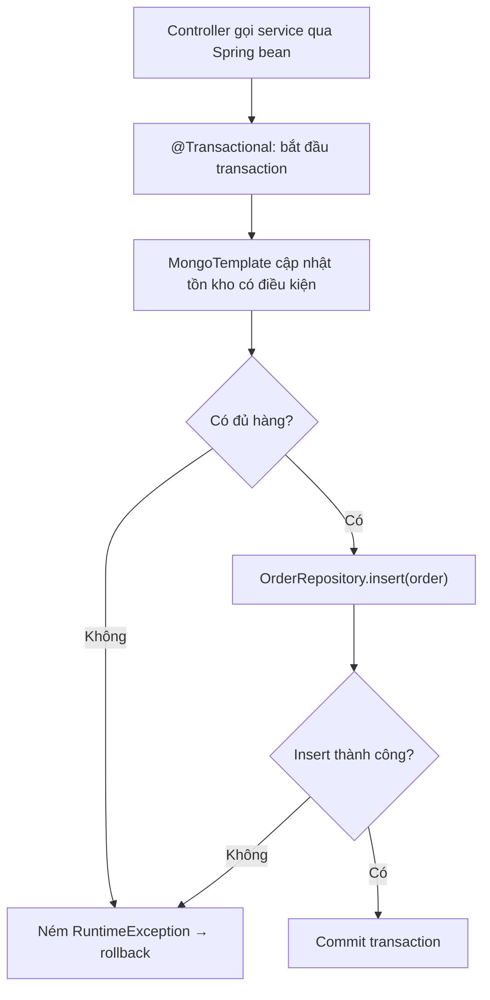

# Phạm vi giao dịch của repository trong MongoDB

## 1. Repository CRUD có đồng nghĩa với transaction không?

Khi xây dựng ứng dụng bằng **Spring Data MongoDB**, ta thường bắt đầu với `MongoRepository` để tạo, đọc, cập nhật và xóa tài liệu. Những thao tác này trông tương tự repository của các hệ cơ sở dữ liệu khác, nhưng **ranh giới nguyên tử và transaction phải được hiểu theo MongoDB**.

Xét chức năng đặt hàng:

1. Kiểm tra và trừ 2 sản phẩm khỏi tồn kho.
2. Tạo document đơn hàng.
3. Ghi nhận trạng thái thanh toán.
4. Gửi thông báo xác nhận.

Nếu bước 1 thành công còn bước 2 thất bại, kho có thể đã giảm nhưng đơn không tồn tại. Nếu bước 2 thành công còn bước 3 lỗi, đơn có thể tồn tại ở trạng thái chưa thanh toán. Gọi tuần tự hai hay nhiều phương thức repository **không tự động tạo một giao dịch chung**.

Ta cần phân biệt ba phạm vi:

| Phạm vi | Điều được bảo đảm hoặc cần thiết kế |
| --- | --- |
| **Một thao tác ghi trên một document** | MongoDB thực hiện thao tác ghi nguyên tử ở mức document, kể cả các trường lồng nhau trong cùng document. |
| **Nhiều thao tác đọc/ghi hoặc nhiều document** | Muốn tất cả cùng commit/rollback cần transaction phù hợp hoặc cơ chế phối hợp nghiệp vụ khác. |
| **Nhiều hệ thống**: MongoDB, cổng thanh toán, hàng đợi, email | Transaction MongoDB không tự bao trùm dịch vụ ngoài MongoDB; phải xử lý idempotency, thông điệp và trạng thái trung gian. |

Trong module **SPRING_DATA_MONGODB**, repository và `MongoTemplate` là hai API truy cập MongoDB. Bài thuộc chương **Repository CRUD** và tập trung vào việc biết **thao tác nào có tính nguyên tử, thao tác nào được tham gia transaction, cách mở ranh giới transaction ở lớp service**, cùng những hệ quả đối với aggregation, index, reactive access, kiểm thử và chẩn đoán hiệu năng.

## 2. Hiểu đúng atomicity của một document

MongoDB bảo đảm một thao tác ghi vào **một document** là nguyên tử. Ví dụ document:

```javascript
{
  _id: "order-1001",
  status: "PLACED",
  items: [
    { productId: "p-01", quantity: 2, unitPrice: NumberDecimal("500000") }
  ],
  total: NumberDecimal("1000000")
}
```

Nếu gửi một lệnh cập nhật đồng thời `status` và `total` cho cùng document:

```javascript
db.orders.updateOne(
  { _id: "order-1001", status: "PLACED" },
  {
    $set: {
      status: "PAID",
      total: NumberDecimal("1000000")
    }
  }
);
```

Các sửa đổi thuộc **cùng thao tác ghi trên document này** được áp dụng nguyên tử. Bộ lọc `status: "PLACED"` còn giúp bảo vệ điều kiện chuyển trạng thái: nếu trạng thái đã thay đổi trước khi lệnh chạy, thao tác không khớp document đó.

Điều này **không** có nghĩa một chuỗi lệnh riêng biệt sau đây là một transaction:

```javascript
db.orders.updateOne({ _id: "order-1001" }, { $set: { status: "PAID" } });
db.orders.updateOne({ _id: "order-1001" }, { $set: { receiptIssued: true } });
```

Giữa hai lệnh, tiến trình có thể lỗi hoặc một tiến trình khác có thể đọc/cập nhật document. Muốn hai field cùng thay đổi trong một thao tác, hãy kết hợp chúng trong một `updateOne`. Nếu quy tắc nghiệp vụ buộc phải phối hợp nhiều thao tác hoặc nhiều document, hãy cân nhắc transaction.

### 2.1. Một lệnh ảnh hưởng nhiều document

```javascript
db.orders.updateMany(
  { status: "PLACED", expired: true },
  { $set: { status: "EXPIRED" } }
);
```

Với `updateMany`, **mỗi document được cập nhật một cách nguyên tử**, nhưng cả tập document không trở thành một đơn vị nguyên tử chung khi chạy ngoài transaction. Nếu có lỗi hoặc cập nhật đồng thời, một số document có thể đã thay đổi trong khi số khác chưa. Tương tự, không mặc định `deleteMany`, `insertMany` hoặc một phương thức repository xử lý nhiều bản ghi sẽ tự rollback cả nhóm.

Đừng nhầm **một lời gọi API** với **một transaction**. Cần kiểm tra MongoDB thực hiện bao nhiêu thao tác ghi và yêu cầu nhất quán có bao gồm nhiều document hay không.

## 3. Phạm vi thật của `MongoRepository`

Repository cung cấp API như:

```java
import org.springframework.data.mongodb.repository.MongoRepository;

public interface OrderRepository
        extends MongoRepository<OrderDocument, String> {}
```

Một số phương thức thông dụng:

| Phương thức | Ý nghĩa | Cần lưu ý về giao dịch |
| --- | --- | --- |
| `insert(entity)` | Thêm document mới | Ghi một document là nguyên tử; trùng `_id` sẽ bị từ chối. |
| `save(entity)` | Lưu entity theo định danh; có thể cập nhật/thay thế document hiện có | Không làm cho một chuỗi *đọc → sửa Java → save* tự trở nên an toàn trước cập nhật đồng thời. |
| `findById(id)` | Đọc document theo ID | Đọc này không tự thiết lập một transaction bao gồm các thao tác tiếp theo. |
| `findAllById(ids)` | Đọc một tập document | Không mặc định là snapshot nhất quán với những cập nhật xảy ra đồng thời. |
| `deleteById(id)` | Xóa document được định danh | Bản thân việc xóa một document là nguyên tử nếu chỉ có một document. |
| `deleteAll(...)` hoặc xóa theo điều kiện | Có thể tác động nhiều document | Không mặc định nguyên tử toàn bộ tập document. |
| Phương thức query tự khai báo | Tìm theo điều kiện, projection, sắp xếp... | Không tự bao gồm cả luồng nghiệp vụ trong transaction. |

**MongoDB repository không nên được giả định có transaction bao quanh mọi phương thức theo mặc định.** Khác biệt giữa các module Spring Data cũng là lý do không được sao chép máy móc giả định về transaction của Spring Data JPA sang MongoDB. Khi cần transaction, ứng dụng phải cấu hình transaction manager và đặt ranh giới rõ ràng.

### 3.1. `save` và lỗi mất cập nhật

Ví dụ hai request đọc cùng một đơn có `status="PLACED"`:

```text
T1: Request A findById("order-1001") → status=PLACED
T2: Request B findById("order-1001") → status=PLACED
T3: Request A sửa status=PAID, save()
T4: Request B sửa ghi chú và save() đối tượng cũ
```

Nếu dùng cách lưu thay thế entity mà không kiểm soát xung đột, request B có thể vô tình ghi đè trạng thái vừa được A cập nhật. **Đọc và save là hai thao tác khác nhau**, không được bảo vệ chỉ vì mỗi thao tác riêng lẻ là nguyên tử.

Có hai hướng cơ bản:

- Dùng `@Version` để **optimistic locking**, phát hiện entity được lưu dựa trên version đã cũ.
- Dùng `MongoTemplate.updateFirst(...)` hoặc `findAndModify(...)` với bộ lọc điều kiện và `$set` đúng field cần thay đổi, sau đó kiểm tra kết quả.

Transaction đa document không thay thế việc thiết kế logic cạnh tranh. Với các bất biến cục bộ của một document, cập nhật có điều kiện thường đơn giản và có chi phí thấp hơn.

## 4. Xây dựng mô hình đơn hàng và tồn kho

Để minh họa transaction đa document, dùng hai collection `inventory` và `orders`. Mỗi sản phẩm có một document tồn kho; mỗi đơn có một document độc lập.

### 4.1. Entity tồn kho

```java
import org.springframework.data.mongodb.core.mapping.Document;
import org.springframework.data.mongodb.core.mapping.FieldType;
import org.springframework.data.mongodb.core.mapping.MongoId;

@Document(collection = "inventory")
public record StockDocument(
    @MongoId(FieldType.STRING) String id,
    long available
) {}
```

`id` là mã sản phẩm, ví dụ `"p-01"`. Trong ví dụ này, `@MongoId(FieldType.STRING)` xác định `_id` ở MongoDB là BSON string để tránh nhầm giữa chuỗi và ObjectId.

### 4.2. Entity đơn hàng

```java
import java.time.Instant;

import org.springframework.data.mongodb.core.mapping.Document;
import org.springframework.data.mongodb.core.mapping.FieldType;
import org.springframework.data.mongodb.core.mapping.MongoId;

@Document(collection = "orders")
public record OrderDocument(
    @MongoId(FieldType.STRING) String id,
    String customerId,
    String productId,
    int quantity,
    Instant placedAt,
    String status
) {}
```

Với nghiệp vụ thực, đơn hàng có thể nhúng nhiều `items`, số tiền, địa chỉ giao nhận và snapshot giá. Ở đây, ta cố ý dùng **một sản phẩm trên một đơn** để làm rõ ranh giới transaction. Thiết kế production cần bổ sung validation, giá, idempotency, chống đơn trùng và các yêu cầu nghiệp vụ khác.

### 4.3. Repository đơn hàng

```java
import org.springframework.data.mongodb.repository.MongoRepository;

public interface OrderRepository
        extends MongoRepository<OrderDocument, String> {}
```

Tạo một đơn và trừ tồn kho là thay đổi **hai document thuộc hai collection**, nên một `orders.insert(...)` thành công không bảo đảm `inventory` đã thay đổi và ngược lại.

## 5. Khi chỉ cập nhật tồn kho: một lệnh có điều kiện là đủ

Trước khi chọn transaction đa document, hãy xét một bất biến chỉ liên quan **một document**: tồn kho không được âm.

Không làm theo kiểu đọc số lượng hiện tại rồi tự trừ và `save` khi có nhiều request mua đồng thời. Hai request có thể cùng đọc `available=2` rồi đều cho rằng có thể bán 2.

Dùng điều kiện ngay trong thao tác cập nhật:

```java
import com.mongodb.client.result.UpdateResult;

import org.springframework.data.mongodb.core.MongoTemplate;
import org.springframework.data.mongodb.core.query.Criteria;
import org.springframework.data.mongodb.core.query.Query;
import org.springframework.data.mongodb.core.query.Update;

public boolean reserveStock(
    MongoTemplate mongoTemplate,
    String productId,
    int quantity
) {
    if (quantity <= 0) {
        throw new IllegalArgumentException("Số lượng phải dương");
    }

    Query query = Query.query(
        Criteria.where("_id").is(productId)
            .and("available").gte(quantity)
    );
    Update update = new Update().inc("available", -quantity);

    UpdateResult result = mongoTemplate.updateFirst(
        query,
        update,
        StockDocument.class
    );

    return result.getModifiedCount() == 1;
}
```

MongoDB đánh giá điều kiện `available >= quantity` khi cập nhật document. Nếu hai request cùng cố trừ 2 từ tồn kho 2, **không thể cùng thành công trên cùng một điều kiện tồn kho**: khi thao tác đầu giảm xuống 0, thao tác còn lại không còn khớp điều kiện. Kiểm tra `getModifiedCount()` giúp service biết có thực sự giảm hàng hay không (trong ví dụ luôn giảm giá trị dương khi khớp).

Không cần transaction đa document chỉ để bảo vệ một phép trừ trên **một document**. Nhưng nếu còn phải tạo đơn hàng, ta cần quan tâm tính nhất quán giữa tồn kho và đơn.

## 6. Khi nào cần transaction đa document?

Giả sử service thực hiện:

```java
boolean reserved = reserveStock(mongoTemplate, "p-01", 2);
if (!reserved) {
    throw new IllegalStateException("Không đủ hàng");
}
orderRepository.insert(order);
```

Nếu `insert(order)` lỗi vì trùng khóa `_id` hoặc mất kết nối, kho có thể đã giảm. Hai thao tác trên nằm trong **cùng Java method** nhưng chưa chắc thuộc **cùng MongoDB transaction**.

Mục tiêu của một transaction là:

> Nếu cả hai bước cần tạo thành một đơn vị nghiệp vụ, chỉ commit khi cả hai đều thành công; nếu một bước thất bại thì rollback các thay đổi thuộc transaction đó.

Những tình huống có thể cần transaction:

- Tạo đơn và trừ tồn kho nằm ở hai document khác nhau, theo chính sách yêu cầu commit/rollback cùng nhau.
- Chuyển điểm thưởng giữa hai tài khoản, nếu hai số dư phải thay đổi trong một đơn vị nguyên tử.
- Tạo chứng từ và cập nhật trạng thái của document nghiệp vụ có quan hệ bắt buộc.
- Chuyển dữ liệu giữa các collection mà không được để lộ trạng thái chỉ cập nhật một phía.

Tuy nhiên, không nên đưa mọi thao tác vào transaction dài: transaction đa document có chi phí về session, tài nguyên, khả năng xung đột và giới hạn thời gian. Đôi khi **mô hình dữ liệu nhúng**, cập nhật có điều kiện hoặc một quy trình bù trừ có idempotency phù hợp hơn.

## 7. Cấu hình `MongoTransactionManager`

### 7.1. Điều kiện MongoDB hỗ trợ transaction

Multi-document transaction cần MongoDB deployment hỗ trợ, chẳng hạn **replica set** hoặc **sharded cluster** được cấu hình phù hợp. Một MongoDB **standalone** thông thường không hỗ trợ multi-document transaction. Với môi trường local/test, cần chạy MongoDB như replica set đúng cách nếu muốn thử commit/rollback.

Trong ứng dụng Spring, cần một `MongoTransactionManager` dùng cùng `MongoDatabaseFactory` với `MongoTemplate` và repository tham gia:

```java
import org.springframework.context.annotation.Bean;
import org.springframework.context.annotation.Configuration;
import org.springframework.data.mongodb.MongoDatabaseFactory;
import org.springframework.data.mongodb.MongoTransactionManager;

@Configuration
public class MongoTransactionConfig {

    @Bean
    public MongoTransactionManager transactionManager(
        MongoDatabaseFactory databaseFactory
    ) {
        return new MongoTransactionManager(databaseFactory);
    }
}
```

Bean này cho phép Spring quản lý `ClientSession` và transaction cho các thao tác MongoDB tham gia trong **cùng ngữ cảnh transaction**. Spring Data MongoDB không nên được giả định tự kích hoạt transaction nếu chưa có cấu hình manager phù hợp.

**Cần bảo đảm:**

- Đường repository và `MongoTemplate` thực sự dùng cùng MongoDB factory/transaction manager đã định.
- Các thao tác được gọi **bên trong** phạm vi transaction Spring quản lý, không dùng tùy tiện MongoDB driver riêng bên ngoài context.
- Collection, index cần dùng được chuẩn bị trước khi chạy luồng nghiệp vụ. Hoạt động tạo collection/index trong transaction có các giới hạn và điều kiện theo phiên bản MongoDB, nên tránh để ứng dụng tự tạo chúng giữa checkout.
- Cấu hình kết nối và thời gian chờ đáp ứng môi trường triển khai, đặc biệt nếu dùng cluster hoặc sharding.

Một số ứng dụng có nhiều transaction manager (JPA, MongoDB, messaging...). Lúc đó phải chọn **đúng manager** trong `@Transactional`. Manager MongoDB không tự quản lý transaction ở hệ khác.

### 7.2. Ranh giới ở lớp service

Trong Spring, đặt `@Transactional` trên method public của service được gọi **qua Spring proxy** là cách thông dụng để đặt ranh giới nghiệp vụ. Không nên dựa vào việc gọi một private method gắn annotation hoặc **self-invocation** (một method trong cùng bean gọi method được annotate) vì có thể bypass proxy trong cấu hình proxy mặc định.



Các phương thức repository được gọi từ bên trong service có thể tham gia transaction mà service đã mở, miễn là chúng dùng kết nối/factory phù hợp và không bị tách ra khỏi context.

## 8. Ví dụ transaction: đặt đơn và trừ kho cùng nhau

### 8.1. Service sử dụng repository và `MongoTemplate`

```java
import java.time.Clock;
import java.time.Instant;

import com.mongodb.client.result.UpdateResult;

import org.springframework.data.mongodb.core.MongoTemplate;
import org.springframework.data.mongodb.core.query.Criteria;
import org.springframework.data.mongodb.core.query.Query;
import org.springframework.data.mongodb.core.query.Update;
import org.springframework.stereotype.Service;
import org.springframework.transaction.annotation.Transactional;

@Service
public class CheckoutService {

    private final MongoTemplate mongoTemplate;
    private final OrderRepository orders;
    private final Clock clock;

    public CheckoutService(
        MongoTemplate mongoTemplate,
        OrderRepository orders,
        Clock clock
    ) {
        this.mongoTemplate = mongoTemplate;
        this.orders = orders;
        this.clock = clock;
    }

    @Transactional(transactionManager = "transactionManager")
    public OrderDocument placeOrder(
        String orderId,
        String customerId,
        String productId,
        int quantity
    ) {
        if (quantity <= 0) {
            throw new IllegalArgumentException("Số lượng không hợp lệ");
        }

        Query query = Query.query(
            Criteria.where("_id").is(productId)
                .and("available").gte(quantity)
        );

        Update update = new Update()
            .inc("available", -quantity);

        UpdateResult result = mongoTemplate.updateFirst(
            query,
            update,
            StockDocument.class
        );

        if (result.getModifiedCount() != 1) {
            throw new IllegalStateException("Không đủ tồn kho");
        }

        OrderDocument order = new OrderDocument(
            orderId,
            customerId,
            productId,
            quantity,
            Instant.now(clock),
            "PLACED"
        );

        // Nếu insert lỗi, transaction được đánh dấu rollback.
        return orders.insert(order);
    }
}
```

Đoạn code yêu cầu `Clock` bean được cung cấp trong ứng dụng và `OrderRepository` cùng `MongoTemplate` dùng MongoDB transaction manager đã cấu hình. Đây là ví dụ cho **một sản phẩm/đơn**, không bao gồm xử lý thanh toán ngoài hệ MongoDB.

Tính chất quan trọng:

1. `updateFirst` giảm kho có điều kiện. Nếu không đủ hàng, service ném `IllegalStateException`.
2. `orders.insert(order)` ghi một document đơn.
3. Nếu một trong các bước phát sinh **unchecked exception** trong transaction, Spring thường rollback transaction theo quy tắc mặc định.
4. Nếu cả hai bước thành công và commit thành công, các thay đổi thuộc transaction được xác nhận cùng nhau.
5. **Không** bắt lỗi rồi trả về thành công ở trong method, vì như vậy có thể khiến Spring cố commit nếu không đánh dấu rollback.
6. Nếu commit hoặc kết nối phát sinh lỗi không rõ kết quả, cần xử lý retry và tính idempotent ở tầng nghiệp vụ thay vì mặc định đơn chắc chắn đã thất bại.

### 8.2. Điều gì xảy ra khi insert đơn bị trùng ID?

Giả sử `orders` đã có `_id = "order-1001"`. Khi gọi `placeOrder("order-1001", ...)`:

- Lệnh trừ kho có thể chạy thành công **trong transaction chưa commit**.
- Lệnh `insert` gặp lỗi duplicate key.
- Với cấu hình transaction đúng, exception thoát ra ngoài method khiến transaction rollback; tồn kho không bị giảm bởi transaction thất bại.

Nếu không có transaction, thao tác trừ kho trước đó đã là một ghi riêng và không tự hoàn tác. Đây là khác biệt cần được kiểm tra bằng integration test.

### 8.3. Tại sao không gọi cổng thanh toán trong transaction?

Ví dụ sau có rủi ro:

```text
BEGIN MongoDB transaction
  cập nhật tồn kho
  tạo order
  gọi HTTP tới cổng thanh toán (có thể mất vài giây)
COMMIT MongoDB transaction
```

Transaction MongoDB không thể rollback một khoản thanh toán đã thành công ở hệ thống bên ngoài. Gọi HTTP lâu trong lúc giữ transaction cũng kéo dài thời gian giữ tài nguyên và tăng xác suất xung đột.

Thay vào đó, thường cần trạng thái trung gian như `PENDING_PAYMENT`, khóa idempotency khi gọi thanh toán, webhook hoặc cơ chế xác nhận kết quả, cùng bước bù trừ/giải phóng kho khi giao dịch bị hủy. Có thể dùng **transactional outbox** để ghi sự kiện ra collection MongoDB trong cùng transaction với thay đổi nghiệp vụ, rồi có worker chuyên trách phát hành; ngay cả vậy, phía nhận vẫn cần khả năng chống xử lý thông điệp trùng.

## 9. Spring `@Transactional`: những quy tắc dễ bị hiểu sai

### 9.1. Annotation không tự bảo đảm mọi thao tác được bao bọc

`@Transactional` hoạt động khi có transaction manager phù hợp và lời gọi đi qua cơ chế interception của Spring. Những trường hợp dễ sai:

- Đặt annotation trong class được tạo bằng `new`, không phải Spring bean.
- Gọi method annotated từ một method khác **trong cùng object** qua `this.method(...)` với proxy mode thông thường.
- Mở transaction bằng MongoDB manager nhưng thực hiện thao tác qua client/factory không tham gia transaction đó.
- Có hai transaction manager và để Spring chọn nhầm manager.
- Trả về trước hoặc chuyển logic bất đồng bộ sang thread khác mà không truyền đúng transaction context.
- Bắt exception ở trong transaction rồi bỏ qua, khiến transaction được commit khi nghiệp vụ thực ra thất bại.

Khi debug, cần xác minh transaction **thực sự bắt đầu và commit/rollback**, thay vì chỉ nhìn thấy annotation trên source code.

### 9.2. Runtime exception và checked exception

Mặc định, transaction interceptor của Spring thường rollback khi ném `RuntimeException` hoặc `Error`. Một **checked exception** không mặc định kích hoạt rollback theo quy tắc phổ biến. Khi nghiệp vụ yêu cầu rollback cho checked exception, có thể cấu hình:

```java
@Transactional(
    transactionManager = "transactionManager",
    rollbackFor = Exception.class
)
public void performBusinessOperation() throws Exception {
    // Ghi dữ liệu MongoDB trong cùng transaction.
}
```

Cấu hình rollback phải phản ánh yêu cầu nghiệp vụ; không phải lúc nào bắt mọi exception cũng là lựa chọn tốt. Cũng cần tránh nuốt exception rồi trả về kết quả thành công.

### 9.3. `readOnly=true` không thay thế chính sách đọc nhất quán

`@Transactional(readOnly = true)` là một chỉ dẫn cấu hình transaction, không phải cam kết rằng mọi lần đọc trong service mặc nhiên có **serializable isolation**. MongoDB có các khái niệm `read concern`, `write concern` và ngữ nghĩa snapshot; mức quan sát cụ thể phụ thuộc cấu hình transaction/session và môi trường.

Nếu cần một ảnh chụp dữ liệu nhất quán qua nhiều document trong cùng thời điểm, phải thiết kế và kiểm chứng **read concern/transaction options** phù hợp. Đừng suy ra rằng gọi hai `findById` liên tiếp trong method repository mặc nhiên nhìn thấy cùng một phiên bản dữ liệu.

### 9.4. Transaction không tự retry toàn bộ luồng

MongoDB có thể trả lỗi tranh chấp ghi, lỗi kết nối hoặc lỗi được gắn nhãn như `TransientTransactionError` và `UnknownTransactionCommitResult`. Không phải mọi cơ chế `@Transactional` của Spring tự động retry an toàn toàn bộ method khi gặp các tình huống ấy.

Một chiến lược retry đúng cần phân biệt:

- **Lỗi chắc chắn đã abort:** có thể retry toàn bộ transaction nếu thao tác nghiệp vụ idempotent và vẫn hợp lệ.
- **Không rõ commit có thành công hay chưa:** trước khi gửi lại phải kiểm tra hoặc dùng khóa idempotency để tránh tạo đơn/thu tiền hai lần.
- **Lỗi logic:** thiếu tồn kho, đầu vào sai, trạng thái không hợp lệ — retry mù quáng thường vô ích.
- **Lỗi hạ tầng lặp lại:** có thể cần giới hạn số lần, backoff và quan sát chỉ số hệ thống.

Đừng retry transaction gồm thao tác gọi cổng thanh toán không idempotent hoặc gửi email như thể tất cả sẽ tự rollback được.

## 10. Optimistic locking với `@Version`

Transaction đa document bảo vệ tính nguyên tử theo một phạm vi, còn **optimistic locking** giúp phát hiện tình huống một document bị ghi dựa trên phiên bản cũ.

Ví dụ bổ sung `@Version` cho document có vòng đời cập nhật:

```java
import org.springframework.data.annotation.Version;
import org.springframework.data.mongodb.core.mapping.Document;
import org.springframework.data.mongodb.core.mapping.FieldType;
import org.springframework.data.mongodb.core.mapping.MongoId;

@Document(collection = "profiles")
public record ProfileDocument(
    @MongoId(FieldType.STRING)
    String id,
    String displayName,
    @Version Long version
) {}
```

Khi một entity được đọc và lưu qua cơ chế hỗ trợ version của Spring Data, converter/repository sử dụng version để kiểm soát cập nhật. Nếu document đã được thay đổi bởi request khác, việc save entity dựa trên version cũ có thể phát sinh `OptimisticLockingFailureException`.

Lợi ích:

- Phát hiện `read → modify → save` dựa trên dữ liệu đã cũ.
- Cho phép ứng dụng yêu cầu người dùng tải lại hoặc thực hiện một chiến lược merge có chủ đích.
- Hạn chế lỗi **lost update** khi hai request cùng sửa một document.

Giới hạn:

- Phải dùng đường ghi thực sự **tôn trọng version**; raw driver hoặc update tùy ý có thể bypass kiểm soát version.
- Cần write acknowledgment phù hợp để phát hiện kết quả ghi; không nên tắt acknowledgement rồi trông đợi nhận đúng mọi lỗi optimistic locking.
- `@Version` không làm cho một chuỗi nhiều repository tự trở thành transaction đa document.
- Với thao tác cập nhật một trường có điều kiện, `MongoTemplate.updateFirst` cùng bộ lọc `_id`/trạng thái/`version` có thể phù hợp hơn việc load toàn bộ entity và save.

### 10.1. So sánh các cơ chế

| Nhu cầu | Cơ chế thường phù hợp |
| --- | --- |
| Đổi trạng thái đơn nếu đang `PAID` | `updateFirst` với `status=PAID` và `$set` |
| Trừ tồn kho nhưng không để âm | `updateFirst` với `available >= quantity` và `$inc` |
| Phát hiện người dùng sửa hồ sơ dựa trên phiên bản cũ | `@Version` hoặc filter theo version |
| Tạo đơn **và** trừ tồn kho như một đơn vị commit | Transaction đa document nếu phù hợp |
| Đồng bộ MongoDB với cổng thanh toán hoặc broker | Idempotency, outbox/saga, xử lý retry và bù trừ |
| Cập nhật các field của cùng một document | Một lệnh update để tận dụng atomicity document |

Không tồn tại một annotation đơn lẻ giải quyết mọi vấn đề nhất quán.

## 11. Reactive repository và phạm vi transaction

Nếu ứng dụng dùng Spring WebFlux, `ReactiveMongoRepository` và `ReactiveMongoTemplate` hỗ trợ luồng dữ liệu không chặn. Nhưng transaction reactive **không dùng cùng cách lưu ngữ cảnh như imperative thông thường**: Reactor truyền transaction context qua subscriber context, không chỉ ThreadLocal.

### 11.1. Cấu hình reactive transaction manager

Ví dụ với MongoDB deployment hỗ trợ transaction:

```java
import org.springframework.context.annotation.Bean;
import org.springframework.context.annotation.Configuration;
import org.springframework.data.mongodb.ReactiveMongoDatabaseFactory;
import org.springframework.data.mongodb.ReactiveMongoTransactionManager;

@Configuration
public class ReactiveMongoTxConfig {

    @Bean
    public ReactiveMongoTransactionManager reactiveTransactionManager(
        ReactiveMongoDatabaseFactory factory
    ) {
        return new ReactiveMongoTransactionManager(factory);
    }
}
```

Nếu ứng dụng có cả manager imperative và reactive, cần chọn đúng manager theo API và kiểu trả về. Reactive repository không được ghép với một manager imperative rồi mặc định cùng tham gia một transaction.

### 11.2. `TransactionalOperator` bao bọc một chuỗi `Mono`

Ví dụ reactive đặt đơn với hai thao tác:

```java
import java.time.Clock;
import java.time.Instant;

import org.springframework.data.mongodb.core.ReactiveMongoTemplate;
import org.springframework.data.mongodb.core.query.Criteria;
import org.springframework.data.mongodb.core.query.Query;
import org.springframework.data.mongodb.core.query.Update;
import org.springframework.transaction.reactive.TransactionalOperator;

import reactor.core.publisher.Mono;

public class ReactiveCheckoutService {

    private final ReactiveMongoTemplate template;
    private final ReactiveOrderRepository orders;
    private final TransactionalOperator tx;
    private final Clock clock;

    public ReactiveCheckoutService(
        ReactiveMongoTemplate template,
        ReactiveOrderRepository orders,
        TransactionalOperator tx,
        Clock clock
    ) {
        this.template = template;
        this.orders = orders;
        this.tx = tx;
        this.clock = clock;
    }

    public Mono<OrderDocument> placeOrder(
        String orderId,
        String customerId,
        String productId,
        int quantity
    ) {
        if (quantity <= 0) {
            return Mono.error(
                new IllegalArgumentException("Số lượng không hợp lệ")
            );
        }

        Query query = Query.query(
            Criteria.where("_id").is(productId)
                .and("available").gte(quantity)
        );

        Update update = new Update()
            .inc("available", -quantity);

        return template.updateFirst(
                query, update, StockDocument.class
            )
            .flatMap(result -> {
                if (result.getModifiedCount() != 1) {
                    return Mono.error(
                        new IllegalStateException("Không đủ tồn kho")
                    );
                }

                OrderDocument order = new OrderDocument(
                    orderId,
                    customerId,
                    productId,
                    quantity,
                    Instant.now(clock),
                    "PLACED"
                );
                return orders.insert(order);
            })
            .as(tx::transactional);
    }
}
```

Đoạn này giả định có interface `ReactiveOrderRepository extends ReactiveMongoRepository<OrderDocument, String>` và `TransactionalOperator` được cấu hình từ **ReactiveMongoTransactionManager** phù hợp. Cả `ReactiveMongoTemplate` và repository cần dùng cùng MongoDB reactive transaction context. Việc gọi `block()` bên trong pipeline của ứng dụng web reactive có thể phá đặc điểm không chặn và không nên dùng để “ép” transaction chạy.

Tương tự imperative, phải xử lý lỗi commit không rõ kết quả, retry và idempotency. Reactive không tự làm MongoDB transaction nhanh hơn hoặc loại bỏ xung đột ghi.

## 12. Cách kiểm thử transaction thật sự hoạt động

Một unit test chỉ mock repository không chứng minh MongoDB đã rollback; nó chỉ chứng minh service gọi đúng method giả lập. Cần **integration test** chạy trên MongoDB hỗ trợ transaction, ví dụ MongoDB replica set trong Testcontainers.

### 12.1. Kiểm thử rollback khi insert trùng ID

Ý tưởng test:

1. Tạo `StockDocument` với `available=5`.
2. Tạo sẵn `OrderDocument` có ID `"order-duplicate"`.
3. Gọi `checkoutService.placeOrder("order-duplicate", ..., quantity=2)`.
4. Xác minh insert thất bại vì duplicate key.
5. **Đọc lại kho và xác minh `available=5`**, vì transaction phải rollback phép trừ.

Ví dụ JUnit 5 và Spring Boot:

```java
import static org.junit.jupiter.api.Assertions.*;

import java.time.Instant;

import org.junit.jupiter.api.Test;
import org.springframework.beans.factory.annotation.Autowired;
import org.springframework.boot.test.context.SpringBootTest;
import org.springframework.dao.DuplicateKeyException;
import org.springframework.data.mongodb.core.MongoTemplate;

@SpringBootTest
class CheckoutTransactionIntegrationTest {

    @Autowired MongoTemplate template;
    @Autowired CheckoutService checkoutService;

    @Test
    void duplicateOrderRollsBackInventoryChange() {
        String productId = "product-test-rollback-01";
        String orderId = "order-test-duplicate-01";

        template.insert(new StockDocument(productId, 5L));

        template.insert(new OrderDocument(
            orderId,
            "customer-test",
            productId,
            1,
            Instant.parse("2026-11-20T01:00:00Z"),
            "PLACED"
        ));

        assertThrows(
            DuplicateKeyException.class,
            () -> checkoutService.placeOrder(
                orderId, "customer-test", productId, 2
            )
        );

        StockDocument current = template.findById(
            productId, StockDocument.class
        );

        assertNotNull(current);
        assertEquals(5L, current.available());
    }
}
```

Giả định test dùng **database cô lập**, collections/index được tạo trước, `MongoTransactionManager` đã đăng ký và test gọi service qua Spring bean để proxy áp dụng `@Transactional`. Với ID cố định, cần làm sạch dữ liệu test giữa các lần chạy hoặc tạo namespace mới. Không gắn `@Transactional` lên chính method test khi mục tiêu là quan sát transaction nghiệp vụ sau khi lời gọi hoàn tất; một transaction test bao quanh có thể làm thay đổi cách kiểm chứng.

Ví dụ kỳ vọng `DuplicateKeyException` khi duplicate `_id` được Spring dịch qua exception translation. Trong các môi trường/phiên bản, lỗi gốc và cách bọc exception có thể khác; nếu test không thấy đúng loại, kiểm tra chuỗi lỗi thực tế, nhưng **vẫn phải xác minh rollback**.

### 12.2. Kiểm thử trường hợp thành công

Một test bổ sung nên xác minh:

- Trước khi đặt: `inventory.available=5`.
- Gọi `placeOrder(..., quantity=2)`.
- Sau khi commit: `inventory.available=3` và `orders` có đơn mới.
- `OrderDocument.productId` và `StockDocument._id` cùng kiểu BSON string theo quy ước ID.
- Khi đặt thêm `quantity=4`, lệnh trừ kho thất bại và **không có** đơn mới.

### 12.3. Kiểm thử tranh chấp đồng thời

Với `available=1`, cho hai request đồng thời đặt 1 sản phẩm, sử dụng ID đơn khác nhau. Kết quả nghiệp vụ mong đợi: không bán vượt tồn kho. Trong transaction đa document, có thể phát sinh **write conflict** thay vì một kết quả “không đủ hàng” thuần túy; service phải xử lý retry khi phù hợp, rồi áp dụng lại điều kiện tồn kho.

Một test cạnh tranh có ý nghĩa khi thật sự thực thi hai luồng truy cập database và kiểm tra **bất biến sau cùng**; không đủ nếu chỉ mock hai lời gọi trả về số đã dựng sẵn.

## 13. Index, aggregation và hiệu năng trong transaction

### 13.1. Chỉ mục

Truy vấn cập nhật tồn kho theo `_id` có thể dùng index `_id` mặc định trong collection `inventory`. Truy vấn danh sách đơn của khách hàng thường cần index ở `orders`:

```javascript
db.orders.createIndex({
  customerId: 1,
  placedAt: -1
});

db.orders.find({ customerId: "customer-01" })
  .sort({ placedAt: -1 })
  .limit(20)
  .explain("executionStats");
```

Tạo index trong giai đoạn quản trị/migration phù hợp, **trước** những transaction nghiệp vụ cần truy vấn. Việc có transaction không làm một query thiếu index trở nên hiệu quả. Query chậm có thể kéo dài transaction và tăng khả năng đụng độ.

### 13.2. Aggregation có cần transaction?

`MongoTemplate.aggregate(...)` và aggregation pipeline không mặc nhiên yêu cầu transaction. Ví dụ báo cáo số lượng đơn theo trạng thái:

```javascript
db.orders.aggregate([
  {
    $group: {
      _id: "$status",
      count: { $sum: 1 }
    }
  },
  { $sort: { count: -1 } }
]);
```

Báo cáo thường chỉ đọc, nên cần chọn read concern và chiến lược nhất quán tương xứng, thay vì mở transaction đa document cho mọi truy vấn phân tích. Nếu yêu cầu một snapshot nhất quán với nhiều collection, phải phân tích yêu cầu đọc, cấu hình và chi phí cụ thể.

### 13.3. Theo dõi chi phí transaction

| Chỉ số | Ý nghĩa chẩn đoán |
| --- | --- |
| Thời gian transaction | Transaction kéo dài làm tăng thời gian giữ tài nguyên và xác suất xung đột |
| Tỷ lệ commit/abort | Có nhiều transaction phải rollback hoặc lỗi tranh chấp không? |
| Write conflict và số lần retry | Có điểm nóng như document tồn kho được nhiều request cập nhật? |
| Query plan trong transaction | Điều kiện lọc có tận dụng index phù hợp không? |
| Thời gian chờ kết nối | Pool/session có bị nghẽn khi nhiều transaction chạy đồng thời? |
| Kích thước batch và số document touched | Có gom quá nhiều công việc vào một transaction không? |
| Tỷ lệ lỗi `DuplicateKeyException` | Có vấn đề idempotency hoặc nhiều request tạo cùng một đơn? |
| Số lần commit result không rõ | Có cần cải thiện chiến lược xác định kết quả/khử trùng lặp? |

Với document tồn kho có nhiều cập nhật cạnh tranh, một transaction trên nhiều document có thể gặp write conflict. Cần giảm thời gian xử lý trong transaction, dùng cập nhật có điều kiện, quản lý số lần retry và đánh giá phân chia dữ liệu nếu có điểm nóng thực sự.

## 14. Những ngộ nhận cần tránh

**“Mọi repository method đều tự chạy trong transaction.”** Sai khi hiểu thành transaction đa document mặc định. Phải cấu hình MongoDB transaction manager và xác định ranh giới, hoặc chỉ dựa vào atomicity của thao tác ghi một document khi phù hợp.

**“`save` đảm bảo cập nhật an toàn khi hai request cùng sửa.”** Một `save` có thể ghi đè dựa trên object cũ. Cân nhắc `@Version`, cập nhật có điều kiện hoặc transaction theo phạm vi cần thiết.

**“Một lệnh `updateMany` nguyên tử cho cả collection.”** MongoDB bảo đảm nguyên tử ở mức từng document nếu không dùng transaction đa document bao quanh.

**“`@Transactional` bao gồm cả thanh toán HTTP.”** Không. Transaction MongoDB chỉ quản lý những thao tác thuộc MongoDB transaction, không rollback được giao dịch đã thực hiện ở cổng thanh toán bên ngoài.

**“Có transaction thì không còn race condition.”** Transaction bảo vệ một số thuộc tính nguyên tử/quan sát, nhưng vẫn phải thiết kế kiểm tra điều kiện, xử lý write conflict, mức cô lập và các bất biến nghiệp vụ.

**“`@Transactional(readOnly = true)` bảo đảm mọi đọc đều nhất quán tuyệt đối.”** Mức nhất quán còn phụ thuộc read concern, transaction options và cách MongoDB triển khai.

**“Reactive repository không cần transaction vì đã dùng `Mono`.”** Reactive chỉ thay đổi mô hình thực thi. Nếu cần transaction đa document, phải dùng transaction manager/reactive context thích hợp.

**“Test mock chứng minh rollback.”** Mock không chạy MongoDB transaction. Cần integration test trên replica set/sharded cluster hỗ trợ và kiểm chứng trạng thái sau rollback.

## 15. Quy trình chọn phạm vi giao dịch

Khi thiết kế một phương thức repository/service mới, có thể quyết định theo trình tự:

1. **Liệt kê các thao tác dữ liệu**: đọc/ghi document nào, ở collection nào?
2. **Xác định bất biến nghiệp vụ**: điều gì không được sai khi có lỗi giữa chừng hoặc hai request đồng thời?
3. **Gom trong một document nếu tự nhiên**: dùng một lệnh `$set`/`$inc` có điều kiện để tận dụng atomicity.
4. **Cần nhiều document cùng commit?** Cân nhắc MongoDB transaction manager, môi trường hỗ trợ và chi phí.
5. **Có hệ thống bên ngoài?** Thiết kế idempotency, trạng thái trung gian, outbox hoặc bù trừ.
6. **Cần chống cập nhật đồng thời?** Dùng filter theo trạng thái/số lượng/version, optimistic locking và retry có kiểm soát.
7. **Xác minh môi trường**: repository/template dùng cùng factory, transaction proxy hoạt động, collection/index có sẵn.
8. **Kiểm thử thành công, rollback và cạnh tranh** trên MongoDB thật; đừng chỉ mock repository.
9. **Đo hiệu năng**: index, độ trễ, xung đột, số lần abort/retry và thời gian giữ transaction.

**Kết luận:** `MongoRepository` cung cấp API CRUD thuận tiện, nhưng **không tự xác định ranh giới transaction của toàn bộ nghiệp vụ**. Với Spring Data MongoDB, hãy tận dụng nguyên tử một document khi có thể; dùng `MongoTemplate` cho cập nhật có điều kiện; cấu hình `MongoTransactionManager` hoặc `ReactiveMongoTransactionManager` và mở transaction ở lớp service khi nhiều document phải commit/rollback cùng nhau. Giữ rõ giới hạn với hệ thống ngoài MongoDB, kiểm soát xung đột và idempotency, rồi kiểm chứng bằng integration test và đo đạc truy vấn thực tế.

