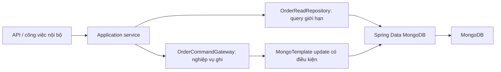

# Giới hạn tập phương thức công khai theo nhu cầu nghiệp vụ

## 1. Vì sao repository không nên mặc định công khai mọi CRUD?

Spring Data MongoDB giúp viết rất ít mã để lưu, tìm, cập nhật và xóa document. Ví dụ, chỉ cần kế thừa `MongoRepository<OrderDocument, String>`, ứng dụng đã có thể gọi các thao tác như `save(...)`, `findById(...)`, `findAll(...)`, `deleteById(...)`, `deleteAll()` và nhiều phương thức khác. Điều đó hữu ích cho nguyên mẫu, nhưng không có nghĩa mọi thao tác đều phù hợp với hợp đồng nghiệp vụ.

Giả sử dịch vụ quản lý đơn hàng yêu cầu:

- Khách hàng chỉ được xem các đơn thuộc tenant của mình.
- Nhân viên kho chỉ được chuyển đơn từ `READY_TO_SHIP` sang `SHIPPED`.
- Đơn đã giao không được xóa bằng một lệnh CRUD thông thường.
- Không có nghiệp vụ «lấy mọi đơn của mọi tenant» hay «xóa toàn bộ đơn».

Nếu một interface repository xuất hiện với đầy đủ `findAll()`, `deleteAll()` và `save()`, lập trình viên khác có thể vô tình sử dụng một phương thức **hợp lệ về mặt kỹ thuật nhưng sai về mặt nghiệp vụ**. Giới hạn tập phương thức công khai giúp giảm bề mặt sử dụng sai và làm rõ ý định của module.

Bài thuộc chương **Repository CRUD** trong module **SPRING_DATA_MONGODB**. Bạn sẽ áp dụng nguyên tắc này khi dùng repository hoặc `MongoTemplate` để thao tác MongoDB, thiết kế query/index theo access pattern, xử lý trạng thái và kiểm thử quyền truy cập. Các chủ đề như transaction, aggregation, reactive access và tối ưu hiệu năng vẫn phải tuân thủ hợp đồng nghiệp vụ đã chọn.

Sau bài, bạn có thể:

1. Phân biệt một interface kế thừa trọn bộ CRUD với một interface chỉ khai báo các phương thức thực sự cần.
2. Tạo repository chọn lọc bằng `Repository<T, ID>` hoặc `@RepositoryDefinition`.
3. Tách truy vấn đọc với các **lệnh nghiệp vụ** như xác nhận, giao hàng, hủy đơn thay vì cho phép cập nhật tùy ý.
4. Hiểu giới hạn của hợp đồng interface: nó **không tự thực hiện phân quyền**, không ngăn mọi code khác truy cập database và không thay thế invariant ở tầng service.
5. Kiểm thử những khả năng *được phép* và *không được phép*, kể cả concurrency và multi-tenancy.

## 2. Từ access pattern đến hợp đồng repository

Trước khi viết interface, hãy ghi lại cách các actor sử dụng dữ liệu.

| Actor / tác vụ | Nhu cầu thực sự | Thao tác không cần phơi bày |
| --- | --- | --- |
| Khách xem chi tiết đơn | Tìm theo `tenantId + id`, kiểm tra quyền sở hữu | `findAll()`, `findById(id)` không có tenant |
| Nhân viên xem hàng chờ giao | Liệt kê theo `tenantId + status`, có sắp xếp/giới hạn | Lấy toàn bộ collection không phân trang |
| Dịch vụ đặt đơn | Tạo đơn mới với trạng thái ban đầu hợp lệ | `save(...)` cho entity tùy ý từ controller |
| Nhân viên kho xác nhận gửi hàng | Chuyển đúng trạng thái và cập nhật thời gian, có điều kiện | Thay thế toàn bộ document bằng object tùy ý |
| Hỗ trợ khách hàng | Xem trạng thái, không sửa hoặc xóa | `deleteAll()`, `deleteById()` |
| Tác vụ giữ dữ liệu | Xử lý retention theo chính sách được duyệt | Xóa tự do qua repository chung |

Từ đây, nhóm có thể lập bảng *use case → phương thức*:

| Use case | Interface/cổng dự kiến | Trả về |
| --- | --- | --- |
| Xem đơn theo tenant và ID | `findByTenantIdAndId(...)` | `Optional<OrderDocument>` |
| Xem danh sách đơn theo trạng thái | `findByTenantIdAndStatus(..., Pageable)` | `Slice<OrderListView>` |
| Tạo đơn | `placeOrder(command, authenticatedTenant)` ở application service | ID đơn đã tạo |
| Giao đơn | `markShipped(tenantId, orderId)` ở command adapter/service | Kết quả thành công hoặc xung đột |
| Xóa dữ liệu theo retention | Tác vụ quản trị chuyên biệt, có kiểm soát | Báo cáo số bản ghi/đối soát |

Những tên như `placeOrder`, `markShipped` mô tả **ý nghĩa nghiệp vụ** tốt hơn `save`. Đối tượng `OrderDocument` là mô hình persistence nội bộ; không nhất thiết phải xuất thẳng cho HTTP API.

## 3. Hiểu các interface nền tảng của Spring Data

Spring Data cung cấp nhiều interface với các tập khả năng khác nhau. Trong các phiên bản hiện đại, `PagingAndSortingRepository` không mặc nhiên bao gồm toàn bộ phương thức của `CrudRepository` như một số phiên bản cũ; cần kiểm tra cây kế thừa theo phiên bản đang dùng.

| Interface | Mục đích | Tác động khi kế thừa |
| --- | --- | --- |
| `Repository<T, ID>` | Marker interface nền tảng | Không tự công khai cả bộ CRUD |
| `CrudRepository<T, ID>` | CRUD phổ biến | Công khai nhiều lệnh đọc/ghi/xóa, kể cả batch |
| `ListCrudRepository<T, ID>` | Biến thể CRUD dùng `List` ở các kết quả tập hợp | Vẫn là API CRUD rộng |
| `PagingAndSortingRepository<T, ID>` | Tập phương thức phân trang và sắp xếp | Chỉ kế thừa khi cần hợp đồng đó |
| `MongoRepository<T, ID>` | Repository dành cho MongoDB, có CRUD và khả năng bổ sung | Tiện nhưng có bề mặt phương thức lớn |
| `@RepositoryDefinition` | Đánh dấu một interface repository mà không cần `extends Repository` | Có thể khai báo trực tiếp các method mong muốn |

**Điểm mấu chốt:** Để tránh các phương thức thừa, hãy bắt đầu từ `Repository<T, ID>` và **chỉ khai báo** các thao tác mong muốn, thay vì kế thừa `MongoRepository` rồi cố «vô hiệu hóa» các phương thức không cần.

### 3.1. Vì sao không thể «ẩn» phương thức đã kế thừa?

Ví dụ:

```java
import org.springframework.data.mongodb.repository.MongoRepository;

public interface OrderRepository
    extends MongoRepository<OrderDocument, String> {
    // Khai báo thêm method ở đây không loại bỏ deleteAll().
}
```

Tất cả phương thức public kế thừa vẫn tồn tại trong kiểu `OrderRepository`. Việc comment «không dùng deleteAll» hoặc thêm phương thức khác không làm `deleteAll()` biến mất khỏi API. Override để ném exception ở mọi phương thức không mong muốn thường gây khó bảo trì và vẫn để lộ chúng khi autocomplete hoặc khi code gọi qua kiểu cha.

Một **hợp đồng hẹp ngay từ đầu** dễ hiểu hơn một hợp đồng rộng nhưng có danh sách cấm dùng.

### 3.2. Repository chỉ là một biên trong hệ thống

`Repository<T, ID>` giúp giới hạn những gì người dùng của **interface đó** có thể gọi trực tiếp, nhưng:

- Không ngăn một bean khác inject `MongoTemplate` hoặc driver.
- Không thay thế security ở HTTP/controller/service.
- Không tự áp `tenantId` cho mọi query.
- Không đảm bảo tài khoản MongoDB có quyền hạn tối thiểu.
- Không biến một method public trong Java thành một API HTTP, trừ khi ứng dụng còn có cơ chế phơi bày tương ứng.

Do đó, «giới hạn tập phương thức công khai» là **thiết kế API nội bộ và phòng ngừa sai sót**, không phải cơ chế sandbox hay authorization độc lập.

## 4. Ví dụ xuyên suốt: domain đơn hàng có tenant

Chúng ta dùng một document có ID chuỗi, tenant, trạng thái và thời gian đặt đơn:

```java
import java.time.Instant;
import org.springframework.data.mongodb.core.mapping.Document;
import org.springframework.data.mongodb.core.mapping.FieldType;
import org.springframework.data.mongodb.core.mapping.MongoId;

@Document(collection = "orders")
public record OrderDocument(
    @MongoId(FieldType.STRING) String id,
    String tenantId,
    String customerId,
    OrderStatus status,
    Instant createdAt,
    Instant updatedAt,
    long totalAmountVnd
) {}

enum OrderStatus {
    NEW,
    PAID,
    READY_TO_SHIP,
    SHIPPED,
    CANCELLED
}
```

Ví dụ document MongoDB:

```javascript
{
  "_id": "order-2026-0042",
  "tenantId": "tenant-a",
  "customerId": "customer-15",
  "status": "READY_TO_SHIP",
  "createdAt": ISODate("2026-11-19T08:15:00Z"),
  "updatedAt": ISODate("2026-11-19T08:15:00Z"),
  "totalAmountVnd": NumberLong("530000")
}
```

Ở đây `@MongoId(FieldType.STRING)` thể hiện chủ đích lưu ID dạng BSON String, tránh nhầm với ObjectId khi mã có dạng 24 ký tự hex. Tiền VND dùng số nguyên đơn vị đồng. Bài tập trung vào hợp đồng repository; mô hình thật cần thêm kiểm tra tổng tiền, quyền sở hữu, tình trạng tồn kho và nhiều ràng buộc khác.

## 5. Viết repository chỉ-đọc bằng Repository<T, ID>

### 5.1. Khai báo tối thiểu

```java
import java.util.Optional;
import org.springframework.data.domain.Pageable;
import org.springframework.data.domain.Slice;
import org.springframework.data.repository.Repository;

public interface OrderReadRepository
    extends Repository<OrderDocument, String> {

    Optional<OrderDocument> findByTenantIdAndId(
        String tenantId,
        String id
    );

    Slice<OrderDocument> findByTenantIdAndStatus(
        String tenantId,
        OrderStatus status,
        Pageable pageable
    );
}
```

Interface này **không khai báo** `save`, `deleteById`, `deleteAll` hoặc `findAll`. Spring Data vẫn có thể tạo repository implementation thông qua repository infrastructure và suy ra query từ tên method, miễn là cấu hình scanning và entity đúng.

`findByTenantIdAndId` mô tả yêu cầu: chỉ tìm document nếu đồng thời khớp tenant và ID. `findByTenantIdAndStatus` mô tả một danh sách trong phạm vi tenant và trạng thái, bắt buộc caller cung cấp phân trang.

**Cảnh báo bảo mật:** Method có tham số `tenantId` không tự xác nhận tham số đó là tenant của người đang đăng nhập. Giá trị phải được lấy từ authentication/authorization context đáng tin cậy, không lấy tùy ý từ client rồi cho qua.

### 5.2. Gọi repository với phân trang

```java
import org.springframework.data.domain.PageRequest;
import org.springframework.data.domain.Sort;

PageRequest firstPage = PageRequest.of(
    0,
    20,
    Sort.by(
        Sort.Order.desc("createdAt"),
        Sort.Order.desc("id")
    )
);

var page = orderReadRepository.findByTenantIdAndStatus(
    authenticatedTenantId,
    OrderStatus.READY_TO_SHIP,
    firstPage
);
```

Ví dụ giả định `orderReadRepository` đã được inject và `authenticatedTenantId` được xác định từ thông tin đăng nhập đáng tin cậy.

`Slice<T>` phù hợp khi UI chỉ cần biết còn trang tiếp theo mà không cần tổng số trang. Trong nhiều trường hợp, `Page<T>` phải thực hiện truy vấn đếm tổng để tính metadata phân trang; nếu không cần số đếm, `Slice<T>` giúp tránh chi phí không cần thiết. Tuy nhiên, với offset lớn, `Pageable` thường vẫn dùng skip và có thể chậm; keyset/cursor pagination nên được cân nhắc cho tập dữ liệu lớn.

Thứ tự `createdAt DESC, id DESC` giúp kết quả ổn định khi nhiều document có cùng thời điểm. Với truy vấn theo `tenantId + status`, index dự kiến:

```javascript
db.orders.createIndex(
  { tenantId: 1, status: 1, createdAt: -1, _id: -1 },
  { name: "ix_orders_tenant_status_recent" }
);
```

Tên property Java `id` được ánh xạ vào BSON `_id`. Hãy kiểm tra query thực tế và `explain("executionStats")` để xác nhận index phục vụ sort và filter. Không thêm index chỉ vì một method tồn tại nếu workload chưa cần.

### 5.3. Hạn chế dữ liệu trả về bằng projection

Màn hình hàng đợi giao hàng có thể chỉ cần ID, trạng thái và thời gian, không cần cả document:

```java
import java.time.Instant;

public interface OrderListView {
    String getId();
    OrderStatus getStatus();
    Instant getCreatedAt();
}
```

Repository có thể thêm một method riêng trả projection:

```java
Slice<OrderListView> findByTenantIdAndStatus(
    String tenantId,
    OrderStatus status,
    Pageable pageable
);
```

**Không khai báo đồng thời** hai method trong cùng interface chỉ khác kiểu trả về. Java không cho overload như vậy. Nếu chọn projection, hãy **thay** method trả `Slice<OrderDocument>` ở mục 5.1 hoặc dùng tên method đủ khác biệt và phù hợp cơ chế query.

Projection giúp giảm dữ liệu đưa lên Java khi framework tạo field selection phù hợp. Tuy nhiên, projection không tự thay thế phân quyền, kiểm tra index hay việc kiểm soát serialization của API.

## 6. @RepositoryDefinition: lựa chọn không cần extends Repository

Spring Data cũng hỗ trợ đánh dấu interface trực tiếp bằng `@RepositoryDefinition`:

```java
import java.util.Optional;
import org.springframework.data.repository.RepositoryDefinition;

@RepositoryDefinition(
    domainClass = OrderDocument.class,
    idClass = String.class
)
public interface OrderLookupRepository {
    Optional<OrderDocument> findByTenantIdAndId(
        String tenantId,
        String id
    );
}
```

Ý nghĩa: đây là một repository do Spring Data quản lý với domain type/ID đã nêu; interface chỉ liệt kê method cần dùng. Không cần kế thừa `MongoRepository` để nhận cơ chế query derivation.

**Chọn một phong cách nhất quán:** đa số dự án dùng `extends Repository<OrderDocument, String>` dễ nhận diện hơn, nhưng `@RepositoryDefinition` hữu ích khi dự án muốn kiểm soát cấu trúc interface bằng annotation. Không nên tạo hai bean repository có cùng vai trò chỉ để minh họa cả hai cú pháp trong một ứng dụng production.

## 7. Dùng @NoRepositoryBean khi cần hợp đồng dùng chung

Một hệ thống có nhiều module có thể muốn định nghĩa interface cha cho những thao tác có ý nghĩa chung:

```java
import java.util.Optional;
import org.springframework.data.repository.NoRepositoryBean;
import org.springframework.data.repository.Repository;

@NoRepositoryBean
public interface BasicReadRepository<T, ID>
    extends Repository<T, ID> {

    Optional<T> findById(ID id);
}
```

`@NoRepositoryBean` ngăn Spring Data cố tạo bean repository độc lập cho interface base chưa gắn domain type cụ thể.

Một repository có thể kế thừa:

```java
public interface PublicCatalogRepository
    extends BasicReadRepository<ProductDocument, String> {
    // Chỉ áp dụng nếu đọc theo ID công khai là một nghiệp vụ hợp lệ.
}
```

Ví dụ giả định `ProductDocument` được định nghĩa trong module catalog khác; mục đích chỉ là minh họa cách dùng interface base, **không yêu cầu tạo file khác**.

Tuy nhiên, `findById(ID id)` không ràng buộc tenant. Vì vậy, **không nên** dùng `BasicReadRepository` này cho `OrderDocument` có yêu cầu cô lập tenant. Tính tái sử dụng của generic base interface không được ưu tiên hơn ràng buộc nghiệp vụ.

Một base repository tốt nên có các phương thức **thực sự đúng cho mọi domain type kế thừa**. Nếu mỗi entity có quyền truy cập và invariant khác nhau, lặp lại vài khai báo repository hẹp còn an toàn và dễ review hơn một interface generic quá rộng.

## 8. Tách lệnh ghi khỏi repository đọc

### 8.1. Tại sao không dùng save cho mọi nghiệp vụ?

Chữ ký `save(entity)` diễn tả «lưu một entity» nhưng không tự diễn tả:

- Ai có quyền thay trạng thái?
- Trạng thái `READY_TO_SHIP -> SHIPPED` có hợp lệ không?
- Có cần kiểm tra trạng thái hiện tại để ngăn cập nhật cạnh tranh không?
- Có phải ghi audit event hoặc cập nhật tồn kho cùng lúc không?
- Có cho phép ghi đè toàn bộ document bằng object cũ không?

Vì thế, application service nên công khai các **command** có chủ đích. Repository chỉ-đọc ở mục 5 không có `save`; một adapter khác sử dụng `MongoTemplate` sẽ thực hiện đúng thao tác ghi được cho phép.



Các thành phần trên vẫn hoạt động trong cùng ứng dụng nếu phù hợp; đây là **tách hợp đồng theo vai trò**, không bắt buộc chia thành các microservice.

### 8.2. Command gateway với tên nghiệp vụ

```java
public interface OrderCommandGateway {
    boolean markShipped(String tenantId, String orderId);
}
```

Interface này không cho caller sửa `status` thành bất kỳ giá trị nào. Nó chỉ công khai thao tác mà nghiệp vụ hỗ trợ.

### 8.3. Triển khai bằng MongoTemplate và điều kiện nguyên tử

```java
import java.time.Instant;
import org.springframework.data.mongodb.core.MongoTemplate;
import org.springframework.data.mongodb.core.query.Criteria;
import org.springframework.data.mongodb.core.query.Query;
import org.springframework.data.mongodb.core.query.Update;

public final class MongoOrderCommandGateway
    implements OrderCommandGateway {

    private final MongoTemplate template;

    public MongoOrderCommandGateway(MongoTemplate template) {
        this.template = template;
    }

    @Override
    public boolean markShipped(String tenantId, String orderId) {
        Query query = Query.query(
            Criteria.where("id").is(orderId)
                .and("tenantId").is(tenantId)
                .and("status").is(OrderStatus.READY_TO_SHIP)
        );

        Update update = new Update()
            .set("status", OrderStatus.SHIPPED)
            .set("updatedAt", Instant.now());

        return template.updateFirst(
            query, update, OrderDocument.class
        ).getModifiedCount() == 1;
    }
}
```

Đoạn này là **mã minh họa trong một ứng dụng đã có bean MongoTemplate**. Để Spring inject gateway, cần đăng ký implementation như một bean qua `@Component` hoặc `@Bean`.

Lệnh cập nhật tìm document thỏa **đồng thời** ID, tenant và trạng thái hiện tại, rồi cập nhật một document. Đây là cách giảm rủi ro hai luồng cùng chuyển trạng thái bằng mô hình «đọc rồi ghi đè». Trong MongoDB, thao tác cập nhật trên một document là nguyên tử.

Giá trị trả về `false` có thể có các nguyên nhân khác nhau: ID không tồn tại, sai tenant, trạng thái đã được chuyển hoặc thao tác không làm thay đổi document. API không nên tự tiết lộ sự tồn tại của đơn ở tenant khác khi phân loại lỗi cho người dùng.

### 8.4. Không để việc tạo mới lẫn với cập nhật

Một command khác có thể là `placeOrder(...)`. Nó cần:

1. Xác định tenant và user từ context đáng tin cậy.
2. Kiểm tra dữ liệu đầu vào, số tiền và các invariant.
3. Tạo ID theo contract đã chọn.
4. Lưu đơn mới với trạng thái ban đầu hợp lệ.
5. Xử lý lỗi duplicate key khi ID hoặc số đơn trùng.

Khi ý định là **tạo mới**, `MongoTemplate.insert(...)` thường biểu đạt rõ hơn `save(...)`. `save` có semantics cho việc lưu/thay thế hoặc upsert tùy trường hợp, và ở cấp repository có cơ chế xác định entity mới dựa trên ID/`@Version`/`Persistable`. Vì vậy, `save` không phải cam kết «chỉ tạo mới và không bao giờ thay thế».

## 9. Nếu vẫn cần save, hãy đặt nó vào đúng phạm vi

Không phải module nào cũng cần command gateway. Một collection cấu hình nội bộ nhỏ có thể thực sự có use case «lưu cấu hình đã chỉnh sửa». Khi đó có thể khai báo `save(...)` trong repository chọn lọc:

```java
import org.springframework.data.repository.Repository;

interface InternalSettingRepository
    extends Repository<InternalSetting, String> {

    <S extends InternalSetting> S save(S entity);
}
```

Ví dụ giả định có entity `InternalSetting` trong module phù hợp; đây chỉ là chữ ký minh họa. Khai báo `save` không đồng nghĩa toàn bộ CRUD được mở, nhưng vẫn trao **khả năng ghi** cho những caller nắm được repository.

Trong bài toán quan trọng, cân nhắc thêm optimistic locking với `@Version`, kiểm tra quyền sửa, validation và giới hạn những service được inject repository. Việc có `@Version` chỉ có tác dụng mong đợi trong những đường ghi thực sự tôn trọng version; thao tác driver trực tiếp không tự kế thừa kiểm soát đồng thời của entity.

### 9.1. Tên method không thay thế invariant

Một method `saveOrder(...)` nếu chỉ gọi `repository.save(entity)` cũng không tự an toàn hơn `save(...)`. Điều quan trọng là **điều kiện được kiểm tra và thực thi** trước hoặc trong thao tác ghi:

- Tenant hiện tại có quyền trên đơn.
- Trạng thái chuyển từ giá trị nào sang giá trị nào.
- Field nào được phép thay đổi.
- Có cần kiểm tra version/thời điểm cập nhật không.
- Hành vi khi lệnh được gửi lại là gì (idempotency).

Tên rõ nghĩa giúp người dùng API hiểu ý định; implementation, index và kiểm thử mới bảo đảm hành vi thực tế.

## 10. Không mở các API xóa và bulk khi nghiệp vụ không yêu cầu

### 10.1. Vì sao deleteAll là tín hiệu rủi ro?

Đối với dữ liệu đơn hàng, một lời gọi vô tình `deleteAll()` có thể xóa dữ liệu của nhiều tenant. Ngay cả `deleteById(id)` không có kiểm tra tenant cũng có thể xóa sai đối tượng.

Hợp đồng `OrderReadRepository` ở mục 5 **không có** những phương thức này, nên code chỉ biết interface đó không thể gọi chúng. Điều này giúp phát hiện sử dụng sai ngay lúc compile thay vì chỉ dựa vào code review.

Nếu có nghiệp vụ xóa, hãy mô tả thật cụ thể: «xóa bản nháp chưa thanh toán», «ẩn khỏi giao diện», «xóa sau thời hạn lưu dữ liệu» hay «vô hiệu hóa theo yêu cầu pháp lý». Chúng có hành vi và rủi ro rất khác với `deleteById` chung.

### 10.2. Bulk operation cũng cần ranh giới

Các thao tác `saveAll`, `deleteAllById`, `deleteAll` hoặc update hàng loạt có thể hữu ích cho backfill/migration nhưng thường không thuộc API thao tác đơn hàng thông thường.

Thay vì phơi bày chúng trong repository dùng chung, hãy tổ chức tác vụ vận hành riêng với:

- Điều kiện lọc có tenant/phạm vi rõ ràng.
- Giới hạn batch, dry-run và thống kê trước/sau.
- Cơ chế retry/idempotency được thiết kế.
- Quan sát lỗi giữa chừng và kế hoạch rollback hoặc khôi phục.
- Quyền thực thi riêng so với thao tác người dùng cuối.

Điều này không cấm dùng `MongoTemplate` hay bulk API; nó yêu cầu **đặt khả năng mạnh vào đúng biên**.

## 11. Nguyên tắc phân quyền đa tenant

### 11.1. Mẫu query nguy hiểm

```java
// Không đủ an toàn cho nghiệp vụ yêu cầu ràng buộc tenant.
Optional<OrderDocument> findById(String id);
```

Nếu ai đó biết ID của đơn thuộc tenant khác, việc gọi `findById(id)` có thể trả document đó trừ khi tầng khác đã ngăn chặn. Nếu application service chỉ kiểm tra tenant **sau khi tải dữ liệu**, có thể xuất hiện logic lỗi, thông báo lỗi khác biệt hoặc xử lý phụ trước khi từ chối.

### 11.2. Tốt hơn: truy vấn ràng buộc tenant

```java
Optional<OrderDocument> findByTenantIdAndId(
    String tenantId,
    String id
);
```

Khi có thêm quyền sở hữu theo khách hàng, cân nhắc:

```java
Optional<OrderDocument> findByTenantIdAndCustomerIdAndId(
    String tenantId,
    String customerId,
    String id
);
```

**Lưu ý:** Đây là các điều kiện tại tầng truy vấn, không thay cho việc xác minh role/ownership. `tenantId` và `customerId` phải xuất phát từ context đã xác thực hoặc từ quyết định ủy quyền của service, không chỉ từ request param do client cung cấp.

### 11.3. Index và tenant filter

MongoDB mặc định có index trên `_id` (cho collection thông thường), nên query `_id + tenantId` có thể tra cứu nhanh theo `_id` rồi kiểm tra tenant. Không cần tạo một index `{ _id: 1, tenantId: 1 }` một cách máy móc chỉ để phương thức `findByTenantIdAndId` tồn tại.

Ngược lại, một query **danh sách** theo tenant, status và thời gian như mục 5 có thể cần compound index chuyên biệt. Chọn index theo query shape và kết quả `explain` chứ không theo số lượng phương thức repository.

## 12. Phương thức chọn lọc và query derivation cần review chặt chẽ

### 12.1. Không mọi tên method đều an toàn

Spring Data có thể suy ra nhiều query từ tên method. Tính năng này giúp giảm boilerplate, nhưng developer vẫn chịu trách nhiệm về semantics:

```java
// Có thể hợp lý nếu có use case chính thức:
Slice<OrderDocument> findByTenantIdAndStatus(
    String tenantId,
    OrderStatus status,
    Pageable pageable
);

// Không nên tự thêm nếu không có nhu cầu và quyền:
// List<OrderDocument> findAllByStatus(OrderStatus status);
// long deleteByStatus(OrderStatus status);
```

Derived delete query vẫn có khả năng xóa dữ liệu; chữ ký ngắn gọn không làm thao tác ít rủi ro hơn. Với update/delete nhiều document, hãy xác nhận cách Spring Data thực thi, số document bị ảnh hưởng, callback/optimistic locking và atomicity tương ứng.

### 12.2. @Query cũng là một phần của API

Nếu cần truy vấn cụ thể, có thể dùng `@Query`:

```java
import java.util.Optional;
import org.springframework.data.mongodb.repository.Query;

@Query("{ 'tenantId': ?0, '_id': ?1 }")
Optional<OrderDocument> loadWithinTenant(String tenantId, String id);
```

Ví dụ đặt method này trong repository của `OrderDocument`, dựa trên contract ID BSON String. Với cấu hình ID khác, phải xem lại cách parameter và BSON query được ánh xạ. `@Query` không tự biến tham số tenant thành giá trị đã xác thực, và không nên ghép chuỗi đầu vào của người dùng để tạo query thủ công.

Giữa hai cách `findByTenantIdAndId(...)` và `@Query`, ưu tiên cách đơn giản, dễ kiểm thử và nhất quán trong codebase. Hợp đồng repository hẹp vẫn có thể dùng query derivation, `@Query` hoặc custom implementation cho những truy vấn khó hơn.

### 12.3. Đừng biến projection thành lối vòng qua quyền

Chỉ trả vài field bằng projection giúp giảm payload nhưng **không** hợp thức hóa việc đọc document không thuộc quyền truy cập. Một projection trên `findAll()` vẫn có thể làm lộ ID, trạng thái hoặc thời gian của tenant khác.

Luôn quyết định **ai được nhìn document nào** trước, rồi mới tối ưu **cần lấy field nào**.

## 13. Repository fragments khi cần tái sử dụng thao tác chuyên biệt

Nếu nhóm muốn API thao tác ghi vẫn là một phần của Spring Data repository, có thể tạo custom repository fragment thay vì trực tiếp exposing `save/deleteAll`.

### 13.1. Khai báo fragment

```java
public interface OrderTransitionOperations {
    boolean markShipped(String tenantId, String orderId);
}
```

Repository kết hợp các truy vấn chọn lọc và thao tác custom:

```java
import java.util.Optional;
import org.springframework.data.repository.Repository;

public interface OrderRepository
    extends Repository<OrderDocument, String>,
            OrderTransitionOperations {

    Optional<OrderDocument> findByTenantIdAndId(
        String tenantId,
        String id
    );
}
```

Ý tưởng là dùng custom fragment implementation để thực hiện `markShipped` bằng `MongoTemplate` như mục 8. Spring Data có quy ước để khám phá và kết hợp fragment, thường gắn implementation mang tên interface cộng hậu tố `Impl`, ví dụ `OrderTransitionOperationsImpl`; cần đối chiếu cấu hình repository scanning và postfix thực tế.

### 13.2. Khi nào chọn fragment, khi nào chọn gateway riêng?

| Phương án | Ưu điểm | Đánh đổi |
| --- | --- | --- |
| Repository hẹp + `OrderCommandGateway` riêng | Phân tách query/command rõ ràng, dễ kiểm tra injection | Thêm một interface/adapter |
| Repository hẹp + custom fragment | Caller dùng một bean, tiện khi thao tác thuộc cùng persistence boundary | Cần hiểu quy tắc compose fragment; có thể làm interface repository nhiều trách nhiệm |
| `MongoRepository` rộng trong mọi service | Nhanh khi làm mẫu nhỏ | Dễ lan truyền các phương thức không được phép |

Không có yêu cầu mọi dự án phải dùng một mẫu duy nhất. Mục tiêu không thay đổi: **phương thức public phải phản ánh use case được phép và được thực thi đúng invariant**.

## 14. Kiểm thử hợp đồng repository hẹp

### 14.1. Những kiểm thử quan trọng

| Tình huống | Mong đợi |
| --- | --- |
| Tìm đúng ID và tenant | Nhận document tương ứng |
| Tìm đúng ID nhưng sai tenant | Không nhận document |
| Tìm đơn theo trạng thái | Chỉ thuộc tenant, đúng status, phân trang/sort ổn định |
| Tạo mới với ID trùng | Không âm thầm ghi đè; xử lý duplicate theo hợp đồng |
| Chuyển `READY_TO_SHIP -> SHIPPED` | Chỉ một document chuyển trạng thái |
| Cố chuyển `CANCELLED -> SHIPPED` | Bị từ chối, dữ liệu không đổi |
| Hai luồng cùng chuyển trạng thái | Chỉ một thao tác thành công theo điều kiện |
| Tenant khác biết ID đơn | Không được đọc hoặc ghi thông tin ngoài quyền |
| Code gọi `deleteAll()` trên `OrderReadRepository` | Không biên dịch vì API không khai báo phương thức đó |

Kiểm thử tích hợp với MongoDB nên dùng dữ liệu đại diện, không chỉ mock repository. Mock có thể xác nhận service gọi đúng method, nhưng không thể chứng minh derived query thực sự ràng buộc tenant hoặc BSON enum/ID được mã hóa đúng.

### 14.2. Ví dụ một test repository có database

Đoạn minh họa JUnit 5 dưới đây giả định test context cung cấp repository và `MongoTemplate` phù hợp; có thể sử dụng Testcontainers MongoDB trong dự án, nhưng **không cần chạy** các test trong bước viết tài liệu này.

```java
import static org.junit.jupiter.api.Assertions.*;
import java.time.Instant;
import org.junit.jupiter.api.Test;

class OrderRepositoryIntegrationTest {

    // Inject orderReadRepository và mongoTemplate từ test context.
    OrderReadRepository orderReadRepository;
    MongoTemplate mongoTemplate;

    @Test
    void readMustRespectTenant() {
        Instant now = Instant.parse("2026-11-19T00:00:00Z");
        OrderDocument order = new OrderDocument(
            "test-order-1", "tenant-a", "customer-a",
            OrderStatus.NEW, now, now, 200000L
        );
        mongoTemplate.insert(order);

        assertTrue(
            orderReadRepository
                .findByTenantIdAndId("tenant-a", "test-order-1")
                .isPresent()
        );
        assertTrue(
            orderReadRepository
                .findByTenantIdAndId("tenant-b", "test-order-1")
                .isEmpty()
        );
    }
}
```

Đây là khung test học tập, **không phải class chạy độc lập ngay**: để thực thi, cần annotation test context, injection, thiết lập database test và cleanup dữ liệu giữa các lần chạy. Không nên đặt `@Autowired` lên field một cách cơ học mà không kiểm soát test lifecycle hoặc dùng chung collection giữa các test.

### 14.3. Kiểm tra API không mong muốn ở compile time

Với biến có kiểu `OrderReadRepository`:

```java
// Những lời gọi sau không hợp lệ về mặt biên dịch:
// orderReadRepository.deleteAll();
// orderReadRepository.save(order);
// orderReadRepository.findAll();
```

Điểm hay của interface hẹp là developer nhận phản hồi ngay từ IDE/compiler khi cố gọi method không nằm trong hợp đồng. Tuy nhiên, **code dùng `MongoTemplate` hoặc bean khác vẫn có thể thao tác**. Vì thế, kiểm soát cấu trúc module, trách nhiệm của service và quyền của database vẫn cần thiết.

## 15. Các lỗi thiết kế thường gặp

| Sai lầm | Hậu quả | Điều chỉnh |
| --- | --- | --- |
| Mọi repository đều `extends MongoRepository` | Phơi bày nhiều method không cần, dễ gọi nhầm | Dùng `Repository<T, ID>` và khai báo chọn lọc |
| Thêm `deleteAll` «để tiện test» vào production API | Khả năng xóa toàn bộ lọt vào nghiệp vụ | Test qua fixture/adapter riêng, không mở method đại trà |
| Dùng `findById(id)` cho dữ liệu multi-tenant | Không ràng buộc tenant ở query | Dùng method có tenant và xác thực context |
| Controller inject trực tiếp repository | Bỏ qua invariant/ủy quyền của service | Để application service điều phối use case |
| Dùng `save` để chuyển trạng thái bất kỳ | Có thể ghi đè và chấp nhận transition sai | Command có điều kiện/trạng thái trước |
| Generic base repository quá rộng | Mỗi domain kế thừa những method không phù hợp | Base nhỏ; chỉ dùng chung khi đúng cho mọi entity |
| Có `@NoRepositoryBean` rồi tưởng đã phân quyền | Annotation chỉ ngăn khởi tạo base bean | Authorization vẫn phải thực thi riêng |
| Không đặt `Pageable` cho query danh sách | Tải lượng dữ liệu khó kiểm soát | Giới hạn và sắp xếp theo nhu cầu |
| Trả `Page` khi UI không cần tổng số | Có thể phát sinh truy vấn count dư thừa | Cân nhắc `Slice` |
| Chỉ test bằng mock | Không bắt được query derivation và BSON mismatch | Integration test với MongoDB |
| Tạo index cho mọi method | Tăng chi phí ghi và lưu trữ | Chọn index theo access pattern và `explain` |

## 16. Bài thực hành có lời giải

### Bài 1 — Thu hẹp một repository quá rộng

**Đề bài:** Repository hiện tại:

```java
interface OrderRepository
    extends MongoRepository<OrderDocument, String> {}
```

UI chỉ cần xem một đơn theo tenant + ID và danh sách đơn theo tenant + status. Hãy viết lại interface.

**Lời giải:**

```java
interface OrderReadRepository
    extends Repository<OrderDocument, String> {

    Optional<OrderDocument> findByTenantIdAndId(
        String tenantId, String id
    );

    Slice<OrderDocument> findByTenantIdAndStatus(
        String tenantId, OrderStatus status, Pageable pageable
    );
}
```

Không có `save`, `findAll` hoặc `deleteAll`. Khi đưa vào dự án, bổ sung imports và test Spring Data repository scanning/query derivation.

### Bài 2 — Có nên tạo generic base findById?

**Đề bài:** Một đồng nghiệp đề xuất mọi repository đều kế thừa `BasicReadRepository<T, ID>` có `findById(ID)` để giảm code. Điều này có hợp lý cho dữ liệu đơn hàng multi-tenant không?

**Lời giải:** Không phù hợp nếu việc tra cứu đơn bắt buộc ràng buộc tenant. `findById` chỉ theo ID làm hợp đồng quá rộng so với use case. Có thể dùng base đó cho catalog công khai, nhưng với đơn hàng nên khai báo `findByTenantIdAndId(...)` ở repository cụ thể.

### Bài 3 — Tách cập nhật trạng thái

**Đề bài:** Nhân viên kho cần giao đơn nhưng không được tự chọn một trạng thái tùy ý. Nên công khai `save(OrderDocument)` hay `markShipped(tenantId, orderId)`?

**Lời giải:** Ưu tiên `markShipped` ở command gateway/fragment. Implementation phải lọc theo ID, tenant và trạng thái `READY_TO_SHIP`, cập nhật `SHIPPED` trong một thao tác nguyên tử, đồng thời xử lý trường hợp không document nào được cập nhật.

### Bài 4 — Giải thích tại sao index _id chưa đủ

**Đề bài:** `findByTenantIdAndId` thường nhanh, nhưng danh sách `findByTenantIdAndStatus` sắp theo thời gian mới nhất chậm. Có thể chỉ dùng index mặc định `_id_` không?

**Lời giải:** Không nên kỳ vọng. Index `_id` hỗ trợ tra ID, nhưng truy vấn danh sách lọc theo tenant/status và sort theo thời gian có query shape khác. Cân nhắc `{ tenantId: 1, status: 1, createdAt: -1, _id: -1 }` rồi đo với `explain("executionStats")`.

### Bài 5 — Giới hạn method có thay thế kiểm tra quyền?

**Đề bài:** Repository có method `findByTenantIdAndId(tenantId, id)`, nhưng controller truyền `tenantId` từ query parameter của người dùng chưa được xác thực. Interface đã an toàn chưa?

**Lời giải:** Chưa. Caller có thể tự đặt tenant của người khác. Service phải xác định tenant hợp lệ từ authentication context hoặc quyết định ủy quyền, sau đó truyền giá trị đáng tin cậy vào repository. Interface hẹp hỗ trợ giảm lỗi sử dụng, không tự xác thực quyền.

### Bài 6 — Phân biệt tạo mới và lưu

**Đề bài:** API «tạo đơn mới» dùng `save(entity)` với ID do client cung cấp. Có bảo đảm sẽ báo lỗi nếu ID trùng không?

**Lời giải:** Không thể dựa vào tên `save` để bảo đảm điều đó. Với ý định insert-only, dùng `insert` hoặc cơ chế tương đương có duplicate-key semantics rõ ràng, áp validation và giới hạn quyền đặt ID. Kiểm thử với ID trùng và yêu cầu idempotency nếu request có thể gửi lại.

## 17. Checklist trước khi bàn giao repository cho module

| Câu hỏi review | Bằng chứng cần có |
| --- | --- |
| Mỗi phương thức ứng với use case nào? | Bảng access pattern và actor |
| Có method CRUD nào không được sử dụng? | Không có trong interface public |
| Repository có ràng buộc tenant/owner cần thiết? | Query và test sai tenant |
| Input tenant có đáng tin cậy không? | Authentication/authorization ở service |
| Các lệnh ghi có diễn tả nghiệp vụ? | Gateway/fragment và transition test |
| Có ai phụ thuộc `deleteAll`, `saveAll` không? | Phạm vi tác vụ vận hành rõ ràng |
| Có chỗ nào inject `MongoTemplate` và bỏ qua hợp đồng? | Review module/adapter boundaries |
| Danh sách có limit/sort phù hợp? | `Pageable`/cursor và index dự kiến |
| Có dữ liệu nhạy cảm bị trả thừa? | Projection/DTO và security test |
| Có kiểm thử tích hợp? | MongoDB test cho query, update, concurrency |
| Index có phục vụ truy vấn thật? | `explain` trên dữ liệu đại diện |
| Chiến lược version/idempotency rõ ràng? | Test lệnh lặp lại và ghi cạnh tranh |

### Ghi nhớ

1. `MongoRepository` tiện lợi nhưng công khai một tập phương thức CRUD rộng; **đừng kế thừa theo thói quen** khi nghiệp vụ chỉ cần một vài thao tác.
2. `Repository<T, ID>` hoặc `@RepositoryDefinition` cho phép **khai báo chọn lọc** những phương thức thật sự cần; `@NoRepositoryBean` hỗ trợ interface nền tảng không bị tạo bean riêng.
3. Đọc theo tenant và update có điều kiện giúp thể hiện invariant rõ hơn `findById`/`save` chung, nhưng vẫn cần authentication và authorization thực sự.
4. Những lệnh như `markShipped`, `cancelDraft`, `placeOrder` nên nằm trong một command boundary có quy tắc, không mở `deleteAll` hoặc ghi đè toàn bộ document nếu nghiệp vụ không yêu cầu.
5. Giới hạn API là một phần của thiết kế: kết hợp với kiểm thử tích hợp, index phù hợp, giám sát query và quy trình vận hành an toàn để đảm bảo hành vi thực tế.
