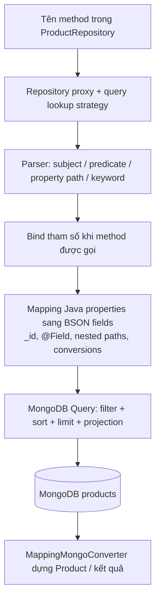

# Cấu trúc tên phương thức và cơ chế sinh truy vấn BSON

## 1. Mục tiêu bài học

Trong **Spring Data MongoDB**, ta có thể khai báo phương thức trong một interface kế thừa `MongoRepository` rồi để framework **suy diễn truy vấn (derived query)** từ tên phương thức. Ví dụ, thay vì viết trực tiếp filter MongoDB, ta khai báo `findBySku(String sku)`; Spring Data sẽ phân tích tên, ánh xạ thuộc tính Java sang tên trường BSON và thực hiện truy vấn trên collection tương ứng.

Bài thuộc chương **Truy vấn suy diễn** và sử dụng mô hình **Mini Commerce** với `Product`, `Customer`, `Order`. Từ mô hình này, ta thực hành tìm sản phẩm còn bán, lọc theo giá, tra đơn của một khách và tìm đơn theo trường của địa chỉ giao hàng nhúng. Kiến thức là nền tảng cho `MongoTemplate`, query phức tạp, aggregation, index, transaction, reactive access, kiểm thử và chẩn đoán hiệu năng dữ liệu.

Hoàn thành bài, bạn có thể:

1. Phân tách tên phương thức thành **subject**, `By`, **predicate**, các toán tử và phần sắp xếp.
2. Giải thích cách repository infrastructure kiểm tra đường dẫn property, gắn tham số và dựng filter BSON.
3. Sử dụng đúng các từ khóa thông dụng như `And`, `Or`, `GreaterThanEqual`, `In`, `Between`, `IsNull`, `Exists`, `Containing` và `OrderBy`.
4. Phân biệt **Java property name** với **MongoDB field name** khi dùng `@Id`, `@Field` và đối tượng nhúng.
5. Chọn kiểu trả về và phân trang phù hợp: `Optional`, `List`, `Page`, `Slice`, `Top`/`First`, `countBy`, `existsBy`.
6. Biết lúc nào nên chuyển sang `@Query`, `MongoTemplate` hoặc aggregation, đồng thời kiểm tra hiệu năng bằng `explain("executionStats")`.

**Kiến thức đầu vào:** Java interface và generics, Spring Boot với `spring-boot-starter-data-mongodb`, MongoDB/BSON, `@Document`, `@Id`, repository, kiểu `BigDecimal` và `Instant`. Ví dụ minh họa dùng API đồng bộ. Với nhánh reactive, nguyên tắc phân tích tên tương tự nhưng kiểu trả về và execution là Reactor `Mono`/`Flux`.

## 2. Mô hình dữ liệu của Mini Commerce

Các trường được sử dụng trong bài:

| Collection | Java entity | Thuộc tính Java | Field BSON và ý nghĩa |
| --- | --- | --- | --- |
| `products` | `Product` | `id` | `_id` – ID kỹ thuật |
| `products` | `Product` | `sku`, `name` | `sku`, `name` – mã và tên sản phẩm |
| `products` | `Product` | `category`, `active` | `category`, `active` – danh mục và trạng thái bán |
| `products` | `Product` | `price` | `unit_price` – giá Decimal128 (đặt alias bằng `@Field`) |
| `products` | `Product` | `stock` | `stock` – số lượng tồn |
| `customers` | `Customer` | `id`, `email` | `_id`, `email` |
| `orders` | `Order` | `customerId`, `status` | `customerId`, `status` |
| `orders` | `Order` | `placedAt` | `placedAt` – thời điểm đặt |
| `orders` | `Order` | `shippingAddressSnapshot.city` | `shippingAddressSnapshot.city` – thành phố trong document nhúng |
| `orders` | `Order` | `lines` | `lines` – mảng dòng hàng nhúng |

Trong bài này, `price` là tên **property Java**, còn `unit_price` là **tên BSON** cố tình đặt khác để người học thấy rõ bước mapping. Nếu dự án thực tế dùng tên BSON `price`, hãy điều chỉnh `@Field` và các câu lệnh `mongosh` cho nhất quán.

Ví dụ BSON của một sản phẩm:

```json
{
  "_id": "prod-001",
  "sku": "LAP-001",
  "name": "Bàn phím cơ Mini",
  "category": "phu-kien",
  "active": true,
  "unit_price": { "$numberDecimal": "129900.00" },
  "stock": 20
}
```

Và một đơn hàng:

```json
{
  "_id": "order-001",
  "customerId": "customer-001",
  "status": "PLACED",
  "placedAt": { "$date": "2026-11-20T02:00:00Z" },
  "shippingAddressSnapshot": {
    "recipient": "Nguyen Thi Lan",
    "city": "TP Ho Chi Minh",
    "country": "VN"
  },
  "lines": [
    {
      "productId": "prod-001",
      "sku": "LAP-001",
      "quantity": 2,
      "unitPrice": { "$numberDecimal": "129900.00" }
    }
  ]
}
```

Đây là **MongoDB Extended JSON**: `$numberDecimal` cho biết BSON Decimal128, `$date` cho biết BSON Date. Các ví dụ query trong `mongosh` phía dưới dùng `NumberDecimal(...)` và `ISODate(...)` để truyền đúng kiểu BSON.

## 3. Cấu trúc tổng quát của một derived query

Tên phương thức thường có dạng:

```text
<prefix> [descriptive text / Distinct / Top / First] By
<Property><Operator> [And / Or <Property><Operator> ...]
[OrderBy<Property>Asc|Desc ...]
```

Ví dụ:

```java
List<Product> findTop5ByActiveTrueAndCategoryOrderByPriceAsc(
    String category);
```

Đọc từ trái sang phải:

| Thành phần | Ý nghĩa |
| --- | --- |
| `find` | Chủ thể là tìm các entity |
| `Top5` | Giới hạn tối đa 5 kết quả |
| `By` | Dấu phân cách subject và predicate |
| `ActiveTrue` | Điều kiện `active = true`; không nhận tham số cho `True` |
| `And` | Kết hợp điều kiện bằng phép AND |
| `Category` | Điều kiện `category = ?`, nhận tham số `category` |
| `OrderByPriceAsc` | Sắp xếp tăng dần theo **property Java** `price` |

BSON logic tương ứng (đã xét alias `price → unit_price`):

```javascript
db.products.find({
  active: true,
  category: "phu-kien"
})
.sort({ unit_price: 1 })
.limit(5)
```

Đây là biểu diễn logic để giải thích. Driver có thể gửi filter, sort, limit dưới dạng tùy chọn của lệnh `find` thay vì đúng chuỗi lệnh `mongosh` như trên. Spring Data còn áp dụng mapping converter, kiểu BSON thực tế và các thiết lập repository trước khi thực thi.



Một phương thức có tên giống từ khóa **không được parse bằng cách tìm chuỗi ký tự tùy tiện**: Spring Data dùng cơ chế phân tích cấu trúc tên và **đường dẫn thuộc tính thực tế của entity**.

## 4. Khai báo entity và repository nền tảng

Để minh họa việc đổi tên trường `price` thành `unit_price`, tạo một entity tối giản. Trong dự án đầy đủ, có thể bổ sung constructor, validation, index và các thuộc tính nghiệp vụ khác.

```java
package com.example.minicommerce.domain;

import java.math.BigDecimal;
import org.springframework.data.annotation.Id;
import org.springframework.data.mongodb.core.mapping.Document;
import org.springframework.data.mongodb.core.mapping.Field;
import org.springframework.data.mongodb.core.mapping.FieldType;

@Document(collection = "products")
public class Product {
    @Id
    private String id;

    private String sku;
    private String name;
    private String category;
    private boolean active;

    @Field(name = "unit_price", targetType = FieldType.DECIMAL128)
    private BigDecimal price;

    private int stock;

    public Product() {}

    public String getId() { return id; }
    public void setId(String id) { this.id = id; }
    public String getSku() { return sku; }
    public void setSku(String sku) { this.sku = sku; }
    public String getName() { return name; }
    public void setName(String name) { this.name = name; }
    public String getCategory() { return category; }
    public void setCategory(String category) {
        this.category = category;
    }
    public boolean isActive() { return active; }
    public void setActive(boolean active) { this.active = active; }
    public BigDecimal getPrice() { return price; }
    public void setPrice(BigDecimal price) { this.price = price; }
    public int getStock() { return stock; }
    public void setStock(int stock) { this.stock = stock; }
}
```

Repository ban đầu:

```java
package com.example.minicommerce.repository;

import java.math.BigDecimal;
import java.util.List;
import java.util.Optional;

import org.springframework.data.domain.Page;
import org.springframework.data.domain.Pageable;
import org.springframework.data.mongodb.repository.MongoRepository;

import com.example.minicommerce.domain.Product;

public interface ProductRepository
        extends MongoRepository<Product, String> {

    Optional<Product> findBySku(String sku);

    List<Product> findByActiveTrueAndCategory(String category);

    List<Product> findByPriceGreaterThanEqual(
        BigDecimal minimumPrice);

    Page<Product> findByActiveTrueAndCategory(
        String category, Pageable pageable);
}
```

Đoạn interface có hai overload cùng tiền tố `findByActiveTrueAndCategory` nhưng khác tham số: một trả `List`, một nhận `Pageable` và trả `Page`. Cả hai đều dùng **cùng điều kiện lọc**, nhưng có hợp đồng pagination khác nhau. Trong ứng dụng thật nên đặt tên rõ ràng ở service để không nhầm cách sử dụng.

Khi khởi động application context, Spring Data tạo repository proxy. Với những method cần suy diễn, nó phân tích tên và xác minh property. Khi được gọi, nó bind giá trị tham số, áp dụng mapping và gửi truy vấn tới MongoDB.

## 5. Subject: tìm, đếm, tồn tại, xóa và giới hạn

Các tiền tố thường dùng:

| Phương thức | Kiểu kết quả phổ biến | Ý nghĩa |
| --- | --- | --- |
| `findBySku(String sku)` | `Optional<Product>` | Tìm sản phẩm có SKU tương ứng |
| `readBySku(String sku)` / `getBySku(String sku)` | Tùy kiểu khai báo | Cũng là phương thức truy vấn tìm |
| `existsBySku(String sku)` | `boolean` | Kiểm tra có document phù hợp |
| `countByCategory(String category)` | `long` | Đếm số document phù hợp |
| `deleteBySku(String sku)` | `long` hoặc `void` tùy phương thức | Xóa document phù hợp |
| `findFirstByOrderByPriceAsc()` | `Optional<Product>` | Lấy một sản phẩm có giá nhỏ nhất theo sort đã định |
| `findTop5ByCategoryOrderByPriceDesc(String category)` | `List<Product>` | Lấy tối đa 5 sản phẩm giá cao nhất trong danh mục |

Lưu ý:

- `find`, `read`, `get`, `query` và một số tiền tố tương tự là **từ khóa mở đầu**. Tập hỗ trợ chính xác phụ thuộc phiên bản và store module.
- Văn bản mô tả nằm giữa tiền tố và `By` thường **không ảnh hưởng filter**, trừ các từ khóa đặc biệt như `Distinct`, `Top` hoặc `First`.
- `Top`/`First` giới hạn **số kết quả**, không bảo đảm kết quả “mới nhất” nếu thiếu sort. Luôn chỉ định thứ tự khi điều kiện nghiệp vụ là “nhiều nhất”, “mới nhất” hoặc “nhỏ nhất”.
- `Distinct` và cách thể hiện distinct result có khác biệt theo store và return type. Với yêu cầu distinct nhiều field, nên kiểm thử truy vấn thực tế hoặc dùng aggregation tường minh.
- `deleteBy...` là lệnh **ghi/xóa dữ liệu**. Quy định xác thực, quyền hạn và test riêng; không cho tên phương thức ngắn gọn khiến người đọc xem nó như truy vấn read-only.

### 5.1. Phân biệt với những method có sẵn

`findById(id)`, `existsById(id)` và `deleteById(id)` được thừa kế từ `CrudRepository` và có **ý nghĩa dành riêng cho identifier**. Chúng nhắm tới property mang `@Id` (BSON `_id`), kể cả khi entity có thêm một field thường tên `id` khác trong một số mô hình.

Ví dụ:

```java
@Document(collection = "products")
class LegacyProduct {
    @Id
    private String pk;

    private String id; // Mã nghiệp vụ cũ, không phải @Id.

    // Constructor/getters/setters...
}

interface LegacyProductRepository
        extends MongoRepository<LegacyProduct, String> {

    // findById(String) được thừa kế: tìm theo @Id pk -> _id.

    // Dùng từ mô tả "Product" để tránh đụng method reserved:
    Optional<LegacyProduct> findProductById(String id);
}
```

Ở đây `findProductById` được suy diễn theo **property Java `id`**, còn `findById` của base repository tìm theo `pk` đã đánh dấu `@Id`. Đây là một ngoại lệ quan trọng khi phân tích query method.

## 6. Predicate: từ khóa và BSON filter

`Predicate` sau `By` mô tả điều kiện. Tên property phải khớp model Java. Bảng dưới sử dụng `Product` và `Order` từ Mini Commerce; BSON minh họa không bao gồm điều kiện bổ sung (ví dụ phân quyền tenant) nếu service áp dụng riêng.

| Derived query | Filter BSON logic | Giải thích |
| --- | --- | --- |
| `findBySku("LAP-001")` | `{ sku: "LAP-001" }` | So sánh bằng (không cần `Equals`) |
| `findBySkuNot("LAP-001")` | `{ sku: { $ne: "LAP-001" } }` | Khác giá trị |
| `findByActiveTrue()` | `{ active: true }` | Không cần tham số |
| `findByActiveFalse()` | `{ active: false }` | Không cần tham số |
| `findByPriceGreaterThan(x)` | `{ unit_price: { $gt: x } }` | Lớn hơn, dùng BSON Decimal128 theo mapping |
| `findByPriceGreaterThanEqual(x)` | `{ unit_price: { $gte: x } }` | Lớn hơn hoặc bằng |
| `findByPriceLessThan(x)` | `{ unit_price: { $lt: x } }` | Nhỏ hơn |
| `findByPriceLessThanEqual(x)` | `{ unit_price: { $lte: x } }` | Nhỏ hơn hoặc bằng |
| `findByCategoryIn(categories)` | `{ category: { $in: [...] } }` | Thuộc danh sách |
| `findByCategoryNotIn(categories)` | `{ category: { $nin: [...] } }` | Không thuộc danh sách |
| `findByPlacedAtAfter(time)` | `{ placedAt: { $gt: time } }` | Sau thời điểm, không bao gồm biên |
| `findByPlacedAtBefore(time)` | `{ placedAt: { $lt: time } }` | Trước thời điểm, không bao gồm biên |
| `findByNameNull()` | `{ name: null }` | Khớp giá trị null **hoặc field thiếu** theo MongoDB |
| `findByNameNotNull()` | `{ name: { $ne: null } }` | Khác null theo ngữ nghĩa MongoDB |
| `findByNameExists(flag)` | `{ name: { $exists: flag } }` | Kiểm tra sự tồn tại field (có thể null) |

### 6.1. Ví dụ And và Or

```java
List<Product> findByActiveTrueAndCategory(String category);

List<Product> findByCategoryOrSku(
    String category, String sku);
```

Filter logic:

```javascript
// findByActiveTrueAndCategory("phu-kien")
{ active: true, category: "phu-kien" }

// findByCategoryOrSku("phu-kien", "LAP-001")
{
  $or: [
    { category: "phu-kien" },
    { sku: "LAP-001" }
  ]
}
```

Đối với biểu thức trộn nhiều `And` và `Or`, tên phương thức có thể khó đọc và dễ hiểu sai nhóm điều kiện. Nếu mục tiêu là `active AND (category OR sku)`, hãy dùng `@Query` hoặc `MongoTemplate` để diễn đạt dấu ngoặc tường minh và viết test với dữ liệu phân biệt từng nhánh. Không suy luận ưu tiên toán tử theo cách đọc câu tiếng Việt.

### 6.2. Between là cặp biên nào?

MongoDB-specific query methods hỗ trợ:

```java
List<Product> findByStockBetween(int min, int max);
```

Theo bảng keyword MongoDB, dạng hai giá trị số thường có **biên mở**:

```javascript
{ stock: { $gt: 5, $lt: 20 } }
```

`findByStockBetween(5, 20)` sẽ không mặc nhiên bao gồm đúng giá trị `5` và `20`. Nếu yêu cầu đóng hai biên, có thể dùng một `Range` với bound phù hợp khi API hỗ trợ, hoặc viết rõ:

```java
List<Product> findByStockGreaterThanEqualAndStockLessThanEqual(
    int min, int max);
```

Khi đọc/viết code liên quan thời gian, nên ưu tiên khoảng **nửa mở** `[from, to)` để không đếm trùng bản ghi tại ranh giới các kỳ báo cáo. Dùng `GreaterThanEqual` và `LessThan` sẽ biểu đạt rõ hơn là đoán ngữ nghĩa của `Between`.

### 6.3. IsNull và Exists khác nhau

MongoDB coi filter `{ field: null }` là khớp document có `field` bằng null **hoặc không tồn tại field**.

Ví dụ tập dữ liệu:

```javascript
{ _id: "a", name: null }
{ _id: "b" }
{ _id: "c", name: "Bàn phím" }
```

Kết quả:

- `findByNameNull()`: thường nhận `a` và `b`.
- `findByNameExists(true)`: nhận `a` và `c` vì field hiện diện.
- `findByNameExists(false)`: nhận `b` vì field không tồn tại.
- `findByNameNotNull()`: theo biểu thức `$ne: null` của MongoDB, cần kiểm chứng chính xác trường hợp dữ liệu thiếu nếu hệ thống yêu cầu phân biệt null và missing.

Khi cần phân biệt BSON type hoặc kiểm tra field phải tồn tại và khác null, viết query rõ bằng `MongoTemplate`/`@Query`, đồng thời kiểm thử dữ liệu legacy. `null` ở Java, BSON Null và **thiếu field** là ba tình huống cần quy ước trong schema.

## 7. Query string: Like, Containing, Regex, IgnoreCase

Các phương thức tìm tên sản phẩm:

```java
List<Product> findByNameContaining(String fragment);

List<Product> findByNameStartingWith(String prefix);

List<Product> findByNameEndingWith(String suffix);

List<Product> findByNameIgnoreCase(String exactName);

List<Product> findByNameContainingIgnoreCase(String fragment);

List<Product> findByNameRegex(String pattern);
```

Spring Data MongoDB biểu diễn nhiều truy vấn chuỗi nêu trên bằng **regular expression** trong filter. Ví dụ logic:

```javascript
// Containing("Mini") — minh họa regex theo chuỗi con:
{ name: { $regex: "Mini" } }

// StartingWith("Bàn"):
{ name: { $regex: "^Bàn" } }

// EndingWith("Mini"):
{ name: { $regex: "Mini$" } }

// IgnoreCase("Bàn phím cơ Mini") — so sánh không phân biệt hoa thường:
{
  name: {
    $regex: "^Bàn phím cơ Mini$",
    $options: "i"
  }
}
```

Đây là **BSON logic** để học, không phải cam kết chính xác chuỗi pattern mà Spring Data tạo cho mọi phiên bản; một số từ khóa escape ký tự đặc biệt hoặc bọc regex bằng `Pattern`. `Regex` nhận pattern biểu thức chính quy có chủ đích, khác với tìm chuỗi literal. Vì vậy:

- Với tìm kiếm text của người dùng, chọn `Containing`/`StartingWith` khi phù hợp và kiểm tra escaping.
- Không cho phép người dùng truyền một regex tùy ý vào `findByNameRegex` nếu chưa giới hạn độ dài/cấu trúc; pattern gây tiêu tốn tài nguyên là rủi ro hiệu năng.
- `IgnoreCase` không đồng nghĩa với collation index tự được chọn. Một truy vấn regex không phân biệt hoa thường có thể không tận dụng index thông thường hiệu quả như equality có collation phù hợp.
- Với tìm kiếm có xếp hạng, tiếng Việt không dấu, stemming hoặc autocomplete, cân nhắc MongoDB Search/text index/thiết kế riêng; derived query không phải công cụ tìm kiếm toàn văn hoàn chỉnh.

## 8. Property path: cách đi từ tên Java sang BSON lồng nhau

### 8.1. Entity Order với địa chỉ giao hàng nhúng

Ví dụ model rút gọn:

```java
package com.example.minicommerce.domain;

import java.time.Instant;
import org.springframework.data.annotation.Id;
import org.springframework.data.mongodb.core.mapping.Document;

@Document(collection = "orders")
public class Order {
    @Id
    private String id;

    private String customerId;
    private String status;
    private Instant placedAt;
    private ShippingAddress shippingAddressSnapshot;

    public Order() {}

    public String getId() { return id; }
    public void setId(String id) { this.id = id; }
    public String getCustomerId() { return customerId; }
    public void setCustomerId(String customerId) {
        this.customerId = customerId;
    }
    public String getStatus() { return status; }
    public void setStatus(String status) { this.status = status; }
    public Instant getPlacedAt() { return placedAt; }
    public void setPlacedAt(Instant placedAt) {
        this.placedAt = placedAt;
    }
    public ShippingAddress getShippingAddressSnapshot() {
        return shippingAddressSnapshot;
    }
    public void setShippingAddressSnapshot(ShippingAddress address) {
        this.shippingAddressSnapshot = address;
    }
}

class ShippingAddress {
    private String recipient;
    private String city;
    private String country;

    public ShippingAddress() {}
    public String getRecipient() { return recipient; }
    public void setRecipient(String recipient) {
        this.recipient = recipient;
    }
    public String getCity() { return city; }
    public void setCity(String city) { this.city = city; }
    public String getCountry() { return country; }
    public void setCountry(String country) { this.country = country; }
}
```

`ShippingAddress` là một object nhúng trong `orders`, không cần collection riêng. Khi chuyển các class này thành file Java thực tế, có thể cho `ShippingAddress` thành public class riêng hoặc nested class phù hợp tổ chức package.

### 8.2. Truy vấn theo thuộc tính nhúng

```java
List<Order> findByShippingAddressSnapshot_City(String city);
```

Trong tên method, dấu gạch dưới `_` là **điểm phân tách đường dẫn property**, giúp chỉ rõ parser phải đi từ `shippingAddressSnapshot` sang `city`. BSON filter tương ứng:

```javascript
{
  "shippingAddressSnapshot.city": "TP Ho Chi Minh"
}
```

Cách viết không có dấu gạch dưới, `findByShippingAddressSnapshotCity(...)`, cũng có thể được parser tách đúng nếu entity không có property cạnh tranh. Tuy nhiên Spring Data thử tìm property theo các phân đoạn CamelCase; nếu entity có cả `shippingAddressSnapshotCity` trực tiếp thì rất dễ mơ hồ. Dùng `_` để chỉ ra traversal một cách tường minh.

### 8.3. Tránh nhầm dấu gạch dưới với BSON field name

Giả sử field Java là `shippingAddressSnapshot` nhưng BSON được rename:

```java
@Field("ship_to")
private ShippingAddress shippingAddressSnapshot;
```

Method repository vẫn phải dựa trên **Java property path**:

```java
List<Order> findByShippingAddressSnapshot_City(String city);
```

Filter BSON sau mapping:

```javascript
{ "ship_to.city": "TP Ho Chi Minh" }
```

Không đặt tên method thành `findByShip_toCity` chỉ vì BSON dùng `ship_to`. Dấu `_` trong tên method là cú pháp parser của Spring Data, không phải cơ chế copy nguyên tên khóa MongoDB. Trong entity Java nên ưu tiên camelCase để tránh xung đột với ký tự đặc biệt của parser.

### 8.4. Query vào mảng document nhúng

Nếu `Order` có `List<OrderLine> lines`, với mỗi dòng có `sku`:

```java
List<Order> findByLines_Sku(String sku);
```

BSON logic:

```javascript
{ "lines.sku": "LAP-001" }
```

MongoDB tìm đơn có **ít nhất một phần tử** của mảng `lines` chứa SKU tương ứng. Nhưng nếu cần **hai điều kiện trên cùng một phần tử mảng**, chẳng hạn SKU và số lượng ở đúng một dòng, hai điều kiện độc lập trên đường dẫn dotted có thể khớp **hai phần tử khác nhau**. Khi đó dùng `$elemMatch` qua `@Query` hoặc `MongoTemplate`:

```javascript
{
  lines: {
    $elemMatch: {
      sku: "LAP-001",
      quantity: { $gte: 2 }
    }
  }
}
```

Đây là ví dụ tiêu biểu cho giới hạn của derived method name. Tên ngắn không quan trọng bằng **ngữ nghĩa đúng của filter BSON**.

## 9. Ánh xạ property Java và kiểu dữ liệu sang BSON

Derived query có hai tầng độc lập:

1. **Parse tên method**: xác định property, operator, đường dẫn lồng và vị trí tham số.
2. **Store mapping**: chuyển property path, giá trị và kiểu miền sang BSON mà MongoDB hiểu.

Ví dụ:

```java
List<Product> findByPriceGreaterThanEqual(
    BigDecimal minimumPrice);
```

Trong `Product`, `price` có:

```java
@Field(name = "unit_price", targetType = FieldType.DECIMAL128)
private BigDecimal price;
```

Khi gọi:

```java
List<Product> products = repository.findByPriceGreaterThanEqual(
    new BigDecimal("100000.00"));
```

Filter logic ở MongoDB:

```javascript
{
  unit_price: {
    $gte: NumberDecimal("100000.00")
  }
}
```

`@Field` đổi **tên** và `targetType` giúp xác định **kiểu lưu**. Không nên dùng literal số JavaScript `100000.00` trong raw query và đoán MongoDB sẽ tạo Decimal128. Đối với dữ liệu tiền tệ, luôn kiểm tra BSON thật và thống nhất `BigDecimal`/`Decimal128` trong repository, `MongoTemplate`, migration và aggregation.

### 9.1. Mapping của identifier

Với `@Id private String id`, method `findById("prod-001")` nhắm tới `_id`. Nếu ID string là chuỗi hexadecimal đủ điều kiện ObjectId, quy tắc chuyển ID của Spring Data có thể chuyển sang BSON ObjectId khi lưu/truy vấn. Trong bài này dùng ID như `"prod-001"` để không tạo nhầm lẫn; dự án thực tế phải định nghĩa kiểu ID nhất quán giữa các entity và trường tham chiếu (`customerId`, `productId`).

### 9.2. Tác động của custom conversion

Nếu `Customer` có một property dùng `@ValueConverter` hoặc `MongoCustomConversions`, query derived vẫn được phân tích dựa trên **Java property**; tuy nhiên cách chuyển tham số thành BSON cần được kiểm tra trên phiên bản Spring Data đang dùng, đặc biệt khi converter áp dụng theo từng property.

Ví dụ trường Java `primaryPhone` lưu dưới khóa BSON `contact_phone` và dạng String. Khi lọc theo số điện thoại, nên có integration test kiểm tra query thực sự dùng `contact_phone` cùng giá trị String. Với raw driver hoặc `mongosh`, hãy truyền **store-native value**; các đường ghi/truy vấn không đi qua entity mapping có thể không gọi converter.

## 10. Sắp xếp, giới hạn và phân trang

### 10.1. Sắp xếp tĩnh bằng OrderBy

```java
List<Product> findByActiveTrueOrderByPriceAsc();

List<Order> findByCustomerIdOrderByPlacedAtDesc(
    String customerId);
```

BSON logic:

```javascript
db.products.find({ active: true })
  .sort({ unit_price: 1 });

db.orders.find({ customerId: "customer-001" })
  .sort({ placedAt: -1 });
```

Trong MongoDB, `1` là tăng dần và `-1` là giảm dần. Nếu nhiều document có cùng `placedAt` hoặc `unit_price`, thứ tự giữa chúng có thể không ổn định; với pagination nên thêm khóa phụ độc nhất (chẳng hạn `_id`) để có thứ tự xác định.

### 10.2. Sắp xếp và phân trang động

```java
Page<Order> findByCustomerId(
    String customerId, Pageable pageable);

List<Product> findByActiveTrue(
    Sort sort);
```

Gọi từ service:

```java
import org.springframework.data.domain.Page;
import org.springframework.data.domain.PageRequest;
import org.springframework.data.domain.Sort;

PageRequest page = PageRequest.of(
    0, 20,
    Sort.by(Sort.Order.desc("placedAt"), Sort.Order.desc("id"))
);

Page<Order> orders = orderRepository.findByCustomerId(
    "customer-001", page);
```

`PageRequest.of(0, 20, ...)` lấy trang đầu tiên (trang bắt đầu từ **0**). `Page` mang dữ liệu và metadata tổng số phần tử/tổng trang; việc tính tổng có thể dẫn tới **count query** bổ sung. Nếu chỉ cần biết còn trang tiếp theo mà không cần tổng số, `Slice` có thể phù hợp hơn:

```java
Slice<Order> findByCustomerId(String customerId, Pageable pageable);
```

Khi áp dụng `Sort` hoặc `Pageable` nhận từ HTTP request, **whitelist các property được phép sort** (ví dụ `placedAt`, `id`, `price`), giới hạn kích thước trang và dùng index phù hợp. Không để client tự do tạo sort trên các field nhạy cảm hoặc truy vấn quá tốn chi phí.

### 10.3. First và Top kết hợp sắp xếp

```java
Optional<Order> findFirstByCustomerIdOrderByPlacedAtDesc(
    String customerId);

List<Product> findTop3ByActiveTrueOrderByPriceDesc();
```

Các phương thức giới hạn số kết quả; với `Top3` nên có sort để xác định “top” theo tiêu chí nào. Nếu kết hợp `Top` với `Pageable`, ngữ nghĩa pagination nằm trong nhóm kết quả đã bị giới hạn; cần kiểm tra kỹ tổng và trường hợp vượt số lượng giới hạn.

## 11. Query lookup strategy: khi nào Spring Data dùng tên method?

Không phải mọi phương thức repository đều được suy diễn từ tên. Spring Data có cơ chế **query lookup strategy**:

| Chiến lược | Cách hoạt động | Khi dùng |
| --- | --- | --- |
| `CREATE` | Cố dựng query từ tên method | Muốn tất cả method thỏa quy ước derivation |
| `USE_DECLARED_QUERY` | Yêu cầu truy vấn được khai báo, lỗi nếu không có | Dự án cần tường minh các query |
| `CREATE_IF_NOT_FOUND` | Tìm declared query trước; không có thì suy diễn | **Mặc định** của Spring Data repository |

Ví dụ:

```java
@Query("{ 'status': ?0, 'customerId': ?1 }")
List<Order> loadOrdersByStatusAndCustomer(
    String status, String customerId);
```

Phương thức trên được gắn `@Query` nên có **declared query**, không cần parser suy diễn tên `loadOrdersByStatusAndCustomer` để tạo filter. Khi framework được đặt ở `CREATE_IF_NOT_FOUND`, declared query được ưu tiên trước quy tắc đặt tên. Trong code thực tế, `@Query` được import từ `org.springframework.data.mongodb.repository.Query`.

Có thể cấu hình strategy thông qua `@EnableMongoRepositories(queryLookupStrategy = ...)`. Trước khi thay đổi strategy của dự án hiện hữu, cần kiểm tra toàn bộ repository method vì một strategy chỉ chấp nhận declared query sẽ làm các derived method chưa có `@Query` thất bại lúc khởi tạo.

### 11.1. Khi tên method không hợp lệ

Ví dụ:

```java
// Product không có Java property "productCategory":
List<Product> findByProductCategory(String category);
```

Spring Data sẽ không tự tìm `category` chỉ vì tên gần giống. Khi khởi tạo query method, có thể xuất hiện `PropertyReferenceException`, `QueryCreationException` hoặc lỗi tạo repository bean, tùy phiên bản và ngữ cảnh. Thông điệp thường chỉ rõ property không tìm thấy.

Sửa thành:

```java
List<Product> findByCategory(String category);
```

**Không sửa BSON schema bằng cách đổi tên method theo phỏng đoán.** Kiểm tra Java property, alias `@Field` và đường dẫn nhúng trước.

## 12. Derived query khác gì @Query, MongoTemplate và aggregation?

| Yêu cầu | Phương án phù hợp | Ví dụ |
| --- | --- | --- |
| Equality, range, boolean, in-list đơn giản | Derived method | `findByActiveTrueAndCategory(...)` |
| Phân trang lịch sử đơn theo khách | Derived + `Pageable`/`Slice` | `findByCustomerId(...)` |
| Điều kiện nhiều nhánh cần nhóm ngoặc rõ | `@Query` hoặc `MongoTemplate` | `active AND (category OR sku)` |
| Điều kiện trên cùng một phần tử mảng | `@Query`/`MongoTemplate` + `$elemMatch` | Dòng hàng có SKU và quantity |
| Điều kiện tùy chọn được ghép động | `MongoTemplate` với `Query`/`Criteria` | Filter sản phẩm tùy theo nhiều input |
| Thống kê doanh thu/sản phẩm bán chạy | Aggregation | `$unwind`, `$group`, `$sum` |
| Trừ tồn kho có điều kiện | `MongoTemplate.updateFirst` hoặc repository update rõ ràng | `$inc` nếu stock đủ |
| Ghi nhiều document nhất quán | Transaction khi có yêu cầu | Tạo Order và giảm stock |

### 12.1. So sánh cùng một truy vấn

Derived repository:

```java
List<Product> findByActiveTrueAndCategory(String category);
```

Với `MongoTemplate`:

```java
Query query = Query.query(
    Criteria.where("active").is(true)
        .and("category").is("phu-kien")
);

List<Product> products =
    mongoTemplate.find(query, Product.class);
```

Cần import `org.springframework.data.mongodb.core.query.Query`, `Criteria` và `MongoTemplate`. Hai cách có thể tạo filter BSON tương đương, nhưng `MongoTemplate` cho phép thêm điều kiện động và tổ hợp phức tạp dễ đọc hơn.

### 12.2. Kết hợp nhiều nhánh có dấu ngoặc tường minh

Ví dụ `active AND (category = ? OR sku = ?)`:

```java
Query query = Query.query(
    new Criteria().andOperator(
        Criteria.where("active").is(true),
        new Criteria().orOperator(
            Criteria.where("category").is(category),
            Criteria.where("sku").is(sku)
        )
    )
);
```

BSON logic:

```javascript
{
  $and: [
    { active: true },
    {
      $or: [
        { category: "phu-kien" },
        { sku: "LAP-001" }
      ]
    }
  ]
}
```

Ở đây, biến `category` và `sku` là tham số do service xác thực trước. Trong hệ thống thực, nếu có yêu cầu multi-tenant, authorization hoặc soft-delete, filter tương ứng phải luôn được bổ sung; derived query **không tự thêm quy tắc bảo mật** nếu ứng dụng chưa cấu hình rõ ràng.

## 13. Query được chạy như thế nào và kiểm tra bằng cách nào?

### 13.1. Từ lời gọi Java đến MongoDB

Khi service gọi:

```java
List<Product> result =
    productRepository.findByPriceGreaterThanEqual(
        new BigDecimal("100000.00"));
```

Cơ chế ở mức khái niệm:

1. Repository proxy tìm cấu hình query cho method. Với derived method, cơ chế phân tích tên (như `PartTree`/query creator của Spring Data) đã xác định predicate và property path.
2. Giá trị tham số `minimumPrice` được bind vào điều kiện tương ứng.
3. Query được ánh xạ qua metadata `Product` để sử dụng field `unit_price` và kiểu Decimal128.
4. MongoDB driver thực thi filter trên collection `products`.
5. Kết quả BSON được converter dựng thành `Product`; kiểu trả về `List<Product>` hoặc một wrapper khác được áp dụng.

Không nên nghĩ parser được viết lại bằng cách ghép chuỗi JSON mỗi lần service gọi; repository infrastructure quản lý metadata/query definition, còn **giá trị tham số thay đổi theo lời gọi**.

### 13.2. Dùng mongosh để kiểm tra filter BSON

```javascript
db.products.find({
  unit_price: { $gte: NumberDecimal("100000.00") }
})
```

Nếu repository trả kết quả khác `mongosh`, kiểm tra:

- Kết nối có trỏ tới cùng **database** và collection `products` không?
- Java `price` có `@Field(name = "unit_price", targetType = DECIMAL128)` không?
- Các document cũ có lưu giá dạng BSON String/Double thay vì Decimal128 không?
- Input `minimumPrice` đã được chuẩn hóa scale và kiểm tra hợp lệ chưa?
- Phương thức repository có khai báo thêm sort, limit, `Pageable` hoặc query annotation không?

### 13.3. Kiểm tra index bằng explain

Hai truy vấn quan trọng của Mini Commerce:

```javascript
// Trang danh mục hàng đang bán, sắp theo giá:
db.products.createIndex({
  active: 1,
  category: 1,
  unit_price: 1
})

db.products
  .find({ active: true, category: "phu-kien" })
  .sort({ unit_price: 1 })
  .explain("executionStats")

// Lịch sử đơn theo khách, mới nhất trước:
db.orders.createIndex({
  customerId: 1,
  placedAt: -1
})

db.orders
  .find({ customerId: "customer-001" })
  .sort({ placedAt: -1 })
  .explain("executionStats")
```

Đây là các index gợi ý theo query shape của bài, **không tự động là lựa chọn tối ưu cho mọi workload**. Trong môi trường thực tế, cần kiểm tra `winningPlan`, `totalKeysExamined`, `totalDocsExamined`, `nReturned` và latency trước/sau. Với pagination cần sort ổn định, có thể cân nhắc thêm `_id` làm khóa phụ và điều chỉnh compound index tương ứng.

**Ghi nhớ:** derived query giúp giảm code mô tả filter, nhưng không tự tạo index, không loại bỏ full collection scan và không thay thế chẩn đoán query plan.

## 14. Kiểm thử bằng MongoDB thật

Một integration test nên được chạy với MongoDB thật hoặc Testcontainers để kiểm tra parsing, mapping alias, kiểu BSON và kết quả truy vấn. Ví dụ sử dụng `@DataMongoTest`; test cần cấu hình MongoDB thử nghiệm riêng biệt.

```java
package com.example.minicommerce;

import static org.junit.jupiter.api.Assertions.*;

import java.math.BigDecimal;
import org.bson.Document;
import org.junit.jupiter.api.Test;
import org.springframework.beans.factory.annotation.Autowired;
import org.springframework.boot.test.autoconfigure.data.mongo.DataMongoTest;
import org.springframework.data.mongodb.core.MongoTemplate;

import com.example.minicommerce.domain.Product;
import com.example.minicommerce.repository.ProductRepository;

@DataMongoTest
class ProductDerivedQueryTest {
    @Autowired
    ProductRepository repository;

    @Autowired
    MongoTemplate template;

    @Test
    void derivesRangeQueryAndMapsBsonFieldAlias() {
        var raw = template.getCollection("products");
        String lowId = "derived-low-test";
        String highId = "derived-high-test";

        raw.deleteMany(new Document("_id",
            new Document("$in", java.util.List.of(lowId, highId))));

        try {
            raw.insertOne(new Document("_id", lowId)
                .append("sku", "DER-LOW")
                .append("name", "Hàng giá thấp")
                .append("active", true)
                .append("category", "test")
                .append("unit_price",
                    new org.bson.types.Decimal128(
                        new BigDecimal("90000.00")))
                .append("stock", 5));

            raw.insertOne(new Document("_id", highId)
                .append("sku", "DER-HIGH")
                .append("name", "Hàng giá cao")
                .append("active", true)
                .append("category", "test")
                .append("unit_price",
                    new org.bson.types.Decimal128(
                        new BigDecimal("129900.00")))
                .append("stock", 3));

            var result = repository.findByPriceGreaterThanEqual(
                new BigDecimal("100000.00"));

            assertTrue(result.stream()
                .anyMatch(p -> highId.equals(p.getId())));
            assertFalse(result.stream()
                .anyMatch(p -> lowId.equals(p.getId())));
        } finally {
            raw.deleteMany(new Document("_id",
                new Document("$in",
                    java.util.List.of(lowId, highId))));
        }
    }
}
```

Test nạp dữ liệu bằng **raw BSON Decimal128**, nhờ vậy nó kiểm tra thực sự rằng query derived dùng alias `unit_price` và ngưỡng số đúng. Dùng database test được cô lập; ví dụ dọn fixture **không dành cho môi trường sản xuất**.

Lưu ý: test trên được viết cho môi trường Spring Boot hỗ trợ `@DataMongoTest` ở package đã import; một số dòng Boot mới tổ chức lại module test và package annotation. Khi chuyển sang phiên bản khác, điều chỉnh import/auto-configuration theo reference documentation của Boot đang dùng, nhưng giữ mục tiêu kiểm chứng.

### 14.1. Những trường hợp tối thiểu cần thêm vào test

| Test | Dữ liệu cần tạo | Kỳ vọng |
| --- | --- | --- |
| `findBySku` | 1 document có SKU, 1 không có | `Optional` có/không giá trị đúng |
| `findByActiveTrueAndCategory` | Hai trạng thái `active` | Chỉ lấy sản phẩm đang bán trong danh mục |
| `findByPriceGreaterThanEqual` | Giá ngay biên và dưới biên | `$gte` bao gồm giá đúng biên |
| `findByStockBetween` | `stock` bằng min, giữa, bằng max | Phát hiện chính xác ngữ nghĩa biên |
| `findByNameNull` / `Exists` | Null, thiếu field, có String | Phân biệt null và missing |
| `findByShippingAddressSnapshot_City` | Hai đơn khác city | Truy vấn đúng BSON nested path |
| `findByCustomerId` + `Pageable` | Nhiều đơn cùng ngày | Phân trang, sort và thứ tự phụ ổn định |
| `findByLines_Sku` | Nhiều order line | Khớp đúng document có SKU |
| `$elemMatch` | Hai phần tử mảng thỏa hai điều kiện khác nhau | Không khớp sai như hai dotted predicates độc lập |
| Mapping `@Field` | Java `price`, BSON `unit_price` | Tên method dùng Java property và query dùng BSON field |
| Truy vấn sai property | Interface thử có method `findByProductCategory` | Context phát hiện lỗi tạo query |
| Test hiệu năng | Tập dữ liệu lớn hơn dữ liệu mẫu | So sánh query plan, index và số document duyệt |

## 15. Những lỗi phổ biến khi dùng derived queries

| Biểu hiện | Nguyên nhân thường gặp | Cách xử lý |
| --- | --- | --- |
| Startup báo `No property 'X' found` | Tên method không khớp Java property | Kiểm tra entity và property path; đổi tên method |
| Query không dùng trường BSON dự kiến | Đặt tên method theo field alias thay vì Java property | Dùng tên Java; để `@Field` thực hiện mapping |
| Query nested path chọn sai property | Ambiguity giữa property trực tiếp và property lồng | Dùng `_` làm điểm tách traversal |
| `findById` lọc sai ID nghiệp vụ | Va vào reserved method identifier | Phân biệt `@Id` với field thường; dùng descriptive method như `findProductById` |
| Range không bao gồm giá trị biên | Dùng `GreaterThan` hoặc `Between` mặc định biên mở | Chọn `GreaterThanEqual`/`LessThanEqual` phù hợp |
| `IsNull` trả cả document thiếu field | MongoDB equality null khớp null hoặc missing | Dùng `Exists` và query tường minh khi cần phân biệt |
| `IgnoreCase` query chậm | Regex case-insensitive không tận dụng index như kỳ vọng | Đo `explain`, cân nhắc normalization/collation/index |
| `Containing` khớp không đúng nhu cầu tìm kiếm | Truy vấn regex thay vì full-text ranking | Chọn công cụ text search phù hợp |
| Lấy “đơn mới nhất” nhưng kết quả thay đổi | Không có sort hoặc sort thiếu tie-breaker | Dùng `OrderByPlacedAtDesc` + sort khóa phụ |
| `Page` chậm dù số bản ghi trả về ít | Có count query hoặc skip sâu | Cân nhắc `Slice`, keyset/cursor pagination, index |
| Derived query dài khó kiểm soát | Quá nhiều `And`/`Or` hoặc điều kiện tùy chọn | Chuyển `@Query`/`MongoTemplate` và viết test |
| Hai điều kiện trên mảng khớp hai phần tử khác nhau | Dotted path không ép cùng phần tử | Dùng `$elemMatch` |
| Query giá không đúng | Field chứa BSON String/Double lẫn Decimal128 | Kiểm kê `$type`, migration và giữ định dạng thống nhất |
| Reactive repository dùng `Optional`/`Page` không phù hợp | Nhầm API đồng bộ và non-blocking | Dùng `Mono`/`Flux` và phân trang tương thích reactive |
| Query chạy được nhưng rất chậm | Thiếu index hoặc regex/scan quá rộng | Kiểm tra `explain` và giới hạn kết quả |

## 16. Liên hệ với reactive, transaction và aggregation

Nếu chọn `spring-boot-starter-data-mongodb-reactive`, các phương thức suy diễn vẫn dựa trên **cấu trúc tên và entity mapping**, nhưng interface kế thừa `ReactiveMongoRepository` và trả về publisher:

```java
import reactor.core.publisher.Flux;
import reactor.core.publisher.Mono;
import org.springframework.data.mongodb.repository.ReactiveMongoRepository;

public interface ReactiveProductRepository
        extends ReactiveMongoRepository<Product, String> {

    Mono<Product> findBySku(String sku);

    Flux<Product> findByActiveTrueAndCategory(
        String category);
}
```

Reactive query được kích hoạt khi publisher được subscribe; không gọi `block()` trong luồng HTTP non-blocking. Với pagination reactive, thường dùng `Flux` nhận `Pageable` hoặc cách phân trang phù hợp; không suy ra rằng `Page<T>` là kiểu trả về giống nhánh đồng bộ.

Derived queries chủ yếu phục vụ **đọc/tìm/xóa theo điều kiện đơn giản**. Chúng không tự sinh aggregation nhiều bước để tính doanh thu, không tự tạo transaction nhiều document và không ngăn bán âm tồn kho. Các bài toán của Mini Commerce như trừ tồn kho có điều kiện bằng `$inc`, tạo đơn và cập nhật nhiều sản phẩm cần `MongoTemplate`/transaction manager theo yêu cầu nghiệp vụ. Report doanh thu nên dùng aggregation `$match`, `$unwind`, `$group`, `$sum`.

Khi thiết kế index, lựa chọn dựa trên filter BSON thực tế, sort và tần suất query. Tên method có thay đổi nhưng filter BSON có thể tương đương; ngược lại, chỉ thay `@Field` hoặc kiểu lưu có thể làm thay đổi query shape/khả năng dùng index.

## 17. Bài tập thực hành và tiêu chí hoàn thành

**Bài tập 1 — Đọc tên method:** Phân tích `findTop5ByActiveTrueAndCategoryOrderByPriceAsc` thành subject, predicate, tham số, sort và limit. Viết filter BSON tương ứng với alias `unit_price`.

**Bài tập 2 — CRUD tìm kiếm:** Khai báo repository tìm sản phẩm theo SKU, kiểm tra tồn tại, đếm theo category và lọc active. Tạo dữ liệu mẫu, kiểm chứng bằng cả repository và `mongosh`.

**Bài tập 3 — Khoảng giá và thời gian:** Viết method lọc sản phẩm có `price ≥ 100000.00` và `price < 200000.00`; so sánh với `Between`. Viết method lọc đơn trong khoảng `[from, to)`.

**Bài tập 4 — Document nhúng:** Thêm `Order.shippingAddressSnapshot.city`, khai báo `findByShippingAddressSnapshot_City`. Thử đặt một property cạnh tranh có tên giống đường dẫn ghép để thấy vai trò của `_`.

**Bài tập 5 — Mảng dòng hàng:** Tìm các đơn có SKU `LAP-001` bằng derived query. Sau đó tạo một đơn có hai dòng, mỗi dòng chỉ thỏa một trong hai điều kiện SKU/số lượng; viết `$elemMatch` để tránh nhầm kết quả.

**Bài tập 6 — Phân trang và hiệu năng:** Lấy lịch sử đơn theo khách, sort mới nhất trước, giới hạn kích thước trang, thêm index theo `customerId` và `placedAt`. So sánh `Page` và `Slice`; kiểm tra `explain("executionStats")`.

**Bài tập mở rộng — Debug query lỗi:** Cố tình viết `findByProductCategory` khi entity chỉ có `category`, đọc lỗi tạo query và sửa. Sau đó gắn `@Field(name = "unit_price")`, bảo đảm method Java vẫn dùng `Price` trong tên, còn BSON dùng `unit_price`.

Các câu hỏi tự kiểm tra:

1. Vì sao `findByActiveTrueAndCategory` có một tham số dù tên chứa hai điều kiện?
2. Subject và predicate được ngăn bởi token nào? `Top5` và `OrderBy` có vai trò khác nhau thế nào?
3. Vì sao method phải dùng `price` thay vì `unit_price` khi Java có `@Field`?
4. `findById` khác gì method tự đặt tên `findProductById` khi entity có cả `@Id pk` và field `id` thường?
5. `Between` mặc định bao gồm hay loại trừ hai biên trong Spring Data MongoDB? Khi cần `[from, to)` nên viết tên method ra sao?
6. Truy vấn `IsNull` và `Exists(false)` có trả kết quả giống nhau trên document thiếu field và field bằng null không?
7. Tại sao có trường hợp cần `$elemMatch` thay vì nối hai điều kiện trên `lines`?
8. Khi nào chọn derived method, khi nào chuyển sang `@Query`, `MongoTemplate` hoặc aggregation?

**Kết quả mong đợi:** người học có thể nhìn vào một tên method repository và dự đoán được predicate BSON, biết kiểm tra trường thực tế sau mapping, tránh các lỗi về nested paths, null, mảng và biên khoảng; đồng thời chọn pagination/index và test để xác nhận query chạy đúng và đủ hiệu năng.

## Tài liệu tham khảo

- [Spring Data MongoDB — Defining Query Methods](https://docs.spring.io/spring-data/mongodb/reference/repositories/query-methods-details.html): query lookup strategy, subject/predicate, property traversal, sort và limit.
- [Spring Data MongoDB — MongoDB-specific Query Methods](https://docs.spring.io/spring-data/mongodb/reference/mongodb/repositories/query-methods.html): bảng toán tử và BSON logic của từng keyword.
- [Spring Data MongoDB — Repository Query Keywords](https://docs.spring.io/spring-data/mongodb/reference/repositories/query-keywords-reference.html): keyword subject/predicate, modifier và reserved methods.
- [Spring Data Commons — Defining Query Methods](https://docs.spring.io/spring-data/commons/reference/repositories/query-methods-details.html): property path ambiguity, dấu `_`, return type và pagination.
- [MongoDB — Query Documents](https://www.mongodb.com/docs/manual/tutorial/query-documents/): cú pháp filter, so sánh, query array và null.
- [MongoDB — Explain Results](https://www.mongodb.com/docs/manual/reference/explain-results/): đọc query plan và `executionStats`.
