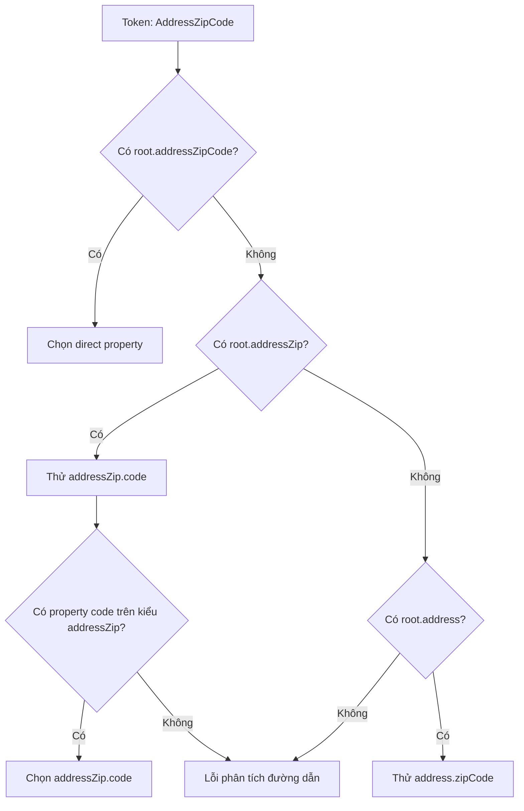

# Thuộc tính trực tiếp, đường dẫn lồng nhau và dấu gạch dưới

> **Chương:** Truy vấn suy diễn  
> **Module:** `SPRING_DATA_MONGODB` — sử dụng Spring Data MongoDB để kết nối, ánh xạ document và thao tác MongoDB qua `MongoTemplate` hoặc repository. Bài này tập trung vào cách tên phương thức repository được phân tích thành **thuộc tính Java trực tiếp**, **đường dẫn thuộc tính lồng nhau** và cách dùng **dấu gạch dưới (`_`)** để giải quyết nhập nhằng. Nắm vững phần này giúp viết đúng query, thiết kế index, aggregation, kiểm thử và chẩn đoán hiệu năng; nguyên tắc cũng liên quan đến ứng dụng reactive.

## 1. Tại sao một tên phương thức có thể truy vấn sai field?

Spring Data có thể tạo truy vấn MongoDB từ tên phương thức repository mà không cần viết trực tiếp BSON:

```java
List<PurchaseOrder> findByCustomerCode(String customerCode);
```

Nhìn tên, ta biết phương thức cần so sánh một **property Java** tên `customerCode`. Nếu entity khai báo `@Field("customer_code")`, Spring Data tiếp tục dùng mapping metadata để tạo điều kiện trên field BSON `customer_code`.

Nhưng khi tên phương thức dài hơn:

```java
List<PurchaseOrder> findByShippingAddressCity(String city);
```

Trình phân tích tên phương thức phải xác định `ShippingAddressCity` có nghĩa:

1. Một **property trực tiếp** tên `shippingAddressCity` trên `PurchaseOrder`; hay
2. `shippingAddress` là một object nhúng và `city` là property bên trong.

Nếu **cả hai đường** đều có thể tồn tại, cách viết trên không còn nói rõ ý định. Dấu `_` là công cụ để chỉ định chính xác điểm đi sâu vào object nhúng:

```java
List<PurchaseOrder> findByShippingAddress_City(String city);
```

**Kết luận cốt lõi:** tên phương thức derived query mô tả **đường dẫn property Java**, không nhất thiết trùng nguyên văn với tên BSON đã lưu. Việc diễn giải đường dẫn xảy ra trước khi Spring Data chuyển nó thành BSON query.

## 2. Tạo domain model để nhìn thấy sự khác biệt

Để tránh ví dụ chỉ đúng trên lý thuyết, ta dùng một entity có cả property trực tiếp và object nhúng. Đoạn sau là một file Java `PurchaseOrder.java`; các type phụ không phải `public` và có thể cùng file:

```java
package demo.orders;

import java.math.BigDecimal;
import java.time.Instant;
import org.springframework.data.annotation.Id;
import org.springframework.data.mongodb.core.mapping.Document;
import org.springframework.data.mongodb.core.mapping.Field;
import org.springframework.data.mongodb.core.mapping.FieldType;

@Document(collection = "purchase_orders")
public record PurchaseOrder(
    @Id String id,
    @Field("customer_code") String customerCode,
    OrderStatus status,
    Instant createdAt,
    ShippingAddress shippingAddress,
    @Field("shipping_address_city_flat") String shippingAddressCity,
    @Field(targetType = FieldType.DECIMAL128) BigDecimal totalAmount
) {}

record ShippingAddress(
    String city,
    @Field("postal_code") String postalCode,
    Country country
) {}

record Country(String code) {}

enum OrderStatus { PENDING, PAID, CANCELLED }
```

Property `shippingAddressCity` được đưa vào **chủ ý để minh họa va chạm tên**. Trong mô hình production, nên tránh trùng ý nghĩa giữa một field phẳng và một field lồng nhau nếu không có lý do nghiệp vụ.

Một document tương ứng, biểu diễn ở dạng Extended JSON:

```json
{
  "_id": "ORDER-001",
  "customer_code": "CUS-42",
  "status": "PAID",
  "createdAt": { "$date": "2026-11-20T03:00:00Z" },
  "shippingAddress": {
    "city": "Da Nang",
    "postal_code": "550000",
    "country": { "code": "VN" }
  },
  "shipping_address_city_flat": "Hue",
  "totalAmount": { "$numberDecimal": "1250.50" }
}
```

Chú ý hai giá trị **khác nhau**:

- `shippingAddress.city` là **`Da Nang`**, nằm trong object nhúng.
- `shipping_address_city_flat` là **`Hue`**, được mapping từ property trực tiếp `shippingAddressCity`.

Hai field có thể dùng để kiểm chứng parser đang chọn đường nào. Field `_class` có thể xuất hiện tùy cấu hình type mapper; ví dụ lược bỏ để tập trung vào property path.

## 3. Thuộc tính trực tiếp: parser luôn thử trước

### 3.1. `findByCustomerCode` chọn property của root entity

Repository đơn giản:

```java
package demo.orders;

import java.util.List;
import org.springframework.data.mongodb.repository.MongoRepository;

public interface PurchaseOrderRepository
        extends MongoRepository<PurchaseOrder, String> {

    List<PurchaseOrder> findByCustomerCode(String customerCode);
}
```

Spring Data thực hiện các bước logic:

1. Nhận diện `find...By` là một derived finder.
2. Đọc phần điều kiện `CustomerCode`.
3. Kiểm tra class `PurchaseOrder` có Java property `customerCode` không.
4. Dùng metadata `@Field("customer_code")` để dịch sang field BSON.
5. Gắn giá trị tham số vào query và chuyển kiểu nếu cần.

Truy vấn MongoDB về ý nghĩa tương đương:

```javascript
db.purchase_orders.find({ customer_code: "CUS-42" })
```

**Không** khai báo `findByCustomer_code(…)` chỉ vì MongoDB dùng snake_case. Trong một derived query, `_` có ý nghĩa **đối với việc phân tích đường dẫn Java**, không phải chỉ là một ký tự thay thế cho tên field BSON.

### 3.2. Parser ưu tiên direct property trước đường lồng nhau

Với entity ở mục 2:

```java
// Property trực tiếp: PurchaseOrder.shippingAddressCity
List<PurchaseOrder> findByShippingAddressCity(String city);
```

Spring Data tìm thấy `shippingAddressCity` ngay trên `PurchaseOrder`, nên không cần đoán thêm đường dẫn `shippingAddress.city`. Query tương đương:

```javascript
db.purchase_orders.find({
  shipping_address_city_flat: "Hue"
})
```

Nếu gọi `findByShippingAddressCity("Da Nang")` trên document mẫu, kết quả **không khớp** vì field phẳng có giá trị `Hue`. Tên phương thức dài trông giống đường dẫn lồng nhau nhưng thực chất được phân tích thành property trực tiếp.

**Hệ quả khi refactor:** nếu trước đây class chỉ có `shippingAddress.city`, phương thức `findByShippingAddressCity` có thể hoạt động như nested query. Sau này ai đó thêm property `shippingAddressCity`, parser có thể ưu tiên property mới và **thay đổi đích truy vấn dù không sửa tên repository method**. Vì vậy đường dẫn có nguy cơ nhập nhằng nên dùng dấu `_` ngay từ đầu.

## 4. Đường dẫn lồng nhau: tách camelCase để đi sâu vào object

Khi không tìm thấy một direct property trùng toàn bộ phần biểu thức, Spring Data thử phân tách tên theo ranh giới camelCase. Ví dụ entity có:

```text
PurchaseOrder
  └── shippingAddress : ShippingAddress
        ├── city : String
        ├── postalCode : String
        └── country : Country
              └── code : String
```

### 4.1. Một cấp lồng nhau

Giả sử không có property root tên `shippingAddressPostalCode`, phương thức:

```java
List<PurchaseOrder> findByShippingAddressPostalCode(String postalCode);
```

có thể được phân tích thành:

```text
shippingAddress.postalCode
```

Vì `postalCode` được gắn `@Field("postal_code")`, query BSON tương ứng là:

```javascript
db.purchase_orders.find({
  "shippingAddress.postal_code": "550000"
})
```

Phân biệt dấu chấm trong BSON path với dấu gạch dưới trong tên phương thức: `shippingAddress.postal_code` là **đường dẫn BSON trên server**, trong khi `ShippingAddressPostalCode` là chuỗi token Java được parser giải nghĩa.

### 4.2. Nhiều cấp lồng nhau

Nếu `ShippingAddress` có `country` và `Country` có `code`:

```java
List<PurchaseOrder> findByShippingAddressCountryCode(String countryCode);
```

Đường dẫn Java:

```text
shippingAddress.country.code
```

BSON query:

```javascript
db.purchase_orders.find({
  "shippingAddress.country.code": "VN"
})
```

Nếu nhiều tổ hợp tên camelCase có thể được hiểu theo nhiều cách, nên **chỉ rõ từng ranh giới**:

```java
List<PurchaseOrder> findByShippingAddress_Country_Code(String code);
```

Hai phương thức trên cùng nhắm tới một BSON path trong **mô hình hiện tại**, nhưng phương thức có `_` ít bị ảnh hưởng hơn nếu ai đó thêm property phẳng có tên trùng chuỗi token.

### 4.3. Quy trình tìm path từ phải sang trái

Giả sử muốn hiểu `AddressZipCode` với class `Person` có property `address` và `Address` có `zipCode`:

1. Thử tìm property trực tiếp `addressZipCode` trên `Person`.
2. Nếu không có, thử tách ở ranh giới camelCase **từ phải qua trái**: `AddressZip` + `Code`.
3. Nếu root có `addressZip`, parser thử tìm `code` trên **kiểu của `addressZip`**.
4. Nếu không tìm được head phù hợp, thử `Address` + `ZipCode`.
5. Nếu có `address` và object đó có `zipCode`, đường dẫn `address.zipCode` hợp lệ.



Một bẫy đúng theo quy tắc này: `Person` có cả `addressZip` (ví dụ String) lẫn `address` (kiểu Address chứa `zipCode`). Parser có thể chọn head `addressZip` ở lần tách đầu, sau đó thất bại vì String không có `code`, **thay vì tiếp tục tìm đường `address.zipCode` như người viết mong đợi**. Dấu `_` giải quyết tình huống này.

## 5. Dấu gạch dưới _ dùng để chỉ rõ ranh giới traversal

### 5.1. Trường hợp quan trọng nhất: tách direct và nested

Thêm một method vào `PurchaseOrderRepository`:

```java
// Bắt buộc đi qua property shippingAddress, rồi tới city:
List<PurchaseOrder> findByShippingAddress_City(String city);
```

Query tương đương:

```javascript
db.purchase_orders.find({
  "shippingAddress.city": "Da Nang"
})
```

Đặt cạnh phương thức không có `_`:

| Repository method | Property path được chọn | BSON field | Giá trị trong document mẫu |
| --- | --- | --- | --- |
| `findByShippingAddressCity(…)` | `shippingAddressCity` | `shipping_address_city_flat` | `Hue` |
| `findByShippingAddress_City(…)` | `shippingAddress.city` | `shippingAddress.city` | `Da Nang` |
| `findByShippingAddressPostalCode(…)` | `shippingAddress.postalCode` | `shippingAddress.postal_code` | `550000` |
| `findByShippingAddress_PostalCode(…)` | `shippingAddress.postalCode` | `shippingAddress.postal_code` | `550000` |
| `findByShippingAddress_Country_Code(…)` | `shippingAddress.country.code` | `shippingAddress.country.code` | `VN` |

**Dấu `_` không được gửi nguyên vẹn thành field BSON** trong những ví dụ này. Nó là một **ký tự điều khiển parser**, yêu cầu phân tách property path tại vị trí đó.

### 5.2. Vì sao không nên dùng _ làm tên Java property thông thường?

Java cho phép tên biến có dấu `_` ở một số vị trí, ví dụ `customer_code`, nhưng Spring Data dành ký tự này cho việc phân tích traversal. Vì vậy một method tự nghĩ như `findByCustomer_code(…)` có thể bị đọc thành đường đi qua property `customer` rồi property `code`.

Cách làm dễ bảo trì:

```java
// Java property theo camelCase, tên MongoDB theo snake_case:
@Field("customer_code")
private String customerCode;

// Derived method vẫn theo property Java:
List<PurchaseOrder> findByCustomerCode(String value);
```

Đây là **minh họa field trong một class mutable** và chữ ký repository, không phải thêm trực tiếp các dòng `private` vào Java record ở mục 2. Lợi ích là code Java theo quy ước thông thường nhưng schema BSON vẫn có thể dùng snake_case.

### 5.3. Edge case: Java property bắt đầu bằng dấu _

Theo quy tắc Spring Data Commons về property expressions, nếu tên Java property thực sự bắt đầu bằng `_`, cần bảo toàn ký tự đó trong phần biểu thức. Ví dụ cấu trúc minh họa:

```java
public class AuditRecord {
    private String _token;
    private AuditUser user;
}

class AuditUser {
    private String _name;
}
```

Trong một repository phù hợp, cách biểu diễn thường là:

```java
// Property trực tiếp có tên _token:
List<AuditRecord> findBy_token(String token);

// Path user._name: một _ để phân tách, một _ thuộc tên property:
List<AuditRecord> findByUser__name(String name);
```

Hai dấu `__` trong `User__name` mang ý nghĩa ranh giới và dấu `_` đầu tên `_name`. Đây là **trường hợp ngoại lệ**, không phải gợi ý đặt tên field như vậy cho entity mới. Tên property có dấu gạch dưới ở giữa, ví dụ `first_name`, có những quy ước escape và khác biệt tài liệu theo thế hệ Spring Data; hãy ưu tiên chuyển về `firstName` với `@Field("first_name")`, và **xác minh bằng test trên phiên bản thực tế** nếu buộc phải duy trì model Java cũ.

### 5.4. Edge case: chữ hoa và va chạm kiểu qCode

Spring Data Commons còn mô tả dạng nhập nhằng giữa một property trực tiếp bắt đầu bằng chữ thường + chữ hoa, và một property lồng nhau:

```java
record Code(String code) {}
record Container(String qCode, Code q) {}
```

Với domain này:

- `findByQCode(…)` ưu tiên property trực tiếp `qCode`.
- `findByQ_Code(…)` chỉ rõ path `q.code`.

Điểm quan trọng không phải học thuộc chữ `Q` đặc biệt, mà là **nếu parser có thể tìm được property trực tiếp trước, nó sẽ ưu tiên property đó**; dấu `_` biểu thị chủ ý traversal. Những tên property có kiểu chữ hoa khác thường càng cần test và quy ước đặt tên nhất quán.

## 6. Cách đọc chính xác tên một derived query

Một tên derived finder có thể chứa nhiều thành phần, không phải toàn bộ tên đều là tên field:

```text
findTop5ByCustomerCodeAndStatusOrderByCreatedAtDesc
│   │  │        │         │      │         └ direction
│   │  │        │         │      └ property sort: createdAt
│   │  │        │         └ keyword AND
│   │  │        └ property: customerCode
│   │  └ bắt đầu predicate
│   └ limit: 5
└ derived finder
```

Ví dụ repository:

```java
import java.time.Instant;
import java.util.List;
import org.springframework.data.domain.Page;
import org.springframework.data.domain.Pageable;
import org.springframework.data.mongodb.repository.MongoRepository;

public interface PurchaseOrderRepository
        extends MongoRepository<PurchaseOrder, String> {

    // Direct property, có @Field("customer_code").
    List<PurchaseOrder> findByCustomerCode(String customerCode);

    // Hai điều kiện AND, sắp xếp theo createdAt.
    List<PurchaseOrder> findByCustomerCodeAndStatusOrderByCreatedAtDesc(
        String customerCode, OrderStatus status
    );

    // Nested path (ngăn nhập nhằng với shippingAddressCity).
    List<PurchaseOrder> findByShippingAddress_City(String city);

    // Nested path đã chỉ rõ với property có @Field("postal_code").
    List<PurchaseOrder> findByShippingAddress_PostalCode(String postalCode);

    // Ba cấp đường dẫn.
    List<PurchaseOrder> findByShippingAddress_Country_Code(String code);

    // So sánh dữ liệu theo Instant.
    List<PurchaseOrder> findByCreatedAtGreaterThanEqualAndCreatedAtLessThan(
        Instant fromInclusive, Instant untilExclusive
    );

    // Giới hạn tối đa năm kết quả.
    List<PurchaseOrder> findTop5ByStatusOrderByCreatedAtDesc(
        OrderStatus status
    );

    // Phân trang và sort động.
    Page<PurchaseOrder> findByStatus(
        OrderStatus status, Pageable pageable
    );
}
```

**Đọc tên theo trình tự:** phần trước `By` là loại truy vấn/giới hạn; phần sau `By` chia điều kiện bằng keyword `And`/`Or`, đọc property path và operator; `OrderBy` là phần sắp xếp tĩnh. Mỗi property vẫn được phân tích theo quy tắc direct → nested → underscore vừa học.

### 6.1. Một số keyword hữu ích

| Keyword trong method | Ví dụ | Ý nghĩa MongoDB ở mức logic |
| --- | --- | --- |
| `And` | `findByCustomerCodeAndStatus` | Hai điều kiện cùng đúng. |
| `Or` | `findByStatusOrCustomerCode` | Ít nhất một điều kiện đúng. |
| `GreaterThan` / `GreaterThanEqual` | `findByTotalAmountGreaterThanEqual` | `$gt` / `$gte`. |
| `LessThan` / `LessThanEqual` | `findByCreatedAtLessThan` | `$lt` / `$lte`. |
| `In` / `NotIn` | `findByStatusIn` | `$in` / `$nin`. |
| `IsNull` / `NotNull` | `findByCustomerCodeIsNull` | Điều kiện so với `null`; nhớ phân biệt field vắng mặt. |
| `Exists` | `findByCustomerCodeExists` | Dùng `$exists` để kiểm tra field có/không. |
| `IgnoreCase` | `findByCustomerCodeIgnoreCase` | Với String, MongoDB có thể dùng regular expression không phân biệt hoa/thường. |
| `Top` / `First` | `findTop5ByStatus` | Giới hạn lượng kết quả. |
| `OrderBy...Asc/Desc` | `findByStatusOrderByCreatedAtDesc` | Sắp xếp tĩnh theo property được nêu. |

Đây là **bảng định hướng**, không phải toàn bộ keyword của Spring Data MongoDB. Ví dụ `Between` có cách áp dụng cận khác nhau theo kiểu đối số (`Range` hay hai giá trị), nên nếu bài toán yêu cầu ranh giới ngày chính xác, dùng `GreaterThanEqual` và `LessThan` rõ nghĩa hoặc `Range` được kiểm thử. Với `IsNull`, MongoDB query `{field: null}` có thể khớp cả field thiếu và giá trị null; khi cần phân biệt, hãy nêu rõ điều kiện `$exists`.

### 6.2. Dạng MongoDB query minh họa

Với lời gọi:

```java
repository.findByCustomerCodeAndStatusOrderByCreatedAtDesc(
    "CUS-42", OrderStatus.PAID
);
```

Về ý nghĩa tương đương:

```javascript
db.purchase_orders.find({
  customer_code: "CUS-42",
  status: "PAID"
}).sort({
  createdAt: -1
})
```

Ví dụ này giả định enum được lưu dưới dạng chuỗi tên như cơ chế mapping mặc định thường dùng. Nếu hệ thống có converter riêng cho enum, giá trị BSON phải theo converter. `@Field("customer_code")` tác động tới field lọc nhưng **không** khiến property sort `createdAt` tự đổi tên.

### 6.3. Static sort, dynamic sort và phân trang

```java
import org.springframework.data.domain.Page;
import org.springframework.data.domain.PageRequest;
import org.springframework.data.domain.Sort;

PageRequest page = PageRequest.of(
    0, 20,
    Sort.by(Sort.Direction.DESC, "createdAt")
        .and(Sort.by("id"))
);

Page<PurchaseOrder> result =
    repository.findByStatus(OrderStatus.PAID, page);
```

Trong `Sort.by(...)` do Spring Data xử lý có domain metadata, `"createdAt"`/`"id"` là tên property Java. Thứ tự phụ `id` giúp kết quả ổn định hơn khi nhiều document có cùng `createdAt`.

`Page` thường cần biết tổng số bản ghi và có thể phát sinh count query bên cạnh query đọc trang; với luồng chỉ cần biết còn trang tiếp theo, cân nhắc `Slice`. Trên tập dữ liệu rất lớn, offset-based paging cũng có chi phí tăng theo offset; nên đánh giá keyset/cursor paging theo yêu cầu API và version thư viện.

## 7. Đường dẫn lồng trong List và Map: cần hiểu semantics MongoDB

### 7.1. Danh sách document nhúng

Thêm vào domain một collection nhúng:

```java
// Ví dụ thuộc tính bổ sung vào PurchaseOrder của một phiên bản mô hình khác:
private List<OrderLine> lines;

record OrderLine(String sku, int quantity) {}
```

Derived query:

```java
List<PurchaseOrder> findByLinesSku(String sku);
```

tương đương về ý nghĩa:

```javascript
db.purchase_orders.find({ "lines.sku": "BOOK-01" })
```

Nếu `lines` là mảng các object, truy vấn này tìm document có **ít nhất một phần tử** trong mảng có `sku` phù hợp. Đây không phải truy vấn join giữa collections.

### 7.2. Hai điều kiện có thể khớp ở hai phần tử khác nhau

Cần thận trọng khi viết:

```java
List<PurchaseOrder> findByLinesSkuAndLinesQuantityGreaterThanEqual(
    String sku, int minQuantity
);
```

MongoDB có thể đánh giá hai điều kiện trên **hai phần tử khác nhau** của cùng mảng:

```json
{
  "lines": [
    { "sku": "BOOK-01", "quantity": 1 },
    { "sku": "PEN-02", "quantity": 20 }
  ]
}
```

Với `sku = "BOOK-01"` và `minQuantity = 10`, document trên có thể khớp query hai điều kiện dotted-path, dù **không có một phần tử nào** vừa là `BOOK-01` vừa có `quantity >= 10`.

Nếu nghiệp vụ yêu cầu **cùng một phần tử**, dùng `$elemMatch`. Ví dụ với `MongoTemplate`:

```java
import org.springframework.data.mongodb.core.query.Criteria;
import org.springframework.data.mongodb.core.query.Query;

Query query = Query.query(
    Criteria.where("lines").elemMatch(
        Criteria.where("sku").is("BOOK-01")
            .and("quantity").gte(10)
    )
);

List<PurchaseOrder> orders =
    mongoTemplate.find(query, PurchaseOrder.class);
```

Điểm phân biệt: **derived query tự động suy đường dẫn property**, nhưng không tự suy ra yêu cầu “hai điều kiện phải thuộc cùng phần tử mảng” trừ khi query thực sự biểu diễn `$elemMatch`. Với cấu trúc dữ liệu khác hoặc điều kiện phức tạp, `MongoTemplate`/`@Query` thường rõ ràng hơn.

### 7.3. Với Map, khóa tùy ý và schema động

Một `Map<String, Object>` có thể chứa các khóa không biết trước tại thời điểm biên dịch. Derived query method parser hoạt động tốt nhất với **các property Java có cấu trúc xác định**, không phải tên khóa người dùng có thể tự do nhập. Nếu cần query khóa động, nên thiết kế API `MongoTemplate` kết hợp validation tên field, hoặc chuyển schema sang một cấu trúc document dễ lập index hơn.

Không ghép trực tiếp đường dẫn MongoDB từ input không đáng tin cậy. Dấu chấm, ký tự đặc biệt và các toán tử query cần được kiểm soát; giới hạn những field được phép truy vấn để tránh lộ dữ liệu ngoài ý định.

## 8. Dấu gạch dưới trong BSON khác dấu gạch dưới trong method

Đây là bảng cần nhớ để tránh trộn ba tầng tên:

| Tầng | Ví dụ | Ý nghĩa |
| --- | --- | --- |
| Java root property | `customerCode` | Tên property của `PurchaseOrder`. |
| BSON field đã map | `customer_code` | Tên field lưu trong MongoDB, nhờ `@Field`. |
| Derived method | `findByCustomerCode` | Parser tìm Java property `customerCode`. |
| Java nested path | `shippingAddress.postalCode` | Đi qua object `ShippingAddress`. |
| BSON nested path | `shippingAddress.postal_code` | Field thật dùng khi truy vấn MongoDB. |
| Derived method có phân định | `findByShippingAddress_PostalCode` | `_` chỉ ranh giới giữa hai Java property. |

**Không tự động thay mọi dấu chấm bằng `_`**. Trong Spring Data, `_` hỗ trợ một phép phân tích cụ thể trên tên method, còn dấu chấm xuất hiện trong BSON path ở truy vấn MongoDB. Những annotation như `@Field("postal_code")` quyết định field đích, không thay đổi tên property trong Java.

Ví dụ so sánh trực tiếp:

```java
// Repository, dùng Java property:
repository.findByShippingAddress_PostalCode("550000");
```

```javascript
// Mongo shell, dùng BSON field:
db.purchase_orders.find({
  "shippingAddress.postal_code": "550000"
})
```

Với API `MongoTemplate` và `Criteria` có domain type, Spring Data có thể chuyển đường dẫn Java sang BSON:

```java
Query query = Query.query(
    Criteria.where("shippingAddress.postalCode").is("550000")
);
List<PurchaseOrder> orders =
    mongoTemplate.find(query, PurchaseOrder.class);
```

Còn với `mongoTemplate.getCollection("purchase_orders")`, bạn đang thao tác gần Java Driver hơn: filter raw BSON phải dùng đúng tên đã lưu là `shippingAddress.postal_code`, trừ khi bạn tự chuyển đổi trước.

## 9. Một số giới hạn quan trọng của derived queries

### 9.1. Không phải mọi path đi qua reference đều giống object nhúng

Nếu `shippingAddress` là một object nhúng, MongoDB có field `shippingAddress.city` trong cùng document. Nếu field đó đổi thành `@DocumentReference Customer customer` hoặc `@DBRef`, BSON root **thường chỉ chứa tham chiếu hoặc giá trị ID**, không chứa đầy đủ các property của customer.

Do đó không thể mặc định `findByCustomerName(…)` sẽ join qua collection customer chỉ vì Java property là `Customer customer`. Spring Data MongoDB repository derived queries **không tự thực hiện join tùy ý qua reference** để tìm field của document đích. Một số kiểu reference như DBRef còn có giới hạn rõ trong query method parameters. Khi cần lọc theo dữ liệu của collection khác, chọn mô hình lưu thích hợp, hai bước truy vấn, hoặc aggregation `$lookup` nếu điều kiện server cho phép.

### 9.2. Derived query không tự quản lý transaction hay consistency

Kết quả tìm theo nested path là truy vấn đọc thông thường. Nó không tự:

- Tạo index.
- Cấp transaction cho nhiều document.
- Giải quyết secondary lag khi dùng read preference không phải primary.
- Chọn shard key phù hợp.
- Bảo đảm các document trong một collection reference được đồng bộ hoàn toàn.

Những vấn đề này thuộc cấu hình MongoDB, driver, transaction manager và thiết kế schema. Abstraction repository giúp tạo query, nhưng không loại bỏ được những ràng buộc của hệ lưu trữ.

### 9.3. Các phương thức đặc biệt `findById` và đường dẫn ID

Một số tên như `findById`, `existsById`, `deleteById` kế thừa từ base repository được **dành riêng cho định danh entity**, không đơn giản là property Java tên `id` nếu entity đánh dấu một property khác bằng `@Id`.

Ví dụ:

```java
class ExternalRecord {
    @Id String pk;
    String id;
}
```

Với repository tương ứng, `findById(…)` thuộc API base sẽ tra `pk` — field BSON `_id`. Nếu muốn truy vấn property Java bình thường tên `id`, có thể dùng **descriptive token** để tránh va chạm, như `findExternalRecordById(…)`, và kiểm chứng parser trên domain thực tế. Điều này khác với việc dùng `_` tách nested path, nhưng cùng nguyên tắc: **tên method có ngữ pháp riêng, không phải chỉ ghép tên field lại**.

## 10. Hiệu năng: đúng đường dẫn chưa đủ, phải đúng index

Giả sử phần lớn API lấy các đơn hàng đã thanh toán của khách hàng và sắp xếp theo ngày tạo:

```java
List<PurchaseOrder> findByCustomerCodeAndStatusOrderByCreatedAtDesc(
    String customerCode, OrderStatus status
);
```

Query BSON dùng `customer_code`, `status` và `createdAt`. Một index đáng cân nhắc dựa trên thứ tự điều kiện bằng và sort:

```javascript
db.purchase_orders.createIndex({
  customer_code: 1,
  status: 1,
  createdAt: -1
});
```

Để kiểm tra query:

```javascript
db.purchase_orders.find({
  customer_code: "CUS-42",
  status: "PAID"
}).sort({ createdAt: -1 })
  .explain("executionStats");
```

Đối với truy vấn theo nested property:

```javascript
db.purchase_orders.createIndex({
  "shippingAddress.postal_code": 1
});
```

Đừng tạo index trên `shippingAddressPostalCode` hoặc `shippingAddress_postalCode` chỉ vì tên method Java trông như vậy: **index phải tham chiếu tên BSON thật**.

Khi phân tích `explain("executionStats")`, xem `winningPlan`, số document/key quét, số bản ghi trả về và sự hiện diện của thao tác sort không dùng index. Không nên kết luận index tốt chỉ dựa vào một lần query với bộ dữ liệu nhỏ.

Nếu collection được sharding, query không có shard key có thể phải truy cập nhiều shard; index trên từng shard vẫn có ích nhưng không thay thế được thông tin định tuyến. Với endpoint danh sách lớn, kiểm soát `Pageable`, limit và lượng dữ liệu trả về thay vì chỉ tăng connection pool.

## 11. Kiểm thử parser và mapping bằng integration test

Lỗi đường dẫn property đôi khi lộ ra ngay khi Spring khởi tạo repository, ví dụ `PropertyReferenceException` nếu không tìm thấy property hợp lệ. Một số lỗi tinh vi hơn là **query hợp lệ nhưng chọn nhầm field**, nên chỉ kiểm tra application context khởi động là chưa đủ.

### 11.1. Bộ dữ liệu test phân biệt direct và nested

Lưu một `PurchaseOrder` với:

- `customerCode = "CUS-42"`;
- `shippingAddress.city = "Da Nang"`;
- `shippingAddress.postalCode = "550000"`;
- `shippingAddress.country.code = "VN"`;
- `shippingAddressCity = "Hue"`.

Sau đó test (ví dụ với AssertJ/JUnit):

```java
// Repository cần khai báo cả hai method.
var flat = repository.findByShippingAddressCity("Hue");
var nested = repository.findByShippingAddress_City("Da Nang");

// Kỳ vọng mỗi truy vấn tìm thấy đơn hàng test.
// repository.findByShippingAddressCity("Da Nang")
// không khớp nếu field phẳng chỉ có "Hue".

var postal = repository.findByShippingAddress_PostalCode("550000");
var country = repository.findByShippingAddress_Country_Code("VN");
```

Các snippet dùng repository đã được inject trong test; muốn khẳng định cụ thể phải thêm assertion `containsExactly(...)` hoặc kiểm tra ID trên tập dữ liệu test riêng. Ngoài kết quả Java, đọc BSON trực tiếp bằng `mongosh`/Java Driver để chắc chắn property path nào được sử dụng.

### 11.2. Kiểm tra thứ tự và phân trang

Tạo nhiều order có `createdAt` khác nhau, bao gồm hai order trùng timestamp. Dùng `findByCustomerCodeAndStatusOrderByCreatedAtDesc` và kiểm tra thứ tự. Nếu API yêu cầu thứ tự hoàn toàn ổn định, thêm điều kiện sort phụ theo ID (ở method hoặc qua `Sort` được hỗ trợ) và index phù hợp.

Khi dùng `Page<PurchaseOrder>`, xác nhận `page.getContent()`, `page.getTotalElements()` và số query thực tế trên MongoDB. Với dữ liệu lớn, benchmark cả offset sâu. Kết quả đúng ở trang đầu không chứng minh các trang sâu có hiệu năng chấp nhận được.

### 11.3. Kiểm tra thay đổi schema khi refactor

Giữ một test với BSON lịch sử. Nếu đổi tên Java `postalCode` → `zipCode` nhưng tiếp tục lưu ở `postal_code` bằng `@Field`, tên derived method phải đổi từ `findByShippingAddress_PostalCode` thành `findByShippingAddress_ZipCode`; field BSON có thể giữ nguyên. Đây là lý do **thử nghiệm mapping ở cấp Java lẫn cấp dữ liệu thô** phải đi cùng nhau.

## 12. Reactive repository và derived property path

Trong Spring Data MongoDB reactive, parser đường dẫn property tuân theo cùng khái niệm; khác biệt chủ yếu là kiểu trả về `Flux`/`Mono` và thực thi không đồng bộ.

```java
import org.springframework.data.mongodb.repository.ReactiveMongoRepository;
import reactor.core.publisher.Flux;
import reactor.core.publisher.Mono;

public interface ReactivePurchaseOrderRepository
        extends ReactiveMongoRepository<PurchaseOrder, String> {

    Flux<PurchaseOrder> findByShippingAddress_City(String city);

    Flux<PurchaseOrder> findByCustomerCodeAndStatus(
        String customerCode, OrderStatus status
    );

    Mono<Boolean> existsByCustomerCode(String customerCode);
}
```

Ví dụ `findByShippingAddress_City` vẫn nhắm tới field BSON `shippingAddress.city`, không phải `shipping_address_city_flat`. Để giảm dữ liệu truyền, reactive query có thể dùng `Pageable` với `Flux`, nhưng không nên mặc định `Mono<Page<T>>` được hỗ trợ như repository imperative; tài liệu Spring Data MongoDB nêu `Page` return type không hỗ trợ ở reactive repository.

Reactive không tự sửa lỗi property path, không làm index xuất hiện và không thay đổi tính nguyên tử của MongoDB. Khi dùng biểu thức lồng trên array, vẫn phải xét semantics của `$elemMatch` như stack imperative.

## 13. Những lỗi thường gặp

| Triệu chứng | Nguyên nhân | Cách xử lý |
| --- | --- | --- |
| `findByShippingAddressCity` trả dữ liệu field phẳng thay vì field nhúng | Trùng tên direct `shippingAddressCity` với nested `shippingAddress.city`. | Dùng `findByShippingAddress_City` để cố định traversal. |
| `PropertyReferenceException` khi tạo repository | Parser chọn sai head (như `addressZip`) rồi không thấy tail property; hoặc đánh sai tên. | Chỉ rõ `Address_ZipCode`, kiểm tra các property trên từng type. |
| `findByCustomer_code` không hoạt động dù BSON có `customer_code` | Đem tên field BSON vào tên method Java và dùng `_` sai mục đích. | Dùng `findByCustomerCode` cùng `@Field("customer_code")`. |
| Repository nested query không trả kết quả nhưng shell thấy dữ liệu | BSON path/`@Field`, database hoặc dữ liệu test không đúng; khả năng method phân tích sai. | Đối chiếu tên Java, metadata mapping, raw BSON và query thật. |
| Query trên `lines` cho kết quả “không có dòng nào thỏa cả hai điều kiện” | Các điều kiện dotted-path có thể khớp hai array element khác nhau. | Dùng `$elemMatch` nếu yêu cầu cùng phần tử. |
| Phân trang chậm khi dữ liệu lớn | Count query, offset lớn, index chưa phù hợp. | Đo `explain`, dùng `Slice`/cursor paging khi phù hợp. |
| Query theo field lồng của document tham chiếu không hoạt động | MongoDB root chỉ lưu reference ID chứ không nhúng object đích. | Truy vấn collection đích hoặc dùng aggregation `$lookup`. |
| Query đúng nhưng chậm | Index được tạo theo tên Java thay vì field BSON, hoặc bỏ shard key. | Tạo index trên đúng BSON path, kiểm tra query plan. |
| Sau refactor property Java, repository không khởi động | Derived method vẫn dùng property cũ. | Đổi tên phương thức theo Java property mới và giữ `@Field` nếu cần tương thích BSON. |

**Cách gỡ lỗi theo trình tự:** (1) xác định tên Java root; (2) vẽ object graph và các property lồng; (3) kiểm tra va chạm direct/nested; (4) dùng `_` khi cần; (5) đối chiếu `@Field` với BSON; (6) chạy test trên dữ liệu phân biệt rõ; (7) kiểm tra `explain` và index nếu có vấn đề hiệu năng.

## 14. Bài thực hành và câu hỏi kiểm tra

### Bài thực hành: catalog có địa chỉ giao hàng

Tạo entity `Shipment` gồm `id`, `customerCode`, `state`, `createdAt`, `destination` là record `Destination(city, postalCode, region)`, và một property trực tiếp `destinationCity` để mô phỏng va chạm.

Yêu cầu:

1. Dùng `@Document(collection = "shipments")`; lưu `customerCode` dưới BSON field `customer_code` và `destination.postalCode` dưới `destination.postal_code`.
2. Viết `findByCustomerCode` và kiểm tra query tìm theo `customer_code`.
3. Viết **hai** method `findByDestinationCity` và `findByDestination_City`; ghi dữ liệu với hai giá trị khác nhau rồi chứng minh chúng truy vấn hai BSON field khác nhau.
4. Viết `findByDestination_PostalCode` và `findByDestination_Region`; giải thích tại sao dấu `_` có ích khi thêm property mới trong tương lai.
5. Viết `findByCustomerCodeAndStateOrderByCreatedAtDesc`; tạo index tổng hợp thích hợp theo tên BSON thật.
6. Dùng `MongoTemplate` viết query tương đương cho một nested path; so sánh tên property Java với field BSON.
7. Thêm danh sách `ShipmentEvent` nhúng. Thử điều kiện có thể khớp ở hai event khác nhau rồi viết lại bằng `elemMatch`.
8. Tạo integration test có dữ liệu lưu và dữ liệu đọc raw BSON; xác minh cả nội dung, đường dẫn và plan của truy vấn hay dùng.

### Tự kiểm tra

- Vì sao `findByShippingAddressCity` không nhất thiết tương đương `findByShippingAddress_City`?
- Parser có thứ tự ưu tiên giữa direct property và nested path như thế nào?
- Trong `AddressZipCode`, vì sao property `addressZip` có thể làm hỏng quá trình suy đường dẫn `address.zipCode`?
- `@Field("postal_code")` thay đổi tên nào? Vì sao repository vẫn có method `findByShippingAddress_PostalCode`?
- Hai dấu `__` mang ý nghĩa gì trong ví dụ property Java `_name`?
- Dấu `_` trong method có được lưu thành dấu `_` trong MongoDB không?
- Vì sao hai điều kiện trên `lines.sku` và `lines.quantity` có thể cùng đúng nhưng không thuộc cùng phần tử?
- Khi nào dùng `@Query`/`MongoTemplate` thay cho việc cố kéo dài derived method?
- Thay đổi mô hình từ embedded object sang `@DocumentReference` ảnh hưởng query nested property thế nào?

## 15. Ghi nhớ và nguồn đối chiếu

- **Truy vấn suy diễn bắt đầu từ property Java**, sau đó Spring Data ánh xạ sang field BSON bằng metadata.
- Parser **ưu tiên thuộc tính trực tiếp** khi có tên khớp toàn phần; chỉ khi cần mới tách camelCase để tìm đường lồng.
- Dấu **`_`** là công cụ **đặt ranh giới traversal tường minh**, ví dụ `findByShippingAddress_City`.
- Với BSON field dạng `snake_case`, vẫn đặt Java property dạng camelCase và dùng `@Field`; **không** tự chuyển tên method sang snake_case.
- Cần chú ý tên Java bắt đầu bằng `_` và trường hợp kiểu chữ hoa đặc biệt; tốt nhất giữ quy ước Java dễ đọc và có integration test trên phiên bản Spring Data cụ thể.
- Truy vấn nested trên mảng **không tự đảm bảo** nhiều điều kiện thuộc cùng phần tử: dùng `$elemMatch` khi cần.
- **Index phải theo tên BSON**, còn repository method theo tên property Java; query đúng cũng cần kiểm tra plan, pagination, topology và thứ tự.

Tài liệu chính thức để đối chiếu:

- [Spring Data MongoDB — Defining Query Methods & Property Expressions](https://docs.spring.io/spring-data/mongodb/reference/repositories/query-methods-details.html)
- [Spring Data MongoDB — MongoDB-specific Query Methods](https://docs.spring.io/spring-data/mongodb/reference/mongodb/repositories/query-methods.html)
- [Spring Data MongoDB — Object Mapping](https://docs.spring.io/spring-data/mongodb/reference/mongodb/mapping/mapping.html)
- [Spring Data Commons — Defining Query Methods](https://docs.spring.io/spring-data/commons/reference/repositories/query-methods-details.html)
