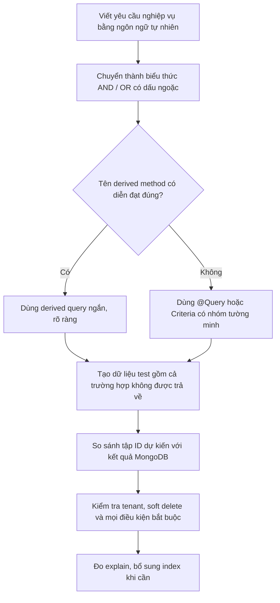

# Kết hợp And, Or và kiểm tra nhóm điều kiện

Với Spring Data MongoDB, bạn có thể định nghĩa truy vấn bằng tên phương thức trong interface kế thừa `MongoRepository`, chẳng hạn `findByStatusAndStockGreaterThan(...)`. Spring Data phân tích tên phương thức, nhận diện các thuộc tính Java và toán tử rồi tạo bộ lọc BSON tương ứng. Cơ chế này gọi là **derived query** (truy vấn suy diễn từ tên phương thức).

Khi kết hợp `And` và `Or`, một câu truy vấn trông có vẻ hợp lý vẫn có thể cho kết quả sai vì **cách nhóm điều kiện khác với ý định nghiệp vụ**. Điều này đặc biệt quan trọng với hệ thống nhiều tenant: nếu một nhánh `Or` không có điều kiện `tenantId`, phương thức có thể trả dữ liệu của tenant khác. Bài thuộc chương **Truy vấn suy diễn** này tập trung vào cách đọc đúng biểu thức logic, kiểm tra kết quả và lựa chọn giữa tên phương thức, `@Query` và `MongoTemplate`.

Sau bài học, bạn có thể:

- Giải thích cách Spring Data tách `Or` thành các nhóm và ưu tiên `And` trong từng nhóm.
- Viết ra biểu thức logic và bộ lọc MongoDB tương ứng trước khi dùng một derived method.
- Nhận ra khác biệt giữa `(A AND B) OR C` và `A AND (B OR C)`.
- Chọn `@Query` hoặc `Criteria.andOperator`/`orOperator` khi nhóm điều kiện cần thể hiện tường minh.
- Kiểm thử các trường hợp phủ định, dữ liệu ở tenant khác, điều kiện biên và truy vấn phát sinh.
- Xem xét index, `explain` và cách viết truy vấn dễ bảo trì trong ứng dụng Spring Data MongoDB.

## 1. Nền tảng: derived query được phân tích như thế nào?

Trong Spring Data, một tên phương thức như:

```java
List<CatalogItem> findByStatusAndStockGreaterThan(
    String status, int minStock);
```

gồm hai phần chính: `findBy` biểu thị thao tác đọc; phần sau `By` định nghĩa điều kiện tìm kiếm bằng **tên thuộc tính Java** và các từ khóa được hỗ trợ. Trong ví dụ:

- `Status` trỏ tới thuộc tính `status`, mặc định so sánh bằng tham số thứ nhất.
- `And` là phép giao logic.
- `StockGreaterThan` trỏ tới thuộc tính `stock` với toán tử so sánh lớn hơn `$gt`, nhận tham số thứ hai.

Bộ lọc MongoDB có thể diễn đạt tương đương:

```javascript
{
  status: "ACTIVE",
  stock: { $gt: 0 }
}
```

Hai điều kiện trên cùng cấp trong MongoDB được kết hợp bằng **AND ngầm định**. Spring Data MongoDB thực hiện việc ánh xạ tên thuộc tính Java sang tên field BSON khi có metadata như `@Field("...")`; vì vậy không nên mặc định rằng tên field Java luôn là tên field lưu trữ.

### Quy tắc nhóm điều kiện

Trong cơ chế phân tích derived query của Spring Data, phần predicate được chia thành **các nhóm `Or`**; bên trong từng nhóm, các phần được nối với nhau bằng `And`. Điều này tương đương việc **`And` có độ ưu tiên cao hơn `Or`**.

Ví dụ:

```text
findByAAndBOrCAndD
          ↓
(A AND B) OR (C AND D)

findByAOrBAndC
          ↓
A OR (B AND C)

findByAAndBOrC
          ↓
(A AND B) OR C
```

Không có cú pháp đặt dấu ngoặc đơn trong **tên derived method** để trực tiếp viết `AAnd(BOrC)`. Tên phương thức `findByAAndBOrC` không thể được hiểu thành `A AND (B OR C)` chỉ vì đó là ý định của người viết.

Đây là quy tắc phân tích tên phương thức của Spring Data, **không phụ thuộc** vào thứ tự field xuất hiện trong document. Thứ tự điều kiện trong JSON thông thường cũng không phải cơ chế tạo nhóm logic.

## 2. Chuẩn bị mô hình và bộ dữ liệu minh họa

Giả sử ứng dụng quản lý danh mục sản phẩm của nhiều tổ chức. Mỗi sản phẩm có `tenantId`, `status`, `category`, `active` và `stock`.

```java
import org.springframework.data.mongodb.core.mapping.Document;
import org.springframework.data.mongodb.core.mapping.MongoId;

@Document(collection = "catalog_items_query_lab")
public class CatalogItem {
    @MongoId
    private String id;
    private String runId;
    private String tenantId;
    private String status;
    private String category;
    private boolean active;
    private int stock;

    protected CatalogItem() {}

    public CatalogItem(
            String id, String runId, String tenantId,
            String status, String category,
            boolean active, int stock) {
        this.id = id;
        this.runId = runId;
        this.tenantId = tenantId;
        this.status = status;
        this.category = category;
        this.active = active;
        this.stock = stock;
    }

    public String getId() { return id; }
    public String getTenantId() { return tenantId; }
    public String getStatus() { return status; }
    public String getCategory() { return category; }
}
```

`@MongoId String id` giữ định danh Java String theo cách ánh xạ MongoDB tương ứng. Trong bài, các ID được cấp sẵn và không cần giả định chúng là BSON ObjectId. Thuộc tính `runId` dùng để cách ly những lần chạy thử trong cùng collection; ở hệ thống thực tế có thể bỏ field này.

### Bộ dữ liệu dùng để tính kết quả bằng tay

| Mã | Tenant | Status | Category | Active | Stock |
| --- | --- | --- | --- | --- | ---: |
| A | T1 | ACTIVE | book | true | 5 |
| B | T1 | DRAFT | office | true | 2 |
| C | T1 | ACTIVE | office | true | 0 |
| D | T1 | DRAFT | book | false | 0 |
| E | T2 | DRAFT | office | true | 6 |
| F | T2 | ACTIVE | book | true | 6 |
| G | T1 | ARCHIVED | book | false | 8 |

Các mã A–G chỉ là nhãn trong bảng. Phần thực hành `mongosh` bên dưới tạo `_id` riêng cho từng lần thử để tránh va chạm dữ liệu của các phiên khác.

## 3. Kết hợp `And` và `Or`: đọc đúng biểu thức

Khai báo repository:

```java
import java.util.List;
import org.springframework.data.mongodb.repository.MongoRepository;

public interface CatalogItemRepository
        extends MongoRepository<CatalogItem, String> {

    List<CatalogItem> findByStatusAndStockGreaterThanOrCategoryAndActiveTrue(
        String status, int minStock, String category);
}
```

Khi gọi:

```java
repository.findByStatusAndStockGreaterThanOrCategoryAndActiveTrue(
    "ACTIVE", 0, "office"
);
```

Spring Data hiểu điều kiện:

```text
(status = "ACTIVE" AND stock > 0)
    OR
(category = "office" AND active = true)
```

Bộ lọc BSON tương đương:

```javascript
{
  $or: [
    { status: "ACTIVE", stock: { $gt: 0 } },
    { category: "office", active: true }
  ]
}
```

Kết quả trên bảng dữ liệu minh họa là **A, B, C, E, F**:

| Mã | Nhánh 1: ACTIVE và stock lớn hơn 0 | Nhánh 2: office và active | Được lấy? |
| --- | --- | --- | --- |
| A | Đúng | Sai | Có |
| B | Sai | Đúng | Có |
| C | Sai vì stock = 0 | Đúng | Có |
| D | Sai | Sai | Không |
| E | Sai | Đúng | Có |
| F | Đúng | Sai | Có |
| G | Sai | Sai | Không |

Đặc biệt, **C vẫn được lấy dù `stock = 0`**, vì C thỏa nhánh `category = office AND active = true`. Nếu nghiệp vụ yêu cầu mọi kết quả đều còn hàng, bạn phải viết điều kiện theo nhóm khác.

### 3.1. Đổi thứ tự từ khóa sẽ đổi ý nghĩa

So sánh:

```text
findByStatusOrCategoryAndActiveTrue
    = status OR (category AND active)

findByStatusAndActiveTrueOrCategory
    = (status AND active) OR category
```

Hai biểu thức này **không tương đương**. Với bản ghi có `status = ACTIVE` nhưng `active = false`, truy vấn đầu tiên có thể trả về bản ghi trong khi truy vấn thứ hai chỉ trả về nếu `category` khớp. Việc thay đổi tên method vì lý do "dễ đọc" có thể vô tình thay đổi hành vi.

### 3.2. Dấu gạch dưới không tạo dấu ngoặc

Trong tên derived query, dấu gạch dưới có thể dùng để phân định **đường dẫn thuộc tính lồng nhau** trong một số trường hợp, ví dụ `findByPublisher_Country(...)`. Nó không phải cú pháp phân nhóm biểu thức `And`/`Or`. Đừng cố dùng `_`, viết hoa hoặc thêm chuỗi `AndOr` để mô phỏng dấu ngoặc đơn.

## 4. Lỗi thực tế: mất điều kiện tenant ở một nhánh `Or`

Giả sử API chỉ được trả dữ liệu của tenant `T1` khi sản phẩm thỏa một trong hai điều kiện:

> Sản phẩm thuộc tenant T1 và (**đang ACTIVE** hoặc **nằm trong category office**).

Biểu thức **mong muốn**:

```text
tenantId = T1 AND (status = ACTIVE OR category = office)
```

Một method có vẻ hợp lý nhưng **sai nhóm**:

```java
List<CatalogItem> findByTenantIdAndStatusOrCategory(
    String tenantId, String status, String category);
```

Khi gọi `findByTenantIdAndStatusOrCategory("T1", "ACTIVE", "office")`, biểu thức thực tế là:

```text
(tenantId = T1 AND status = ACTIVE)
    OR
(category = office)
```

Nhánh `category = office` không bị giới hạn bởi tenant. Kết quả sẽ gồm **A, B, C, E**; bản ghi **E thuộc T2** vẫn lọt vào. Đây là lỗi nghiệp vụ nghiêm trọng nếu `tenantId` là ranh giới phân quyền.

### 4.1. Khắc phục bằng phép phân phối logic

Từ định luật logic:

```text
A AND (B OR C)
    tương đương
(A AND B) OR (A AND C)
```

ta có thể viết lại derived method:

```java
List<CatalogItem> findByTenantIdAndStatusOrTenantIdAndCategory(
    String firstTenantId,
    String status,
    String secondTenantId,
    String category);
```

Lời gọi:

```java
repository.findByTenantIdAndStatusOrTenantIdAndCategory(
    "T1", "ACTIVE", "T1", "office"
);
```

Điều kiện trở thành:

```text
(tenantId = T1 AND status = ACTIVE)
    OR
(tenantId = T1 AND category = office)
```

Kết quả đúng là **A, B, C**. Tuy nhiên, `tenantId` phải được truyền **hai lần**. Nếu người gọi vô tình truyền `T1` và `T2`, bạn lại có lỗi phạm vi dữ liệu. Khi yêu cầu cần nhóm có dấu ngoặc hoặc chứa điều kiện bảo mật, cách viết tường minh bằng `@Query` hay `MongoTemplate` thường dễ đọc và dễ kiểm tra hơn.

### 4.2. Cách đọc bảng kết quả khi thêm điều kiện tenant

| Mã | T1? | ACTIVE? | office? | `T1 AND (ACTIVE OR office)` | `(T1 AND ACTIVE) OR office` |
| --- | --- | --- | --- | --- | --- |
| A | Có | Có | Không | **Có** | **Có** |
| B | Có | Không | Có | **Có** | **Có** |
| C | Có | Có | Có | **Có** | **Có** |
| D | Có | Không | Không | Không | Không |
| E | Không | Không | Có | **Không** | **Có — sai phạm vi** |
| F | Không | Có | Không | Không | Không |
| G | Có | Không | Không | Không | Không |

Khi review method có `Or`, hãy hỏi: **Những điều kiện bắt buộc cho mọi kết quả (tenant, quyền, soft delete, trạng thái công khai...) có hiện diện ở mọi nhánh không?** Nếu không, cần sửa nhóm trước khi đưa lên production.

## 5. Dùng `@Query` để thể hiện dấu ngoặc rõ ràng

`@Query` cho phép định nghĩa bộ lọc MongoDB bằng JSON query string, thuận tiện khi cần `$and`, `$or` lồng nhau:

```java
import java.util.List;
import org.springframework.data.mongodb.repository.Query;

// Method đặt bên trong CatalogItemRepository:
@Query("{ 'tenantId': ?0, '$or': [ " +
       "{ 'status': ?1 }, { 'category': ?2 } ] }")
List<CatalogItem> findByTenantWithStatusOrCategory(
    String tenantId, String status, String category);
```

Ở đây, `?0`, `?1`, `?2` tương ứng ba tham số method. Điều kiện `tenantId` ở cấp cao nhất được **AND ngầm định** với `$or`; vì thế mọi nhánh kết quả đều phải thỏa tenant:

```javascript
{
  tenantId: "T1",
  $or: [
    { status: "ACTIVE" },
    { category: "office" }
  ]
}
```

Để nhấn mạnh thứ tự ưu tiên, cũng có thể viết `$and` tường minh:

```javascript
{
  $and: [
    { tenantId: "T1" },
    {
      $or: [
        { status: "ACTIVE" },
        { category: "office" }
      ]
    }
  ]
}
```

Hai bộ lọc này tương đương cho ví dụ trên. Dùng `$and` tường minh khi biểu thức phức tạp hoặc cần trình bày cấu trúc nhóm rõ ràng cho người đọc. Với `@Query`, tránh ghép giá trị nhận từ người dùng vào chuỗi JSON bằng phép nối chuỗi thủ công; sử dụng **binding parameter** (`?0`, `?1`, ...) để framework biểu diễn giá trị đúng kiểu.

**Lưu ý mapping:** JSON query của repository có thể được Spring Data xử lý dựa trên metadata của entity. Khi viết raw `mongosh` hoặc MongoDB Driver query, bạn phải dùng tên field BSON thực tế. Nếu có `@Field("...")`, hãy kiểm tra query được ánh xạ như dự định.

## 6. `MongoTemplate` và `Criteria`: nhóm điều kiện bằng cấu trúc

Khi biểu thức được tạo theo điều kiện động (ví dụ API có nhiều tùy chọn lọc), việc viết một derived method dài không còn thuận tiện. `MongoTemplate` cho phép xây dựng nhóm tường minh:

```java
import java.util.List;
import org.springframework.data.mongodb.core.MongoTemplate;
import org.springframework.data.mongodb.core.query.Criteria;
import org.springframework.data.mongodb.core.query.Query;

public List<CatalogItem> findTenantItems(
        MongoTemplate template,
        String tenantId,
        String status,
        String category) {

    Criteria anyMatch = new Criteria().orOperator(
        Criteria.where("status").is(status),
        Criteria.where("category").is(category)
    );

    Criteria scoped = new Criteria().andOperator(
        Criteria.where("tenantId").is(tenantId),
        anyMatch
    );

    return template.find(
        new Query(scoped),
        CatalogItem.class
    );
}
```

Nhờ `CatalogItem.class`, bộ ánh xạ Spring Data có ngữ cảnh về tên property và BSON field. Cấu trúc `andOperator(tenant, orOperator(...))` diễn đạt đúng `tenant AND (status OR category)` mà không cần lặp tham số tenant.

### 6.1. Bộ lọc động và nhóm khi tham số vắng mặt

Không nên tự ý thêm một nhánh `OR` bằng điều kiện "luôn đúng" khi người dùng không truyền filter, vì nó có thể làm toàn bộ nhóm `OR` trở thành đúng. Hãy phân biệt rõ:

- Nếu **không có** status và category, chỉ lọc theo `tenantId` hoặc trả lỗi validation, theo quy tắc API.
- Nếu có **chỉ status**, lọc `tenantId AND status`.
- Nếu có **chỉ category**, lọc `tenantId AND category`.
- Nếu có **cả hai**, lọc `tenantId AND (status OR category)`.

Ví dụ một cách xây dựng có kiểm soát:

```java
import java.util.ArrayList;
import java.util.List;

public Query buildQuery(
        String tenantId, String status, String category) {

    List<Criteria> branches = new ArrayList<>();
    if (status != null && !status.isBlank()) {
        branches.add(Criteria.where("status").is(status));
    }
    if (category != null && !category.isBlank()) {
        branches.add(Criteria.where("category").is(category));
    }

    Criteria tenant = Criteria.where("tenantId").is(tenantId);

    if (branches.isEmpty()) {
        return Query.query(tenant);
    }
    if (branches.size() == 1) {
        return new Query(new Criteria().andOperator(
            tenant, branches.get(0)
        ));
    }
    Criteria alternatives = new Criteria().orOperator(
        branches.toArray(Criteria[]::new)
    );
    return new Query(new Criteria().andOperator(
        tenant, alternatives
    ));
}
```

Đoạn mã giả định `tenantId` đã được xác thực và lấy từ **ngữ cảnh quyền truy cập đáng tin cậy**. `status` và `category` chỉ được xem là bộ lọc tùy chọn; nếu sản phẩm yêu cầu ít nhất một tiêu chí, thay nhánh `branches.isEmpty()` bằng lỗi validation. Với điều kiện truy vấn phức tạp hơn, có thể tạo lớp đặc tả filter và kiểm thử mọi kết hợp.

## 7. Khi nào dùng `In` thay cho nhiều nhánh `Or`?

Nếu nhiều lựa chọn **cùng so sánh một property**, ví dụ trạng thái có thể là `ACTIVE` hoặc `DRAFT`, bộ lọc:

```javascript
{
  tenantId: "T1",
  $or: [
    { status: "ACTIVE" },
    { status: "DRAFT" }
  ]
}
```

thường có thể biểu diễn gọn hơn bằng:

```javascript
{
  tenantId: "T1",
  status: { $in: ["ACTIVE", "DRAFT"] }
}
```

Và repository:

```java
List<CatalogItem> findByTenantIdAndStatusIn(
    String tenantId, java.util.Collection<String> statuses);
```

`In` rõ nghĩa hơn khi đang chọn nhiều **giá trị của cùng một field**. Nhưng `In` không thay thế `Or` giữa **hai field khác nhau** như `status` và `category`. Cũng cần kiểm tra hành vi với collection rỗng, giá trị `null` và input không hợp lệ theo hợp đồng API.

## 8. Thực hành với `mongosh`: chứng minh kết quả từng nhóm

Trước khi đưa derived query vào service, nên chạy bộ lọc BSON tương đương trên một tập dữ liệu nhỏ và **tự tính kết quả mong đợi**. Phần này tạo bảy document theo bảng mục 2 và cách ly bằng `runId`. Chỉ dùng database/collection thực hành, không chạy lệnh xóa toàn collection.

### 8.1. Tạo bộ dữ liệu thử nghiệm

Mở `mongosh` tới MongoDB thử nghiệm và chạy trong cùng một phiên shell:

```javascript
use spring_data_training

const lab = db.getCollection("catalog_items_query_lab");
const runId = "derived-queries-003-" + new ObjectId().toHexString();
const t1 = runId + "-T1";
const t2 = runId + "-T2";

lab.insertMany([
  {
    _id: runId + "-A", runId: runId, tenantId: t1,
    status: "ACTIVE", category: "book", active: true, stock: 5
  },
  {
    _id: runId + "-B", runId: runId, tenantId: t1,
    status: "DRAFT", category: "office", active: true, stock: 2
  },
  {
    _id: runId + "-C", runId: runId, tenantId: t1,
    status: "ACTIVE", category: "office", active: true, stock: 0
  },
  {
    _id: runId + "-D", runId: runId, tenantId: t1,
    status: "DRAFT", category: "book", active: false, stock: 0
  },
  {
    _id: runId + "-E", runId: runId, tenantId: t2,
    status: "DRAFT", category: "office", active: true, stock: 6
  },
  {
    _id: runId + "-F", runId: runId, tenantId: t2,
    status: "ACTIVE", category: "book", active: true, stock: 6
  },
  {
    _id: runId + "-G", runId: runId, tenantId: t1,
    status: "ARCHIVED", category: "book", active: false, stock: 8
  }
]);

print("runId = " + runId);
print("t1 = " + t1);
print("t2 = " + t2);
print(lab.countDocuments({ runId: runId })); // Dự kiến: 7
```

`runId` và hai tenant ID thay đổi ở mỗi lần chạy, nên không lẫn dữ liệu các phiên trước. Các giá trị `_id` là BSON String có hậu tố `-A` đến `-G`. Chạy tiếp các lệnh dưới đây **trong phiên shell hiện tại** để giữ các biến `lab`, `runId`, `t1` và `t2`.

Hàm phụ giúp hiển thị nhãn A–G của các document tìm được:

```javascript
function labelsFor(filter) {
  return lab.find(filter, { _id: 1 })
    .toArray()
    .map(d => d._id.substring(d._id.lastIndexOf("-") + 1))
    .sort();
}
```

### 8.2. Chứng minh `(A AND B) OR (C AND D)`

```javascript
labelsFor({
  runId: runId,
  $or: [
    { status: "ACTIVE", stock: { $gt: 0 } },
    { category: "office", active: true }
  ]
});
// Dự kiến: ["A", "B", "C", "E", "F"]
```

Kết quả C là lời nhắc rằng toàn bộ truy vấn **không bắt buộc** `stock > 0`. Điều kiện đó chỉ có trong nhánh thứ nhất.

### 8.3. So sánh truy vấn đúng và sai tenant

Truy vấn **sai**: một nhánh `Or` không kiểm tra `tenantId`.

```javascript
const leaky = labelsFor({
  runId: runId,
  $or: [
    { tenantId: t1, status: "ACTIVE" },
    { category: "office" }
  ]
});
printjson(leaky);
// Dự kiến: ["A", "B", "C", "E"]
```

Truy vấn **đúng**: `tenantId` ở ngoài `$or` và áp dụng cho cả hai nhánh.

```javascript
const scoped = labelsFor({
  runId: runId,
  tenantId: t1,
  $or: [
    { status: "ACTIVE" },
    { category: "office" }
  ]
});
printjson(scoped);
// Dự kiến: ["A", "B", "C"]
```

Bản ghi E chỉ xuất hiện trong `leaky` vì nó thuộc `t2` nhưng có `category = office`. Trên API thật, điều kiện tenant nên lấy từ **thông tin xác thực/ủy quyền phía server**, không nhận một `tenantId` tùy ý từ tham số request mà chưa kiểm tra quyền.

### 8.4. Kiểm tra tính tương đương của phép phân phối

```javascript
const distributed = labelsFor({
  runId: runId,
  $or: [
    { tenantId: t1, status: "ACTIVE" },
    { tenantId: t1, category: "office" }
  ]
});
printjson(distributed);
// Dự kiến: ["A", "B", "C"] — bằng scoped.
```

Trong bài này, `distributed` và `scoped` trả về cùng danh sách. Ứng dụng có thể dùng derived method chứa tenant lặp lại nếu biểu thức đủ đơn giản; với điều kiện ngày càng phức tạp, `@Query` hoặc `Criteria` giúp giữ cấu trúc nhóm dễ đọc hơn.

### 8.5. Dọn đúng dữ liệu của phiên thực hành

Sau khi đã quan sát kết quả, chạy:

```javascript
const countBefore = lab.countDocuments({ runId: runId });
print("Số document sẽ xóa: " + countBefore);

const cleanup = lab.deleteMany({ runId: runId });
printjson({ deletedCount: cleanup.deletedCount });
// Dự kiến: 7 nếu không thêm/xóa document trước đó.
```

Không thay `{ runId: runId }` bằng bộ lọc rỗng `{}`; nếu muốn tiếp tục thao tác trong Compass hoặc Java, hãy dọn dữ liệu sau khi kiểm tra xong.

## 9. Kiểm thử repository: nhóm điều kiện phải được xác nhận bằng dữ liệu

Lỗi nhóm `And`/`Or` thường không gây lỗi compile hoặc lỗi khởi động. Tên method hoàn toàn hợp lệ, chỉ **trả sai document**. Vì vậy, unit test kiểm tra tên method hoặc kiểm tra số lượng kết quả trên dữ liệu một tenant là chưa đủ. Cần kiểm thử trực tiếp bằng MongoDB trong môi trường cách ly.

### 9.1. Ma trận ca kiểm thử

| Nhóm kiểm thử | Tình huống | Điều cần chứng minh |
| --- | --- | --- |
| Hai nhánh đều đúng | Cùng một document thỏa cả `status` và `category` | Document xuất hiện **một lần**, không nhân đôi do `Or` |
| Chỉ nhánh trái đúng | ACTIVE nhưng category khác | Document vẫn được lấy |
| Chỉ nhánh phải đúng | DRAFT nhưng category office | Document vẫn được lấy |
| Cả hai đều sai | DRAFT và category book | Không được lấy |
| Tenant khác nhưng nhánh phải đúng | T2 và category office | **Không được lấy** khi truy vấn giới hạn T1 |
| Điều kiện biên | `stock = 0` với `GreaterThan(0)` | Không thỏa nhánh stock; có thể vẫn thỏa nhánh khác |
| Kết hợp tham số | Tenant lặp hai lần ở derived method | Hai tham số tenant phải giống nhau nếu dùng phép phân phối |
| Dữ liệu thiếu/null | `status` hoặc `category` thiếu | Không bất ngờ khớp do chính sách null không rõ |

Ví dụ, kiểm thử tích hợp cần ít nhất một document từ tenant khác **có thể khớp một nhánh `Or`**. Nếu tất cả fixture thuộc T1, truy vấn thiếu tenant ở một nhánh vẫn có thể vượt qua mọi assertion.

### 9.2. Ví dụ JUnit 5 và Spring Boot Data Mongo test

Các method `findByTenantIdAndStatusOrCategory` và `findByTenantWithStatusOrCategory` ở phần 4–5 cần được khai báo trong `CatalogItemRepository` cùng các method ở phần 3:

```java
import static org.junit.jupiter.api.Assertions.*;

import java.util.List;
import java.util.Set;
import java.util.UUID;
import java.util.stream.Collectors;
import org.junit.jupiter.api.Test;
import org.springframework.beans.factory.annotation.Autowired;
import org.springframework.boot.test.autoconfigure.data.mongo.DataMongoTest;

@DataMongoTest
class CatalogItemQueryTest {
    @Autowired
    CatalogItemRepository repository;

    @Test
    void orConditionMustRemainInsideTenantBoundary() {
        String run = "test-" + UUID.randomUUID();
        String t1 = run + "-T1";
        String t2 = run + "-T2";

        CatalogItem a = new CatalogItem(
            run + "-A", run, t1, "ACTIVE", "book", true, 5
        );
        CatalogItem b = new CatalogItem(
            run + "-B", run, t1, "DRAFT", "office", true, 2
        );
        CatalogItem e = new CatalogItem(
            run + "-E", run, t2, "DRAFT", "office", true, 6
        );

        repository.insert(List.of(a, b, e));
        try {
            List<CatalogItem> correct =
                repository.findByTenantWithStatusOrCategory(
                    t1, "ACTIVE", "office"
                );

            Set<String> resultIds = correct.stream()
                .map(CatalogItem::getId)
                .collect(Collectors.toSet());

            assertEquals(Set.of(a.getId(), b.getId()), resultIds);
            assertFalse(resultIds.contains(e.getId()));

            List<CatalogItem> leaky =
                repository.findByTenantIdAndStatusOrCategory(
                    t1, "ACTIVE", "office"
                );
            assertTrue(leaky.stream().anyMatch(
                item -> e.getId().equals(item.getId())
            ));
        } finally {
            repository.deleteAllById(
                List.of(a.getId(), b.getId(), e.getId())
            );
        }
    }
}
```

Phần assertion cuối cố ý chứng minh method **sai** trả về document E; không có nghĩa nên dùng method đó trong production. Đây là mã minh họa để bạn thực hành với MongoDB test riêng; theo STEP 4, bài học **chưa chạy các test này**. Một cấu hình `@DataMongoTest` có thể cần MongoDB thử nghiệm đang chạy hoặc Testcontainers, tùy thiết lập project.

### 9.3. Kiểm tra truy vấn thật, không chỉ kết quả trả về

Khi kết quả bất ngờ, kiểm tra:

1. Tên method và cách tách `Or`/`And`.
2. Thứ tự tham số khi gọi method; các toán tử như `GreaterThan`, `Between`, `In` sử dụng số tham số khác nhau.
3. Tên field BSON sau khi áp dụng `@Field` hoặc converter (nếu có).
4. Các field cần điều kiện bắt buộc ở **mọi nhánh `Or`**, đặc biệt `tenantId` và `deleted`.
5. Truy vấn thực thi trong log debug hoặc bằng một query BSON tương đương chạy trực tiếp trên `mongosh`.
6. Kết quả test bao gồm cả bản ghi **không được phép xuất hiện**, không chỉ bản ghi đúng.

Bạn có thể bật logging truy vấn MongoDB của Spring Data ở mức DEBUG trong môi trường test theo cấu hình logging của phiên bản đang dùng. Tránh ghi dữ liệu nhạy cảm hoặc log giá trị query không cần thiết trên production. Quan sát raw BSON và query plan giúp phân biệt lỗi parser/mapping với lỗi dữ liệu.

## 10. Index và hiệu năng của bộ lọc có `$or`

Đúng về logic chưa đồng nghĩa với nhanh. Truy vấn dạng:

```javascript
{
  tenantId: "T1",
  $or: [
    { status: "ACTIVE" },
    { category: "office" }
  ]
}
```

có hai nhánh trên các field khác nhau. Tùy dữ liệu và tần suất sử dụng, có thể cân nhắc các chỉ mục:

```javascript
db.catalog_items_query_lab.createIndex(
  { tenantId: 1, status: 1 },
  { name: "idx_tenant_status" }
);

db.catalog_items_query_lab.createIndex(
  { tenantId: 1, category: 1 },
  { name: "idx_tenant_category" }
);
```

Đây là **gợi ý để đánh giá**, không phải công thức luôn tối ưu. MongoDB có thể dùng index cho các nhánh `$or` nếu các điều kiện và kế hoạch phù hợp, nhưng cũng có thể chọn `COLLSCAN`, đặc biệt khi collection nhỏ hoặc độ chọn lọc thấp. Nếu query có sắp xếp/phân trang, thiết kế index còn phải tính đến `sort`, thứ tự field và bộ lọc thực tế.

Kiểm tra bằng:

```javascript
db.catalog_items_query_lab.find({
  tenantId: "TENANT_THUC_TE",
  $or: [
    { status: "ACTIVE" },
    { category: "office" }
  ]
}).explain("executionStats");
```

Thay `TENANT_THUC_TE` bằng giá trị tenant hợp lệ và chạy trên dataset đại diện. Đọc `winningPlan`, `totalKeysExamined`, `totalDocsExamined` và `nReturned`. Với dataset bảy document của bài thực hành, chưa thể kết luận index nào nhanh hơn trong sản xuất.

### 10.1. Không thay logic để chạy nhanh khi chưa chứng minh tương đương

Đừng chuyển `tenant AND (status OR category)` thành `(tenant AND status) OR category` chỉ vì biểu thức thứ hai có tên method ngắn hơn. Nó thay đổi tập kết quả và có thể lộ dữ liệu. Khi tối ưu, trước tiên chứng minh hai biểu thức **tương đương về logic**, sau đó mới đo query plan và độ trễ.

### 10.2. Phân trang và sort

Repository có thể nhận `Pageable` để giới hạn và sắp xếp kết quả:

```java
import org.springframework.data.domain.Page;
import org.springframework.data.domain.Pageable;

@Query("{ 'tenantId': ?0, '$or': [ " +
       "{ 'status': ?1 }, { 'category': ?2 } ] }")
Page<CatalogItem> pageByTenantWithStatusOrCategory(
    String tenantId,
    String status,
    String category,
    Pageable pageable);
```

Khi method nhận `Pageable`, đặt tên và return type rõ ràng. `Page` có thể cần thêm count query; khi chỉ cần "có trang tiếp hay không", `Slice` hoặc phương thức giới hạn phù hợp có thể giảm công việc tùy trường hợp.

Để kết quả phân trang ổn định, nên sắp xếp theo các field có thứ tự xác định và thêm tie-breaker như `_id` khi cần. Dữ liệu có thể thay đổi giữa các lần request, nên phân trang offset không tự bảo đảm snapshot nhất quán.

## 11. Lỗi thường gặp khi ghép toán tử trong method name

| Triệu chứng | Nguyên nhân | Cách xử lý |
| --- | --- | --- |
| Method có `And`/`Or` nhưng kết quả nhiều hơn dự kiến | Nhóm theo `And` trước `Or` | Viết lại biểu thức bằng dấu ngoặc, đối chiếu bộ lọc BSON |
| Trả dữ liệu tenant khác | Một nhánh `Or` thiếu `tenantId` | Đưa tenant ra ngoài `$or` bằng `@Query`/`Criteria` hoặc phân phối tenant vào mọi nhánh |
| `findByAOrBAndC` trả bản ghi A dù C sai | Điều kiện thực tế là `A OR (B AND C)` | Dùng `@Query` nếu cần `(A OR B) AND C` |
| Method quá dài hoặc lặp tenant nhiều lần | Cố mô phỏng dấu ngoặc bằng tên method | Chuyển sang `@Query` hoặc `MongoTemplate` |
| Điều kiện `active` hoặc `deleted` không áp dụng mọi kết quả | Đặt điều kiện chỉ trong một nhánh `Or` | Đưa điều kiện bắt buộc ra ngoài `$or` |
| Test pass nhưng production trả sai | Fixture chỉ có ca dương tính hoặc chỉ một tenant | Tạo cả ca đúng, sai và dữ liệu cross-tenant |
| Thêm `Sort`/`Top` rồi vẫn lọt dữ liệu | Sort/limit không sửa nhóm điều kiện | Sửa predicate trước, sau đó mới giới hạn/sắp xếp |
| Truy vấn sai khi đổi tên field | `@Field` hoặc query raw chưa đồng bộ | Kiểm tra property path và BSON field thực |
| Sai kết quả khi field là `null` hoặc thiếu | So sánh `null` có hành vi riêng; thiếu field khác giá trị thông thường | Xác định quy tắc missing/null và kiểm tra `$exists`/`$type` |
| Chậm khi thêm nhiều nhánh `Or` | Query plan/index chưa phù hợp, nhiều dữ liệu trả về | Đo `explain`, xem index và mẫu truy vấn |

### Trường hợp có soft delete

Giả sử mọi truy vấn chỉ được lấy `deleted = false`. Derived method:

```java
findByTenantIdAndDeletedFalseAndStatusOrCategory(...)
```

được hiểu là:

```text
(tenantId AND deleted = false AND status) OR category
```

Nhánh category không bị giới hạn cả tenant lẫn soft delete. Thay bằng `@Query` có hai điều kiện bắt buộc ở ngoài `$or`:

```javascript
{
  tenantId: "T1",
  deleted: false,
  $or: [
    { status: "ACTIVE" },
    { category: "office" }
  ]
}
```

Chú ý rằng `deleted: false` khác trường `deleted` không tồn tại; nếu dữ liệu cũ thiếu field, hãy định nghĩa quy tắc rõ thay vì giả định tất cả được coi là false. Kiểm soát quyền truy cập ở service/API vẫn cần được thực hiện, kể cả khi truy vấn đã có bộ lọc tenant.

## 12. Quy trình thiết kế và kiểm chứng nhóm điều kiện



Trong code review, ưu tiên bốn câu hỏi cụ thể: điều kiện nào là **bắt buộc cho mọi kết quả**; điều kiện nào là **các lựa chọn thay thế**; derived method đang nhóm theo thứ tự nào; và test nào chứng minh document không hợp lệ không bị lọt vào. Khi biểu thức khó đọc chỉ bằng tên method, chọn API truy vấn có nhóm tường minh.

## 13. Bài tập tự luyện

**Bài 1 — Đọc biểu thức.** Chuyển các tên method sau thành biểu thức logic có dấu ngoặc, rồi viết bộ lọc BSON tương đương:

- `findByAAndBOrC`
- `findByAOrBAndC`
- `findByAAndBOrCAndD`
- `findByTenantIdAndActiveTrueOrCategoryAndStockGreaterThan`

**Bài 2 — Dự đoán kết quả.** Với bảng A–G ở mục 2, xác định ID trả về của `findByStatusAndStockGreaterThanOrCategoryAndActiveTrue("ACTIVE", 0, "office")`. Giải thích vì sao C có trong kết quả.

**Bài 3 — Sửa lỗi tenant.** Nhận một method `findByTenantIdAndStatusOrCategory`. Viết lại bằng hai cách: phép phân phối trong derived method và `@Query` với `$or` đặt dưới điều kiện tenant. Chứng minh bằng bản ghi E rằng method cũ sai.

**Bài 4 — Soft delete.** API chỉ trả bản ghi `tenantId = T1`, `deleted = false` và (`status = ACTIVE` hoặc `category = office`). Viết `Criteria` đúng nhóm. Tạo dữ liệu thử có một bản ghi của T2 và một bản ghi `deleted = true` để xác nhận không bị trả về.

**Bài 5 — Bộ lọc động.** Tạo phương thức nhận tenant bắt buộc, status và category tùy chọn. Xác định hành vi khi cả hai filter vắng mặt; viết code không tạo nhánh `Or` luôn đúng.

**Bài 6 — Chọn `In` hay `Or`.** Viết repository tìm các bản ghi của T1 có status `ACTIVE` hoặc `DRAFT`. So sánh `findByTenantIdAndStatusIn` với `@Query` chứa `$or` và nêu lý do `In` không thay thế được lựa chọn giữa status và category.

**Bài 7 — Test chống hồi quy.** Viết integration test gồm ít nhất hai tenant, hai trạng thái, hai category và các trường hợp biên. Assert tập `_id` chính xác của query đúng, sau đó chứng minh query sai trả bản ghi E.

**Bài 8 — Chẩn đoán hiệu năng.** Tạo index ghép theo các nhánh query trên một dataset đại diện, dùng `explain("executionStats")` so sánh trước/sau. Không thay đổi nhóm logic để cải thiện hiệu năng.

### Ghi nhớ

Spring Data MongoDB nhóm derived query theo quy tắc **`And` ưu tiên hơn `Or`**: `findByAAndBOrC` có nghĩa `(A AND B) OR C`. Muốn biểu diễn `A AND (B OR C)`, hãy **phân phối A vào cả hai nhánh** hoặc dùng `@Query`/`MongoTemplate` với nhóm điều kiện tường minh. Luôn kiểm tra bằng BSON và tập dữ liệu có cả ca âm tính, đặc biệt với `tenantId`, phân quyền và soft delete. Sau khi xác nhận đúng tập kết quả, mới đánh giá index, sort và phân trang bằng số liệu thực tế.
