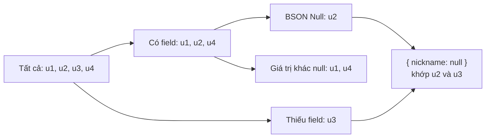

# IsNull, IsNotNull, Exists và sự khác biệt null với trường thiếu

Trong **Spring Data MongoDB**, truy vấn suy diễn (*derived query*) cho phép khai báo các phương thức như `findByNicknameIsNull()`, `findByNicknameIsNotNull()` hoặc `findByNicknameExists(boolean exists)` ngay trên repository. Spring Data đọc tên phương thức, dùng metadata của entity rồi dựng truy vấn MongoDB tương ứng.

Vấn đề dễ nhầm là MongoDB phân biệt **một trường có giá trị BSON `null`** với **một trường hoàn toàn không tồn tại trong document**. Trên đối tượng Java, cả hai tình huống thường được ánh xạ thành cùng một giá trị `null`, nhưng ở tầng truy vấn, các toán tử `$exists`, `$ne` và `$type` cho phép kiểm tra những trạng thái khác nhau. Bài học thuộc chương **Truy vấn suy diễn** và tập trung vào ý nghĩa chính xác của các từ khóa `IsNull`, `IsNotNull` và `Exists`.

## 1. Ba trạng thái phải phân biệt trong BSON

Xét collection `users` với bốn document. Để tiện kiểm tra, các giá trị `_id` dưới đây là BSON String, không phải ObjectId:

```javascript
db.users.insertMany([
  { _id: "u1", nickname: "Minh",  active: true },
  { _id: "u2", nickname: null,    active: true },
  { _id: "u3",                    active: false },
  { _id: "u4", nickname: "",      active: true }
]);
```

Trường `nickname` có bốn trường hợp:

| Document | Trường `nickname` trong BSON | Diễn giải |
| --- | --- | --- |
| `u1` | `"Minh"` | Có trường và giá trị không null |
| `u2` | `null` | **Có trường**, nhưng giá trị là BSON Null |
| `u3` | Không có khóa `nickname` | **Trường thiếu** (*missing / absent*) |
| `u4` | `""` | Có trường, là chuỗi rỗng; **không phải** null |

Không nên đồng nhất `null`, trường thiếu, chuỗi rỗng, `false`, số `0` hoặc array rỗng. Mỗi trạng thái có ý nghĩa dữ liệu và cách truy vấn riêng.

Ví dụ, một người dùng chưa bao giờ khai báo biệt danh có thể được lưu bằng cách **không tạo field**. Một người dùng chủ động xóa biệt danh có thể được lưu bằng **BSON Null** nếu nghiệp vụ muốn ghi nhận sự khác biệt. Nếu ứng dụng không cần phân biệt hai trạng thái đó, phải thống nhất một quy ước ghi để tránh nhiều kiểu dữ liệu cùng diễn đạt “không có biệt danh”.

## 2. MongoDB hiểu `null`, `$ne: null` và `$exists` như thế nào?

Với một trường giá trị vô hướng như `nickname` trong ví dụ, kết quả của các truy vấn như sau:

| Điều kiện MongoDB | Ý nghĩa | Các document khớp |
| --- | --- | --- |
| `{ nickname: null }` | Trường có BSON Null **hoặc không tồn tại** | `u2`, `u3` |
| `{ nickname: { $ne: null } }` | Trường **tồn tại** và giá trị **khác null** | `u1`, `u4` |
| `{ nickname: { $exists: true } }` | Có trường, bất kể giá trị là gì | `u1`, `u2`, `u4` |
| `{ nickname: { $exists: false } }` | Trường hoàn toàn không tồn tại | `u3` |
| `{ nickname: { $type: 10 } }` | Trường có kiểu BSON Null | `u2` |

Điểm cần nhớ: **`{ field: null }` không chỉ tìm BSON Null**, còn **`$exists: true` không có nghĩa field khác null**. Với toán tử `$ne: null`, MongoDB có ngữ nghĩa đặc biệt là tìm field tồn tại và có giá trị không null; đừng áp dụng máy móc nhận định chung về `$ne` cho mọi trường hợp.

Kiểm tra trực tiếp trong MongoDB Shell:

```javascript
// null hoặc field thiếu:
db.users.find({ nickname: null });

// Có field và không null:
db.users.find({ nickname: { $ne: null } });

// Field tồn tại, kể cả giá trị BSON Null:
db.users.find({ nickname: { $exists: true } });

// Chỉ field không tồn tại:
db.users.find({ nickname: { $exists: false } });

// Chỉ BSON Null (với trường vô hướng của ví dụ):
db.users.find({ nickname: { $type: 10 } });
```

Trong hệ kiểu BSON, mã `10` biểu diễn **Null**. Có thể dùng `$type: "null"` nếu cú pháp và phiên bản MongoDB hỗ trợ. Các giải thích trên tập trung vào field vô hướng; đối với **array hoặc đường dẫn đi qua array**, quy tắc matching có thêm ngữ nghĩa kiểm tra phần tử, nên cần test trên schema thực tế.

### Hình dung các tập kết quả



Sơ đồ cho thấy tập trả về của `{ nickname: null }` là hợp của **BSON Null** và **trường thiếu**. Khi thiết kế quy tắc kiểm tra dữ liệu, chính sự khác biệt này quyết định nên dùng `IsNull` hay kết hợp `Exists` với điều kiện khác.

## 3. Khai báo entity và `MongoRepository` để tạo derived queries

Tạo entity khớp collection dữ liệu mẫu. Vì `_id` là chuỗi `"u1"`, `"u2"`, … nên dùng `@MongoId(FieldType.STRING)` để biểu đạt rõ kiểu định danh:

```java
import org.springframework.data.mongodb.core.mapping.Document;
import org.springframework.data.mongodb.core.mapping.FieldType;
import org.springframework.data.mongodb.core.mapping.MongoId;

@Document("users")
public class UserAccount {
    @MongoId(FieldType.STRING)
    private String id;

    private String nickname;
    private boolean active;

    public UserAccount() {}

    public String getId() { return id; }
    public String getNickname() { return nickname; }
    public boolean isActive() { return active; }
}
```

Repository:

```java
import java.util.List;
import org.springframework.data.mongodb.repository.MongoRepository;

public interface UserAccountRepository
        extends MongoRepository<UserAccount, String> {

    List<UserAccount> findByNicknameIsNull();

    List<UserAccount> findByNicknameIsNotNull();

    List<UserAccount> findByNicknameExists(boolean exists);

    boolean existsByNickname(String nickname);
}
```

Các method ở trên minh họa **bốn câu hỏi khác nhau**. Kiểu `List<UserAccount>` phù hợp vì nhiều document có thể thỏa điều kiện; không dùng `Optional<UserAccount>` khi bộ lọc không đảm bảo duy nhất.

### 3.1. `findByNicknameIsNull()`

```java
List<UserAccount> result = users.findByNicknameIsNull();
// Với dữ liệu mẫu: u2 và u3.
```

Tương đương về ngữ nghĩa:

```javascript
db.users.find({ nickname: null });
```

`IsNull` (hoặc từ khóa tương đương `Null` khi parser hỗ trợ) dùng phép so sánh với `null`, vì vậy **bao gồm cả trường không tồn tại**. Nó phù hợp cho câu hỏi “đã có biệt danh khác null hay chưa?”, nhưng không phù hợp nếu nghiệp vụ muốn phân biệt “được đặt thành null” với “chưa được lưu field”.

### 3.2. `findByNicknameIsNotNull()`

```java
List<UserAccount> result = users.findByNicknameIsNotNull();
// Với dữ liệu mẫu: u1 và u4.
```

Tương đương:

```javascript
db.users.find({ nickname: { $ne: null } });
```

Trong ví dụ scalar, `IsNotNull` yêu cầu tồn tại một giá trị khác null. **Chuỗi rỗng vẫn được trả về** vì `""` là một chuỗi, không phải BSON Null. Nếu nghiệp vụ yêu cầu biệt danh có ít nhất một ký tự không phải khoảng trắng, cần validation và/hoặc điều kiện bổ sung; chỉ `IsNotNull` là chưa đủ.

### 3.3. `findByNicknameExists(boolean exists)`

```java
List<UserAccount> storedField = users.findByNicknameExists(true);
// u1, u2, u4: field có tồn tại, dù u2 là null.

List<UserAccount> missingField = users.findByNicknameExists(false);
// u3: field hoàn toàn thiếu.
```

Spring Data sử dụng hậu tố `Exists` trong **tên property predicate** và tham số `boolean` để sinh `$exists`:

```javascript
db.users.find({ nickname: { $exists: true } });
db.users.find({ nickname: { $exists: false } });
```

Điều kiện `$exists: true` không kiểm tra nội dung `nickname`, nên `u2` có `nickname: null` vẫn phù hợp. Ngược lại, `$exists: false` không bao gồm `u2`.

### 3.4. `existsByNickname(String nickname)` **khác** `findByNicknameExists(...)`

```java
boolean hasMinh = users.existsByNickname("Minh");
// true nếu ít nhất một document có nickname == "Minh".
```

`existsBy...` là **chủ ngữ** của truy vấn repository, yêu cầu kiểm tra có document thỏa *predicate* hay không. Nó không có nghĩa kiểm tra sự hiện diện của field. Trong khi đó, `findByNicknameExists(boolean)` dùng **từ khóa predicate `Exists`** để tạo `$exists`.

| Method | Câu hỏi trả lời |
| --- | --- |
| `existsByNickname("Minh")` | Có user nào có `nickname = "Minh"` không? |
| `findByNicknameExists(true)` | User nào có key `nickname` trong BSON? |
| `findByNicknameExists(false)` | User nào không có key `nickname` trong BSON? |

Một tên method nhìn giống nhau nhưng nằm ở vị trí khác nhau trong ngữ pháp derived query có thể tạo truy vấn khác hẳn.

## 4. So sánh nhanh các từ khóa và kết quả

| Phương thức repository | MongoDB filter (ý nghĩa) | `u1` | `u2` | `u3` | `u4` |
| --- | --- | :---: | :---: | :---: | :---: |
| `findByNicknameIsNull()` | `{nickname: null}` | — | ✓ | ✓ | — |
| `findByNicknameIsNotNull()` | `{nickname: {$ne: null}}` | ✓ | — | — | ✓ |
| `findByNicknameExists(true)` | `{nickname: {$exists: true}}` | ✓ | ✓ | — | ✓ |
| `findByNicknameExists(false)` | `{nickname: {$exists: false}}` | — | — | ✓ | — |
| Truy vấn BSON Null tường minh | `{nickname: {$type: 10}}` | — | ✓ | — | — |

Khi cần **chỉ một kiểu tình trạng**, hãy đặt câu hỏi chính xác: “không có giá trị”, “có khóa”, “thiếu khóa”, hay “khóa được lưu dưới kiểu Null”? Không nên chọn phương thức chỉ vì tên tiếng Anh có chữ `Null` hoặc `Exists`.

## 5. Tìm **chỉ BSON Null**, không gồm trường thiếu

`findByNicknameIsNull()` không phân biệt `u2` với `u3`. Muốn tìm riêng document **đã lưu** key `nickname` có giá trị BSON Null, dùng truy vấn rõ nghĩa hơn.

### 5.1. Dùng `$type: 10`

```javascript
db.users.find({
  nickname: { $type: 10 }
});
// u2
```

Trong `MongoTemplate` có thể dùng `BasicQuery`:

```java
import java.util.List;
import org.springframework.data.mongodb.core.MongoTemplate;
import org.springframework.data.mongodb.core.query.BasicQuery;

List<UserAccount> explicitlyNull = mongoTemplate.find(
    new BasicQuery("{ \"nickname\": { \"$type\": 10 } }"),
    UserAccount.class
);
```

Đây là điều kiện cho **kiểu BSON Null**; với field vô hướng, nó loại bỏ các document không có field. Một lựa chọn khác là kết hợp so sánh `null` với `$exists: true`.

### 5.2. Kết hợp `{ field: null }` với `$exists: true`

```javascript
db.users.find({
  $and: [
    { nickname: null },
    { nickname: { $exists: true } }
  ]
});
// u2
```

Lưu ý không thể dựa vào việc đưa hai khóa `nickname` trùng tên vào cùng một object JSON để gộp điều kiện; parser có thể chỉ giữ một trong hai. Dùng `$and`, `$type` hoặc `Criteria` có cách biểu diễn không nhập nhằng.

Một repository có thể khai báo truy vấn tường minh qua `@Query` khi tên derived query không đủ diễn đạt chính xác:

```java
import org.springframework.data.mongodb.repository.Query;

// Bổ sung bên trong UserAccountRepository:
@Query("{ 'nickname': { '$type': 10 } }")
List<UserAccount> findWithExplicitNullNickname();
```

Ví dụ `@Query` dùng cú pháp MongoDB JSON theo cách Spring Data MongoDB hỗ trợ. Nếu field Java có `@Field` đổi tên, cần xác minh mapping của câu truy vấn theo đúng entity và tên trường thực tế.

## 6. Viết điều kiện tương đương bằng MongoTemplate

Repository method phù hợp khi điều kiện ổn định và ngắn gọn. Với bộ lọc động, `MongoTemplate` và `Criteria` cho phép xây điều kiện rõ ràng:

```java
import org.springframework.data.mongodb.core.query.Criteria;
import org.springframework.data.mongodb.core.query.Query;

List<UserAccount> nullOrMissing = mongoTemplate.find(
    Query.query(Criteria.where("nickname").is(null)),
    UserAccount.class
);

List<UserAccount> nonNull = mongoTemplate.find(
    Query.query(Criteria.where("nickname").ne(null)),
    UserAccount.class
);

List<UserAccount> hasField = mongoTemplate.find(
    Query.query(Criteria.where("nickname").exists(true)),
    UserAccount.class
);

List<UserAccount> noField = mongoTemplate.find(
    Query.query(Criteria.where("nickname").exists(false)),
    UserAccount.class
);
```

Về ngữ nghĩa trên dữ liệu mẫu, bốn biểu thức tương ứng chính xác với bốn phương thức `IsNull`, `IsNotNull`, `Exists(true)` và `Exists(false)`.

Có thể kết hợp trạng thái field với điều kiện khác:

```java
Query activeWithoutNicknameValue = Query.query(
    Criteria.where("active").is(true)
            .and("nickname").is(null)
);

List<UserAccount> result =
    mongoTemplate.find(activeWithoutNicknameValue, UserAccount.class);
```

Ở dữ liệu mẫu, user `u2` được chọn vì `active=true` và `nickname=null`. User `u3` dù không có `nickname` nhưng có `active=false`, nên không được chọn. Nên kiểm tra cả điều kiện nghiệp vụ chứ không chỉ tập hợp kết quả của toán tử null.

## 7. Vì sao hai document khác nhau trở thành cùng giá trị `null` trong Java?

Khi `MappingMongoConverter` đọc document vào entity `UserAccount`, property `String nickname` được ánh xạ từ trường BSON có tên tương ứng:

```text
Document u2: { nickname: null }   → UserAccount.nickname == null
Document u3: { /* không có */ }   → UserAccount.nickname == null
```

Trong ví dụ với no-arg constructor và field tham chiếu ban đầu `null`, cả hai trạng thái thường cùng tạo ra `getNickname() == null`. **Từ object Java đã materialize, chỉ nhìn giá trị property không thể khôi phục chắc chắn liệu key có từng tồn tại trong BSON hay không.**

Nếu phân biệt *absent* và *explicit null* là yêu cầu nghiệp vụ, hãy lưu hoặc đọc thông tin đó một cách tường minh: dùng `Document`, truy vấn `$exists`, một trường trạng thái riêng hoặc một DTO chuyên biệt có cờ hiện diện. Không tự suy diễn từ một `String` Java `null`.

### 7.1. Chính sách ghi các property null

Ở cấu hình mapping thông thường, Spring Data MongoDB **không ghi field có giá trị Java `null`** khi lưu entity. Vì vậy:

```java
UserAccount user = new UserAccount();
// Nếu nickname == null, bản ghi mới có thể không có trường nickname
// theo chính sách ghi null mặc định.
```

Nếu yêu cầu khi lưu Java `null` phải có **trường BSON Null**, Spring Data hỗ trợ chính sách ghi tường minh, ví dụ khai báo field trong entity:

```java
import org.springframework.data.mongodb.core.mapping.Field;

// Thay phần khai báo nickname trong UserAccount bằng:
@Field(write = Field.Write.ALWAYS)
private String nickname;
```

Khi đó converter được hướng dẫn ghi `nickname: null` ngay cả khi property Java là `null`. Tùy phiên bản Spring Data, cần kiểm thử chính sách này bằng raw BSON, đặc biệt trên dữ liệu cũ hoặc khi dùng custom conversions. Annotation không làm `null` và missing trở thành hai giá trị Java khác nhau khi đọc.

### 7.2. `$set: null` khác `$unset`

Khi cập nhật một document đã tồn tại:

```javascript
// Giữ key, đặt giá trị BSON Null:
db.users.updateOne(
  { _id: "u1" },
  { $set: { nickname: null } }
);

// Xóa hẳn key khỏi document:
db.users.updateOne(
  { _id: "u1" },
  { $unset: { nickname: "" } }
);
```

Tương đương với `MongoTemplate`:

```java
import org.springframework.data.mongodb.core.query.Update;

Query byId = Query.query(Criteria.where("id").is("u1"));

mongoTemplate.updateFirst(
    byId,
    new Update().set("nickname", null),
    UserAccount.class
);

mongoTemplate.updateFirst(
    byId,
    new Update().unset("nickname"),
    UserAccount.class
);
```

Hai lệnh trên là **hai thao tác minh họa độc lập**, không phải quy trình phải chạy liên tiếp trong sản phẩm. Sau `$set`, `findByNicknameExists(true)` tìm được document; sau `$unset`, `findByNicknameExists(false)` tìm được document đó.

**Điểm quan trọng:** `save(entity)` có thể ghi lại nhiều property dựa theo mapping, nên không dùng `save` trên một entity đọc thiếu trường qua projection chỉ để đổi một trạng thái null. Khi chỉ cần thay một field, các toán tử `$set`/`$unset` giúp kiểm soát chính xác kết quả.

## 8. Field lồng nhau và `@Field`: truy vấn theo tên property Java

Giả sử MongoDB lưu tên hiển thị dưới trường `profile.display_name`:

```javascript
{
  _id: "u5",
  profile: {
    display_name: null
  }
}
```

Java model tương ứng:

```java
import org.springframework.data.mongodb.core.mapping.Field;

record Profile(@Field("display_name") String displayName) {}

@Document("users")
class UserWithProfile {
    @MongoId(FieldType.STRING)
    private String id;

    private Profile profile;
}
```

Derived query dùng **tên property Java**:

```java
interface UserWithProfileRepository
        extends MongoRepository<UserWithProfile, String> {
    List<UserWithProfile> findByProfileDisplayNameIsNull();
    List<UserWithProfile> findByProfileDisplayNameExists(boolean exists);
}
```

Spring Data phân tích đường dẫn `profile.displayName` rồi ánh xạ theo `@Field("display_name")` sang `profile.display_name`. Truy vấn `IsNull` trên đường dẫn lồng có thể khớp khi **bản thân `profile` thiếu**, khi `display_name` thiếu hoặc khi `display_name` là Null. Truy vấn `Exists` kiểm tra đường dẫn tồn tại như được lưu trong BSON, không chỉ xem Java object đã có `profile` hay chưa.

Khi có cấu trúc lồng phức tạp, `@Field`, map, array hoặc subtype, nên kiểm tra truy vấn thực tế và dữ liệu BSON. Quy tắc phân tích tên method không thể tự thay thế việc hiểu đường dẫn document.

## 9. Điều kiện null trên array và các kiểu dữ liệu khác

Các ví dụ trước dùng `nickname` là **field vô hướng**. Với array:

```javascript
{
  _id: "u6",
  tags: ["java", null, "mongodb"]
}
```

MongoDB có ngữ nghĩa matching phần tử array cho một số toán tử. Vì vậy, `{tags: null}` có thể khớp một array chứa phần tử null, dù `tags` không phải BSON Null ở cấp field. Kiểm tra một field array rỗng, field array thiếu, phần tử null và một phần tử có giá trị là **những yêu cầu khác nhau**.

Khi nghiệp vụ cần “có phần tử null trong mảng”, “mảng tồn tại”, “mảng rỗng” hay “không tồn tại field”, hãy viết truy vấn theo BSON schema thực tế và kiểm thử với đủ dữ liệu biên. Với một đối tượng lồng trong array, các toán tử như `$elemMatch`, `$size`, `$exists` và đường dẫn dotted có thể cần được kết hợp có chủ đích; `IsNull` đơn giản hiếm khi biểu đạt đầy đủ yêu cầu đó.

Điều này cũng đúng khi thuộc tính có giá trị Boolean `false`, số `0`, chuỗi `""` hoặc object rỗng: chúng là **giá trị hiện hữu**, không phải null và cũng không phải thiếu field.

## 10. Hiệu năng, index, sparse và partial index

Các truy vấn theo sự tồn tại của field thường xuất hiện khi xử lý migration, phân loại hồ sơ còn thiếu dữ liệu hoặc dọn bản ghi cũ. Hãy xem xét hiệu năng trên dữ liệu thật.

| Kiểu truy vấn | Điều cần lưu ý |
| --- | --- |
| `{nickname: {$exists: true}}` | Có thể hưởng lợi từ index phù hợp; bao gồm document lưu BSON Null |
| `{nickname: {$exists: false}}` | Có thể phải đọc/kiểm tra nhiều document; không giả định luôn dùng index hiệu quả |
| `{nickname: null}` | Gồm cả null và missing; độ chọn lọc có thể thấp nếu dữ liệu chưa chuẩn hóa |
| `{nickname: {$ne: null}}` | Chọn field có giá trị; vẫn cần đo vì `$ne` thường không phải bộ lọc chọn lọc cao |
| `{nickname: {$type: 10}}` | Chọn kiểu BSON Null; cần đánh giá kế hoạch thực thi và loại index hỗ trợ |

**Sparse index** chỉ lập index cho document **có field**, nhưng một document có field với giá trị `null` vẫn được xem là có field trong ngữ cảnh này. Ví dụ:

```javascript
db.users.createIndex(
  { nickname: 1 },
  { sparse: true }
);
```

Index này không tự biến `null` thành “không tồn tại”. Đặc biệt, unique sparse index trên một field cho phép nhiều document **thiếu field** nhưng thường vẫn áp dụng ràng buộc unique lên những document **có field với giá trị Null**. Nếu chỉ muốn index các biệt danh kiểu string hợp lệ, hãy cân nhắc **partial index** với bộ lọc kiểu dữ liệu và xác minh các loại giá trị nghiệp vụ:

```javascript
db.users.createIndex(
  { nickname: 1 },
  {
    name: "nickname_strings",
    partialFilterExpression: {
      nickname: { $type: "string" }
    }
  }
);
```

Partial index chỉ phục vụ hiệu quả những truy vấn mà MongoDB có thể chứng minh đáp ứng điều kiện filter của index; đừng kỳ vọng nó sẽ được dùng cho mọi truy vấn `IsNull` hoặc `Exists`.

Chẩn đoán bằng:

```javascript
db.users.find({ nickname: { $exists: false } })
  .explain("executionStats");
```

Quan sát `winningPlan`, `nReturned`, `totalDocsExamined`, `totalKeysExamined` và độ trễ trên dữ liệu đại diện. Tạo nhiều index chỉ để tối ưu một truy vấn chạy hiếm khi có thể làm tăng chi phí ghi, dung lượng đĩa và thời gian bảo trì.

## 11. Kiểm thử bằng MongoDB thật: không làm mất khác biệt missing/null

Một phép thử quan trọng là **ghi raw BSON trực tiếp** thay vì chỉ lưu entity Java. Lý do: converter có thể bỏ field null khi ghi, làm dữ liệu test không còn chứa trường `nickname: null` như ý định.

Ví dụ integration test với Spring Boot test slice, MongoDB dành riêng cho test và AssertJ:

```java
import static org.assertj.core.api.Assertions.assertThat;

import java.util.List;
import org.bson.Document;
import org.junit.jupiter.api.Test;
import org.springframework.beans.factory.annotation.Autowired;
import org.springframework.boot.test.autoconfigure.data.mongo.DataMongoTest;
import org.springframework.data.mongodb.core.MongoTemplate;

@DataMongoTest
class UserNullQueryIntegrationTest {
    @Autowired MongoTemplate template;
    @Autowired UserAccountRepository users;

    @Test
    void shouldDifferentiateNullFromMissingFields() {
        var collection = template.getCollection("users");
        collection.deleteMany(new Document());

        collection.insertMany(List.of(
            new Document("_id", "u1").append("nickname", "Minh")
                .append("active", true),
            new Document("_id", "u2").append("nickname", null)
                .append("active", true),
            new Document("_id", "u3").append("active", false),
            new Document("_id", "u4").append("nickname", "")
                .append("active", true)
        ));

        assertThat(users.findByNicknameIsNull())
            .extracting(UserAccount::getId)
            .containsExactlyInAnyOrder("u2", "u3");

        assertThat(users.findByNicknameIsNotNull())
            .extracting(UserAccount::getId)
            .containsExactlyInAnyOrder("u1", "u4");

        assertThat(users.findByNicknameExists(true))
            .extracting(UserAccount::getId)
            .containsExactlyInAnyOrder("u1", "u2", "u4");

        assertThat(users.findByNicknameExists(false))
            .extracting(UserAccount::getId)
            .containsExactly("u3");

        assertThat(users.existsByNickname("Minh")).isTrue();
        assertThat(users.existsByNickname("KhongCo")).isFalse();
    }
}
```

Bài test cần chạy trên database **cô lập** (ví dụ Testcontainers); `deleteMany(new Document())` chỉ được dùng trên collection test, tuyệt đối không áp dụng lên collection production. Kết quả phải được kiểm tra thực tế khi triển khai với phiên bản Spring Data MongoDB và Spring Boot cụ thể.

Để kiểm thử chính sách ghi null:

1. Tạo một entity có `nickname == null` theo chính sách mặc định; lưu rồi đọc **raw document** và kiểm tra có key `nickname` hay không.
2. Thử `@Field(write = Field.Write.ALWAYS)`; lưu vào collection test khác hoặc xóa dữ liệu test phù hợp, kiểm tra key thực sự tồn tại với BSON Null.
3. Thực hiện `$set: {nickname: null}` và `$unset: {nickname: ""}` trên hai document độc lập; kiểm tra `Exists(true/false)`.
4. Thêm test với chuỗi rỗng, `false`, `0`, nested field và array nếu schema có sử dụng.

Nếu mock repository được lập trình để trả kết quả “mong muốn”, test chỉ xác minh service chứ không chứng minh **derived query parser** hoặc MongoDB thực thi `$exists` đúng. Với lỗi kiểu dữ liệu, câu truy vấn và mapping, integration test có nhiều giá trị hơn.

## 12. Tình huống nghiệp vụ: biểu diễn trạng thái dữ liệu rõ ràng

Giả sử quy trình onboarding yêu cầu nhập biệt danh. Có hai cách hiểu đối với một document không có giá trị:

- **Chưa thu thập**: field `nickname` không tồn tại.
- **Đã được người dùng xóa/không muốn cung cấp**: field `nickname` có BSON Null.

Nếu quy trình thực sự cần phân biệt hai trường hợp, `IsNull` **không đủ**. Có thể dùng `Exists(false)` để tìm người chưa thu thập và `$type: 10` để tìm người đã chủ động để trống. Cần bảo đảm mọi đường ghi tuân thủ cùng quy ước; nếu `save` bỏ các field null theo mặc định, ý nghĩa “đã xóa” sẽ bị mất.

Nếu trạng thái được dùng thường xuyên hoặc ảnh hưởng quyền truy cập/luồng nghiệp vụ, cách bền vững hơn có thể là một trường trạng thái tường minh:

```javascript
{
  _id: "u10",
  nickname: null,
  nickname_state: "DECLINED"
}
```

Các trạng thái như `NOT_PROVIDED`, `DECLINED`, `PROVIDED` có thể được kiểm tra bằng validation và truy vấn equality, tránh nhồi nhiều ý nghĩa vào sự vắng mặt của một key BSON. Chỉ nên thêm field như vậy khi nhu cầu nghiệp vụ thật sự tồn tại, không phải cho mọi thuộc tính tùy chọn.

## 13. Những lỗi thường gặp và cách tránh

| Lỗi | Vì sao sai | Cách làm phù hợp |
| --- | --- | --- |
| Dùng `IsNull` để tìm **chỉ** BSON Null | MongoDB cũng khớp document thiếu field | Dùng `$type: 10` hoặc kết hợp `$exists: true` |
| Dùng `Exists(true)` để tìm “đã có giá trị” | Field có thể hiện diện nhưng giá trị `null` | Dùng `IsNotNull` khi cần khác null; validation nếu cần không rỗng |
| Dùng `IsNotNull` để lọc chuỗi không rỗng | `""` không phải null | Thêm quy tắc cho blank/empty string |
| Nhầm `existsByNickname("Minh")` với `NicknameExists(true)` | Một bên kiểm tra document khớp giá trị, bên kia kiểm tra key | Đọc đủ cấu trúc derived method |
| Chỉ quan sát `getNickname() == null` rồi kết luận key thiếu | Entity có thể đọc cả BSON Null lẫn missing thành Java null | Xem raw BSON hoặc dùng `$exists` |
| Thử `save` entity null rồi tưởng đã lưu BSON Null | Converter mặc định có thể bỏ field null | Kiểm tra write policy, `@Field(write = ALWAYS)`, `$set` |
| Dùng index sparse và tin rằng loại bỏ BSON Null | Sparse phân biệt **missing**, không loại mọi null | Thiết kế partial filter đúng yêu cầu |
| Dùng derived query theo tên BSON có gạch dưới | Derived parser dùng tên property Java | Dùng `findByPreferredNameIsNull()` với `@Field` tương ứng |
| Chạy test chỉ với entity write rồi read | Cùng mapper có thể che đi trường thiếu khác null | Chèn raw `Document` có cả hai trạng thái |

## 14. Câu hỏi tự kiểm tra

**1.** `nickname` không có trong document. `findByNicknameIsNull()` có chọn document đó không?  
**Đáp án:** có, vì truy vấn equality với null trong MongoDB khớp cả field thiếu.

**2.** `nickname: null` có được trả về từ `findByNicknameExists(true)` không?  
**Đáp án:** có, vì key tồn tại.

**3.** `nickname: ""` có khớp `IsNotNull` không?  
**Đáp án:** có; chuỗi rỗng vẫn khác BSON Null.

**4.** Muốn tìm **chỉ document không có key** `nickname`, dùng gì?  
**Đáp án:** `findByNicknameExists(false)` hoặc `Criteria.where("nickname").exists(false)`.

**5.** Muốn tìm **chỉ document chứa BSON Null** trên trường vô hướng `nickname` thì sao?  
**Đáp án:** `{nickname: {$type: 10}}` hoặc kết hợp `{nickname: null}` với `$exists: true`.

**6.** Vì sao một object Java có `getNickname() == null` không đủ để kết luận document gốc chứa `nickname: null`?  
**Đáp án:** trường thiếu thường cũng được ánh xạ thành giá trị Java null ở property đó.

**7.** `existsByNickname("Minh")` có tương đương `findByNicknameExists(true)` không?  
**Đáp án:** không. Câu đầu kiểm tra có document với giá trị `"Minh"`; câu sau chọn mọi document có field `nickname`.

**8.** Một nghiệp vụ phân biệt “chưa nhập” và “đã từ chối cung cấp” có nên chỉ dùng một property nullable `String nickname` không?  
**Đáp án:** chỉ nên làm vậy khi có quy ước BSON/write-path và truy vấn đáng tin cậy; nếu đây là trạng thái nghiệp vụ quan trọng, trường trạng thái tường minh thường rõ ràng hơn.

**Kết luận:** trong Spring Data MongoDB, `IsNull` tìm **null hoặc missing**, `IsNotNull` tìm **field có giá trị khác null**, còn `Exists` chỉ kiểm tra **sự hiện diện của key**. Hãy đối chiếu tên derived method với BSON document thật, chính sách ghi null của converter và mục đích nghiệp vụ trước khi dùng kết quả để phân quyền, phân loại hồ sơ hoặc cập nhật dữ liệu. Một integration test có cả `null` lẫn trường thiếu là cách ngắn nhất để tránh nhầm lẫn khi triển khai.
