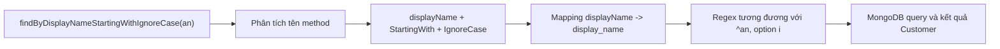

# Containing, StartingWith, EndingWith, Regex và IgnoreCase trong truy vấn suy diễn Spring Data MongoDB

## 1. Truy vấn suy diễn giải quyết vấn đề gì?

Spring Data MongoDB có thể tạo truy vấn MongoDB từ tên phương thức của `MongoRepository`. Đây là cơ chế **derived query** (*query derivation*): thay vì viết BSON cho từng điều kiện đơn giản, ta mô tả **thuộc tính**, **toán tử** và **cách kết hợp** trong tên method, còn Spring Data phân tích tên, ánh xạ property Java sang field BSON và tạo câu truy vấn.

Trong một hệ thống quản lý khách hàng, người dùng có thể cần:

- Tìm tên **chứa** đoạn văn bản: `Containing`.
- Tìm tên **bắt đầu bằng** tiền tố: `StartingWith`.
- Tìm tên **kết thúc bằng** hậu tố: `EndingWith`.
- Tìm theo một **biểu thức chính quy** có chủ ý: `Regex`.
- Tìm **không phân biệt chữ hoa/chữ thường**: `IgnoreCase` hoặc `AllIgnoreCase`.

Các từ khóa này phù hợp cho bài toán lọc chuỗi cơ bản của `SPRING_DATA_MONGODB`, nhưng cần hiểu rõ chúng thường tạo ra **truy vấn `$regex`**, chứ không phải phép tìm kiếm ngôn ngữ tự nhiên. Độ chính xác, khả năng dùng index và mức độ an toàn khác nhau đáng kể giữa tìm chuỗi literal và nhận một regex từ bên ngoài.

Mục tiêu của bài thuộc chương **Truy vấn suy diễn** là hiểu cú pháp repository, kết quả truy vấn, cách phối hợp từ khóa, mapping field, an toàn đầu vào, performance và kiểm thử bằng MongoDB thật. Các biểu diễn BSON trong bảng là **mô tả ngữ nghĩa**; cách Spring Data xây `Pattern` hoặc chuỗi regex chi tiết có thể thay đổi theo phiên bản.

## 2. Dữ liệu mẫu và entity Java

Trước tiên, tạo bộ dữ liệu nhỏ trong `mongosh` trên một database dùng cho thực hành:

```javascript
db.customers.insertMany([
  { _id: "C001", display_name: "An",       email: "an@example.com",    active: true },
  { _id: "C002", display_name: "Anh",      email: "anh@example.com",   active: true },
  { _id: "C003", display_name: "Lan Anh",  email: "lan@example.com",   active: false },
  { _id: "C004", display_name: "anna",     email: "anna@example.com",  active: true },
  { _id: "C005", display_name: "ANNA",     email: "anna2@example.com", active: true },
  { _id: "C006", display_name: "A.B",      email: "ab@example.com",    active: true },
  { _id: "C007", display_name: "A0B",      email: "a0b@example.com",   active: true },
  { _id: "C008", display_name: "Đà Nẵng",  email: "dn@example.com",    active: true }
]);

db.customers.find({}, { display_name: 1, email: 1 }).sort({ _id: 1 });
```

Điểm cố ý trong bộ dữ liệu:

- `"An"`, `"Anh"`, `"anna"` và `"ANNA"` giúp phân biệt **prefix** và **case sensitivity**.
- `"Lan Anh"` giúp phân biệt **chứa** và **kết thúc bằng**.
- `"A.B"` và `"A0B"` cho thấy dấu chấm `.` là **ký tự literal** trong tìm chuỗi nhưng là **ký tự đại diện** của regex.
- `"Đà Nẵng"` nhắc rằng case-insensitive **không đồng nghĩa** tìm kiếm không dấu hoặc tìm kiếm ngôn ngữ tự nhiên.

Ánh xạ với Spring Data MongoDB:

```java
import org.springframework.data.annotation.Id;
import org.springframework.data.mongodb.core.mapping.Document;
import org.springframework.data.mongodb.core.mapping.Field;

@Document(collection = "customers")
public class Customer {
    @Id
    private String id;

    @Field("display_name")
    private String displayName;

    private String email;
    private boolean active;

    protected Customer() {
        // Dành cho cơ chế materialization của Spring Data.
    }

    public Customer(String id, String displayName, String email, boolean active) {
        this.id = id;
        this.displayName = displayName;
        this.email = email;
        this.active = active;
    }

    public String getId() { return id; }
    public String getDisplayName() { return displayName; }
    public String getEmail() { return email; }
    public boolean isActive() { return active; }
}
```

Trong repository, method phải dùng **tên thuộc tính Java `displayName`**, dù document lưu field BSON `display_name`. Spring Data sử dụng mapping metadata `@Field` để ánh xạ query. Nếu viết query trực tiếp bằng `mongosh` hoặc raw Java Driver, sử dụng **`display_name`**.

## 3. Định nghĩa các phương thức truy vấn suy diễn

Ví dụ repository:

```java
import java.util.List;
import java.util.Optional;
import java.util.regex.Pattern;

import org.springframework.data.domain.Page;
import org.springframework.data.domain.Pageable;
import org.springframework.data.mongodb.repository.MongoRepository;

public interface CustomerRepository
        extends MongoRepository<Customer, String> {

    List<Customer> findByDisplayNameContaining(String fragment);

    List<Customer> findByDisplayNameStartingWith(String prefix);

    List<Customer> findByDisplayNameEndingWith(String suffix);

    List<Customer> findByDisplayNameRegex(String expression);

    List<Customer> findByDisplayNameRegex(Pattern expression);

    List<Customer> findByDisplayNameContainingIgnoreCase(String fragment);

    List<Customer> findByDisplayNameStartingWithIgnoreCase(String prefix);

    List<Customer> findByDisplayNameEndingWithIgnoreCase(String suffix);

    Optional<Customer> findByEmailIgnoreCase(String email);

    List<Customer> findByDisplayNameContainingAndActiveTrue(String fragment);

    List<Customer> findByDisplayNameAndEmailAllIgnoreCase(
        String displayName, String email);

    Page<Customer> findByDisplayNameContainingIgnoreCase(
        String fragment, Pageable pageable);
}
```

Các method `findByDisplayNameRegex(String)` và `findByDisplayNameRegex(Pattern)` được viết dạng overload để so sánh hai cách truyền biểu thức. Trong dự án thật, nên chọn **một giao diện rõ ràng** theo nhu cầu để tránh nhầm giữa chuỗi literal và regex được phép chạy. Những method có `IgnoreCase` có thể kết hợp với các toán tử chuỗi khác trong tên truy vấn.

Quy trình xử lý một lời gọi repository:



Spring Data phân tích cấu trúc method ở thời điểm tạo repository và bind các giá trị khi gọi. Method dài không đồng nghĩa query nhanh; phải xem điều kiện thực sự được sinh và index tương ứng.

## 4. Bảng đối chiếu năm nhóm từ khóa

Giả sử thuộc tính Java là `displayName`, field BSON là `display_name`:

| Method repository | Ý nghĩa | Truy vấn MongoDB tương đương về logic | Kết quả trên dữ liệu mẫu |
|---|---|---|---|
| `findByDisplayNameContaining("Anh")` | Chứa chuỗi literal `Anh` ở bất kỳ vị trí nào | `{ display_name: { $regex: "Anh" } }` | `C002, C003` |
| `findByDisplayNameStartingWith("An")` | Bắt đầu bằng `An` | `{ display_name: { $regex: "^An" } }` | `C001, C002` |
| `findByDisplayNameEndingWith("Anh")` | Kết thúc bằng `Anh` | `{ display_name: { $regex: "Anh$" } }` | `C002, C003` |
| `findByDisplayNameRegex("^A.B$")` | Đánh giá regex, trong đó `.` khớp một ký tự | `{ display_name: { $regex: "^A.B$" } }` | `C006, C007` |
| `findByEmailIgnoreCase("AN@EXAMPLE.COM")` | Bằng nhau khi bỏ qua khác biệt case | Điều kiện regex được neo cả đầu/cuối, option `i` | `C001` |
| `findByDisplayNameContainingIgnoreCase("ann")` | Chứa `ann`, bỏ qua case | `{ display_name: { $regex: "ann", $options: "i" } }` | `C004, C005` |
| `findByDisplayNameStartingWithIgnoreCase("an")` | Prefix `an`, bỏ qua case | `{ display_name: { $regex: "^an", $options: "i" } }` | `C001, C002, C004, C005` |
| `findByDisplayNameContaining("A.B")` | Tìm **dấu chấm literal** | Regex có escape cho dấu `.` | `C006` |

**Chú ý:** bảng viết mẫu regex ngắn gọn để dễ nhìn; Spring Data có thể thêm escape như `\Q...\E` khi biến tham số người dùng thành regex literal. Với `Containing`, `StartingWith` và `EndingWith`, tham số phải được xem như **chuỗi cần tìm**, trong khi `Regex` mô tả **mẫu biểu thức chính quy**.

### 4.1. Containing: chuỗi xuất hiện ở bất kỳ vị trí nào

```java
List<Customer> result =
    repository.findByDisplayNameContaining("Anh");
// C002 ("Anh"), C003 ("Lan Anh")
```

Đối chiếu trong `mongosh`:

```javascript
db.customers.find({ display_name: /Anh/ });
```

Không có `^` hoặc `$` nên vị trí xuất hiện không bị giới hạn. Với field là String, `Containing` biểu diễn tìm một đoạn văn bản. Tránh suy rộng trực tiếp sang field dạng array: các từ khóa collection như `Contains`/`Containing` có thể được ánh xạ theo kiểu thuộc tính khác với trường String; bài này tập trung vào **chuỗi**.

### 4.2. StartingWith: so khớp tiền tố

```java
List<Customer> result =
    repository.findByDisplayNameStartingWith("An");
// C001 ("An"), C002 ("Anh")
```

Tương đương:

```javascript
db.customers.find({ display_name: /^An/ });
```

Trong regex, dấu `^` neo vị trí bắt đầu chuỗi (với ngữ nghĩa thông thường không bật multiline). Đây là nhóm điều kiện regex có **khả năng tận dụng index tốt hơn** khi mẫu literal, case-sensitive và được neo đầu chuỗi. Khả năng thực tế phụ thuộc truy vấn, collation, kiểu index và kế hoạch thực thi.

### 4.3. EndingWith: so khớp hậu tố

```java
List<Customer> result =
    repository.findByDisplayNameEndingWith("Anh");
// C002 ("Anh"), C003 ("Lan Anh")
```

Tương đương:

```javascript
db.customers.find({ display_name: /Anh$/ });
```

Hậu tố không được neo từ đầu chuỗi. Với B-tree index thông thường, việc tìm tất cả String **kết thúc bằng** một đoạn thường khó tận dụng range scan hiệu quả. Nếu đây là chức năng có tải lớn, cần cân nhắc thiết kế chỉ mục/dữ liệu hoặc giải pháp tìm kiếm chuyên dụng thay vì tăng `maxPoolSize`.

### 4.4. Regex: người gọi cung cấp mẫu biểu thức

```java
List<Customer> result =
    repository.findByDisplayNameRegex("^A.B$");
// C006 ("A.B") và C007 ("A0B")
```

Tương đương:

```javascript
db.customers.find({ display_name: /^A.B$/ });
```

Trong regex:

- `^` neo đầu chuỗi, `$` neo cuối chuỗi theo ngữ nghĩa regex.
- `.` khớp một ký tự (trừ các trường hợp đặc biệt theo flags).
- `.*` có thể khớp chuỗi ký tự bất kỳ.
- `[0-9]` là lớp ký tự chữ số; `(foo|bar)` biểu thị lựa chọn.

`Regex` thích hợp khi nghiệp vụ **thực sự cần cú pháp regex**, chẳng hạn rule nội bộ được kiểm soát. Nó không phải cách an toàn để mô phỏng `Containing` khi nhận bất kỳ input nào từ form tìm kiếm. Với input literal chứa `.`, `*`, `?`, `[`, `]`... nên dùng `Containing`/`StartingWith` hoặc escape đúng cách.

### 4.5. IgnoreCase: bỏ qua khác biệt chữ hoa/chữ thường

```java
Customer result = repository
    .findByEmailIgnoreCase("AN@EXAMPLE.COM")
    .orElseThrow();
// C001 có email "an@example.com"
```

Với so khớp bằng nhau của String, hành vi tương đương là mẫu regex **neo đủ đầu và cuối** kèm chế độ case-insensitive; có thể hình dung:

```javascript
db.customers.find({
  email: { $regex: "^an@example\\.com$", $options: "i" }
});
```

Trong chuỗi regex JavaScript, ký tự `.` ở tên miền email được escape để là dấu chấm literal. Lưu ý `IgnoreCase` làm giảm phân biệt case, **không tự bỏ dấu tiếng Việt**, không tự loại khoảng trắng và không chuẩn hóa Unicode/định dạng email. Nếu ứng dụng cần quy tắc canonical email hoặc identifier, hãy chuẩn hóa theo hợp đồng nghiệp vụ ở tầng nhập dữ liệu trước khi lưu/truy vấn.

`IgnoreCase` có thể kết hợp với từ khóa khác, ví dụ:

```java
repository.findByDisplayNameContainingIgnoreCase("ann");
repository.findByDisplayNameStartingWithIgnoreCase("an");
repository.findByDisplayNameEndingWithIgnoreCase("ANH");
```

Khi được áp dụng cho regex, case-insensitive thường dẫn đến flag `i`. Kết quả theo chữ có dấu, Unicode và quy tắc collation không nên suy diễn chỉ từ tên method; cần kiểm thử với dữ liệu tiếng Việt thực.

## 5. Phân biệt chuỗi literal với một regex do người gọi cung cấp

### 5.1. Vì sao dấu chấm trong A.B là ca kiểm thử bắt buộc?

Giả sử form tìm kiếm nhận chuỗi `A.B`. Hai lời gọi này có **ý nghĩa khác nhau**:

```java
List<Customer> literal =
    repository.findByDisplayNameContaining("A.B");

List<Customer> regex =
    repository.findByDisplayNameRegex("^A.B$");
```

Kết quả với dữ liệu mẫu:

| Lời gọi | `C006: "A.B"` | `C007: "A0B"` | Giải thích |
|---|---|---|---|
| `Containing("A.B")` | Có | Không | Dấu `.` được hiểu như ký tự thường |
| `Regex("^A.B$")` | Có | Có | `.` trong regex khớp bất kỳ một ký tự phù hợp |
| `Regex("^A\\.B$")` | Có | Không | Dấu chấm đã được escape trong mẫu regex |

Ở hàng cuối, biểu thức `^A\\.B$` là **chuỗi Java cần escape dấu `\`**. Khi hiển thị trực tiếp bằng regex literal của `mongosh`, mẫu là:

```javascript
db.customers.find({ display_name: /^A\.B$/ }); // C006
db.customers.find({ display_name: /^A.B$/ });  // C006 và C007
```

Trong Java, có thể viết:

```java
repository.findByDisplayNameRegex("^A\\.B$");
repository.findByDisplayNameRegex(
    Pattern.compile("^A\\.B$"));
```

**Đừng làm mất bước escape:** Chuỗi Java `"^A\\.B$"` tương ứng mẫu regex `^A\.B$` khi đưa tới engine regex. Viết `"^A.B$"` không có escape sẽ khớp thêm `"A0B"`.

### 5.2. Từ khóa chuỗi của Spring Data có cơ chế làm an toàn regex

Trong các phiên bản Spring Data MongoDB hiện đại, các từ khóa dựa trên text literal như `Containing`, `StartingWith` và `EndingWith` được xử lý bằng cách **escape các metacharacter của regex** trong giá trị tham số. Vì vậy người dùng nhập `".*"` vào `Containing` không có nghĩa được quyền tìm mọi chuỗi theo regex `.*`.

Chẳng hạn:

```java
repository.findByDisplayNameContaining(".*");
// Mục tiêu là tìm hai ký tự literal "." rồi "*".
// Với dữ liệu mẫu hiện tại, không có tên nào chứa literal ".*".
```

Trong khi đó:

```java
repository.findByDisplayNameRegex(".*");
// Mẫu regex này có thể khớp mọi giá trị chuỗi, rất rộng.
```

Nếu ứng dụng đang dùng phiên bản Spring Data cũ hoặc có custom query/criteria, hãy xác minh chính xác cách escape của phiên bản đó. Không suy rằng tự ghép input vào `$regex` trong `@Query` hay raw driver sẽ tự có cùng cơ chế bảo vệ của derived `Containing`.

### 5.3. Khi cần xây regex bằng Java

`Pattern.quote` biến một giá trị thành đoạn regex dùng để so khớp **literal**. Ví dụ chuyển prefix do người dùng nhập thành một mẫu đã neo đầu:

```java
import java.util.List;
import java.util.regex.Pattern;
import org.springframework.data.mongodb.core.MongoTemplate;
import org.springframework.data.mongodb.core.query.Criteria;
import org.springframework.data.mongodb.core.query.Query;

public final class CustomerTextSearch {
    private final MongoTemplate mongoTemplate;

    public CustomerTextSearch(MongoTemplate mongoTemplate) {
        this.mongoTemplate = mongoTemplate;
    }

    public List<Customer> byLiteralPrefix(String prefix) {
        if (prefix == null || prefix.isBlank() || prefix.length() > 80) {
            throw new IllegalArgumentException("Prefix không hợp lệ");
        }

        Pattern safePattern =
            Pattern.compile("^" + Pattern.quote(prefix));

        Query query = Query.query(
            Criteria.where("displayName").regex(safePattern));

        return mongoTemplate.find(query, Customer.class);
    }
}
```

`Criteria.where("displayName")` là **property Java** của entity; khi gọi `mongoTemplate.find(query, Customer.class)`, Spring Data ánh xạ sang field BSON `display_name`. `Pattern.quote` tránh coi `.`, `[`, `*`... là cú pháp regex do người dùng tự ý truyền vào.

Nếu đây chỉ là prefix search cơ bản, method derived `findByDisplayNameStartingWith(...)` thường gọn và dễ bảo trì hơn. `Pattern.quote` hữu ích khi cần xây một regex phức tạp có phần cố định và phần literal do người dùng nhập.

### 5.4. Regex phức tạp cần giới hạn chi phí

Regex không phải bộ lọc vô hại nếu mở cho người dùng tùy ý điều khiển. Một số biểu thức gây quét nhiều document hoặc làm engine tốn tài nguyên. Với API công khai:

- Ưu tiên **literal search** (`Containing`/`StartingWith`/`EndingWith`) nếu người dùng không cần cú pháp regex.
- Nếu thật sự cần regex, giới hạn độ dài input, loại mẫu không được phép theo chính sách ứng dụng và giới hạn quyền truy cập/chỉ số request.
- Bắt buộc **page/limit**, đặt deadline phù hợp và quan sát latency, `docsExamined`, lỗi timeout.
- Không cho phép client gửi các mẫu tùy ý vào truy vấn nhạy cảm hoặc dùng regex làm cơ chế ủy quyền/xác thực.
- Kiểm tra khác biệt giữa engine regex phía Java và MongoDB server; không mặc định mọi đặc tính của `java.util.regex.Pattern` được hỗ trợ giống hệt bởi engine MongoDB.

Một regex `^prefix` đơn giản thường có chi phí dễ dự đoán hơn regex chứa nhiều lựa chọn hoặc wildcard không được neo. Nhưng có anchor không có nghĩa luôn dùng index hoặc luôn chạy nhanh, nhất là khi kết hợp `IgnoreCase`.

## 6. IgnoreCase, AllIgnoreCase và kết hợp điều kiện

### 6.1. IgnoreCase chỉ áp dụng cho phần truy vấn chứa nó

```java
List<Customer> result = repository
    .findByDisplayNameContainingIgnoreCase("ann");
// C004 ("anna"), C005 ("ANNA")
```

Chữ hoa và chữ thường được bỏ qua trong điều kiện tên. Nếu method có nhiều điều kiện, vị trí `IgnoreCase` chỉ rõ điều kiện String nào cần áp dụng. Ví dụ có thể khai báo một method:

```java
// Có thể thêm vào CustomerRepository:
List<Customer> findByDisplayNameIgnoreCaseAndEmail(
    String displayName, String email);
```

Trong trường hợp này, so khớp `displayName` không phân biệt case, còn so khớp `email` theo cách mặc định. Nếu muốn cả hai không phân biệt case, có thể thêm `IgnoreCase` cho cả hai phần hoặc dùng `AllIgnoreCase`.

### 6.2. AllIgnoreCase áp dụng cho mọi phần String thích hợp

```java
List<Customer> result = repository
    .findByDisplayNameAndEmailAllIgnoreCase(
        "AN", "AN@EXAMPLE.COM");
// C001
```

`AllIgnoreCase` yêu cầu các điều kiện String **có hỗ trợ bỏ qua case** trong method cùng dùng quy tắc này. Các thuộc tính boolean/number không biến thành so khớp case-insensitive. Tránh suy rằng một từ khóa áp dụng được cho mọi kiểu dữ liệu chỉ nhờ đặt `AllIgnoreCase` ở cuối.

Khi tên method có nhiều `And`, `Or`, `Containing` và `IgnoreCase`, nó có thể trở nên khó đọc và dễ nhầm về ý định. Với điều kiện phức tạp, nên chuyển sang `@Query` hoặc `MongoTemplate` với `Criteria` để thể hiện cấu trúc rõ ràng và kiểm thử BSON được sinh.

### 6.3. Kết hợp với điều kiện boolean

```java
List<Customer> result = repository
    .findByDisplayNameContainingAndActiveTrue("Anh");
// C002 ("Anh"); C003 ("Lan Anh") bị loại vì active=false
```

Ngữ nghĩa tương đương:

```javascript
db.customers.find({
  display_name: { $regex: "Anh" },
  active: true
});
```

`ActiveTrue` không nhận tham số; Spring Data nhận biết `True` như phần điều kiện cố định. Tương tự, repository hỗ trợ các từ khóa như `False`, `Not`, `IsNull` theo kiểu dữ liệu phù hợp, nhưng không nên ghép một tên method dài đến mức khó bảo đảm cách parser phân tích.

### 6.4. Phân biệt IgnoreCase với MongoDB collation

MongoDB có **collation** để so sánh/sắp xếp chuỗi theo locale và mức độ nhạy case/diacritics. Đây là cơ chế khác với `IgnoreCase` thường dựa trên regex flag `i`:

| Cơ chế | Ví dụ | Đặc điểm |
|---|---|---|
| `IgnoreCase` của derived query | `findByEmailIgnoreCase("AN@EXAMPLE.COM")` | Thường dùng regex case-insensitive |
| Case-insensitive collation | Equality với `collation({ locale: "en", strength: 2 })` | Có thể kết hợp index tạo với collation tương ứng cho equality/sort |
| Field canonical để lookup | `emailLookup = lower/normalized email` | Truy vấn equality thông thường khi chuẩn hóa ngay từ lúc ghi |
| Text search/Search index | Truy vấn theo từ/cụm từ/đặc tính tìm kiếm | Cơ chế khác với substring regex, phải thiết kế theo nhu cầu |

Ví dụ `mongosh` về **equality + collation**:

```javascript
db.customers.createIndex(
  { email: 1 },
  {
    name: "ix_email_collation",
    collation: { locale: "en", strength: 2 }
  }
);

db.customers.find({
  email: "AN@EXAMPLE.COM"
}).collation({ locale: "en", strength: 2 });
// C001
```

Tìm bằng `$regex` **không collation-aware** theo cùng cách equality/sort, nên một index case-insensitive dựa trên collation không đồng nghĩa regex `/pattern/i` có thể dùng index đó hiệu quả. Nếu chức năng chủ yếu là tra cứu email hoặc mã theo equality không phân biệt case, hãy cân nhắc schema canonical/appropriate collation thay vì tạo regex cho mọi request.

Tiếng Việt có các tình huống khác nhau giữa chữ hoa/thường, dấu, ký tự Unicode tổ hợp và cách sắp xếp. `IgnoreCase` không phải giải pháp toàn diện cho tìm kiếm **không dấu**; cần quy định rõ yêu cầu sản phẩm, chuẩn hóa dữ liệu hoặc dùng chức năng tìm kiếm phù hợp.

## 7. Truy vấn suy diễn trên property path và kiểu dữ liệu

### 7.1. Dùng tên thuộc tính Java, để mapper giải quyết field BSON

Entity `Customer` có `displayName` nhưng MongoDB lưu `display_name`. Vì vậy:

```java
repository.findByDisplayNameStartingWith("An");
```

không yêu cầu đổi tên method thành `findByDisplay_nameStartingWith(...)`. Khi định nghĩa method, parser dựa trên **property name của entity**, sau đó Spring Data mapping mới xác định tên field vật lý.

Trường hợp có một value object lồng nhau:

```java
public class Address {
    private String city;
    // Constructor/getter hoặc cơ chế mapping phù hợp.
}

// Khi entity Customer có field:
private Address address;
```

Repository có thể diễn đạt property path:

```java
List<Customer> findByAddress_CityContainingIgnoreCase(String text);
```

Tên method trên có thể được khai báo khi entity thật sự có `address.city`. Dấu gạch dưới giúp phân định đường dẫn lồng nhau và tránh nhập nhằng trong parser. Với embedded document mặc định, BSON path là `address.city`; nếu dùng mapping đặc biệt như `@Field` hoặc `@Unwrapped`, đường dẫn vật lý có thể khác. Hãy kiểm tra câu query thực tế khi domain model có mapping tùy chỉnh.

### 7.2. Không nhầm String với array hoặc BSON null

Bài học tập trung vào property có kiểu `String`. MongoDB cũng cho phép một field chứa array String, lúc đó bộ lọc regex trên field có thể khớp **một phần tử của array**. Nếu collection có dữ liệu không đồng nhất, việc query chuỗi có thể trả ra document mà field BSON là array. Spring Data khi ánh xạ lại entity có field `String` có thể gặp vấn đề chuyển đổi kiểu.

Vì vậy:

- Đặt schema/validation đảm bảo `display_name` là String theo hợp đồng.
- Kiểm tra trường hợp `display_name` thiếu hoặc null; regex thường không khớp các giá trị đó như so khớp chuỗi.
- Với array, cân nhắc derived keywords và query dành riêng cho collection/array; không dùng ngữ nghĩa của String để suy luận.
- Không dùng `Containing` cho bất kỳ field nào mà không xác định type và query tương ứng.

### 7.3. Trả về Optional, List, Page có ý nghĩa gì?

| Return type | Khi dùng | Lưu ý |
|---|---|---|
| `Optional<Customer>` | Mong nhiều nhất một kết quả, ví dụ email duy nhất theo chính sách | Không tự bảo đảm uniqueness; database nên có ràng buộc |
| `List<Customer>` | Tập kết quả nhỏ, đã giới hạn hợp lý | Không tự có thứ tự ổn định nếu thiếu sort |
| `Page<Customer>` | UI cần tổng số trang/bản ghi | Thường cần thêm count query, có chi phí với regex |
| `Slice<Customer>` | UI chỉ cần biết còn trang sau | Có thể tránh yêu cầu count tổng khi phù hợp |

**Return type không thay thế index, limit và tính đúng đắn schema.** Ví dụ `Optional<Customer> findByEmailIgnoreCase` không bảo đảm không tồn tại hai document email khác nhau chỉ về chữ hoa/thường; nếu kết quả có nhiều hơn một document, việc đọc một kết quả đơn có thể gây lỗi số lượng kết quả ngoài dự kiến.

Nếu cần uniqueness không phân biệt case, thiết kế index/normalization theo dữ liệu thực và quy tắc MongoDB của deployment, thay vì chỉ dựa vào tên repository method.

## 8. Kết hợp phân trang, sort và giới hạn kết quả

Không nên cho endpoint trả hàng chục nghìn kết quả chỉ vì method `findBy...Containing(...)` trả về một `List`. Với dữ liệu thực, thêm phân trang và sắp xếp rõ ràng:

```java
import org.springframework.data.domain.Page;
import org.springframework.data.domain.PageRequest;
import org.springframework.data.domain.Pageable;
import org.springframework.data.domain.Sort;

Pageable firstPage = PageRequest.of(
    0,
    10,
    Sort.by(
        Sort.Order.asc("displayName"),
        Sort.Order.asc("id")
    )
);

Page<Customer> page = repository
    .findByDisplayNameContainingIgnoreCase("an", firstPage);

System.out.println(page.getContent());
System.out.println(page.getTotalElements());
```

`Sort.by("displayName")` sử dụng **property Java**, Spring Data ánh xạ sang `display_name`. Thêm `id` làm trường thứ hai để có thứ tự nhất quán hơn khi nhiều khách hàng trùng tên. Với các method không có `Sort` hay `Pageable`, thứ tự trả về mặc định **không được bảo đảm**, dù ví dụ trong bài liệt kê ID theo cách dễ đọc.

`Page` thường cần tổng số bản ghi và số trang, nên có thể phát sinh **count query** ngoài truy vấn lấy dữ liệu. Với regex substring và collection lớn, count cũng có thể tốn tài nguyên. Nếu UI chỉ cần “còn trang sau không?”, cân nhắc `Slice` hoặc mô hình phân trang phù hợp thay vì đếm mọi kết quả.

Truy vấn `StartingWith` có thể được giới hạn:

```java
// Có thể khai báo bổ sung trong CustomerRepository:
List<Customer> findTop10ByDisplayNameStartingWithOrderByDisplayNameAsc(
    String prefix);
```

Từ khóa `Top10` giới hạn số kết quả; `OrderByDisplayNameAsc` chỉ định sort theo property. Query có limit nhưng **không tự giải quyết chi phí scan** nếu regex không dùng index. Để tránh phản hồi quá rộng từ một form, thường nên yêu cầu người dùng nhập tối thiểu một số ký tự, giới hạn độ dài chuỗi và giới hạn kích thước trang.

## 9. Index và hiệu năng của từng kiểu regex

### 9.1. Tạo index cho field vật lý

Trên dữ liệu mẫu, nếu cần tối ưu tìm theo tên, có thể thử index:

```javascript
db.customers.createIndex(
  { display_name: 1 },
  { name: "ix_customers_display_name" }
);
```

Trong một bài benchmark, so sánh ba query:

```javascript
// Prefix case-sensitive
db.customers.find({ display_name: /^An/ })
  .explain("executionStats");

// Substring không neo đầu
db.customers.find({ display_name: /Anh/ })
  .explain("executionStats");

// Prefix case-insensitive
db.customers.find({ display_name: /^an/i })
  .explain("executionStats");
```

Với index B-tree thông thường, regex **case-sensitive và neo đầu bằng tiền tố literal** như `/^An/` có thể tận dụng range scan trên index hiệu quả. Regex không neo đầu như `/Anh/` hoặc regex dùng flag `i` thường không có lợi thế tương đương. MongoDB có thể vẫn chọn index scan trong một số kế hoạch, nhưng một scan rộng không phải là tối ưu.

**Không khẳng định chắc chắn sẽ có `IXSCAN` trong bộ dữ liệu 8 document.** Query planner có thể chọn `COLLSCAN` vì collection quá nhỏ. Kết luận hiệu năng phải dựa trên khối lượng và phân bố dữ liệu thực, số index keys/documents đã duyệt và thời gian truy vấn.

### 9.2. Kết quả từ explain cần đọc thế nào?

Quan sát:

| Trường/khái niệm | Cách diễn giải |
|---|---|
| `winningPlan` | Kế hoạch thực thi MongoDB lựa chọn |
| `IXSCAN` | Có quét index; cần xem mức độ rộng của quét |
| `COLLSCAN` | Quét collection; có thể hợp lý cho tập dữ liệu nhỏ |
| `totalKeysExamined` | Số khóa index được xem xét |
| `totalDocsExamined` | Số document được xem xét |
| `nReturned` | Số document trả về |
| `executionTimeMillis` | Một phép đo thời gian thực thi; cần so sánh nhiều lượt và bối cảnh tải |

Nếu `nReturned` thấp nhưng `totalDocsExamined` lớn, regex đang lọc không chọn lọc hoặc không có index thích hợp. Với autocomplete, nên thiết kế **prefix search có giới hạn và index hợp lý**. Nếu yêu cầu tìm một cụm xuất hiện ở bất kỳ vị trí nào trong hàng triệu bản ghi, sử dụng `Containing` đơn giản có thể không đáp ứng mục tiêu hiệu năng.

### 9.3. Vì sao thêm IgnoreCase có thể làm chậm?

MongoDB `$regex` không collation-aware như các phép equality/sort thông thường. Vì vậy regex case-insensitive kiểu `/^an/i` thường không tận dụng hiệu quả một index collation case-insensitive chỉ vì index đó tồn tại. Đặc biệt, `ContainingIgnoreCase` là một tổ hợp **substring + case-insensitive**, nên cần đo trên dữ liệu thật thay vì coi đây là một query index-friendly.

Các hướng thiết kế có thể cân nhắc tùy sản phẩm:

1. **Canonical field:** lưu `displayNameNormalized` hoặc `emailLookup` theo một quy tắc chuẩn hóa được định nghĩa rõ, sau đó tìm equality/prefix case-sensitive trên trường này. Cần bảo đảm dữ liệu cũ được migration và field canonical luôn đồng bộ.
2. **Collation:** áp dụng equality và index cùng collation khi bài toán là so sánh/unique case-insensitive, không cần substring regex.
3. **Search index chuyên dụng:** khi cần full-text, typo tolerance, phân tích ngôn ngữ, tokenization hoặc substring trên khối lượng lớn, xem xét MongoDB Search/Atlas Search hay một công cụ tìm kiếm phù hợp với hạ tầng.
4. **Thiết kế lại UX:** autocomplete có độ dài đầu vào tối thiểu, giới hạn kết quả, debounce và caching hợp lý để giảm tải.

Không thay đổi dữ liệu sang lowercase một cách vô điều kiện khi nghiệp vụ cần giữ nguyên tên hiển thị, quy tắc dấu hoặc sự khác biệt case. Thông thường nên lưu riêng giá trị **hiển thị gốc** và khóa **dùng để tìm kiếm** nếu phải chuẩn hóa.

### 9.4. Không nhầm `$regex` với `$text` và `$in`

`$text` dựa trên text index và tokenization, không có cùng ngữ nghĩa “chứa một chuỗi ký tự liên tiếp” của `Containing`. `$in` dùng kiểm tra tập giá trị, không phải substring search. Các kiểu truy vấn khác có thể tốt hơn với workload phù hợp, nhưng không được coi chúng thay thế trực tiếp cho derived query khi yêu cầu kết quả khác nhau.

## 10. Khi nào viết @Query hoặc MongoTemplate thay vì tên method dài?

Với nhu cầu cơ bản, derived query giúp code ngắn gọn:

```java
repository.findByDisplayNameStartingWithIgnoreCase("an");
```

Khi logic cần nhiều nhánh `$and`/`$or`, điều kiện tùy chọn, kết hợp `$elemMatch`, regex flag phức tạp hoặc yêu cầu vận hành đặc biệt, dùng `MongoTemplate` sẽ dễ kiểm soát hơn:

```java
import java.util.List;
import java.util.regex.Pattern;
import org.springframework.data.mongodb.core.query.Criteria;
import org.springframework.data.mongodb.core.query.Query;

String fragment = "Anh";
Pattern escaped = Pattern.compile(
    Pattern.quote(fragment), Pattern.CASE_INSENSITIVE);

Query query = Query.query(
    new Criteria().andOperator(
        Criteria.where("displayName").regex(escaped),
        Criteria.where("active").is(true)
    )
);

List<Customer> customers =
    mongoTemplate.find(query, Customer.class);
```

Đoạn code giữ ngữ nghĩa “chứa literal Anh, bỏ qua case, và phải active” thông qua `Criteria`; Spring mapper ánh xạ `displayName` thành `display_name` khi có `Customer.class`. Nếu ứng dụng đã có `findByDisplayNameContainingIgnoreCaseAndActiveTrue(...)`, không nhất thiết phải dùng template. Tiêu chí chọn là **độ dễ hiểu và khả năng kiểm thử** của truy vấn.

`@Query` cũng cho phép mô tả BSON tường minh ngay trên repository method, ví dụ:

```java
import java.util.List;
import org.springframework.data.mongodb.repository.Query;

// Trong interface CustomerRepository:
@Query("{ 'active': true, 'display_name': { $regex: ?0, $options: 'i' } }")
List<Customer> findActiveByTrustedNameRegex(String trustedPattern);
```

Trong ví dụ này, `?0` là tham số thứ nhất được bind vào expression. **Đây là regex có chủ ý**, vì vậy chỉ dùng với pattern đã kiểm soát. Đừng lấy trực tiếp nội dung tùy ý từ ô tìm kiếm rồi chuyển vào method này: binding tham số không biến cú pháp regex thành tìm kiếm literal.

Nếu query phụ thuộc vào mapping `@Field`, nested object hoặc custom converter, hãy kiểm thử xem `@Query` tường minh có dùng đúng tên field BSON thực tế và không tạo điều kiện trái ý. Đối với cú pháp quá phức tạp, xây `Query` bằng `Criteria` để dễ review hơn so với string nội tuyến.

## 11. Kiểm thử tích hợp các kết quả mong đợi

Với dữ liệu mẫu đã định nghĩa ở mục 2, nên kiểm thử bằng MongoDB thật (chẳng hạn instance dành riêng cho integration test hoặc Testcontainers); mock repository không kiểm chứng được cách Spring Data phân tích method thành `$regex`.

### 11.1. Ca kiểm thử tối thiểu

| Input/method | ID phải tìm được | Vì sao ca này cần thiết |
|---|---|---|
| `Containing("Anh")` | `C002, C003` | So khớp substring không cần đứng đầu |
| `StartingWith("An")` | `C001, C002` | Có anchor đầu chuỗi, case-sensitive |
| `EndingWith("Anh")` | `C002, C003` | Có anchor cuối chuỗi |
| `ContainingIgnoreCase("ann")` | `C004, C005` | Case-insensitive |
| `StartingWithIgnoreCase("an")` | `C001, C002, C004, C005` | Kết hợp prefix và IgnoreCase |
| `Regex("^A.B$")` | `C006, C007` | Dấu chấm là metacharacter |
| `Containing("A.B")` | `C006` | Dấu chấm literal phải được escape |
| `Containing(".*")` | Không có | Input có ký tự regex không được biến thành wildcard |
| `EmailIgnoreCase("AN@EXAMPLE.COM")` | `C001` | Case-insensitive equality |
| `ContainingAndActiveTrue("Anh")` | `C002` | Kết hợp String và boolean |
| `DisplayNameAndEmailAllIgnoreCase("AN", "AN@EXAMPLE.COM")` | `C001` | Bỏ qua case ở hai thuộc tính String |

Tất cả ID chỉ là **tập kết quả**, không phải yêu cầu thứ tự, vì các method trả `List` chưa khai báo sort.

### 11.2. Ví dụ JUnit 5 + AssertJ

Ví dụ dưới đây giả định đã có môi trường `@DataMongoTest` hoặc integration test tương đương và dữ liệu test được cô lập:

```java
import java.util.List;
import org.junit.jupiter.api.BeforeEach;
import org.junit.jupiter.api.Test;
import org.springframework.beans.factory.annotation.Autowired;
import org.springframework.boot.test.autoconfigure.data.mongo.DataMongoTest;

import static org.assertj.core.api.Assertions.assertThat;

@DataMongoTest
class CustomerRepositoryDerivedQueryTest {
    @Autowired
    CustomerRepository repository;

    @BeforeEach
    void seed() {
        repository.deleteAll(); // Chỉ chạy trên database test cô lập.
        repository.saveAll(List.of(
            new Customer("C001", "An", "an@example.com", true),
            new Customer("C002", "Anh", "anh@example.com", true),
            new Customer("C003", "Lan Anh", "lan@example.com", false),
            new Customer("C004", "anna", "anna@example.com", true),
            new Customer("C005", "ANNA", "anna2@example.com", true),
            new Customer("C006", "A.B", "ab@example.com", true),
            new Customer("C007", "A0B", "a0b@example.com", true),
            new Customer("C008", "Đà Nẵng", "dn@example.com", true)
        ));
    }

    @Test
    void containingMatchesLiteralText() {
        assertThat(repository.findByDisplayNameContaining("A.B"))
            .extracting(Customer::getId)
            .containsExactlyInAnyOrder("C006");

        assertThat(repository.findByDisplayNameContaining(".*"))
            .isEmpty();
    }

    @Test
    void regexTreatsDotAsWildcard() {
        assertThat(repository.findByDisplayNameRegex("^A.B$"))
            .extracting(Customer::getId)
            .containsExactlyInAnyOrder("C006", "C007");
    }

    @Test
    void prefixAndIgnoreCaseAreDifferentConditions() {
        assertThat(repository.findByDisplayNameStartingWith("An"))
            .extracting(Customer::getId)
            .containsExactlyInAnyOrder("C001", "C002");

        assertThat(repository.findByDisplayNameStartingWithIgnoreCase("an"))
            .extracting(Customer::getId)
            .containsExactlyInAnyOrder("C001", "C002", "C004", "C005");
    }

    @Test
    void caseInsensitiveEmailLookupMatches() {
        assertThat(repository.findByEmailIgnoreCase("AN@EXAMPLE.COM"))
            .map(Customer::getId)
            .contains("C001");
    }
}
```

Ví dụ chỉ minh họa cấu trúc test; với phiên bản Spring Boot khác, package `@DataMongoTest` và cách cấu hình context/Testcontainers có thể thay đổi. Không dùng `deleteAll()` trên database phát triển dùng chung hoặc production. Với phiên bản Spring Data mới có thay đổi tên class/cơ chế bootstrap, cần đối chiếu dependency thực tế.

### 11.3. Trường hợp biên cần thêm

Nên thêm ca kiểm thử cho:

- Chuỗi đầu vào rỗng, chỉ có khoảng trắng, rất dài; endpoint phải **định nghĩa chính sách rõ**, không mặc định trả mọi bản ghi.
- Regex đặc biệt như dấu `.`, `*`, `[`, `(`, dấu gạch chéo ngược và Unicode; phân biệt input literal với pattern.
- Chữ có dấu, chữ hoa/thường và Unicode chuẩn hóa khác nhau trong tên tiếng Việt.
- Document có `display_name` thiếu, null hoặc sai kiểu (nếu collection cho phép schema hỗn hợp).
- Tên trùng nhau, phân trang nhiều trang, sort ổn định theo `displayName` rồi `id`.
- Phân bố dữ liệu lớn: query planner có dùng index không, `docsExamined` và latency ở P95/P99.

Nếu ứng dụng kết hợp derived query với projection, reactive repository hoặc authorization theo tenant, kiểm thử thêm rằng các điều kiện lọc cố định luôn được áp dụng, không bị bỏ qua khi người dùng nhập chuỗi quá rộng.

## 12. Chẩn đoán truy vấn trả sai hoặc chạy chậm

| Biểu hiện | Nguyên nhân có thể | Cách kiểm tra |
|---|---|---|
| `findByDisplayNameContaining("A.B")` khớp cả `A0B` | Dùng raw regex chưa escape hoặc custom `@Query` khác với derived literal search | Xem query BSON và ca test metacharacter |
| `findByDisplayNameRegex(...)` khớp nhiều hơn mong đợi | `.`, `*`, `^`, `$` hoặc group đang có ý nghĩa regex | In mẫu kiểm soát, test regex bằng dữ liệu cố định |
| `IgnoreCase` vẫn không tìm được tên không dấu | Case-insensitive không đồng nghĩa accent-insensitive | Kiểm tra Unicode/collation/normalization và yêu cầu tìm kiếm |
| Query không tìm thấy document dù nhìn thấy trên DB | Dùng sai tên field Java/BSON hoặc database/collection | Kiểm tra `@Field`, raw `display_name` và query thực tế |
| Query có kết quả khác nhau khi thay đổi sort/page | Không có sort ổn định hoặc trang quá lớn | Sort thêm ID và dùng phân trang rõ ràng |
| `Optional<Customer>` gặp lỗi nhiều kết quả | Không có uniqueness theo case-insensitive semantics | Kiểm tra index, duplicate data và canonical key |
| `ContainingIgnoreCase` chậm trên collection lớn | Regex substring/case-insensitive phải xem nhiều keys/docs | `explain("executionStats")`, index, giới hạn input và search index |
| `StartingWith` chậm dù đã có index | Regex không còn prefix đơn giản, collation khác, dữ liệu phân bố lệch | Xem winningPlan, filter, sort và số keys/docs examined |
| API bị quá tải với đầu vào rất ngắn | Query khớp phần lớn collection hoặc count đắt | Đặt ngưỡng độ dài, limit, rate control và theo dõi |
| Truy vấn lỗi regex syntax | Input người dùng bị diễn giải thành pattern hợp lệ/không hợp lệ | Dùng literal keywords hoặc validate regex có chủ ý |

Quy trình xử lý thực tế:

1. Ghi nhận **method repository**, tham số và kết quả mong đợi.
2. Xác định field Java, `@Field` và field BSON, sau đó quan sát lệnh được gửi trong môi trường test.
3. Chạy câu truy vấn tương đương trên `mongosh` để loại trừ vấn đề mapping hoặc dữ liệu.
4. Dùng `explain("executionStats")` và metrics để xác định trường hợp lỗi logic so khớp hay lỗi hiệu năng.
5. Chỉnh query/index/schema hoặc chiến lược tìm kiếm; bổ sung regression test cho input gây lỗi.

Không giải quyết mọi truy vấn regex chậm bằng cách tăng connection pool hoặc timeout. Nếu phần lớn thời gian nằm ở quét dữ liệu MongoDB, cần xử lý kiểu truy vấn và cấu trúc index/dữ liệu trước.

## 13. Bài thực hành tự đánh giá

**Bối cảnh:** xây endpoint tìm kiếm khách hàng cho ứng dụng Spring Data MongoDB. Form có ô tên và tùy chọn tìm không phân biệt chữ hoa/chữ thường.

1. Chạy tập dữ liệu ở mục 2 và tạo entity `Customer` với `@Field("display_name")`.
2. Tạo `CustomerRepository` có đủ các method `Containing`, `StartingWith`, `EndingWith`, `Regex`, `IgnoreCase` và một method `AllIgnoreCase`.
3. Chạy mỗi method với dữ liệu mẫu, ghi lại ID tìm được. Đặc biệt so sánh `Containing("A.B")` với `Regex("^A.B$")`.
4. Dùng `Containing(".*")` để kiểm tra tham số được hiểu là literal; phân tích sự khác biệt với `Regex(".*")`.
5. Bổ sung `Pageable` với sort theo `displayName` rồi `id` và kích thước trang tối đa do API kiểm soát.
6. Tạo index trên `display_name`, chạy `explain("executionStats")` cho prefix, substring và prefix case-insensitive. So sánh `totalKeysExamined`, `totalDocsExamined` và kế hoạch thực thi.
7. Thử một tên có dấu tiếng Việt và quyết định xem sản phẩm cần **case-insensitive**, **accent-insensitive** hay **tìm kiếm từ/cụm từ**; chọn công nghệ theo yêu cầu thực tế.
8. Viết integration tests cho input literal metacharacter, regex chủ ý, case-insensitive equality và điều kiện `ActiveTrue`.

**Tiêu chí hoàn thành:** giải thích được vì sao các method sinh truy vấn khác nhau, chứng minh `Containing` không coi dấu chấm là wildcard, phân biệt `IgnoreCase` với collation, dùng đúng field BSON, giới hạn đầu vào và đánh giá chi phí index trên MongoDB thật.

## 14. Bảng ghi nhớ

| Từ khóa/cơ chế | Cần nhớ |
|---|---|
| `Containing` | Chuỗi literal xuất hiện ở bất kỳ vị trí nào; thường không tận dụng prefix index hiệu quả |
| `StartingWith` | Chuỗi literal ở đầu; regex neo đầu, case-sensitive có thể tận dụng index |
| `EndingWith` | Chuỗi literal ở cuối; thường không có range scan hiệu quả với B-tree index thông thường |
| `Regex` | Người gọi mô tả mẫu regex, có metacharacter và chi phí bảo mật/hiệu năng |
| `IgnoreCase` | Bỏ khác biệt chữ hoa/thường ở điều kiện tương ứng; thường dùng regex flag `i` |
| `AllIgnoreCase` | Áp dụng ignore-case cho các điều kiện String phù hợp trong method |
| `@Field` | Method repository dùng tên property Java; Spring ánh xạ sang tên BSON |
| `Pageable` và `Sort` | Giới hạn và sắp xếp kết quả; thêm ID để ổn định thứ tự |
| Collation | Dùng cho equality/sort theo locale, không thay thế `$regex` |
| `explain("executionStats")` | Xác minh liệu index có giúp query và mức độ quét thực tế |

**Nguyên tắc thiết kế:** chọn derived query khi ý định lọc đơn giản và rõ ràng; chọn `Regex` chỉ khi thực sự cần biểu thức chính quy; dùng `MongoTemplate` hoặc `@Query` khi cấu trúc truy vấn vượt khả năng biểu đạt dễ đọc của tên method. Đối với ứng dụng có tải lớn, hiệu năng được quyết định bởi dữ liệu, index, giới hạn kết quả và khả năng tìm kiếm phù hợp, không phải chỉ bởi tên repository method.

**Tài liệu tham khảo:** [Spring Data MongoDB — Query Methods](https://docs.spring.io/spring-data/mongodb/reference/mongodb/repositories/query-methods.html), [Spring Data Commons — Query Keywords](https://docs.spring.io/spring-data/commons/reference/repositories/query-keywords-reference.html), [MongoDB — $regex](https://www.mongodb.com/docs/manual/reference/operator/query/regex/), [MongoDB — Case-Insensitive Indexes](https://www.mongodb.com/docs/manual/core/index-case-insensitive/). Khi triển khai, đối chiếu API/từ khóa với phiên bản Spring Data MongoDB và Java Driver trong dự án.
