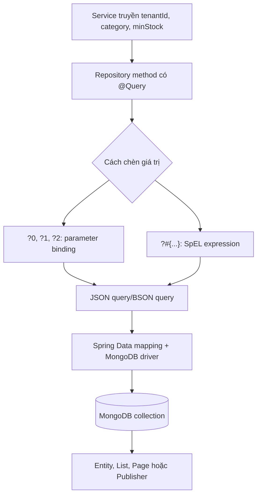

# Bind tham số vị trí ?0 và biểu thức SpEL

## 1. Vì sao cần bind tham số trong truy vấn JSON?

Trong **Spring Data MongoDB**, repository có thể tạo truy vấn từ tên phương thức như `findBySku`, nhưng một số tình huống cần mô tả điều kiện MongoDB cụ thể: `$gte`, `$in`, `$elemMatch`, kết hợp nhiều điều kiện hoặc giá trị được tính trước khi thực hiện truy vấn. Annotation `@Query` cho phép viết **JSON query trực tiếp trong mã Java** rồi truyền tham số vào những vị trí cần thiết.

Giả sử dịch vụ quản lý sản phẩm cần tìm:

- Sản phẩm thuộc **đúng tenant** đang đăng nhập;
- Sản phẩm trong một category cụ thể;
- Sản phẩm có `stock` từ một ngưỡng do service truyền vào;
- Trường hợp thiếu ngưỡng, áp dụng giá trị mặc định của nghiệp vụ.

Hai cơ chế cần phân biệt:

1. **`?0`, `?1`, `?2`...**: bind giá trị từ tham số phương thức repository theo thứ tự, bắt đầu tại chỉ số 0.
2. **`?#{...}`**: đánh giá một biểu thức **Spring Expression Language (SpEL)** trong ngữ cảnh truy vấn; có thể đọc các tham số như `[0]`, `[1]` và tạo giá trị cho điều kiện.

Ví dụ cơ bản:

```java
@Query("{ 'tenantId': ?0, 'category': ?1 }")
List<CatalogProduct> findProducts(String tenantId, String category);
```

Khi truyền `("tenant-42", "books")`, query MongoDB tương đương:

```javascript
db.catalog_products.find({
  tenantId: "tenant-42",
  category: "books"
});
```

Với module **SPRING_DATA_MONGODB**, các truy vấn này vẫn dùng hạ tầng kết nối, ánh xạ document, driver, index và quy tắc kiểm thử của Spring Data MongoDB. `@Query` thay cách **khai báo điều kiện**, không tự tạo index, cải thiện thuật toán truy vấn hoặc bảo đảm tính duy nhất của dữ liệu.

## 2. @Query nằm ở đâu trong kiến trúc Spring Data?



Một câu `@Query` có hai loại thành phần:

| Thành phần | Ví dụ | Ý nghĩa |
| --- | --- | --- |
| Tên trường | `'tenantId'`, `'stock'` | Định nghĩa field cần lọc; phải khớp với schema/mapping thực tế |
| Toán tử MongoDB | `'$gte'`, `'$in'` | Thể hiện thao tác so sánh, kết hợp hoặc lọc |
| Giá trị cố định | `true`, `'ACTIVE'` | Dữ liệu được khai báo sẵn trong query |
| Tham số vị trí | `?0`, `?1` | Giá trị được truyền từ phương thức theo vị trí |
| Biểu thức SpEL | `?#{[1] == null ? 0 : [1]}` | Giá trị tính từ ngữ cảnh/đối số phương thức |

**Hợp đồng cần nhớ:** Binding là một phần của framework. Không tự nối chuỗi từ input người dùng vào JSON query bằng phép cộng chuỗi, và không biến văn bản người dùng thành mã SpEL để đánh giá.

## 3. Chuẩn bị entity và repository mẫu

### 3.1. Entity sản phẩm

Ví dụ dùng một entity đơn giản để tập trung vào phần truy vấn:

```java
package example.catalog;

import java.time.Instant;
import org.springframework.data.annotation.Id;
import org.springframework.data.mongodb.core.mapping.Document;

@Document(collection = "catalog_products")
public record CatalogProduct(
    @Id String id,
    String tenantId,
    String category,
    String sku,
    int stock,
    boolean active,
    Instant createdAt
) {}
```

Document tương ứng:

```javascript
{
  _id: "p-101",
  tenantId: "tenant-42",
  category: "books",
  sku: "BOOK-101",
  stock: NumberInt("12"),
  active: true,
  createdAt: ISODate("2026-11-20T02:00:00Z")
}
```

Trong môi trường đa tenant, `tenantId` dùng làm điều kiện phân tách dữ liệu. Giá trị tenant phải được xác định **từ thông tin xác thực/ủy quyền của server**, không được tin tưởng một giá trị tenant do client tự chọn.

### 3.2. Repository

```java
package example.catalog;

import java.util.Collection;
import java.util.List;
import java.util.Optional;
import org.springframework.data.mongodb.repository.MongoRepository;
import org.springframework.data.mongodb.repository.Query;

public interface CatalogProductRepository
        extends MongoRepository<CatalogProduct, String> {

    @Query("{ 'tenantId': ?0, 'sku': ?1 }")
    Optional<CatalogProduct> findByTenantAndSku(
        String tenantId, String sku
    );

    @Query(
        "{ 'tenantId': ?0, 'category': ?1, " +
        "'stock': { '$gte': ?2 } }"
    )
    List<CatalogProduct> findAvailableByCategory(
        String tenantId, String category, int minStock
    );

    @Query("{ 'tenantId': ?0, 'category': { '$in': ?1 } }")
    List<CatalogProduct> findInCategories(
        String tenantId, Collection<String> categories
    );
}
```

Ba method thể hiện ba kiểu phổ biến: tìm theo khóa nghiệp vụ, so sánh bằng toán tử và truyền một collection vào `$in`. Chúng chỉ cần đối số thông thường của Java; Spring Data chịu trách nhiệm bind giá trị thành biểu diễn truy vấn phù hợp.

## 4. Cú pháp ?0, ?1 và cách Spring bind tham số

### 4.1. Chỉ số bắt đầu từ 0

```java
@Query("{ 'tenantId': ?0, 'category': ?1, 'stock': { '$gte': ?2 } }")
List<CatalogProduct> findAvailableByCategory(
    String tenantId,  // ?0
    String category,  // ?1
    int minStock      // ?2
);
```

Ví dụ gọi:

```java
List<CatalogProduct> result = repository.findAvailableByCategory(
    "tenant-42",
    "books",
    10
);
```

Truy vấn MongoDB tương đương về ý nghĩa:

```javascript
db.catalog_products.find({
  tenantId: "tenant-42",
  category: "books",
  stock: { $gte: 10 }
});
```

Đối số thứ nhất là `?0`, không phải `?1`. Khi thay đổi thứ tự tham số trong method, cần cập nhật vị trí trong chuỗi `@Query` cho khớp. Một lỗi nhầm vị trí có thể không gây lỗi cú pháp nếu các tham số cùng kiểu `String`, nhưng kết quả lọc sẽ sai.

### 4.2. Không tự thêm dấu nháy cho placeholder

Nên viết:

```java
@Query("{ 'sku': ?0 }")
Optional<CatalogProduct> findBySkuExact(String sku);
```

Giá trị `?0` đã được Spring Data bind theo kiểu phù hợp. Không cần tự tạo dấu nháy chuỗi ở xung quanh placeholder hoặc ghép `"'" + sku + "'"`. Tương tự, giá trị số, boolean, thời gian và collection cần giữ kiểu phù hợp của tham số Java thay vì ép tất cả thành string.

Đoạn `@Query` có thể dùng JSON-like syntax với tên trường và operator được quote như ví dụ. Phần `?0` không phải là JSON hợp lệ khi đứng một mình trong `mongosh`; đây là cú pháp template của Spring Data, được framework giải quyết trước khi gửi lệnh MongoDB.

### 4.3. Binding giá trị và escape dữ liệu đầu vào

Spring Data MongoDB **escape tham số `String` trong quá trình binding**, nhằm ngăn dữ liệu chuỗi tự biến thành toán tử MongoDB khi nó được đặt vào vị trí giá trị.

Giả sử client cố tìm SKU với ký tự giống JSON query:

```java
String suspiciousSku = "{ '$ne': null }";

Optional<CatalogProduct> product =
    repository.findByTenantAndSku("tenant-42", suspiciousSku);
```

Ở ví dụ này `suspiciousSku` được hiểu là **giá trị chuỗi** cần so khớp, không phải biến thành operator `$ne`. Điều đó khác hoàn toàn việc ứng dụng nối nguyên văn chuỗi người dùng vào query:

```java
// KHÔNG dùng cách này để xây JSON query:
String unsafe = "{ 'sku': " + userInput + " }";
```

Mẫu `unsafe` là ví dụ chống chỉ định, chưa phải một method chạy được. Dùng binding cho giá trị và kiểm soát các phần cấu trúc query bằng code tĩnh/DSL an toàn. Escape không thay thế authorization, giới hạn input hay kiểm soát những phép toán đắt như regex.

### 4.4. Giá trị null vẫn là một giá trị

```java
@Query("{ 'category': ?0 }")
List<CatalogProduct> findByCategoryRaw(String category);
```

Nếu truyền `null`, truy vấn về mặt ý nghĩa sẽ lọc `category: null`, chứ **không mặc nhiên bỏ điều kiện category**. Trong MongoDB, phép so khớp với `null` có thể bao gồm cả document không có field, tùy query và toán tử.

Nếu người dùng muốn “không truyền category thì bỏ filter”, cần xây query động có kiểm soát (ví dụ `MongoTemplate`) hoặc khai báo một hợp đồng điều kiện khác. Đừng hiểu `null` trong `?0` như lời yêu cầu framework xóa một phần JSON query.

## 5. Biểu thức SpEL trong @Query: ?#{...}

Spring Expression Language (**SpEL**) là ngôn ngữ biểu thức do Spring cung cấp. Trong `@Query` của Spring Data MongoDB, cú pháp `?#{...}` cho phép tính ra giá trị từ các tham số và ngữ cảnh trước khi hoàn thiện truy vấn.

Một biểu thức thường gặp dùng **đối số theo index**:

```java
@Query("{ 'stock': { '$gte': ?#{[0] == null ? 0 : [0]} } }")
List<CatalogProduct> findStockAtLeastOrZero(Integer minStock);
```

Nếu `minStock = 10`, biểu thức tạo giá trị 10. Nếu `minStock = null`, biểu thức tạo giá trị 0. Đây là **quy ước rõ ràng**: mặc định lọc `stock >= 0`, không phải bỏ filter khi `null`.

### 5.1. Tại sao trong SpEL dùng [0] thay cho ?0?

So sánh hai dạng:

```java
// Binding thông thường: chuyển thẳng giá trị tham số đầu tiên.
@Query("{ 'sku': ?0 }")
Optional<CatalogProduct> findDirectly(String sku);

// SpEL: đánh giá biểu thức lấy tham số đầu tiên.
@Query("{ 'sku': ?#{[0]} }")
Optional<CatalogProduct> findThroughSpel(String sku);
```

`?0` là placeholder của Spring Data. Trong `?#{...}`, `[0]` là cách truy cập đối số thứ nhất của phương thức trong **ngữ cảnh đánh giá SpEL**. Cả hai ví dụ trên hướng tới cùng giá trị SKU, nhưng ví dụ thứ hai phức tạp hơn mà không thêm lợi ích. Vì vậy **ưu tiên `?0` khi chỉ cần binding giá trị**.

### 5.2. Biểu thức số học

Ví dụ yêu cầu tồn kho **lớn hơn** một ngưỡng được truyền vào:

```java
@Query(
    "{ 'tenantId': ?0, " +
    "'stock': { '$gte': ?#{[1] + 1} } }"
)
List<CatalogProduct> findStockStrictlyGreaterThan(
    String tenantId, int threshold
);
```

Với `threshold = 10`, SpEL tính 11, nên query trở thành `stock >= 11` và tương đương `stock > 10` đối với trường số nguyên.

Ví dụ này chỉ để minh họa phép tính. Trong ứng dụng thực tế, nên viết `'$gt': ?1` cho ngắn gọn, tránh rủi ro tràn số nếu `threshold == Integer.MAX_VALUE`. **Không dùng SpEL chỉ vì có thể** khi toán tử MongoDB đã mô tả yêu cầu trực tiếp.

### 5.3. Biểu thức điều kiện

Một query áp dụng mức tồn kho tối thiểu 0 khi tham số bị bỏ trống:

```java
@Query(
    "{ 'tenantId': ?0, 'category': ?1, " +
    "'stock': { '$gte': ?#{[2] == null ? 0 : [2]} } }"
)
List<CatalogProduct> findWithOptionalMinimum(
    String tenantId,
    String category,
    Integer minStock
);
```

| `minStock` từ service | Giá trị sau SpEL | Filter thực thi |
| --- | --- | --- |
| `null` | `0` | `stock >= 0` |
| `5` | `5` | `stock >= 5` |
| `20` | `20` | `stock >= 20` |

Nếu nghiệp vụ không cho phép tồn kho âm, service có thể validate tham số đầu vào và thống nhất cách xử lý khi `null`. Nếu nghiệp vụ thật sự cần **bỏ hẳn điều kiện stock**, query động với `MongoTemplate` thường sáng sủa hơn là tạo một SpEL map lồng nhiều nhánh.

### 5.4. SpEL có thể tạo cấu trúc, nhưng cần kiểm soát phạm vi

Trong Spring Data MongoDB, biểu thức SpEL có thể tạo ra giá trị phức tạp để dùng trong phần truy vấn. Điều này cho phép các nhánh logic như một điều kiện dùng `$exists` hoặc một giá trị trực tiếp.

Ví dụ minh họa cú pháp biểu thức trả về một object thay vì scalar:

```java
// Khi checkExistence=true: điều kiện id có tồn tại.
// Khi false: so sánh id với expectedId.
@Query("{ 'externalId': ?#{[0] ? {'$exists': true} : [1]} }")
List<CatalogProduct> queryWithConditionalOperator(
    boolean checkExistence,
    String expectedId
);
```

Ví dụ cho thấy SpEL có thể thay đổi **cấu trúc giá trị** phía sau một field. Đây là kỹ thuật cần dùng rất thận trọng: một nhánh có `$exists` không tương đương nhánh so sánh bằng; cả hai phải được mô tả rõ trong hợp đồng method và có test riêng. Khi query ngày càng phức tạp, nên chuyển sang `Criteria` và `Query` để thấy rõ các điều kiện.

**Về bảo mật:** Biểu thức SpEL có thể biểu diễn nhiều dạng cấu trúc phức tạp hơn binding chuỗi thông thường. Chỉ đưa dữ liệu đã kiểm tra vào những vị trí được phép, không cho input người dùng quyết định **văn bản của biểu thức SpEL**, tên operator, tên trường hoặc toàn bộ JSON query. Tránh dùng SpEL để lắp ghép chuỗi query từ dữ liệu không tin cậy.

## 6. So sánh ?0, ?#{[0]} và MongoTemplate

| Cách viết | Ưu điểm | Hạn chế/cần lưu ý |
| --- | --- | --- |
| `@Query("{ 'sku': ?0 }")` | Ngắn, dễ đọc, bind theo vị trí | Thay đổi thứ tự tham số dễ tạo lỗi nếu không sửa query |
| `@Query("{ 'stock': { '$gte': ?#{[0] ?: 0} } }")` | Có thể áp dụng fallback hoặc phép tính ngay tại annotation | Biểu thức phức tạp khó review và khó kiểm thử |
| `MongoTemplate` + `Criteria` | Dễ xây filter tùy chọn theo từng nhánh và kiểm soát cấu trúc query | Nhiều code hơn cho truy vấn đơn giản |
| Query derivation `findBy...` | Không cần viết JSON cho trường hợp CRUD cơ bản | Tên method có thể dài/khó diễn đạt logic phức tạp |

Một quy tắc thực dụng: **giá trị trực tiếp → `?0`; biến đổi giá trị đơn giản → cân nhắc SpEL; nhiều điều kiện tùy chọn/dynamic operator → `MongoTemplate` hoặc custom repository**.

### 6.1. Ví dụ bỏ điều kiện optional bằng MongoTemplate

Giả sử yêu cầu: luôn lọc theo tenant, lọc category nếu có, lọc tồn kho nếu có:

```java
package example.catalog;

import java.util.ArrayList;
import java.util.List;
import org.springframework.data.mongodb.core.MongoTemplate;
import org.springframework.data.mongodb.core.query.Criteria;
import org.springframework.data.mongodb.core.query.Query;

public class ProductSearchService {
    private final MongoTemplate mongoTemplate;

    public ProductSearchService(MongoTemplate mongoTemplate) {
        this.mongoTemplate = mongoTemplate;
    }

    public List<CatalogProduct> search(
            String tenantId,
            String category,
            Integer minStock) {

        List<Criteria> filters = new ArrayList<>();
        filters.add(Criteria.where("tenantId").is(tenantId));

        if (category != null && !category.isBlank()) {
            filters.add(Criteria.where("category").is(category));
        }
        if (minStock != null) {
            filters.add(Criteria.where("stock").gte(minStock));
        }

        Query query = new Query(new Criteria().andOperator(
            filters.toArray(new Criteria[0])
        ));
        query.limit(100);
        return mongoTemplate.find(query, CatalogProduct.class);
    }
}
```

Ở đây khi `category == null`, filter category **không được thêm**. Khi `minStock == null`, filter stock **không được thêm**. Đây là một hợp đồng khác ví dụ `?#{[2] == null ? 0 : [2]}`. Lệnh có `limit(100)` để giới hạn số kết quả trả về; trong hệ thống thật cần thêm sort/pagination và các index tương ứng.

Service phải nhận `tenantId` từ nguồn xác thực. Nếu client tự truyền tenantId, code trên không tự chặn quyền truy cập vượt tenant.

### 6.2. Khi nào cần custom repository?

Khi điều kiện thay đổi theo nhiều trường, kết hợp `$or`, aggregation, phân trang theo cursor, dynamic projection hoặc cần tối ưu query phức tạp, có thể đặt logic `MongoTemplate` trong một implementation repository tùy biến. Điều này giữ interface repository dễ sử dụng và gom logic truy vấn vào một chỗ.

## 7. Các kiểu dữ liệu trong parameter binding

Giá trị truyền vào `@Query` phải phù hợp với kiểu BSON đang lưu. Ví dụ:

| Kiểu Java của tham số | Đầu vào ví dụ | Điều cần kiểm tra |
| --- | --- | --- |
| `String` | `"books"` | Collation, chuẩn hóa chữ hoa/thường, escaping |
| `int`/`Integer` | `10` | Giá trị nguyên và giới hạn phạm vi |
| `boolean`/`Boolean` | `true` | Phân biệt boolean với chuỗi `"true"` |
| `Instant` | `Instant.parse(...)` | Đường chuyển đổi thời gian và múi giờ/UTC |
| `Collection<String>` | `List.of("books", "tools")` | Bind vào `$in` và xử lý collection rỗng |
| `BigDecimal` | `new BigDecimal("19.99")` | BSON String hay Decimal128 tùy mapping/converter |
| ID Java `String` | `"..."` | Quy tắc ánh xạ `@Id` sang BSON `_id`, ObjectId hay String |

### 7.1. Binding collection vào $in

```java
@Query("{ 'tenantId': ?0, 'category': { '$in': ?1 } }")
List<CatalogProduct> findInCategories(
    String tenantId, Collection<String> categories
);
```

```java
repository.findInCategories(
    "tenant-42",
    List.of("books", "tools")
);
```

Truy vấn tương đương:

```javascript
db.catalog_products.find({
  tenantId: "tenant-42",
  category: { $in: ["books", "tools"] }
});
```

Nếu `categories` rỗng, `$in: []` không khớp document nào. Với `null`, hãy quy định rõ lỗi validation hay cách bỏ điều kiện; không tự coi null là “mọi category”.

### 7.2. Đường dẫn nested field

Với document có `supplier: { country: "VN" }`, query raw dùng dấu chấm:

```java
@Query("{ 'supplier.country': ?0 }")
List<CatalogProduct> findBySupplierCountry(String country);
```

Phương thức minh họa cú pháp; entity `CatalogProduct` ở phần trước chưa có `supplier`. Nếu triển khai thực tế, phải thêm mapping thuộc tính hoặc viết query theo schema thật, kiểm tra annotation `@Field`/`@Unwrapped` nếu có. Không lấy ví dụ đường dẫn raw làm cam kết rằng mọi tên field sẽ được tự chuyển đúng trong mọi cách mapping tùy biến.

### 7.3. Số tiền cần kiểu BSON nhất quán

Nếu trường `price` được lưu dưới BSON Decimal128 nhưng method nhận một `String` rồi lọc:

```java
@Query("{ 'price': { '$gte': ?0 } }")
List<CatalogProduct> findPriceAtLeast(String minimum);
```

đây là hợp đồng không phù hợp: `minimum` là chuỗi, trong khi `price` là số. Nên dùng kiểu Java/convert và mapping phù hợp với Decimal128, kiểm thử raw BSON. Ví dụ `BigDecimal` có thể được Spring Data MongoDB lưu thành String nếu không cấu hình target type; do đó không thể suy ra chỉ cần chọn `BigDecimal` trong method là luôn đủ.

## 8. Null, missing, $exists và các điều kiện khó

### 8.1. Null trong MongoDB query

```javascript
db.catalog_products.find({ category: null });
```

MongoDB có thể trả cả document với `category: null` và document thiếu khóa `category`. Nếu nghiệp vụ phải phân biệt, sử dụng điều kiện `$exists` hoặc kiểm tra kiểu BSON rõ hơn:

```javascript
// Chỉ các document không có field category:
db.catalog_products.find({
  category: { $exists: false }
});

// Chỉ các document có field và giá trị BSON null:
db.catalog_products.find({
  category: { $exists: true, $eq: null }
});
```

Khi truyền `null` vào `?0`, lưu ý những quy tắc MongoDB này vẫn áp dụng; binding không sửa lại ngữ nghĩa `null` thành tùy chọn.

### 8.2. Điều kiện trên array

Giả sử một document chứa:

```javascript
{
  _id: "p-bundle-1",
  tenantId: "tenant-42",
  tags: ["featured", "winter"]
}
```

Query:

```java
@Query("{ 'tenantId': ?0, 'tags': ?1 }")
List<CatalogProduct> findTagged(String tenantId, String tag);
```

Trong MongoDB, so khớp một giá trị với field array có thể tìm các document mà array chứa phần tử bằng giá trị đó. Cũng như ví dụ `supplier.country`, đây là truy vấn theo schema mở rộng; entity mẫu cần có trường `tags` nếu muốn đưa vào dự án thực tế.

Với array các object và yêu cầu nhiều điều kiện phải khớp **cùng một phần tử**, cân nhắc `$elemMatch`. Không nên nhầm `@Query` với khả năng tự giải quyết mọi vấn đề mô hình hóa array.

### 8.3. Regex là trường hợp cần bảo vệ riêng

```java
@Query("{ 'sku': { '$regex': ?0, '$options': 'i' } }")
List<CatalogProduct> findBySkuPattern(String pattern);
```

Parameter binding giúp dữ liệu đi vào vị trí value, nhưng **chuỗi regex vẫn là một mẫu regex** khi được dùng với `$regex`. Người dùng có thể gửi mẫu có ký tự đặc biệt hoặc gây quét tốn tài nguyên. Cần giới hạn độ dài, cho phép pattern được xây từ mã ứng dụng hoặc escape ký tự theo mục đích tìm literal, chọn index và tránh công khai tính năng regex tự do nếu không cần.

## 9. Kết quả trả về, projection và phân trang

Kiểu trả về không làm thay đổi ý nghĩa của `?0` hay SpEL; nó ảnh hưởng cách ứng dụng tiêu thụ kết quả:

```java
@Query("{ 'tenantId': ?0, 'sku': ?1 }")
Optional<CatalogProduct> findByTenantAndSku(
    String tenantId, String sku
);

@Query("{ 'tenantId': ?0, 'category': ?1 }")
List<CatalogProduct> findInCategory(
    String tenantId, String category
);
```

`Optional` thích hợp khi nghiệp vụ bảo đảm tối đa một sản phẩm theo cặp (`tenantId`, `sku`); ràng buộc này nên được hỗ trợ bởi **unique index** trên collection. `List` phù hợp khi nhiều sản phẩm có cùng category; khi không có kết quả, nhận danh sách rỗng.

### 9.1. Pageable

```java
import org.springframework.data.domain.Page;
import org.springframework.data.domain.Pageable;

@Query("{ 'tenantId': ?0, 'category': ?1 }")
Page<CatalogProduct> findPageInCategory(
    String tenantId, String category, Pageable pageable
);
```

Ví dụ khai báo này đặt **bên trong repository interface**. `Pageable` là tham số đặc biệt hỗ trợ phân trang; nó không làm các chỉ số `?0` và `?1` của hai tham số truy vấn thông thường thay đổi.

Service gọi:

```java
import org.springframework.data.domain.PageRequest;
import org.springframework.data.domain.Sort;

var page = repository.findPageInCategory(
    "tenant-42",
    "books",
    PageRequest.of(0, 20, Sort.by("sku").ascending())
);
```

`Page` có metadata về tổng số phần tử/trang và có thể phát sinh truy vấn đếm. Với dữ liệu lớn, cần sort ổn định, kiểm soát chi phí đếm và xem xét `Slice` hoặc phân trang dựa trên cursor nếu phù hợp.

### 9.2. Projection với fields

`@Query` cho phép khai báo các field cần trả về:

```java
@Query(
    value = "{ 'tenantId': ?0, 'active': true }",
    fields = "{ 'sku': 1, 'category': 1 }"
)
List<CatalogProduct> findActiveSummaries(String tenantId);
```

Query trả một phần document, nên entity được dựng từ projection có thể không chứa đủ dữ liệu còn lại. Không `save` lại entity chỉ chứa một phần trường rồi vô tình làm mất dữ liệu gốc. Với API hiển thị tóm tắt, sử dụng DTO/projection interface riêng thường rõ hơn.

## 10. Reactive repository: cú pháp @Query vẫn dùng được

Spring Data MongoDB reactive có cách khai báo `@Query` tương tự. Thay `MongoRepository` bằng `ReactiveMongoRepository`, kiểu kết quả nhiều document thường là `Flux<T>`, còn một document là `Mono<T>`:

```java
package example.catalog;

import org.springframework.data.mongodb.repository.Query;
import org.springframework.data.mongodb.repository.ReactiveMongoRepository;
import reactor.core.publisher.Flux;
import reactor.core.publisher.Mono;

public interface ReactiveCatalogProductRepository
        extends ReactiveMongoRepository<CatalogProduct, String> {

    @Query("{ 'tenantId': ?0, 'sku': ?1 }")
    Mono<CatalogProduct> findByTenantAndSku(
        String tenantId, String sku
    );

    @Query(
        "{ 'tenantId': ?0, 'stock': " +
        "{ '$gte': ?#{[1] == null ? 0 : [1]} } }"
    )
    Flux<CatalogProduct> findWithMinimum(
        String tenantId, Integer minimum
    );
}
```

SpEL/binding quyết định query được tạo; reactive access quyết định cách truy vấn được **thực thi và tiêu thụ** theo publisher. Khi `Flux` không tìm thấy gì, nó hoàn tất mà không phát phần tử. Khi `Mono` không tìm thấy gì, nó hoàn tất rỗng. Trong pipeline WebFlux, thường trả publisher ra controller thay vì gọi `block()`.

**Reactive không tăng độ chính xác của truy vấn hoặc tự thêm index.** Với cùng filter, MongoDB vẫn cần index và mô hình dữ liệu phù hợp.

## 11. Index và hiệu năng: truy vấn đẹp chưa chắc chạy nhanh

### 11.1. Index theo tenant, category, stock

Với query lặp lại:

```javascript
db.catalog_products.find({
  tenantId: "tenant-42",
  category: "books",
  stock: { $gte: 10 }
});
```

có thể đánh giá compound index:

```javascript
db.catalog_products.createIndex({
  tenantId: 1,
  category: 1,
  stock: 1
});
```

Hai trường so sánh bằng (`tenantId` và `category`) đứng trước trường range (`stock`) là một điểm khởi đầu hợp lý cho workload minh họa. Tuy vậy, index thực tế phải xét selectivity, sort, các query khác và chi phí ghi/index. Kiểm tra kế hoạch thực thi:

```javascript
db.catalog_products.find({
  tenantId: "tenant-42",
  category: "books",
  stock: { $gte: 10 }
}).explain("executionStats");
```

Theo dõi `totalDocsExamined`, `totalKeysExamined`, thời gian thực thi và index được chọn. `@Query` chỉ mô tả điều kiện, không bảo đảm MongoDB sẽ dùng index phù hợp.

### 11.2. Unique index cho query trả Optional

Nếu mỗi tenant chỉ có một sản phẩm trên mỗi SKU:

```javascript
db.catalog_products.createIndex(
  { tenantId: 1, sku: 1 },
  { unique: true, name: "uk_tenant_sku" }
);
```

Index này hỗ trợ truy vấn `findByTenantAndSku` và bảo vệ dữ liệu khỏi trùng cặp khóa khi có nhiều request ghi đồng thời. `Optional<CatalogProduct>` **không tự tạo uniqueness**. Khi chưa có index, một truy vấn kỳ vọng một kết quả có thể gặp lỗi kết quả không duy nhất nếu nhiều document khớp.

### 11.3. SpEL không phải công cụ tối ưu query

Với cùng điều kiện thực tế sau binding, `?0` và `?#{[0]}` không có lợi thế hiệu năng truy vấn chỉ do cách viết. Hãy tối ưu bằng index, projection, giới hạn kết quả, mô hình document, aggregation và đo lường. Nếu biểu thức SpEL quá nhiều nhánh, khó quan sát query sinh ra sẽ làm việc chẩn đoán khó hơn.

## 12. Kiểm thử: xác minh cả kết quả lẫn kiểu tham số

Kiểm thử cần xác nhận **dữ liệu kết quả**, **quy tắc binding** và **hợp đồng trường hợp rỗng**. Với JSON query có SpEL, mỗi nhánh điều kiện phải được kiểm tra.

### 12.1. Một bộ test với Spring Data MongoDB

Ví dụ JUnit 5 + Spring Boot Mongo test slice (giả định MongoDB test có thể kết nối):

```java
package example.catalog;

import static org.junit.jupiter.api.Assertions.*;

import java.time.Instant;
import java.util.List;
import java.util.UUID;
import org.junit.jupiter.api.BeforeEach;
import org.junit.jupiter.api.Test;
import org.springframework.beans.factory.annotation.Autowired;
import org.springframework.boot.test.autoconfigure.data.mongo.DataMongoTest;

@DataMongoTest
class CatalogProductQueryTest {

    @Autowired
    CatalogProductRepository repository;

    private String tenant;

    @BeforeEach
    void insertSamples() {
        String suffix = UUID.randomUUID().toString();
        tenant = "tenant-" + suffix;

        repository.saveAll(List.of(
            new CatalogProduct("a-" + suffix, tenant,
                "books", "BOOK-A", 12, true, Instant.EPOCH),
            new CatalogProduct("b-" + suffix, tenant,
                "books", "BOOK-B", 3, true, Instant.EPOCH),
            new CatalogProduct("c-" + suffix, tenant,
                "tools", "TOOL-C", 20, false, Instant.EPOCH)
        ));
    }

    @Test
    void bindsPositionalParametersInCorrectOrder() {
        var found = repository.findByTenantAndSku(
            tenant, "BOOK-A"
        );

        assertTrue(found.isPresent());
        assertEquals(12, found.orElseThrow().stock());
        assertTrue(
            repository.findByTenantAndSku(
                "another-tenant", "BOOK-A"
            ).isEmpty()
        );
    }

    @Test
    void bindsRangeAndCollectionParameters() {
        assertEquals(1, repository.findAvailableByCategory(
            tenant, "books", 10
        ).size());

        assertEquals(3, repository.findInCategories(
            tenant, List.of("books", "tools")
        ).size());

        assertTrue(repository.findInCategories(
            tenant, List.of()
        ).isEmpty());
    }
}
```

Class test minh họa dùng UUID để mỗi lần chạy có tenant và ID riêng. Nó vẫn cần một môi trường MongoDB test được cấu hình: `@DataMongoTest` tự giới hạn Spring context nhưng không có nghĩa MongoDB server luôn được khởi chạy.

### 12.2. Kiểm thử SpEL với giá trị null và không null

Trong repository, bổ sung method:

```java
@Query(
    "{ 'tenantId': ?0, 'category': ?1, " +
    "'stock': { '$gte': ?#{[2] == null ? 0 : [2]} } }"
)
List<CatalogProduct> findWithOptionalMinimum(
    String tenantId, String category, Integer minStock
);
```

Trong class test:

```java
@Test
void spelUsesDefaultWhenMinimumIsNull() {
    assertEquals(2, repository.findWithOptionalMinimum(
        tenant, "books", null
    ).size());

    assertEquals(1, repository.findWithOptionalMinimum(
        tenant, "books", 10
    ).size());
}
```

Đây là ví dụ **ghép thêm method vào repository và test vào class đã khai báo**, không phải những top-level Java statement độc lập. Với service thực tế, nên kiểm tra thêm trường hợp input âm nếu nghiệp vụ không cho phép.

### 12.3. Chứng minh chuỗi input không trở thành operator

```java
@Test
void stringParameterIsNotInterpretedAsMongoOperator() {
    String looksLikeOperator = "{ '$ne': null }";

    var found = repository.findByTenantAndSku(
        tenant, looksLikeOperator
    );

    assertTrue(found.isEmpty());
}
```

Test này có ý nghĩa vì collection thử đang chứa nhiều SKU khác null; nếu một giá trị chuỗi bị diễn giải sai thành toán tử `$ne`, query có thể khớp ngoài dự kiến. Tuy nhiên, binding an toàn không thay thế việc kiểm tra authorization của tenant.

### 12.4. Kiểm tra query thực sự được gửi

Với lỗi truy vấn khó tái hiện, có thể dùng:

- Kiểm thử integration trên MongoDB thực tế/Testcontainers và assert tập kết quả cụ thể.
- Driver command monitoring/logging có kiểm soát để quan sát filter BSON, tránh ghi dữ liệu nhạy cảm vào log.
- `explain("executionStats")` của truy vấn tương đương trong mongosh để xem index và chi phí.
- Kiểm tra nguyên nhân gốc của exception khi mapping, ép kiểu hoặc xây biểu thức SpEL thất bại.

Không chỉ kiểm tra chuỗi annotation trông “đúng”. Một query có thể đúng cú pháp nhưng sai thứ tự `?0`/`?1`, sai kiểu BSON hoặc lọc quá rộng.

## 13. Những lỗi thường gặp

| Triệu chứng | Nguyên nhân có thể | Cách xử lý |
| --- | --- | --- |
| Truy vấn trả rỗng dù document tồn tại | Nhầm `?0` và `?1`; sai tên field hoặc kiểu BSON | Đối chiếu thứ tự method, raw BSON và filter sinh ra |
| Query với null không trả “tất cả” như mong đợi | `?0 = null` vẫn là điều kiện, không tự bỏ filter | Xây query động hoặc khai báo fallback rõ ràng |
| Nhận nhiều tenant hơn dự kiến | Điều kiện tenant thiếu/sai hoặc lấy tenant từ input client | Buộc tenant filter từ server-side authorization; test cách ly tenant |
| String input bị xử lý như regex | Query dùng `$regex`, trong đó value có ý nghĩa regex | Escape literal hoặc kiểm soát pattern và index |
| Lỗi khi đánh giá SpEL | Biểu thức sai cú pháp, truy cập sai index hoặc đối số null | Giảm độ phức tạp, test mỗi nhánh, cân nhắc MongoTemplate |
| Số tiền query sai | BSON `Decimal128` nhưng tham số bind thành String/Double | Chuẩn hóa mapping và kiểm thử kiểu BSON |
| Query quá chậm | Thiếu index, điều kiện không chọn lọc, regex rộng | `explain`, thiết kế index, pagination |
| Query dynamic quá dài và khó review | Đưa nhiều toán tử/nhánh vào SpEL | Dùng `Criteria` và custom repository |
| Chạy được trong Java nhưng mongosh báo lỗi với `?0` | Placeholder là cú pháp Spring Data, không phải JSON thuần | Thay bằng giá trị BSON thật khi thử trong mongosh |
| Kết quả projection mất trường khi save lại | Dữ liệu đọc thiếu field từ projection | Sử dụng DTO/projection riêng và tránh save entity thiếu trường |

### Quy trình chẩn đoán

1. Xem lại annotation `@Query` và danh sách tham số method theo đúng thứ tự.
2. Phân biệt vị trí dùng `?0` với biểu thức `?#{[0]}` và ý nghĩa của từng nhánh.
3. Kiểm tra raw document, tên trường BSON, kiểu dữ liệu thực tế và điều kiện null/missing.
4. Tái hiện filter với dữ liệu mẫu trong mongosh (thay placeholder bằng giá trị đã bind).
5. Quan sát query/command thực tế nếu cần, bảo vệ dữ liệu nhạy cảm trong log.
6. Kiểm tra index, sort, giới hạn kết quả và các dữ liệu ngoại lệ như dấu tiếng Việt, chuỗi rỗng, collection rỗng.
7. Thêm test cho cả giá trị hợp lệ, null, rỗng, sai kiểu và trường hợp xuyên tenant.

## 14. Bài tập thực hành

### Bài 1 — Bind tham số theo vị trí

Tạo repository cho collection `products` có `tenantId`, `category`, `price` và `active`. Viết `@Query` nhận:

1. `tenantId` ở `?0`;
2. `category` ở `?1`;
3. `minPrice` ở `?2`;
4. `active = true` cố định trong JSON query.

Gọi method với dữ liệu mẫu, giải thích tại sao đảo `tenantId` và `category` có thể khiến query sai dù cả hai đều là String.

### Bài 2 — So sánh ?0 và SpEL

Viết hai method tìm sản phẩm theo tồn kho: một method dùng `?0` cho ngưỡng truyền thẳng; một method dùng `?#{[0] == null ? 0 : [0]}` để đặt default 0. Thử với `null`, 0, 5 và 20; mô tả query thực tế, rồi đề xuất phương án dùng `MongoTemplate` nếu null phải mang nghĩa “bỏ điều kiện stock”.

### Bài 3 — Binding an toàn

Truyền chuỗi `"{ '$ne': null }"` vào một method tìm đúng SKU. Kiểm tra rằng query không trở thành operator. Sau đó viết một method tìm kiếm regex có giới hạn chiều dài và xử lý ký tự đặc biệt phù hợp với nhu cầu người dùng.

### Bài 4 — Index và dữ liệu lớn

Với query theo `tenantId`, `category` và `stock >= minimum`, đề xuất index compound, chạy `explain("executionStats")` và đo sự khác biệt khi có/không có index trên một workload thử đại diện. Kiểm tra cả chi phí index khi thêm/sửa sản phẩm.

### Bài 5 — Repository đồng bộ và reactive

Triển khai cùng một filter JSON ở `MongoRepository` và `ReactiveMongoRepository`. Đối chiếu kiểu trả về `List` với `Flux`, trường hợp không có dữ liệu, và cách test bằng JUnit/`StepVerifier`. Giải thích tại sao mô hình reactive không thay đổi tính đúng đắn của parameter binding.

### Câu hỏi tự kiểm tra

- `?0` trỏ đến tham số thứ mấy của method? Điều gì xảy ra khi đổi thứ tự tham số?
- Khi nào `?#{[0]}` cho cùng giá trị với `?0` và vì sao thường không nên dùng SpEL trong trường hợp này?
- Tại sao truyền `null` không đồng nghĩa bỏ một điều kiện `@Query`?
- Spring Data escape String khi bind có nghĩa một chuỗi giống `$ne` tự trở thành operator không?
- Tại sao regex do người dùng cung cấp vẫn cần hạn chế dù query đã dùng binding?
- Khi nào nên thay SpEL phức tạp bằng `MongoTemplate`/`Criteria`?
- Vì sao index và ràng buộc unique vẫn cần thiết dù code repository đã khai báo `@Query` đúng?

## Ghi nhớ

Trong **Spring Data MongoDB**, `@Query` cho phép khai báo điều kiện MongoDB bằng JSON-like syntax. **`?0`, `?1`...** là placeholder bind theo vị trí tham số Java, bắt đầu ở 0; Spring Data xử lý dữ liệu chuỗi khi binding để nó không tự biến thành toán tử truy vấn. **`?#{...}`** cho phép đánh giá biểu thức **SpEL**, đọc tham số bằng `[0]`, `[1]` và áp dụng tính toán/điều kiện khi thật sự cần. Ưu tiên binding trực tiếp cho giá trị; dùng `MongoTemplate` khi cấu trúc filter phải thay đổi nhiều; không lấy input người dùng làm cấu trúc query/SpEL. Cuối cùng, hãy kiểm thử dữ liệu null, thứ tự tham số, kiểu BSON, phân tách tenant và index để bảo đảm truy vấn đúng cả về nghiệp vụ lẫn hiệu năng.

## Tài liệu tham khảo

- [Spring Data MongoDB Reference — JSON-based Queries](https://docs.spring.io/spring-data/mongodb/reference/mongodb/repositories/query-methods.html#mongodb.repositories.queries.json-based)
- [Spring Data MongoDB Reference — MongoDB Repositories](https://docs.spring.io/spring-data/mongodb/reference/mongodb/repositories/repositories.html)
- [Spring Framework Reference — Spring Expression Language](https://docs.spring.io/spring-framework/reference/core/expressions.html)
- [MongoDB Manual — Query Documents](https://www.mongodb.com/docs/manual/tutorial/query-documents/)
