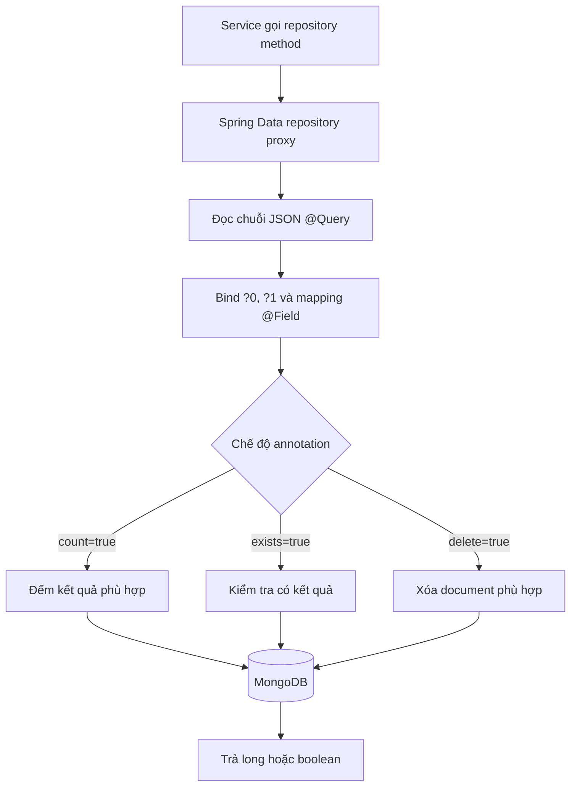

# Truy vấn count, exists và delete qua annotation

Trong **Spring Data MongoDB**, repository không chỉ tìm và trả về entity. Khi cần **đếm số document**, **kiểm tra có ít nhất một document khớp điều kiện**, hoặc **xóa các document khớp điều kiện**, ta có thể viết bộ lọc JSON trên annotation `@Query` và chọn các chế độ `count = true`, `exists = true` hoặc `delete = true`.

Bài học thuộc chương **Truy vấn JSON** của module **SPRING_DATA_MONGODB**. Trọng tâm là cách khai báo, kiểu kết quả, cách binding tham số, khác biệt giữa `exists = true` và toán tử MongoDB `$exists`, cũng như những rủi ro về hiệu năng và tính toàn vẹn khi xóa dữ liệu. Các ví dụ áp dụng trên `MongoRepository`; `MongoTemplate`, reactive repository và kiểm thử được đề cập để thấy rõ đường thực thi từ Java tới MongoDB.

## 1. Ba nhu cầu, ba chế độ của @Query

Giả sử ứng dụng đa tenant lưu thông báo. Service cần trả lời:

1. Tenant `T1` có **bao nhiêu** thông báo `EXPIRED`?
2. Tenant `T1` có **ít nhất một** thông báo `PENDING` không?
3. Có thể **xóa** bao nhiêu thông báo `EXPIRED` thuộc `T1` với `expiresAt` trước một mốc thời gian?

| Thao tác | Annotation | Return type thường dùng | Ý nghĩa |
| --- | --- | --- | --- |
| Count | `@Query(value = "...", count = true)` | `long` | Đếm document thỏa filter |
| Exists | `@Query(value = "...", exists = true)` | `boolean` | Kiểm tra có document thỏa filter |
| Delete | `@Query(value = "...", delete = true)` | `long` | Xóa document thỏa filter và trả số đã xóa |

**Một method chỉ nên biểu thị một loại thao tác.** Không phối hợp các cờ `count`, `exists`, `delete` để mong cùng một method vừa đếm vừa xóa. Trái với count/exists, delete là **write operation có tác dụng phá hủy dữ liệu**.

## 2. Dữ liệu mẫu và entity

Các document sau minh họa collection `notifications`. `_id` được MongoDB sinh nếu khi insert chưa cung cấp; thời gian dùng UTC.

```javascript
db.notifications.insertMany([
  {
    tenant_id: "T1", status: "PENDING",
    expires_at: ISODate("2026-12-01T00:00:00Z"),
    message: "Chờ xử lý"
  },
  {
    tenant_id: "T1", status: "EXPIRED",
    expires_at: ISODate("2026-11-01T00:00:00Z"),
    message: "Thông báo quá hạn"
  },
  {
    tenant_id: "T1", status: "EXPIRED",
    expires_at: ISODate("2026-12-05T00:00:00Z"),
    message: "Chưa tới ngày dọn"
  },
  {
    tenant_id: "T1", status: "DONE",
    message: "Đã hoàn tất"
  },
  {
    tenant_id: "T2", status: "EXPIRED",
    expires_at: ISODate("2026-11-01T00:00:00Z"),
    message: "Dữ liệu tenant khác"
  }
]);
```

Với cutoff `2026-11-20T00:00:00Z`, kết quả kỳ vọng là: đếm thông báo `T1/EXPIRED` được **2**, kiểm tra `T1/PENDING` được **true**, và xóa thông báo `T1/EXPIRED` có thời gian trước cutoff sẽ xóa **1** document. Document của tenant `T2` phải được giữ nguyên.

Entity Java ánh xạ tương ứng:

```java
import java.time.Instant;
import org.bson.types.ObjectId;
import org.springframework.data.annotation.Id;
import org.springframework.data.mongodb.core.mapping.Document;
import org.springframework.data.mongodb.core.mapping.Field;

@Document(collection = "notifications")
public class Notification {
    @Id
    private ObjectId id;

    @Field("tenant_id")
    private String tenantId;

    private String status;

    @Field("expires_at")
    private Instant expiresAt;

    private String message;

    public Notification() {}

    public ObjectId getId() { return id; }
    public String getTenantId() { return tenantId; }
    public String getStatus() { return status; }
    public Instant getExpiresAt() { return expiresAt; }
    public String getMessage() { return message; }
}
```

`@Id ObjectId` tương ứng với BSON `_id`. `@Field("tenant_id")` và `@Field("expires_at")` ánh xạ property Java `tenantId`, `expiresAt` sang tên trường thực tế. Spring Data sử dụng metadata này khi xử lý truy vấn repository.

## 3. Khai báo @Query(count/exists/delete)

```java
import java.time.Instant;
import org.bson.types.ObjectId;
import org.springframework.data.mongodb.repository.MongoRepository;
import org.springframework.data.mongodb.repository.Query;

public interface NotificationRepository
        extends MongoRepository<Notification, ObjectId> {

    @Query(
        value = "{ 'tenantId': ?0, 'status': ?1 }",
        count = true
    )
    long countForTenantAndStatus(String tenantId, String status);

    @Query(
        value = "{ 'tenantId': ?0, 'status': 'PENDING' }",
        exists = true
    )
    boolean hasPendingForTenant(String tenantId);

    @Query(
        value = "{ 'tenantId': ?0, 'status': 'EXPIRED', " +
                "'expiresAt': { '$lt': ?1 } }",
        delete = true
    )
    long deleteExpiredBefore(String tenantId, Instant cutoff);
}
```

Các method trên không cần tự viết implementation: Spring Data MongoDB tạo repository proxy, phân tích `@Query`, binding `?0`, `?1`, mapping các field rồi chọn thao tác MongoDB. Generic `ObjectId` vẫn phải đúng với `Notification.id`, dù ba method lọc theo tenant/status/thời gian thay vì ID.



Đây là sơ đồ **luồng trách nhiệm**, không phải cam kết về tên lệnh wire protocol hay số round trip. Spring Data và MongoDB Java Driver có thể lựa chọn cơ chế tối ưu thích hợp; cả ba vẫn phụ thuộc vào filter, index và dữ liệu thực tế.

## 4. Count: lấy số lượng thay vì toàn bộ entity

```java
long expired = notifications.countForTenantAndStatus("T1", "EXPIRED");
// Dữ liệu mẫu: expired == 2
```

Bộ lọc tương đương về ngữ nghĩa ở MongoDB Shell:

```javascript
db.notifications.countDocuments({
  tenant_id: "T1",
  status: "EXPIRED"
});
```

Với `count = true`, method trả số document khớp điều kiện. Nếu không có document, kết quả là **0**, không phải `null`. Đừng gọi `find...` rồi `list.size()` trên một collection lớn chỉ để đếm: làm vậy tải document qua mạng và vật hóa entity Java không cần thiết.

Có thể khai báo dạng **derived query** tương đương cho điều kiện đơn giản:

```java
long countByTenantIdAndStatus(String tenantId, String status);
```

Chọn `@Query(count = true)` khi JSON filter dễ đọc hơn một tên method dài hoặc khi cần điều kiện MongoDB cụ thể. Nếu chỉ cần biết **có ít nhất một** document khớp hay không, `exists` thể hiện đúng ý định hơn `count > 0` và có thể tránh phải xác định toàn bộ số lượng.

Giá trị đếm là kết quả tại thời điểm thực thi. Truy vấn count và một truy vấn find/delete chạy sau đó không mặc nhiên đọc cùng snapshot khi có tác vụ khác đang ghi dữ liệu.

## 5. Exists: kiểm tra có ít nhất một document phù hợp

```java
boolean hasPending = notifications.hasPendingForTenant("T1");
// Dữ liệu mẫu: true.
```

Có thể diễn giải bằng mongosh như sau:

```javascript
const found = db.notifications.findOne({
  tenant_id: "T1",
  status: "PENDING"
});
const exists = found !== null;
```

Đây là **cách minh họa ngữ nghĩa**, không khẳng định Spring Data luôn gửi chính xác lệnh `findOne`. `@Query(exists = true)` trả boolean: chỉ cần một document khớp là đủ cho câu trả lời `true`.

### 5.1. Exists ở annotation khác với $exists ở filter

```java
// Tồn tại ít nhất một document có status PENDING?
@Query(value = "{ 'status': 'PENDING' }", exists = true)
boolean anyPending();
```

Trong khi đó, toán tử MongoDB sau hỏi **document nào có một trường**:

```javascript
db.notifications.find({
  expires_at: { $exists: true }
});
```

| Cú pháp | Trả lời câu hỏi gì? |
| --- | --- |
| `@Query(exists = true)` | Có document nào khớp *toàn bộ filter* không? |
| `{ expires_at: { $exists: true } }` | Document nào có key `expires_at` (kể cả BSON Null)? |
| `existsByStatus("PENDING")` | Có document nào có `status = PENDING` không? |

Hai ý nghĩa có thể dùng cùng lúc:

```java
@Query(
    value = "{ 'tenantId': ?0, 'expiresAt': { '$exists': true } }",
    exists = true
)
boolean tenantHasAnyExpiryField(String tenantId);
```

Method trên chỉ trả `true` nếu tồn tại **ít nhất một** notification của tenant có key `expires_at`. `$exists: true` không tự yêu cầu giá trị đó khác `null`; nếu muốn kiểm tra giá trị không null, phải dùng điều kiện khác phù hợp với schema.

## 6. Delete: xóa document khớp điều kiện

```java
import java.time.Instant;

Instant cutoff = Instant.parse("2026-11-20T00:00:00Z");
long removed = notifications.deleteExpiredBefore("T1", cutoff);
// Dữ liệu mẫu: removed == 1.
```

Bộ lọc tương đương với thao tác:

```javascript
db.notifications.deleteMany({
  tenant_id: "T1",
  status: "EXPIRED",
  expires_at: { $lt: ISODate("2026-11-20T00:00:00Z") }
});
```

Ở đây `$lt` là **nhỏ hơn nghiêm ngặt**: document có `expires_at == cutoff` không khớp. Điều kiện tenant là bắt buộc trong ví dụ đa tenant. Nếu bỏ `tenant_id`, một lần delete có thể xóa cả thông báo quá hạn của các tổ chức khác.

Với method trả `long`, kết quả là số document đã xóa được MongoDB xác nhận. Trường hợp không khớp có thể trả **0**. Spring Data MongoDB cũng hỗ trợ một số dạng repository delete khác có thể trả các entity đã xóa; nhưng khi chỉ cần **số lượng**, khai báo return type số nguyên và kiểm thử theo phiên bản đang dùng giúp tránh việc phải tải object.

**`@Query(delete = true)` xóa cả document**, không xóa một thuộc tính. Muốn bỏ riêng trường `expires_at`, hãy dùng update `$unset` qua `MongoTemplate` hoặc cơ chế update tương ứng.

### 6.1. Vì sao delete cần kiểm soát đặc biệt?

- **Phạm vi:** bộ lọc phải bao gồm tenant và các điều kiện nghiệp vụ cần thiết.
- **Quyền:** chỉ chức năng đã được ủy quyền mới được chạy lệnh delete.
- **Đồng thời:** count trước và delete sau có thể cho hai số khác nhau do có writer khác.
- **Atomicity:** MongoDB ghi nguyên tử theo **mỗi document**; một lệnh xóa nhiều document không tự tạo transaction chung cho toàn bộ tập.
- **Khôi phục:** nếu cần audit hoặc phục hồi, hãy có chính sách lưu trữ, soft delete hoặc snapshot phù hợp trước khi xóa vật lý.
- **Retry:** xóa lại cùng filter có thể trả 0, nhưng writer mới có thể thêm bản ghi vừa khớp filter giữa hai lần chạy.

Không nên khai báo lệnh xóa **toàn bộ tenant** trong một repository dùng bởi luồng nghiệp vụ thông thường khi chưa có cơ chế bảo vệ rõ ràng. Số trả về từ delete phản ánh thao tác đã được xác nhận; một lần count trước đó không phải bảo đảm về số bản ghi thực sự sẽ bị xóa.

## 7. Annotation chuyên dụng: @CountQuery, @ExistsQuery, @DeleteQuery

Spring Data MongoDB cung cấp các annotation rút gọn tương đương với `@Query` khi chỉ muốn thể hiện một mục đích:

```java
import java.time.Instant;
import org.springframework.data.mongodb.repository.CountQuery;
import org.springframework.data.mongodb.repository.ExistsQuery;
import org.springframework.data.mongodb.repository.DeleteQuery;

// Đặt các khai báo minh họa sau bên trong một repository.
@CountQuery("{ 'tenantId': ?0, 'status': ?1 }")
long countViaShortcut(String tenantId, String status);

@ExistsQuery("{ 'tenantId': ?0, 'status': 'PENDING' }")
boolean existsPendingViaShortcut(String tenantId);

@DeleteQuery(
    "{ 'tenantId': ?0, 'status': 'EXPIRED', " +
    "'expiresAt': { '$lt': ?1 } }"
)
long deleteExpiredViaShortcut(String tenantId, Instant cutoff);
```

| Dạng ngắn | Dạng @Query tương đương |
| --- | --- |
| `@CountQuery("...")` | `@Query(value = "...", count = true)` |
| `@ExistsQuery("...")` | `@Query(value = "...", exists = true)` |
| `@DeleteQuery("...")` | `@Query(value = "...", delete = true)` |

Chúng là **các phương án thay thế**, không phải các bước phải chạy liên tiếp. Một số chi tiết API có thể khác giữa các phiên bản Spring Data MongoDB: khi áp dụng trong dự án thật, dùng đúng annotation và signature của dependency đang chạy, không gắn hai annotation rút gọn và dạng đầy đủ lên cùng một method.

## 8. Gắn tham số và ánh xạ field

Trong ví dụ delete:

```java
@Query(
    value = "{ 'tenantId': ?0, 'status': 'EXPIRED', " +
            "'expiresAt': { '$lt': ?1 } }",
    delete = true
)
long deleteExpiredBefore(String tenantId, Instant cutoff);
```

`?0` là tham số thứ **nhất**, `?1` là tham số thứ **hai**. Spring Data xử lý binding dựa trên giá trị và converter, thay vì lấy một chuỗi input rồi nối thẳng thành cấu trúc JSON query. Vì thế `"T1"` là giá trị BSON String, `Instant` được chuyển sang dạng thời gian BSON phù hợp, còn `ObjectId` nếu được dùng trong filter giữ vai trò định danh BSON.

Đừng tự xây một bộ lọc bằng cách nối input tùy ý:

```java
// Cách không khuyến nghị vì tạo JSON trực tiếp từ dữ liệu người dùng:
// String filter = "{ 'tenant_id': '" + tenantIdFromRequest + "' }";
```

Nên dùng placeholder `?0`, `?1` hoặc `Criteria` để bind giá trị. Nếu cho phép người dùng chỉ định tên field, sort hoặc toán tử truy vấn, hãy dùng **allowlist**: đây là thành phần *cấu trúc* chứ không còn là dữ liệu tham số đơn thuần.

### Tên property Java và tên trường BSON

Trong annotation, `tenantId`, `expiresAt` là property Java. Nhờ `@Field("tenant_id")` và `@Field("expires_at")`, Spring Data mapping sang field thực khi truy vấn `Notification`:

```java
@Query(value = "{ 'tenantId': ?0 }", count = true)
long countAllForTenant(String tenantId);
```

Trong mongosh hoặc native driver dùng tên field MongoDB:

```javascript
db.notifications.countDocuments({ tenant_id: "T1" });
```

Với nested property, custom converter hoặc schema cũ, nên xác minh bộ lọc MongoDB thực tế được driver gửi thay vì suy đoán.

## 9. MongoTemplate là phương án khi query động

Ba thao tác cũng có thể thực hiện qua `MongoTemplate`, phù hợp khi service xây filter theo nhiều điều kiện khác nhau:

```java
import java.time.Instant;
import com.mongodb.client.result.DeleteResult;
import org.springframework.data.mongodb.core.query.Criteria;
import org.springframework.data.mongodb.core.query.Query;

Query expired = Query.query(
    Criteria.where("tenantId").is("T1")
            .and("status").is("EXPIRED")
);
long count = mongoTemplate.count(expired, Notification.class);

Query pending = Query.query(
    Criteria.where("tenantId").is("T1")
            .and("status").is("PENDING")
);
boolean exists = mongoTemplate.exists(pending, Notification.class);

Query expiredBefore = Query.query(
    Criteria.where("tenantId").is("T1")
            .and("status").is("EXPIRED")
            .and("expiresAt")
            .lt(Instant.parse("2026-11-20T00:00:00Z"))
);
DeleteResult result =
    mongoTemplate.remove(expiredBefore, Notification.class);
long deleted = result.getDeletedCount();
```

Các biến trên minh họa một đoạn trong service đã inject `MongoTemplate`. API `count`, `exists`, `remove` thể hiện ba thao tác khác nhau và dùng cùng quy tắc mapping entity. Khi cần xem thêm thông tin thao tác xóa, `DeleteResult` cho phép đọc `getDeletedCount()` (với write concern có xác nhận).

| Chọn repository annotation khi… | Chọn MongoTemplate khi… |
| --- | --- |
| Filter ổn định, ngắn, có ý nghĩa nghiệp vụ rõ | Filter xây động từ nhiều nhánh điều kiện |
| Muốn return type đơn giản `long`/`boolean` | Cần điều khiển `Query`, result hoặc option chi tiết |
| Giữ logic truy vấn ngắn gọn trong interface | Viết truy vấn phức tạp, aggregation hay update theo field |

## 10. Index và chẩn đoán hiệu năng

Khi query chủ yếu lọc theo tenant, trạng thái và hạn dùng, có thể cân nhắc compound index:

```javascript
db.notifications.createIndex(
  { tenant_id: 1, status: 1, expires_at: 1 },
  { name: "tenant_status_expiry" }
);
```

Index này là ứng viên phục vụ các điều kiện equality trên `tenant_id`, `status` và range trên `expires_at`. Để chọn đúng cần cân bằng tần suất ghi, độ chọn lọc và kích thước index; một index không bảo đảm mọi query sẽ nhanh.

Trước khi chạy delete, có thể xem query plan của filter tương đương:

```javascript
db.notifications.find({
  tenant_id: "T1",
  status: "EXPIRED",
  expires_at: { $lt: ISODate("2026-11-20T00:00:00Z") }
}).explain("executionStats");
```

Đọc `winningPlan`, `nReturned`, `totalDocsExamined`, `totalKeysExamined`. `explain` của một lệnh find dùng cùng filter giúp hiểu chi phí tìm bản ghi, nhưng **không thay thế** việc đo chính lệnh count/exists/delete, tác động ghi và độ trễ trong môi trường thực.

Nếu dữ liệu chỉ cần tự động hết hạn theo thời gian, **TTL index** có thể phù hợp hơn một job dọn. Tuy nhiên, TTL có thời điểm xóa bất đồng bộ, không bảo đảm xóa đúng tức thì và phải được xem xét kỹ nếu điều kiện nghiệp vụ còn phụ thuộc tenant hoặc status. Lệnh `@Query(delete = true)` vẫn hữu ích khi cần scope rõ ràng, audit hoặc trả số đã xóa.

## 11. Tính nhất quán, lỗi và transaction

- **Count rồi delete có thể khác số:** dữ liệu được chèn, sửa, xóa giữa hai lời gọi. Không dùng phép đếm trước như bảo đảm kết quả của delete.
- **Một delete có thể chạm nhiều document:** atomicity ở cấp document không mặc định có nghĩa cả tập cùng commit/rollback.
- **Transaction:** khi cần tính nhất quán đa document, phải cấu hình `MongoTransactionManager` và MongoDB topology hỗ trợ; chỉ đặt `@Transactional` không đủ.
- **Write concern:** cần yêu cầu xác nhận phù hợp để đánh giá kết quả xóa và phát hiện lỗi.
- **Retry:** một thao tác xóa có thể đã thực thi trên server trước khi client nhận thông báo lỗi mạng. Retry cần cân nhắc tính idempotent, filter và những bản ghi mới phát sinh.
- **Phân quyền:** xác định tenant từ ngữ cảnh tin cậy, kiểm soát đối tượng được xóa và tránh viết dữ liệu nhạy cảm vào log.

Một method repository trả `long` không phải công cụ cung cấp tất cả thông tin về hoạt động của cluster, transaction hoặc audit. Nếu hệ thống yêu cầu khả năng phục hồi, lưu trữ pháp lý và xác thực xóa, cần thiết kế quy trình nghiệp vụ riêng.

## 12. Integration test: xác minh filter và số liệu thật

Mock repository không chứng minh `@Query` được parse hay field BSON được mapping đúng. Để kiểm tra count/exists/delete, hãy dùng MongoDB thật trong môi trường **cô lập** (ví dụ Testcontainers).

```java
import static org.assertj.core.api.Assertions.assertThat;

import java.time.Instant;
import java.util.Date;
import java.util.List;
import java.util.UUID;
import org.bson.Document;
import org.junit.jupiter.api.Test;
import org.springframework.beans.factory.annotation.Autowired;
import org.springframework.boot.test.autoconfigure.data.mongo.DataMongoTest;
import org.springframework.data.mongodb.core.MongoTemplate;

@DataMongoTest
class NotificationQueryTest {
    @Autowired MongoTemplate template;
    @Autowired NotificationRepository notifications;

    @Test
    void shouldCountExistAndDeleteWithinTenant() {
        String t1 = "test-" + UUID.randomUUID();
        String t2 = "test-" + UUID.randomUUID();
        Instant cutoff = Instant.parse("2026-11-20T00:00:00Z");
        Date oldDate = Date.from(Instant.parse("2026-11-01T00:00:00Z"));
        Date laterDate = Date.from(Instant.parse("2026-12-05T00:00:00Z"));

        template.getCollection("notifications").insertMany(List.of(
            new Document("tenant_id", t1)
                .append("status", "PENDING").append("expires_at", laterDate),
            new Document("tenant_id", t1)
                .append("status", "EXPIRED").append("expires_at", oldDate),
            new Document("tenant_id", t1)
                .append("status", "EXPIRED").append("expires_at", laterDate),
            new Document("tenant_id", t2)
                .append("status", "EXPIRED").append("expires_at", oldDate)
        ));

        assertThat(notifications.countForTenantAndStatus(t1, "EXPIRED"))
            .isEqualTo(2);
        assertThat(notifications.hasPendingForTenant(t1)).isTrue();

        long deleted = notifications.deleteExpiredBefore(t1, cutoff);
        assertThat(deleted).isEqualTo(1);

        assertThat(notifications.countForTenantAndStatus(t1, "EXPIRED"))
            .isEqualTo(1);
        assertThat(notifications.countForTenantAndStatus(t2, "EXPIRED"))
            .isEqualTo(1);
    }
}
```

Dùng ID tenant ngẫu nhiên giúp tránh đụng dữ liệu test có sẵn. Không chạy test ghi/xóa như trên trong production. Khi dùng Spring Boot phiên bản khác, cần cấu hình package test slice và MongoDB dành cho test đúng với dependency hiện có.

Kiểm thử thêm: không có document khớp (`count = 0`, `exists = false`, `delete = 0`); document có `expires_at == cutoff` không bị xóa với `$lt`; trường ngày thiếu không khớp ngoài ý định; ký tự đặc biệt trong input được bind như giá trị; tenant `T2` luôn được bảo vệ. Kiểm tra raw document cũng giúp xác nhận `tenant_id` và `expires_at` được ánh xạ đúng.

## 13. Reactive repository: Mono<Long> và Mono<Boolean>

Khi ứng dụng dùng Reactive MongoDB Driver, repository khai báo kiểu reactive:

```java
import java.time.Instant;
import org.bson.types.ObjectId;
import org.springframework.data.mongodb.repository.Query;
import org.springframework.data.mongodb.repository.ReactiveMongoRepository;
import reactor.core.publisher.Mono;

interface ReactiveNotificationRepository
        extends ReactiveMongoRepository<Notification, ObjectId> {

    @Query(value = "{ 'tenantId': ?0, 'status': ?1 }", count = true)
    Mono<Long> countForTenantAndStatus(String tenantId, String status);

    @Query(value = "{ 'tenantId': ?0, 'status': 'PENDING' }", exists = true)
    Mono<Boolean> hasPendingForTenant(String tenantId);

    @Query(
        value = "{ 'tenantId': ?0, 'status': 'EXPIRED', " +
                "'expiresAt': { '$lt': ?1 } }",
        delete = true
    )
    Mono<Long> deleteExpiredBefore(String tenantId, Instant cutoff);
}
```

Các `Mono` diễn đạt thao tác thực thi theo **subscription**; tạo publisher không đồng nghĩa đã đọc hoặc xóa dữ liệu. Trong WebFlux, nên trả publisher cho framework hoặc kết hợp bằng `flatMap`/`then`; tránh `subscribe()` riêng trong service khi nghiệp vụ cần xử lý lỗi và transaction. Nếu cần reactive transaction, dùng `ReactiveMongoTransactionManager` với Reactor Context và driver phù hợp. Đổi return type sang `Mono` không biến synchronous MongoClient thành reactive.

## 14. Lỗi thường gặp

| Sai lầm | Hậu quả | Cách khắc phục |
| --- | --- | --- |
| `@Query` không bật `count = true` mà muốn số đếm | Method không diễn đạt đúng loại thao tác | Dùng `count = true` hoặc `@CountQuery` |
| Nhầm `exists = true` với `$exists: true` | Kiểm tra sai điều kiện | Phân biệt kiểu thao tác và điều kiện BSON |
| Delete nhưng không khai báo `delete = true` | Không có ngữ nghĩa xóa như mong đợi | Dùng `@Query(delete = true)` hoặc `@DeleteQuery` |
| Return type không phù hợp | Lỗi ánh xạ/khởi tạo query method | Count/delete trả `long`, exists trả `boolean` |
| Bỏ filter tenant | Có thể xóa dữ liệu tenant khác | Luôn scope tenant, test case tenant khác |
| Nối input thẳng thành JSON | Sai cú pháp, sai kiểu hoặc query injection | Dùng `?0`/`?1` hay `Criteria` |
| Tin count trước bằng số xóa sau | Race condition | Quan sát kết quả delete và thiết kế transaction nếu cần |
| Hiểu delete là xóa field | Mất cả document | Dùng update `$unset` để xóa field |
| Không có index phù hợp | Count, exists, delete gây tải lớn | Đo explain, tối ưu access pattern |
| Chỉ dùng mock trong test | Không xác minh truy vấn MongoDB thực | Integration test có raw BSON |

## 15. Câu hỏi tự kiểm tra

**1.** Muốn đếm thông báo `EXPIRED` của một tenant mà không tải entity, dùng gì?  
**Đáp án:** `@Query(value = "{ 'tenantId': ?0, 'status': 'EXPIRED' }", count = true)` trả `long`.

**2.** `@Query(exists = true)` có đồng nghĩa với `{ field: { $exists: true } }` không?  
**Đáp án:** không. Cờ annotation trả boolean xem có document khớp filter; toán tử `$exists` kiểm tra sự hiện diện của một field.

**3.** `@Query(delete = true)` có tự động chỉ xóa một document đầu tiên không?  
**Đáp án:** không nên mặc định như vậy; phương thức delete theo filter trong bài có thể xóa nhiều document và trả số lượng đã xóa. Luôn thử trên database test.

**4.** Với `'$lt': cutoff`, document có `expires_at == cutoff` có bị xóa không?  
**Đáp án:** không, vì `$lt` nghĩa là nhỏ hơn nghiêm ngặt.

**5.** Vì sao filter delete phải có `tenantId`?  
**Đáp án:** để chỉ tác động lên dữ liệu tenant được cho phép, không xóa nhầm tổ chức khác.

**6.** Vì sao count trước delete không bảo đảm số document bị xóa?  
**Đáp án:** vì các thao tác cách nhau về thời gian, dữ liệu có thể thay đổi; cần transaction/ràng buộc phù hợp nếu nghiệp vụ yêu cầu nhất quán.

**7.** Khi nào dùng `MongoTemplate.remove()`?  
**Đáp án:** khi cần dựng filter động, kiểm soát `Query` và xử lý `DeleteResult` ở mức chi tiết.

**8.** Reactive `Mono<Long> deleteExpiredBefore(...)` đã xóa dữ liệu ngay khi method được gọi chưa?  
**Đáp án:** thông thường chưa; publisher thực thi khi được subscribe.

## 16. Bài thực hành

Hãy tạo `Notification` và `NotificationRepository`, rồi thao tác trên MongoDB phát triển/kiểm thử:

1. Chèn năm document mẫu, quan sát tên field BSON bằng mongosh.
2. Gọi `countForTenantAndStatus("T1", "EXPIRED")` và xác nhận kết quả **2**.
3. Gọi `hasPendingForTenant("T1")` rồi thử tenant không có `PENDING`; đối chiếu `true/false`.
4. Gọi `deleteExpiredBefore("T1", cutoff)`; kỳ vọng **1** document bị xóa, còn `T2` nguyên vẹn.
5. Thử ba annotation rút gọn `@CountQuery`, `@ExistsQuery`, `@DeleteQuery` với dữ liệu được dựng lại.
6. Viết thêm `@Query(exists = true)` có toán tử BSON `$exists` bên trong để thấy hai cấp độ không giống nhau.
7. So sánh các lời gọi với `MongoTemplate.count`, `exists`, `remove`; đánh giá query plan và index.

**Kết luận:** `@Query(count = true)` trả **số document khớp**, `@Query(exists = true)` trả **có/không document khớp**, còn `@Query(delete = true)` thực sự **xóa document khớp filter**. Cùng một cú pháp JSON nhưng loại thao tác, kiểu trả về và rủi ro rất khác nhau. Luôn kiểm tra tham số, mapping field, phạm vi tenant, index và độ an toàn của lệnh xóa trước khi đưa code vào vận hành.

