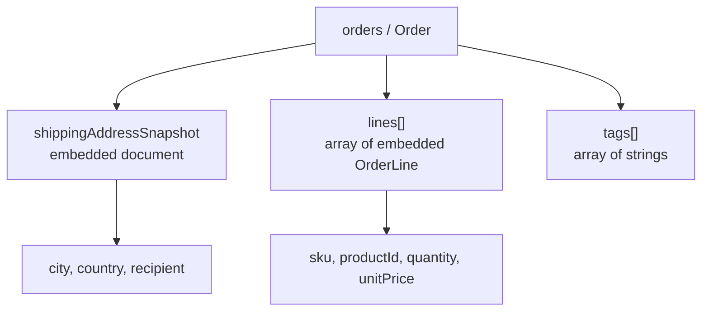
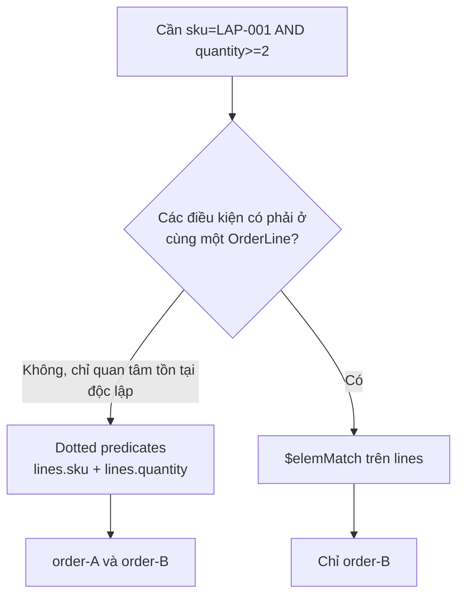

# Truy vấn document lồng nhau và array bằng toán tử MongoDB

## 1. Bối cảnh và mục tiêu

Trong **Spring Data MongoDB**, document thường chứa object nhúng và mảng thay vì chỉ các field phẳng. Ứng dụng bán hàng **Mini Commerce** dùng xuyên suốt lộ trình có ba thực thể chính: `Product`, `Customer` và `Order`. Mỗi `Order` lưu bản chụp địa chỉ giao hàng trong `shippingAddressSnapshot`, danh sách dòng hàng `lines` và có thể có mảng nhãn `tags`. Một số câu hỏi nghiệp vụ cần tìm thông tin nằm sâu trong các cấu trúc này:

- Tìm đơn giao đến một thành phố cụ thể.
- Tìm đơn có **ít nhất một** sản phẩm mang SKU `LAP-001`.
- Tìm đơn có **một dòng hàng duy nhất** vừa mang SKU `LAP-001` vừa có `quantity >= 2`.
- Tìm đơn gắn **đủ** hai nhãn `priority` và `gift`.
- Tìm đơn có địa chỉ giao bị thiếu để bổ sung dữ liệu lịch sử.
- Tối ưu các truy vấn trên mảng bằng **multikey index** và `explain("executionStats")`.

Bài thuộc phần **Truy vấn JSON**: trọng tâm là diễn đạt điều kiện MongoDB trong `mongosh` và trong annotation `@Query` của Spring Data MongoDB, sau đó hiểu kết quả BSON mà driver thực thi. `MongoTemplate` được dùng để đối chiếu cách viết chương trình tương đương. Các ý tưởng này cũng hỗ trợ query động, aggregation, index, transaction, reactive access, kiểm thử và chẩn đoán hiệu năng dữ liệu.

Kết thúc bài, bạn có thể:

1. Sử dụng **dotted path** như `"shippingAddressSnapshot.city"` và `"lines.sku"`.
2. Phân biệt so sánh **toàn bộ embedded document** với điều kiện trên **một field lồng nhau**.
3. Chọn đúng `$in`, `$all`, `$size`, `$elemMatch`, `$exists`, `$type`, `$and`, `$or`, `$not` hoặc `$nor` theo yêu cầu.
4. Viết `@Query` có tham số ràng buộc an toàn, phân trang, sắp xếp và projection.
5. Nhận ra các lỗi thường gặp khi hai điều kiện trên array khớp **hai phần tử khác nhau**.
6. Kiểm chứng semantics bằng MongoDB thật và xác định index hữu ích từ query plan.

**Kiến thức đầu vào:** Java/Spring Boot, `spring-boot-starter-data-mongodb`, `@Document`, `@Id`, `MongoRepository`, BSON/JSON, object nhúng và array. Ví dụ sử dụng MongoDB driver đồng bộ; khi dùng reactive, ý nghĩa điều kiện BSON không thay đổi.

## 2. Bộ dữ liệu Mini Commerce dùng trong bài

Ta dùng collection `orders`. Mỗi đơn có một khách hàng, trạng thái, thời điểm đặt, địa chỉ giao, danh sách dòng hàng và danh sách nhãn.



Hai document mẫu sau được chọn để tạo ra một trường hợp **dễ truy vấn nhầm**.

### 2.1. Đơn A: điều kiện nằm ở hai dòng hàng khác nhau

```json
{
  "_id": "order-A",
  "customerId": "customer-001",
  "status": "PLACED",
  "placedAt": { "$date": "2026-11-20T02:00:00Z" },
  "shippingAddressSnapshot": {
    "recipient": "Nguyen Thi Lan",
    "city": "TP Ho Chi Minh",
    "country": "VN"
  },
  "lines": [
    {
      "productId": "prod-lap",
      "sku": "LAP-001",
      "quantity": 1,
      "unitPrice": { "$numberDecimal": "129900.00" }
    },
    {
      "productId": "prod-mou",
      "sku": "MOU-001",
      "quantity": 5,
      "unitPrice": { "$numberDecimal": "49000.00" }
    }
  ],
  "tags": ["priority", "gift"]
}
```

### 2.2. Đơn B: một dòng hàng thỏa cả hai điều kiện

```json
{
  "_id": "order-B",
  "customerId": "customer-002",
  "status": "PLACED",
  "placedAt": { "$date": "2026-11-20T03:00:00Z" },
  "shippingAddressSnapshot": {
    "recipient": "Tran Minh An",
    "city": "Da Nang",
    "country": "VN"
  },
  "lines": [
    {
      "productId": "prod-lap",
      "sku": "LAP-001",
      "quantity": 3,
      "unitPrice": { "$numberDecimal": "129900.00" }
    }
  ],
  "tags": ["priority"]
}
```

Trong `mongosh`, có thể tạo dữ liệu tương đương bằng:

```javascript
use mini_commerce

db.orders.insertMany([
  {
    _id: "order-A",
    customerId: "customer-001",
    status: "PLACED",
    placedAt: ISODate("2026-11-20T02:00:00Z"),
    shippingAddressSnapshot: {
      recipient: "Nguyen Thi Lan",
      city: "TP Ho Chi Minh",
      country: "VN"
    },
    lines: [
      {
        productId: "prod-lap",
        sku: "LAP-001",
        quantity: 1,
        unitPrice: NumberDecimal("129900.00")
      },
      {
        productId: "prod-mou",
        sku: "MOU-001",
        quantity: 5,
        unitPrice: NumberDecimal("49000.00")
      }
    ],
    tags: ["priority", "gift"]
  },
  {
    _id: "order-B",
    customerId: "customer-002",
    status: "PLACED",
    placedAt: ISODate("2026-11-20T03:00:00Z"),
    shippingAddressSnapshot: {
      recipient: "Tran Minh An",
      city: "Da Nang",
      country: "VN"
    },
    lines: [
      {
        productId: "prod-lap",
        sku: "LAP-001",
        quantity: 3,
        unitPrice: NumberDecimal("129900.00")
      }
    ],
    tags: ["priority"]
  }
]);
```

Chỉ chạy `insertMany` trên database thực hành riêng khi chưa có các ID trên. Nếu chạy lại sẽ gặp lỗi duplicate `_id`. Không dùng ví dụ fixture này để thay đổi dữ liệu sản xuất.

Trong Java, `Instant` là lựa chọn hợp lý cho `placedAt`; `BigDecimal` kết hợp `@Field(targetType = FieldType.DECIMAL128)` dùng cho `unitPrice`. Dù BSON có nhiều kiểu, trong toàn bộ hệ thống cần thống nhất ID của `Customer` và `Product` với các trường tham chiếu trong `Order`.

## 3. Truy vấn field trong document nhúng bằng dotted path

Để tìm đơn có địa chỉ giao đến TP Hồ Chí Minh:

```javascript
db.orders.find({
  "shippingAddressSnapshot.city": "TP Ho Chi Minh"
});
```

Kết quả từ hai fixture: **order-A**. Dấu chấm trong khóa mô tả đường dẫn từ embedded document tới field cần kiểm tra. Đặt toàn bộ đường dẫn trong **dấu nháy** để `mongosh` hiểu là một tên field.

Ví dụ các đường dẫn khác:

| Điều kiện nghiệp vụ | BSON filter |
| --- | --- |
| Đơn giao trong Việt Nam | `{ "shippingAddressSnapshot.country": "VN" }` |
| Người nhận tên cụ thể | `{ "shippingAddressSnapshot.recipient": "Nguyen Thi Lan" }` |
| Đơn có SKU bất kỳ là `LAP-001` | `{ "lines.sku": "LAP-001" }` |
| Có dòng hàng số lượng ít nhất 3 | `{ "lines.quantity": { $gte: 3 } }` |

### 3.1. Tránh nhầm với so sánh cả embedded document

Hai truy vấn dưới **khác nhau**:

```javascript
// Chỉ kiểm tra field city bên trong object:
db.orders.find({
  "shippingAddressSnapshot.city": "TP Ho Chi Minh"
});

// So khớp embedded document với một giá trị document cụ thể:
db.orders.find({
  shippingAddressSnapshot: {
    city: "TP Ho Chi Minh"
  }
});
```

Truy vấn thứ hai **không khớp order-A**, vì `shippingAddressSnapshot` còn chứa `recipient` và `country`. MongoDB so sánh embedded document nguyên khối theo cấu trúc và thứ tự field BSON; không được hiểu như “object chứa ít nhất trường city”. Khi cần tìm theo một hay vài trường nhúng, thông thường hãy dùng **dotted path**.

### 3.2. Dotted path có thể có nhiều cấp

Giả sử `Customer` lưu:

```json
{
  "_id": "customer-001",
  "preferences": {
    "notification": {
      "email": true
    }
  }
}
```

Truy vấn:

```javascript
db.customers.find({
  "preferences.notification.email": true
});
```

Cú pháp truy cập nhiều cấp là như nhau. Nếu tên field trong dữ liệu legacy có dấu chấm *thật* hoặc bắt đầu bằng `$`, phải dùng những API xử lý tên field đặc biệt phù hợp; không suy luận đó luôn là đường dẫn lồng nhau. Đối với schema mới, ưu tiên tên field đơn giản để dễ query và index.

## 4. Array: tìm giá trị và phần tử nhúng

MongoDB cho phép kiểm tra một giá trị nằm trong array mà không cần duyệt array trong Java. Với `tags`:

```javascript
db.orders.find({ tags: "gift" });
```

Truy vấn trên khớp **order-A** vì array chứa chuỗi `"gift"`. Với `lines` là array document:

```javascript
db.orders.find({ "lines.sku": "LAP-001" });
```

Kết quả: **order-A và order-B**. MongoDB duyệt các phần tử `lines` để tìm một phần tử có field `sku` phù hợp.

### 4.1. $in: ít nhất một giá trị thuộc danh sách

```javascript
db.orders.find({
  tags: { $in: ["gift", "promotion"] }
});
```

Kết quả: **order-A**. Với một field array, `$in` kiểm tra có ít nhất một phần tử thuộc danh sách cho trước. Nếu trường scalar, `$in` cũng là phép kiểm tra thuộc tập giá trị tương ứng.

### 4.2. $all: array chứa đủ những giá trị được yêu cầu

```javascript
db.orders.find({
  tags: { $all: ["priority", "gift"] }
});
```

Kết quả: **order-A**. `$all` mang ý nghĩa giống **AND cho việc có mặt các giá trị trong array**; không đòi hỏi thứ tự giống tham số và không đồng nghĩa array chỉ được có đúng hai phần tử.

So sánh:

| Filter | Kết quả trên hai fixture | Ý nghĩa |
| --- | --- | --- |
| `{ tags: "gift" }` | A | Có ít nhất một `gift` |
| `{ tags: { $in: ["gift", "priority"] } }` | A, B | Có ít nhất một nhãn trong danh sách |
| `{ tags: { $all: ["gift", "priority"] } }` | A | Có **đủ cả hai** nhãn |
| `{ tags: { $size: 1 } }` | B | Array có đúng một phần tử |

### 4.3. $size: số lượng phần tử chính xác

```javascript
db.orders.find({
  lines: { $size: 1 }
});
```

Kết quả: **order-B**. `$size` nhận **giá trị đếm bằng đúng**, không nhận điều kiện `$gte` hoặc `$lt` bên trong:

```javascript
// Không hợp lệ để tìm length >= 2:
// { lines: { $size: { $gte: 2 } } }
```

Nếu thường xuyên cần lọc theo số dòng hàng, cân nhắc lưu và duy trì một field đếm đã kiểm chứng hoặc dùng `$expr`/aggregation. Truy vấn `$size` thông thường không được index hỗ trợ trực tiếp cho phép so sánh độ dài, nên phải đo hiệu năng trên dữ liệu đại diện.

### 4.4. $nin và điều kiện phủ định

```javascript
db.orders.find({
  tags: { $nin: ["gift"] }
});
```

Kết quả: **order-B**. Lưu ý `$nin` cũng có thể khớp document **không có field** được truy vấn; khi cần array phải tồn tại, thêm kiểm tra `$exists`/`$type` rõ ràng. Không coi “không chứa giá trị” và “field chắc chắn tồn tại nhưng không chứa” là một điều kiện.

## 5. Điểm dễ sai nhất: hai điều kiện có thuộc cùng phần tử mảng không?

Nhu cầu nghiệp vụ: **tìm đơn chứa một dòng hàng có SKU `LAP-001` và quantity ít nhất 2**.

### 5.1. Hai dotted predicates có thể khớp hai phần tử khác nhau

```javascript
db.orders.find({
  "lines.sku": "LAP-001",
  "lines.quantity": { $gte: 2 }
});
```

Kết quả: **order-A và order-B**.

- Với **order-A**, dòng thứ nhất có `sku = LAP-001` nhưng chỉ `quantity = 1`; dòng thứ hai có `quantity = 5` nhưng SKU là `MOU-001`. Hai điều kiện được đáp ứng bởi **hai phần tử khác nhau**.
- Với **order-B**, cùng một dòng `LAP-001` có `quantity = 3`, nên đúng yêu cầu.

Nếu diễn giải truy vấn trên là “cùng một dòng hàng vừa có SKU vừa đủ số lượng”, kết quả **order-A là dương tính giả**.

### 5.2. Dùng $elemMatch để ràng buộc cùng một phần tử

```javascript
db.orders.find({
  lines: {
    $elemMatch: {
      sku: "LAP-001",
      quantity: { $gte: 2 }
    }
  }
});
```

Kết quả: **chỉ order-B**.

`$elemMatch` yêu cầu **ít nhất một phần tử array** phải thỏa **tất cả** điều kiện bên trong nó. Đây là khác biệt cốt lõi so với nhiều điều kiện dotted path đặt cạnh nhau.



### 5.3. $elemMatch với array của số hoặc chuỗi

`$elemMatch` cũng dùng được cho array các scalar khi cần nhiều điều kiện trên **một giá trị**:

```javascript
// Ví dụ khác: document { scores: [6, 12, 30] }
db.assessments.find({
  scores: {
    $elemMatch: { $gte: 10, $lt: 20 }
  }
});
```

Truy vấn tìm một giá trị nằm trong khoảng `[10, 20)`; không phải một phần tử thỏa `>= 10` và phần tử khác thỏa `< 20`. Collection `assessments` chỉ là ví dụ minh họa cú pháp, không phải thành phần của Mini Commerce.

### 5.4. Trường hợp chỉ một điều kiện

Với điều kiện đơn như `"lines.sku": "LAP-001"`, dùng dotted path thường đơn giản và đủ. Không cần `$elemMatch` chỉ để tăng độ dài câu query. Tuy nhiên `$elemMatch` có thể giúp diễn đạt rõ ý định và tác động tới cách dùng compound multikey index trong các query nhiều điều kiện.

### 5.5. $all với mảng object không thay thế $elemMatch

`$all` phù hợp nhất để hỏi array có chứa nhiều giá trị được yêu cầu. Khi điều kiện liên quan **nhiều field trong cùng embedded document**, `$elemMatch` thường phản ánh đúng nghiệp vụ hơn. Đừng viết `$all: ["LAP-001", 2]` lên array `lines`: mỗi phần tử `lines` là **document**, không phải chuỗi SKU hay số quantity.

## 6. Kết hợp các điều kiện: $and, $or, $not, $nor

Ta có thể kết hợp điều kiện root và điều kiện trên object/array:

```javascript
db.orders.find({
  status: "PLACED",
  "shippingAddressSnapshot.country": "VN",
  lines: {
    $elemMatch: {
      sku: "LAP-001",
      quantity: { $gte: 2 }
    }
  }
});
```

Các khóa cùng cấp mặc định tạo phép **AND**; ở đây kết quả chỉ **order-B**.

### 6.1. $or: ít nhất một nhánh đúng

```javascript
db.orders.find({
  $or: [
    { "shippingAddressSnapshot.city": "Da Nang" },
    { tags: "gift" }
  ]
});
```

Kết quả: **order-A và order-B**. Khi thêm filter `status` bên ngoài `$or`, phép AND với toàn bộ nhóm OR:

```javascript
db.orders.find({
  status: "PLACED",
  $or: [
    { "shippingAddressSnapshot.city": "Da Nang" },
    { tags: "gift" }
  ]
});
```

### 6.2. $not và $nor: đọc ngữ nghĩa cẩn thận

`$not` là toán tử phủ định một **biểu thức điều kiện trên field**, ví dụ:

```javascript
db.orders.find({
  "lines.quantity": { $not: { $gte: 5 } }
});
```

Đây là phủ định điều kiện `lines.quantity >= 5` trên đường dẫn; **các trường hợp thiếu field/array** cũng cần được xem xét. Trong các bài toán “không có dòng hàng nào thỏa điều kiện”, thường dễ kiểm soát hơn bằng cách diễn đạt rõ phép phủ định của `$elemMatch` rồi kiểm tra fixture có array rỗng và field thiếu.

`$nor` yêu cầu **không nhánh nào** trong danh sách điều kiện đúng:

```javascript
db.orders.find({
  $nor: [
    { tags: "gift" },
    { "shippingAddressSnapshot.city": "Da Nang" }
  ]
});
```

Trên hai fixture, truy vấn trả **0 đơn**. Khi viết điều kiện phủ định, bắt buộc test riêng trường hợp field null, thiếu, array rỗng và array nhiều phần tử: phủ định query MongoDB không luôn trùng với cách diễn đạt bằng tiếng Việt.

## 7. Phân biệt null, missing, empty array và BSON type

Thống nhất schema quan trọng vì dữ liệu lịch sử có thể không đầy đủ. Bốn trường hợp sau có ý nghĩa khác nhau:

```javascript
{ _id: "x1", shippingAddressSnapshot: { city: null } }
{ _id: "x2", shippingAddressSnapshot: {} }
{ _id: "x3" }
{ _id: "x4", lines: [] }
```

### 7.1. Equality null có thể khớp field không tồn tại

```javascript
db.orders.find({
  "shippingAddressSnapshot.city": null
});
```

MongoDB cho phép `{ field: null }` khớp **field có BSON Null hoặc field không tồn tại** trên đường dẫn. Vì vậy nó có thể tìm cả `x1`, `x2` và `x3`.

Nếu chỉ quan tâm đường dẫn **tồn tại**:

```javascript
db.orders.find({
  "shippingAddressSnapshot.city": { $exists: true }
});
```

Điều kiện trên vẫn có thể khớp `x1` dù `city` bằng null. Khi cần phân biệt thật sự field thuộc BSON Null:

```javascript
db.orders.find({
  "shippingAddressSnapshot.city": { $type: "null" }
});
```

Khi cần field **không tồn tại**:

```javascript
db.orders.find({
  "shippingAddressSnapshot.city": { $exists: false }
});
```

### 7.2. Empty array khác missing array

```javascript
// Có lines và đúng 0 phần tử:
{ lines: { $size: 0 } }

// Không hề có field lines:
{ lines: { $exists: false } }

// lines là BSON array, dù rỗng hay có dữ liệu:
{ lines: { $type: "array" } }
```

`$size: 0` không đồng nghĩa `$exists: false`. Với đơn hàng đã chốt, hệ thống nên kiểm tra `lines` không rỗng ở tầng nghiệp vụ/validation, thay vì trông đợi các query báo cáo tự sửa dữ liệu sai.

### 7.3. Điều kiện phủ định và dữ liệu thiếu

Ví dụ `{ "shippingAddressSnapshot.city": { $ne: "Da Nang" } }` có thể khớp cả document **thiếu city**. Nếu thực sự muốn “city đã biết nhưng khác Da Nang”, cần thêm điều kiện tồn tại và/hoặc type phù hợp. Tương tự, `$nin` có thể bao gồm missing fields.

## 8. Đưa JSON query vào Spring Data MongoDB bằng @Query

Spring Data MongoDB hỗ trợ annotation:

```java
import org.springframework.data.mongodb.repository.Query;
```

`@Query` cho phép khai báo JSON filter trực tiếp trên phương thức repository. Với tham số vị trí:

- `?0` là tham số đầu tiên (đánh chỉ số từ 0).
- `?1` là tham số thứ hai, cứ tiếp tục như vậy.
- **Không bọc `?0` trong dấu nháy** khi đặt giá trị JSON. Framework sẽ bind và escape giá trị theo cơ chế query binding; bọc nhầm có thể làm placeholder trở thành chuỗi literal.
- Với JSON viết trong annotation Java, dùng một Java String hợp lệ; thói quen dùng dấu nháy đơn cho tên khóa/chuỗi JSON trong biểu thức `@Query` giúp hạn chế escape dấu nháy kép.

### 8.1. Entity Order có document và array nhúng

Ví dụ một entity Java đầy đủ tối thiểu, giúp những phương thức repository ở mục tiếp theo có đường dẫn property xác định:

```java
package com.example.minicommerce.domain;

import java.math.BigDecimal;
import java.time.Instant;
import java.util.List;

import org.springframework.data.annotation.Id;
import org.springframework.data.mongodb.core.mapping.Document;
import org.springframework.data.mongodb.core.mapping.Field;
import org.springframework.data.mongodb.core.mapping.FieldType;

@Document(collection = "orders")
public class Order {
    @Id
    private String id;
    private String customerId;
    private String status;
    private Instant placedAt;
    private ShippingAddress shippingAddressSnapshot;
    private List<OrderLine> lines;
    private List<String> tags;

    public Order() {}

    public String getId() { return id; }
    public void setId(String id) { this.id = id; }
    public String getCustomerId() { return customerId; }
    public void setCustomerId(String customerId) { this.customerId = customerId; }
    public String getStatus() { return status; }
    public void setStatus(String status) { this.status = status; }
    public Instant getPlacedAt() { return placedAt; }
    public void setPlacedAt(Instant placedAt) { this.placedAt = placedAt; }
    public ShippingAddress getShippingAddressSnapshot() {
        return shippingAddressSnapshot;
    }
    public void setShippingAddressSnapshot(ShippingAddress value) {
        this.shippingAddressSnapshot = value;
    }
    public List<OrderLine> getLines() { return lines; }
    public void setLines(List<OrderLine> lines) { this.lines = lines; }
    public List<String> getTags() { return tags; }
    public void setTags(List<String> tags) { this.tags = tags; }

    public static class ShippingAddress {
        private String recipient;
        private String city;
        private String country;

        public ShippingAddress() {}

        public String getRecipient() { return recipient; }
        public void setRecipient(String value) { recipient = value; }
        public String getCity() { return city; }
        public void setCity(String value) { city = value; }
        public String getCountry() { return country; }
        public void setCountry(String value) { country = value; }
    }

    public static class OrderLine {
        private String productId;
        private String sku;
        private int quantity;

        @Field(targetType = FieldType.DECIMAL128)
        private BigDecimal unitPrice;

        public OrderLine() {}

        public String getProductId() { return productId; }
        public void setProductId(String value) { productId = value; }
        public String getSku() { return sku; }
        public void setSku(String value) { sku = value; }
        public int getQuantity() { return quantity; }
        public void setQuantity(int value) { quantity = value; }
        public BigDecimal getUnitPrice() { return unitPrice; }
        public void setUnitPrice(BigDecimal value) { unitPrice = value; }
    }
}
```

Hai lớp `ShippingAddress` và `OrderLine` là nested static classes để ví dụ tự chứa trong một file. Trong dự án thực tế có thể tách thành class/record riêng. `OrderLine` được nhúng trong document `Order`, không cần collection riêng. Có thể bổ sung snapshot `productName`, `lineTotal` và `shippingAddressSnapshot` đầy đủ khi triển khai luồng đặt hàng thật.

### 8.2. Repository với JSON query rõ nghĩa

```java
package com.example.minicommerce.repository;

import java.util.Collection;
import java.util.List;

import org.springframework.data.domain.Page;
import org.springframework.data.domain.Pageable;
import org.springframework.data.mongodb.repository.MongoRepository;
import org.springframework.data.mongodb.repository.Query;

import com.example.minicommerce.domain.Order;

public interface OrderRepository extends MongoRepository<Order, String> {

    @Query("{ 'shippingAddressSnapshot.city': ?0 }")
    List<Order> findOrdersDeliveredTo(String city);

    @Query("{ 'lines.sku': ?0 }")
    List<Order> findOrdersContainingSku(String sku);

    @Query("{ 'lines': { '$elemMatch': " +
           "{ 'sku': ?0, 'quantity': { '$gte': ?1 } } } }")
    List<Order> findOrdersWithEnoughOfSku(
        String sku, int minimumQuantity);

    @Query("{ 'tags': { '$all': ?0 } }")
    List<Order> findOrdersWithEveryTag(Collection<String> tags);

    @Query("{ 'lines': { '$size': ?0 } }")
    List<Order> findOrdersWithLineCount(int count);

    @Query("{ 'shippingAddressSnapshot.city': { '$exists': false } }")
    List<Order> findOrdersMissingShippingCity();

    @Query("{ 'status': ?0, 'lines.sku': ?1 }")
    Page<Order> findByStatusAndSku(
        String status, String sku, Pageable pageable);
}
```

Các tên method này **không cần** tuân theo cú pháp derived query, bởi `@Query` đã cung cấp filter. `@Query` cũng hữu ích khi cần `$elemMatch` hoặc kết hợp toán tử không thể diễn đạt rõ ràng bằng một tên method.

Nếu method nhận `Pageable`, nên đặt kích thước trang tối đa ở tầng API/service, chỉ cho phép các field sort đã được duyệt và cung cấp thứ tự ổn định. Return type `Page<Order>` có thể cần truy vấn đếm bổ sung; dùng `Slice` nếu nghiệp vụ không cần tổng số bản ghi.

### 8.3. Ví dụ gọi và dự đoán kết quả

```java
List<Order> allLap =
    repository.findOrdersContainingSku("LAP-001");
// Fixture: order-A và order-B.

List<Order> enoughLap =
    repository.findOrdersWithEnoughOfSku("LAP-001", 2);
// Fixture: chỉ order-B.

List<Order> bothTags =
    repository.findOrdersWithEveryTag(List.of("priority", "gift"));
// Fixture: chỉ order-A.

List<Order> oneLine =
    repository.findOrdersWithLineCount(1);
// Fixture: chỉ order-B.
```

Kết quả này giả định collection chỉ có hai fixture của bài. Nếu trong database còn những đơn khác, truy vấn có thể trả thêm các document khác khớp điều kiện.

## 9. Ánh xạ tên property Java và tên field BSON trong @Query

Trong ví dụ ban đầu, tên Java và BSON của `shippingAddressSnapshot` giống nhau. Nhưng entity có thể dùng:

```java
@Field("ship_to")
private ShippingAddress shippingAddressSnapshot;
```

Lúc đó BSON lưu:

```json
{
  "_id": "order-C",
  "ship_to": {
    "city": "Hue",
    "country": "VN"
  }
}
```

Truy vấn raw `mongosh` phải dùng tên **BSON**:

```javascript
db.orders.find({
  "ship_to.city": "Hue"
});
```

Trong `@Query` gắn entity, Spring Data có hạ tầng query mapping dựa trên `@Field`; thường có thể dùng tên Java `shippingAddressSnapshot.city` và để framework ánh xạ sang `ship_to.city`. Tuy nhiên với **custom conversions, tên field đặc biệt hoặc cấu hình phiên bản khác nhau**, cần integration test kiểm tra filter thực thi và BSON lưu thực tế.

Đặc biệt, trường hợp viết một JSON query phức tạp bằng raw driver hoặc `mongosh` sẽ **không** có bước mapping Java property name. Quy tắc nhất quán: **API Java dùng metadata entity; raw BSON dùng tên BSON**.

## 10. MongoTemplate: viết điều kiện tương đương bằng Criteria

`MongoTemplate` thích hợp khi các điều kiện được ghép từ input tùy chọn hoặc khi một truy vấn JSON trở nên khó đọc. Cùng điều kiện “một OrderLine có SKU và quantity phù hợp”:

```java
import org.springframework.data.mongodb.core.MongoTemplate;
import org.springframework.data.mongodb.core.query.Criteria;
import org.springframework.data.mongodb.core.query.Query;

Query query = Query.query(
    Criteria.where("lines").elemMatch(
        Criteria.where("sku").is("LAP-001")
            .and("quantity").gte(2)
    )
);

List<Order> result = mongoTemplate.find(query, Order.class);
```

Filter BSON logic:

```javascript
{
  lines: {
    $elemMatch: {
      sku: "LAP-001",
      quantity: { $gte: 2 }
    }
  }
}
```

Đối với điều kiện đơn giản:

```java
Query byCity = Query.query(
    Criteria.where("shippingAddressSnapshot.city")
        .is("TP Ho Chi Minh")
);

Query byTags = Query.query(
    Criteria.where("tags").all("priority", "gift")
);
```

`Criteria` tạo điều kiện, `Query` mô tả filter và tùy chọn, `MongoTemplate` thực thi trên collection tương ứng với `Order.class`. Khi cần `$or`, `$and` hoặc thêm điều kiện phụ thuộc trạng thái request, cách viết chương trình này thường dễ tổ chức hơn một annotation JSON dài.

## 11. Filter không đồng nghĩa projection: trả những field nào?

MongoDB phân biệt:

- **Filter**: document nào được chọn.
- **Projection**: trong mỗi document được chọn, những field nào được trả về.

Ví dụ raw `mongosh`:

```javascript
db.orders.find(
  { "lines.sku": "LAP-001" },
  { customerId: 1, status: 1, placedAt: 1 }
);
```

Theo mặc định, `_id` vẫn được trả về trong inclusion projection nếu không yêu cầu loại bỏ. Vì projection trên không có `lines`, ứng dụng **không thể** suy ra nó đã nhận đầy đủ tất cả dòng hàng.

Trong Spring Data MongoDB, `@Query` có thuộc tính `fields`:

```java
@Query(
    value = "{ 'lines.sku': ?0 }",
    fields = "{ 'customerId': 1, 'status': 1, 'placedAt': 1 }"
)
List<Order> findOrderSummariesContainingSku(String sku);
```

Khi trả về `Order`, các property không nằm trong projection có thể nhận `null`/giá trị mặc định; các object này **không phải entity đầy đủ**. Tránh gọi `save()` trên object được load một phần, vì có thể làm mất dữ liệu chưa được đọc nếu thao tác thay thế toàn document. Với API đọc danh sách, nên cân nhắc DTO/interface projection dành riêng cho summary.

### 11.1. $elemMatch trong projection khác với $elemMatch trong filter

MongoDB còn có projection `$elemMatch` để **giới hạn phần tử array được trả về**:

```javascript
db.orders.find(
  { "lines.sku": "LAP-001" },
  {
    customerId: 1,
    lines: {
      $elemMatch: {
        sku: "LAP-001",
        quantity: { $gte: 2 }
      }
    }
  }
);
```

Điểm khác biệt:

- `$elemMatch` trong **filter** quyết định document có được chọn hay không.
- `$elemMatch` trong **projection** chọn **phần tử array đầu tiên** phù hợp để trả về trong document đã khớp filter; không đồng nghĩa trả **tất cả** phần tử phù hợp.

Nếu cần trả danh sách tất cả dòng hàng hợp lệ, dùng aggregation với `$filter` hoặc xử lý kết quả theo hợp đồng API. Đừng nhầm query lọc document với phép biến đổi nội dung mảng.

## 12. Aggregation khi cần lọc hoặc tổng hợp các phần tử mảng

Một lệnh `find` với `$elemMatch` chọn **đơn hàng**, không tự tách dòng hàng ra thành nhiều kết quả. Nếu muốn báo cáo số lượng `LAP-001` đã bán:

```javascript
db.orders.aggregate([
  { $match: { status: "PLACED" } },
  { $unwind: "$lines" },
  { $match: { "lines.sku": "LAP-001" } },
  {
    $group: {
      _id: "$lines.sku",
      unitsSold: { $sum: "$lines.quantity" }
    }
  }
]);
```

Trên fixture A và B, tổng số `LAP-001` là **1 + 3 = 4**. `$unwind` biến mỗi dòng trong array thành một bản ghi trung gian; `$match` sau `$unwind` chọn chính dòng cần đếm. Nếu chỉ dùng `$match` theo `lines.sku` ở cấp Order rồi `$sum` toàn bộ `lines.quantity`, có thể cộng nhầm số lượng của SKU khác.

### 12.1. $filter trả tất cả dòng hàng phù hợp trong một document

```javascript
db.orders.aggregate([
  {
    $project: {
      customerId: 1,
      matchingLines: {
        $filter: {
          input: "$lines",
          as: "line",
          cond: {
            $and: [
              { $eq: ["$$line.sku", "LAP-001"] },
              { $gte: ["$$line.quantity", 2] }
            ]
          }
        }
      }
    }
  }
]);
```

`$filter` giữ nguyên một document cho mỗi đơn và tạo mảng `matchingLines` với **tất cả** phần tử hợp lệ. Trong fixture, order-A có mảng rỗng, order-B có một dòng. Nếu chỉ muốn trả các đơn có kết quả không rỗng, bổ sung `$match` trên mảng sau projection.

**Quy tắc chọn công cụ:** `$elemMatch` để chọn document dựa trên một phần tử thỏa nhiều điều kiện; `$filter` để lọc các phần tử **được trả về**; `$unwind` để tạo từng dòng độc lập phục vụ aggregation.

## 13. Index trên field nhúng và array: multikey index

MongoDB có thể tạo index trên dotted path. Ví dụ:

```javascript
db.orders.createIndex({
  "shippingAddressSnapshot.city": 1,
  placedAt: -1
});

db.orders.createIndex({
  "lines.sku": 1
});
```

Khi một field được index chứa array, MongoDB tạo **multikey index**. Với `"lines.sku"`, các SKU trong từng phần tử `lines` có thể được index để hỗ trợ truy vấn `{ "lines.sku": "LAP-001" }`.

### 13.1. Compound index và $elemMatch

Một index cho SKU và quantity trong **cùng array document**:

```javascript
db.orders.createIndex({
  "lines.sku": 1,
  "lines.quantity": 1
});
```

Khi query dùng:

```javascript
db.orders.find({
  lines: {
    $elemMatch: {
      sku: "LAP-001",
      quantity: { $gte: 2 }
    }
  }
});
```

MongoDB có thể dùng các điều kiện theo **cùng phần tử** để kết hợp giới hạn index hiệu quả hơn so với hai dotted predicates không có `$elemMatch`. Nhưng lựa chọn kế hoạch còn phụ thuộc dữ liệu, selectivity và index khác.

**Giới hạn cần nhớ:** compound multikey index chịu ràng buộc về các field array đồng thời. Không thể tùy tiện lập compound index qua **hai array độc lập** trong cùng document; các trường `"lines.sku"` và `"lines.quantity"` ở ví dụ thuộc **cùng mảng `lines`**, nên là trường hợp phù hợp để khảo sát.

### 13.2. Kiểm tra query plan

```javascript
db.orders.find({
  lines: {
    $elemMatch: {
      sku: "LAP-001",
      quantity: { $gte: 2 }
    }
  }
}).explain("executionStats");
```

Theo dõi `winningPlan`, `totalKeysExamined`, `totalDocsExamined` và `nReturned`. Không kết luận “có index thì luôn nhanh”: query quá rộng, index không phù hợp thứ tự filter/sort, array quá lớn hoặc nhiều giá trị lặp vẫn có thể tốn tài nguyên.

Với lịch sử đơn theo khách, một index khác thường quan trọng hơn:

```javascript
db.orders.createIndex({
  customerId: 1,
  placedAt: -1
});
```

Chọn index theo **truy vấn thực tế và tần suất thực thi**, không tạo mỗi ví dụ trong bài lên production. Index tăng chi phí ghi và chiếm bộ nhớ/dung lượng lưu.

## 14. An toàn truy vấn và các lỗi thiết kế thường gặp

### 14.1. Ràng buộc tham số thay vì nối chuỗi JSON thủ công

Trong `@Query`:

```java
@Query("{ 'shippingAddressSnapshot.city': ?0 }")
List<Order> findOrdersDeliveredTo(String city);
```

Đây là cách biểu diễn **tham số**. Tránh tự nối dữ liệu nhận từ HTTP vào một chuỗi JSON để tạo query, ví dụ nối trực tiếp `"{" + userInput + "}"` rồi parse. Việc đó làm khó escape chính xác, kiểm tra kiểu và audit.

Tuy nhiên, bind tham số **không thay thế validation**: cần giới hạn độ dài chuỗi, số phần tử trong `$in`/`$all`, kích thước trang và chỉ cho phép những field/operator được API công khai. Nếu API cho phép người dùng gửi nguyên BSON filter tùy ý, rủi ro query quá tốn chi phí và truy cập dữ liệu ngoài phạm vi tăng lên.

### 14.2. Truy vấn mảng và dữ liệu trong nhiều tenant

Nếu Mini Commerce phục vụ nhiều cửa hàng/tenant, mỗi query trên `orders` phải đưa điều kiện tenant phù hợp vào cùng filter. `@Query` trên repository không tự động bảo đảm phân quyền hàng hay quyền đọc. Nếu có soft-delete, tương tự cần bổ sung điều kiện trạng thái.

### 14.3. Đọc array lớn

Một document có `lines` rất lớn có thể tốn băng thông dù filter chỉ cần một SKU. Cân nhắc projection, aggregation `$filter`, phân trang phù hợp hoặc thay đổi mô hình lưu khi mảng phát triển không giới hạn. MongoDB có giới hạn kích thước document; việc nhúng mọi dữ liệu lịch sử vào một document không phải lúc nào cũng đúng.

### 14.4. Ghi cập nhật vào array khác với truy vấn đọc

`$elemMatch` dùng để **chọn document**. Khi cần cập nhật đúng phần tử `OrderLine`, MongoDB có các cơ chế update chuyên biệt như positional `$` và `arrayFilters` với `$[identifier]`. Không dùng thao tác thay thế toàn bộ `Order` khi chỉ cần cập nhật một field mà không đánh giá concurrency, snapshot và dữ liệu do service khác quản lý.

Trong Mini Commerce, dòng hàng đã chốt cần được bảo vệ bằng quy tắc nghiệp vụ; các thay đổi đơn giá/số lượng sau khi đặt có thể ảnh hưởng doanh thu, tồn kho và giao dịch. Transaction nhiều document không làm một filter BSON sai trở thành đúng; vẫn phải xác định chính xác phần tử được chọn.

## 15. Kiểm thử thực tế với MongoDB và Spring Data

Để kiểm chứng chính xác khác biệt giữa dotted predicates và `$elemMatch`, hãy dùng **MongoDB thật hoặc Testcontainers**. Một mock repository chỉ trả danh sách do test chuẩn bị sẽ không kiểm tra được semantics của MongoDB.

### 15.1. Test với fixture raw BSON

Ví dụ `@SpringBootTest` sau giả định ứng dụng đã có `OrderRepository`, MongoDB dành riêng cho test và repository được quét bởi Spring. Ta chủ động insert raw document để kiểm tra query, không phụ thuộc vào logic ghi của mapping.

```java
package com.example.minicommerce;

import static org.junit.jupiter.api.Assertions.*;

import java.util.List;

import org.bson.Document;
import org.junit.jupiter.api.Test;
import org.springframework.beans.factory.annotation.Autowired;
import org.springframework.boot.test.context.SpringBootTest;
import org.springframework.data.mongodb.core.MongoTemplate;

import com.example.minicommerce.domain.Order;
import com.example.minicommerce.repository.OrderRepository;

@SpringBootTest
class NestedArrayJsonQueryTest {

    @Autowired MongoTemplate template;
    @Autowired OrderRepository repository;

    @Test
    void elemMatchBindsSkuAndQuantityToSameLine() {
        var raw = template.getCollection("orders");
        List<String> ids = List.of("json-array-test-A", "json-array-test-B");

        Document idFilter =
            new Document("_id", new Document("$in", ids));
        raw.deleteMany(idFilter);

        try {
            raw.insertMany(List.of(
                new Document("_id", ids.get(0))
                    .append("customerId", "test-customer-1")
                    .append("status", "PLACED")
                    .append("lines", List.of(
                        new Document("sku", "LAP-001")
                            .append("quantity", 1),
                        new Document("sku", "MOU-001")
                            .append("quantity", 5)))
                    .append("tags", List.of("priority", "gift")),
                new Document("_id", ids.get(1))
                    .append("customerId", "test-customer-2")
                    .append("status", "PLACED")
                    .append("lines", List.of(
                        new Document("sku", "LAP-001")
                            .append("quantity", 3)))
                    .append("tags", List.of("priority"))
            ));

            var dotted = raw.find(new Document("lines.sku", "LAP-001")
                .append("lines.quantity", new Document("$gte", 2)))
                .into(new java.util.ArrayList<>());
            assertEquals(2, dotted.size());

            List<Order> correct =
                repository.findOrdersWithEnoughOfSku("LAP-001", 2);
            assertEquals(1, correct.size());
            assertEquals(ids.get(1), correct.get(0).getId());

            List<Order> withBothTags =
                repository.findOrdersWithEveryTag(
                    List.of("priority", "gift"));
            assertEquals(1, withBothTags.size());
            assertEquals(ids.get(0), withBothTags.get(0).getId());
        } finally {
            raw.deleteMany(idFilter);
        }
    }
}
```

Vì dữ liệu test chỉ ghi các field cần thiết cho filter, các property không được cung cấp sẽ nhận null/mặc định khi Spring Data dựng `Order`. Điều đó đủ cho test về truy vấn; không dùng những entity fixture thiếu field để test nghiệp vụ đặt hàng hoàn chỉnh. Dọn fixture theo ID cố định **chỉ trong database test riêng**.

### 15.2. Ma trận test nên bổ sung

| Trường hợp | Kỳ vọng |
| --- | --- |
| Address có city và các field khác | Dotted query match, so sánh document nguyên khối không match nếu cấu trúc khác |
| Array `lines` rỗng | Không khớp SKU; `$size: 0` khớp |
| Field `lines` thiếu | Không khớp `$size: 0`, nhưng khớp `$exists: false` |
| SKU và quantity ở hai dòng khác nhau | Hai dotted predicates khớp, `$elemMatch` không khớp |
| SKU và quantity ở cùng dòng | `$elemMatch` khớp |
| `tags` có một trong hai nhãn | `$in` khớp, `$all` không khớp |
| `city = null`, missing city, missing address | Kiểm chứng `null`, `$exists`, `$type` |
| Projection chỉ chọn vài field | Đối tượng trả về không có các property bị loại, không đem đi `save` |
| Dữ liệu Decimal128 trong `lines.unitPrice` | Query giá dùng đúng BSON type |
| Mapped Java property có `@Field("ship_to")` | `@Query` và `MongoTemplate` dùng đúng tên lưu thực tế |
| Query thực thi trên dữ liệu lớn | `explain` cho thấy index có ích, không full scan bất ngờ |
| Reactive repository | `StepVerifier` xác minh kết quả và không có blocking |

## 16. Lỗi thường gặp

| Triệu chứng | Nguyên nhân | Cách xử lý |
| --- | --- | --- |
| Truy vấn thành phố không trả kết quả | Dùng equality cả object thay vì dotted path | Viết `"shippingAddressSnapshot.city"` |
| Query chứa dấu chấm báo sai cú pháp JavaScript | Quên quote khóa dotted path | Dùng chuỗi `"lines.sku"` |
| Đơn A được tính là có 2 chiếc LAP-001 | Hai dotted predicates khớp hai phần tử khác nhau | Dùng `$elemMatch` trên `lines` |
| `$all` trả nhiều hơn/kém hơn mong đợi | Nhầm “có đủ giá trị” với “có ít nhất một giá trị” | Chọn `$all` hoặc `$in` đúng ý nghĩa |
| `$size` không hỗ trợ `$gte` | `$size` chỉ nhận số lượng chính xác | Dùng `$expr`/aggregation hoặc field đếm phù hợp |
| Query `null` trả cả document thiếu field | MongoDB equality null khớp null/missing | Dùng `$exists` hoặc `$type` để phân biệt |
| `@Query` trả sai khi đổi tên BSON | Thay schema/`@Field` nhưng thiếu test mapping | Kiểm chứng raw BSON và query đã map |
| Tham số `?0` bị coi là chuỗi literal | Bọc placeholder trong quote sai cách | Dùng `?0` ở vị trí giá trị |
| Giá Decimal128 không khớp ngưỡng | Dữ liệu trộn String/Double/Decimal128 | Kiểm kê `$type`, chuẩn hóa và truyền giá trị đúng kiểu |
| Truy vấn theo array chậm | Thiếu multikey index, index không hợp query hoặc mảng quá lớn | `explain` và cân nhắc thiết kế lại document |
| Compound index báo lỗi với hai array | Vi phạm giới hạn parallel arrays | Thiết kế index đúng cấu trúc và workload |
| Projection làm mất field khi lưu lại | Lấy entity không đầy đủ rồi `save()` | Trả DTO đọc hoặc dùng partial update |
| Đếm SKU sai trong aggregation | Match Order rồi cộng mọi OrderLine | `$unwind`, lọc lại theo dòng hàng trước `$group` |
| Query đủ điều kiện nhưng không được phân quyền | Thiếu tenant/authorization filter | Bổ sung kiểm soát ở service/repository |
| Reactive đọc được nhưng event loop bị nghẽn | Chèn I/O blocking hoặc `block()` | Dùng reactive driver và pipeline non-blocking nhất quán |

## 17. Liên hệ với reactive, transaction và chẩn đoán hiệu năng

Trong nhánh reactive, `ReactiveMongoRepository` và `ReactiveMongoTemplate` cũng có thể sử dụng các điều kiện trên. Ví dụ:

```java
import org.springframework.data.mongodb.repository.Query;
import org.springframework.data.mongodb.repository.ReactiveMongoRepository;
import reactor.core.publisher.Flux;

public interface ReactiveOrderRepository
        extends ReactiveMongoRepository<Order, String> {

    @Query("{ 'lines': { '$elemMatch': " +
           "{ 'sku': ?0, 'quantity': { '$gte': ?1 } } } }")
    Flux<Order> findOrdersWithEnoughOfSku(
        String sku, int minimumQuantity);
}
```

`Flux<Order>` được thực thi khi có subscriber. Khi kiểm thử, dùng `StepVerifier` hoặc subscriber thích hợp; không gọi `block()` bên trong request pipeline reactive.

Với tạo đơn, thao tác cập nhật `Product.stock` và ghi `Order` có thể cần multi-document transaction nếu yêu cầu nhất quán; MongoDB phải chạy topology hỗ trợ transaction. Nhưng lựa chọn filter trên `lines` vẫn tuân theo ngữ nghĩa BSON thông thường. Transaction không sửa việc dùng sai `$elemMatch` hoặc thiếu index.

Để chẩn đoán hiệu năng, quan sát cả **filter**, **projection**, **sort**, **kích thước array** và **index**, đồng thời so sánh `explain("executionStats")` trên dữ liệu đủ đại diện. Không cần biến mọi query JSON thành aggregation: chọn công cụ đơn giản nhất diễn đạt đúng nghiệp vụ và có thể kiểm thử.

## 18. Bài tập thực hành và tiêu chí hoàn thành

**Bài tập 1 — Dotted path:** Chèn hai đơn mẫu và viết query tìm `shippingAddressSnapshot.city = "TP Ho Chi Minh"`. So sánh với query equality cả embedded document chỉ chứa `city`, giải thích vì sao kết quả khác.

**Bài tập 2 — Array primitives:** Viết truy vấn tìm đơn có `gift`, đơn có một trong `gift/promotion`, đơn có đủ `priority/gift`, và đơn có đúng một dòng hàng. Nêu kết quả dự kiến A/B trước khi chạy.

**Bài tập 3 — Lỗi cùng phần tử:** Truy vấn SKU `LAP-001` và quantity ít nhất 2 bằng hai dotted predicates, sau đó thay bằng `$elemMatch`. Chứng minh vì sao order-A chỉ là dương tính giả của truy vấn đầu.

**Bài tập 4 — Repository @Query:** Định nghĩa `findOrdersWithEnoughOfSku`, `findOrdersWithEveryTag`, `findOrdersMissingShippingCity` và `findByStatusAndSku` nhận `Pageable`. Viết integration test và đối chiếu `mongosh`.

**Bài tập 5 — Projection và aggregation:** Dùng projection chỉ lấy ID/trạng thái/người mua. Sau đó dùng `$filter` trả các dòng hàng hợp lệ và `$unwind + $group` tính tổng số chiếc `LAP-001` từ hai fixture.

**Bài tập 6 — Multikey index:** Tạo index `"lines.sku"`, thử compound index `"lines.sku", "lines.quantity"`, dùng `explain` để kiểm tra query plan. Trình bày hạn chế khi index nhiều array độc lập.

**Bài tập mở rộng — Legacy data:** Thêm document có `shippingAddressSnapshot.city = null`, một document thiếu `city`, một document thiếu cả địa chỉ và một document có `lines: []`. Viết query phân biệt từng trường hợp; giải thích tác động đến thống kê và API.

Tự trả lời:

1. Khi nào nên dùng dotted path và khi nào equality của embedded document là đúng?
2. `$in` và `$all` khác nhau ra sao với một array string?
3. Vì sao hai dotted predicates trên `lines` có thể khớp hai dòng hàng khác nhau?
4. `$elemMatch` trong **filter** và trong **projection** có chức năng khác nhau gì?
5. Làm thế nào phân biệt `null`, missing field và empty array?
6. Viết `@Query` với `?0`, `?1` thế nào để Spring Data bind tham số đúng?
7. Khi nào cần `$filter`/`$unwind` thay vì một câu `find`?
8. Multikey index giúp gì và có giới hạn gì khi kết hợp nhiều trường array?

**Kết quả mong đợi:** người học có thể viết và kiểm tra filter JSON chính xác cho document nhúng và array, chọn `$elemMatch` để đảm bảo các điều kiện nằm trong một phần tử, đưa filter vào repository bằng `@Query`, hiểu projection và aggregation, đồng thời kiểm chứng hiệu năng bằng multikey index và `explain`.

## Tài liệu tham khảo

- [MongoDB Manual — Query on Embedded/Nested Documents](https://www.mongodb.com/docs/manual/tutorial/query-embedded-documents/): dotted notation và so khớp embedded document.
- [MongoDB Manual — Query an Array](https://www.mongodb.com/docs/manual/tutorial/query-arrays/): array membership, `$all`, `$size` và điều kiện trên array.
- [MongoDB Manual — Query an Array of Documents](https://www.mongodb.com/docs/manual/tutorial/query-array-of-documents/): `$elemMatch` và điều kiện trên cùng phần tử.
- [MongoDB Manual — Query for Null or Missing Fields](https://www.mongodb.com/docs/manual/tutorial/query-for-null-fields/): null, missing, `$exists` và `$type`.
- [MongoDB Manual — Multikey Indexes](https://www.mongodb.com/docs/manual/core/indexes/index-types/index-multikey/): index trên array và giới hạn compound multikey.
- [Spring Data MongoDB — JSON-based Queries](https://docs.spring.io/spring-data/mongodb/reference/mongodb/repositories/query-methods.html): `@Query`, tham số vị trí, projection, method return types.
- [Spring Data MongoDB — MongoTemplate Querying](https://docs.spring.io/spring-data/mongodb/reference/mongodb/template-query-operations.html): `Query`, `Criteria`, `elemMatch` và query mapping.
- [MongoDB Manual — Explain Results](https://www.mongodb.com/docs/manual/reference/explain-results/): đọc `winningPlan` và `executionStats`.
