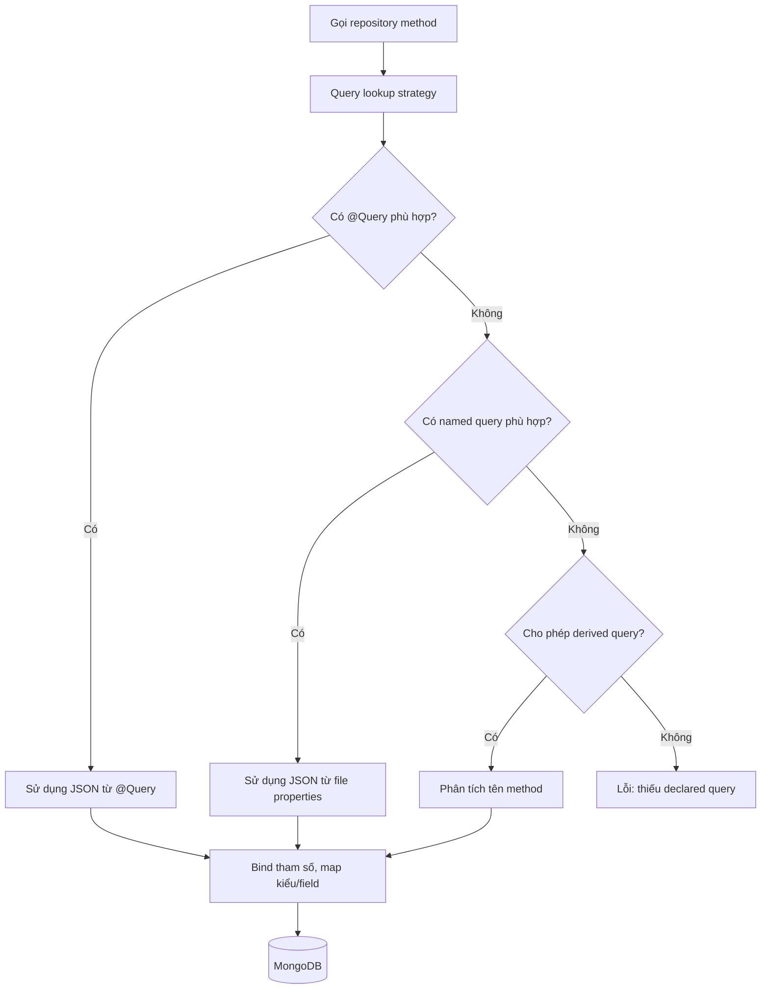

# Named query và quy tắc tìm truy vấn khai báo

> **Chương:** Truy vấn JSON  
> **Module:** `SPRING_DATA_MONGODB` — sử dụng Spring Data MongoDB để kết nối, ánh xạ document và thao tác dữ liệu qua `MongoTemplate` hoặc repository; từ đó thực hành thiết kế truy vấn, aggregation, index, transaction, reactive access, kiểm thử và chẩn đoán hiệu năng. Bài này tập trung vào **named query lưu dưới dạng JSON** và cơ chế Spring Data MongoDB chọn giữa truy vấn khai báo với truy vấn suy diễn từ tên phương thức.

## 1. Tại sao cần named query khi đã có derived query?

Spring Data MongoDB cho phép repository tạo truy vấn trực tiếp từ tên phương thức:

```java
List<PurchaseOrder> findByBuyerCode(String buyerCode);
```

Nếu chỉ cần tìm theo một property, derived query ngắn gọn và dễ bảo trì. Nhưng trong một số trường hợp, nhóm muốn **định nghĩa rõ JSON filter** mà không kéo dài tên method:

- Truy vấn có điều kiện nghiệp vụ cố định như `archived: false` cho các đơn còn hiệu lực.
- Cần các toán tử `$gte`, `$lt`, `$in` hoặc kết hợp `$and`, `$or` theo một cách khó đọc bằng tên method.
- Muốn dùng **tên method ổn định** nhưng có thể chỉnh truy vấn khai báo tại một nơi có version control.
- Muốn bảo vệ API repository khỏi việc vô ý biến một tên phương thức thành query khác khi refactor domain.

**Named query** là truy vấn được khai báo bên ngoài method, xác định bằng **khóa tên**, rồi được framework tìm để gắn vào repository method khi khởi tạo repository. Với Spring Data MongoDB, định dạng thông dụng là file `META-INF/mongo-named-queries.properties` trên classpath, trong đó giá trị là chuỗi JSON query.

Điều quan trọng nhất của bài:

> Với chiến lược lookup mặc định, Spring Data **ưu tiên truy vấn khai báo có sẵn**, rồi mới suy diễn từ tên phương thức nếu chưa tìm được. Trong các khai báo tương ứng, `@Query` đặt trực tiếp trên method được ưu tiên hơn named query trong file properties.

Named query **không đồng nghĩa** với một stored procedure hay một truy vấn được lưu và chạy độc lập trên MongoDB server. File properties được ứng dụng Spring Data đọc khi thiết lập repository; MongoDB chỉ nhận query được gửi tới nó.

## 2. Phân biệt ba cách viết repository query

| Cách viết | Truy vấn nằm ở đâu? | Phù hợp khi nào? |
| --- | --- | --- |
| **Derived query** | Trong tên phương thức Java, ví dụ `findByStatus` | Bộ lọc đơn giản, có thể diễn đạt rõ qua property và keyword. |
| **JSON `@Query`** | Trong annotation ngay trên repository method | Muốn đặt JSON cạnh chữ ký method để review dễ dàng. |
| **Named JSON query** | Trong file `mongo-named-queries.properties` với khóa `DomainType.methodName` | Muốn quản lý một tập truy vấn có tên, không đặt JSON trực tiếp trong interface. |

Cả ba cách đều được thực thi qua Spring Data repository infrastructure, chứ không mở thêm loại kết nối MongoDB riêng. Tên collection, ánh xạ property Java/BSON, converter và `MongoClient` vẫn theo cấu hình Spring Data MongoDB của ứng dụng.



Sơ đồ mô tả **trường hợp phổ biến với `CREATE_IF_NOT_FOUND`**, không phải quy tắc bắt buộc cho mọi chế độ lookup. Các chiến lược cụ thể được giải thích ở mục 5.

## 3. Domain model dùng xuyên suốt bài

Giả sử hệ thống lưu đơn hàng:

```java
package demo.orders;

import java.math.BigDecimal;
import java.time.Instant;
import org.springframework.data.annotation.Id;
import org.springframework.data.mongodb.core.mapping.Document;
import org.springframework.data.mongodb.core.mapping.Field;
import org.springframework.data.mongodb.core.mapping.FieldType;

@Document(collection = "purchase_orders")
public record PurchaseOrder(
    @Id String id,
    @Field("buyer_code") String buyerCode,
    String status,
    boolean archived,
    Instant createdAt,
    @Field(targetType = FieldType.DECIMAL128) BigDecimal totalAmount,
    ShippingAddress shippingAddress
) {}

record ShippingAddress(String city, String postalCode) {}
```

Document BSON biểu diễn bằng Extended JSON:

```json
{
  "_id": "ORD-001",
  "buyer_code": "CUS-42",
  "status": "PAID",
  "archived": false,
  "createdAt": { "$date": "2026-11-20T03:00:00Z" },
  "totalAmount": { "$numberDecimal": "1250.50" },
  "shippingAddress": {
    "city": "Da Nang",
    "postalCode": "550000"
  }
}
```

Lược bỏ field `_class` nếu có. Những điểm cần nhớ:

- Collection là `purchase_orders` vì `@Document(collection = "...")`.
- Property Java `buyerCode` được lưu thành BSON field `buyer_code`.
- `createdAt` là BSON Date; một named query so sánh ngày giờ cần truyền giá trị tương thích.
- `totalAmount` là Decimal128, không phải double hoặc string.
- `shippingAddress.city` là đường dẫn tới **document nhúng**, không phải tham chiếu sang collection khác.

Trong `@Query` và named query, ta sẽ cố ý viết **tên BSON thực tế** để nhìn rõ filter gửi tới MongoDB. Với nhiều thao tác typed, Spring Data còn áp dụng metadata mapping lên query; không nên dựa vào sự tự động đó để che giấu schema sai hoặc sự khác biệt giữa property Java với tên field trên server.

## 4. Khai báo named query trong file properties

### 4.1. Vị trí mặc định và cấu trúc thư mục

Trong dự án Maven/Gradle với layout tiêu chuẩn:

```text
src/
  main/
    java/
      demo/orders/PurchaseOrder.java
      demo/orders/PurchaseOrderRepository.java
    resources/
      META-INF/
        mongo-named-queries.properties
```

Khi đóng gói ứng dụng, resource phải có mặt **trên classpath**. Với Java application thông thường, đường dẫn thực tế sau build tương ứng `META-INF/mongo-named-queries.properties` bên trong classpath, **không** phải đường dẫn tùy ý bên cạnh JAR.

Mẫu file:

```properties
# src/main/resources/META-INF/mongo-named-queries.properties

# Khóa = tên đơn giản của domain type + "." + tên repository method.
PurchaseOrder.findByBuyerCode={ 'buyer_code' : ?0, 'archived' : false }
PurchaseOrder.findWithinWindow={ 'createdAt' : { '$gte' : ?0, '$lt' : ?1 } }
PurchaseOrder.findByShippingAddress_City={ 'shippingAddress.city' : ?0 }

# Khóa này sẽ bị @Query trên method cùng tên ưu tiên thay thế ở ví dụ sau.
PurchaseOrder.findByStatus={ 'status' : ?0 }
```

Ở file `.properties`, dấu `=` phân cách **khóa** và **giá trị**. Phần giá trị là một chuỗi truy vấn JSON theo cú pháp Spring Data MongoDB (cho phép dạng JSON giống JavaScript với dấu nháy đơn). Dấu hai chấm trong JSON là ký tự của **giá trị**, không phải định nghĩa một property mới.

Quy ước khóa rất quan trọng:

```text
PurchaseOrder.findByBuyerCode
└───────────┘ └──────────────┘
 Domain type     Tên method
```

- `PurchaseOrder` là **tên đơn giản của domain class**, không phải tên collection `purchase_orders` và không phải tên interface repository.
- `findByBuyerCode` là **tên method chính xác**, có phân biệt chữ hoa/thường.
- Các tham số Java không được thêm vào tên khóa, nên phương thức overload cùng tên khó phân biệt bằng cơ chế named query này.
- Nếu domain class được đổi tên, khóa trong file properties cần rà soát; nếu chỉ đổi `@Document(collection = "...")`, khóa không tự đổi theo collection.

### 4.2. Repository tương ứng

```java
package demo.orders;

import java.time.Instant;
import java.util.List;
import org.springframework.data.mongodb.repository.MongoRepository;
import org.springframework.data.mongodb.repository.Query;

public interface PurchaseOrderRepository
        extends MongoRepository<PurchaseOrder, String> {

    // Có named query: lọc buyer_code và archived=false.
    List<PurchaseOrder> findByBuyerCode(String buyerCode);

    // Method không dễ suy diễn; named query định nghĩa khoảng [from, until).
    List<PurchaseOrder> findWithinWindow(
        Instant fromInclusive, Instant untilExclusive
    );

    // Named query theo field lồng nhau.
    List<PurchaseOrder> findByShippingAddress_City(String city);

    // Có cả @Query lẫn named query cùng khóa.
    @Query("{ 'status' : ?0, 'archived' : false }")
    List<PurchaseOrder> findByStatus(String status);

    // Không có named query hay @Query: fallback về derived query.
    List<PurchaseOrder> findByStatusOrderByCreatedAtDesc(String status);
}
```

Kết quả mong đợi với lookup mặc định:

| Method | Nguồn truy vấn chọn | Bộ lọc logic |
| --- | --- | --- |
| `findByBuyerCode` | Named query | `buyer_code = ?0` **và** `archived = false` |
| `findWithinWindow` | Named query | `from <= createdAt < until` |
| `findByShippingAddress_City` | Named query | `shippingAddress.city = ?0` |
| `findByStatus` | `@Query` | `status = ?0` **và** `archived = false` |
| `findByStatusOrderByCreatedAtDesc` | Derived query | `status = ?0`, sort `createdAt` giảm dần |

Nếu không có named query cho `findByBuyerCode`, phương thức đó vẫn có thể được suy diễn thành `buyerCode = ?0`, nhưng sẽ **không tự thêm** `archived = false`. Đây là thay đổi semantics cần có test rõ ràng.

### 4.3. Vì sao nên giữ truy vấn và tên method dễ đối chiếu?

Một named query có thể “cứu” tên method không thể suy diễn, như `findWithinWindow`. Tuy nhiên, nếu tên quá chung hoặc một method `findByBuyerCode` bí mật lọc thêm `archived: false`, người đọc code chỉ nhìn interface có thể hiểu nhầm. Hãy:

1. Đặt tên method mô tả nghiệp vụ rõ (ví dụ `findActiveByBuyerCode`) khi thích hợp.
2. Đặt comment ngắn hoặc test thể hiện điều kiện ngầm.
3. Tránh các điều kiện an toàn quan trọng chỉ tồn tại trong file properties mà không có test.
4. Chấp nhận `@Query` nếu khai báo trực tiếp cạnh method sẽ giúp code review dễ hơn.

## 5. Quy tắc tìm truy vấn: QueryLookupStrategy

Spring Data repositories dùng khái niệm **query lookup strategy** để xác định truy vấn cho một phương thức. Ba lựa chọn cần biết:

| Strategy | Cách tìm truy vấn | Hành vi khi không có khai báo phù hợp |
| --- | --- | --- |
| `CREATE` | Tạo truy vấn từ tên phương thức theo khả năng suy diễn của store module. | Không thể parse tên/property thì thất bại. |
| `USE_DECLARED_QUERY` | Tìm truy vấn khai báo (`@Query` hoặc named query phù hợp). | Thất bại nếu không tìm thấy truy vấn khai báo. |
| `CREATE_IF_NOT_FOUND` | Thử truy vấn khai báo trước, nếu không có thì suy diễn tên phương thức. | Thất bại nếu cả khai báo và suy diễn đều không khả thi. |

**`CREATE_IF_NOT_FOUND` là chiến lược mặc định thông dụng.** Do đó, một repository method `findByStatusOrderByCreatedAtDesc` có thể chạy mà không cần JSON properties; còn `findWithinWindow` cần khai báo vì không phải cấu trúc tên derived query thông thường.

### 5.1. Thứ tự ưu tiên trong trường hợp khai báo

Với một repository method có **cả `@Query` lẫn named query cùng khóa**, `@Query` có ưu tiên cao hơn. Ví dụ:

```properties
PurchaseOrder.findByStatus={ 'status' : ?0 }
```

```java
@Query("{ 'status' : ?0, 'archived' : false }")
List<PurchaseOrder> findByStatus(String status);
```

Nếu truy vấn đúng đang được chọn, tài liệu chỉ trả về những order chưa archived. Không được giả định hai truy vấn sẽ được ghép thành một, hoặc named query tự thêm điều kiện sau khi `@Query` đã được chọn.

Vì `CREATE_IF_NOT_FOUND` có fallback, một **named query sai tên khóa** có thể bị bỏ qua âm thầm nếu tên method vẫn là derived query hợp lệ. Đây là lý do cần test quan sát điều kiện mà query thật sự áp dụng, không chỉ kiểm tra repository khởi động được.

### 5.2. Khi muốn buộc các query phải được khai báo

Với cấu hình repositories bằng annotation trên những phiên bản Spring Data MongoDB hỗ trợ thuộc tính này, có thể chọn `USE_DECLARED_QUERY`:

```java
import org.springframework.context.annotation.Configuration;
import org.springframework.data.repository.query.QueryLookupStrategy;
import org.springframework.data.mongodb.repository.config.EnableMongoRepositories;

@Configuration
@EnableMongoRepositories(
    basePackages = "demo.orders",
    queryLookupStrategy = QueryLookupStrategy.Key.USE_DECLARED_QUERY
)
public class MongoRepositoryConfiguration {}
```

Khi đó, những method query như `findByStatusOrderByCreatedAtDesc` **cần truy vấn khai báo** thay vì tự fallback; các thao tác kế thừa từ base repository được xử lý bởi cơ chế repository riêng. Cấu hình này có thể hữu ích nếu team muốn kiểm soát toàn bộ truy vấn, nhưng tăng chi phí bảo trì và nên được áp dụng có chủ đích.

Lưu ý **chỉ sử dụng một cấu hình `@EnableMongoRepositories` phù hợp** với auto-configuration và package scanning của Spring Boot. Tùy phiên bản Spring Data/Spring Boot, khai báo thủ công có thể thay đổi phạm vi quét repository hoặc các bean cấu hình; hãy kiểm tra tài liệu đúng phiên bản trước khi sao chép vào production.

### 5.3. Chuyển file named queries tới vị trí khác

Khi một ứng dụng muốn dùng file riêng thay vì `META-INF/mongo-named-queries.properties`, các phiên bản `@EnableMongoRepositories` hỗ trợ `namedQueriesLocation` có thể cấu hình vị trí resource:

```java
@EnableMongoRepositories(
    basePackages = "demo.orders",
    namedQueriesLocation = "classpath:queries/orders-named-queries.properties"
)
public class MongoRepositoryConfiguration {}
```

Khi dùng cách này, phải chắc chắn file được đóng gói đúng classpath. Đừng đổi vị trí rồi quên cập nhật module đóng gói, integration test hoặc cấu hình repositories. Đối chiếu tên thuộc tính của `@EnableMongoRepositories` với phiên bản Spring Data MongoDB thực tế vì khả năng cấu hình có thể thay đổi theo nhánh.

## 6. Bind tham số JSON query: không nối chuỗi đầu vào

Named query và `@Query` dùng placeholder **tham số theo vị trí** như `?0`, `?1`:

```properties
PurchaseOrder.findWithinWindow={ 'createdAt' : { '$gte' : ?0, '$lt' : ?1 } }
```

```java
Instant from = Instant.parse("2026-11-20T00:00:00Z");
Instant until = Instant.parse("2026-11-21T00:00:00Z");

List<PurchaseOrder> orders =
    repository.findWithinWindow(from, until);
```

Ý nghĩa query:

```javascript
db.purchase_orders.find({
  createdAt: {
    $gte: ISODate("2026-11-20T00:00:00Z"),
    $lt: ISODate("2026-11-21T00:00:00Z")
  }
})
```

Nhờ Spring Data và MongoDB Driver thực hiện binding/conversion, tham số Java `Instant` có thể được gửi thành giá trị BSON Date phù hợp. Đối với kiểu `BigDecimal`, UUID, enum hay value object có converter, hãy kiểm tra BSON type thực sự được dùng trong filter thay vì đoán từ Java signature.

### 6.1. Cách viết an toàn

```java
@Query("{ 'buyer_code' : ?0 }")
List<PurchaseOrder> findByBuyerCodeExplicit(String buyerCode);
```

Đưa giá trị `buyerCode` qua placeholder, **không** tự nối một JSON query từ string người dùng gửi lên:

```java
// PHẢN VÍ DỤ: không làm như thế này.
String unsafeQuery = "{ 'buyer_code' : '" + untrustedInput + "' }";
```

String concatenation vừa làm hỏng escaping khi có dấu nháy vừa mở rủi ro query injection. Binding positional của Spring Data xử lý giá trị như dữ liệu; tuy nhiên ứng dụng vẫn phải kiểm soát quyền truy cập theo user và không cho phép caller tự đưa field/operator tùy ý vào query.

### 6.2. Phân biệt placeholder với dấu nháy cố định

```java
// Đúng: ?0 là giá trị do framework bind.
@Query("{ 'buyer_code' : ?0 }")
List<PurchaseOrder> lookup(String code);

// Dấu nháy bao quanh ?0 tạo ra chuỗi literal trong một số cách parse;
// tránh kiểu viết mơ hồ này.
@Query("{ 'buyer_code' : '?0' }")
List<PurchaseOrder> avoidLiteralPlaceholder(String code);
```

Thực hành: dùng `?0` không nằm trong dấu nháy cố định, rồi kiểm tra query kết quả thực tế. Với truy vấn phức tạp, đặc biệt biểu thức SpEL hoặc parameter expression trong JSON, cần dựa trên API/tài liệu của phiên bản đang dùng và viết test cho cả giá trị có ký tự đặc biệt.

### 6.3. Mảng, toán tử $in, $or và lồng nhau

```java
@Query("{ 'status' : { '$in' : ?0 }, 'archived' : false }")
List<PurchaseOrder> findActiveWithStatusIn(List<String> statuses);

@Query("{ '$or' : [ { 'buyer_code' : ?0 }, { 'status' : ?1 } ] }")
List<PurchaseOrder> findMatchingBuyerOrStatus(
    String buyerCode, String status
);

@Query("{ 'shippingAddress.city' : ?0 }")
List<PurchaseOrder> findForShippingCity(String city);
```

Những filter này có thể được khai báo trong named queries properties bằng khóa `PurchaseOrder.<methodName>` tương ứng. Nếu method có `Sort` hoặc `Pageable`, Spring Data có thể áp dụng sắp xếp/phân trang bên cạnh JSON filter, theo API repository và kiểu trả về được hỗ trợ.

**Khi query phức tạp hơn:** với `$elemMatch`, điều kiện trên nhiều field của array, điều kiện động hoặc aggregation, `MongoTemplate` hay `@Aggregation` có thể dễ đọc hơn một chuỗi JSON rất dài. Named query là cách khai báo một filter, không phải một giải pháp cho mọi loại truy vấn MongoDB.

## 7. Named query có ánh xạ tên field và collection như thế nào?

Đây là một trong những nguồn lỗi khó thấy nhất:

| Khái niệm | Ví dụ | Nơi được dùng |
| --- | --- | --- |
| Domain class Java | `PurchaseOrder` | Phần đầu khóa named query. |
| Repository method | `findByBuyerCode` | Phần cuối khóa named query. |
| Java property | `buyerCode` | Derived query, DTO, code service. |
| BSON field | `buyer_code` | Truy vấn thô trên MongoDB; dùng tường minh trong JSON ví dụ. |
| MongoDB collection | `purchase_orders` | Nơi lệnh thực thi được gửi tới. |

Nếu chuyển `@Document(collection = "purchase_orders")` sang một collection khác, Spring Data thực thi query trên collection đã cấu hình cho entity. **Named query key vẫn dựa theo tên domain class**, không dựa theo collection. Ngược lại, nếu refactor tên Java class nhưng giữ collection, hãy đổi khóa named query cho đúng domain type mới.

### 7.1. Filter JSON và @Field

Với `@Field("buyer_code") String buyerCode`, query thực tế phải tác động đến BSON field `buyer_code`. Ví dụ khai báo:

```properties
PurchaseOrder.findByBuyerCode={ 'buyer_code' : ?0, 'archived' : false }
```

Các tầng query có domain metadata có thể ánh xạ tên property Java sang BSON theo cấu hình, nhưng cách thực hành dễ kiểm chứng nhất khi dùng **raw JSON query** là mô tả đúng **tên field lưu trữ** rồi dùng test với document thô.

Nếu property nested `shippingAddress.city` được đổi tên field bằng `@Field("town")` trên `ShippingAddress.city`, truy vấn BSON đích phải là `shippingAddress.town`. Bài viết Spring Data repository khi sử dụng property paths suy diễn vẫn dùng `shippingAddress.city` ở tầng Java; đừng pha trộn hai khái niệm.

### 7.2. Query trả về document thật, không tự join reference

Nếu entity có `@DocumentReference Customer customer`, BSON của root thường lưu scalar ID. JSON query như `{ 'customer.name' : ?0 }` **không tự join** sang collection `customers` chỉ vì Java có object `Customer` trong domain. Muốn lọc theo dữ liệu ở collection khác, cân nhắc hai bước tìm ID, denormalized field có kiểm soát hoặc aggregation `$lookup`.

### 7.3. JSON null, tồn tại field và schema cũ

Trong MongoDB, `{ 'field' : null }` có thể khớp cả document chứa field với giá trị null **và** document không có field. Nếu muốn kiểm tra field có tồn tại, khai báo `$exists` phù hợp:

```properties
PurchaseOrder.findWithStatusField={ 'status' : { '$exists' : true } }
```

Không mặc định JSON query với `null` sẽ phân biệt missing với explicit null. Khi schema tiến hóa và có document thiếu field, hãy thiết kế semantics trước rồi mới viết named query.

## 8. Projection, Sort, Pageable, count và exists

### 8.1. Named query thường khai báo điều kiện filter

Một entry thông thường trong `mongo-named-queries.properties` xác định **JSON filter**. Những mục tiêu phức tạp như projection field, update query, aggregation pipeline hoặc count semantics có thể cần thêm annotation/API tương ứng; **không tự hiểu toàn bộ định dạng của một lệnh shell là giá trị named query**.

Ví dụ projection sử dụng `@Query`:

```java
@Query(
    value = "{ 'status' : ?0 }",
    fields = "{ '_id' : 1, 'buyer_code' : 1, 'status' : 1 }"
)
List<PurchaseOrder> findBriefByStatus(String status);
```

Lưu ý quan trọng: trả trực tiếp `PurchaseOrder` từ projection thiếu `createdAt`, `totalAmount`, `shippingAddress` và `archived` có thể tạo entity **không đầy đủ** hoặc không tương thích với constructor/record bất biến. Với API thực tế, nên định nghĩa một DTO/projection riêng có những field cần thiết, thay vì coi entity bị cắt field là một aggregate đầy đủ có thể `save` trở lại.

### 8.2. Sort và Pageable

```java
import java.util.List;
import org.springframework.data.domain.Page;
import org.springframework.data.domain.Pageable;
import org.springframework.data.domain.Sort;

// Method khác tên: tránh overload findByBuyerCode đã có ở ví dụ trước.
List<PurchaseOrder> findActiveByBuyerCode(String buyerCode, Sort sort);

// Named query key chỉ phân biệt tên method, không phân biệt signature.
Page<PurchaseOrder> findPageByBuyerCode(
    String buyerCode, Pageable pageable
);
```

Trong một repository thật, nên chọn tên method không nhập nhằng, tránh overload trùng tên với method đã có trong ví dụ trước. Mẫu trên minh họa **chữ ký lựa chọn**: khi dùng `Sort`/`Pageable`, các tham số điều khiển truy vấn không nên xuất hiện như placeholder điều kiện nghiệp vụ.

Ví dụ named query cho method phân trang:

```properties
PurchaseOrder.findActiveByBuyerCode={ 'buyer_code' : ?0, 'archived' : false }
PurchaseOrder.findPageByBuyerCode={ 'buyer_code' : ?0, 'archived' : false }
```

Khi cần tổng số kết quả, `Page` thường phát sinh thêm count query theo cơ chế của repository. Nếu chỉ cần biết còn trang sau, `Slice` có thể tránh một số chi phí đếm. Trên tập dữ liệu lớn, offset cao vẫn đắt; cân nhắc cursor/keyset pagination với sorting ổn định và index phù hợp.

### 8.3. Count/exists được dẫn xuất hay khai báo riêng?

Spring Data MongoDB có thể suy diễn `countBy...` và `existsBy...` từ tên phương thức, hoặc dùng những thuộc tính tương ứng của `@Query` theo phiên bản:

```java
long countByStatus(String status);

boolean existsByBuyerCode(String buyerCode);

@Query(value = "{ 'status' : ?0, 'archived' : false }", count = true)
long countActiveByStatus(String status);

@Query(value = "{ 'buyer_code' : ?0 }", exists = true)
boolean existsForBuyer(String buyerCode);
```

Nếu cần truy vấn count/exists với điều kiện quan trọng, kiểm tra xem query được derive, định nghĩa bằng annotation hay lấy từ named query. Không suy đoán rằng một named query filter sẽ tự mang theo projection/count behavior được viết ở nơi khác; test cả **giá trị trả về và điều kiện lọc thật**.

## 9. Chẩn đoán khi named query không được dùng

Một lỗi đặc biệt nguy hiểm là **file properties chứa truy vấn đúng nhưng ứng dụng bỏ qua và dùng derived query**. Vì derived query vẫn chạy, người dùng chỉ thấy thiếu điều kiện hoặc ra nhiều kết quả hơn dự kiến.

### 9.1. Checklist

1. **File có nằm trên classpath không?** Kiểm tra resource `META-INF/mongo-named-queries.properties` trong artifact chạy thực tế.
2. **Khóa có đúng không?** `PurchaseOrder.findByBuyerCode` phải trùng tên đơn giản của domain type và method, phân biệt chữ hoa/thường.
3. **Có một `@Query` trên method không?** Nếu có, annotation thường được ưu tiên hơn named query cùng tên.
4. **Lookup strategy là gì?** Với `CREATE_IF_NOT_FOUND`, thiếu named query có thể fallback về derived query. Với `USE_DECLARED_QUERY`, method thiếu khai báo có thể gây lỗi lúc tạo repository.
5. **Property method có overload không?** File named query chỉ có tên method, không có signature; nên tránh overload với hai ý nghĩa khác nhau.
6. **Resource bị đóng gói trùng ở các module/JAR không?** Cần xác định bản resource nào đang được load, tránh file cùng đường dẫn với nội dung khác nhau.
7. **Giá trị JSON hợp lệ không?** Kiểm tra dấu nháy, ngoặc nhọn, tham số `?0`/`?1` và operator MongoDB; lỗi cú pháp thường bộc lộ khi repository query được tạo hoặc thực thi.
8. **Schema BSON thực sự ra sao?** Xác nhận collection, tên field, loại BSON (nhất là `_id`, Date, Decimal128) và giá trị lưu.
9. **Có sắp xếp/phân trang ngoài filter không?** Kiểm tra tham số `Sort`/`Pageable` và kiểu trả về.
10. **Test có phân biệt named với derived không?** Phải có một document được derived query trả về nhưng named query loại bỏ, chẳng hạn `archived = true`.

### 9.2. Dấu hiệu thất bại điển hình

| Triệu chứng | Nguyên nhân khả dĩ | Khắc phục |
| --- | --- | --- |
| `findByBuyerCode` trả cả order đã archived | Named query không được tìm, fallback derived query thiếu `archived=false`. | Kiểm tra file/classpath/key, bổ sung integration test phân biệt. |
| Application context lỗi với `findWithinWindow` | Named query thiếu/sai key và method không suy diễn được. | Cố định resource hoặc dùng `@Query`, xem exception gốc. |
| JSON query trả không đúng thứ tự | Filter không tự định nghĩa `Sort`. | Thêm method sort/Pageable hoặc `OrderBy`/`@Query(sort=...)` theo API hỗ trợ. |
| Kết quả filter theo buyer rỗng | Sai field BSON `buyer_code` hoặc sai kiểu giá trị. | So sánh raw BSON và query bằng `mongosh`. |
| Query luôn trả cả đơn đã archived mặc dù method có @Query | Annotation JSON không chứa điều kiện như kỳ vọng, hoặc gọi nhầm method. | Test annotation được chọn; không nghĩ named query sẽ ghép thêm. |
| Query chứa `?0` như chuỗi literal | Placeholder được đặt trong nháy sai quy tắc. | Dùng binding `?0` không có nháy cứng. |
| `Page` chậm hơn `List` với cùng filter | Count query và offset hoặc index chưa tối ưu. | Quan sát query plan, đổi pagination khi cần. |
| Tên domain đổi khiến named query không khớp | Key phụ thuộc tên domain class, không phụ thuộc collection. | Đổi tên key và thêm test startup/query. |

Khi cần debug, bật mức log phù hợp cho Spring Data MongoDB và MongoDB Java Driver ở **môi trường test có kiểm soát**, nhưng tránh ghi mật khẩu, thông tin cá nhân hoặc dữ liệu truy vấn nhạy cảm vào log. Có thể sử dụng command monitoring theo hướng dẫn driver để quan sát lệnh gửi đi, kiểm soát quyền truy cập và giới hạn dữ liệu được ghi.

## 10. Integration test để chứng minh query được chọn

Một unit test chỉ kiểm tra tên method hoặc đọc nội dung properties **không chứng minh** Spring Data đã sử dụng named query. Cần dùng repository thật, dữ liệu BSON thật và những bản ghi phân biệt các nhánh.

### 10.1. Bộ dữ liệu nhỏ nhưng có tính phân biệt

Tạo ít nhất ba order:

| ID | buyer_code | status | archived | Vai trò |
| --- | --- | --- | --- | --- |
| `ORD-A` | `CUS-42` | `PAID` | `false` | Phải xuất hiện trong named query. |
| `ORD-B` | `CUS-42` | `PAID` | `true` | **Phải bị loại khỏi named query**, nhưng derived `findByBuyerCode` có thể trả. |
| `ORD-C` | `CUS-99` | `PENDING` | `false` | Không khớp buyer code. |

Khi gọi:

```java
List<PurchaseOrder> found =
    repository.findByBuyerCode("CUS-42");

// Named query đang được chọn đúng => chỉ có ORD-A.
// Nếu fallback derived => có thể có cả ORD-A và ORD-B.
```

Đây là test kiểm tra **semantics**, không chỉ kiểm tra kết nối. Nên assert tập ID chính xác, không dựa vào thứ tự mặc định khi truy vấn chưa có sort.

### 10.2. Mẫu integration test với Spring Boot

Ví dụ đoạn test sử dụng JUnit 5 và AssertJ, giả định ứng dụng đã có MongoDB test riêng hoặc Testcontainers được cấu hình:

```java
import static org.assertj.core.api.Assertions.assertThat;

import java.math.BigDecimal;
import java.time.Instant;
import java.util.List;
import org.junit.jupiter.api.BeforeEach;
import org.junit.jupiter.api.Test;
import org.springframework.beans.factory.annotation.Autowired;
import org.springframework.boot.test.autoconfigure.data.mongo.DataMongoTest;
import org.springframework.data.mongodb.core.MongoTemplate;

@DataMongoTest
class PurchaseOrderNamedQueryTest {

    @Autowired PurchaseOrderRepository repository;
    @Autowired MongoTemplate mongoTemplate;

    @BeforeEach
    void prepare() {
        mongoTemplate.dropCollection(PurchaseOrder.class);
        Instant t = Instant.parse("2026-11-20T03:00:00Z");
        repository.saveAll(List.of(
            new PurchaseOrder("ORD-A", "CUS-42", "PAID", false,
                t, new BigDecimal("10.00"), new ShippingAddress("Hue", "530000")),
            new PurchaseOrder("ORD-B", "CUS-42", "PAID", true,
                t, new BigDecimal("20.00"), new ShippingAddress("Hue", "530000")),
            new PurchaseOrder("ORD-C", "CUS-99", "PENDING", false,
                t, new BigDecimal("30.00"), new ShippingAddress("Da Nang", "550000"))
        ));
    }

    @Test
    void namedQueryFiltersArchivedOrders() {
        assertThat(repository.findByBuyerCode("CUS-42"))
            .extracting(PurchaseOrder::id)
            .containsExactly("ORD-A");
    }

    @Test
    void queryAnnotationOverridesNamedQuery() {
        assertThat(repository.findByStatus("PAID"))
            .extracting(PurchaseOrder::id)
            .containsExactly("ORD-A");
    }
}
```

**Lưu ý phiên bản:** `@DataMongoTest` và auto-configuration/test module có thể khác package trong các thế hệ Spring Boot; đoạn import ở trên theo kiểu Spring Boot 3.x. Đối chiếu dependency của dự án khi dùng Boot 4.x. Đồng thời, `@DataMongoTest` chỉ cấu hình MongoDB slice, **không tự tạo MongoDB server**: bạn vẫn phải cấp MongoDB thử nghiệm, có thể qua Testcontainers và connection property thích hợp cho phiên bản Boot.

Test phải dùng database/collection **tách biệt hoàn toàn với production** vì `dropCollection` sẽ xóa dữ liệu. Với phép thử khác, có thể dọn từng document theo ID test thay vì xóa toàn bộ collection.

### 10.3. Kiểm tra annotation thắng named query

Trong file properties, `PurchaseOrder.findByStatus` chỉ lọc `status`, còn trên repository method `findByStatus` ta đặt `@Query` có thêm `archived: false`. Test ở trên dự kiến chỉ trả `ORD-A`. Nếu `ORD-B` cũng xuất hiện, cần kiểm tra repository method, cấu hình annotation hoặc giả định về cách query được chọn.

Để thử riêng **lookup strategy `USE_DECLARED_QUERY`**, đặt cấu hình trên một test context riêng, không thay đổi cấu hình production; xác nhận query method không có khai báo bị từ chối. Với `CREATE_IF_NOT_FOUND`, test `findByStatusOrderByCreatedAtDesc` chạy theo derived query khi không có named entry tương ứng.

### 10.4. Test query range và type mapping

```java
Instant from = Instant.parse("2026-11-20T00:00:00Z");
Instant until = Instant.parse("2026-11-21T00:00:00Z");

List<PurchaseOrder> inWindow =
    repository.findWithinWindow(from, until);
```

So sánh với truy vấn `mongosh` dùng BSON Date. Với giá tiền lưu Decimal128, hãy kiểm tra raw BSON trước khi viết query so sánh số; nếu dữ liệu cũ lưu String, named query dùng toán tử số có thể không cho kết quả như kỳ vọng.

## 11. Tối ưu hiệu năng khi dùng named query

Tên query được lưu trong properties **không khiến MongoDB thực thi nhanh hơn** so với cùng filter được khai báo bằng `@Query` hoặc suy diễn từ method. Hiệu năng phụ thuộc vào **BSON query thực tế, index, số document quét, sort, pagination và topology**.

Ví dụ query thường gọi:

```properties
PurchaseOrder.findByBuyerCode={ 'buyer_code' : ?0, 'archived' : false }
```

Index có thể cân nhắc nếu workload thường lọc theo hai field này:

```javascript
db.purchase_orders.createIndex({
  buyer_code: 1,
  archived: 1
});

db.purchase_orders.find({
  buyer_code: "CUS-42",
  archived: false
}).explain("executionStats");
```

Nếu API còn sort theo `createdAt` giảm dần, index tổng hợp có thể cần thêm `createdAt: -1`, tùy query shape và các truy vấn khác. Cần đo dữ liệu đại diện, xem `totalDocsExamined`/`totalKeysExamined`, số kết quả và các bước sort, không tự tạo index cho từng named query riêng lẻ.

Với sharded cluster, query thiếu shard key có thể phân tán qua nhiều shard. Với replica set, read preference/write concern và secondary lag có thể ảnh hưởng tính mới của kết quả. Những yếu tố này **không được giải quyết chỉ bằng cách di chuyển JSON vào file named query**.

## 12. Khi nào dùng named query, @Query hay MongoTemplate?

| Nhu cầu | Lựa chọn thường phù hợp | Lý do |
| --- | --- | --- |
| `findByStatus` đơn giản | Derived query | Tối thiểu cấu hình, dễ hiểu từ tên method. |
| Filter tương đối phức tạp nhưng gắn chặt một method | `@Query` | JSON nằm cạnh chữ ký và kiểu trả về. |
| Nhiều truy vấn khai báo cần quản lý trong resource | Named query properties | Tập trung JSON, có khóa định danh rõ. |
| Filter thay đổi nhiều theo input, optional condition | `MongoTemplate` và `Criteria`/`Query` | Tạo điều kiện bằng API có cấu trúc, tránh nối chuỗi JSON. |
| Pipeline `$group`, `$lookup`, `$project` | Aggregation API hoặc `@Aggregation` | Filter named query đơn lẻ không biểu diễn toàn bộ pipeline. |
| Cập nhật theo điều kiện, upsert, atomic update | `MongoTemplate` update API hoặc annotation update thích hợp | Rõ operator, số document bị ảnh hưởng và semantics. |
| Reactive access | Reactive repository/`ReactiveMongoTemplate` | Nguyên tắc query giống nhau, kết quả `Flux`/`Mono`. |

Với **reactive MongoDB repositories**, khái niệm declared/derived query và JSON filter vẫn có liên quan, nhưng kiểm tra phiên bản/API khi dùng phân trang hoặc projection: reactive repository thường trả `Flux`/`Mono`, không mặc định hỗ trợ `Page<T>` như imperative repository. Một JSON named query không tự biến truy vấn nhiều document thành transaction.

## 13. Bài thực hành: triển khai lookup và phát hiện fallback

Tạo dịch vụ quản lý `PurchaseOrder` và hoàn thành các bước:

1. Khai báo entity có `buyerCode` được ánh xạ `@Field("buyer_code")`, `status`, `archived`, `createdAt` và `shippingAddress.city`.
2. Tạo `META-INF/mongo-named-queries.properties` với query `PurchaseOrder.findByBuyerCode` lọc thêm `archived = false`.
3. Tạo method `findByBuyerCode` và dữ liệu test có hai order cùng buyer nhưng một order `archived = true`. Xác nhận kết quả chỉ có đơn chưa archived.
4. Tạo named query `findWithinWindow` dùng `$gte` và `$lt`; kiểm tra ngày giờ bằng `Instant` và khoảng nửa mở.
5. Tạo `@Query` cùng tên với một entry trong named query properties; cho hai query khác điều kiện và chứng minh `@Query` được dùng.
6. Cố tình đổi sai key named query (chỉ trong test). Với method có thể suy diễn, quan sát fallback; với method không thể suy diễn, quan sát lỗi tạo repository.
7. Viết derived query `findByStatusOrderByCreatedAtDesc` không có khai báo tương ứng, kiểm chứng fallback của `CREATE_IF_NOT_FOUND`.
8. Thử tách một test context bật `USE_DECLARED_QUERY` để quan sát behavior khác.
9. Chạy `explain("executionStats")` trên query BSON tương đương và đề xuất index dựa vào workload.
10. So sánh tính dễ đọc của ba phương án: method derived, `@Query` và named query properties. Giải thích phương án nào được chọn trong codebase của nhóm.

### Câu hỏi tự kiểm tra

- Named query MongoDB mặc định nằm ở đâu trên classpath?
- Tên khóa `PurchaseOrder.findByBuyerCode` lấy `PurchaseOrder` từ **domain type**, repository interface hay collection?
- Khi có cả `@Query` và named query cùng method, khai báo nào được ưu tiên?
- Với `CREATE_IF_NOT_FOUND`, chuyện gì xảy ra nếu tên khóa trong file properties sai nhưng method vẫn có thể suy diễn?
- Vì sao `USE_DECLARED_QUERY` hữu ích để phát hiện thiếu khai báo, và đánh đổi của nó là gì?
- Tham số `?0`, `?1` khác gì việc nối chuỗi đầu vào vào JSON?
- Khi `@Field("buyer_code")` được dùng, tên method và tên BSON khác nhau thế nào?
- Vì sao derived query vẫn có thể hoạt động nếu không còn named query, nhưng có thể trả dữ liệu sai nghiệp vụ?
- Named query giúp gì cho quản lý mã nguồn, và **không giúp gì** cho index/sharding/transaction?
- Trong một test, cần tạo dữ liệu như thế nào để chứng minh query nào thực sự được chọn?

## 14. Ghi nhớ và tài liệu đối chiếu

- **Named query là truy vấn JSON khai báo theo khóa tên**, thường ở `META-INF/mongo-named-queries.properties`.
- Khóa có cấu trúc **`DomainType.methodName`**, không theo tên collection và không theo tên repository interface.
- `@Query` đặt trực tiếp trên method **được ưu tiên** so với named query cùng khóa trong các cơ chế lookup được hỗ trợ.
- `CREATE_IF_NOT_FOUND` thử truy vấn khai báo trước rồi mới suy diễn tên; `USE_DECLARED_QUERY` yêu cầu có khai báo; `CREATE` tập trung suy diễn.
- Named query nên bind dữ liệu bằng **`?0`, `?1`** và dùng đúng schema BSON; không nối JSON tùy ý từ input.
- **Fallback có thể che lỗi cấu hình**: một method chạy được chưa chứng minh named query đã được load.
- Integration test nên có **dữ liệu phân biệt named filter và derived filter**, đồng thời kiểm tra query thực tế và index.
- `MongoTemplate`, aggregation và update API vẫn cần thiết cho query quá động hoặc không phù hợp với JSON finder đơn lẻ.

Tài liệu chính thức để đối chiếu theo phiên bản đang sử dụng:

- [Spring Data MongoDB — Defining Query Methods / Query Lookup Strategies](https://docs.spring.io/spring-data/mongodb/reference/repositories/query-methods-details.html)
- [Spring Data MongoDB — MongoDB-specific Query Methods](https://docs.spring.io/spring-data/mongodb/reference/mongodb/repositories/query-methods.html)
- [Spring Data MongoDB — Reference Documentation](https://docs.spring.io/spring-data/mongodb/reference/)
- [Spring Data Commons — Query Lookup Strategies](https://docs.spring.io/spring-data/commons/reference/repositories/query-methods-details.html)
