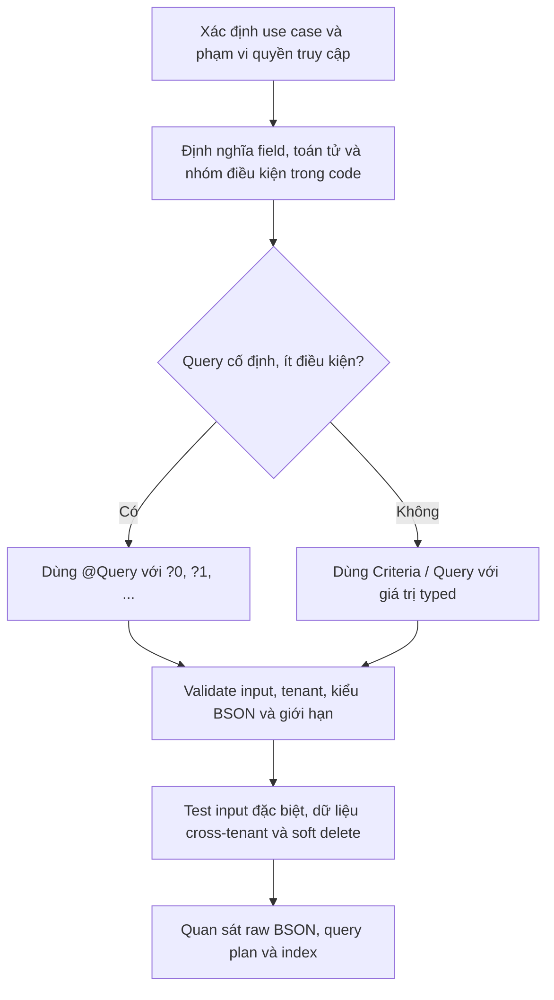

# Truyền tham số an toàn thay vì ghép chuỗi JSON từ đầu vào

Spring Data MongoDB cho phép viết truy vấn MongoDB bằng JSON trong `@Query`, hoặc xây dựng query với `Criteria` và `MongoTemplate`. Cả hai cách đều hữu ích khi truy vấn phức tạp hơn một phương thức repository suy diễn từ tên. Nhưng một lỗi dễ gặp là **ghép chuỗi JSON trực tiếp từ dữ liệu người dùng**. Nếu ứng dụng nhúng nguyên văn một đoạn do client gửi vào cấu trúc query, đoạn đó có thể bị MongoDB diễn giải thành **toán tử**, thay vì giá trị cần so sánh.

Ví dụ, API chỉ định tìm đơn hàng có `status = "ACTIVE"`. Nếu server nối dữ liệu đầu vào vào một câu query JSON, client có thể đưa biểu thức `{"$ne": "ARCHIVED"}` khiến bộ lọc chuyển từ phép so sánh bằng sang phép **khác**. Với hệ thống nhiều tenant, một query được dựng sai còn có nguy cơ bỏ qua điều kiện giới hạn dữ liệu theo tổ chức.

Trong chương **Truy vấn JSON**, bài này tập trung vào cách **giữ cấu trúc truy vấn do ứng dụng quyết định, còn giá trị đầu vào được bind như dữ liệu có kiểu**. Đây là nền tảng trước khi xây dựng các truy vấn phức tạp, aggregation, index và kiểm thử bằng `MongoRepository` hoặc `MongoTemplate` trong Spring Data MongoDB.

Sau bài học, bạn có thể:

- Giải thích rủi ro **MongoDB query/operator injection** khi ghép dữ liệu thô vào JSON query.
- Bind tham số trong `@Query` bằng `?0`, `?1` và truyền đúng Java type.
- Xây dựng query động bằng `Criteria`, `Query` và `MongoTemplate` mà không lắp JSON bằng chuỗi.
- Kiểm soát những phần không thể bind như tên field, toán tử, sort, projection và biểu thức SpEL.
- Phân biệt tìm kiếm chuỗi nguyên văn với biểu thức regex do người dùng cung cấp.
- Kiểm thử query với input đặc biệt, điều kiện tenant, dữ liệu bị xóa mềm và BSON type.

## 1. JSON query là cấu trúc có ý nghĩa, không chỉ là chuỗi

Trong MongoDB, hai bộ lọc sau **khác nhau về logic**:

```javascript
// So sánh bằng: chỉ trả document có status = "ACTIVE".
db.orders.find({
  status: "ACTIVE"
});

// So sánh khác: trả các document có status khác "ARCHIVED"
// (và trong nhiều trường hợp cả document thiếu field status).
db.orders.find({
  status: { $ne: "ARCHIVED" }
});
```

`"ACTIVE"` là một **giá trị BSON String**. `{ "$ne": "ARCHIVED" }` là một **document điều kiện** chứa toán tử MongoDB. Nếu ứng dụng cho phép input của client quyết định liệu vị trí `status` là String hay document toán tử, client đã được quyền thay đổi ý nghĩa truy vấn.

Đó chính là nguồn gốc của **operator injection**: dữ liệu không đáng tin cậy được diễn giải thành cấu trúc query. Việc dùng MongoDB không tự loại bỏ rủi ro này; nó chỉ khác dạng SQL injection quen thuộc.

### Hai ranh giới cần bảo vệ

| Thành phần query | Ai nên quyết định? | Ví dụ |
| --- | --- | --- |
| **Tên collection/field** | Code ứng dụng hoặc danh sách field cho phép | `tenantId`, `status` |
| **Toán tử và cách nhóm** | Code ứng dụng | `$eq`, `$in`, `$and`, `$or` |
| **Giá trị so sánh** | Có thể đến từ client sau khi kiểm tra hợp đồng API | `"ACTIVE"`, `50000L` |
| **Phạm vi truy cập** | Ngữ cảnh xác thực/ủy quyền đáng tin cậy | Tenant hiện hành, quyền xem đơn |
| **Sort, projection, limit** | Code hoặc lựa chọn hợp lệ đã giới hạn | Sắp theo `createdAt`, tối đa 50 kết quả |

**Nguyên tắc:** client có thể đề nghị **giá trị** trong các vị trí đã định nghĩa; không nên được tự viết toàn bộ bộ lọc MongoDB, tên field tùy ý hay toán tử chưa được kiểm soát.

## 2. Mẫu nguy hiểm: ghép chuỗi JSON rồi chuyển thành query

Giả sử API nhận một chuỗi `rawStatusJson` và ghép vào JSON:

```java
import org.springframework.data.mongodb.core.MongoTemplate;
import org.springframework.data.mongodb.core.query.BasicQuery;

// VÍ DỤ NGUY HIỂM: chỉ để minh họa lỗi thiết kế.
public List<OrderRecord> unsafeSearch(
        MongoTemplate template, String rawStatusJson) {

    String json = "{\"status\":" + rawStatusJson + "}";
    return template.find(new BasicQuery(json), OrderRecord.class);
}
```

Đoạn này chấp nhận **một mảnh JSON do client tự viết** tại vị trí đáng ra chỉ chứa giá trị trạng thái. Nếu client gửi:

```text
"ACTIVE"
```

query sinh ra là `{"status":"ACTIVE"}`. Nhưng nếu client gửi:

```json
{"$ne":"ARCHIVED"}
```

query sinh ra trở thành:

```json
{"status":{"$ne":"ARCHIVED"}}
```

Toán tử đã bị thay đổi mà code không nhận ra. Cách ghép chuỗi còn dễ tạo JSON không hợp lệ khi chuỗi chứa dấu nháy kép, dấu gạch chéo ngược hoặc ký tự escape. Chỉ thử input thông thường trong unit test thường không phát hiện được.

**Sai lầm cùng bản chất:**

```java
// NGUY HIỂM: cho client quyết định một filter JSON hoàn chỉnh.
Document filter = Document.parse(untrustedRequestBody);
mongoTemplate.getCollection("orders").find(filter);
```

`Document.parse` chuyển văn bản thành BSON document, nhưng **không biến một biểu thức query tùy ý thành an toàn**. Parse thành công chỉ nói rằng cú pháp hợp lệ. Nếu mục tiêu API là "chỉ lọc theo status", cho phép client gửi toàn bộ `Document` là mở rộng quyền truy vấn ngoài hợp đồng.

### 2.1. Đặt dấu nháy và escape thủ công có đủ không?

Một số code thử giải quyết bằng cách thêm dấu nháy quanh giá trị:

```java
// Vẫn không nên: dữ liệu có thể chứa ký tự cần escape và dễ sai.
String json = "{\"status\":\"" + statusFromRequest + "\"}";
```

Cách này dễ lỗi với input như `A"B` hoặc chuỗi có backslash; tự xây một hàm escape JSON đúng và đầy đủ là công việc thừa khi framework đã có binding. Kể cả sau khi escape giá trị, nếu ứng dụng vẫn cho client tùy ý quyết định **tên field** hay **toán tử**, nguy cơ thay đổi ý nghĩa query vẫn còn.

Để giải quyết ở gốc, hãy **không tự tạo cú pháp JSON từ input**. Dùng binding của Spring Data hoặc typed query builder.

## 3. Giải pháp thứ nhất: bind tham số bằng `@Query`

### 3.1. Entity và repository

Giả sử collection `json_query_orders` có `tenantId`, `status`, `totalMinor`, `deleted` và `createdAt`:

```java
import java.time.Instant;
import org.bson.types.ObjectId;
import org.springframework.data.annotation.Id;
import org.springframework.data.mongodb.core.mapping.Document;

@Document(collection = "json_query_orders")
public class OrderRecord {
    @Id
    private ObjectId id;
    private String tenantId;
    private String status;
    private long totalMinor;
    private boolean deleted;
    private Instant createdAt;

    protected OrderRecord() {}

    public OrderRecord(
            String tenantId, String status,
            long totalMinor, boolean deleted) {
        this.tenantId = tenantId;
        this.status = status;
        this.totalMinor = totalMinor;
        this.deleted = deleted;
        this.createdAt = Instant.now();
    }

    public ObjectId getId() { return id; }
    public String getTenantId() { return tenantId; }
    public String getStatus() { return status; }
    public long getTotalMinor() { return totalMinor; }
    public boolean isDeleted() { return deleted; }
}
```

Repository khai báo query JSON **cố định** và sử dụng placeholder:

```java
import java.util.List;
import org.bson.types.ObjectId;
import org.springframework.data.mongodb.repository.MongoRepository;
import org.springframework.data.mongodb.repository.Query;

public interface OrderRecordRepository
        extends MongoRepository<OrderRecord, ObjectId> {

    @Query("{ 'tenantId': ?0, 'status': ?1, 'deleted': false }")
    List<OrderRecord> findVisibleByTenantAndStatus(
        String tenantId, String status);
}
```

`?0` và `?1` lần lượt tham chiếu tham số **theo vị trí, bắt đầu từ 0**. Spring Data bind chúng dưới dạng giá trị thay vì chép nguyên văn văn bản client vào mã JSON. Với input là `"{\"$ne\":\"ARCHIVED\"}"` thuộc Java `String`, hệ thống tìm **một status String chứa đúng các ký tự đó**; chuỗi không trở thành toán tử `$ne`.

| Thành phần | Do ai kiểm soát | Tác dụng |
| --- | --- | --- |
| `'tenantId'` | Query cố định trong source code | Field giới hạn tenant |
| `?0` | Tham số Java thứ nhất | Giá trị tenant được bind |
| `'status'` | Query cố định | Field lọc trạng thái |
| `?1` | Tham số Java thứ hai | Giá trị status được bind |
| `'deleted': false` | Query cố định | Không trả document đã xóa mềm |

Việc binding an toàn **không tự xác minh quyền truy cập**. `tenantId` phải được lấy hoặc kiểm tra từ ngữ cảnh quyền truy cập của server. Nếu client tự chọn tenant bất kỳ và server tin ngay, câu query vẫn có thể đọc dữ liệu sai quyền dù không có injection.

### 3.2. Dùng đúng Java type thay vì tự chuyển thành JSON

Ví dụ lấy đơn thuộc tenant có tổng tiền từ một ngưỡng:

```java
@Query("{ 'tenantId': ?0, 'totalMinor': { '$gte': ?1 }, 'deleted': false }")
List<OrderRecord> findVisibleWithMinimumTotal(
    String tenantId, long minimumMinor);
```

`minimumMinor` là `long`, vì vậy giá trị được bind theo kiểu dữ liệu phù hợp; không cần chuyển sang chuỗi `"50000"` rồi chèn vào JSON. MongoDB phân biệt BSON String và BSON numeric trong nhiều phép lọc, chuyển đổi sai kiểu có thể khiến truy vấn không trả về dữ liệu mong đợi.

Để lọc một tập trạng thái, định nghĩa toán tử `$in` trong source code:

```java
import java.util.Collection;

@Query("{ 'tenantId': ?0, 'status': { '$in': ?1 }, 'deleted': false }")
List<OrderRecord> findVisibleWithStatuses(
    String tenantId, Collection<String> statuses);
```

Client gửi danh sách **giá trị trạng thái**; ứng dụng kiểm tra từng giá trị rồi bind cả collection. Client không được quyết định tên toán tử bằng chuỗi JSON tùy ý.

### 3.3. Bind và kiểm tra tham số trạng thái

Giả sử nghiệp vụ chỉ hỗ trợ `ACTIVE`, `DRAFT` và `ARCHIVED`. Bạn có thể giới hạn input ở biên service:

```java
import java.util.Set;

private static final Set<String> ALLOWED_STATUSES =
    Set.of("ACTIVE", "DRAFT", "ARCHIVED");

public List<OrderRecord> searchOrders(
        String trustedTenantId, String requestedStatus) {

    if (requestedStatus == null
            || !ALLOWED_STATUSES.contains(requestedStatus)) {
        throw new IllegalArgumentException("Status không hợp lệ");
    }

    return orderRepository.findVisibleByTenantAndStatus(
        trustedTenantId, requestedStatus
    );
}
```

Đoạn code là **phác thảo một method trong service** đã có `orderRepository` được inject, và `trustedTenantId` do server xác định. Validation giúp giữ hợp đồng nghiệp vụ; binding giúp giữ ranh giới giữa **giá trị** và **cú pháp truy vấn**. Hai lớp bảo vệ bổ sung cho nhau, không thay thế nhau.

### 3.4. Các chỗ không nên đưa raw input vào `@Query`

Không nối chuỗi đầu vào trực tiếp vào annotation query, không thay placeholder bằng cách tự `String.replace` trên JSON, và không thử tạo một `@Query` có nội dung lấy nguyên từ request. Annotation được thiết kế để chứa **cấu trúc query do developer định nghĩa**. Với nhu cầu điều kiện thay đổi linh hoạt, dùng `MongoTemplate` và `Criteria` ở phần tiếp theo.

## 4. Giải pháp thứ hai: `Criteria` và `MongoTemplate`

`MongoTemplate` giúp xây query theo kiểu object, giữ toán tử và tên field trong code:

```java
import java.util.List;
import org.springframework.data.mongodb.core.MongoTemplate;
import org.springframework.data.mongodb.core.query.Criteria;
import org.springframework.data.mongodb.core.query.Query;

public List<OrderRecord> findWithStatus(
        MongoTemplate template, String trustedTenantId, String status) {

    Query query = Query.query(
        Criteria.where("tenantId").is(trustedTenantId)
            .and("status").is(status)
            .and("deleted").is(false)
    );
    return template.find(query, OrderRecord.class);
}
```

`Criteria.where(...).is(status)` nhận một **giá trị Java**. Nó không parse `status` thành một phần JSON query. Nhờ `OrderRecord.class`, Spring Data còn biết metadata mapping của entity, ví dụ field `@Field("...")` khi có đổi tên.

### 4.1. Bộ lọc tùy chọn

Nếu client có thể lọc theo status, giá trị nhỏ nhất và lớn nhất của tổng tiền, hãy tạo query từ các nhánh **được định nghĩa sẵn**:

```java
import org.springframework.data.mongodb.core.query.Criteria;
import org.springframework.data.mongodb.core.query.Query;

public Query buildOrderQuery(
        String trustedTenantId,
        String status,
        Long minimumMinor,
        Long maximumMinor) {

    if (minimumMinor != null && minimumMinor < 0) {
        throw new IllegalArgumentException("Giá trị tối thiểu âm");
    }
    if (maximumMinor != null && maximumMinor < 0) {
        throw new IllegalArgumentException("Giá trị tối đa âm");
    }
    if (minimumMinor != null && maximumMinor != null
            && minimumMinor > maximumMinor) {
        throw new IllegalArgumentException("Khoảng giá trị không hợp lệ");
    }

    Criteria base = Criteria.where("tenantId").is(trustedTenantId)
        .and("deleted").is(false);

    if (status != null && !status.isBlank()) {
        base.and("status").is(status);
    }

    if (minimumMinor != null || maximumMinor != null) {
        Criteria amount = base.and("totalMinor");
        if (minimumMinor != null) {
            amount.gte(minimumMinor);
        }
        if (maximumMinor != null) {
            amount.lte(maximumMinor);
        }
    }

    return Query.query(base);
}
```

Phần validation trạng thái có thể đặt ở service hoặc DTO đầu vào; ví dụ này tập trung vào **cách xây điều kiện có kiểu**. Nếu một tham số tùy chọn không có, bạn **không thêm** điều kiện tương ứng. Toán tử `$gte`/`$lte` được code định nghĩa, client chỉ gửi giá trị `Long`.

### 4.2. Nhóm `AND` / `OR` an toàn

Giả sử chỉ lấy đơn của tenant hiện tại và đơn phải thỏa `status = ACTIVE` **hoặc** `totalMinor >= 50000`:

```java
Criteria alternatives = new Criteria().orOperator(
    Criteria.where("status").is("ACTIVE"),
    Criteria.where("totalMinor").gte(50000L)
);

Criteria scoped = new Criteria().andOperator(
    Criteria.where("tenantId").is(trustedTenantId),
    Criteria.where("deleted").is(false),
    alternatives
);

Query query = new Query(scoped);
List<OrderRecord> result =
    template.find(query, OrderRecord.class);
```

Tương đương BSON:

```javascript
{
  tenantId: "T1",
  deleted: false,
  $or: [
    { status: "ACTIVE" },
    { totalMinor: { $gte: 50000 } }
  ]
}
```

Trong query có `$or`, điều kiện tenant/ủy quyền và soft delete phải áp dụng cho **mọi nhánh**. Dùng `andOperator` với `orOperator` giúp thể hiện dấu ngoặc rõ ràng, tránh sai nhóm điều kiện khi biểu thức lớn lên.

## 5. Kiểu dữ liệu đầu vào: String, số, ObjectId và danh sách

**Bind tham số** giải quyết ranh giới giữa cú pháp query và giá trị, nhưng vẫn phải chọn **đúng kiểu** dữ liệu để MongoDB tìm được document.

| Dữ liệu cần lọc | Kiểu Java nên cân nhắc | Lưu ý |
| --- | --- | --- |
| `status`, `sku`, `tenantId` | `String` hoặc enum được kiểm soát | Kiểm tra tập giá trị hợp lệ và quyền tenant |
| Giá trị tiền ở đơn vị nhỏ nhất | `long` / `Long` | Không đổi số thành String rồi ghép JSON |
| `_id` BSON ObjectId | `ObjectId` | Kiểm tra format khi nhận chuỗi, sau đó chuyển đổi |
| Danh sách trạng thái | `Collection<String>` | Giới hạn số lượng phần tử và giá trị |
| Ngày giờ BSON Date | `Instant` hoặc kiểu thời gian được hỗ trợ | Thống nhất múi giờ/độ phân giải; dùng instant có ý nghĩa rõ |
| Tìm kiếm bằng regex | `Pattern` do server tạo | Escape chuỗi nhập nguyên văn; giới hạn độ dài |

### 5.1. Parse ObjectId tại biên API

Nếu `OrderRecord.id` là `ObjectId`, nên nhận chuỗi path ID rồi parse một lần:

```java
import org.bson.types.ObjectId;

public ObjectId parseOrderId(String rawId) {
    if (rawId == null || !ObjectId.isValid(rawId)) {
        throw new IllegalArgumentException("Định dạng ID không hợp lệ");
    }
    return new ObjectId(rawId);
}
```

Sau đó truy vấn bằng kiểu ID đúng:

```java
Query query = Query.query(
    Criteria.where("_id").is(parseOrderId(rawId))
        .and("tenantId").is(trustedTenantId)
        .and("deleted").is(false)
);

OrderRecord order = template.findOne(query, OrderRecord.class);
```

`ObjectId.isValid` chỉ xác nhận **định dạng**, không xác nhận document tồn tại hay người dùng có quyền truy cập. Với API, ID sai format có thể được xử lý thành HTTP 400; ID hợp lệ nhưng không tìm thấy hoặc không có quyền cần tuân theo chính sách trả lỗi của hệ thống, tránh để lộ sự tồn tại của dữ liệu nhạy cảm.

### 5.2. Không để client gửi toán tử thay cho giá trị

Không thiết kế API như:

```json
{
  "field": "totalMinor",
  "operator": "$gte",
  "value": 50000
}
```

rồi đưa thẳng mọi phần vào MongoDB nếu mục tiêu API chỉ là tìm đơn theo khoảng tiền đã định nghĩa. Một API truy vấn linh hoạt **có thể** hỗ trợ các toán tử trong danh sách cho phép, nhưng server phải kiểm tra field, operator, kiểu giá trị, phạm vi truy cập, số lượng điều kiện và độ phức tạp. Trường hợp thông thường, DTO rõ nghĩa như `minimumMinor` và `maximumMinor` dễ bảo trì và an toàn hơn.

**Đừng chuyển trực tiếp `Map<String, Object>` từ request thành `Document` để làm filter** khi client không được phép viết query MongoDB. Việc một thư viện có thể chuyển map thành BSON không làm các toán tử trong map trở thành vô hại.

## 6. Tìm kiếm nguyên văn: tránh đưa input thành regex tùy ý

Giả sử người dùng nhập từ khóa `"C++"` và muốn tìm tên sản phẩm **chứa đúng các ký tự đó**. Với regex, dấu `+` có ý nghĩa đặc biệt; đầu vào như `.*` còn có thể khớp rất nhiều document nếu được dùng như biểu thức chính quy.

Mẫu dễ sai:

```java
// Không phù hợp với yêu cầu "tìm nguyên văn".
Query query = Query.query(
    Criteria.where("title").regex(userKeyword, "i")
);
```

Khi `userKeyword` được diễn giải như regex, người dùng đã vô tình hoặc cố ý thay đổi **ngữ nghĩa của mẫu tìm kiếm**. Với mẫu dài/phức tạp, query còn có thể tiêu tốn tài nguyên đáng kể.

Nếu API chỉ cho tìm **chuỗi literal**, escape metacharacter và giới hạn độ dài trước:

```java
import java.util.regex.Pattern;
import org.springframework.data.mongodb.core.query.Criteria;
import org.springframework.data.mongodb.core.query.Query;

public Query titleContainsLiteral(
        String trustedTenantId, String input) {

    if (input == null || input.isBlank()
            || input.length() > 80) {
        throw new IllegalArgumentException("Từ khóa không hợp lệ");
    }

    Pattern literal = Pattern.compile(
        Pattern.quote(input.trim()),
        Pattern.CASE_INSENSITIVE
    );

    return Query.query(
        Criteria.where("tenantId").is(trustedTenantId)
            .and("deleted").is(false)
            .and("title").regex(literal)
    );
}
```

`Pattern.quote(...)` giúp `C++`, `.*`, `(x)` được hiểu là **ký tự nhập nguyên văn**, không phải toán tử regex. Cơ chế truyền `Pattern` của Java và các option BSON cần được kiểm chứng bằng integration test trên stack MongoDB đang dùng.

**Cân nhắc hiệu năng:** regex tìm chuỗi ở giữa, không có prefix cố định, hoặc case-insensitive regex có thể khó dùng index B-tree hiệu quả. Khi nghiệp vụ đòi hỏi tìm kiếm văn bản quy mô lớn, nên cân nhắc chỉ mục tìm kiếm hoặc cơ chế tìm kiếm phù hợp; giữ giới hạn chiều dài từ khóa, số kết quả và đo `explain`. Escape regex giúp giữ **đúng ngữ nghĩa**, không tự biến truy vấn thành nhanh.

## 7. Không bind được tên field, sort và phép toán theo cách bind giá trị

Trong `@Query("{ 'status': ?0 }")`, `?0` là **giá trị**. Nó không phải cơ chế cho người dùng tự thay tên field thành `totalMinor` hoặc thay toán tử `$eq` bằng `$ne`.

Một API tìm kiếm có thể cho phép sort theo một trong vài field. Khi đó hãy dùng **allowlist ánh xạ tên công khai sang property Java**:

```java
import java.util.Map;
import org.springframework.data.domain.Sort;
import org.springframework.data.mongodb.core.query.Query;

private static final Map<String, String> SORT_FIELDS = Map.of(
    "created", "createdAt",
    "amount", "totalMinor",
    "status", "status"
);

public Query applySortAndLimit(
        Query query, String requestedSort, int requestedLimit) {

    String property = SORT_FIELDS.get(requestedSort);
    if (property == null) {
        throw new IllegalArgumentException("Sort không được hỗ trợ");
    }

    int limit = Math.min(Math.max(requestedLimit, 1), 100);
    return query
        .with(Sort.by(Sort.Direction.DESC, property))
        .limit(limit);
}
```

Trong ví dụ này `"amount"` từ API được ánh xạ sang property Java `totalMinor` của entity; client không trực tiếp điều khiển một field BSON bất kỳ. Với các yêu cầu phân trang, cần thêm thứ tự ổn định (chẳng hạn `_id` làm tie-breaker khi phù hợp) để giảm trùng/lệch kết quả giữa các trang.

Tương tự, nếu API cho phép lựa chọn **projection** hoặc field muốn tìm, hãy định nghĩa một tập field được phép hiển thị/lọc. Không đưa đường dẫn tùy ý do client nhập vào `Criteria.where(userField)`, `Sort.by(userField)` hoặc `query.fields().include(userField)` khi API không chủ đích mở quyền đó.

## 8. Thận trọng với SpEL trong `@Query`

Spring Data MongoDB hỗ trợ các biểu thức SpEL trong query nhằm tính giá trị hoặc xây biểu thức linh hoạt. SpEL rất mạnh, nên cần phân biệt:

- **Bind giá trị đơn giản** bằng `?0`, `?1`: phù hợp với đa số trường hợp, dễ review và kiểm thử.
- **SpEL do developer viết, đầu vào chỉ dùng như giá trị**: có thể hợp lệ khi cần biểu thức nhất định; phải xem chính xác cách Spring Data đánh giá và chuyển kết quả sang BSON.
- **Biểu thức SpEL do client cung cấp rồi thực thi**: không nên cho phép. Client không được quyết định mã biểu thức mà server sẽ đánh giá.

Ví dụ cú pháp SpEL thường gặp trong repository query là `?#{[0]}` để tham chiếu tham số đầu tiên. Nó không cần thiết nếu chỉ muốn bind `status`; `?0` rõ ràng hơn:

```java
@Query("{ 'status': ?0 }")
List<OrderRecord> findByStatusSafely(String status);
```

Khi sử dụng SpEL nâng cao để dựng một cấu trúc query, cần rà soát những expression có thể nhận dữ liệu không đáng tin cậy và kiểm tra kết quả query cuối cùng. Đừng dùng SpEL, template engine hoặc phép nối chuỗi như một đường vòng để cho client gửi raw JSON operator.

## 9. Giới hạn phạm vi truy cập quan trọng ngang với binding

Giả sử API của một nền tảng có nhiều tenant. Người dùng đăng nhập thuộc tenant `T1` và gửi trạng thái `ACTIVE`. Query đúng:

```javascript
{
  tenantId: "T1",
  status: "ACTIVE",
  deleted: false
}
```

**Binding giúp giá trị `status` không biến thành toán tử**, nhưng không tự bảo vệ `tenantId`. Dữ liệu tenant phải được lấy từ session/token đã xác thực và được server kiểm tra theo chính sách truy cập, không tin trực tiếp `tenantId` trên URL/body.

Đặc biệt chú ý các truy vấn `$or`:

```javascript
// SAI: nhánh thứ hai có thể trả dữ liệu tenant khác.
{
  $or: [
    { tenantId: "T1", status: "ACTIVE" },
    { totalMinor: { $gte: 50000 } }
  ]
}

// ĐÚNG: tenant áp dụng cho tất cả nhánh.
{
  tenantId: "T1",
  deleted: false,
  $or: [
    { status: "ACTIVE" },
    { totalMinor: { $gte: 50000 } }
  ]
}
```

Cả hai câu query đều có thể bind tham số an toàn mà vẫn khác nhau về **phạm vi truy cập**. Vì thế cần kiểm thử cả injection và nhóm điều kiện logic, soft delete, kiểm soát quyền và dữ liệu ở tenant khác.

### 9.1. API đọc và API sửa dữ liệu

Một truy vấn đọc được bảo vệ đúng không đồng nghĩa mọi thao tác cập nhật/xóa đã an toàn. Ví dụ khi cập nhật trạng thái đơn, dùng filter có tenant và trạng thái hiện tại:

```java
Query query = Query.query(
    Criteria.where("_id").is(orderId)
        .and("tenantId").is(trustedTenantId)
        .and("status").is("DRAFT")
        .and("deleted").is(false)
);

Update update = new Update().set("status", "CONFIRMED");
long changed = template.updateFirst(
    query, update, OrderRecord.class
).getModifiedCount();
```

Với một document, điều kiện lọc và `$set` chạy nguyên tử. Đảm bảo mọi trạng thái được phép chuyển đều được xác định ở service/domain, đồng thời kiểm tra `changed` để xử lý trường hợp không còn document khớp. `@Query` của repository là công cụ truy vấn; các lệnh update cần chính sách bảo vệ riêng.

## 10. Thực hành với `mongosh`: giá trị String và toán tử có kết quả khác nhau

Để kiểm chứng một câu query, hãy tạo bộ dữ liệu riêng và chạy các bộ lọc tương đương. Ví dụ này dùng collection `json_query_orders` trong database **thử nghiệm** `spring_data_training`, mỗi phiên có marker `runId` nhằm tránh đụng dữ liệu khác.

### 10.1. Tạo dữ liệu cách ly

```javascript
use spring_data_training

const lab = db.getCollection("json_query_orders");
const runId = "json-queries-008-" + new ObjectId().toHexString();
const t1 = runId + "-T1";
const t2 = runId + "-T2";

const inserted = lab.insertMany([
  {
    runId: runId, tenantId: t1, status: "ACTIVE",
    totalMinor: NumberLong("40000"), deleted: false
  },
  {
    runId: runId, tenantId: t1, status: "DRAFT",
    totalMinor: NumberLong("60000"), deleted: false
  },
  {
    runId: runId, tenantId: t1, status: "ARCHIVED",
    totalMinor: NumberLong("70000"), deleted: false
  },
  {
    runId: runId, tenantId: t2, status: "ACTIVE",
    totalMinor: NumberLong("80000"), deleted: false
  },
  {
    runId: runId, tenantId: t1, status: "ACTIVE",
    totalMinor: NumberLong("90000"), deleted: true
  }
]);

printjson(inserted.insertedIds);
print(lab.countDocuments({ runId: runId })); // Dự kiến: 5
```

Chạy các bước sau **trong cùng phiên `mongosh`** để dùng lại biến `lab`, `runId`, `t1` và `t2`.

### 10.2. Tìm giá trị thông thường

```javascript
lab.find({
  runId: runId,
  tenantId: t1,
  status: "ACTIVE",
  deleted: false
}).toArray();
// Dự kiến: một document ACTIVE, 40000.
```

### 10.3. Chuỗi chứa ký tự giống JSON vẫn là String

```javascript
const typedAsString = '{"$ne":"ARCHIVED"}';

lab.find({
  runId: runId,
  tenantId: t1,
  status: typedAsString,
  deleted: false
}).toArray();
// Dự kiến: [] — không có status là đúng chuỗi này.
```

Điều này giống việc bind một `String` qua `@Query` hoặc `Criteria.is(...)`. Nội dung chuỗi chứa ký tự `{`, `}` và `$ne` nhưng **không được chuyển thành toán tử**.

### 10.4. So sánh với bộ lọc chứa toán tử

```javascript
lab.find({
  runId: runId,
  tenantId: t1,
  status: { $ne: "ARCHIVED" },
  deleted: false
}).toArray();
// Dự kiến: hai document ACTIVE và DRAFT.
```

Cùng dữ liệu, một phép so sánh String literal trả **0**, còn biểu thức `$ne` trả **2**. Đây là bằng chứng rõ vì sao không cho nội dung request quyết định cấu trúc query.

### 10.5. Kiểm tra điều kiện tenant và soft delete

```javascript
lab.find({
  runId: runId,
  tenantId: t1,
  deleted: false,
  $or: [
    { status: "ACTIVE" },
    { totalMinor: { $gte: NumberLong("50000") } }
  ]
}).toArray();
// Dự kiến: ACTIVE 40000, DRAFT 60000 và ARCHIVED 70000.
// Không có document của t2 hoặc document deleted = true.
```

Lưu ý logic: bản ghi `ARCHIVED` vẫn xuất hiện vì tổng tiền của nó vượt ngưỡng ở nhánh thứ hai. Nếu nghiệp vụ yêu cầu bỏ trạng thái `ARCHIVED` trong mọi trường hợp, phải thêm điều kiện vào **nhóm AND bên ngoài `$or`**. Việc query không có injection không bảo đảm nó đúng mọi quy tắc nghiệp vụ.

### 10.6. Dọn dữ liệu của phiên thực hành

```javascript
const countToDelete = lab.countDocuments({ runId: runId });
print("Số document của lần chạy này: " + countToDelete);

const cleanup = lab.deleteMany({ runId: runId });
printjson({ deletedCount: cleanup.deletedCount });
```

Chỉ xóa document có marker `runId`. Không dùng `deleteMany({})` hoặc `drop()` trên collection chung. Nếu còn cần quan sát dữ liệu bằng Compass, thực hiện bước dọn sau khi kiểm tra xong.

## 11. Kiểm thử tích hợp `@Query` với input đặc biệt

Một unit test chỉ xác minh service gọi repository đúng tham số **không chứng minh** query cuối cùng an toàn và trả đúng dữ liệu. Kiểm thử tích hợp cần đưa document vào MongoDB thật hoặc Testcontainers và khẳng định **tập document trả về**.

### 11.1. Các trường hợp cần kiểm tra

| Nhóm input | Ví dụ | Kết quả cần đạt |
| --- | --- | --- |
| Giá trị đúng | `"ACTIVE"` | Chỉ trả bản ghi trạng thái ACTIVE trong tenant được phép |
| Chuỗi giống toán tử | `{"$ne":"ARCHIVED"}` dưới dạng String | So sánh literal; không diễn giải thành `$ne` |
| Chuỗi chứa dấu nháy | `A"B` | Không tạo query lỗi vì nối chuỗi |
| Chuỗi chứa backslash | `a\\b` | Được bind như dữ liệu, không thay đổi cấu trúc JSON |
| Giá trị không thuộc enum | `"ACTIVE_OR_ANYTHING"` | Bị validation từ chối nếu API quy định tập status |
| Tenant khác | Document cùng status ở T2 | Không được trả về khi người dùng thuộc T1 |
| Soft delete | `deleted = true` | Không được trả về |
| Giá trị số tại biên | `minimumMinor = 0`, `-1` | Tuân thủ quy tắc validation và kiểu numeric |
| Regex đặc biệt | `.*`, `C++` | Tìm literal nếu API được thiết kế tìm văn bản nguyên dạng |
| Sort không hợp lệ | `"__unknown__"` | Bị allowlist từ chối, không thành field tùy ý |

### 11.2. Ví dụ với Spring Boot Test và JUnit 5

Ví dụ dưới đây dùng repository ở mục 3 và một MongoDB **chỉ dành cho kiểm thử**. `@DataMongoTest` cần cấu hình kết nối thử nghiệm phù hợp với phiên bản Spring Boot của dự án.

```java
import static org.junit.jupiter.api.Assertions.*;

import java.util.List;
import java.util.UUID;
import org.junit.jupiter.api.Test;
import org.springframework.beans.factory.annotation.Autowired;
import org.springframework.boot.test.autoconfigure.data.mongo.DataMongoTest;

@DataMongoTest
class SafeJsonQueryTest {
    @Autowired
    private OrderRecordRepository repository;

    @Test
    void bindsClientStatusAsLiteralAndKeepsTenantBoundary() {
        String tenant1 = "T1-" + UUID.randomUUID();
        String tenant2 = "T2-" + UUID.randomUUID();

        List<OrderRecord> saved = repository.insert(List.of(
            new OrderRecord(tenant1, "ACTIVE", 40000L, false),
            new OrderRecord(tenant1, "DRAFT", 60000L, false),
            new OrderRecord(tenant2, "ACTIVE", 80000L, false),
            new OrderRecord(tenant1, "ACTIVE", 90000L, true)
        ));

        try {
            List<OrderRecord> visible =
                repository.findVisibleByTenantAndStatus(
                    tenant1, "ACTIVE"
                );
            assertEquals(1, visible.size());
            assertEquals(tenant1, visible.get(0).getTenantId());
            assertFalse(visible.get(0).isDeleted());

            String operatorLookingString =
                "{\"$ne\":\"ARCHIVED\"}";
            List<OrderRecord> noInjection =
                repository.findVisibleByTenantAndStatus(
                    tenant1, operatorLookingString
                );

            assertTrue(noInjection.isEmpty());
        } finally {
            repository.deleteAllById(
                saved.stream().map(OrderRecord::getId).toList()
            );
        }
    }
}
```

Trong ví dụ này, test tạo cả bản ghi cùng tenant nhưng trạng thái khác, bản ghi tenant khác và bản ghi đã xóa mềm. Nếu binding vô tình biến String thành toán tử, assertion `noInjection.isEmpty()` có thể thất bại. Test cần được chạy với đúng cấu hình conversion/mapping repository của ứng dụng thật; đoạn mã trong bài là tài liệu thực hành và **chưa được thực thi khi soạn**.

Nếu hệ thống có query theo ID, timestamp, danh sách hoặc converter tùy biến, hãy thêm test giữ đúng **kiểu BSON**. Không chỉ kiểm tra một giá trị JSON được render giống nhau: ObjectId và String có thể nhìn giống nhưng là hai BSON type khác nhau.

### 11.3. Kiểm tra JSON query tại tầng MongoDB

Khi test thất bại, dùng dữ liệu thử nghiệm và `mongosh` để chạy query tương đương. So sánh:

1. **Cấu trúc bộ lọc**: field và toán tử có đúng mong muốn không?
2. **Kiểu giá trị BSON**: status là String, số là Long/Int32 theo hợp đồng, ID là ObjectId nếu được thiết kế như vậy?
3. **Nhóm điều kiện**: tenant, soft delete có áp dụng mọi nhánh `$or`?
4. **Kết quả âm tính**: document không được phép xuất hiện có bị lọt qua không?

Khi cần xem câu query thật từ ứng dụng, bật logging truy vấn Spring Data MongoDB ở mức thích hợp trong **môi trường test**. Tránh log dữ liệu nhạy cảm và không bật logging chi tiết tràn lan ở production.

## 12. Index và hiệu năng khi dùng parameter binding

Binding không khiến query chậm đi theo một quy tắc cố định và cũng không tự giải quyết vấn đề index. Một query hợp lệ và an toàn vẫn có thể phải quét nhiều document nếu thiếu index phù hợp.

Với mẫu truy vấn thường xuyên:

```javascript
{
  tenantId: "T1",
  status: "ACTIVE",
  deleted: false
}
```

có thể cân nhắc chỉ mục ghép (trên collection thử nghiệm):

```javascript
db.json_query_orders.createIndex(
  { tenantId: 1, deleted: 1, status: 1 },
  { name: "idx_tenant_deleted_status" }
);
```

Đánh giá bằng:

```javascript
db.json_query_orders.find({
  tenantId: "TENANT_THUC_TE",
  deleted: false,
  status: "ACTIVE"
}).explain("executionStats");
```

Thay tenant bằng giá trị thực có trong dữ liệu thử. Quan sát `winningPlan`, `totalKeysExamined`, `totalDocsExamined` và số kết quả trả về. Với chỉ vài document, MongoDB có thể chọn collection scan vì rẻ hơn; không nên kết luận hiệu năng từ một bộ dữ liệu quá nhỏ.

Với các phép lọc `$in` nhiều phần tử, regex không có prefix hoặc sort không đi cùng index, hãy giới hạn số điều kiện, số kết quả và đo tải thực tế. **An toàn cấu trúc query**, **đúng nghiệp vụ** và **hiệu năng** là ba thuộc tính cần được kiểm chứng riêng.

## 13. Những lỗi thường gặp và cách xử lý

| Triệu chứng | Nguyên nhân | Hướng xử lý |
| --- | --- | --- |
| Input chứa `$ne` khiến trả nhiều dữ liệu | Parse raw JSON/Map từ client như filter | Chỉ nhận scalar/list theo DTO; dùng `@Query` binding hoặc `Criteria` |
| Dấu nháy trong input gây lỗi query | Ghép chuỗi JSON thủ công | Truyền tham số giá trị, bỏ string concatenation |
| `@Query` trả dữ liệu tenant khác | Tenant lấy từ client không kiểm tra hoặc đặt sai nhóm `$or` | Dùng trusted tenant từ server và kiểm tra nhóm điều kiện |
| Trạng thái không hợp lệ vẫn được tìm | Thiếu validation nghiệp vụ | Dùng enum/allowlist và lỗi đầu vào rõ ràng |
| Tìm ObjectId không có kết quả | So khớp BSON ObjectId bằng String hoặc ngược lại | Parse ID rõ ràng và xác nhận BSON type |
| Query số không khớp dữ liệu | Gửi String thay số hoặc dữ liệu DB bị trộn kiểu | Dùng Java numeric type và thống nhất BSON schema |
| Nhập `.*` khiến match mọi tên | Dùng input trực tiếp làm regex | `Pattern.quote` cho tìm literal, giới hạn độ dài |
| Sort theo field tùy ý | Dùng trực tiếp field name do client nhập | Allowlist và ánh xạ sang property Java |
| Dữ liệu cũ có format khác | Converter đọc được nhưng query chưa xử lý representation legacy | Kiểm tra `$type`, migration và thử truy vấn hai phiên bản |
| Query an toàn nhưng chậm | Thiếu index, regex tốn tài nguyên, tập `$in` lớn | `explain`, giới hạn kết quả và kiểm tra index |
| Dùng SpEL để xử lý biểu thức client | Cho dữ liệu không đáng tin cậy tác động đến biểu thức được đánh giá | Tránh evaluate biểu thức do client gửi; ưu tiên `?0`/`Criteria` |

## 14. Quy trình thiết kế một JSON query an toàn



Áp dụng theo thứ tự:

1. **Viết hợp đồng API**: client được gửi những giá trị nào, kiểu dữ liệu nào, và phạm vi truy cập do đâu xác định?
2. **Giữ cấu trúc query ở server**: field, toán tử, nhóm `AND`/`OR` không lấy trực tiếp từ raw input.
3. **Bind giá trị**: dùng `?0`/`?1` cho `@Query` hoặc `Criteria`/`Query` với Java type phù hợp.
4. **Validate và giới hạn**: status allowlist, giới hạn danh sách, độ dài chuỗi, regex, sort, số kết quả.
5. **Giữ quyền truy cập**: tenant/soft delete áp dụng cho mọi nhánh điều kiện; object ID không thay thế authorization.
6. **Kiểm thử ca âm tính**: đầu vào trông như toán tử JSON, dấu nháy, regex, tenant khác và dữ liệu đã xóa mềm.
7. **Đo và quan sát**: kiểm tra kết quả BSON thực tế, index và `explain("executionStats")` khi có yêu cầu hiệu năng.

## 15. Bài tập tự luyện

**Bài 1 — Chỉ ra điểm injection.** Cho code `new BasicQuery("{\"status\":" + request.getStatus() + "}")`. Giải thích vì sao String `"{\"$ne\":\"ARCHIVED\"}"` có thể đổi ý nghĩa query khi dùng làm một mảnh JSON. Viết lại bằng `@Query` và `?0`.

**Bài 2 — Bind nhiều tham số.** Viết repository query tìm các đơn theo tenant, `status`, `minimumMinor` và `deleted = false`. Sử dụng `?0`, `?1`, `?2`; không biến số tiền thành chuỗi JSON.

**Bài 3 — Filter động.** Xây `MongoTemplate` query nhận tenant đáng tin cậy, status tùy chọn, khoảng tổng tiền tùy chọn và giới hạn 50 kết quả. Kiểm tra trường hợp khoảng tối thiểu lớn hơn tối đa.

**Bài 4 — Lọc nhiều trạng thái.** Viết `@Query` với `$in`, nhận `Collection<String>`. Giới hạn tập trạng thái cho phép và số phần tử đầu vào; giải thích vì sao client không cần gửi `{"$in":[...]}`.

**Bài 5 — Tìm chuỗi nguyên văn.** API cần tìm tên sản phẩm chứa chuỗi `"C++"` hoặc `".*"` đúng theo ký tự. Viết query dùng `Pattern.quote` và phân tích hiệu năng khi dữ liệu có hàng triệu document.

**Bài 6 — Sort allowlist.** Cho phép client chọn `created` hoặc `amount`, ánh xạ tới `createdAt` hoặc `totalMinor`. Nếu client gửi tên khác, trả lỗi. Đưa limit vào khoảng 1–100.

**Bài 7 — Tenant và OR.** Một truy vấn lọc `(tenant=T1 AND status=ACTIVE) OR (totalMinor >= 50000)`. Chỉ ra cách nó có thể trả dữ liệu T2. Viết lại bằng `Criteria.andOperator`/`orOperator` để tenant áp dụng mọi nhánh.

**Bài 8 — Integration test.** Tạo dữ liệu gồm đơn ACTIVE, DRAFT, tenant khác và đơn deleted. Gọi `@Query` với `status = "{\"$ne\":\"ARCHIVED\"}"` dưới dạng String; assert không có kết quả. Sau đó dùng status ACTIVE và assert chỉ có đơn hợp lệ của tenant.

**Bài 9 — Kiểm tra mapping.** Một entity dùng `@Field("order_status") String status`. So sánh query `MongoTemplate` theo thuộc tính Java với bộ lọc raw `mongosh` theo field BSON. Giải thích vì sao binding an toàn không bù cho việc dùng sai tên field.

### Ghi nhớ

**Giữ cú pháp MongoDB query trong code, truyền đầu vào như giá trị có kiểu.** `@Query` với `?0`/`?1` và `MongoTemplate` với `Criteria` là những cách phù hợp để tránh việc dữ liệu người dùng trở thành toán tử JSON. Đồng thời phải giới hạn field, sort, regex, kích thước truy vấn, xác minh kiểu BSON và bảo vệ điều kiện tenant/ủy quyền. Một query chỉ thực sự đáng tin cậy khi **đúng cấu trúc, đúng phạm vi dữ liệu, đúng kiểu và được kiểm thử với cả đầu vào bất thường**.


