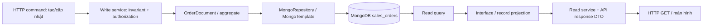

# Tách mô hình đọc khỏi entity dùng để ghi

Một document MongoDB được thiết kế để hỗ trợ **lưu và cập nhật trạng thái nghiệp vụ** thường chứa nhiều dữ liệu hơn những gì một màn hình hoặc API GET cần trả về. Ví dụ, document đơn hàng có dòng hàng, địa chỉ nhận, trạng thái, phiên bản, ghi chú nội bộ và thông tin thanh toán; danh sách đơn hàng trên màn hình chỉ cần **ID, trạng thái, tổng tiền và ngày tạo**.

Trong **Spring Data MongoDB**, **projection** và **DTO (Data Transfer Object)** cho phép tách **mô hình đọc** khỏi entity dùng để ghi. Thay vì truy xuất cả aggregate rồi trả thẳng qua API, bạn mô tả cấu trúc dữ liệu đúng với từng nhu cầu đọc. Spring Data có thể hỗ trợ tối ưu trường dữ liệu được truy vấn, giảm payload từ MongoDB và giảm rủi ro vô tình đưa trường nội bộ ra ngoài.

Bài thuộc chương **Projection và DTO** của module `SPRING_DATA_MONGODB`: kết nối, ánh xạ document, thao tác bằng `MongoTemplate` hoặc repository; thiết kế query, aggregation, index, transaction, reactive access, kiểm thử và chẩn đoán hiệu năng. Mục tiêu là xây dựng một luồng đọc rõ ràng **mà không làm sai ngữ nghĩa cập nhật của aggregate**.

> **Nguyên tắc:** Projection/DTO là **mô hình kết quả đọc**, không phải entity “thiếu vài trường” để đem `save` trở lại database. Cơ chế chọn field giúp hiệu năng, còn **ủy quyền và bảo vệ dữ liệu** vẫn phải kiểm soát ở service và API.

## 1. Mục tiêu học tập

Sau bài này, bạn có thể:

1. Phân biệt **write model/aggregate**, **read projection**, **API response DTO** và **cấu trúc BSON được lấy từ server**.
2. Chọn closed interface projection, open projection, class/record DTO hoặc ánh xạ thủ công theo nhu cầu.
3. Viết repository method trả projection, dùng `@Query(fields = …)`, dynamic projection và projection với `Pageable`.
4. Dùng `MongoTemplate.query(DomainType.class).as(ReadType.class)` để chọn read model độc lập với entity.
5. Hiểu cơ chế field inclusion/exclusion, alias `@Field`, `_id`, nested object và giới hạn tối ưu query.
6. Giải thích vì sao không được gọi `save` với entity chỉ tải một phần.
7. Thiết kế projection cho danh sách, chi tiết, báo cáo aggregation và API đa người dùng.
8. Kiểm thử mapping, kiểm tra raw BSON, đo `explain`, latency và không làm lộ dữ liệu nội bộ.

## 2. Vì sao không dùng một entity cho cả đọc và ghi?

Giả sử có ứng dụng quản lý đơn hàng. Write entity chứa mọi thông tin cần để kiểm tra chuyển trạng thái, hoàn tất thanh toán hoặc đổi địa chỉ. Nhưng một màn hình danh sách chỉ hiển thị vài cột.



Khi **tái sử dụng write entity làm response**, bạn dễ gặp ba nhóm vấn đề:

| Nhóm | Khi dùng cùng entity ở mọi nơi | Khi tách read model |
| --- | --- | --- |
| **Hiệu năng** | Có thể tải object nhúng lớn, mảng dài và trường không dùng đến. | Có thể yêu cầu MongoDB trả những field cần thiết. |
| **Hợp đồng API** | Thay đổi field nội bộ làm thay đổi JSON nếu thiếu lớp kiểm soát. | API được định nghĩa bởi DTO chuyên biệt, có thể version hóa. |
| **Bảo mật** | Dễ vô tình serialize ghi chú nội bộ hoặc token. | Whitelist field trên DTO, kết hợp ủy quyền và kiểm thử response. |
| **Đúng đắn khi ghi** | Entity một phần dễ bị ghi trả làm mất dữ liệu. | Read model không có đường `save`; write model riêng xử lý bất biến. |
| **Bảo trì** | Mọi nhu cầu danh sách/chi tiết kéo thêm trường vào aggregate. | Mỗi read view phục vụ đúng trường hợp sử dụng. |
| **Thay đổi schema** | UI bị buộc theo cấu trúc lưu trữ. | Có lớp chuyển đổi/adapter giữa BSON và public response. |

Đây là hình thức **tách mô hình đọc và ghi ở mức ứng dụng** (đôi khi gọi là *CQRS-lite*). **Không** có nghĩa bạn phải tạo hai database, message broker hay event sourcing. Cả hai luồng có thể vẫn đọc/ghi **cùng collection** với Spring Data MongoDB.

## 3. Ví dụ dữ liệu: một write entity, nhiều read model

### 3.1. Write model là aggregate có đầy đủ trạng thái

```java
package dev.learning.orders;

import java.time.Instant;
import java.util.List;

import org.springframework.data.annotation.Id;
import org.springframework.data.annotation.Version;
import org.springframework.data.mongodb.core.mapping.Document;
import org.springframework.data.mongodb.core.mapping.Field;

@Document("sales_orders")
public record OrderDocument(
        @Id String id,
        String customerId,
        String status,
        @Field("total_cents") long totalCents,
        Instant createdAt,
        ShippingAddress shippingAddress,
        List<OrderLine> lines,
        @Version Long version,
        String internalNote,
        String paymentToken) {

    public OrderDocument withStatus(String nextStatus) {
        return new OrderDocument(
                id, customerId, nextStatus, totalCents, createdAt,
                shippingAddress, lines, version, internalNote, paymentToken);
    }
}
```

Các value object nhúng (mỗi `public record` đặt trong **một tệp Java riêng** theo tên class):

```java
package dev.learning.orders;

public record ShippingAddress(String city, String street) {}

public record OrderLine(String sku, int quantity, long unitPriceCents) {}
```

Đây là ví dụ học thuật: trong hệ thống thực, **không lưu thông tin thanh toán nhạy cảm hoặc token sử dụng được nếu không có thiết kế bảo mật tương ứng**. Trường `paymentToken` ở đây chỉ mô phỏng một field tuyệt đối không đưa ra API đọc thông thường.

Một document BSON tương ứng có thể có dạng:

```javascript
{
  _id: "ORD-1001",
  customerId: "CUS-9",
  status: "PAID",
  total_cents: NumberLong("159900"),
  createdAt: ISODate("2026-11-01T09:00:00Z"),
  shippingAddress: { city: "Da Nang", street: "12 Tran Phu" },
  lines: [
    { sku: "SKU-A", quantity: 2, unitPriceCents: NumberLong("79950") }
  ],
  version: NumberLong("0"),
  internalNote: "Ghi chú nghiệp vụ nội bộ",
  paymentToken: "REDACTED-DEMO-VALUE"
}
```

Đối với màn hình danh sách, cả `lines`, `shippingAddress`, `internalNote` và `paymentToken` đều không cần thiết.

### 3.2. Read model cho danh sách

Ta chỉ lấy bốn trường:

```java
package dev.learning.orders;

import java.time.Instant;
import org.springframework.data.annotation.Id;
import org.springframework.data.mongodb.core.mapping.Field;

public record OrderSummary(
        @Id String id,
        String status,
        @Field("total_cents") long totalCents,
        Instant createdAt) {
}
```

`OrderSummary` là DTO chỉ đọc và **không** đánh dấu `@Document("sales_orders")`, không có phương thức thay đổi trạng thái, không được sử dụng cho `save`. Record có canonical constructor, các component bất biến và `equals/hashCode/toString` sinh sẵn.

### 3.3. Read model cho màn hình chi tiết

Màn hình chi tiết của người mua có thể cần địa chỉ giao hàng và các dòng hàng, nhưng vẫn không cần ghi chú nội bộ.

```java
package dev.learning.orders;

import java.time.Instant;
import java.util.List;

public record OrderDetail(
        String id,
        String status,
        long totalCents,
        Instant createdAt,
        ShippingAddress shippingAddress,
        List<OrderLine> lines) {
}
```

Nếu dùng projection record này trực tiếp, phải kiểm tra alias BSON `total_cents` và mapping của domain source. Có thể dùng `@Field("total_cents")` trên component DTO tương tự `OrderSummary` hoặc dùng một bước map tường minh sang DTO sau khi lấy dữ liệu.

**Đừng suy rằng danh sách và chi tiết luôn chỉ khác số field.** Các quy tắc ủy quyền, định dạng tiền, múi giờ, quyền hiển thị địa chỉ và chính sách giấu dữ liệu có thể khác nhau. Vì vậy đôi khi nên có cả **repository projection** lẫn **API response DTO**.

Các đoạn định nghĩa lại `OrderRepository`, `OrderHeadline` hoặc `OrderSummary` ở các mục sau nhằm minh họa **phương án hoặc phương thức bổ sung**. Trong một ứng dụng thực tế, hãy hợp nhất chúng thành **một định nghĩa cho mỗi kiểu**, tránh copy các khai báo trùng nhau vào cùng package.

## 4. Phân biệt các tầng “projection”

Một nguồn nhầm lẫn lớn là tất cả cùng được gọi là projection nhưng hoạt động ở những tầng khác nhau.

| Loại | Ví dụ | Tác dụng |
| --- | --- | --- |
| **MongoDB field projection** | `{status: 1, total_cents: 1}` | Giới hạn field mà MongoDB trả về trong lệnh `find`. |
| **Spring Data interface projection** | `interface OrderHeadline { … }` | Tạo proxy cung cấp các getter đã khai báo; với closed projection có thể tối ưu field. |
| **Spring Data class/record DTO projection** | `record OrderSummary(…)` | Ánh xạ kết quả trực tiếp sang value type, không dùng proxy interface. |
| **Aggregation projection** | `$project` / `$group` | Thay đổi **hình dạng hoặc giá trị** của document đầu ra trong pipeline. |
| **API DTO** | `OrderListResponse` | Hợp đồng dữ liệu được phép trả qua API, có thể áp dụng định dạng và chính sách riêng. |

Một DTO ở HTTP layer không tự khiến database gửi ít field hơn. Nếu service lấy toàn bộ `OrderDocument` rồi dùng `new OrderListResponse(...)`, API đúng shape nhưng **MongoDB vẫn có thể gửi toàn bộ document**.

Ngược lại, chỉ chọn field phía MongoDB chưa có nghĩa dữ liệu đã được **ủy quyền**. Nếu query thiếu điều kiện khách hàng sở hữu đơn hàng, bạn vẫn có thể trả dữ liệu của người khác dù DTO chỉ chứa bốn field.

## 5. Closed interface projection: getter xác định field đọc

Định nghĩa interface không nằm trong type hierarchy của entity:

```java
package dev.learning.orders;

import java.time.Instant;

public interface OrderHeadline {
    String getId();
    String getStatus();
    long getTotalCents();
    Instant getCreatedAt();
}
```

Khi các accessor ánh xạ trực tiếp sang property của `OrderDocument`, đây là **closed projection**.

Một repository method:

```java
package dev.learning.orders;

import java.util.List;
import org.springframework.data.mongodb.repository.MongoRepository;

public interface OrderRepository
        extends MongoRepository<OrderDocument, String> {

    List<OrderHeadline> findByCustomerId(String customerId);
}
```

Gọi:

```java
List<OrderHeadline> cards =
        orderRepository.findByCustomerId("CUS-9");

for (OrderHeadline card : cards) {
    System.out.println(card.getId() + " / " + card.getStatus());
}
```

Spring Data tạo projection proxy và có thể tối ưu query bằng cách chỉ lấy các property cần thiết. Getter `getTotalCents` vẫn tham chiếu **property Java `totalCents`**, trong khi MongoDB lưu field `total_cents` do `@Field` của entity.

### 5.1. Quy tắc tên getter

Tên property trên projection phải khớp mô hình domain được quản lý:

- `getStatus()` ↔ `status`.
- `getTotalCents()` ↔ `totalCents`.
- `getCreatedAt()` ↔ `createdAt`.

Nếu interface tự đặt `getTotalAmount()` nhưng entity chỉ có `totalCents`, Spring Data không thể tự đoán hai tên có nghĩa giống nhau. Cần tính qua default method từ những property được expose, dùng mapper hoặc xây projection dựa trên aggregation với alias phù hợp.

### 5.2. Default method vẫn có thể giữ projection đóng

```java
public interface OrderHeadline {
    String getId();
    String getStatus();
    long getTotalCents();

    default String getLabel() {
        return getId() + " / " + getStatus();
    }
}
```

`getLabel()` chỉ dùng các accessor đã có trong projection, không yêu cầu trực tiếp các property khác của aggregate. Đây là cách tính giá trị đơn giản mà không nhất thiết phải chuyển sang open projection dùng SpEL.

Tránh đặt business logic phức tạp, truy vấn database hoặc gọi service từ một getter projection; read model cần dễ dự đoán và rẻ khi được gọi nhiều lần.

### 5.3. Optional getter

Với field có thể thiếu, Spring Data hỗ trợ wrapper như `Optional` trong interface projection:

```java
import java.util.Optional;

public interface OrderOptionalNoteView {
    String getId();
    Optional<String> getInternalNote();
}
```

Ví dụ này chỉ giải thích null-safety; **không** dùng `OrderOptionalNoteView` làm public response vì `internalNote` là dữ liệu nội bộ. `Optional.empty()` biểu diễn giá trị không có, không thay thế chính sách ủy quyền.

## 6. Open projection với @Value: linh hoạt nhưng khó tối ưu

Bạn có thể tính field bằng Spring Expression Language (SpEL):

```java
package dev.learning.orders;

import org.springframework.beans.factory.annotation.Value;

public interface OrderOpenView {
    String getId();
    String getStatus();

    @Value("#{target.customerId + ' / ' + target.status}")
    String getDisplayTitle();
}
```

`target` tham chiếu aggregate được dùng để hỗ trợ projection. Đây là **open projection**: vì biểu thức có thể dùng bất kỳ property nào của aggregate, Spring Data không thể chắc chắn trước toàn bộ field cần lấy và **không áp dụng cùng tối ưu field retrieval** như closed projection.

So sánh:

| Tiêu chí | Closed projection | Open projection |
| --- | --- | --- |
| Getter | Trỏ trực tiếp đến property | Có thể dùng `@Value`/SpEL |
| Biết trước field cần thiết | Thường có | Không thể bảo đảm |
| Khả năng giảm field trả về | Có thể tối ưu | Không nên kỳ vọng tối ưu này |
| Kiểm thử | Dễ kiểm tra getter | Cần kiểm tra SpEL và target |
| Rủi ro đọc dữ liệu dư | Thấp hơn khi mapping phù hợp | Cao hơn, nhất là aggregate lớn |

Nếu chỉ cần nối hai getter, ưu tiên **default method**; nếu cần tính toán nghiệp vụ phức tạp, thường tốt hơn khi ánh xạ từ read projection sang API DTO tại service, hoặc dùng MongoDB aggregation phù hợp khi muốn xử lý tại server.

## 7. Class-based và Java record DTO projection

DTO projection không sử dụng proxy; Spring Data tạo object trực tiếp từ dữ liệu truy vấn.

```java
public record OrderSummary(
        @org.springframework.data.annotation.Id String id,
        String status,
        @org.springframework.data.mongodb.core.mapping.Field("total_cents")
        long totalCents,
        java.time.Instant createdAt) {
}
```

Để dùng DTO trong repository, có thể khai báo:

```java
public interface OrderRepository
        extends MongoRepository<OrderDocument, String> {

    List<OrderSummary> findByStatus(String status);
}
```

Tên component `id`, `status`, `totalCents`, `createdAt` mô tả property nguồn. `@Field` minh họa alias lưu trữ, không phải một phép đổi tên tự do; cần kiểm tra mapping theo phiên bản Spring Data thực tế.

### 7.1. Vì sao Java record thích hợp làm DTO?

- Canonical constructor cung cấp đủ tham số để framework dựng object.
- Không yêu cầu setter hoặc proxy runtime kiểu interface projection.
- Dễ dùng trong response và test theo giá trị.
- Thể hiện “đây là kết quả đọc”, không phải entity mutable dùng để update.
- Kiểu hóa rõ các giá trị, ví dụ `Instant` cho thời điểm.

Nhưng **record bất biến nông**, không phải bất biến sâu: một component kiểu `List<MutableLine>` vẫn chứa tham chiếu mutable. Khi định nghĩa DTO cho collection, hãy dùng defensive copy và kiểu phần tử bất biến nếu cần bảo đảm trạng thái không thay đổi.

### 7.2. Class DTO có nhiều constructor

Nếu dùng class thay vì record, constructor tham gia projection phải có tên tham số được ánh xạ đến property domain; compiler nên giữ metadata `-parameters`.

```java
package dev.learning.orders;

import java.time.Instant;
import org.springframework.data.annotation.PersistenceCreator;

public final class OrderSummaryClass {
    private final String id;
    private final String status;
    private final Instant createdAt;

    @PersistenceCreator
    public OrderSummaryClass(String id, String status, Instant createdAt) {
        this.id = id;
        this.status = status;
        this.createdAt = createdAt;
    }

    public String getId() { return id; }
    public String getStatus() { return status; }
    public Instant getCreatedAt() { return createdAt; }
}
```

Khi class có **một constructor** phù hợp, Spring Data thường xác định được constructor đó. Khi có nhiều constructor, `@PersistenceCreator` giúp chỉ rõ constructor phục vụ persistence/projection. Với field thiếu hoặc kiểu không tương thích, constructor có thể nhận giá trị không mong muốn hoặc việc mapping thất bại.

### 7.3. Không có nested interface projection trong class DTO

Class-based projection **không có cơ chế recursive nested interface proxy** như interface-based projection. Một record có component `ShippingAddress` hoặc `List<OrderLine>` vẫn có thể được mapping thành object lồng nhau, nhưng đó là ánh xạ kiểu của DTO, không phải lời hứa Spring Data sẽ chỉ tải các subfield mong muốn.

Nếu chỉ cần `shippingAddress.city`, một DTO phẳng `OrderCityRow(String id, String city)` thường yêu cầu `$project`/alias tường minh hoặc mapping sau truy vấn; đừng coi việc đổi tên component Java thành `city` là phép tự động truy cập path lồng nhau.

## 8. Nested projection: thuận tiện nhưng có giới hạn

Với interface projection, bạn có thể khai báo interface lồng nhau:

```java
package dev.learning.orders;

public interface OrderDestinationView {
    String getId();
    String getStatus();
    AddressView getShippingAddress();

    interface AddressView {
        String getCity();
    }
}
```

Spring Data có thể cung cấp proxy cho `shippingAddress` và cho phép:

```java
OrderDestinationView view = /* kết quả repository */;
String city = view.getShippingAddress().getCity();
```

**Cẩn trọng về tối ưu:** nested projection có thể yêu cầu materialize **toàn bộ property lồng nhau** ở phía store, ngay cả khi interface con chỉ expose một phần. Khả năng tối ưu theo field có thể bị giới hạn bởi cách Spring Data xử lý nested property và phiên bản cụ thể.

Nếu nested document rất lớn hoặc gồm nhiều trường nhạy cảm, hãy thử nghiệm field-level projection tường minh trong `MongoTemplate`, projection aggregation hoặc tách cấu trúc read model, thay vì giả định nested proxy luôn giảm payload mạng.

### Khi nào nên tránh DBRef?

Projection qua Fluent MongoDB API không nên được áp dụng tùy tiện lên `DBRef`; tài liệu Spring Data nêu giới hạn riêng đối với DBRef. Với màn hình có dữ liệu từ nhiều document, cân nhắc thiết kế truy vấn rõ ràng, `$lookup` có kiểm soát hoặc read model tổng hợp, thay vì kỳ vọng nested projection có thể tự join mọi liên kết.

## 9. Dynamic projection: chọn loại kết quả khi gọi

Thay vì tạo nhiều repository methods có cùng điều kiện lọc, bạn có thể chọn kiểu projection lúc gọi:

```java
package dev.learning.orders;

import java.util.List;
import org.springframework.data.mongodb.repository.MongoRepository;

public interface OrderRepository
        extends MongoRepository<OrderDocument, String> {

    <T> List<T> findByCustomerId(
            String customerId, Class<T> projectionType);
}
```

Dùng cùng một điều kiện để lấy entity hoặc read view:

```java
List<OrderDocument> full =
        repository.findByCustomerId(
                "CUS-9", OrderDocument.class);

List<OrderHeadline> headline =
        repository.findByCustomerId(
                "CUS-9", OrderHeadline.class);

List<OrderSummary> summaries =
        repository.findByCustomerId(
                "CUS-9", OrderSummary.class);
```

**Cảnh báo 1:** `Class<T>` ở đây là **tham số chọn projection**, không phải tham số query được bind vào MongoDB. Spring Data nhận diện một `Class<T>` phù hợp generic return type và dùng nó để chọn kiểu kết quả. Nếu thực sự muốn truyền class làm giá trị query, cần khai báo chữ ký khác (ví dụ `Class<?>`) và kiểm tra cách bind.

**Cảnh báo 2:** Không đưa `Class<T>` từ dữ liệu do client gửi vào một cách tùy tiện. Một endpoint công khai không được cho phép người dùng chọn `OrderDocument.class` vì điều đó có thể làm lộ nội dung nội bộ. Chọn projection ở **server side**, theo hợp đồng API và vai trò người dùng.

**Cảnh báo 3:** Dynamic projection chỉ thay đổi loại kết quả; nó **không tự thêm filter phân quyền**. `customerId` từ request phải được đối chiếu với danh tính đã xác thực, hoặc query phải sử dụng context ủy quyền của server.

## 10. @Query(fields = …) và field projection ở MongoDB

Khi muốn kiểm soát rõ những trường được truy xuất, `@Query(fields = …)` cho phép chỉ định projection document trong repository.

```java
import java.util.List;
import org.springframework.data.mongodb.repository.Query;

public interface OrderRepository
        extends MongoRepository<OrderDocument, String> {

    @Query(
        value = "{ 'status': ?0 }",
        fields = "{ 'status': 1, 'total_cents': 1, 'createdAt': 1 }"
    )
    List<OrderSummary> findReadRowsByStatus(String status);
}
```

Truy vấn MongoDB tương đương:

```javascript
db.sales_orders.find(
  { status: "PAID" },
  { status: 1, total_cents: 1, createdAt: 1 }
);
```

MongoDB **mặc định vẫn trả `_id`** khi dùng inclusion projection, trừ khi loại nó rõ ràng.

### 10.1. Include/exclude và _id

| Projection MongoDB | Kết quả |
| --- | --- |
| `{ status: 1 }` | Chỉ status và `_id` mặc định. |
| `{ status: 1, _id: 0 }` | Status, không có `_id`. |
| `{ internalNote: 0 }` | Loại internalNote; các field khác vẫn có thể được trả. |
| `{ status: 1, internalNote: 0 }` | Trộn include/exclude không hợp lệ trong trường hợp thông thường, ngoại trừ quy tắc riêng cho `_id`. |

**Đối với dữ liệu nhạy cảm, ưu tiên whitelist bằng inclusion**. Chỉ loại một field bằng exclusion dễ thất bại khi schema thêm một field nội bộ mới.

`_id` quan trọng với pagination, navigation và identity của read model. Nếu DTO không cần ID, có thể loại rõ ràng; nếu cần, không được vô tình loại rồi mong Spring Data tự tái tạo.

### 10.2. @Field alias

Write entity khai báo:

```java
@Field("total_cents")
long totalCents
```

Khi viết `@Query(fields = …)` dạng JSON/BSON, hãy xác nhận query mapper và tên field sau khi ánh xạ. Có những vị trí sử dụng **tên property Java** qua mapping context, còn biểu thức BSON native có thể cần tên field thực. Trong ví dụ này, `total_cents` là tên BSON đích đã biết; integration test phải xác minh `OrderSummary.totalCents()` được điền đúng.

Để tránh nhầm lẫn khi refactor annotation, có thể chọn dùng `MongoTemplate` với source domain type để Spring Data có thông tin mapping, hoặc đưa alias vào DTO nếu cần.

## 11. MongoTemplate.query(…).as(…): chọn read model rõ ràng

`MongoTemplate` hỗ trợ Fluent API cho projection. Ví dụ:

```java
package dev.learning.orders;

import java.util.List;

import org.springframework.data.mongodb.core.MongoTemplate;
import org.springframework.data.mongodb.core.query.Criteria;
import org.springframework.data.mongodb.core.query.Query;
import org.springframework.stereotype.Service;

@Service
public class OrderReadService {
    private final MongoTemplate template;

    public OrderReadService(MongoTemplate template) {
        this.template = template;
    }

    public List<OrderSummary> listPaidOrdersForCustomer(
            String authorizedCustomerId) {
        Query query = Query.query(
                Criteria.where("customerId").is(authorizedCustomerId)
                        .and("status").is("PAID"));

        return template.query(OrderDocument.class)
                .as(OrderSummary.class)
                .matching(query)
                .all();
    }
}
```

Giải thích từng bước:

1. `query(OrderDocument.class)`: lấy **domain type nguồn** để biết mapping field và collection.
2. `as(OrderSummary.class)`: chọn **kiểu kết quả** thay vì materialize toàn `OrderDocument`.
3. `matching(query)`: áp dụng filter.
4. `all()`: trả về `List<OrderSummary>`.

Trong cấu hình được Spring Data hỗ trợ, Fluent projection có thể tự giới hạn các field cần thiết cho DTO hoặc closed interface projection **nếu `Query` chưa chứa field restrictions riêng**. Nếu đã tự gọi `query.fields().include(...)`, đừng mặc định cơ chế tự tối ưu sẽ tiếp tục hoạt động cùng cách; cần xác minh field thực gửi xuống MongoDB.

### 11.1. Chọn một phần field với Query.fields()

API cấp thấp hơn cho phép:

```java
import org.springframework.data.mongodb.core.query.Query;
import org.springframework.data.mongodb.core.query.Criteria;

Query query = Query.query(
        Criteria.where("customerId").is("CUS-9"));

query.fields()
        .include("status")
        .include("totalCents")
        .include("createdAt");

List<OrderDocument> partialDocuments =
        template.find(query, OrderDocument.class);
```

Ví dụ này **chỉ để chỉ ra rủi ro**: kết quả được gắn kiểu `OrderDocument`, nhưng nhiều property trong aggregate không được tải, có thể thành `null` hoặc giá trị mặc định. **Tuyệt đối không dùng `save(partialDocuments.get(0))` như thao tác cập nhật toàn entity.**

Phương án tốt hơn khi chỉ đọc:

```java
List<OrderSummary> summaries =
        template.query(OrderDocument.class)
                .as(OrderSummary.class)
                .matching(Query.query(
                    Criteria.where("customerId").is("CUS-9")))
                .all();
```

Nếu bạn muốn kiểm soát field tường minh, nên làm việc với một DTO đúng shape hoặc định nghĩa một lớp read-only riêng và kiểm thử mapping.

### 11.2. Đọc từ collection khác tên mặc định

Nếu cần chọn collection tường minh, Fluent API có `inCollection`:

```java
List<OrderSummary> summaries =
        template.query(OrderDocument.class)
                .inCollection("sales_orders")
                .as(OrderSummary.class)
                .matching(Query.query(
                    Criteria.where("status").is("PAID")))
                .all();
```

Trong ví dụ `OrderDocument` đã có `@Document("sales_orders")`, nên `inCollection` không bắt buộc. Không dùng một DTO không có mapping metadata làm source type khi vẫn muốn giữ các quy tắc alias/cấu hình từ entity gốc.

## 12. Tách tiếp API response DTO khỏi repository projection

Repository projection giải quyết cách đọc MongoDB. Còn DTO HTTP giải quyết **hợp đồng phản hồi**.

Ví dụ API trả tổng tiền theo đơn vị tiền và thời gian ở dạng UTC ISO 8601:

```java
package dev.learning.orders.api;

import java.time.Instant;
import dev.learning.orders.OrderSummary;

public record OrderListResponse(
        String orderId,
        String status,
        long amountCents,
        Instant createdAt) {

    public static OrderListResponse from(OrderSummary source) {
        return new OrderListResponse(
                source.id(),
                source.status(),
                source.totalCents(),
                source.createdAt());
    }
}
```

Sử dụng trong service hoặc controller:

```java
List<OrderListResponse> response = readService
        .listPaidOrdersForCustomer(authorizedCustomerId)
        .stream()
        .map(OrderListResponse::from)
        .toList();
```

Tại sao cần thêm một lớp DTO?

- Repository projection có thể đổi theo schema hoặc tên property Java.
- Public response có thể có quy ước tên field khác như `orderId` thay vì `id`.
- API có thể hiển thị tiền theo chính sách riêng mà không cần đổi dữ liệu database.
- Giảm rủi ro framework tự serialize getter không được mong muốn.
- Dễ viết contract tests và version API.

Tuy nhiên, tạo thêm DTO không phải lúc nào cũng cần: với ứng dụng nội bộ nhỏ, có thể dùng read projection như response **nếu** được review quyền truy cập, serialization và ranh giới phụ thuộc. Điều quan trọng là **không vô tình đưa write entity ra API**.

## 13. Không lưu projection hoặc entity chỉ được tải một phần

Đây là cảnh báo quan trọng nhất về đúng đắn dữ liệu.

Giả sử document gốc có:

```javascript
{
  _id: "ORD-1001",
  status: "PAID",
  total_cents: NumberLong("159900"),
  lines: [ /* chi tiết sản phẩm */ ],
  internalNote: "Ghi chú nội bộ",
  paymentToken: "REDACTED-DEMO-VALUE",
  version: NumberLong("0")
}
```

Nếu chỉ đọc `status`, `total_cents` và `createdAt` vào **OrderDocument** rồi gọi `save`, những field chưa được tải có thể mang `null`/mặc định. Tùy mapping và optimistic locking, `save` có thể **thay thế document, làm mất field, thất bại do version thiếu** hoặc hành xử khác với ý định của bạn.

```java
// SAI về thiết kế: một read-only query trả kiểu write entity
Query query = Query.query(
        Criteria.where("_id").is("ORD-1001"));
query.fields().include("status").include("totalCents");

OrderDocument partiallyLoaded =
        template.findOne(query, OrderDocument.class);

// KHÔNG GỌI:
// repository.save(partiallyLoaded);
```

**Giải pháp theo mục tiêu:**

| Mục tiêu | Cách làm phù hợp |
| --- | --- |
| Xem danh sách/chi tiết | Read projection/DTO; không `save` kết quả. |
| Thay đổi toàn aggregate | Tải entity đầy đủ, kiểm tra invariant và version, lưu theo cơ chế optimistic locking. |
| Đổi một số field | `MongoTemplate.updateFirst` / `findAndModify` có điều kiện; không upsert nếu chỉ update. |
| Tạo document mới | `insert` và kiểm tra duplicate key. |
| Upsert được cho phép | `upsert` có chủ đích với unique key và điều kiện phù hợp. |

Không lấy nguyên một DTO GET làm đầu vào cho PATCH/PUT rồi “đổ” các field lên entity mà không validate. Command DTO nên tách riêng và chỉ chứa field người dùng **được phép sửa**.

## 14. Write service: giữ invariant và optimistic locking

Giả sử nghiệp vụ chỉ cho chuyển đơn đã thanh toán sang trạng thái giao. Write path nên chọn câu lệnh **có điều kiện**, không dùng projection làm object ghi.

```java
package dev.learning.orders;

import com.mongodb.client.result.UpdateResult;
import org.springframework.data.mongodb.core.MongoTemplate;
import org.springframework.data.mongodb.core.query.Criteria;
import org.springframework.data.mongodb.core.query.Query;
import org.springframework.data.mongodb.core.query.Update;
import org.springframework.stereotype.Service;

@Service
public class OrderCommandService {
    private final MongoTemplate template;

    public OrderCommandService(MongoTemplate template) {
        this.template = template;
    }

    public boolean markShipped(
            String authorizedCustomerId, String orderId) {

        Query query = Query.query(
                Criteria.where("_id").is(orderId)
                        .and("customerId").is(authorizedCustomerId)
                        .and("status").is("PAID"));

        Update update = new Update().set("status", "SHIPPED");

        UpdateResult result =
                template.updateFirst(query, update, OrderDocument.class);

        return result.getMatchedCount() == 1;
    }
}
```

Ở đây:

- Điều kiện `customerId` thể hiện **phạm vi được phép tác động**; trong ứng dụng thực, giá trị này phải lấy từ context đã xác thực, không tin trực tiếp vào input của người dùng.
- `status = "PAID"` được kiểm tra **trong cùng thao tác update**.
- `updateFirst` không tự tạo document mới nếu query không khớp.
- `matchedCount = 0` có thể nghĩa là không tồn tại, sai chủ sở hữu hoặc trạng thái đã đổi; không nên trả thông báo làm lộ thông tin đơn hàng thuộc khách khác.
- `Update` không cần cả entity để sửa một field và không tự ghi đè `lines`/`internalNote`.

Với `@Version`, một số API Spring Data tự tăng version khi update, nhưng không nên mặc định mọi update tùy biến đều kiểm tra **expectedVersion** từ client. Nếu nghiệp vụ cần compare-and-set chính xác, thêm `Criteria.where("version").is(expectedVersion)` và kiểm tra `matchedCount`; tránh tăng version hai lần nếu framework đã xử lý.

Với thao tác nhiều document cần bảo đảm nguyên tử theo nghiệp vụ, xét transaction trên topology MongoDB hỗ trợ. Projection đọc không tự tạo transaction và cũng không thay thế quy tắc đồng thời.

## 15. Phân trang và sắp xếp trên read model

Màn hình danh sách thường không thể tải toàn bộ đơn hàng của một khách.

```java
import org.springframework.data.domain.Page;
import org.springframework.data.domain.Pageable;

public interface OrderRepository
        extends MongoRepository<OrderDocument, String> {

    Page<OrderSummary> findByCustomerId(
            String customerId, Pageable pageable);
}
```

Ví dụ sắp xếp theo thời gian tạo giảm dần, sau đó ID giảm dần để có thứ tự ổn định hơn:

```java
import org.springframework.data.domain.PageRequest;
import org.springframework.data.domain.Sort;

PageRequest pageRequest = PageRequest.of(
        0, 20,
        Sort.by(
                Sort.Order.desc("createdAt"),
                Sort.Order.desc("id")));

Page<OrderSummary> page =
        repository.findByCustomerId("CUS-9", pageRequest);
```

- `Page<T>` cung cấp metadata về tổng số phần tử/trang; thông thường cần thêm phép đếm.
- `Slice<T>` phù hợp khi chỉ cần biết có trang sau, có thể tiết kiệm chi phí count.
- `List<T>` với `Pageable` có thể dùng khi không cần đối tượng `Page`, nhưng phải thiết kế giao diện trả về phù hợp.
- Offset pagination với collection liên tục được ghi mới có thể lặp/bỏ sót bản ghi giữa các lần gọi. Với feed rất lớn, cân nhắc keyset/scrolling và sort theo khóa ổn định.

Việc projection chỉ lấy bốn field giảm payload trên mỗi bản ghi nhưng **không chữa** query quét collection quá lớn. Cần cả filter, index, sort và pagination phù hợp.

## 16. Index và covered query: tối ưu có điều kiện

Một query phổ biến:

```javascript
db.sales_orders.find(
  { customerId: "CUS-9", status: "PAID" },
  { _id: 1, status: 1, total_cents: 1, createdAt: 1 }
).sort({ createdAt: -1, _id: -1 });
```

Bạn có thể thử compound index:

```javascript
db.sales_orders.createIndex(
  {
    customerId: 1,
    status: 1,
    createdAt: -1,
    _id: -1,
    total_cents: 1
  },
  { name: "customer_status_created_summary" }
);
```

**Tại sao index theo thứ tự này?** Các điều kiện bằng (`customerId`, `status`) ở đầu; tiếp theo là field sort (`createdAt`, `_id`), rồi field hiển thị (`total_cents`). Đây chỉ là ứng viên để đo, không phải index đúng cho mọi workload.

### 16.1. Covered query là gì?

Một query có thể được phục vụ từ index mà không cần đọc full document khi **tất cả các field dùng để filter và field cần trả đều có trong index**, đồng thời các điều kiện khác của MongoDB về covered query được đáp ứng. Vì MongoDB mặc định trả `_id`, index không chứa `_id` có thể khiến query không covered nếu bạn không loại ID khỏi projection.

Nhưng **projection không tự bảo đảm covered query**. Để kiểm tra, dùng:

```javascript
db.sales_orders.find(
  { customerId: "CUS-9", status: "PAID" },
  { _id: 1, status: 1, total_cents: 1, createdAt: 1 }
).sort({ createdAt: -1, _id: -1 })
 .explain("executionStats");
```

Quan sát `winningPlan`, `totalKeysExamined`, `totalDocsExamined` và `nReturned`. Tùy phiên bản MongoDB/query engine, cách biểu diễn plan có thể khác nhau; mục tiêu của covered query thường là **không cần đọc document để lấy các field trả về**.

Một index dài chứa nhiều field giúp một truy vấn nhưng tăng dung lượng index, chi phí ghi và sử dụng cache. Chọn theo workload thực, tránh tạo index chỉ vì một projection có bốn field.

### 16.2. Tối ưu theo hai trục

| Trục | Câu hỏi |
| --- | --- |
| **Field projection** | MongoDB có thể gửi ít byte hơn không? |
| **Query plan/index** | MongoDB phải quét bao nhiêu index keys/documents để tạo kết quả? |

Phép đo tốt nên quan sát **cả hai**. Giảm bớt 90% kích thước response không có nghĩa tổng latency sẽ giảm 90% nếu phần lớn thời gian nằm ở filter/scan hoặc server I/O.

## 17. Aggregation tạo read model chuyên biệt

Khi cần báo cáo theo khách hàng, một repository projection đơn giản không thể tự biến hàng trăm document thành dữ liệu tổng hợp. MongoDB aggregation có thể thực hiện `$match`, `$group` và `$project`.

Ví dụ muốn đếm đơn PAID và tổng tiền theo khách hàng:

```java
package dev.learning.orders;

public record CustomerSpend(
        String customerId,
        long orderCount,
        long totalCents) {
}
```

Dùng `MongoTemplate.aggregate`:

```java
import org.springframework.data.mongodb.core.aggregation.Aggregation;
import org.springframework.data.mongodb.core.aggregation.AggregationResults;
import org.springframework.data.mongodb.core.MongoTemplate;
import org.springframework.data.mongodb.core.query.Criteria;

Aggregation aggregation = Aggregation.newAggregation(
    Aggregation.match(Criteria.where("status").is("PAID")),
    Aggregation.group("customerId")
        .count().as("orderCount")
        .sum("totalCents").as("totalCents"),
    Aggregation.project("orderCount", "totalCents")
        .and("_id").as("customerId")
        .andExclude("_id")
);

AggregationResults<CustomerSpend> grouped =
        mongoTemplate.aggregate(
                aggregation, OrderDocument.class, CustomerSpend.class);

java.util.List<CustomerSpend> report =
        grouped.getMappedResults();
```

Điểm cần nhớ:

- `Aggregation.match` lọc dữ liệu trước khi group.
- `group("customerId")` gom các đơn theo khách hàng; `count` và `sum` tính số đơn/tổng tiền.
- `project` chuyển key `_id` của group thành `customerId` trong output.
- `CustomerSpend` là **read DTO**, không phải entity `@Document` để ghi lại collection gốc.
- Spring Data mapping field theo `OrderDocument` có thể dùng alias `@Field("total_cents")` khi xây pipeline. Kiểm tra pipeline thực tế và test aggregation trên dữ liệu mẫu.
- Với dữ liệu tiền lớn, kiểm tra giới hạn số học BSON, kiểu kết quả và tổng hợp vượt phạm vi `long`.

Đây là một read model tổng hợp trực tiếp từ MongoDB, **không yêu cầu** tạo collection riêng. Nếu báo cáo quá tốn kém, có thể cân nhắc materialized read model/collection dành riêng cho báo cáo, kèm cơ chế đồng bộ và chấp nhận độ trễ tương ứng. Đó là quyết định kiến trúc khác so với projection thông thường.

## 18. Reactive access dùng cùng ý tưởng projection

Với Spring Data MongoDB reactive:

```java
package dev.learning.orders;

import org.springframework.data.mongodb.repository.ReactiveMongoRepository;
import reactor.core.publisher.Flux;

public interface ReactiveOrderRepository
        extends ReactiveMongoRepository<OrderDocument, String> {

    Flux<OrderHeadline> findByCustomerId(String customerId);
}
```

Và với `ReactiveMongoTemplate`:

```java
Flux<OrderSummary> summaries =
        reactiveMongoTemplate.query(OrderDocument.class)
                .as(OrderSummary.class)
                .matching(Query.query(
                    Criteria.where("customerId").is(authorizedCustomerId)))
                .all();
```

Semantics của read model vẫn vậy: đừng lưu projection ngược thành entity ghi, vẫn phải kiểm tra ủy quyền và tối ưu query. Reactive API thay đổi mô hình thực thi, cancellation, backpressure và resource management; nó không tự bảo đảm chỉ lấy field mong muốn nếu projection là open projection hoặc query bị cấu hình khác.

Không gọi `block()` tùy tiện trong event loop để biến một pipeline reactive thành cách đọc đồng bộ. Khi cần kết hợp nhiều nguồn, kiểm soát concurrency và số lượng dữ liệu được buffer.

## 19. Kiểm thử: xác minh DTO, dữ liệu nhạy cảm và truy vấn thật

Một bộ kiểm thử projection nên có **ba lớp**: unit test mapper/API DTO, integration test với MongoDB và phép đo query plan/payload.

### 19.1. Unit test lớp API response

```java
import static org.junit.jupiter.api.Assertions.assertEquals;

import java.time.Instant;
import org.junit.jupiter.api.Test;

class OrderResponseMapperTest {

    @Test
    void mapsOnlyPublicFields() {
        OrderSummary row = new OrderSummary(
                "ORD-1001", "PAID", 159_900L,
                Instant.parse("2026-11-01T09:00:00Z"));

        var response = OrderListResponse.from(row);

        assertEquals("ORD-1001", response.orderId());
        assertEquals("PAID", response.status());
        assertEquals(159_900L, response.amountCents());
    }
}
```

Đây là test cho **mapping giữa read projection và API response**. Nó không chứng minh database chỉ trả đúng các field, hay user đã được phân quyền.

### 19.2. Integration test round-trip trên MongoDB

Giả sử có MongoDB test (URI hoặc Testcontainers riêng) và Spring Boot test starter. Test tự tạo ID duy nhất để tránh xung đột với lần chạy trước:

```java
package dev.learning.orders;

import static org.assertj.core.api.Assertions.assertThat;

import java.time.Instant;
import java.util.List;
import java.util.UUID;

import org.junit.jupiter.api.Test;
import org.springframework.beans.factory.annotation.Autowired;
import org.springframework.boot.test.context.SpringBootTest;
import org.springframework.data.mongodb.core.MongoTemplate;
import org.springframework.data.mongodb.core.query.Criteria;
import org.springframework.data.mongodb.core.query.Query;

@SpringBootTest
class OrderProjectionIntegrationTest {

    @Autowired MongoTemplate template;
    @Autowired OrderRepository repository;

    @Test
    void readsSummaryWithoutRequiringSensitiveFields() {
        String id = "ORD-" + UUID.randomUUID();
        Instant created = Instant.parse("2026-11-01T09:00:00Z");

        OrderDocument source = new OrderDocument(
                id, "CUS-9", "PAID", 159_900L, created,
                new ShippingAddress("Da Nang", "12 Tran Phu"),
                List.of(new OrderLine("SKU-A", 2, 79_950L)),
                null, "Only internal staff", "REDACTED-DEMO-VALUE");

        template.insert(source);

        List<OrderSummary> result =
                template.query(OrderDocument.class)
                        .as(OrderSummary.class)
                        .matching(Query.query(
                            Criteria.where("_id").is(id)))
                        .all();

        assertThat(result).hasSize(1);
        OrderSummary row = result.get(0);

        assertThat(row.id()).isEqualTo(id);
        assertThat(row.status()).isEqualTo("PAID");
        assertThat(row.totalCents()).isEqualTo(159_900L);
        assertThat(row.createdAt()).isEqualTo(created);
    }
}
```

Kiểm thử này xác minh projection ánh xạ đúng dữ liệu đọc. Vì `OrderSummary` không chứa `internalNote` hoặc `paymentToken`, object projection không expose hai trường đó. Nhưng test **chưa chứng minh** MongoDB không gửi các field dư trên mạng, và **chưa chứng minh** endpoint thực thi phân quyền.

### 19.3. Kiểm tra field trên query thực tế

Để xác nhận lợi ích giảm payload, không chỉ gọi getter trên DTO. Bạn có thể:

- Gắn **MongoDB Java Driver `CommandListener`** trong môi trường test, xem `find` command và phần `projection` được gửi (phải loại/redact thông tin nhạy cảm khỏi log).
- Dùng MongoDB profiler hoặc command monitoring tương đương, tùy cấu hình test/monitoring.
- So sánh với truy vấn MongoDB thủ công có cùng filter, sort, projection và index; dùng `explain("executionStats")` để xem plan.
- Đo kích thước raw BSON, latency, số document/keys examined và mức sử dụng mạng dưới workload đại diện.

Khi sử dụng Fluent `as(OrderSummary.class)`, tài liệu Spring Data nói có thể tự giới hạn field nếu query không tự khai báo field restrictions. Hãy đo **thực tế** thay vì chỉ dựa vào chữ “DTO”.

### 19.4. Kiểm thử bảo mật ở HTTP layer

Với một endpoint `GET /orders`, kiểm thử ít nhất:

1. Khách A chỉ nhìn thấy đơn của khách A, không thấy đơn khách B.
2. Response chỉ chứa field thuộc API contract.
3. Response **không có** `internalNote` và `paymentToken`.
4. Một thay đổi thêm field mới vào `OrderDocument` không vô tình làm field đó xuất hiện ở response.
5. Đọc `OrderSummary` không có đường persistence save ngược trở lại.
6. Nếu trả danh sách phân trang, kiểm tra sort, page size và ủy quyền cho từng trang.

Có thể dùng JSON serialization test hoặc HTTP integration test để xác nhận cấu trúc response; riêng kiểm thử repository không đủ bảo vệ API.

## 20. Những lỗi thường gặp

| Sai lầm | Vấn đề | Cách xử lý |
| --- | --- | --- |
| Dùng `OrderDocument` trực tiếp làm JSON response | Dễ lộ trường nội bộ khi entity thay đổi | Dùng read projection/API DTO, thêm contract test. |
| Chỉ map entity sang DTO **sau khi đã tải toàn bộ document** | Không giảm payload giữa MongoDB và ứng dụng | Dùng repository/Fluent projection nếu muốn giảm field thực tải. |
| Dùng `@Value` SpEL rồi kỳ vọng query chỉ lấy vài field | Open projection không được tối ưu như closed projection | Dùng getter đóng, default method hoặc mapper riêng. |
| Interface projection tự đặt tên getter không có trong entity | Không ánh xạ đúng property | Khớp property domain hoặc dùng mapping/aggregation rõ ràng. |
| Giả định DTO record hỗ trợ nested projection như interface | Class-based DTO không có recursive proxy tương đương | Dùng interface nested hoặc ánh xạ DTO/mapping riêng. |
| Query có field restrictions riêng nhưng vẫn mặc định Spring Data tự chọn đủ field | Có thể xung đột projection optimizer | Test query BSON thật và trả kiểu kết quả phù hợp. |
| Quên `_id` vẫn được trả mặc định | Payload/covered-query khác kỳ vọng | Include/exclude ID theo nhu cầu. |
| Gọi `save` với entity chỉ tải một số field | Có thể làm mất dữ liệu hoặc lỗi optimistic locking | Không dùng partial entity để ghi; sử dụng write model/update có điều kiện. |
| Cho user chọn dynamic projection type | Có thể mở đường lấy entity đủ field | Whitelist server-side projection, kiểm tra auth. |
| Cho rằng projection là cơ chế ủy quyền | Query vẫn có thể lấy đơn của người khác | Đưa user/tenant filter từ principal đã xác thực vào query. |
| Query không có index/sort/pagination | Trả ít field nhưng vẫn quét dữ liệu lớn | Dùng index theo workload và `explain`. |
| Dùng DTO có primitive cho field có thể thiếu | Missing field có thể thành giá trị mặc định hoặc gây lỗi | Dùng wrapper, validation và test dữ liệu cũ. |
| Dùng cùng DTO cho mọi endpoint | Khó tiến hóa API và mô hình đọc | Định nghĩa read view theo use case, không lạm dụng một DTO tổng hợp. |

### Vấn đề null/missing và schema evolution

Khi thêm một field vào `OrderSummary` record nhưng dữ liệu lịch sử chưa có field đó, Spring Data có thể truyền `null`/mặc định phù hợp kiểu hoặc việc dựng DTO có thể thất bại do validation. Với số tiền `long`, sự thiếu vắng dữ liệu khác biệt với giá trị 0; hãy chọn kiểu wrapper hoặc migration khi cần phân biệt.

Đổi alias `@Field("total_cents")` hoặc rename property Java phải đi kèm kiểm thử trên **cả dữ liệu cũ và mới**. Một DTO mới có thể biên dịch thành công nhưng đọc sai giá trị vì collection vẫn lưu tên BSON cũ.

## 21. Bài tập thực hành

### Bài 1 — Hai read model, một write entity

Từ `OrderDocument`, thiết kế `OrderSummary` (ID, status, total, createdAt) và `OrderDetail` (thêm address, lines). Không expose `internalNote` và `paymentToken`. Viết repository method hoặc Fluent `MongoTemplate` trả đúng type.

**Tiêu chí đạt:** mã gọi không cần materialize `OrderDocument` đầy đủ cho danh sách, response API không có field nhạy cảm.

### Bài 2 — Closed hay open projection?

Viết `OrderHeadline` có `getStatus()`, `getCustomerId()` và default method `getLabel()` nối hai getter. Sau đó viết open projection bằng `@Value` truy cập `target.customerId`. Giải thích sự khác nhau về khả năng xác định field cần đọc.

**Tiêu chí đạt:** hiểu default method có thể dựa vào field đã expose, còn SpEL khiến tối ưu đọc field khó đảm bảo.

### Bài 3 — Dynamic projection và quyền truy cập

Định nghĩa `<T> List<T> findByCustomerId(String customerId, Class<T> type)`. Viết một read service chỉ cho phép các type do server chọn. Mô tả rủi ro nếu client được truyền tùy ý tên class.

**Tiêu chí đạt:** projection type là lựa chọn bên trong ứng dụng; query filter phải dựa trên customer/tenant đã xác thực.

### Bài 4 — Phát hiện lỗi partial entity save

Viết một query chỉ lấy `status` và `totalCents`, sau đó mô tả dữ liệu bị mất hoặc lỗi có thể xảy ra khi nạp kết quả vào `OrderDocument` rồi `save`. Thiết kế lại bằng `OrderSummary` cho GET và `updateFirst` cho thay đổi trạng thái.

**Tiêu chí đạt:** không dùng read model để ghi ngược; write path có điều kiện và kiểm tra `matchedCount`.

### Bài 5 — Covered query có thật sự xảy ra?

Dùng dữ liệu thử đủ lớn, tạo compound index cho customerId, status, createdAt, _id, total_cents. So sánh `find` có/không projection bằng `explain("executionStats")`.

**Tiêu chí đạt:** đọc `totalKeysExamined`/`totalDocsExamined`/`nReturned` và cân nhắc chi phí index khi ghi.

### Bài 6 — Aggregation DTO

Nhóm các đơn PAID theo customerId, trả `CustomerSpend(customerId, orderCount, totalCents)`. Hãy kiểm tra alias output sau `$group`/`$project` và kiểu số của tổng tiền.

**Tiêu chí đạt:** kết quả là DTO báo cáo, không phải `OrderDocument`; không nhầm `_id` của group với ID đơn hàng.

### Bài 7 — Reactive read projection

Viết `Flux<OrderHeadline> findByCustomerId(String customerId)` cho `ReactiveMongoRepository` và một method `ReactiveMongoTemplate.query(...).as(...).matching(...).all()`. Kiểm tra không dùng blocking call.

**Tiêu chí đạt:** hiểu reactive khác cách thực thi, không thay đổi nguyên tắc auth, field projection và write/read separation.

## 22. Checklist triển khai

- [ ] Xác định write aggregate và bất biến nghiệp vụ trước khi thiết kế read model.
- [ ] Phân loại các màn hình: list, detail, export, reporting và quyền đọc tương ứng.
- [ ] Chọn **closed interface** hoặc **record DTO** cho kết quả đọc có số field xác định.
- [ ] Dùng open projection/SpEL chỉ khi có lý do; không mặc định nó tối ưu.
- [ ] Kiểm tra tên property Java, alias `@Field` và kiểu BSON trong collection.
- [ ] Tách API response DTO nếu cần hợp đồng public ổn định/định dạng khác.
- [ ] Bảo đảm read projection **không có đường `save`**.
- [ ] Viết command DTO và write service riêng, kiểm tra auth/invariant/optimistic locking.
- [ ] Với nested projection, xác minh payload thực và giới hạn map nested object.
- [ ] Dùng pagination, sort ổn định, compound index theo workload.
- [ ] Đo field projection thật qua command monitoring, raw BSON hoặc profiler.
- [ ] Kiểm thử dữ liệu cũ, null/missing, alias, schema evolution và timezone.
- [ ] Viết HTTP authorization/serialization tests cho dữ liệu nội bộ.
- [ ] Đánh giá riêng aggregation DTO và reactive projection khi cần.

## 23. Tài liệu chính thức để tham khảo

1. [Spring Data MongoDB — Projections](https://docs.spring.io/spring-data/data-mongo/reference/repositories/projections.html): interface-based, closed/open, nullable wrappers, DTO, Java record và dynamic projections.
2. [Spring Data MongoDB — Template API](https://docs.spring.io/spring-data/data-mongo/reference/mongodb/template-api.html): Fluent `query().as().matching().all()`, giới hạn tối ưu và lưu ý về DBRef.
3. [Spring Data MongoDB — Querying Documents](https://docs.spring.io/spring-data/mongodb/reference/mongodb/template-query-operations.html): `Query.fields()`, include/exclude, `_id`, `@Field` và query projection.
4. [Spring Data MongoDB — MongoDB-specific Query Methods](https://docs.spring.io/spring-data/mongodb/reference/mongodb/repositories/query-methods.html): `@Query(fields = …)` và các phương pháp query.
5. [Spring Data MongoDB — Aggregation Framework Support](https://docs.spring.io/spring-data/mongodb/reference/mongodb/aggregation-framework.html): `$group`, `$project`, ánh xạ đầu ra pipeline.
6. [Spring Data MongoDB — Saving, Updating, and Removing Documents](https://docs.spring.io/spring-data/mongodb/reference/mongodb/template-crud-operations.html): `save`, `updateFirst` và optimistic locking.
7. [MongoDB Manual — Project Fields to Return from Query](https://www.mongodb.com/docs/manual/tutorial/project-fields-from-query-results/): field projection, include/exclude và `_id`.
8. [MongoDB Manual — Explain Results](https://www.mongodb.com/docs/manual/reference/explain-results/): đánh giá query plan bằng `executionStats`.
9. [MongoDB Manual — The ESR Guideline](https://www.mongodb.com/docs/manual/tutorial/equality-sort-range-guideline/): thiết kế compound index dựa trên equality, sort và range.

**Kết luận:** Tách mô hình đọc khỏi entity dùng để ghi giúp API rõ ràng, giảm coupling và có cơ hội giảm dữ liệu truy xuất từ MongoDB. Dùng projection/DTO phù hợp, đo field thực trả về và lập index theo truy vấn. Tuyệt đối không ghi lại entity chỉ được tải một phần, và không coi projection là biện pháp thay thế ủy quyền, validation hoặc cơ chế kiểm soát đồng thời.
