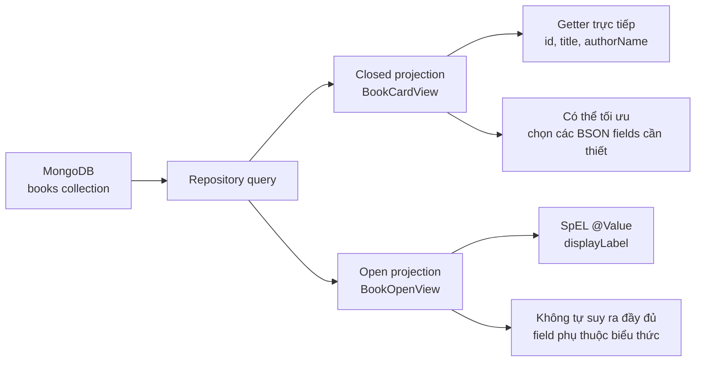

# Projection interface đóng và projection mở

## 1. Bài toán: màn hình chỉ cần vài trường của document

Một collection `books` trong MongoDB có thể lưu đầy đủ thông tin về sách: mã ISBN, tiêu đề, tác giả, trạng thái xuất bản, ngày tạo, mô tả dài, ảnh bìa và các thuộc tính phục vụ quản trị. Nhưng màn hình danh sách thường chỉ cần **ID, tiêu đề và tên tác giả**. Nếu mọi truy vấn đều đọc toàn bộ entity `Book`, ứng dụng có thể phải truyền và ánh xạ nhiều trường không cần thiết.

Trong **Spring Data MongoDB**, *projection* cho phép mô tả một **góc nhìn dữ liệu** thay vì luôn trả entity đầy đủ. Hai loại interface projection quan trọng:

- **Projection interface đóng (closed projection):** mọi getter được ánh xạ tới các property có thể xác định của entity nguồn. Spring Data biết projection cần những property nào, nên trong các truy vấn được hỗ trợ, framework có thể **giới hạn field được lấy từ MongoDB**.
- **Projection interface mở (open projection):** ít nhất một giá trị được tính bằng biểu thức, chẳng hạn `@Value` kết hợp **Spring Expression Language (SpEL)**. Vì biểu thức có thể truy cập nhiều thuộc tính của entity, Spring Data **không thể suy ra chắc chắn toàn bộ danh sách field cần đọc** để tối ưu projection theo cùng cách với closed projection.

Projection không phải là một kiểu BSON mới, cũng không tự tạo thêm collection. Nó là **hợp đồng dữ liệu phía Java** cho kết quả truy vấn repository.



Trong bài, ta sẽ tạo một entity, hai interface projection, viết repository, gọi truy vấn, quan sát dữ liệu BSON và thảo luận giới hạn về hiệu năng, nested projection, API động và kiểm thử.

## 2. Chuẩn bị entity và document mẫu

Giả sử dự án Spring Boot có dependency `spring-boot-starter-data-mongodb` và được cấu hình kết nối tới database `library_projection_demo`. Ví dụ Java sử dụng Java 17 trở lên và phong cách Spring Data MongoDB trên Spring Boot 3.x.

### Entity đầy đủ

```java
package com.example.library;

import java.time.Instant;
import org.springframework.data.mongodb.core.mapping.Document;
import org.springframework.data.mongodb.core.mapping.Field;
import org.springframework.data.mongodb.core.mapping.FieldType;
import org.springframework.data.mongodb.core.mapping.MongoId;

@Document(collection = "books")
public class Book {

    @MongoId(FieldType.STRING)
    private String id;

    private String isbn;
    private String title;
    private String category;
    private String status;

    @Field("author_name")
    private String authorName;

    @Field("created_at")
    private Instant createdAt;

    private String description;

    protected Book() {}

    public String getId() { return id; }
    public String getIsbn() { return isbn; }
    public String getTitle() { return title; }
    public String getCategory() { return category; }
    public String getStatus() { return status; }
    public String getAuthorName() { return authorName; }
    public Instant getCreatedAt() { return createdAt; }
    public String getDescription() { return description; }
}
```

Các property `authorName` và `createdAt` sử dụng `@Field` để lưu trong MongoDB với tên `author_name` và `created_at`. `@MongoId(FieldType.STRING)` làm rõ rằng ID do ứng dụng cấp dưới dạng chuỗi được lưu là BSON String, không cần phụ thuộc phép chuyển sang ObjectId.

### Dữ liệu thực hành

Trong `mongosh`, kết nối tới MongoDB dành riêng cho việc học rồi chạy:

```javascript
use library_projection_demo

db.books.insertMany([
  {
    _id: "BK-001",
    isbn: "ISBN-001",
    title: "Nhập môn Spring Data MongoDB",
    author_name: "An",
    category: "backend",
    status: "PUBLISHED",
    created_at: ISODate("2026-11-01T08:00:00Z"),
    description: "Nội dung mô tả đầy đủ, có thể dài hơn tiêu đề nhiều lần."
  },
  {
    _id: "BK-002",
    isbn: "ISBN-002",
    title: "Thiết kế document theo truy vấn",
    author_name: "Bình",
    category: "database",
    status: "PUBLISHED",
    created_at: ISODate("2026-11-05T08:00:00Z"),
    description: "Các ví dụ thiết kế schema và phân tích mẫu truy cập."
  },
  {
    _id: "BK-003",
    isbn: "ISBN-003",
    title: "MongoDB Aggregation",
    author_name: "Chi",
    category: "database",
    status: "DRAFT",
    created_at: ISODate("2026-11-09T08:00:00Z"),
    description: "Bản thảo đang được biên tập."
  }
])
```

Lệnh `insertMany` chỉ dùng khi collection thực hành còn trống; chạy lại với cùng `_id` sẽ gây duplicate key. Các ID ở đây là String và thời gian là BSON Date. Với Spring Boot 3.x, URI minh họa là:

```properties
spring.data.mongodb.uri=mongodb://localhost:27017/library_projection_demo
```

Đọc toàn bộ một document bằng `db.books.findOne({ _id: "BK-001" })` cho thấy tất cả trường kể cả `description`. Phần sau sẽ trình bày cách projection giúp giao diện chỉ nhìn thấy một tập con thuộc tính.

## 3. Closed interface projection: các getter được xác định rõ

Tạo interface chỉ gồm ba getter:

```java
package com.example.library;

public interface BookCardView {
    String getId();
    String getTitle();
    String getAuthorName();
}
```

**Vì sao đây là projection đóng?**

1. `getId()` ứng với property `id` của entity `Book`.
2. `getTitle()` ứng với property `title`.
3. `getAuthorName()` ứng với property `authorName`, được ánh xạ sang BSON field `author_name`.
4. Không có biểu thức `@Value` truy cập tùy ý các phần khác của target.

Khai báo repository:

```java
package com.example.library;

import java.util.List;
import org.springframework.data.mongodb.repository.MongoRepository;

public interface BookRepository extends MongoRepository<Book, String> {

    List<BookCardView> findByStatusOrderByCreatedAtDescIdDesc(
        String status);
}
```

Phương thức dùng **property của entity nguồn** (`status`, `createdAt`, `id`) để lọc và sắp xếp, nhưng **kiểu trả về** là `List<BookCardView>`. Khi gọi:

```java
List<BookCardView> cards =
    bookRepository.findByStatusOrderByCreatedAtDescIdDesc(
        "PUBLISHED");

cards.forEach(card ->
    System.out.println(
        card.getId() + " | "
        + card.getTitle() + " | "
        + card.getAuthorName()
    )
);
```

Kết quả mong đợi với dữ liệu mẫu:

```text
BK-002 | Thiết kế document theo truy vấn | Bình
BK-001 | Nhập môn Spring Data MongoDB | An
```

`BookCardView` không có getter `getDescription()`. Code nhận projection không thể tùy ý gọi thêm các trường của `Book` thông qua interface này. Đó là lợi ích về **hợp đồng dữ liệu**, ngay cả trước khi cân nhắc tối ưu truy vấn.

### Closed projection có thể giảm số field đọc từ MongoDB

Vì framework suy ra được các property của projection đóng, nó có thể tạo truy vấn dạng:

```javascript
// Hình thức minh họa về field selection, không cam kết
// đây là đúng câu lệnh driver sinh ra ở mọi phiên bản.
db.books.find(
  { status: "PUBLISHED" },
  { _id: 1, title: 1, author_name: 1 }
).sort({ created_at: -1, _id: -1 })
```

Projection BSON trong đối số thứ hai của `find` chọn `_id`, `title` và `author_name`, tránh trả field mô tả dài. MongoDB có thể vẫn cần đọc dữ liệu khác để lọc/sort tùy index và kế hoạch thực thi.

**Giới hạn phải hiểu đúng:**

- Việc Spring Data **có thể tối ưu field selection** không đồng nghĩa nó luôn thực hiện *covered query*; covered query phụ thuộc index chứa đủ field lọc, sort và trả về.
- Tối ưu thực tế còn phụ thuộc phiên bản framework, hình dạng truy vấn, nested projection và tùy chỉnh mapping/converter.
- Chỉ nhìn vào kiểu `BookCardView` trong Java chưa chứng minh lệnh MongoDB thật đã loại `description`. Cần quan sát truy vấn/command monitoring hoặc kế hoạch truy vấn trong kiểm thử.
- `_id` thường được MongoDB đưa vào projection mặc định trừ khi bị loại tường minh; trong ví dụ ta chủ động có `getId()` nên cần ID trong kết quả.

### Không dùng tên BSON làm getter Java

Getter phải bám vào **property Java**:

```java
// Đúng với Book.authorName:
String getAuthorName();

// Không nên lấy cách đặt tên field BSON làm tên getter:
// String getAuthor_name();
```

Spring Data dựa trên metadata `@Field("author_name")` để đưa property `authorName` sang field MongoDB. Trường hợp getter không tương ứng property hợp lệ có thể gây lỗi mapping hoặc không nhận được giá trị dự kiến.

## 4. Open interface projection: dùng `@Value` và SpEL

Giờ giả sử giao diện muốn chuỗi hiển thị `"Nhập môn Spring Data MongoDB — An"`, ghép tiêu đề với tác giả. Một cách làm là **open projection**:

```java
package com.example.library;

import org.springframework.beans.factory.annotation.Value;

public interface BookOpenView {

    String getTitle();

    String getAuthorName();

    @Value("#{target.title + ' — ' + target.authorName}")
    String getDisplayLabel();
}
```

`@Value` ở đây là `org.springframework.beans.factory.annotation.Value`. Biểu thức trong `@Value` là **Spring Expression Language (SpEL)**:

- `target` đại diện cho đối tượng nguồn mà projection đang bao quanh.
- `target.title` đọc tiêu đề từ đối tượng nguồn.
- `target.authorName` đọc tên tác giả từ đối tượng nguồn.
- Kết quả biểu thức trở thành giá trị getter `getDisplayLabel()`; **không có field BSON `displayLabel`** được tạo bởi annotation.

Mở rộng repository thêm một phương thức có điều kiện khác:

```java
import java.util.List;

public interface BookRepository extends MongoRepository<Book, String> {

    List<BookCardView> findByStatusOrderByCreatedAtDescIdDesc(
        String status);

    List<BookOpenView> findByStatusAndCategory(
        String status, String category);
}
```

Đây là **phiên bản gộp của cùng một repository**, không cần tạo hai interface trùng tên trong project.

Gọi ví dụ:

```java
List<BookOpenView> results =
    bookRepository.findByStatusAndCategory(
        "PUBLISHED", "backend");

results.forEach(view ->
    System.out.println(view.getDisplayLabel())
);
```

Với dữ liệu mẫu, kết quả:

```text
Nhập môn Spring Data MongoDB — An
```

### Vì sao projection mở khó tối ưu field selection?

Spring Data không thể suy luận tổng quát biểu thức SpEL sẽ truy cập những property nào. Biểu thức có thể gọi method, truy cập quan hệ hoặc dùng một bean khác. Do đó, với open projection, framework **không áp dụng cùng kiểu tối ưu lựa chọn field dựa trên danh sách getter đã biết** như closed projection.

Ví dụ getter:

```java
@Value("#{target.title + ' — ' + target.authorName}")
String getDisplayLabel();
```

dù chỉ đọc hai trường, vẫn được xem là **open projection** vì phụ thuộc biểu thức. Nó không phải phép `$concat` chạy tự động trong aggregation MongoDB. Giá trị thường được tính **phía Java** khi xử lý projection; việc đó không tạo thêm field trong document đã lưu.

Một biểu thức SpEL có thể được nâng cấp để gọi bean hoặc logic tùy biến, nhưng cần lưu ý:

- Biểu thức khó đọc và debug hơn getter đơn giản; không nên chứa logic nghiệp vụ phức tạp.
- Không dùng SpEL như nơi thực hiện truy vấn database ẩn hoặc thao tác I/O lặp lại cho từng kết quả.
- Nếu property có thể `null`, biểu thức cần quy tắc xử lý rõ ràng để tránh chuỗi hiển thị không mong muốn hoặc lỗi runtime.
- Nếu dữ liệu cần **lọc/sắp xếp theo chuỗi đã tính**, không thể mặc định gọi `findByDisplayLabel(...)` hay `OrderByDisplayLabel`: đó không phải field được lưu trong document.

## 5. So sánh closed projection và open projection

| Khía cạnh | Closed interface projection | Open interface projection |
| --- | --- | --- |
| Getter | Trỏ trực tiếp tới property có thể xác định của entity | Có getter tính toán, thường qua `@Value`/SpEL |
| Ví dụ | `String getTitle()` | `@Value(...) String getDisplayLabel()` |
| Field BSON được lưu | Không thay đổi | Không thay đổi |
| Khả năng tối ưu field selection | Có thể suy ra và chỉ chọn field cần thiết trong truy vấn hỗ trợ | Không thể suy ra an toàn từ mọi biểu thức; thường không tối ưu tương tự |
| Công việc phía Java | Getter đơn giản | Đánh giá biểu thức khi lấy giá trị |
| Phù hợp | API danh sách, card, kết quả tìm kiếm, payload gọn | Hiển thị một giá trị tính toán đơn giản cần truy cập target |
| Rủi ro | Getter sai property, nested projection cần kiểm chứng | Chi phí mapping, SpEL khó debug, phụ thuộc null và dữ liệu nguồn |

**Chọn closed projection làm mặc định** khi chỉ cần lấy một số field hiện có. Chỉ dùng open projection khi **thực sự cần biểu thức động** và đã cân nhắc tác động đến I/O, mapping và khả năng kiểm thử.

## 6. Khi chỉ cần ghép getter: default method thay cho SpEL

Nhiều giá trị “tính toán” thực ra chỉ ghép một vài getter vốn đã có. Khi đó, Java interface có **default method** để giữ phép tính ở Java mà không cần mở projection bằng SpEL:

```java
package com.example.library;

public interface BookCardWithLabel extends BookCardView {

    default String getDisplayLabel() {
        return getTitle() + " — " + getAuthorName();
    }
}
```

Ở đây:

- `getTitle()` và `getAuthorName()` đã có trong closed projection `BookCardView`.
- `getDisplayLabel()` là phép tính dựa **duy nhất** vào hai getter đã biết; nó không cần truy cập trực tiếp toàn bộ đối tượng `Book`.
- Vì không có `@Value` với biểu thức tùy ý, Spring Data vẫn có thể suy ra tập property cần đọc khi dùng projection này theo cơ chế hỗ trợ.

Đây thường là lựa chọn đơn giản hơn open projection nếu logic trình bày chỉ là nối chuỗi, định dạng nhẹ hoặc kiểm tra điều kiện nhỏ. Tuy nhiên, không nên nhét tính toán nghiệp vụ phức tạp vào default method của projection. Nếu việc tính toán cần nhiều dependency hoặc nhiều trường, dùng **service/mapper sang DTO** với trách nhiệm rõ ràng.

### So sánh hai cách tạo nhãn hiển thị

```java
// Open projection: Spring Expression Language.
@Value("#{target.title + ' — ' + target.authorName}")
String getDisplayLabel();

// Default method trong closed projection.
default String getDisplayLabel() {
    return getTitle() + " — " + getAuthorName();
}
```

Cả hai có thể trả cùng chuỗi, nhưng **khả năng phân tích dependency để giới hạn BSON fields không giống nhau**. Không chỉ nhìn vào kết quả hiển thị để kết luận hai phương án có chi phí truy vấn tương đương.

## 7. Dynamic projection: chọn kiểu trả về khi gọi repository

Nếu ứng dụng cần nhiều kiểu hiển thị của cùng một điều kiện tìm kiếm, Spring Data hỗ trợ **dynamic projections** qua một tham số `Class<T>`:

```java
package com.example.library;

import java.util.List;
import org.springframework.data.mongodb.repository.MongoRepository;

public interface BookRepository extends MongoRepository<Book, String> {

    List<BookCardView> findByStatusOrderByCreatedAtDescIdDesc(
        String status);

    List<BookOpenView> findByStatusAndCategory(
        String status, String category);

    <T> List<T> findByStatus(String status, Class<T> type);
}
```

Các ví dụ:

```java
List<BookCardView> compact =
    bookRepository.findByStatus(
        "PUBLISHED", BookCardView.class);

List<BookCardWithLabel> cardsWithLabel =
    bookRepository.findByStatus(
        "PUBLISHED", BookCardWithLabel.class);

List<BookOpenView> computed =
    bookRepository.findByStatus(
        "PUBLISHED", BookOpenView.class);

List<Book> fullEntities =
    bookRepository.findByStatus(
        "PUBLISHED", Book.class);
```

**Điểm quan trọng:** tham số `Class<T>` quyết định kiểu ánh xạ của kết quả, nhưng **không khiến repository join thêm collection hoặc tự cấp quyền xem field nhạy cảm**. Khi `T` là closed projection, các field có thể được tối ưu theo khả năng framework; khi `T` là open projection, biểu thức SpEL làm giảm khả năng suy ra tập field cần thiết.

Một số ràng buộc:

1. `T` cần là một kiểu trả về mà Spring Data có khả năng ánh xạ phù hợp với domain `Book`.
2. Cách nhận diện `Class<T>` như tham số projection có quy tắc về generic trong method signature. Nếu `Class` được dùng làm **giá trị filter** thực sự, nên thiết kế signature riêng thay vì vô tình khiến framework hiểu là tham số projection.
3. Dynamic projection giúp tái sử dụng câu hỏi truy vấn, nhưng ở API công khai **không nên cho client chỉ định tên class Java bất kỳ** để suy ra một kiểu dữ liệu không được duyệt.
4. Khi thay projection loại interface bằng entity thật, lượng field có thể được đọc và khả năng truy cập dữ liệu thay đổi; cần kiểm soát điều này qua tầng service.

### Phân biệt với class-based DTO projection

Spring Data cũng hỗ trợ **class-based projection**, thường dùng một constructor xác định property sẽ lấy. Java record là một lựa chọn tự nhiên:

```java
package com.example.library;

public record BookCardDto(
    String id,
    String title,
    String authorName
) {}
```

Khi framework hỗ trợ constructor mapping như thiết kế, có thể dùng trong dynamic projection:

```java
List<BookCardDto> dtoCards =
    bookRepository.findByStatus(
        "PUBLISHED", BookCardDto.class);
```

`BookCardDto` là **đối tượng dữ liệu cụ thể**, không phải proxy interface. Constructor parameter cần khớp với property nguồn và cấu hình ánh xạ; trong trường hợp nhiều constructor hoặc metadata tham số không rõ, cần khai báo constructor được sử dụng một cách tường minh theo quy tắc Spring Data của phiên bản đang dùng.

**Đừng đánh đồng class-based DTO với open interface projection:** DTO có constructor rõ ràng có thể cho phép xác định trước các field cần dùng, còn getter `@Value` trong open projection phụ thuộc biểu thức. Khả năng tối ưu cụ thể cần kiểm chứng bằng truy vấn phát sinh.

| Kỹ thuật | Hình thức | Trường hợp phù hợp |
| --- | --- | --- |
| Closed interface | `BookCardView` với getter | Trả một số property, cú pháp ngắn, ít mapping thủ công |
| Closed + default method | `BookCardWithLabel` | Định dạng đơn giản từ getter đã biết |
| Open interface | `@Value`/SpEL | Tính giá trị qua biểu thức không thể diễn đạt bằng getter đơn giản |
| Class/record DTO | `record BookCardDto(...)` | Hợp đồng kết quả rõ ràng, dễ chuyển sang response API |
| Mapper trong service | `Book → DTO` | Cần logic nghiệp vụ, chuẩn hóa, xử lý null hoặc kết hợp nguồn dữ liệu |

## 8. Projection lồng nhau và dữ liệu được tham chiếu

Không phải lúc nào ứng dụng chỉ lấy các property cấp trên cùng. Một sách có thể nhúng thông tin nhà xuất bản:

```javascript
{
  _id: "BK-010",
  title: "Sách mẫu",
  publisher_snapshot: {
    name: "Nhà xuất bản Ví dụ",
    city: "Hà Nội",
    phone: "0123456789"
  }
}
```

Nếu entity `Book` có thêm property `publisherSnapshot` với kiểu `PublisherSnapshot` và `@Field("publisher_snapshot")`, ta có thể khai báo interface projection lồng nhau:

```java
public interface PublisherNameView {
    String getName();
}

public interface BookWithPublisherView {
    String getId();
    String getTitle();
    PublisherNameView getPublisherSnapshot();
}
```

Spring Data có thể dựng nested projection từ object được nhúng trong document. Nhưng **việc có getter lồng không bảo đảm truy vấn chỉ đọc chính xác field `publisher_snapshot.name`** ở mọi phiên bản/cấu hình. Có những tình huống framework phải lấy toàn bộ embedded object để tạo nested projection. Hãy kiểm tra truy vấn BSON thực tế nếu kích thước embedded document lớn.

**Không nhầm embedded object với document reference.** Nếu `Book` chỉ lưu `publisherId` và `Publisher` nằm ở collection khác, projection không tự join collection đích. Khi cần tên nhà xuất bản, ứng dụng phải tải tường minh bằng repository/template, sử dụng aggregation `$lookup`, hoặc lưu snapshot nếu nghiệp vụ chấp nhận.

Với các nguồn dữ liệu được lấy từ nhiều collection, đôi khi **DTO do service ghép** phù hợp và dễ kiểm soát hơn projection lồng nhau.

## 9. Phân biệt interface projection với chọn BSON fields bằng MongoTemplate

Projection interface thuộc cơ chế ánh xạ kết quả repository. Còn MongoDB có khả năng **field projection** trực tiếp trong câu lệnh find:

```javascript
db.books.find(
  { status: "PUBLISHED" },
  { _id: 1, title: 1, author_name: 1 }
)
```

Trong Spring Data MongoDB, có thể chỉ định field bằng `MongoTemplate`:

```java
import java.util.List;
import org.springframework.data.mongodb.core.MongoTemplate;
import org.springframework.data.mongodb.core.query.Criteria;
import org.springframework.data.mongodb.core.query.Query;

public class BookFieldQuery {
    private final MongoTemplate template;

    public BookFieldQuery(MongoTemplate template) {
        this.template = template;
    }

    public List<Book> findPartialBooks() {
        Query query = Query.query(
            Criteria.where("status").is("PUBLISHED")
        );

        query.fields()
            .include("id")
            .include("title")
            .include("authorName");

        return template.find(query, Book.class);
    }
}
```

Với `Book.class`, Spring Data có metadata ánh xạ nên property `authorName` được chuyển sang `author_name`, `id` sang `_id`. API trả lại `Book`, **nhưng entity đó chỉ được cấp một phần field**.

**Cẩn trọng khi dùng partial entity:**

- Những getter không có trong field projection có thể trả `null` hoặc giá trị mặc định do Java constructor/property cung cấp.
- Không xem partial entity là một aggregate đầy đủ.
- Không gọi `save` vô điều kiện trên partial entity với kỳ vọng mọi field khác vẫn được giữ nguyên; thao tác lưu có thể dẫn đến ghi đè hay mất dữ liệu ngoài ý muốn tùy trạng thái/semantics của entity.
- Khi mục đích là trả dữ liệu cho UI, interface projection hoặc DTO rõ ràng thường tránh sự nhầm lẫn rằng đối tượng đã được nạp đầy đủ.

Trong repository, một truy vấn tùy chỉnh còn có thể cấu hình trường BSON bằng `@Query(fields = "...")` khi thực sự cần, nhưng điều đó không thay thế việc khai báo đúng kiểu trả về và kiểm thử. Thường nên để **closed projection tự diễn đạt các property cần dùng** trước khi tối ưu thủ công.

## 10. Đo hiệu năng: ít field hơn không có nghĩa truy vấn luôn nhanh hơn

Mục tiêu của projection đóng thường là **giảm payload BSON qua mạng** và công việc ánh xạ trong ứng dụng. Để biết hiệu quả, phải tách ba lớp chi phí:

1. **MongoDB chọn và đọc dữ liệu:** có sử dụng index phù hợp, phải quét bao nhiêu document?
2. **MongoDB trả field nào:** còn có `description` hay các field lớn không cần thiết không?
3. **Ứng dụng xử lý kết quả:** truyền bao nhiêu byte, tạo bao nhiêu object/proxy, SpEL có tốn thời gian đáng kể không?

Ví dụ truy vấn cần danh sách sách xuất bản mới nhất:

```javascript
db.books.find(
  { status: "PUBLISHED" },
  { _id: 1, title: 1, author_name: 1 }
)
.sort({ created_at: -1, _id: -1 })
.limit(20)
.explain("executionStats")
```

Các trường cần quan sát:

| Chỉ dấu | Câu hỏi |
| --- | --- |
| `winningPlan` | MongoDB dùng kế hoạch truy vấn nào? |
| `IXSCAN` / `COLLSCAN` | Có dùng index hay quét collection? |
| `totalKeysExamined` | Phải duyệt bao nhiêu khóa index? |
| `totalDocsExamined` | Có cần đọc nhiều document không? |
| `nReturned` | Số document kết quả có tương ứng giới hạn không? |
| `executionTimeMillis` | Thời gian thực thi được đo trong lần kiểm tra này ra sao? |

Một index ứng viên cho bộ lọc và thứ tự sắp:

```javascript
db.books.createIndex(
  { status: 1, created_at: -1, _id: -1 },
  { name: "books_status_created_id" }
)
```

Index này hỗ trợ mục tiêu lọc theo `status` rồi sắp theo `created_at` và `_id`, nhưng **không tự bảo đảm covered query** vì còn thiếu `title` và `author_name` mà projection cần trả. Muốn xem xét khả năng covered query, có thể **thử nghiệm** index có chứa cả các field kết quả:

```javascript
db.books.createIndex(
  {
    status: 1,
    created_at: -1,
    _id: -1,
    title: 1,
    author_name: 1
  },
  { name: "books_card_cover_candidate" }
)
```

Đây chỉ là **index ứng viên để đo**, không phải khuyến nghị tạo mặc định. Index càng rộng có thể tốn nhiều dung lượng và ảnh hưởng tốc độ ghi. Khi collection nhỏ, MongoDB cũng có thể chọn kế hoạch khác; hãy đo workload thực tế trước khi quyết định giữ index nào.

### Không nhầm projection với điều kiện lọc

Lấy ít field không giúp hạn chế số document nếu truy vấn thiếu filter/limit:

```java
// Có thể vẫn đọc một tập kết quả rất lớn nếu status phổ biến.
List<BookCardView> cards =
    bookRepository.findByStatus("PUBLISHED", BookCardView.class);
```

Đối với danh sách API, nên kết hợp **truy vấn có filter, sort và phân trang**. Projection là cách kiểm soát **chiều rộng** dữ liệu của từng document; phân trang và điều kiện lọc kiểm soát **số lượng** document.

### Cách xác minh framework có tối ưu BSON field selection

Không dựa riêng vào thời gian chạy trên ba document mẫu. Trong một môi trường kiểm thử cho phép:

- Bật mức ghi log/capture phù hợp cho truy vấn MongoDB hoặc dùng command monitoring của driver để xem câu lệnh `find` và phần `projection` thực sự.
- So sánh closed interface với open interface trên cùng bộ lọc, số bản ghi và kết nối.
- Quan sát field được lấy, bytes mạng, thời gian ánh xạ và heap phía Java khi payload có mô tả lớn.
- So sánh `explain` cho truy vấn tương đương khi cần đánh giá index.
- Chú ý không ghi ra log dữ liệu nhạy cảm hoặc toàn bộ document production chỉ để debug projection.

Nếu thấy framework không loại field theo kỳ vọng, hãy kiểm tra phiên bản, loại query, nested mapping, custom converter và kiểu projection. **Không viết bài toán hiệu năng dựa trên một bảo đảm mà framework không đưa ra cho mọi trường hợp.**

## 11. Projection và ranh giới API: không phải cơ chế bảo mật

Một interface `BookCardView` không công khai getter `getDescription()`, nhưng điều đó **không tự động tạo chính sách phân quyền**. Ví dụ, người dùng A và B có thể có quyền xem những sách khác nhau; chỉ chọn ít field không lọc được document theo tenant, chủ sở hữu hoặc quyền truy cập.

Thiết kế API nên phân biệt:

- **Filter/query:** document nào người gọi được phép thấy?
- **Projection/DTO:** trong những document đó, field nào được phép trả?
- **Mapping/serialization:** trường nào thực sự được chuyển thành JSON?

Open projection còn có thể tham chiếu các property không hiện diện trong getter thông thường qua `target`. Vì vậy, không nên cho phép client nhập biểu thức SpEL tùy ý; biểu thức và kiểu projection phải do code ứng dụng kiểm soát.

Khi xây response công khai, một `record BookCardDto(...)` rõ ràng hoặc mapper riêng giúp định nghĩa danh sách field trả về và xử lý giá trị tính toán. Nhưng vẫn cần xác minh tầng truy vấn không nạp dữ liệu ngoài quyền cho phép, cũng như không lộ dữ liệu qua log hoặc exception.

## 12. Kiểm thử closed và open projection bằng dữ liệu thật

Nên kiểm thử tích hợp với MongoDB thực, ví dụ MongoDB dành cho test hoặc Testcontainers, vì lỗi projection thường liên quan tới **tên field BSON, ánh xạ kiểu và câu lệnh truy vấn thực tế**. `@DataMongoTest` trên Spring Boot 3.x có thể khởi tạo lớp dữ liệu cho bài test; dự án vẫn cần cấu hình database test cô lập.

Ví dụ sau tạo dữ liệu bằng **MongoDB Driver API trực tiếp**, để kiểm tra việc chuyển `author_name` thành `authorName` từ BSON không phụ thuộc vào chính entity khi ghi.

```java
package com.example.library;

import java.time.Instant;
import java.util.Date;
import java.util.List;
import org.bson.Document;
import org.junit.jupiter.api.BeforeEach;
import org.junit.jupiter.api.Test;
import org.springframework.beans.factory.annotation.Autowired;
import org.springframework.boot.test.autoconfigure.data.mongo.DataMongoTest;
import org.springframework.data.mongodb.core.MongoTemplate;

import static org.assertj.core.api.Assertions.assertThat;

@DataMongoTest
class BookProjectionTest {

    @Autowired
    BookRepository repository;

    @Autowired
    MongoTemplate template;

    @BeforeEach
    void seedIsolatedDatabase() {
        // Chỉ được dùng trên database test cô lập.
        template.dropCollection(Book.class);

        template.getCollection("books").insertMany(List.of(
            new Document("_id", "BK-001")
                .append("isbn", "ISBN-001")
                .append("title", "Sách Một")
                .append("author_name", "An")
                .append("status", "PUBLISHED")
                .append("category", "backend")
                .append("created_at", Date.from(
                    Instant.parse("2026-11-01T08:00:00Z")))
                .append("description", "Mô tả dài"),
            new Document("_id", "BK-002")
                .append("isbn", "ISBN-002")
                .append("title", "Sách Hai")
                .append("author_name", "Bình")
                .append("status", "PUBLISHED")
                .append("category", "database")
                .append("created_at", Date.from(
                    Instant.parse("2026-11-05T08:00:00Z")))
                .append("description", "Dữ liệu khác")
        ));
    }

    @Test
    void closedProjectionMapsJavaPropertyFromBsonField() {
        List<BookCardView> cards =
            repository.findByStatusOrderByCreatedAtDescIdDesc(
                "PUBLISHED");

        assertThat(cards)
            .extracting(BookCardView::getId)
            .containsExactly("BK-002", "BK-001");

        assertThat(cards.get(0).getTitle())
            .isEqualTo("Sách Hai");
        assertThat(cards.get(0).getAuthorName())
            .isEqualTo("Bình");
    }

    @Test
    void openProjectionEvaluatesSpelGetter() {
        List<BookOpenView> views =
            repository.findByStatusAndCategory(
                "PUBLISHED", "backend");

        assertThat(views).hasSize(1);
        assertThat(views.get(0).getDisplayLabel())
            .isEqualTo("Sách Một — An");
    }

    @Test
    void dynamicClosedProjectionUsesSelectedType() {
        List<BookCardWithLabel> views =
            repository.findByStatus(
                "PUBLISHED", BookCardWithLabel.class);

        assertThat(views)
            .extracting(BookCardWithLabel::getDisplayLabel)
            .containsExactlyInAnyOrder(
                "Sách Một — An",
                "Sách Hai — Bình");
    }
}
```

**Chú ý:** `template.dropCollection(Book.class)` xóa cả collection; thao tác này chỉ an toàn với database test cô lập và tuyệt đối không được dùng để chuẩn bị fixture trên production hay database dùng chung. `BookRepository` trong test là interface đã được **gộp các phương thức** ở mục 7.

Các assertion trên kiểm tra **đúng dữ liệu và phép tính**, nhưng chưa chứng minh MongoDB đã chọn ít field hơn cho closed projection. Muốn xác minh tối ưu mạng, cần thêm cơ chế quan sát command hoặc truy vấn thực tế như mục 10. Không được suy luận hiệu năng chỉ từ việc `getDescription()` không có trong interface.

Các ca nên bổ sung khi triển khai thật:

1. `author_name` bị thiếu hoặc null: định nghĩa hành vi của getter và biểu thức SpEL.
2. Thay đổi tên BSON bằng `@Field`: kiểm tra closed projection vẫn đọc đúng property Java.
3. Entity có embedded object: đo field selection của nested projection.
4. Tập dữ liệu lớn và mô tả dài: so sánh payload/độ trễ giữa closed, open và entity đầy đủ.
5. Query có sort, limit và phân trang: bảo đảm thứ tự ổn định và số document giới hạn.
6. Dữ liệu BSON cũ không tương thích: kiểm tra mapping thất bại hoặc giá trị bị thiếu đúng cách.
7. Dynamic projection: không cho client chọn loại không nằm trong danh sách được phép.

## 13. Reactive repository và projection

Nếu ứng dụng dùng reactive access, Spring Data MongoDB có `ReactiveMongoRepository`. Vẫn có thể biểu đạt kiểu kết quả projection từ truy vấn repository:

```java
package com.example.library;

import org.springframework.data.mongodb.repository.ReactiveMongoRepository;
import reactor.core.publisher.Flux;

public interface ReactiveBookRepository
        extends ReactiveMongoRepository<Book, String> {

    Flux<BookCardView> findByStatusOrderByCreatedAtDescIdDesc(
        String status);
}
```

Lời gọi:

```java
Flux<BookCardView> cards =
    reactiveBookRepository
        .findByStatusOrderByCreatedAtDescIdDesc("PUBLISHED");
```

`Flux<BookCardView>` là một chuỗi kết quả reactive: dữ liệu được truy xuất khi subscribe. Projection vẫn không thay thế `limit`/`Pageable` hoặc bộ lọc; nếu muốn lấy một trang, phải thiết kế repository method có phân trang hoặc truy vấn `ReactiveMongoTemplate` tương ứng.

Open projection dùng SpEL không biến phép tính thành một toán tử reactive hay stage aggregation. Với lượng kết quả lớn, công việc tính toán của mỗi getter và lượng field MongoDB trả về vẫn đáng đo. Tránh gọi `block()` trong đường xử lý request reactive chỉ để biến luồng thành danh sách đồng bộ.

## 14. Những lỗi thường gặp

| Triệu chứng | Nguyên nhân có thể | Hướng xử lý |
| --- | --- | --- |
| `getAuthorName()` trả null | Document có tên `authorName` thay vì `author_name`, hoặc field bị thiếu | Đối chiếu `@Field` và BSON thực tế; kiểm tra migration |
| Closed projection không trả ít field như mong đợi | Loại query/mapping/nested projection không áp dụng tối ưu như kỳ vọng | Quan sát command MongoDB, kiểm tra phiên bản và truy vấn phát sinh |
| Biểu thức `@Value` lỗi khi đọc | Sai property trong `target` hoặc giá trị null | Kiểm tra SpEL, dữ liệu mẫu và xử lý null |
| Open projection chậm hơn closed projection | Thêm công việc đánh giá SpEL và có thể đọc nhiều field hơn | Dùng default method hoặc DTO/mapper khi phù hợp, đo tải thực tế |
| Gọi `getDisplayLabel()` từ `OrderBy` không hoạt động | Display label tính ở Java, không phải property BSON có thể sort trực tiếp | Dùng field được lưu hoặc aggregation `$addFields`/`$sort` với logic cụ thể |
| Projection lồng không giảm payload như dự đoán | Embedded object được chọn ở mức rộng hơn | Kiểm tra câu lệnh BSON và cân nhắc DTO/query tùy chỉnh |
| API để lộ dữ liệu nhạy cảm | Coi projection là cơ chế cấp quyền | Áp dụng tenant filter, authorization và DTO response riêng |
| Dùng `save` trên Book chỉ đọc một số field | Partial entity có field thiếu | Tránh save partial entity; dùng update có điều kiện hoặc tải entity đầy đủ |
| Dynamic projection không ánh xạ được DTO | Constructor/property name không tương ứng domain | Kiểm tra constructor, mapping metadata và kiểu trả về |
| Projection vẫn trả quá nhiều document | Có projection nhưng không có filter/limit | Kết hợp derived query, Sort và Pageable |

## 15. Bài tập tự kiểm tra

**Bài tập 1.** Entity `Book` có property `title`, `authorName` và `description`. Interface:

```java
public interface Card {
    String getTitle();
    String getAuthorName();
}
```

**Hỏi:** Đây là closed hay open projection? **Đáp án:** Closed, vì cả hai getter tương ứng property cụ thể và không cần biểu thức SpEL.

**Bài tập 2.** Thêm getter:

```java
@Value("#{target.title + ' — ' + target.authorName}")
String getDisplayLabel();
```

**Hỏi:** Vì sao projection trở thành open? **Đáp án:** Vì getter phụ thuộc biểu thức trên `target`; framework không thể suy luận tổng quát mọi field mà biểu thức sẽ truy cập.

**Bài tập 3.** Muốn có `getDisplayLabel()` nhưng không cần biểu thức động. Có lựa chọn nào để vẫn tận dụng các getter đóng?

**Đáp án:** Dùng default method trên interface gọi `getTitle()` và `getAuthorName()`. Khi tất cả dependency của phép tính đã nằm trong getter đóng, framework vẫn có thể phân tích tập property cần đọc.

**Bài tập 4.** `@Field("author_name")` được dùng trên property Java `authorName`. Getter trong projection interface nên là gì?

**Đáp án:** `getAuthorName()`. Spring Data ánh xạ tên property Java sang BSON field `author_name`.

**Bài tập 5.** Một request chỉ được phép xem sách thuộc `tenantId = "TENANT-A"`. Có thể dùng `BookCardView` mà bỏ qua lọc tenant không?

**Đáp án:** Không. Projection định nghĩa field trả về, không xác định document nào người dùng có quyền truy cập. Phải có điều kiện tenant và kiểm tra quyền.

**Bài tập 6.** Sau khi chuyển từ entity `Book` sang closed projection, thời gian truy vấn không giảm đáng kể. Điều đó chứng minh projection không hiệu quả không?

**Đáp án:** Chưa. Cần đo payload thực sự, truy vấn và index. Nếu description vốn nhỏ hoặc phần lớn thời gian nằm ở filter/sort, lợi ích có thể ít; nếu framework không tối ưu field selection cho truy vấn đó, cần quan sát câu lệnh thực tế.

## 16. Quy trình lựa chọn projection cho một API mới

1. **Xác định danh sách field giao diện thật sự cần.** Ví dụ card sách chỉ cần ID, tiêu đề và tên tác giả.
2. **Chọn closed interface trước** nếu chỉ đọc property của entity: ít mã, dễ xác định dependency và có cơ hội tối ưu field selection.
3. **Cần giá trị hiển thị tính toán?** Nếu chỉ ghép những getter đã khai báo, dùng default method. Nếu cần biểu thức linh hoạt hơn, cân nhắc open projection và đo chi phí.
4. **Cần một hợp đồng response cụ thể?** Dùng class/record DTO hoặc service mapper, đặc biệt khi có kiểm tra quyền, chuyển đổi kiểu và nghiệp vụ.
5. **Chọn đúng phương thức repository.** Lọc, sort, page/limit ở phía database; dynamic projection chỉ chọn kiểu trả về.
6. **Đối chiếu Java với BSON.** `@Field` có thể đổi tên property; kiểm tra dữ liệu thật, nested mapping và kiểu ID.
7. **Đo và kiểm thử.** Kiểm tra kết quả, SpEL/null, truy vấn MongoDB phát sinh, payload, index và độ trễ.
8. **Giữ ranh giới an toàn.** Projection không phải cơ chế phân quyền; không lưu rồi ghi đè một partial entity theo cách thiếu kiểm soát.

**Kết luận:** **Closed interface projection** dùng getter tương ứng với property xác định của entity và có thể giúp Spring Data MongoDB chỉ chọn các BSON field cần thiết. **Open interface projection** cho phép tính getter qua `@Value`/SpEL nhưng thường không được tối ưu field selection theo cùng cách. Khi cần hiển thị giá trị tính toán đơn giản, **default method** có thể là một phương án vừa dễ đọc vừa giữ dependency rõ ràng; khi cần response ổn định và logic nghiệp vụ, **DTO** phù hợp hơn. Dù chọn kỹ thuật nào, hãy kiểm chứng trên truy vấn MongoDB và dữ liệu thật thay vì suy ra hiệu năng chỉ từ chữ ký Java.
