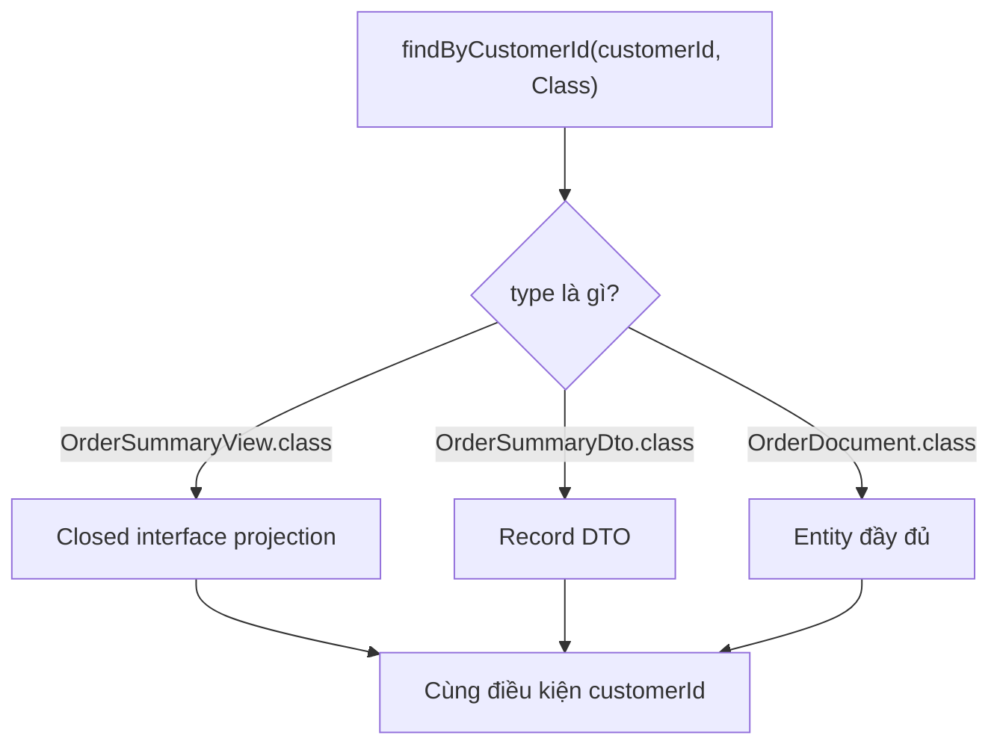

# Projection động với tham số Class

## 1. Tại sao cần projection động?

Trong một ứng dụng quản lý đơn hàng, cùng collection MongoDB `orders` có thể phục vụ những màn hình rất khác nhau:

- **Danh sách đơn:** chỉ cần mã đơn, trạng thái, tổng tiền và thời gian đặt.
- **Đối soát:** cần mã đơn, loại tiền, số tiền, trạng thái thanh toán.
- **Chi tiết đơn:** cần cả người mua, địa chỉ giao, các dòng sản phẩm và ghi chú được phép hiển thị.
- **Xuất dữ liệu:** có tập trường riêng theo hợp đồng của hệ thống nhận.

Nếu mọi màn hình đều gọi `findByCustomerId(...)` và nhận nguyên `OrderDocument`, các endpoint chỉ cần vài trường vẫn có thể đọc nhiều dữ liệu, tạo object lớn và vô tình làm lộ thông tin nội bộ.

Nếu tạo một phương thức repository khác nhau cho từng kiểu trả về, interface có thể có nhiều method lặp điều kiện lọc:

```java
List<OrderSummaryView> findSummaryByCustomerId(...);
List<OrderFinanceView> findFinanceByCustomerId(...);
List<OrderDocument> findFullByCustomerId(...);
```

**Projection động (dynamic projection)** của Spring Data giải quyết tình huống có **cùng điều kiện tìm kiếm, nhưng kiểu kết quả thay đổi theo nhu cầu của caller**. Ta khai báo một phương thức generic với tham số `Class<T>`, sau đó truyền interface projection, DTO class/record hoặc chính entity ở từng lời gọi.

Bài học thuộc chương **Projection và DTO** của module **SPRING_DATA_MONGODB**. Phạm vi gồm repository, cách MongoDB lưu và trả document, sự khác biệt giữa projection interface và DTO, giới hạn tối ưu hóa truy vấn, phân trang, `MongoTemplate`, reactive access, index, kiểm thử và chẩn đoán hiệu năng. Điểm trọng tâm là **tham số `Class<T>` dùng để chọn kiểu projection tại thời điểm gọi**, không phải một tham số lọc giá trị BSON.

## 2. Bài toán và document MongoDB mẫu

Giả sử database có một document:

```javascript
db.orders.insertOne({
  _id: "ord-1001",
  customerId: "cus-01",
  status: "PAID",
  currency: "VND",
  totalAmount: NumberDecimal("1850000.00"),
  placedAt: ISODate("2026-11-20T02:00:00Z"),
  shippingAddress: {
    recipient: "Nguyễn An",
    city: "Đà Nẵng",
    phone: "0900000000"
  },
  items: [
    {
      productId: "p-10",
      productNameAtPurchase: "Bàn phím cơ",
      quantity: 2,
      unitPrice: NumberDecimal("925000.00")
    }
  ],
  internalNote: "Liên hệ khách trước khi giao"
});
```

Đây là dữ liệu học tập: chỉ chạy lệnh ghi trên database thử nghiệm, không dùng trực tiếp trong hệ thống sản xuất.

Ba response khác nhau có thể cùng lấy từ document ấy.

**Danh sách:**

```json
{
  "id": "ord-1001",
  "status": "PAID",
  "totalAmount": 1850000.00,
  "placedAt": "2026-11-20T02:00:00Z"
}
```

**Đối soát:**

```json
{
  "id": "ord-1001",
  "currency": "VND",
  "totalAmount": 1850000.00,
  "status": "PAID"
}
```

**Chi tiết:** có thể cần `items` và địa chỉ, nhưng cần loại `internalNote` khỏi API cho khách nếu đó là thông tin nội bộ.

Hai JSON ở trên chỉ minh họa **hợp đồng response API**, không phải canonical Extended JSON của MongoDB. Giá trị `NumberDecimal` lưu trong BSON khác với cách một JSON serializer thể hiện `BigDecimal` ở HTTP response. Nếu phải bảo đảm tiền tệ chính xác giữa các hệ thống, hãy thống nhất quy ước serialize số tiền cho API.

## 3. Mô hình entity đầy đủ

Ví dụ Java 17+ với Spring Data MongoDB:

```java
import java.math.BigDecimal;
import java.time.Instant;
import java.util.List;

import org.springframework.data.mongodb.core.mapping.Document;
import org.springframework.data.mongodb.core.mapping.Field;
import org.springframework.data.mongodb.core.mapping.FieldType;
import org.springframework.data.mongodb.core.mapping.MongoId;

@Document(collection = "orders")
public record OrderDocument(
    @MongoId(FieldType.STRING)
    String id,

    String customerId,
    String status,
    String currency,

    @Field(targetType = FieldType.DECIMAL128)
    BigDecimal totalAmount,

    Instant placedAt,
    ShippingAddress shippingAddress,
    List<OrderItem> items,
    String internalNote
) {
    public record ShippingAddress(
        String recipient,
        String city,
        String phone
    ) {}

    public record OrderItem(
        String productId,
        String productNameAtPurchase,
        int quantity,
        @Field(targetType = FieldType.DECIMAL128)
        BigDecimal unitPrice
    ) {}
}
```

`@Document(collection = "orders")` xác định collection; `@MongoId(FieldType.STRING)` mô tả chủ đích lưu khóa `_id` là BSON string. `@Field(targetType = FieldType.DECIMAL128)` trên `BigDecimal` giúp biểu diễn tiền dưới BSON Decimal128 theo mapping phù hợp.

Chúng ta **không** muốn dựng đầy đủ `OrderDocument` khi màn hình chỉ dùng bốn trường. Đồng thời, không muốn tạo một entity bị thiếu `items`/`shippingAddress` rồi vô tình gọi `save` và thay thế document gốc. Vì vậy cần phân biệt **model ghi** với các **mô hình chỉ đọc**.

## 4. Định nghĩa các kiểu projection

### 4.1. Closed interface projection

Một interface chỉ khai báo các accessor có thể ánh xạ trực tiếp tới property của entity được gọi là **closed projection**:

```java
import java.math.BigDecimal;
import java.time.Instant;

public interface OrderSummaryView {
    String getId();
    String getStatus();
    BigDecimal getTotalAmount();
    Instant getPlacedAt();
}
```

Spring Data có thể tạo implementation/proxy cho interface này khi đọc kết quả. Caller chỉ truy cập những property đã định nghĩa, không cần một `OrderDocument` có đủ field.

Đối với closed projection, Spring Data có thể xác định những property cần thiết và tối ưu tập trường đọc từ MongoDB. Nhưng **không suy ra rằng mọi closed projection đều chắc chắn tạo covered query** hoặc không đọc field khác trong mọi trường hợp: còn phụ thuộc loại query, ánh xạ lồng nhau, converter và phiên bản framework. Cần xem lệnh MongoDB thực sự được phát ra khi cần chứng minh mức tối ưu.

### 4.2. Interface projection cho đối soát

```java
import java.math.BigDecimal;

public interface OrderFinanceView {
    String getId();
    String getStatus();
    String getCurrency();
    BigDecimal getTotalAmount();
}
```

Interface này dùng cùng entity `OrderDocument` nhưng có tập accessor khác, phục vụ use case khác. Các giá trị getter không tự tạo ra một field mới trong database; chúng là cách đọc các property hiện có.

### 4.3. Class-based projection bằng Java record

Thay vì interface, ta định nghĩa DTO có constructor rõ ràng:

```java
import java.math.BigDecimal;
import java.time.Instant;

public record OrderSummaryDto(
    String id,
    String status,
    BigDecimal totalAmount,
    Instant placedAt
) {}
```

**Class-based projection** dùng thông tin constructor để xác định cách dựng object và những trường cần thiết. Java record đặc biệt thuận tiện vì có canonical constructor và tên component tường minh. Với class Java truyền thống có nhiều constructor, có thể cần `@PersistenceCreator` để chọn constructor phù hợp; tham số constructor phải xác định được tên và ánh xạ đúng property.

Không nên thiết kế DTO constructor có kiểu/ tên property khác hẳn entity mà mong Spring Data sẽ tự suy luận mọi phép biến đổi. Những giá trị dẫn xuất phức tạp nên được map ở service hoặc tạo bằng aggregation pipeline.

### 4.4. Sự khác nhau về semantics

| Loại kết quả | Cách tạo | Ưu điểm | Điểm cần chú ý |
| --- | --- | --- | --- |
| `OrderDocument` đầy đủ | Mapping entity | Có mọi property cần cho nghiệp vụ | Có thể đọc dư field cho list |
| `OrderSummaryView` interface | Proxy/projection | Tái sử dụng accessor, hỗ trợ nested/open projection | Không bảo đảm server chỉ trả đúng các accessor trong mọi cấu hình |
| `OrderFinanceView` interface | Proxy/projection | Cùng query, shape khác | Chỉ mô tả dữ liệu đọc, không phải model ghi |
| `OrderSummaryDto` record | Constructor DTO | Immutable, hợp đồng dữ liệu rõ ràng | Tên/kiểu constructor phải khớp mapping |
| Response DTO riêng của API | Service ánh xạ | Kiểm soát dữ liệu xuất ra HTTP | Có thể cần thêm bước chuyển đổi từ projection |

Một interface projection **không mặc định tương đương API DTO**. Có thể dùng nó ở persistence layer rồi map sang response object để duy trì ranh giới giữa persistence và public API.

## 5. Khai báo phương thức repository động với `Class<T>`

Đây là cú pháp cốt lõi:

```java
import java.util.List;

import org.springframework.data.mongodb.repository.MongoRepository;

public interface OrderRepository
        extends MongoRepository<OrderDocument, String> {

    <T> List<T> findByCustomerId(
        String customerId,
        Class<T> type
    );
}
```

Trong signature này:

- `<T>` là generic type parameter của phương thức.
- `Class<T> type` cho Spring Data biết **kiểu kết quả cần dựng**.
- `findByCustomerId` là derived query, dùng property `customerId` của `OrderDocument` để lọc.
- `Class<T>` là **projection selector**, không phải điều kiện MongoDB và không có nghĩa tìm những document có Java class bằng tham số truyền vào.
- Kiểu trả về `List<T>` cho phép caller chọn interface, record DTO hoặc entity, nhưng không nên áp dụng một kiểu tùy ý thiếu property tương ứng.

Cùng một method có thể gọi ba cách:

```java
List<OrderSummaryView> summaries =
    orderRepository.findByCustomerId(
        "cus-01", OrderSummaryView.class
    );

List<OrderSummaryDto> dtoList =
    orderRepository.findByCustomerId(
        "cus-01", OrderSummaryDto.class
    );

List<OrderDocument> fullOrders =
    orderRepository.findByCustomerId(
        "cus-01", OrderDocument.class
    );
```

**Ba lời gọi lọc cùng `customerId`, nhưng shape kết quả khác nhau.** Caller không cần một phương thức repository riêng cho từng projection.



Spring Data nhận diện dynamic projection từ generic signature, không đơn giản từ việc có một tham số bất kỳ thuộc kiểu `Class<?>`. Chi tiết này đặc biệt quan trọng khi khai báo tham số trong `@Query` hoặc SpEL, được giải thích ở mục 9.

### 5.1. Ý nghĩa của lựa chọn kiểu tại thời điểm gọi

“Động” trong tên kỹ thuật **không** có nghĩa người dùng HTTP gửi tên class rồi ứng dụng tạo class tùy ý. Đây là lựa chọn tại **mã Java gọi repository**. Hệ thống có thể quyết định gọi `OrderSummaryView.class` cho màn hình list và `OrderDocument.class` cho nghiệp vụ nội bộ; quyết định quyền truy cập vẫn phải do service/API kiểm soát.

Nên tránh thiết kế endpoint nhận `projectionClassName` từ client rồi gọi `Class.forName(...)`: điều đó khó kiểm toán, có thể tạo đường vô ý trả thông tin không được phép và không làm cho câu truy vấn trở nên an toàn hơn.

## 6. Tích hợp ở service và trả API DTO

### 6.1. Giữ một repository method, dùng nhiều use case

```java
import java.util.List;
import org.springframework.stereotype.Service;

@Service
public class OrderReadService {
    private final OrderRepository orders;

    public OrderReadService(OrderRepository orders) {
        this.orders = orders;
    }

    public List<OrderSummaryDto> listSummaries(String customerId) {
        return orders.findByCustomerId(
            customerId, OrderSummaryDto.class
        );
    }

    public List<OrderFinanceView> loadFinanceViews(String customerId) {
        return orders.findByCustomerId(
            customerId, OrderFinanceView.class
        );
    }

    public List<OrderDocument> loadFullOrders(String customerId) {
        return orders.findByCustomerId(
            customerId, OrderDocument.class
        );
    }
}
```

Ví dụ cho thấy **tái sử dụng logic lọc**, không buộc mọi caller phải biết định nghĩa JSON của một projection. Trong hệ thống thật, `customerId` phải được xác định từ người dùng đã xác thực hoặc kiểm tra quyền; dynamic projection **không lọc quyền truy cập**.

### 6.2. Phân biệt projection persistence và response HTTP

Ví dụ service muốn trả một response được kiểm soát:

```java
import java.math.BigDecimal;
import java.time.Instant;

public record OrderSummaryResponse(
    String orderId,
    String status,
    BigDecimal totalAmount,
    Instant placedAt
) {
    public static OrderSummaryResponse from(OrderSummaryView view) {
        return new OrderSummaryResponse(
            view.getId(),
            view.getStatus(),
            view.getTotalAmount(),
            view.getPlacedAt()
        );
    }
}
```

Trong service:

```java
List<OrderSummaryResponse> result = orderRepository
    .findByCustomerId("cus-01", OrderSummaryView.class)
    .stream()
    .map(OrderSummaryResponse::from)
    .toList();
```

Cách này tạo một ranh giới rõ ràng: repository quyết định **lấy dữ liệu thế nào**, response DTO quyết định **công khai dữ liệu gì**. Với use case đơn giản, có thể chọn `OrderSummaryDto` trực tiếp làm response nếu hợp đồng API và persistence phù hợp; không phải lúc nào cũng cần hai DTO khác nhau.

### 6.3. Không ghi lại một projection

`OrderSummaryView` không chứa đủ các field để thể hiện đơn hàng hoàn chỉnh. DTO record cũng tương tự. Không dùng kết quả partial để tạo một `OrderDocument` với các field còn thiếu rồi gọi `save(...)`; thao tác thay thế có thể xóa giá trị không được đọc.

Khi chỉ cần cập nhật trạng thái đơn, dùng `MongoTemplate.updateFirst(...)` với `$set` và điều kiện chuyển trạng thái, hoặc tải entity đầy đủ và áp dụng cơ chế bảo vệ cập nhật đồng thời phù hợp. Projection là **read model**, không phải một bản sao đầy đủ để ghi ngược.

## 7. Projection động và phân trang, sắp xếp

Một phương thức trả `List<T>` có thể phù hợp với tập nhỏ, nhưng nếu khách hàng có hàng chục nghìn đơn thì không nên tải toàn bộ vào bộ nhớ.

### 7.1. Kết hợp `Pageable` với `Slice<T>`

```java
import org.springframework.data.domain.Pageable;
import org.springframework.data.domain.Slice;
import org.springframework.data.mongodb.repository.MongoRepository;

public interface OrderRepository
        extends MongoRepository<OrderDocument, String> {

    <T> Slice<T> findByCustomerId(
        String customerId,
        Pageable pageable,
        Class<T> type
    );
}
```

Đây là một biến thể signature có tham số `Pageable`; nếu sử dụng chung với phiên bản `List<T>` ở mục 5, bạn có thể khai báo **overload** tương ứng trong cùng interface.

Ví dụ gọi:

```java
import org.springframework.data.domain.PageRequest;
import org.springframework.data.domain.Pageable;
import org.springframework.data.domain.Slice;
import org.springframework.data.domain.Sort;

Pageable page = PageRequest.of(
    0, 20,
    Sort.by(Sort.Direction.DESC, "placedAt")
);

Slice<OrderSummaryView> summaries =
    orderRepository.findByCustomerId(
        "cus-01",
        page,
        OrderSummaryView.class
    );
```

`Slice` thường phù hợp khi chỉ cần biết **có còn trang tiếp theo** hay không; `Page` cung cấp tổng số phần tử/trang và có thể cần thêm truy vấn đếm. Muốn thứ tự ổn định khi nhiều đơn cùng `placedAt`, có thể kết hợp thêm khóa phân biệt như ID trong sort.

Với tập dữ liệu thay đổi liên tục, offset pagination có thể lặp hoặc bỏ qua bản ghi giữa các lần tải. Nếu đọc lịch sử lớn, cân nhắc keyset pagination theo bộ khóa có thứ tự ổn định và index tương ứng.

### 7.2. Projection không thay thế pagination

Tham số `Class<T>` quyết định kiểu và thường là tập field cần lấy, **không quyết định số document được đọc**. Một phương thức trả 100.000 DTO vẫn có thể tốn nhiều băng thông và bộ nhớ. Thiết kế tối ưu nên kết hợp:

- Điều kiện lọc có độ chọn lọc phù hợp.
- Pagination hoặc limit theo yêu cầu.
- Sắp xếp có index hỗ trợ.
- Projection chỉ dùng những field cần thiết.
- Kiểm tra tổng dữ liệu truyền, thời gian mapping và thời gian phục vụ API.

## 8. Closed projection, open projection và nested projection

### 8.1. Closed projection: thuộc tính có thể suy ra

```java
public interface OrderStateView {
    String getId();
    String getStatus();
}
```

Mỗi accessor ánh xạ với property của entity. Spring Data có thể suy ra rằng view cần ID và trạng thái để tối ưu truy vấn. Loại projection này thường có cơ hội giảm dữ liệu đọc tốt hơn.

### 8.2. Open projection: biểu thức phụ thuộc `target`

```java
import org.springframework.beans.factory.annotation.Value;

public interface OrderLabelView {
    String getId();

    @Value("#{target.status + ' / ' + target.customerId}")
    String getLabel();
}
```

Đây là **open projection**, vì giá trị `getLabel()` được tính từ biểu thức SpEL trên `target`. Framework không thể luôn suy ra tập field tối thiểu mà expression sẽ truy cập; do đó **không nên mặc định open projection được tối ưu field như closed projection**.

Nếu chỉ cần một nhãn hiển thị, có thể đọc các trường tối thiểu bằng closed projection rồi tạo nhãn ở service hoặc ở response DTO. Cách đó tách logic presentation khỏi cơ chế truy vấn và dễ đo lượng dữ liệu đọc.

### 8.3. Nested projection

Nếu entity có `shippingAddress`, ta có thể viết:

```java
public interface CityView {
    String getCity();
}

public interface OrderWithCityView {
    String getId();
    CityView getShippingAddress();
}
```

Caller dùng:

```java
List<OrderWithCityView> result =
    orderRepository.findByCustomerId(
        "cus-01", OrderWithCityView.class
    );
```

Nested projection giúp trả một cấu trúc đọc phân cấp. Tuy nhiên, một property lồng nhau có thể khiến Spring Data phải đọc **toàn bộ subdocument** thay vì chỉ một trường con, tùy cách ánh xạ và query. Không suy ra rằng `getShippingAddress().getCity()` chắc chắn chỉ lấy `shippingAddress.city` từ BSON.

Nếu cần chỉ chọn `shippingAddress.city` chính xác, cân nhắc `MongoTemplate` với `Query.fields().include("shippingAddress.city")` hoặc aggregation `$project`, và kiểm thử command/projection thực tế.

## 9. Tham số `Class<T>` có phải tham số query hay SpEL không?

Đây là khác biệt dễ bị bỏ sót.

### 9.1. `Class<T>` dùng để chọn projection

Xét phương thức:

```java
<T> List<T> findByCustomerId(
    String customerId,
    Class<T> type
);
```

Khi Spring Data nhận diện `Class<T>` khớp với generic return type `T`, tham số này được dùng làm **projection selector**. Nó không phải một trường lọc được bind vào MongoDB query.

Vì vậy, bộ lọc được suy ra từ tên method vẫn chỉ là `customerId`. Không thêm điều kiện `type` vào JSON hay suy ra rằng mỗi kiểu DTO tương ứng một collection khác nhau.

### 9.2. Dùng `@Query` với projection động

Có thể kết hợp truy vấn JSON rõ ràng với kiểu kết quả động:

```java
import java.util.List;
import org.springframework.data.mongodb.repository.Query;

@Query(value = "{ 'customerId': ?0, 'status': ?1 }")
<T> List<T> findSelectedOrders(
    String customerId,
    String status,
    Class<T> type
);
```

`?0` và `?1` là giá trị lọc `customerId` và `status`. `Class<T> type` phục vụ projection và **không phải giá trị BSON thứ ba** để chèn vào điều kiện.

Trong ứng dụng thật, hãy kiểm tra kết quả với repository MongoDB thực, nhất là khi kết hợp `@Query`, projection động, custom converters hoặc constructor DTO.

### 9.3. Khi thực sự cần một `Class` làm tham số của biểu thức

Spring Data phân biệt **tham số được nhận diện là projection selector** với **tham số truy vấn thông thường**. Trong nhiều trường hợp, nếu một tham số `Class<?>` không khớp kiểu generic return type thì nó không bị sử dụng như dynamic projection selector. Chi tiết này ảnh hưởng khả năng truy cập tham số từ SpEL hoặc query binding.

Không sử dụng cùng một `Class<T>` vừa làm bộ chọn projection vừa làm dữ liệu nghiệp vụ, vì hành vi nhận diện special parameter có thể khiến câu query không nhìn thấy tham số theo cách mong đợi. Nếu cần truyền giá trị nghiệp vụ, hãy dùng mã phân loại/enum/chuỗi rõ ràng; nếu thật sự dùng `Class<?>` trong query expression, hãy kiểm chứng signature, biểu thức và hành vi phiên bản Spring Data đang dùng.

## 10. `@Query(fields=...)` và projection động khác nhau thế nào?

Hai tính năng liên quan nhưng **không đồng nhất**.

**Projection động** chọn **kiểu kết quả Java** của phương thức repository tại thời điểm gọi.

```java
<T> List<T> findByCustomerId(String customerId, Class<T> type);
```

**`@Query(fields=...)`** khai báo một **BSON projection cụ thể** cho truy vấn JSON:

```java
@Query(
    value = "{ 'customerId': ?0 }",
    fields = "{ '_id': 1, 'status': 1, 'totalAmount': 1 }"
)
List<OrderSummaryView> findFixedSummaries(String customerId);
```

So sánh:

| Câu hỏi | Dynamic projection `Class<T>` | `@Query(fields=...)` |
| --- | --- | --- |
| Quyết định điều gì? | Kiểu Java nhận kết quả | Field BSON yêu cầu MongoDB trả về |
| Tùy chọn tại mỗi lần gọi? | Có, truyền `OrderSummaryView.class` hoặc `OrderDocument.class` | Thường cố định trong annotation |
| Có thể dùng cùng derived query? | Có | Không bắt buộc viết JSON query riêng |
| Có thể cùng tồn tại? | Có, nhưng phải kiểm tra tương tác | Có, field tĩnh có thể giới hạn dữ liệu cho mọi projection |
| Chắc chắn giảm dữ liệu trả về? | Không cho mọi loại projection và mọi query | Đặt projection tường minh, nhưng cần kiểm tra mapping/query thực tế |
| Có nên `save` kết quả partial? | Không | Không |

Một nguy cơ cụ thể: nếu repository khai báo `fields` chỉ lấy `status` và `totalAmount`, rồi caller truyền `OrderDocument.class`, kiểu kết quả vẫn là `OrderDocument` nhưng các field khác bị thiếu vì BSON projection đã giới hạn dữ liệu. **Kiểu trả về đầy đủ không làm MongoDB tự gửi lại những field bị loại khỏi truy vấn**.

Để phục vụ nhiều kiểu projection khác nhau, trước hết nên dùng derived query + `Class<T>`, sau đó đo lường thực tế. Chỉ thêm `@Query(fields=...)` khi cần kiểm soát tập trường cố định cho một use case cụ thể.

## 11. MongoTemplate có cùng ý tưởng nhưng API khác

`MongoTemplate` hỗ trợ truy vấn và ánh xạ sang kiểu đích, nhưng **không dùng signature dynamic projection `Class<T>` của repository theo cùng cách**. Trong template, ta tự quyết định bộ lọc, bộ trường cần tải, collection và kiểu kết quả.

### 11.1. Ví dụ đọc DTO bằng `MongoTemplate`

```java
import java.util.List;

import org.springframework.data.mongodb.core.MongoTemplate;
import org.springframework.data.mongodb.core.query.Criteria;
import org.springframework.data.mongodb.core.query.Query;

public List<OrderSummaryDto> loadSummaries(
    MongoTemplate template,
    String customerId
) {
    Query query = Query.query(
        Criteria.where("customerId").is(customerId)
    );

    query.fields()
        .include("_id")
        .include("status")
        .include("totalAmount")
        .include("placedAt");

    return template.find(
        query,
        OrderSummaryDto.class,
        "orders"
    );
}
```

Ở ví dụ này, ta chủ động truyền `OrderSummaryDto.class` cho `MongoTemplate.find(...)`, đồng thời tự khai báo field projection. Nó không cần entity đầy đủ làm kiểu kết quả, nhưng **phải biết collection** `"orders"` khi DTO không có metadata collection phù hợp.

### 11.2. Kiểm soát tên BSON

Nếu entity sử dụng `@Field("customer_id")` nhưng DTO không có annotation tương ứng, việc dựng query dựa trên kiểu kết quả DTO có thể không dùng metadata của entity gốc theo cách bạn kỳ vọng. Vì vậy:

- Với repository derived query, metadata của `OrderDocument` là cơ sở để hiểu property `customerId`.
- Với `MongoTemplate` có target DTO và collection tên chuỗi, hãy xác minh mapping/query thực tế, nhất là khi có `@Field`, naming strategy hoặc custom converters.
- Nếu muốn kiểm soát chính xác tên BSON, có thể xây query theo tên lưu thực tế hoặc dùng đường mapping phù hợp và kiểm thử bằng MongoDB thật.

Không nên giả định việc truyền `OrderSummaryDto.class` tự động làm template hiểu mọi annotation của `OrderDocument` nếu DTO hoàn toàn độc lập.

### 11.3. Khi kết quả cần tính toán hoặc join

Nếu response cần `statusLabel` tính từ điều kiện, tổng dòng hàng hoặc dữ liệu từ collection khác, aggregation pipeline với `$project`, `$group`, `$lookup` có thể thích hợp hơn projection dựa trên interface/constructor.

```javascript
db.orders.aggregate([
  { $match: { customerId: "cus-01" } },
  {
    $project: {
      _id: 1,
      status: 1,
      totalAmount: 1,
      statusLabel: {
        $cond: [
          { $eq: ["$status", "PAID"] },
          "Đã thanh toán",
          "Chưa thanh toán"
        ]
      }
    }
  }
]);
```

`MongoTemplate.aggregate(...)` có thể ánh xạ kết quả aggregation vào DTO chuyên dụng khi tên/kiểu trường phù hợp. Đây là một cơ chế khác với dynamic projection `Class<T>` của repository; lựa chọn dựa trên mức độ phức tạp của dữ liệu cần trả.

## 12. Hiệu năng: projection động có giảm I/O không?

### 12.1. Ba mức tối ưu khác nhau

Cần phân biệt:

1. **Giới hạn API response:** caller chỉ thấy accessor DTO hoặc interface được cho phép.
2. **Giới hạn dữ liệu BSON trả về:** MongoDB server chỉ gửi những field trong projection; giúp giảm mạng và mapping.
3. **Covered query:** toàn bộ filter/projection có thể được xử lý từ index mà không đọc document gốc.

Projection động thường phục vụ tốt mục tiêu thứ nhất, **có thể** tạo cơ hội cho mục tiêu thứ hai và thứ ba, nhưng phải kiểm tra query plan thực tế để chứng minh.

Ví dụ index theo khách hàng và thời gian:

```javascript
db.orders.createIndex({
  customerId: 1,
  placedAt: -1
});

db.orders.find(
  { customerId: "cus-01" },
  { _id: 1, status: 1, totalAmount: 1, placedAt: 1 }
)
.sort({ placedAt: -1 })
.limit(20)
.explain("executionStats");
```

Index trên có thể hỗ trợ bộ lọc và sort, nhưng **không nhất thiết cover** toàn bộ projection vì `status` và `totalAmount` không có trong index. Ngay cả khi thêm các field còn thiếu, cần xét `_id` mặc định, collation và hạn chế của các loại index.

Ví dụ muốn thử covered query mà không cần `_id`:

```javascript
db.orders.createIndex({
  customerId: 1,
  placedAt: -1,
  status: 1,
  totalAmount: 1
});

db.orders.find(
  { customerId: "cus-01" },
  {
    _id: 0,
    customerId: 1,
    placedAt: 1,
    status: 1,
    totalAmount: 1
  }
).sort({ placedAt: -1 })
 .limit(20)
 .explain("executionStats");
```

Nếu điều kiện index/query phù hợp và planner sử dụng chỉ mục cần thiết, `totalDocsExamined` có thể bằng 0. Đây không phải lời hứa cho mọi deployment. Nếu DTO cần ID, không thể bỏ `_id` tùy tiện chỉ để có covered query.

### 12.2. Open/nested projection có thể không giảm dữ liệu

Nếu chọn `OrderLabelView.class` với SpEL dựa trên `target` hoặc nested projection, framework có thể cần tải nhiều hơn bốn field. Không kết luận hiệu năng từ **số getter** hay **kích thước JSON response**; phải kiểm tra truy vấn MongoDB đã gửi và kích thước BSON đọc.

Những thứ nên đo:

| Chỉ số | Ý nghĩa |
| --- | --- |
| Số query/endpoint | Có N+1 khi tự tải document tham chiếu hay không? |
| `totalDocsExamined` và `totalKeysExamined` | Index có thực sự được sử dụng hiệu quả? |
| Field projection của command MongoDB | Server được yêu cầu trả những trường nào? |
| Kích thước BSON trả về | Có thực sự giảm dữ liệu mạng? |
| Thời gian chuyển BSON → Java | Interface proxy/DTO constructor có gây chi phí đáng kể? |
| Tốc độ serialize HTTP response | Kích thước DTO và dữ liệu xuất ra |
| Độ trễ p95/p99 | Ảnh hưởng khi tải cao, không chỉ thời gian một lần chạy |

Index cần phản ánh **filter + sort + trường trả về**, nhưng index quá rộng làm tăng chi phí ghi và dung lượng. Không lập index cho từng projection chỉ để đạt covered query trên giấy.

## 13. Dữ liệu nhạy cảm và phân quyền

Một dynamic projection có thể cho caller lựa chọn `OrderSummaryView.class` hoặc **`OrderDocument.class`**, vì thế nó dễ bị hiểu sai là một cơ chế cho phép client tự chọn trường.

**Không dùng projection thay thế authorization.** Cần bảo đảm:

- Bộ lọc luôn gắn với khách hàng/tài khoản được phép đọc.
- Service quyết định danh sách kiểu projection được phép dùng theo từng use case.
- `internalNote`, số điện thoại hoặc dữ liệu thanh toán chỉ được xuất qua API nếu có quyền tương ứng.
- Kiểu entity persistence không được trả thẳng ra HTTP chỉ vì caller đã chọn `OrderDocument.class`.
- Không nhận chuỗi class name từ request rồi biến thành `Class<?>` không qua whitelist.
- Response DTO/serializer phải có hợp đồng rõ ràng và được kiểm thử về field lộ ra.

Một ví dụ chính sách: endpoint khách hàng chỉ gọi `OrderSummaryView.class` hoặc `OrderSummaryDto.class`, còn màn hình quản trị có service riêng và kiểm tra vai trò trước khi đọc chi tiết. Quyền được xác minh trước và trong truy vấn; projection chỉ là lựa chọn dữ liệu đọc.

## 14. Reactive dynamic projection

Với ứng dụng dùng Spring WebFlux, repository reactive có thể khai báo phương thức động tương tự:

```java
import org.springframework.data.mongodb.repository.ReactiveMongoRepository;
import reactor.core.publisher.Flux;

public interface ReactiveOrderRepository
        extends ReactiveMongoRepository<OrderDocument, String> {

    <T> Flux<T> findByCustomerId(
        String customerId,
        Class<T> type
    );
}
```

Ví dụ:

```java
Flux<OrderSummaryDto> summaries =
    reactiveOrderRepository.findByCustomerId(
        "cus-01", OrderSummaryDto.class
    );

Flux<OrderSummaryView> views =
    reactiveOrderRepository.findByCustomerId(
        "cus-01", OrderSummaryView.class
    );
```

Giá trị trả về là `Flux<T>`; truy vấn được thực hiện khi stream được subscribe, theo cơ chế reactive. Không gọi `block()` trong luồng xử lý WebFlux chỉ để đổi kết quả sang danh sách đồng bộ.

### 14.1. Reactive projection không tạo transaction

Projection động không tự mở transaction hoặc bảo đảm đọc nhiều collection ở cùng một thời điểm. Khi cần transaction MongoDB đa document trong ứng dụng reactive, phải cấu hình `ReactiveMongoTransactionManager` và context transaction phù hợp; trong imperative tương ứng có `MongoTransactionManager`.

Với một query đọc danh sách thông thường, không nên mặc định mở transaction chỉ vì dùng interface/DTO. Tham số `Class<T>` là lựa chọn cách ánh xạ kết quả, **không ảnh hưởng atomicity của dữ liệu**.

### 14.2. Không ghép repository reactive với code blocking

Nếu projection cần tải thêm dữ liệu từ collection `customers`, tránh gọi repository imperative ở giữa `Flux.map(...)`. Tốt hơn là thiết kế luồng reactive nhất quán và cân nhắc tải theo lô để tránh N+1; projection không tự resolve các ID tham chiếu thông thường.

## 15. Kiểm thử tính đúng và shape của kết quả

Một kiểm thử chỉ mock `OrderRepository` không xác minh Spring Data đã nhận ra `Class<T>` là projection selector hoặc đã đọc đúng field BSON. Cần có **integration test** trên MongoDB thật (có thể dùng MongoDB Testcontainers) và test độc lập của service.

### 15.1. Ví dụ integration test với repository

Giả định test cấu hình MongoDB riêng, dữ liệu được cô lập và repository scan được bật:

```java
import static org.assertj.core.api.Assertions.assertThat;

import java.math.BigDecimal;
import java.time.Instant;
import java.util.List;

import org.junit.jupiter.api.Test;
import org.springframework.beans.factory.annotation.Autowired;
import org.springframework.boot.test.autoconfigure.data.mongo.DataMongoTest;

@DataMongoTest
class OrderDynamicProjectionTest {

    @Autowired OrderRepository orders;

    @Test
    void sameQueryCanReturnInterfaceRecordOrEntity() {
        orders.insert(new OrderDocument(
            "ord-dynamic-test-01",
            "cus-dynamic-test",
            "PAID",
            "VND",
            new BigDecimal("1850000.00"),
            Instant.parse("2026-11-20T02:00:00Z"),
            new OrderDocument.ShippingAddress(
                "Nguyễn An", "Đà Nẵng", "0900000000"
            ),
            List.of(new OrderDocument.OrderItem(
                "p-10",
                "Bàn phím cơ",
                2,
                new BigDecimal("925000.00")
            )),
            "Ghi chú nội bộ"
        ));

        List<OrderSummaryView> interfaceViews =
            orders.findByCustomerId(
                "cus-dynamic-test", OrderSummaryView.class
            );

        assertThat(interfaceViews).hasSize(1);
        assertThat(interfaceViews.get(0).getId())
            .isEqualTo("ord-dynamic-test-01");
        assertThat(interfaceViews.get(0).getStatus())
            .isEqualTo("PAID");

        List<OrderSummaryDto> records =
            orders.findByCustomerId(
                "cus-dynamic-test", OrderSummaryDto.class
            );

        assertThat(records).hasSize(1);
        assertThat(records.get(0).totalAmount())
            .isEqualByComparingTo("1850000.00");

        List<OrderDocument> entities =
            orders.findByCustomerId(
                "cus-dynamic-test", OrderDocument.class
            );

        assertThat(entities).hasSize(1);
        assertThat(entities.get(0).items()).hasSize(1);
        assertThat(entities.get(0).internalNote())
            .isEqualTo("Ghi chú nội bộ");
    }
}
```

Với ID cố định, test cần database/collection sạch hoặc dữ liệu được dọn giữa các lượt chạy. Mã trên **là mẫu kiểm thử**, không phải khẳng định test đã chạy trong dự án. Nếu test gặp lỗi do mapping constructor, converter hoặc projection không được hỗ trợ ở một cấu hình, cần xác định đúng nguyên nhân và điều chỉnh bằng bằng chứng từ kết quả thực.

### 15.2. Test projection không chỉ là test giá trị Java

Một test xác minh accessor đúng **chưa chứng minh** MongoDB server chỉ trả những field ấy. Framework có thể tải document đầy đủ rồi dựng projection phía ứng dụng trong một số trường hợp.

Để đo khả năng giảm BSON thực tế, có thể dùng:

- Command monitoring của MongoDB Java Driver trong môi trường kiểm thử để quan sát **filter** và **projection** được gửi ở command.
- `mongosh` và `explain("executionStats")` cho truy vấn tương đương để xem index và số document quét.
- Đo kích thước dữ liệu trả về, thời gian mapping và độ trễ endpoint.
- Kiểm tra trường lồng nhau và converter nếu MongoDB trả nhiều field hơn dự kiến.

Không bật logging command chứa thông tin cá nhân tùy tiện trong môi trường production. Ngoài ra, `mongosh` với projection tự viết chỉ xác minh **MongoDB xử lý projection ấy như thế nào**, không tự chứng minh repository đã gửi cùng projection; muốn xác nhận repository cần quan sát command thực.

### 15.3. Các tình huống cần test hồi quy

| Tình huống | Kết quả mong đợi |
| --- | --- |
| `Class<T> = OrderSummaryView.class` | Trả interface projection và accessor đúng |
| `Class<T> = OrderSummaryDto.class` | Dựng record DTO theo constructor |
| `Class<T> = OrderDocument.class` | Trả entity có các field đầy đủ, nếu query không projection tĩnh |
| Danh sách đơn rỗng | Trả danh sách rỗng, không lỗi mapping |
| `totalAmount` là BSON Decimal128 | BigDecimal được ánh xạ chính xác |
| Có nhiều đơn và cùng thời điểm đặt | Phân trang/sort ổn định theo khóa bổ sung |
| Open projection dùng SpEL | Giá trị tính đúng; không giả định tối ưu field |
| Nested projection địa chỉ | Lấy đúng city; xác minh BSON được đọc |
| `@Query(fields=...)` cùng dynamic selector | Không mất field ngoài ý muốn khi chọn entity |
| Thay `@Field` hoặc converter | Derived query/DTO vẫn ánh xạ đúng BSON |
| Caller không có quyền | Không thể chọn projection để vượt kiểm tra authorization |
| Reactive repository | Trả đúng `Flux<T>` mà không dùng blocking |

## 16. Những nhầm lẫn phổ biến

**“`Class<T>` là điều kiện lọc theo class.”** Sai. Nó chọn **kiểu kết quả**, còn bộ lọc vẫn theo `customerId`, `status` hoặc query JSON được định nghĩa.

**“Đã có projection động thì không cần DTO.”** Không hẳn. Interface projection thuận tiện cho persistence; response DTO rõ ràng vẫn hữu ích để kiểm soát API và versioning.

**“Đổi `OrderSummaryView.class` thành `OrderDocument.class` chắc chắn trả đầy đủ dữ liệu.”** Chỉ khi truy vấn thực tế không có projection tĩnh hoặc cơ chế giới hạn field khác. `@Query(fields=...)` có thể khiến entity vẫn bị thiếu field.

**“Record DTO nào cũng được tự động dựng.”** Không. Constructor và tên/kiểu property phải tương thích với dữ liệu có thể ánh xạ; các phép biến đổi khác cần logic rõ ràng.

**“Closed interface chắc chắn là covered query.”** Không. Covered query còn phụ thuộc index, field lọc, sort, `_id`, collation và kế hoạch truy vấn; field projection thực tế cũng phải được xác minh.

**“Open SpEL projection chỉ đọc những field viết trong biểu thức.”** Không được giả định như vậy. Framework có thể cần materialize target và đọc nhiều hơn.

**“Nested projection chỉ đọc field con được khai báo.”** Không phải lúc nào. Subdocument lồng nhau có thể được đọc toàn bộ.

**“Không có getter cho `internalNote` nghĩa là an toàn tuyệt đối.”** Không. Authorization, DTO, serializer, log và lớp API vẫn cần được kiểm soát.

**“Có `Class<T>` thì gọi cùng method cho mọi loại entity.”** Không. Projection type phải phù hợp với entity của repository; tham số không chọn collection khác và không tạo join tự động.

**“Reactive projection tự có transaction.”** Không. Reactive thay đổi mô hình thực thi; transaction là một quyết định và cấu hình riêng.

## 17. Checklist triển khai production

1. **Xác định từng use case**: màn hình list, đối soát, chi tiết cần những property nào?
2. **Thiết kế projection type**: closed interface cho dữ liệu đọc trực tiếp; record DTO khi cần immutable contract; tránh open projection nếu ưu tiên tối ưu BSON.
3. **Định nghĩa repository method**: `<T> ... findBy...(criteria, Class<T> type)`, không trộn selector vào điều kiện filter.
4. **Chọn type tại service**: không cho client chỉ định class tùy ý; áp dụng authorization theo document và field.
5. **Đặt pagination/sort**: tránh tải mọi đơn, bảo đảm thứ tự ổn định và index phù hợp.
6. **Không save partial**: projection là mô hình đọc; cập nhật qua query có điều kiện hoặc entity đầy đủ.
7. **Kiểm tra mapping**: `@Field`, ID String/ObjectId, Decimal128, constructor record và các converter.
8. **Quan sát query thực tế**: xác minh server nhận projection BSON nào; đừng đoán chỉ từ interface getter.
9. **Tối ưu bằng dữ liệu**: đo `explain`, số query, bytes truyền, thời gian mapping và độ trễ API.
10. **Kiểm thử tích hợp**: cả interface, DTO, entity, nested/open projection, dữ liệu cũ và reactive khi áp dụng.

**Kết luận:** Projection động với **`Class<T>`** giúp một phương thức Spring Data MongoDB repository phục vụ nhiều kiểu kết quả mà không phải lặp lại điều kiện truy vấn. Hãy dùng **closed interface** hoặc **record DTO** khi cần bản đọc gọn, truyền **entity class** khi cần tài liệu đầy đủ và phân biệt rõ **kiểu kết quả Java** với **field BSON thực sự được truy vấn**. Khi kết hợp với phân trang, index, kiểm soát quyền, `MongoTemplate` cho trường hợp truy vấn đặc thù và kiểm thử MongoDB thật, dynamic projection trở thành công cụ thiết kế API dữ liệu vừa linh hoạt vừa có thể đo đạc.

