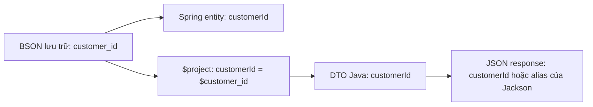

# Alias, biểu thức tính toán và mapping kết quả trong Spring Data MongoDB

## 1. Tại sao cần projection và DTO?

Trong ứng dụng **Spring Data MongoDB**, entity thường biểu diễn đầy đủ dữ liệu lưu trữ, còn một API hoặc màn hình chỉ cần một phần dữ liệu với tên trường dễ hiểu hơn, thậm chí cần các giá trị được **tính từ nhiều trường**. Ví dụ document đơn hàng có `subtotal_cents`, `shipping_cents` và `discount_cents`; màn hình danh sách chỉ muốn nhận `orderId`, `customerId` và `netPayableCents`.

**Projection** là cách lựa chọn hoặc biến đổi các trường đầu ra. **Alias** là tên mới của trường trong kết quả. **DTO** (*Data Transfer Object*) là kiểu Java dành cho việc truyền/đọc dữ liệu, thường không mang toàn bộ trách nhiệm và trạng thái của entity được lưu.

Ba câu hỏi quan trọng cần giải quyết:

1. **MongoDB trả trường nào?** Điều này do `find` projection hoặc các stage như `$project` và `$set`/`$addFields` trong aggregation quyết định.
2. **Tên và kiểu của giá trị tính toán là gì?** Các biểu thức `$add`, `$subtract`, `$ifNull`, `$concat`, `$size`... chạy ở phía MongoDB và tạo BSON result.
3. **Spring Data đọc kết quả vào object Java nào?** `MongoTemplate.aggregate(...)`, repository `@Aggregation` hoặc các loại interface/class projection cần ghép đúng field kết quả với property hoặc constructor của DTO.

Bài thuộc chương **Projection và DTO** này hướng dẫn cùng một yêu cầu nghiệp vụ qua `mongosh`, `MongoTemplate` và repository, phân biệt tính toán trên server với tính toán bằng Java/SpEL, xử lý kiểu dữ liệu, trường thiếu, hiệu năng và kiểm thử. Ví dụ sử dụng số tiền theo **đơn vị nhỏ nhất (cents)** với kiểu số nguyên để tránh lỗi làm tròn `double`; hệ thống thực cần quy tắc đơn vị tiền, thuế và precision riêng.

## 2. Ba loại “alias” rất dễ nhầm

| Cơ chế | Ví dụ | Có hiệu lực ở đâu? | Có đổi dữ liệu đã lưu không? |
|---|---|---|---|
| `@Field("customer_id")` | Java property `customerId` ↔ BSON `customer_id` | Mapping entity Spring Data | Không, chỉ định quy tắc ánh xạ |
| `$project` với `customerId: "$customer_id"` | BSON đầu ra có field `customerId` | Aggregation result phía MongoDB | Không, chỉ tạo kết quả |
| `@JsonProperty("customer_id")` | JSON API trả field tên khác property Java | Jackson/HTTP JSON serialization | Không, không tự thay Spring Data mapping |

Một tên có thể xuất hiện ở nhiều tầng:



Đừng dùng `@Field` chỉ để đổi tên JSON trả về API, hoặc cho rằng `@JsonProperty` sẽ đổi tên field BSON. Khi aggregation trả về một DTO, **tên của trường được project ra** phải khớp cách DTO được materialize, hoặc cần cung cấp mapping/constructor rõ ràng.

## 3. Dữ liệu mẫu và các giá trị cần tính

Trong database thử nghiệm, tạo collection `orders`:

```javascript
db.orders.insertMany([
  {
    _id: "O-101",
    customer_id: "C-01",
    status: "PAID",
    subtotal_cents: NumberLong(15000),
    shipping_cents: NumberLong(1500),
    discount_cents: NumberLong(1000),
    items: [{ sku: "P-A", qty: 2 }, { sku: "P-B", qty: 1 }],
    created_at: ISODate("2026-01-05T10:00:00Z")
  },
  {
    _id: "O-102",
    customer_id: "C-02",
    status: "PAID",
    subtotal_cents: NumberLong(20000),
    shipping_cents: NumberLong(0),
    items: [],
    created_at: ISODate("2026-01-06T10:00:00Z")
  },
  {
    _id: "O-103",
    customer_id: "C-03",
    status: "NEW",
    subtotal_cents: NumberLong(7000),
    shipping_cents: NumberLong(500),
    discount_cents: NumberLong(0),
    items: [{ sku: "P-C", qty: 1 }],
    created_at: ISODate("2026-01-07T10:00:00Z")
  }
]);
```

Quy ước của bài:

- `grossCents = subtotal_cents + shipping_cents`.
- `discountResolvedCents = discount_cents`, hoặc `0` nếu trường thiếu hay null.
- `netPayableCents = grossCents - discountResolvedCents`.
- `lineCount` là **số phần tử** `items`, không phải tổng số lượng `qty`.
- `label = customer_id + " / " + _id`.

Kết quả mong đợi cho các đơn có `status = "PAID"`:

| orderId | customerId | grossCents | discountResolvedCents | netPayableCents | lineCount | label |
|---|---|---:|---:|---:|---:|---|
| O-101 | C-01 | 16500 | 1000 | 15500 | 2 | C-01 / O-101 |
| O-102 | C-02 | 20000 | 0 | 20000 | 0 | C-02 / O-102 |

Đơn `O-103` không thuộc kết quả vì trạng thái khác `PAID`. Document `O-102` cố ý **không có** `discount_cents` để thể hiện cách xử lý missing/null.

## 4. Projection đơn giản: lấy bớt trường và đặt alias

### 4.1. Chọn trường trong find projection

Nếu chỉ cần tên khách hàng và trạng thái, có thể dùng `find` projection trong `mongosh`:

```javascript
db.orders.find(
  { status: "PAID" },
  { customer_id: 1, status: 1, _id: 0 }
);
```

`1` là bao gồm field, `0` là loại trừ field. MongoDB mặc định giữ `_id` khi projection có inclusion, trừ khi ghi rõ `_id: 0`. Trừ ngoại lệ `_id` và một số trường hợp biểu thức được hỗ trợ, không trộn tùy ý inclusion với exclusion trong cùng một projection.

Với `MongoTemplate`:

```java
import java.util.List;
import org.springframework.data.mongodb.core.MongoTemplate;
import org.springframework.data.mongodb.core.query.Criteria;
import org.springframework.data.mongodb.core.query.Query;

Query query = Query.query(Criteria.where("status").is("PAID"));
query.fields()
    .include("customerId")
    .include("status")
    .exclude("id");

List<Order> partialOrders = mongoTemplate.find(query, Order.class);
```

Ví dụ này giả định entity `Order` có `customerId` với `@Field("customer_id")` và `id` với `@Id` như mục 7. Spring Data ánh xạ các property Java thành tên field BSON thích hợp. **Entity đọc bằng projection một phần không phải entity đầy đủ để ghi ngược:** các field không tải có thể null/default; tránh gọi `save` lên một object như vậy rồi vô tình ghi đè dữ liệu.

### 4.2. Alias bằng aggregation `$project`

Nếu cần đổi `customer_id` thành `customerId` trong **kết quả**, dùng aggregation:

```javascript
db.orders.aggregate([
  { $match: { status: "PAID" } },
  {
    $project: {
      _id: 0,
      orderId: "$_id",
      customerId: "$customer_id",
      status: 1
    }
  },
  { $sort: { orderId: 1 } }
]);
```

`orderId` và `customerId` không phải trường đã lưu trong collection; chúng được tạo trong output BSON của `$project`. Ký hiệu `"$customer_id"` là **tham chiếu đến giá trị field**. Nếu viết `customerId: "customer_id"` (không có `$`), MongoDB sẽ tạo chuỗi hằng literal `"customer_id"` thay vì đọc dữ liệu.

### 4.3. Tên field trong stage kế tiếp

Sau `$project`, stage tiếp theo nhìn thấy **các trường đầu ra của projection**, không mặc nhiên thấy toàn bộ document nguồn. Ví dụ:

```javascript
db.orders.aggregate([
  { $project: { _id: 0, orderId: "$_id", customerId: "$customer_id" } },
  { $sort: { customerId: 1 } }
]);
```

Ở đây `$sort` sử dụng `customerId`, không phải `customer_id` vì field gốc đã không được đưa qua `$project`. Nếu cần tính toán với field nguồn sau projection, hãy giữ nó trong output hoặc sắp xếp lại stage.

## 5. Biểu thức tính toán với `$project`

MongoDB aggregation cho phép viết expression làm giá trị đầu ra của `$project`, không chỉ sao chép field.

### 5.1. Tính gross, discount, net và số dòng hàng

```javascript
db.orders.aggregate([
  { $match: { status: "PAID" } },
  {
    $project: {
      _id: 0,
      orderId: "$_id",
      customerId: "$customer_id",
      grossCents: {
        $add: ["$subtotal_cents", "$shipping_cents"]
      },
      discountResolvedCents: {
        $ifNull: ["$discount_cents", NumberLong(0)]
      },
      netPayableCents: {
        $subtract: [
          { $add: ["$subtotal_cents", "$shipping_cents"] },
          { $ifNull: ["$discount_cents", NumberLong(0)] }
        ]
      },
      lineCount: {
        $size: { $ifNull: ["$items", []] }
      },
      label: {
        $concat: ["$customer_id", " / ", "$_id"]
      }
    }
  },
  { $sort: { orderId: 1 } }
]);
```

Giải thích từng biểu thức:

| Biểu thức | Mục đích | Kiểu/kết quả cần lưu ý |
|---|---|---|
| `$add` | Cộng tiền hàng và phí giao | Giữ ngữ nghĩa số BSON; tránh đầu vào string |
| `$ifNull` | Thay missing/null bằng giá trị mặc định | Không tự xử lý field sai kiểu |
| `$subtract` | Gross trừ discount | Không tự hiểu đơn vị tiền hoặc quy tắc làm tròn |
| `$size` | Đếm phần tử mảng `items` | Yêu cầu đầu vào là array; fallback `[]` chỉ xử lý null/missing |
| `$concat` | Ghép nhãn hiển thị | Nếu một thành phần null/missing, kết quả có thể null |
| `$project` | Đặt tên và chọn trường output | Không ghi lại vào collection nguồn |

**Không viện dẫn alias mới ngay trong biểu thức khác của cùng stage `$project`** như thể đó là biến cục bộ. Ví dụ `netPayableCents: { $subtract: ["$grossCents", ...] }` ở cùng `$project` với `grossCents` không đảm bảo lấy được `grossCents` vừa tính. Trong ví dụ trên, biểu thức `$add` được viết lại rõ ràng để tham chiếu trực tiếp các trường nguồn.

### 5.2. Dùng `$set` trước, `$project` sau để tránh lặp công thức

`$set` là alias của `$addFields`. Nó **thêm hoặc thay thế field trong document đang chảy qua pipeline**, giữ các field khác còn lại; `$project` sau đó chọn output cuối cùng.

```javascript
db.orders.aggregate([
  { $match: { status: "PAID" } },
  {
    $set: {
      grossCents: { $add: ["$subtotal_cents", "$shipping_cents"] },
      discountResolvedCents: {
        $ifNull: ["$discount_cents", NumberLong(0)]
      }
    }
  },
  {
    $project: {
      _id: 0,
      orderId: "$_id",
      customerId: "$customer_id",
      grossCents: 1,
      discountResolvedCents: 1,
      netPayableCents: {
        $subtract: ["$grossCents", "$discountResolvedCents"]
      },
      lineCount: {
        $size: { $ifNull: ["$items", []] }
      },
      label: {
        $concat: ["$customer_id", " / ", "$_id"]
      }
    }
  },
  { $sort: { orderId: 1 } }
]);
```

Ở pipeline này, `grossCents` và `discountResolvedCents` là field đã được stage `$set` trước đó tạo ra, nên stage `$project` được phép tham chiếu chúng. Cần phân biệt **`$set` stage của aggregation** với lệnh update dữ liệu: ở đây chỉ đang biến đổi dữ liệu **trong pipeline**, không thay đổi document lưu trong `orders`.

## 6. DTO kết quả cần khớp tên và kiểu dữ liệu

MongoDB trả kết quả của `aggregate` dưới dạng BSON document. Spring Data MongoDB có thể chuyển chúng thành `org.bson.Document`, một class Java hoặc một `record`/DTO phù hợp với constructor và mapping. DTO kết quả **không cần** là entity có `@Document` và không cần có cùng danh sách trường với document nguồn.

Giả sử yêu cầu đầy đủ của mục 5 được thể hiện bằng record Java:

```java
public record OrderCard(
    String orderId,
    String customerId,
    long grossCents,
    long discountResolvedCents,
    long netPayableCents,
    int lineCount,
    String label
) {}
```

Để materialize record này, kết quả pipeline cần có các field:

```json
{
  "orderId": "O-101",
  "customerId": "C-01",
  "grossCents": 16500,
  "discountResolvedCents": 1000,
  "netPayableCents": 15500,
  "lineCount": 2,
  "label": "C-01 / O-101"
}
```

Các giá trị JSON ở trên chỉ minh họa hình dạng kết quả; trong BSON, số nguyên có thể thuộc kiểu `Int32` hoặc `Int64` tùy input và phép toán. Ứng dụng phải xác định trước kiểu Java mong muốn. Chẳng hạn `$size` trả về số phần tử array, thường có thể ánh xạ vào `int`; số tiền tính từ các giá trị `NumberLong` được ánh xạ phù hợp vào `long`.

**Nguyên tắc quan trọng:**

- Alias `orderId` phải khớp constructor parameter/property `orderId`; MongoDB không tự biết alias đó tương ứng với `@Id String id` của entity gốc.
- `@Field` ở entity đầu vào giải thích cách đọc schema lưu trữ. Nó không tự tạo các alias tùy ý trong kết quả aggregation.
- Khi một field đầu ra có thể vắng hoặc null, cân nhắc DTO dùng `Long`/`Integer` thay vì primitive `long`/`int` để nhận biết trạng thái thiếu; tốt hơn là xử lý missing/null tường minh bằng expression.
- DTO nên là đối tượng **chỉ đọc** cho kết quả truy vấn, không gọi `save` lên DTO như thể nó là entity đã tải đầy đủ.
- Với DTO bất biến, tên tham số và constructor phải được Spring Data nhận diện đúng theo phiên bản đang dùng; Java record giúp biểu diễn hợp đồng đầu ra rõ ràng.

### 6.1. Không mặc nhiên ánh xạ `_id` thành `id` trong mọi DTO

Raw aggregation thường giữ `_id` nếu không loại trừ. Với DTO có thuộc tính `orderId`, cách rõ ràng là:

```javascript
{
  $project: {
    _id: 0,
    orderId: "$_id"
  }
}
```

Nếu cố đọc trực tiếp `_id` vào constructor parameter `orderId` mà không alias hoặc mapping phù hợp, kết quả có thể thiếu dữ liệu hoặc ánh xạ sai. Hãy kiểm tra raw output và thiết kế alias rõ ràng thay vì dựa vào suy đoán.

## 7. Entity đầu vào và typed aggregation của Spring Data

### 7.1. Khai báo entity tương ứng với schema lưu trữ

Ví dụ Java cho `orders` (các class trong từng khối được xem là file Java riêng):

```java
import java.time.Instant;
import java.util.List;
import org.springframework.data.annotation.Id;
import org.springframework.data.mongodb.core.mapping.Document;
import org.springframework.data.mongodb.core.mapping.Field;

@Document(collection = "orders")
public class Order {
    @Id
    private String id;

    @Field("customer_id")
    private String customerId;

    private String status;

    @Field("subtotal_cents")
    private long subtotalCents;

    @Field("shipping_cents")
    private long shippingCents;

    @Field("discount_cents")
    private Long discountCents;

    private List<OrderLine> items;

    @Field("created_at")
    private Instant createdAt;

    protected Order() {}

    public String getId() { return id; }
    public String getCustomerId() { return customerId; }
    public String getStatus() { return status; }
    public long getSubtotalCents() { return subtotalCents; }
    public long getShippingCents() { return shippingCents; }
    public Long getDiscountCents() { return discountCents; }
    public List<OrderLine> getItems() { return items; }
    public Instant getCreatedAt() { return createdAt; }
}

record OrderLine(String sku, int qty) {}
```

`@Field("customer_id")` và các annotation tương tự để Spring Data ánh xạ property Java `customerId`, `subtotalCents`... tới field BSON. Constructor và khả năng ánh xạ kiểu `OrderLine` cần phù hợp Spring Data MongoDB/Java version của dự án.

Vì `discount_cents` ở `O-102` không tồn tại, entity dùng `Long discountCents` thay vì `long` để không đồng nhất “không có giá trị” với số 0 trong object Java. Việc chọn mặc định 0 cho báo cáo được thể hiện **tại pipeline**, không áp đặt khi đọc mọi entity.

### 7.2. Typed aggregation bằng ProjectionOperation

Một DTO nhỏ chỉ cần alias và phép cộng:

```java
public record OrderGrossView(
    String orderId,
    String customerId,
    long grossCents
) {}
```

Sử dụng Spring Data Aggregation DSL:

```java
import java.util.List;
import org.springframework.data.domain.Sort;
import org.springframework.data.mongodb.core.MongoTemplate;
import org.springframework.data.mongodb.core.aggregation.Aggregation;
import org.springframework.data.mongodb.core.aggregation.AggregationResults;
import org.springframework.data.mongodb.core.query.Criteria;

Aggregation pipeline = Aggregation.newAggregation(
    Aggregation.match(Criteria.where("status").is("PAID")),
    Aggregation.project()
        .and("id").as("orderId")
        .and("customerId").as("customerId")
        .andExpression("subtotalCents + shippingCents").as("grossCents")
        .andExclude("_id"),
    Aggregation.sort(Sort.Direction.ASC, "orderId")
);

AggregationResults<OrderGrossView> result =
    mongoTemplate.aggregate(pipeline, Order.class, OrderGrossView.class);

List<OrderGrossView> cards = result.getMappedResults();
```

Trong lời gọi `aggregate(pipeline, Order.class, OrderGrossView.class)`, `Order.class` cung cấp **kiểu đầu vào** cho Spring Data mapping. Biểu thức DSL tham chiếu **tên property Java** (như `subtotalCents` và `shippingCents`); Spring chuyển sang tên trường BSON tương ứng ở giai đoạn tạo lệnh. `OrderGrossView.class` là **kiểu của kết quả**.

`andExpression(...)` dùng cú pháp expression do Spring Data chuyển thành biểu thức aggregation tương ứng. Với những công thức đơn giản, nó giúp code dễ đọc; với công thức có nhiều `$ifNull`, `$cond`, array và kiểu BSON phức tạp, có thể dùng các builder API chuyên biệt hoặc stage BSON tường minh.

**Kiểm tra pipeline thực tế** khi sử dụng `@Field`, nested property, phiên bản Spring Data khác nhau hay converter tùy chỉnh. Không lấy mẫu BSON viết cho `mongosh` rồi cho rằng mọi chuỗi field trong DSL đều được ánh xạ giống nhau trong tất cả các loại `AggregationOperation`.

### 7.3. Chú ý phạm vi alias sau `$project`

Sau khi đặt alias `customerId`, `orderId` và `grossCents`, stage `sort` trong ví dụ dùng `orderId` là tên kết quả. Nếu sau đó viết:

```java
Aggregation.sort(Sort.Direction.ASC, "subtotalCents")
```

thì `subtotalCents` không còn trong output projection trước đó, trừ khi bạn cũng giữ nó lại. Một pipeline có thể hợp lệ về cú pháp nhưng trả giá trị sai hoặc sort không có ý nghĩa khi tham chiếu field đã bị loại.

## 8. MongoTemplate với raw BSON stage để kiểm soát biểu thức

Với các phép tính có nhiều nhánh hoặc có yêu cầu đối chiếu trực tiếp với `mongosh`, có thể xây `AggregationOperation` dạng `Document`. Ví dụ dưới đây tính gross và dùng `$ifNull` để tính net, trả về DTO ba trường:

```java
import java.util.List;
import org.bson.Document;
import org.springframework.data.domain.Sort;
import org.springframework.data.mongodb.core.aggregation.Aggregation;
import org.springframework.data.mongodb.core.aggregation.AggregationOperation;
import org.springframework.data.mongodb.core.aggregation.AggregationResults;
import org.springframework.data.mongodb.core.query.Criteria;

AggregationOperation rawProjection = context -> new Document(
    "$project",
    new Document("_id", 0)
        .append("orderId", "$_id")
        .append("customerId", "$customer_id")
        .append("grossCents",
            new Document("$add",
                List.of("$subtotal_cents", "$shipping_cents")))
        .append("netPayableCents",
            new Document("$subtract", List.of(
                new Document("$add",
                    List.of("$subtotal_cents", "$shipping_cents")),
                new Document("$ifNull",
                    List.of("$discount_cents", 0L))
            )))
);

Aggregation pipeline = Aggregation.newAggregation(
    Aggregation.match(Criteria.where("status").is("PAID")),
    rawProjection,
    Aggregation.sort(Sort.Direction.ASC, "orderId")
);

AggregationResults<OrderAmountView> result =
    mongoTemplate.aggregate(pipeline, "orders", OrderAmountView.class);
```

DTO tương ứng:

```java
public record OrderAmountView(
    String orderId,
    String customerId,
    long grossCents,
    long netPayableCents
) {}
```

**Khác biệt quan trọng:** raw stage được dựng bằng `new Document("$project", ...)` không nhất thiết đi qua toàn bộ cơ chế chuyển property Java thành field BSON của typed DSL. Vì thế code **cố ý dùng field BSON vật lý** `customer_id`, `subtotal_cents`, `shipping_cents`, `discount_cents`. Nếu đổi `@Field` hoặc schema lưu trữ, phải cập nhật các raw stage tương ứng.

Điểm mạnh của cách này là biểu thức BSON hiển thị rất rõ và dễ so với pipeline chạy trong `mongosh`. Điểm yếu là dài hơn, dễ lỗi tên field và khó refactor hơn. Với logic thông dụng, nên cân nhắc API `Aggregation.project()`, `ArithmeticOperators`, `ConditionalOperators` và `ArrayOperators` phù hợp với phiên bản Spring Data đang dùng.

## 9. Repository @Aggregation trả trực tiếp DTO

Nếu pipeline cố định và muốn API repository ngắn gọn, Spring Data MongoDB cho phép khai báo `@Aggregation` trên method. Ví dụ:

```java
import java.util.List;
import org.springframework.data.mongodb.repository.Aggregation;
import org.springframework.data.mongodb.repository.MongoRepository;

public interface OrderReportRepository
        extends MongoRepository<Order, String> {

    @Aggregation(pipeline = {
        "{ '$match': { 'status': ?0 } }",
        "{ '$project': { '_id': 0, " +
            "'orderId': '$_id', " +
            "'customerId': '$customer_id', " +
            "'grossCents': { '$add': " +
                "['$subtotal_cents', '$shipping_cents'] } } }",
        "{ '$sort': { 'orderId': 1 } }"
    })
    List<OrderGrossView> findGrossViewsByStatus(String status);
}
```

Lời gọi:

```java
List<OrderGrossView> paid =
    orderReportRepository.findGrossViewsByStatus("PAID");
```

`?0` tham chiếu tham số thứ nhất của method. Repository xử lý bind giá trị tham số theo cơ chế Spring Data, tránh tự nối trực tiếp chuỗi đầu vào thành JSON query. Các stage `$project` trong ví dụ vẫn cần biểu diễn đúng alias của kết quả và schema lưu trữ.

Ưu điểm: khai báo gọn cho truy vấn báo cáo nhỏ, ít thay đổi. Hạn chế: pipeline phức tạp trong chuỗi annotation dễ khó đọc, khó refactor và có nguy cơ dùng tên trường BSON sai. Với nhiều stage hay business rule phức tạp, đặt chúng trong một lớp repository custom/service dùng `MongoTemplate` thường dễ kiểm thử và bảo trì hơn.

**Phân biệt:** tên `@Aggregation` của Spring Data repository không phải `@Query` dành cho truy vấn find, và cũng không phải interface projection. `@Aggregation` chạy pipeline MongoDB; kết quả được materialize vào kiểu trả về được khai báo.

## 10. Interface projection, DTO projection và biểu thức SpEL

Không phải lúc nào cũng cần một aggregation pipeline. Spring Data repository hỗ trợ **interface-based projection** và **class-based projection** cho những trường hợp chỉ muốn đọc một tập con của entity.

### 10.1. Closed interface projection: chọn các thuộc tính đã có

Ví dụ interface:

```java
public interface OrderCompactView {
    String getId();
    String getCustomerId();
    String getStatus();

    default String getShortLabel() {
        return getCustomerId() + " / " + getId();
    }
}
```

Repository:

```java
import java.util.List;
import org.springframework.data.mongodb.repository.MongoRepository;

public interface OrderCompactRepository
        extends MongoRepository<Order, String> {

    List<OrderCompactView> findByStatus(String status);
}
```

Các getter `getId`, `getCustomerId`, `getStatus` tương ứng với property của `Order`. `getShortLabel` là **default method Java**, nối hai giá trị có sẵn. Vì chỉ phụ thuộc vào getter của projection, cấu trúc này có thể cho phép Spring tối ưu tập trường đọc nếu hạ tầng/phiên bản hỗ trợ.

Đây **không phải** phép `$concat` chạy phía MongoDB. `getShortLabel` chỉ chạy khi ứng dụng gọi method trên object projection đã được dựng.

### 10.2. Open projection với @Value SpEL

Spring Data hỗ trợ viết SpEL trên getter của interface projection:

```java
import org.springframework.beans.factory.annotation.Value;

public interface OrderOpenView {
    String getCustomerId();
    String getStatus();

    @Value("#{target.customerId + ' / ' + target.status}")
    String getSummary();
}
```

`target` trong biểu thức trên tham chiếu object nền của projection theo cơ chế Spring Data. `getSummary` là giá trị được tính **ở phía ứng dụng**, không phải một field do MongoDB tạo bằng `$project`. Vì SpEL có thể truy cập những thuộc tính tùy ý của target, **open projection thường khó tối ưu việc chỉ tải đúng các field cần thiết** như closed projection.

Không dùng `@Value` như một cách thay thế mặc định cho một phép tính báo cáo trên hàng triệu document. Khi cần filter, sort, group hoặc tổng hợp theo kết quả đã tính, ưu tiên tính toán trên server bằng aggregation nếu phù hợp.

### 10.3. Class-based projection theo constructor

DTO đơn giản có thể dùng Java record:

```java
public record OrderBasicDto(
    String customerId,
    String status
) {}
```

Khi repository hỗ trợ class-based projection cho entity, các tham số constructor phù hợp với property được lựa chọn; ví dụ có thể khai báo:

```java
List<OrderBasicDto> findByStatus(String status);
```

Tùy loại truy vấn, Spring Data có thể dùng metadata constructor để xác định tập field cần đọc. Khác với interface projection, class-based DTO thường không dùng nested projection thông qua interface theo cùng cơ chế. Với record chứa alias tính toán **không tồn tại trong entity**, chẳng hạn `grossCents` hay `netPayableCents`, cần tạo chúng ở pipeline `$project` rồi map output, thay vì mặc định trông chờ derived query tìm được property tương ứng.

### 10.4. Bảng chọn cơ chế theo yêu cầu

| Nhu cầu | Cơ chế xem xét trước | Điều cần cảnh giác |
|---|---|---|
| Chỉ lấy vài property đã có | Closed interface projection / constructor DTO | Getter hoặc constructor phải khớp property entity |
| Ghép chuỗi nhỏ sau khi đọc vài field | Default method interface projection | Giá trị tính ở Java, không dùng để filter/sort ở DB |
| Tính toán linh hoạt từ object đã đọc | Open projection + `@Value` SpEL | Có thể giảm khả năng tối ưu field selection |
| Đổi field BSON thành alias trả về | Aggregation `$project` | Tên alias phải khớp DTO kết quả |
| Tính gross, net, count, label tại server | `$project`, `$set`, aggregation expressions | Kiểu BSON, missing/null, index và chi phí pipeline |
| Nhóm và tổng hợp theo customer | `$group` + `$project` | `_id` của kết quả group khác `_id` document nguồn |
| Dữ liệu đầu ra cố định qua repository | `@Aggregation` trả DTO | Chuỗi JSON dài khó bảo trì, phải test pipeline |
| Điều kiện linh hoạt/ nhiều stage | Custom repository với `MongoTemplate` | Cấu hình mapping property path và raw BSON phải nhất quán |

## 11. Missing, null, kiểu BSON và phép tính an toàn

### 11.1. Vì sao cần $ifNull?

Trong dữ liệu mẫu, `O-102` không có `discount_cents`. Nếu dùng:

```javascript
{
  $project: {
    netPayableCents: {
      $subtract: [
        { $add: ["$subtotal_cents", "$shipping_cents"] },
        "$discount_cents"
      ]
    }
  }
}
```

thì dữ liệu thiếu/null có thể làm kết quả phép tính trở thành null. Một DTO có primitive `long netPayableCents` sẽ không phản ánh đúng khoản tiền phải thu nếu ứng dụng mặc định coi null là 0 hoặc gặp lỗi materialization.

Đưa ra quy tắc nghiệp vụ tường minh:

```javascript
{
  $ifNull: ["$discount_cents", NumberLong(0)]
}
```

Trong ngữ nghĩa MongoDB aggregation, `$ifNull` xử lý giá trị null và những trường không tồn tại theo fallback. Nó không tự biến một String như `"1000"` thành NumberLong; nếu dữ liệu sai kiểu, cần migration hoặc validation riêng.

### 11.2. $size chỉ chấp nhận array

`$ifNull` hữu ích nếu `items` thiếu hoặc null:

```javascript
lineCount: { $size: { $ifNull: ["$items", []] } }
```

Nhưng nếu document lỗi schema có `items: "not-an-array"`, `$size` vẫn có thể báo lỗi vì đầu vào không phải array. Khi collection chứa dữ liệu legacy không đồng nhất, có thể kiểm tra kiểu trước:

```javascript
lineCount: {
  $cond: [
    { $isArray: "$items" },
    { $size: "$items" },
    0
  ]
}
```

Đoạn này chọn 0 với dữ liệu không phải array, nhưng đó là **quyết định nghiệp vụ**: trong nhiều hệ thống nên báo lỗi và sửa schema thay vì âm thầm che dữ liệu sai.

### 11.3. Ghép chuỗi, chuyển kiểu và hiển thị

`$concat` ghép chuỗi nhưng một thành phần null/missing có thể khiến kết quả null. Nếu muốn nhãn hiển thị luôn có nội dung, cần fallback và quy tắc định dạng rõ ràng:

```javascript
label: {
  $concat: [
    { $ifNull: ["$customer_id", "UNKNOWN"] },
    " / ",
    { $toString: "$_id" }
  ]
}
```

Trong dữ liệu mẫu `_id` đã là String; dùng `$toString` chỉ để thể hiện cách chuẩn hóa đầu vào khi ID có thể là một kiểu BSON khác. Những phép chuyển kiểu có thể gặp lỗi hoặc trả null tùy giá trị; xử lý những schema đặc biệt bằng `$convert` với `onError`/`onNull` khi cần và có chính sách dữ liệu phù hợp.

Nếu tính tiền bằng Decimal128 thay vì NumberLong, phải nhất quán kiểu số khi `$add`/`$subtract`, không gửi String là giá trị tiền. Với phần trăm hoặc chia, xét quy tắc làm tròn và chuyển đổi kiểu; **định dạng tiền để hiển thị theo locale** thường nên được xử lý tại tầng API/UI, không biến kiểu số thành String quá sớm nếu còn phải sort/tổng hợp.

### 11.4. DTO dùng primitive hay wrapper?

| Field output | DTO type ví dụ | Khi nào nên dùng |
|---|---|---|
| `grossCents` | `long` | Pipeline bảo đảm kết quả là số và không null |
| `discountResolvedCents` | `long` | Pipeline đã dùng `$ifNull` để có mặc định 0 |
| `lineCount` | `int` | Pipeline bảo đảm là array hoặc fallback an toàn |
| `netPayableCents` | `Long` | Chưa thể bảo đảm có kết quả; muốn phát hiện missing/null |
| `label` | `String` | Đúng loại sau `$concat`/`$toString` |

Nếu chọn primitive mà output missing, conversion có thể thất bại hoặc đưa ra giá trị mặc định không phản ánh lỗi dữ liệu. Phải kiểm thử **cả hình dạng BSON và giá trị Java**, thay vì chỉ kiểm tra API trả HTTP 200.

## 12. Tổng hợp nhiều document: alias sau $group

Nhiều báo cáo cần tổng tiền theo khách hàng, không chỉ giá trị của từng đơn. Khi đó có thể tính net cho từng document, `$group` theo customer rồi `$project` alias đầu ra:

```javascript
db.orders.aggregate([
  { $match: { status: "PAID" } },
  {
    $set: {
      netPayableCents: {
        $subtract: [
          { $add: ["$subtotal_cents", "$shipping_cents"] },
          { $ifNull: ["$discount_cents", NumberLong(0)] }
        ]
      }
    }
  },
  {
    $group: {
      _id: "$customer_id",
      orderCount: { $sum: 1 },
      totalNetCents: { $sum: "$netPayableCents" }
    }
  },
  {
    $project: {
      _id: 0,
      customerId: "$_id",
      orderCount: 1,
      totalNetCents: 1
    }
  },
  { $sort: { customerId: 1 } }
]);
```

Trong stage `$group`, `_id` **là khóa nhóm** `customer_id`, không còn mang ý nghĩa ID từng order. Stage cuối chuyển khóa nhóm thành `customerId` và loại `_id` khỏi kết quả. DTO phù hợp:

```java
public record CustomerRevenue(
    String customerId,
    int orderCount,
    long totalNetCents
) {}
```

Với dữ liệu mẫu, kết quả có hai dòng: `C-01` tổng 15500 cents và `C-02` tổng 20000 cents, mỗi khách hàng có `orderCount=1`. Nếu một customer có nhiều order, `totalNetCents` là tổng theo nhóm. Đừng gộp nhiều loại tiền tệ vào một tổng nếu collection chứa nhiều currency; cần nhóm theo currency hoặc đổi sang cùng đơn vị bằng tỷ giá với quy tắc xác định.

**Lưu ý về alias qua các stage:** `totalNetCents` chỉ tồn tại sau `$group`; muốn lọc theo ngưỡng tổng tiền phải có `$match` **sau `$group`**, ví dụ `{ $match: { totalNetCents: { $gte: 20000 } } }`. Ngược lại, điều kiện `status: "PAID"` nên lọc trước khi group để giảm số document đầu vào.

## 13. Projection ảnh hưởng hiệu năng như thế nào?

### 13.1. Lấy ít dữ liệu không tự động làm query tối ưu

Projection có thể giảm lượng dữ liệu trả về qua mạng và chi phí materialize đối tượng Java, nhưng chi phí tổng vẫn phụ thuộc truy vấn, index, sort, aggregation và số document đã xem xét. Một phép `$project` tạo ít field hơn không bảo đảm server không phải đọc full document hoặc không phải quét nhiều keys.

Ví dụ index cho điều kiện lọc và thứ tự thời gian:

```javascript
db.orders.createIndex(
  { status: 1, created_at: -1 },
  { name: "ix_orders_status_created" }
);
```

Pipeline liệt kê đơn được thanh toán theo thời gian:

```javascript
db.orders.aggregate([
  { $match: { status: "PAID" } },
  { $sort: { created_at: -1 } },
  { $limit: 20 },
  {
    $project: {
      _id: 0,
      orderId: "$_id",
      customerId: "$customer_id"
    }
  }
]);
```

Khi `$match` và `$sort` phù hợp index, MongoDB có cơ hội dùng index trước khi materialize projection. Có những trường hợp optimizer tự sắp lại stage, nhưng **không nên dựa vào nó để sửa một pipeline sai logic** hoặc kỳ vọng mọi biểu thức được đẩy xuống index.

### 13.2. Sort theo computed alias cần lưu ý

Ví dụ:

```javascript
db.orders.aggregate([
  {
    $set: {
      grossCents: { $add: ["$subtotal_cents", "$shipping_cents"] }
    }
  },
  { $sort: { grossCents: -1 } },
  { $limit: 10 }
]);
```

`grossCents` là trường được tính trong pipeline, không tồn tại trong collection. Index B-tree trên `subtotal_cents` hoặc `shipping_cents` **không tự trở thành index trên tổng**. Nếu workload rất lớn và thường xuyên sort/filter theo gross, có thể cân nhắc materialized/computed field được duy trì khi ghi, tạo index trên trường đó, hoặc xây báo cáo tính trước. Quyết định này đánh đổi chi phí ghi và tính nhất quán để giảm chi phí đọc.

### 13.3. Đo pipeline bằng explain

Trong `mongosh`:

```javascript
db.orders.explain("executionStats").aggregate([
  { $match: { status: "PAID" } },
  {
    $project: {
      _id: 0,
      orderId: "$_id",
      grossCents: { $add: ["$subtotal_cents", "$shipping_cents"] }
    }
  }
]);
```

Tùy phiên bản MongoDB và kế hoạch được chọn, quan sát `winningPlan`, `IXSCAN`/`COLLSCAN`, số lượng keys/documents đã duyệt, số kết quả trả về và latency. Trên collection chỉ có ba document, `COLLSCAN` có thể vẫn được chọn; cần đo trên dữ liệu đủ lớn và phân bố tương tự production trước khi kết luận.

Các cân nhắc khác:

- Dùng `$match` theo tenant/authorization **trước** khi trả kết quả để không truy xuất dữ liệu của tenant khác.
- Giới hạn result bằng `$limit` và phân trang phù hợp. `$skip` sâu có thể tốn chi phí; với báo cáo thời gian thực, cân nhắc keyset/range pagination.
- Không dùng `$project` như **biện pháp bảo mật duy nhất**. Quyền truy cập collection, điều kiện lọc tenant và chính sách dữ liệu phải được thực thi riêng.
- Với báo cáo có `$group` lớn, cần cân nhắc memory, disk usage và workload của cluster; không tăng connection pool để giải quyết một pipeline tính toán quá nặng.
- Nếu cùng báo cáo được dùng thường xuyên, cân nhắc cache, materialized view hoặc data pipeline có kiểm soát thay vì tính lại toàn bộ mỗi request.

## 14. Kiểm thử từ BSON đến DTO

Một bài test tốt cần chứng minh được **ba tầng**: dữ liệu BSON nguồn, kết quả pipeline BSON có alias đúng, và object Java được ánh xạ đúng kiểu/giá trị.

### 14.1. Dựng raw output để kiểm tra field names

Với pipeline raw ở mục 8, trước khi trả `OrderAmountView` có thể tạm yêu cầu kết quả `Document.class`:

```java
AggregationResults<org.bson.Document> rawResult =
    mongoTemplate.aggregate(pipeline, "orders", org.bson.Document.class);

for (org.bson.Document resultDoc : rawResult.getMappedResults()) {
    System.out.println(resultDoc.toJson());
}
```

Kiểm tra raw result có `orderId`, `customerId`, `grossCents` và `netPayableCents`, đồng thời không có `_id` do đã `_id: 0`. Đừng suy đoán tên alias từ tên Java record khi chưa nhìn output BSON. Hạn chế log dữ liệu nhạy cảm trong production; đây là ví dụ dành cho môi trường kiểm thử.

### 14.2. Integration test với MongoDB thật

Ví dụ JUnit 5 và AssertJ, giả sử một môi trường Spring Boot test có `MongoTemplate`, entity `Order` và record `OrderGrossView` ở các mục trước:

```java
import java.util.List;
import org.bson.Document;
import org.junit.jupiter.api.BeforeEach;
import org.junit.jupiter.api.Test;
import org.springframework.beans.factory.annotation.Autowired;
import org.springframework.boot.test.autoconfigure.data.mongo.DataMongoTest;
import org.springframework.data.domain.Sort;
import org.springframework.data.mongodb.core.MongoTemplate;
import org.springframework.data.mongodb.core.aggregation.Aggregation;
import org.springframework.data.mongodb.core.query.Criteria;

import static org.assertj.core.api.Assertions.assertThat;

@DataMongoTest
class OrderProjectionTest {
    @Autowired
    MongoTemplate template;

    @BeforeEach
    void seed() {
        // Chỉ xóa dữ liệu trong database test được cô lập.
        template.getCollection("orders").deleteMany(new Document());

        template.getCollection("orders").insertMany(List.of(
            new Document("_id", "O-101")
                .append("customer_id", "C-01")
                .append("status", "PAID")
                .append("subtotal_cents", 15000L)
                .append("shipping_cents", 1500L)
                .append("discount_cents", 1000L),
            new Document("_id", "O-102")
                .append("customer_id", "C-02")
                .append("status", "PAID")
                .append("subtotal_cents", 20000L)
                .append("shipping_cents", 0L),
            new Document("_id", "O-103")
                .append("customer_id", "C-03")
                .append("status", "NEW")
                .append("subtotal_cents", 7000L)
                .append("shipping_cents", 500L)
        ));
    }

    @Test
    void aliasesAndComputedGrossMapToRecord() {
        Aggregation aggregation = Aggregation.newAggregation(
            Aggregation.match(Criteria.where("status").is("PAID")),
            Aggregation.project()
                .and("id").as("orderId")
                .and("customerId").as("customerId")
                .andExpression("subtotalCents + shippingCents")
                    .as("grossCents")
                .andExclude("_id"),
            Aggregation.sort(Sort.Direction.ASC, "orderId")
        );

        List<OrderGrossView> cards =
            template.aggregate(
                aggregation, Order.class, OrderGrossView.class)
                .getMappedResults();

        assertThat(cards)
            .extracting(OrderGrossView::orderId)
            .containsExactly("O-101", "O-102");

        assertThat(cards)
            .extracting(OrderGrossView::customerId)
            .containsExactly("C-01", "C-02");

        assertThat(cards)
            .extracting(OrderGrossView::grossCents)
            .containsExactly(16500L, 20000L);
    }
}
```

Test này nhằm kiểm tra mapping `id → _id`, `customerId → customer_id`, phép cộng và alias output. Phiên bản cụ thể của Spring Boot có thể khác package của `@DataMongoTest` hoặc cách khởi tạo test context; cần đối chiếu dependency. Không dùng `deleteMany(new Document())` trên database dùng chung vì lệnh sẽ xóa toàn bộ collection.

### 14.3. Bộ ca kiểm thử tối thiểu

| Ca kiểm thử | Kết quả cần xác minh |
|---|---|
| Hai đơn `PAID` | Pipeline chỉ trả `O-101`, `O-102` |
| Tên field nguồn `customer_id` | Kết quả có `customerId` đúng giá trị |
| `_id: 0` và `orderId: "$_id"` | Không có `_id` output, có `orderId` đúng |
| `$add` và `$subtract` | Gross/net lần lượt 16500/15500 và 20000/20000 |
| Discount missing | `$ifNull` đặt giá trị 0, không có kết quả null |
| `items: []` | `lineCount=0` |
| `items` không phải array | Hành vi lỗi hoặc fallback được kiểm soát |
| Field đã alias rồi sort | Sort dùng field alias sau projection |
| DTO constructor thiếu một alias | Phát hiện mapping sai hoặc dữ liệu không mong đợi |
| Field đầu ra là BSON Double thay Long | Có quy tắc conversion/validation rõ ràng |
| Raw pipeline khác typed DSL | Hai pipeline cho ra kết quả nhất quán theo hợp đồng |
| Truy cập nhiều tenant | Điều kiện tenant được áp dụng trước khi trả dữ liệu |

Với Java record có trường primitive, đặc biệt cần test trường bị bỏ sót; tránh lỗi bị che khuất bởi giá trị mặc định của kiểu nguyên thủy. Test `MongoTemplate.aggregate(...)` và test repository `@Aggregation` nếu cả hai đường được dùng trong dự án.

## 15. Những lỗi thiết kế thường gặp

| Sai lầm | Hậu quả | Cách khắc phục |
|---|---|---|
| Dùng `@Field` trên entity để kỳ vọng đổi tên JSON API | Đổi logic ánh xạ BSON chứ không phải tên API | Đặt alias kết quả ở `$project` hoặc tầng JSON phù hợp |
| DTO có `getTotal()` nhưng output alias là `grossCents` | Không có giá trị để map vào property | Đồng bộ tên field output và DTO/constructor |
| `$project` quên `_id: 0` | Kết quả còn field `_id` ngoài ý định | Loại `_id` khi hợp đồng đầu ra không cần |
| Trong cùng `$project` dùng `"$grossCents"` vừa được tính | Tham chiếu chưa tồn tại ở input stage | Lặp biểu thức hoặc thêm `$set` ở stage trước |
| Dùng tên Java `customerId` trong raw `Document` stage | MongoDB đọc nhầm field không tồn tại | Dùng `customer_id`, hoặc typed DSL có mapping |
| `$size` trên field String legacy | Aggregation lỗi vì không phải array | Validate schema, dùng `$isArray` nếu cần fallback |
| Thiếu `$ifNull` cho discount | Tổng tiền bị null, DTO không nhất quán | Định nghĩa fallback nghiệp vụ rõ ràng |
| Dùng primitive cho giá trị có thể missing | Mất thông tin null hoặc lỗi materialization | Dùng wrapper/validation hoặc bảo đảm output đầy đủ |
| Dùng `@Value` SpEL rồi tin rằng MongoDB đã tính | Có thể tải nhiều dữ liệu và không filter/sort bằng result đó | Phân biệt client-side với aggregation server-side |
| Gọi `save(...)` trên DTO projection | Có thể ghi đè/thay thế document sai ý định | DTO chỉ đọc, update qua entity hoặc atomic update riêng |
| Sort theo field tính toán và kỳ vọng dùng index thường | Có thể phải tính/sort nhiều document | Materialize/index giá trị nếu workload đòi hỏi |
| Project dữ liệu rồi bỏ qua authorization | Nguy cơ rò rỉ dữ liệu khác tenant | Kiểm soát quyền và `$match` đúng phạm vi |

Khi kết quả sai, hãy chẩn đoán theo thứ tự: **BSON nguồn → pipeline đang chạy → raw BSON output → conversion sang DTO → JSON API**. Cách này tách được lỗi tên field, lỗi công thức, lỗi null/kiểu và lỗi serialization ở tầng trả API.

## 16. Thực hành tổng hợp

**Bối cảnh:** thiết kế endpoint danh sách đơn hàng đã thanh toán. Kết quả chỉ có ID, khách hàng, tổng tiền phải thu, số dòng hàng và nhãn hiển thị. MongoDB lưu tiền hàng/ship/discount trong ba field khác nhau.

1. Tạo dữ liệu ở mục 3 trong database test.
2. Viết pipeline `$match + $project` theo mục 5, kiểm tra kết quả hai đơn `PAID` và tính toán đúng giá trị.
3. Viết lại thành `$match + $set + $project` để tránh lặp biểu thức gross, giải thích sự khác nhau giữa hai pipeline.
4. Khai báo entity `Order` với `@Field` và record `OrderGrossView`. Dùng typed `MongoTemplate.aggregate(...)` tạo alias và tính gross.
5. Tạo `OrderReportRepository` có `@Aggregation`, đọc dữ liệu thành cùng record `OrderGrossView` và đối chiếu kết quả.
6. Dùng `OrderCard` với đầy đủ output: net, discount mặc định, lineCount và label; kiểm tra raw BSON trước khi ánh xạ DTO.
7. Thử thêm document có `discount_cents: null`, thiếu `items` hoặc `items` sai kiểu; quyết định chính sách xử lý cho từng tình huống.
8. Tính tổng theo khách hàng bằng `$group`, map kết quả sang `CustomerRevenue`.
9. Tạo index `{ status: 1, created_at: -1 }`, dùng `explain("executionStats")` và đo sự khác nhau khi sắp theo `created_at` và khi sắp theo `grossCents` tính toán.
10. Viết integration tests cho tên alias, kiểu số, filter, order và hành vi missing/null.

**Tiêu chí hoàn thành:** giải thích đúng sự khác biệt giữa alias BSON của `@Field`, alias output của `$project` và alias JSON; phân biệt tính toán ở database với Java/SpEL; map được output vào DTO/record có kiểu rõ ràng; và kiểm chứng pipeline cả về dữ liệu lẫn hiệu năng.

## 17. Tóm tắt quyết định kỹ thuật

| Câu hỏi | Nguyên tắc |
|---|---|
| Chỉ cần vài field có sẵn? | Dùng find projection, closed interface projection hoặc constructor DTO |
| Cần đổi tên hoặc tính toán trên server? | Dùng `$project` và biểu thức aggregation |
| Cần dùng lại alias ở stage sau? | Tạo alias ở stage trước bằng `$set`/`$project` |
| Muốn map vào record? | Tên/kiểu field output phải khớp DTO được Spring Data hỗ trợ |
| Có `@Field` trên entity? | Typed DSL có thể ánh xạ property Java; raw stage nên dùng BSON field vật lý |
| Dữ liệu thiếu/null? | Dùng `$ifNull`, validation và kiểu Java phù hợp |
| Cần tính toán trên nhiều document? | `$group` rồi alias kết quả với `$project` |
| Cần tối ưu hiệu năng? | Lọc bằng index sớm, giới hạn kết quả, đo `explain` và chi phí expression |
| Cần tính toán nhỏ trong projection Java? | Default method hoặc SpEL; nhớ rằng không phải server-side aggregation |

Projection tốt giúp giảm dữ liệu truyền về ứng dụng và tạo hợp đồng trả kết quả rõ ràng. Giá trị của nó không chỉ ở **ít field hơn**, mà còn ở việc thống nhất **alias, phép tính, kiểu BSON, mapping DTO và quy tắc xử lý dữ liệu thiếu** để các tầng Spring Data MongoDB, driver và API không hiểu khác nhau về cùng một báo cáo.

**Tài liệu tham khảo theo phiên bản dự án:** [Spring Data MongoDB — Aggregation Framework Support](https://docs.spring.io/spring-data/mongodb/reference/mongodb/aggregation-framework.html), [Spring Data Commons — Projections](https://docs.spring.io/spring-data/commons/reference/repositories/projections.html), [MongoDB — $project](https://www.mongodb.com/docs/manual/reference/operator/aggregation/project/), [MongoDB — $addFields](https://www.mongodb.com/docs/manual/reference/operator/aggregation/addFields/) và [MongoDB — $ifNull](https://www.mongodb.com/docs/manual/reference/operator/aggregation/ifNull/). Cần xác minh tên API và hành vi conversion với phiên bản Spring Data MongoDB/Java Driver đang triển khai.
