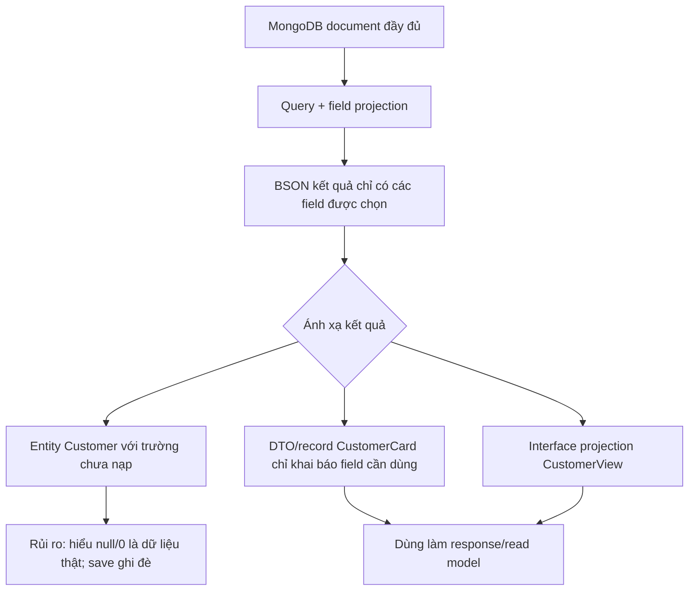
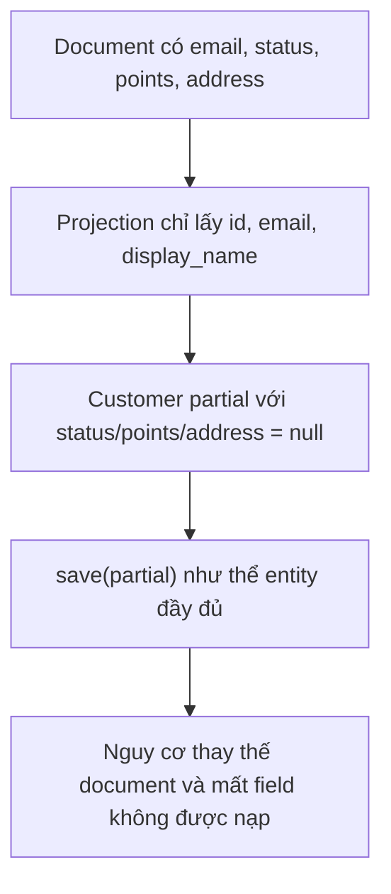

# Phân biệt kết quả thiếu trường với entity đầy đủ

## 1. Vấn đề: một object Java chưa chắc là một entity được nạp đầy đủ

Trong **Spring Data MongoDB**, repository và `MongoTemplate` có thể đọc cả document MongoDB hoặc chỉ lấy những field cần thiết thông qua **projection**. Projection làm giảm dữ liệu truyền từ MongoDB và lượng dữ liệu cần ánh xạ khi câu truy vấn thực sự loại trừ các trường trên server. Đổi lại, đối tượng Java thu được có thể **không chứa toàn bộ trạng thái đã lưu**.

Giả sử collection `customers` có document:

```javascript
{
  _id: "customer-101",
  email: "lan@example.com",
  display_name: "Lan Nguyen",
  status: "ACTIVE",
  rewardPoints: NumberLong("120"),
  address: {
    city: "Da Nang",
    street: "Tran Phu"
  }
}
```

Trang tìm kiếm chỉ cần `_id`, `email` và `display_name`. Query projection:

```javascript
db.customers.find(
  { status: "ACTIVE" },
  { _id: 1, email: 1, display_name: 1 }
);
```

Kết quả có dạng:

```javascript
{
  _id: "customer-101",
  email: "lan@example.com",
  display_name: "Lan Nguyen"
}
```

Document trong cơ sở dữ liệu **vẫn có** `status`, `rewardPoints` và `address`. Chúng chỉ **không có trong kết quả của lần truy vấn này**. Nếu ánh xạ kết quả trên vào cùng class `Customer`, các thuộc tính không được trả về có thể nhận giá trị mặc định Java như `null`, `0` hoặc `false`. Chúng không phải bằng chứng rằng database đã xóa dữ liệu.

**Ý chính của bài thuộc chương Projection và DTO:** phải phân biệt **document gốc**, **tập field được truy vấn trả về**, **object Java sau mapping** và **DTO trả cho client**. Việc nhầm các lớp này có thể dẫn đến lỗi hiển thị, kiểm tra nghiệp vụ sai hoặc ghi đè dữ liệu khi `save` entity chỉ có một phần thuộc tính.

## 2. Bốn khái niệm cần tách biệt



| Khái niệm | Có nghĩa là gì? | Không có nghĩa là gì? |
| --- | --- | --- |
| **Full document** | Dữ liệu thực được lưu trong MongoDB tại thời điểm đọc | Tất cả field đều bắt buộc có giá trị khác null |
| **Field projection** | Danh sách field được phép xuất hiện trong kết quả query | MongoDB đã xóa các field không được chọn |
| **Partially populated entity** | Entity class được tạo từ kết quả chỉ có vài field | Entity đang chứa trạng thái đầy đủ để cập nhật lại |
| **DTO / projection interface** | Read model với hợp đồng chỉ gồm thuộc tính cần tiêu thụ | DTO tự động luôn bảo đảm bảo mật hoặc luôn được server-side tối ưu hoàn toàn |

Trong module **SPRING_DATA_MONGODB**, các đường truy cập như `MongoTemplate`, `MongoRepository`, `ReactiveMongoTemplate` và repository reactive đều có thể làm việc với projection. Cấu trúc document, converter, mapping tên field, index và tính nhất quán cập nhật vẫn phải được thiết kế riêng.

## 3. Phân biệt field missing, BSON null và field bị projection loại bỏ

Ba trường hợp dưới đây có thể cùng tạo ra `customer.getRewardPoints() == null` trong Java, nhưng mang ý nghĩa rất khác nhau.

### 3.1. Document gốc không có field

```javascript
{ _id: "c-1", email: "a@example.com" }
```

Ở đây `rewardPoints` **chưa được lưu**. Nó có thể đến từ schema cũ, dữ liệu không bắt buộc, một đường ghi không đầy đủ hoặc lỗi migration.

### 3.2. Document gốc chứa BSON null

```javascript
{ _id: "c-2", email: "b@example.com", rewardPoints: null }
```

Khóa `rewardPoints` **có tồn tại**, nhưng giá trị bằng BSON `null`. Khi ánh xạ vào `Long`, thuộc tính Java thường là `null`.

### 3.3. Document có dữ liệu, nhưng projection không lấy field

```javascript
// Document gốc:
{ _id: "c-3", email: "c@example.com", rewardPoints: NumberLong("120") }

// Chỉ đọc _id và email:
db.customers.find(
  { _id: "c-3" },
  { _id: 1, email: 1 }
);
```

Kết quả không chứa `rewardPoints` dù MongoDB vẫn lưu `120`. Nếu dùng mapper tạo một `Customer`, getter cho `Long rewardPoints` có thể trả `null` y hệt hai trường hợp trên.

### 3.4. Kiểm tra giá trị gốc khi cần phân biệt

```javascript
// Tìm document không có key rewardPoints:
db.customers.find({
  rewardPoints: { $exists: false }
});

// Có key và giá trị null:
db.customers.find({
  rewardPoints: { $exists: true, $eq: null }
});

// Quan sát kiểu field, kể cả trường hợp thiếu:
db.customers.aggregate([
  {
    $project: {
      rewardPointsType: { $type: "$rewardPoints" }
    }
  },
  { $limit: 50 }
]);
```

MongoDB `{ rewardPoints: null }` có thể khớp cả document **missing** lẫn document có BSON null. Nếu nghiệp vụ cần phân biệt chúng, dùng `$exists` hoặc cách đọc BSON trực tiếp có kiểm soát. **Một entity đọc từ projection thiếu field không cung cấp đủ bằng chứng** để phân loại tình huống trong database.

## 4. Tạo entity Java để minh họa

Để theo dõi các đường đọc, dùng entity `Customer` và một value object `Address`. Các field kiểu `Long` và `String` giúp dễ nhìn thấy trạng thái chưa được nạp; không dùng primitive `long` cho ví dụ chính vì `0` có thể làm nhầm lẫn với một điểm thưởng thực sự bằng không.

```java
package example.customers;

public record Address(String city, String street) {}
```

```java
package example.customers;

import org.springframework.data.annotation.Id;
import org.springframework.data.mongodb.core.mapping.Document;
import org.springframework.data.mongodb.core.mapping.Field;

@Document(collection = "customers")
public class Customer {
    @Id
    private String id;

    private String email;

    @Field("display_name")
    private String displayName;

    private String status;
    private Long rewardPoints;
    private Address address;

    public Customer() {}

    public Customer(
            String id,
            String email,
            String displayName,
            String status,
            Long rewardPoints,
            Address address) {
        this.id = id;
        this.email = email;
        this.displayName = displayName;
        this.status = status;
        this.rewardPoints = rewardPoints;
        this.address = address;
    }

    public String getId() { return id; }
    public String getEmail() { return email; }
    public String getDisplayName() { return displayName; }
    public String getStatus() { return status; }
    public Long getRewardPoints() { return rewardPoints; }
    public Address getAddress() { return address; }
}
```

`@Field("display_name")` biểu thị rằng thuộc tính Java `displayName` tương ứng với tên field BSON `display_name`. Với query có metadata mapping của entity, Spring Data có thể chuyển đường dẫn thuộc tính Java sang tên BSON phù hợp. Nếu viết truy vấn trực tiếp trong mongosh, phải dùng tên field được lưu thật.

### 4.1. Đọc đầy đủ bằng MongoTemplate

```java
import org.springframework.data.mongodb.core.MongoTemplate;

Customer customer =
    mongoTemplate.findById("customer-101", Customer.class);

// Với document minh họa tồn tại đầy đủ:
// customer.getRewardPoints() == 120L
// customer.getStatus().equals("ACTIVE")
// customer.getAddress().city().equals("Da Nang")
```

`findById` không khai báo field projection nên đây là yêu cầu đọc toàn bộ document theo mapping thông thường. Tuy nhiên, **đọc toàn bộ document** cũng không có nghĩa mọi field đều có dữ liệu hợp lệ: document gốc vẫn có thể thiếu một số field hoặc có BSON null.

## 5. Đọc một phần field bằng MongoTemplate

### 5.1. include() để chọn field

```java
package example.customers;

import org.springframework.data.mongodb.core.MongoTemplate;
import org.springframework.data.mongodb.core.query.Criteria;
import org.springframework.data.mongodb.core.query.Query;

public class CustomerQueryService {
    private final MongoTemplate template;

    public CustomerQueryService(MongoTemplate template) {
        this.template = template;
    }

    public Customer findPartialEntity(String id) {
        Query query = Query.query(
            Criteria.where("id").is(id)
        );
        query.fields()
            .include("email")
            .include("displayName");

        return template.findOne(query, Customer.class);
    }
}
```

Với entity `Customer` ở trên, Spring Data ánh xạ tên `displayName` thành `display_name`. Vì MongoDB thường **giữ `_id` trong kết quả của inclusion projection trừ khi bị loại trừ tường minh**, object được nạp có thể chứa `id`, `email` và `displayName`, còn `status`, `rewardPoints` và `address` không được trả về.

```java
Customer partial = service.findPartialEntity("customer-101");

// Với document ví dụ:
// partial.getId().equals("customer-101")  -> true
// partial.getEmail().equals("lan@example.com") -> true
// partial.getDisplayName().equals("Lan Nguyen") -> true
// partial.getRewardPoints() == null       -> true
// partial.getAddress() == null            -> true
// partial.getStatus() == null             -> true
```

Các dòng comment diễn tả kết quả kỳ vọng khi dùng mô hình class có constructor rỗng và các field tham chiếu như ví dụ; một class có constructor bắt buộc, initializer hoặc callback riêng có thể có hành vi khác.

**Đừng đặt tên biến `partial` rồi sau này quên nguồn gốc của nó.** Từ góc nhìn kiểu Java, `partial` vẫn là `Customer` và có đủ các getter, nhưng không đủ dữ liệu để thực hiện các nghiệp vụ đòi trạng thái đầy đủ.

### 5.2. include() và exclude() không phải cách “xóa field”

```java
Query query = new Query();
query.fields().exclude("address");
```

Với loại projection chỉ loại `address`, MongoDB có thể trả tất cả field khác ngoại trừ field bị loại. Việc chọn include hay exclude phụ thuộc nhu cầu và chi phí dữ liệu. Đối với màn hình chỉ cần ba trường, include tường minh thường giúp kiểm soát payload rõ hơn.

MongoDB có quy tắc hạn chế trộn phép include và exclude trong cùng projection, ngoại trừ trường hợp như `_id`. Đừng tạo cấu trúc field projection mâu thuẫn rồi giả định framework sẽ sửa hộ.

## 6. Partial entity nguy hiểm nhất khi bị save() lại

### 6.1. Một ví dụ sai rất dễ xuất hiện

Giả sử mã ứng dụng đọc phần tóm tắt, thay đổi tên hiển thị, rồi gọi `save`:

```java
// KHÔNG ÁP DỤNG MẪU NÀY CHO ENTITY NẠP MỘT PHẦN:
Customer partial = service.findPartialEntity("customer-101");

// ... thay đổi một số thuộc tính của partial ...
mongoTemplate.save(partial);
```

`save` đối với entity có ID không phải là một lệnh “chỉ sửa field đã chọn trong lần query trước”. Nó thường thực hiện thao tác lưu/thay thế document theo trạng thái của object hiện có. Vì `partial` không có `status`, `rewardPoints` và `address`, những field từng có trong document gốc **có nguy cơ bị mất hoặc bị ghi thành giá trị khác**, tùy quy tắc mapping và null handling.



Điểm cần nhớ: **không có dirty tracking mặc định cho các field bị projection loại bỏ**. Repository `save` không biết bạn cố ý không tải `rewardPoints` hay người dùng thật sự muốn xóa nó.

### 6.2. @Version không biến partial entity thành đối tượng an toàn

Nếu entity có `@Version` để áp dụng optimistic locking, một object chỉ được nạp một phần nhưng bỏ mất trường version có thể không còn đủ thông tin để update hợp lệ. Việc save có thể thất bại, bị coi là trạng thái version khác hoặc gặp hành vi không mong muốn theo kiểu ID/version và phiên bản Spring Data đang dùng.

**Không coi `@Version` là cách chữa lỗi này.** Muốn áp dụng optimistic locking, phải có version đã nạp hợp lệ và thao tác cập nhật đúng hợp đồng. Với cập nhật một vài field, `Update` có điều kiện (gồm version nếu cần) thường rõ hơn.

### 6.3. Nếu buộc cập nhật, dùng update từng field

```java
import org.springframework.data.mongodb.core.query.Criteria;
import org.springframework.data.mongodb.core.query.Query;
import org.springframework.data.mongodb.core.query.Update;

public void changeDisplayName(
        MongoTemplate template, String id, String newName) {

    Query query = Query.query(Criteria.where("id").is(id));
    Update update = new Update().set("displayName", newName);

    template.updateFirst(query, update, Customer.class);
}
```

Trong typed operation, Spring Data ánh xạ property `displayName` thành field BSON `display_name` và cập nhật trường đó mà không phải xây lại toàn bộ object `Customer` trong bộ nhớ.

Nếu nghiệp vụ yêu cầu kiểm tra tính hợp lệ hoặc thứ tự cập nhật, có thể bổ sung điều kiện trên query, optimistic locking, transaction hoặc cách cập nhật thích hợp. Dùng `updateFirst` đơn giản không tự giải quyết mọi vấn đề concurrency.

### 6.4. Lựa chọn khác: nạp entity đầy đủ để thay thế có chủ đích

Nếu thực sự cần cập nhật **toàn bộ document** theo workflow chỉnh sửa, đọc entity đầy đủ bằng `findById`, áp dụng kiểm tra nghiệp vụ, sau đó lưu theo quy tắc đồng thời của hệ thống. Không dùng entity từ projection như một giá trị thay thế an toàn. Với object chứa trường nhạy cảm hoặc dữ liệu thay đổi đồng thời, cân nhắc versioning và DTO đầu vào tách biệt.

## 7. DTO: định nghĩa rõ “tôi chỉ cần ba trường”

Thay vì nạp dữ liệu vào `Customer` rồi chịu rủi ro field null mang hai nghĩa, hãy tạo read model chỉ chứa những thuộc tính màn hình cần:

```java
package example.customers;

public record CustomerCard(
    String id,
    String email,
    String displayName
) {}
```

`CustomerCard` không có `rewardPoints`, `address` hay `status`. Khi code gọi `card.email()` hoặc `card.displayName()`, ý định đã rõ: đây là một **view dữ liệu tóm tắt**, không phải entity được phép save.

### 7.1. Class-based projection qua repository

```java
package example.customers;

import java.util.List;
import org.springframework.data.mongodb.repository.MongoRepository;

public interface CustomerRepository
        extends MongoRepository<Customer, String> {

    List<CustomerCard> findByStatus(String status);
}
```

Spring Data hỗ trợ **class-based projection**. Với Java record có constructor/canonical constructor tương ứng với các thuộc tính của domain model, framework có thông tin để tạo kết quả DTO. Hiệu quả loại field trên server và cách materialize có thể phụ thuộc phiên bản Spring Data, projection dạng nào, query/mapping và converter tùy chỉnh: **đừng suy ra chắc chắn query chỉ chọn ba field chỉ từ kiểu trả về**.

Trong ví dụ này, `status` dùng làm **điều kiện lọc**, không bắt buộc phải là field của DTO trả về. Muốn chắc chắn dữ liệu truyền qua mạng chỉ gồm những field mong muốn, cần kiểm tra BSON của command truy vấn thực tế hoặc kiểm thử integration có quan sát query.

### 7.2. Interface-based projection

```java
package example.customers;

public interface CustomerView {
    String getId();
    String getEmail();
    String getDisplayName();
}
```

Một method repository khác:

```java
List<CustomerView> findAllByStatus(String status);
```

Đây là **closed interface projection**: các getter tham chiếu trực tiếp tới các property của entity. Spring Data có thể tận dụng tập property được khai báo để tối ưu field cần lấy trong các trường hợp được hỗ trợ. Nhưng projection interface là một **hợp đồng đọc**, không phải entity có thể dùng làm đối số `repository.save`.

### 7.3. Open projection không tương đương field selection đơn giản

```java
import org.springframework.beans.factory.annotation.Value;

public interface CustomerLabelView {
    String getEmail();

    @Value("#{target.displayName}")
    String getLabel();
}
```

Một **open projection** dùng SpEL có thể tham chiếu đến target object theo cách không cho framework biết chính xác những field nào cần thiết từ trước. Vì vậy việc tối ưu query chỉ chọn đúng một số field **không được bảo đảm** như closed projection. Cũng cần cẩn thận khi dùng biểu thức SpEL với dữ liệu null/missing hoặc phép gọi có chi phí cao.

**Đặt mục tiêu đúng:** DTO giúp làm rõ hợp đồng dữ liệu cho tầng gọi. Nó không bảo đảm mọi kiểu projection luôn được tối ưu đồng đều trên MongoDB server. Hãy xem query thực tế nếu mục tiêu là giảm I/O.

## 8. Dynamic projection: cùng filter, nhiều cách nhìn dữ liệu

Với repository, có thể khai báo lựa chọn kiểu kết quả khi gọi:

```java
public interface CustomerRepository
        extends MongoRepository<Customer, String> {

    <T> List<T> findByStatus(String status, Class<T> type);
}
```

Trong ví dụ, method trên có thể được thêm vào interface `CustomerRepository` thay vì khai báo interface trùng tên ở nhiều file. Khi gọi:

```java
List<CustomerCard> cards =
    repository.findByStatus("ACTIVE", CustomerCard.class);

List<CustomerView> views =
    repository.findByStatus("ACTIVE", CustomerView.class);
```

Điều này hữu ích nếu một filter dùng chung cho màn hình tóm tắt và màn hình chi tiết. Tuy nhiên, **không để client tự chọn `Class<?>` tùy ý** qua request HTTP. Service nên chọn projection type nằm trong danh sách được phép, và API response phải được kiểm soát bởi DTO cùng cơ chế phân quyền.

## 9. Trả entity hay DTO qua @Query(fields = ...)

### 9.1. Chỉ định field nhưng trả entity: được, song phải giữ tính “read-only”

```java
import java.util.List;
import org.springframework.data.mongodb.repository.Query;

@Query(
    value = "{ 'status': ?0 }",
    fields = "{ '_id': 1, 'email': 1, 'display_name': 1 }"
)
List<Customer> findPartialCustomersByStatus(String status);
```

Khai báo method này nằm trong `CustomerRepository`. Spring Data trả `Customer` nhưng một số field không được chọn sẽ không được nạp. Đó là **partial entity**, không phải full entity, dù kiểu Java giống nhau.

Nếu có thể, ưu tiên trả một read model riêng thay vì truyền partial entity qua nhiều tầng hệ thống. Tên method cũng nên cho người đọc biết đây là truy vấn tóm tắt, tránh sử dụng nhầm ở workflow cập nhật.

### 9.2. Cân nhắc dữ liệu được sử dụng làm DTO

```java
@Query(
    value = "{ 'status': ?0 }",
    fields = "{ '_id': 1, 'email': 1, 'display_name': 1 }"
)
List<CustomerCard> findCardsByStatus(String status);
```

Khai báo này yêu cầu framework ánh xạ kết quả query vào `CustomerCard`. Khi ứng dụng có mapping tùy chỉnh hoặc tên field BSON khác tên constructor property, cần kiểm thử mapping thực tế thay vì chỉ dựa trên tên `@Query`. Nếu DTO chỉ cần một số field, test nên xác minh cả giá trị map ra đúng và không tải nhầm dữ liệu nhạy cảm.

### 9.3. @Query(fields) không phải là serialization filter

Khi API dùng Jackson để trả entity, dữ liệu hiển thị trong JSON còn phụ thuộc getter, annotation Jackson, DTO và cấu hình serialization. Projection ở MongoDB điều khiển **dữ liệu trả từ truy vấn**, còn cấu trúc HTTP JSON là một bước khác.

Ví dụ có một field `internalNotes` trong entity: bỏ field đó khỏi một query không chứng minh mọi endpoint đều an toàn. Endpoint khác có thể đọc entity đầy đủ và vô tình trả nó trong JSON. Kiểm soát thông tin nhạy cảm bằng DTO phù hợp, authorization và contract API, không dựa riêng vào projection của một repository method.

## 10. Nested object, nguyên thủy và nullability

### 10.1. Nếu chỉ nạp một phần document con

Document gốc:

```javascript
{
  _id: "customer-101",
  address: { city: "Da Nang", street: "Tran Phu" }
}
```

Một projection có thể chỉ lấy:

```javascript
db.customers.find(
  { _id: "customer-101" },
  { "address.city": 1 }
);
```

Kết quả có thể chứa `address` với `city` nhưng thiếu `street`. Nếu ánh xạ sang `Address`, object con có thể được tạo với dữ liệu một phần, tùy kiểu value object/constructor. Đừng suy luận rằng vì `address != null` nên toàn bộ địa chỉ đã đầy đủ.

Với nested projection interface, framework có thể phải materialize cấu trúc con rộng hơn mức mong đợi. Khi hiệu năng quan trọng, đo query BSON thực tế và số byte truyền thay vì giả định mọi tầng projection đều là field selection tối thiểu.

### 10.2. Primitive che giấu việc không nạp dữ liệu

Nếu entity khai báo:

```java
private long rewardPoints;
private boolean verified;
```

thì một object mới không nạp các field này sẽ có mặc định `0` và `false`. Nếu document MongoDB chứa `rewardPoints: 120` và `verified: true` nhưng projection loại cả hai, code nghiệp vụ có thể diễn giải sai rằng khách hàng thực sự có 0 điểm và chưa được xác minh.

Khi dữ liệu phải phân biệt trạng thái **không có/chưa nạp** với giá trị 0/false, hãy sử dụng wrapper `Long`/`Boolean` hoặc DTO rõ ràng. Tuy nhiên, wrapper null vẫn không tự chứng minh dữ liệu vắng mặt trong database; cần xem đường query.

### 10.3. Constructor, immutable record và Kotlin nullability

Một entity dùng constructor bắt buộc tham số hoặc một record không chấp nhận null có thể không ánh xạ được kết quả thiếu field theo cùng cách với class mutable có no-args constructor. Trong Kotlin, kiểu non-null không có default cũng có thể gây lỗi khi field bị thiếu.

Chính vì vậy, **DTO dùng cho projection phải được thiết kế để phản ánh đúng trường được chọn**, còn entity có invariant mạnh nên được đọc đầy đủ khi thực hiện nghiệp vụ cần những invariant đó.

## 11. Khi nào nên dùng projection, DTO hoặc entity đầy đủ?

| Nhu cầu | Lựa chọn thường phù hợp | Vì sao |
| --- | --- | --- |
| Trang danh sách chỉ hiển thị tên và email | DTO/closed projection | Hợp đồng nhỏ, tránh nhầm với entity đầy đủ |
| Cập nhật một field theo ID | `MongoTemplate.updateFirst` hoặc thao tác update phù hợp | Không cần nạp/ghi lại toàn document |
| Workflow cần kiểm tra toàn bộ trạng thái rồi cập nhật | Full entity, versioning và xác thực nghiệp vụ | Cần đủ dữ liệu để duy trì invariant |
| API trả dữ liệu cho client ngoài | DTO response riêng | Kiểm soát các field hiển thị và quyền truy cập |
| Aggregation tính toán nhãn/tổng hợp | DTO cho kết quả aggregation | Kết quả không còn nhất thiết tương đương schema entity |
| Chỉ dùng dữ liệu để kiểm tra tồn tại | `existsBy...` hoặc truy vấn existence | Không cần tải toàn bộ document |
| Chỉ cần số lượng | `count...` | Tránh chuyển các document không cần thiết |
| Báo cáo dữ liệu lớn | Projection + pagination/streaming | Giảm payload và tránh nạp quá nhiều vào RAM |

Chọn projection không chỉ là tối ưu băng thông. Nó là quyết định **ranh giới đọc dữ liệu**: field nào là cần thiết, field nào được phép sử dụng, và object trả về có được xem là thực thể cập nhật hay không.

## 12. Reactive repository: thiếu field không được tự “lấp đầy”

Trong Spring Data MongoDB reactive, repository vẫn có các dạng projection tương tự. Điểm khác chủ yếu là cách trả dữ liệu bằng `Mono` và `Flux`:

```java
package example.customers;

import org.springframework.data.mongodb.repository.ReactiveMongoRepository;
import reactor.core.publisher.Flux;
import reactor.core.publisher.Mono;

public interface ReactiveCustomerRepository
        extends ReactiveMongoRepository<Customer, String> {

    Flux<CustomerCard> findByStatus(String status);

    Mono<CustomerView> findProjectedById(String id);
}
```

`Mono<CustomerView>` có thể hoàn tất rỗng nếu không tìm thấy ID, còn `Flux<CustomerCard>` có thể phát 0, 1 hoặc nhiều kết quả. Tuy nhiên, **publisher không tự nạp các field bị projection loại trừ**. Nếu DTO thiếu `rewardPoints`, biến `Flux` thành `List` bằng `collectList()` cũng không làm dữ liệu đó xuất hiện.

```java
import java.util.List;
import reactor.core.publisher.Mono;

Mono<List<CustomerCard>> cards = repository
    .findByStatus("ACTIVE")
    .collectList();
```

Với danh sách lớn, `collectList()` giữ toàn bộ kết quả trong bộ nhớ; cần giới hạn hoặc phân trang/streaming theo workload. Mô hình reactive có thể cải thiện khả năng phối hợp I/O nhưng **không thay thế thiết kế projection, index hoặc chiến lược cập nhật an toàn**.

### 12.1. Không “khôi phục” DTO thành entity giả để save

Một lỗi dễ gặp là nhận `CustomerCard` từ truy vấn rồi tạo `Customer` mới chỉ với `id`, `email` và `displayName`, sau đó gọi reactive repository `save`. Đây vẫn là thao tác lưu từ **trạng thái thiếu field** và mang nguy cơ mất dữ liệu y như nhánh đồng bộ. Nếu chỉ thay đổi tên hiển thị, dùng một thao tác cập nhật field riêng và xử lý lỗi/concurrency trong pipeline reactive.

## 13. Index và hiệu năng của field projection

### 13.1. Projection giảm payload, không tự sửa query chậm

Với màn hình danh sách:

```javascript
db.customers.find(
  { status: "ACTIVE" },
  { _id: 1, email: 1, display_name: 1 }
);
```

MongoDB vẫn phải tìm các document thỏa `status`. Nếu thiếu index phù hợp và collection lớn, projection không ngăn được chi phí quét dữ liệu. Có thể đánh giá:

```javascript
db.customers.createIndex({
  status: 1,
  email: 1,
  display_name: 1
});
```

Index này **chỉ là ứng viên** cho workload minh họa, không phải bắt buộc. Việc dùng compound index hay không phụ thuộc cardinality, truy vấn sort, kích thước index, tỷ lệ ghi và chi phí vận hành.

### 13.2. Covered query cần kiểm tra thực tế

Nếu filter và các field được chọn đều có thể lấy từ index, một query có thể đạt trạng thái **covered query** và không cần fetch document gốc. Nhưng trong inclusion projection, MongoDB thường vẫn bao gồm `_id` nếu không loại trừ; vì vậy index không chứa `_id` có thể làm query **không covered**.

Ví dụ nếu UI không cần ID:

```javascript
db.customers.find(
  { status: "ACTIVE" },
  { _id: 0, email: 1, display_name: 1 }
).explain("executionStats");
```

Đừng áp dụng `_id: 0` nếu ứng dụng cần khóa để điều hướng/cập nhật hoặc DTO mong đợi ID. Hãy xác định requirement trước khi tối ưu index và projection. Đọc các chỉ số như `totalDocsExamined`, `totalKeysExamined`, plan stage và payload thực tế để đánh giá.

### 13.3. Chỉ định field trong query repository không đủ để khẳng định tối ưu

Với interface projection, DTO projection, nested projection hoặc custom converter, cách Spring Data xây BSON filter/projection có thể khác nhau. Một số projection được tối ưu field selection, một số cần nạp nhiều dữ liệu hơn để tạo view. Để kết luận tối ưu thực sự:

1. Xem MongoDB command/filter/projection qua công cụ quan sát phù hợp.
2. Kiểm tra số byte truyền và latency trên dữ liệu đại diện.
3. Chạy `explain("executionStats")` của query tương đương.
4. Đối chiếu chi phí tạo DTO, serialization và nguy cơ N+1 từ service nếu có truy vấn bổ sung.

Đừng coi số property trong interface Java là phép đo chính xác số byte server trả về.

## 14. Kiểm thử: so sánh document gốc, full entity và partial entity

### 14.1. Mục tiêu kiểm thử

Một integration test có giá trị nên chứng minh đồng thời:

1. Document MongoDB thực sự chứa `rewardPoints` và `address`.
2. Query đọc đầy đủ có thể ánh xạ các field đó vào `Customer`.
3. Query chỉ chọn `email` và `displayName` tạo object thiếu các field còn lại.
4. Document gốc không bị thay đổi sau một phép **đọc projection**.
5. Một lệnh `Update.set` đúng field làm thay đổi field mục tiêu mà không làm mất dữ liệu khác.

### 14.2. Test với MongoTemplate và raw BSON

```java
package example.customers;

import static com.mongodb.client.model.Filters.eq;
import static org.junit.jupiter.api.Assertions.*;

import java.util.UUID;
import org.bson.Document;
import org.junit.jupiter.api.Test;
import org.springframework.beans.factory.annotation.Autowired;
import org.springframework.boot.test.autoconfigure.data.mongo.DataMongoTest;
import org.springframework.data.mongodb.core.MongoTemplate;
import org.springframework.data.mongodb.core.query.Criteria;
import org.springframework.data.mongodb.core.query.Query;
import org.springframework.data.mongodb.core.query.Update;

@DataMongoTest
class CustomerProjectionTest {

    @Autowired
    MongoTemplate template;

    @Test
    void partialReadDoesNotMeanFieldsWereDeleted() {
        String id = "customer-test-" + UUID.randomUUID();
        template.save(new Customer(
            id,
            "lan@example.com",
            "Lan Nguyen",
            "ACTIVE",
            120L,
            new Address("Da Nang", "Tran Phu")
        ));

        Customer full = template.findById(id, Customer.class);
        assertNotNull(full);
        assertEquals(120L, full.getRewardPoints());
        assertEquals("Da Nang", full.getAddress().city());

        Query onlySummary = Query.query(
            Criteria.where("id").is(id)
        );
        onlySummary.fields()
            .include("email")
            .include("displayName");

        Customer partial = template.findOne(
            onlySummary, Customer.class
        );
        assertNotNull(partial);
        assertEquals(id, partial.getId());
        assertEquals("Lan Nguyen", partial.getDisplayName());
        assertNull(partial.getRewardPoints());
        assertNull(partial.getAddress());
        assertNull(partial.getStatus());

        Document raw = template.getCollection("customers")
            .find(eq("_id", id))
            .first();

        assertNotNull(raw);
        assertEquals(120L, raw.getLong("rewardPoints"));
        assertNotNull(raw.get("address", Document.class));

        template.updateFirst(
            Query.query(Criteria.where("id").is(id)),
            new Update().set("displayName", "Lan N."),
            Customer.class
        );

        Document afterUpdate = template.getCollection("customers")
            .find(eq("_id", id))
            .first();

        assertNotNull(afterUpdate);
        assertEquals("Lan N.", afterUpdate.getString("display_name"));
        assertEquals(120L, afterUpdate.getLong("rewardPoints"));
        assertNotNull(afterUpdate.get("address", Document.class));
    }
}
```

Test sử dụng UUID để tránh trùng khóa và đọc trực tiếp raw `Document` để phân biệt dữ liệu nguồn với object sau mapping. `@DataMongoTest` cần kết nối tới MongoDB test phù hợp; có thể cấu hình Testcontainers hoặc instance riêng. Đường import và cấu hình test có thể cần điều chỉnh theo phiên bản Spring Boot.

**Không đưa `template.save(partial)` vào test khẳng định an toàn.** Nếu cần chứng minh tác hại của việc save entity thiếu field, hãy chạy test riêng trong môi trường cô lập và kỳ vọng có khác biệt dữ liệu, không chạy trên collection dùng chung.

### 14.3. Test DTO projection

Khi repository trả `CustomerCard` hoặc `CustomerView`, kiểm tra các giá trị được map ra:

```java
List<CustomerCard> cards = repository.findByStatus("ACTIVE");

assertTrue(cards.stream().anyMatch(card ->
    card.email().equals("lan@example.com")
));
```

Đây là phần trích của test trong cùng một context có repository và dữ liệu mẫu. Trong integration test đầy đủ, hãy cô lập dataset/tenant để không phụ thuộc khách hàng khác đang tồn tại. Nếu hợp đồng thực sự yêu cầu tối ưu payload, bổ sung quan sát query projection thay vì chỉ assert các field trong DTO.

## 15. Các sai lầm thường gặp

| Dấu hiệu | Nguyên nhân có thể | Cách chẩn đoán/khắc phục |
| --- | --- | --- |
| Getter trả null dù MongoDB có giá trị | Query projection không chọn field | Đối chiếu BSON gốc và projection thực tế |
| Trường số bằng 0 hoặc boolean false bất ngờ | Primitive nhận mặc định khi field không được nạp | Dùng DTO hoặc wrapper khi cần phân biệt trạng thái |
| Sau save mất field hoặc object con | Save entity được nạp một phần | Dùng typed `Update` theo field hoặc nạp full entity |
| Constructor mapping báo lỗi | Projection thiếu tham số constructor bắt buộc | Thiết kế DTO/class projection với constructor phù hợp |
| Truy vấn trả nhiều dữ liệu hơn dự kiến | Open/nested projection hoặc mapping cần target rộng hơn | Xem command MongoDB thực tế |
| DTO không map đúng tên | Tên property Java/BSON khác nhau, thiếu alias/conversion | Kiểm tra `@Field`, constructor, `@Query(fields)` |
| API vô tình trả dữ liệu nhạy cảm | Dùng entity trực tiếp và serialization ngoài ý muốn | DTO response, authorization và test JSON |
| Pagination chậm dù dùng projection | Query/filter/sort thiếu index, count đắt | Kiểm tra `explain`, index và `Page`/`Slice` |
| Tưởng missing nghĩa là BSON null | Projection hoặc query loại field | Phân biệt `$exists`, `$type` và raw BSON |
| Reactive code vẫn mất dữ liệu khi save | Publisher không thay đổi ngữ nghĩa partial entity | Cập nhật field thay vì tái dựng full entity từ DTO |

### Quy trình chẩn đoán nhanh

1. Xác nhận phương thức nào đã đọc object: `findById`, `@Query(fields)`, `MongoTemplate` hay DTO projection.
2. Xem raw MongoDB document để xác định field có tồn tại và có giá trị gì.
3. Xem projection BSON được gửi lên server, đặc biệt `_id` và tên field có `@Field`.
4. Kiểm tra constructor, giá trị mặc định Java và custom converter của đối tượng nhận kết quả.
5. Nếu có cập nhật, kiểm tra code đã gọi `save` entity chưa nạp đủ hay dùng typed `Update`.
6. Đo query/filter/index bằng `explain`; kiểm tra output JSON và authorization riêng ở tầng API.

## 16. Bài tập thực hành

### Bài 1 — Phân biệt ba trạng thái

Tạo ba document: một document thiếu `rewardPoints`, một document có `rewardPoints: null` và một document có `rewardPoints: NumberLong("120")`. Đọc bằng projection chỉ lấy `email` rồi giải thích tại sao ba kết quả entity có thể đều cho `rewardPoints == null`. Dùng raw BSON và `$exists` để xác định chính xác dữ liệu gốc.

### Bài 2 — Entity thiếu field và update an toàn

Tạo một customer có đầy đủ email, tên, trạng thái, điểm thưởng, địa chỉ. Dùng `@Query(fields)` nạp chỉ tên và email, rồi viết lệnh `MongoTemplate.updateFirst` thay tên mà không làm mất điểm thưởng hoặc địa chỉ. Mô tả vì sao không được thay bằng `repository.save(partial)`.

### Bài 3 — DTO và interface projection

Viết `CustomerCard` record và `CustomerView` interface cùng phản ánh `id`, `email`, `displayName`. Tạo repository methods trả hai kiểu, kiểm tra giá trị nhận được và quan sát BSON projection thực tế trên server. So sánh lợi ích với method trả `List<Customer>` nạp một phần.

### Bài 4 — Nested object

Với `Address(city, street)`, chỉ chọn `address.city`. Kiểm tra object con khi ánh xạ, sau đó thử một DTO chỉ chứa city để không tạo ấn tượng rằng có một địa chỉ đầy đủ. Mô tả hướng xử lý khi constructor không chấp nhận street null.

### Bài 5 — Hiệu năng và covered query

Thiết kế index theo `status`, `email` và `display_name`. Chạy hai query có và không lấy `_id`, xem `explain("executionStats")` và tổng số document phải đọc. Giải thích khi nào việc bỏ `_id` giúp truy vấn được cover bởi index, và khi nào việc bỏ ID lại không phù hợp với yêu cầu nghiệp vụ.

### Câu hỏi tự kiểm tra

- Có thể dùng `customer.getRewardPoints() == null` để khẳng định MongoDB không lưu điểm thưởng không? Vì sao?
- “Full entity” và “đọc full document” giống và khác nhau ở điểm nào?
- Vì sao `save(partialEntity)` không phải là một lệnh PATCH chỉ cập nhật các trường được chọn?
- DTO/closed interface projection có luôn bảo đảm MongoDB chỉ trả đúng các field được khai báo không?
- `@Field("display_name")` ảnh hưởng thế nào khi dùng typed query và khi truy vấn bằng mongosh?
- Khi nào nên chọn `MongoTemplate.updateFirst` thay cho nạp entity rồi `save`?
- Vì sao việc dùng `Flux` hoặc `Mono` không giải quyết rủi ro thiếu field?

## Ghi nhớ

**Projection là yêu cầu chỉ đọc một phần dữ liệu, không phải phép xóa dữ liệu khỏi MongoDB.** Khi ánh xạ projection vào entity `Customer`, những field chưa được trả về có thể trở thành `null`, `0` hoặc `false` trong object Java dù document gốc vẫn có giá trị. Đừng suy ra trạng thái database từ một getter trên partial entity; đặc biệt **không `save` partial entity như thể nó đã được nạp đầy đủ**. Hãy dùng DTO/read model để thể hiện rõ tập field cần thiết, dùng update theo field để chỉnh sửa an toàn và kiểm thử đồng thời raw BSON, mapped object, query projection, index và response API.

## Tài liệu tham khảo

- [Spring Data MongoDB Reference — Projections](https://docs.spring.io/spring-data/mongodb/reference/repositories/projections.html)
- [Spring Data MongoDB Reference — Querying Documents](https://docs.spring.io/spring-data/mongodb/reference/mongodb/template-query-operations.html)
- [MongoDB Manual — Project Fields to Return from Query](https://www.mongodb.com/docs/manual/tutorial/project-fields-from-query-results/)
